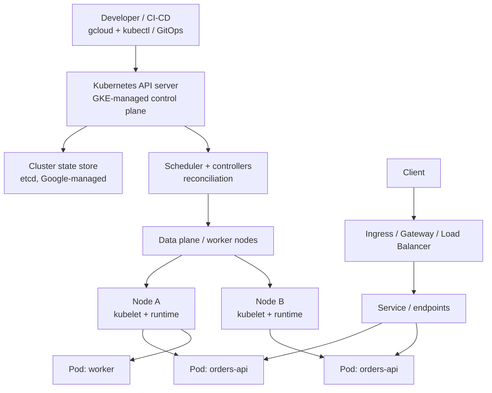
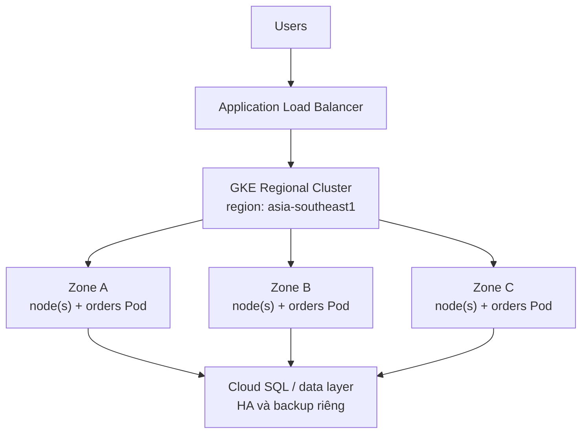
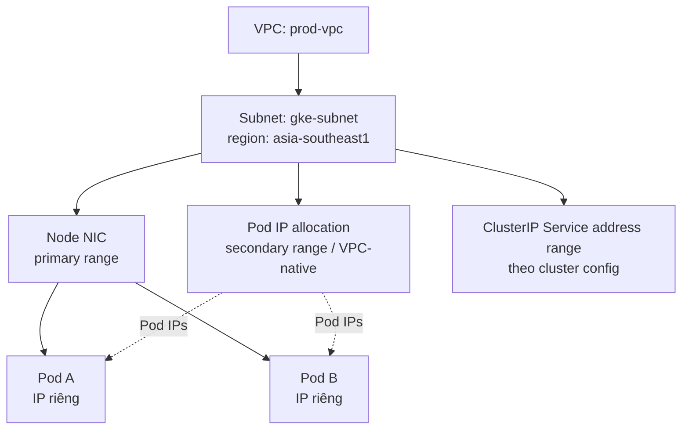
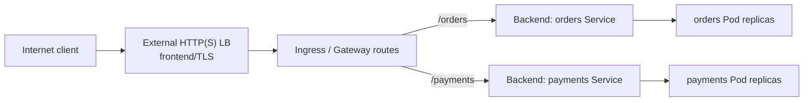
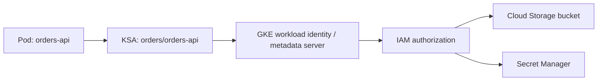
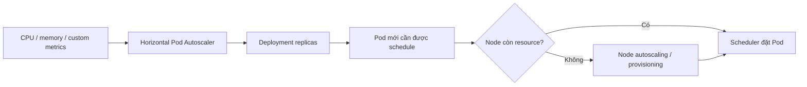
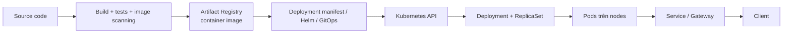

# Kiến trúc Google Kubernetes Engine (GKE)

Một ứng dụng đặt hàng có thể bắt đầu bằng một máy ảo Compute Engine và một tiến trình web. Khi hệ thống phát triển, đội kỹ thuật cần chạy nhiều bản sao, tự khôi phục khi một tiến trình lỗi, triển khai phiên bản mới không gián đoạn, phân phối lưu lượng qua nhiều máy, bảo vệ bí mật và điều chỉnh năng lực theo tải. **Kubernetes** cung cấp các đối tượng và bộ điều khiển để mô tả *trạng thái mong muốn* của các workload container; **Google Kubernetes Engine (GKE)** là dịch vụ Kubernetes được Google Cloud quản lý, giúp vận hành các cluster đó trong hạ tầng Google Cloud.

Bài học thuộc chương **GKE cơ bản** của module `CLOUD_PROVIDERS_GCP`. GKE kết nối kiến thức về tổ chức project, IAM, VPC, Compute Engine, load balancing, Cloud Storage, cơ sở dữ liệu và CI/CD. Để lựa chọn GKE hợp lý, người học cần hiểu kiến trúc **control plane, data plane, node, Pod, Service, mạng, danh tính, lưu trữ và các vòng điều khiển tự động**, đồng thời biết trách nhiệm nào thuộc Google Cloud và trách nhiệm nào vẫn ở đội vận hành.

> Các tên project, cluster, region và image trong ví dụ là minh họa. Câu lệnh có thay đổi tài nguyên sẽ được đánh dấu rõ. Phiên bản Kubernetes, các lựa chọn GKE Standard/Autopilot, loại networking và tính năng bổ sung có thể thay đổi; hãy đối chiếu tài liệu chính thức khi triển khai production.

## 1. Mục tiêu học tập

Sau bài học, bạn có thể:

1. Giải thích **cluster, control plane, node, node pool, Pod, Deployment, ReplicaSet, Service, Ingress và Gateway** trong GKE.
2. Phân biệt trách nhiệm của **Google quản lý control plane** với trách nhiệm cấu hình workload và node của người dùng.
3. So sánh **GKE Standard** và **GKE Autopilot** theo khả năng kiểm soát, provisioning, security, vận hành và mô hình chi phí.
4. Hiểu ranh giới **zonal/regional**, thiết kế đa zone, khả năng mở rộng và tính sẵn sàng cao.
5. Mô tả đường đi của một request từ **Load Balancer → Service/backend → Pod**, cùng VPC-native Pod networking, DNS và NetworkPolicy.
6. Phân biệt **Google Cloud IAM, Kubernetes RBAC, Kubernetes ServiceAccount, node service account và Workload Identity Federation for GKE**.
7. Lựa chọn hướng lưu trữ bằng **PersistentVolumeClaim/CSI driver**, phân biệt dữ liệu tạm của Pod với storage bền vững.
8. Đọc cấu hình cluster và triển khai một ứng dụng thử bằng `gcloud`, `kubectl`; xác định các nguyên nhân Pod chưa sẵn sàng.
9. Đánh giá rủi ro, khả năng vận hành, observability, quota và chi phí trước khi dùng GKE cho ứng dụng production.

## 2. Bức tranh tổng thể của GKE

Một **Kubernetes cluster** gồm **control plane** và các **worker nodes** (hoặc hạ tầng thực thi Pod do GKE quản lý theo chế độ). Ứng dụng thông thường chạy trong **Pod**, còn control plane theo dõi tài nguyên Kubernetes và cố gắng đưa trạng thái thực về trạng thái mong muốn.



Đây là **sơ đồ khái niệm**, không phải sơ đồ giao thức thực thi của mọi phiên bản GKE: cơ chế dataplane, controller, endpoint và load balancer thực tế phụ thuộc chế độ cluster cùng thành phần được bật. Điểm quan trọng là **người vận hành gửi khai báo vào API**, sau đó các controller phối hợp lập lịch và duy trì workload, thay vì SSH vào từng VM để chạy container thủ công.

### 2.1. Những khái niệm cần phân biệt

| Thành phần | Là gì? | Trách nhiệm chính |
| --- | --- | --- |
| **GKE cluster** | Môi trường Kubernetes được quản lý và các tài nguyên liên quan. | Cung cấp Kubernetes API và hạ tầng chạy workloads. |
| **Control plane** | Nhóm thành phần điều phối Kubernetes, do GKE vận hành. | Quản lý trạng thái cluster, scheduling, reconciliation và API. |
| **Node** | Máy thực thi Pod; trong Standard thường là Compute Engine VM được GKE quản lý qua node pool. | Chạy container runtime, kubelet, mạng và thành phần hệ thống. |
| **Node pool** | Nhóm node có cấu hình chung trong Standard. | Machine type, image, disk, zone, autoscaling và nâng cấp. |
| **Pod** | Đơn vị triển khai nhỏ nhất; chứa một hoặc nhiều container chia sẻ mạng/storage cục bộ theo cấu hình. | Chạy một instance của workload. |
| **Deployment** | Kubernetes controller quản lý tập Pod stateless qua ReplicaSet. | Duy trì replicas và rollout phiên bản. |
| **Service** | Điểm truy cập ổn định tới một tập Pod/endpoints. | Discovery và phân phối traffic nội bộ theo loại Service. |
| **Ingress / Gateway** | API quản lý traffic HTTP(S)/L4 theo controller và tính năng tương ứng. | Khai báo route và tạo/configure load balancing khi có controller. |
| **ConfigMap / Secret** | Đối tượng cung cấp cấu hình và dữ liệu nhạy cảm cho Pod. | Tách phần cấu hình khỏi image; Secret vẫn cần bảo vệ truy cập và mã hóa. |
| **PersistentVolume / PVC** | Trừu tượng hóa storage bền vững mà workload yêu cầu. | Kết nối tới loại storage/CSI driver được hỗ trợ. |

## 3. Control plane: phần não điều phối được GKE quản lý

### 3.1. Kubernetes API server

**API server** là điểm vào của Kubernetes. Các thao tác `kubectl apply`, `kubectl get` hoặc thao tác từ controller/CI đều tương tác với API server. Nó thực hiện authentication, authorization và admission theo cấu hình; sau đó các Kubernetes objects được lưu ở hệ thống trạng thái cluster.

Ví dụ khi khai báo:

```yaml
apiVersion: apps/v1
kind: Deployment
metadata:
  name: orders-api
spec:
  replicas: 3
  selector:
    matchLabels:
      app: orders-api
  template:
    metadata:
      labels:
        app: orders-api
    spec:
      containers:
        - name: orders-api
          image: REGION-docker.pkg.dev/PROJECT_ID/apps/orders-api:VERSION
```

Kubernetes nhận yêu cầu “mong muốn có 3 Pod” và các controller sẽ tìm cách tạo/duy trì 3 bản sao theo ràng buộc. Manifest trên chỉ để minh họa **ý nghĩa Deployment**, chưa phải file production đầy đủ: image là placeholder, chưa khai báo readiness, resource requests/limits, service account, security context và cơ chế xuất traffic.

### 3.2. etcd và trạng thái cluster

**etcd** là kho key-value phân tán lưu trạng thái Kubernetes như Deployments, Services, ConfigMaps và nhiều Kubernetes objects. Trong GKE, Google quản lý hạ tầng/control plane và những công việc bảo trì liên quan theo chế độ cluster.

Đừng nhầm kho trạng thái control plane với kho dữ liệu nghiệp vụ. **etcd không thay Cloud SQL hoặc database ứng dụng**; không nên lưu dữ liệu giao dịch hoặc tệp lớn vào Kubernetes ConfigMap/Secret.

### 3.3. Scheduler và controllers

- **Scheduler** quyết định Pod mới có thể được đặt ở node nào dựa trên **resource requests, selectors, affinity, taints/tolerations, topology, khả năng node** và các ràng buộc khác.
- **Deployment/ReplicaSet controller** bảo đảm số Pod mong muốn được tạo, cập nhật hoặc thay thế.
- **Node controller** và các bộ điều khiển khác theo dõi tình trạng cluster/tài nguyên.
- **GKE/cloud controllers và add-ons** phối hợp với Google Cloud để cung cấp load balancing, storage, networking hoặc các chức năng tương ứng.

**Reconciliation** là cơ chế liên tục so sánh trạng thái thực với trạng thái mong muốn, không phải một script chỉ chạy một lần. Ví dụ một Pod của Deployment bị xóa, controller có thể tạo Pod thay thế nếu điều kiện tài nguyên cho phép.

### 3.4. Control plane được quản lý không có nghĩa mọi thứ đều tự động

Google Cloud vận hành control plane, bao gồm hạ tầng Kubernetes quan trọng theo dịch vụ. Tuy nhiên khách hàng vẫn cần:

- Chọn kiểu cluster, location, mạng, phiên bản/kênh nâng cấp và các chính sách được hỗ trợ.
- Cấu hình IAM/RBAC, namespace, workload identity, secrets và kiểm soát admission.
- Định nghĩa Deployments, Services, network access, Pod resources và health probes.
- Đảm bảo ứng dụng có backup, rollout/rollback, logging/monitoring và dữ liệu bền vững.
- Kiểm tra tương thích khi nâng cấp Kubernetes, API deprecation và add-ons.

Đó là khác biệt giữa **managed Kubernetes** và **managed application**: GKE quản lý phần hạ tầng của Kubernetes nhưng không tự bảo đảm mã ứng dụng đúng hoặc database đủ năng lực.

## 4. Data plane: node, kubelet, container runtime và Pod

### 4.1. Node và node pool

Trong **GKE Standard**, người dùng thường tạo cluster cùng **node pools**. Một node pool tập hợp các VM có cấu hình tương đối giống nhau: machine series/type, image, boot disk, vùng triển khai, service account, labels, taints và các tùy chọn bảo mật/scale.

Mỗi node chạy các thành phần cần thiết để thực thi workload, gồm:

- **kubelet**: agent giao tiếp với control plane, quản lý vòng đời Pod/container trên node.
- **Container runtime**: kéo container image và khởi chạy container theo đặc tả Kubernetes; đừng giả định một runtime cụ thể với mọi version GKE.
- **Networking/data plane components**: xử lý địa chỉ Pod, routing và Service traffic theo cấu hình của cluster.
- **System Pods/daemons**: logging, metrics, DNS hoặc các tác vụ hệ thống được cung cấp tùy cluster.

**Node pool không phải là Deployment**. Node pool điều chỉnh máy có thể chạy Pod; Deployment điều chỉnh số Pod ứng dụng. Một cluster có 20 Pod vẫn có thể chỉ có vài node nếu mỗi node đủ CPU/memory và scheduler đặt được chúng.

### 4.2. Pod là đơn vị triển khai, không phải một VM riêng

Pod chứa một hoặc nhiều container chia sẻ:

- **Network namespace**: các container trong cùng Pod dùng chung IP và có thể gọi nhau qua `localhost` trên port thích hợp.
- **Các volumes** được khai báo và mount vào containers trong Pod.
- **Vòng đời**: nếu Pod bị thay, một Pod mới có thể nhận **IP khác**, chạy trên node khác.

**Không đặt IP Pod cố định vào config ứng dụng**. Dùng Kubernetes Service, DNS hoặc cơ chế service discovery phù hợp để liên lạc. Dữ liệu đặt trên filesystem tạm bên trong container/Pod có thể biến mất khi Pod bị thay.

### 4.3. Resource requests và limits

Scheduler chủ yếu dựa trên **resource requests** khi đánh giá node có đủ capacity để đặt Pod hay không. **Resource limits** ảnh hưởng khả năng sử dụng tài nguyên lúc chạy theo kiểu resource/cơ chế enforcement.

Ví dụ:

```yaml
resources:
  requests:
    cpu: "250m"
    memory: "256Mi"
  limits:
    cpu: "1"
    memory: "512Mi"
```

Ý nghĩa:

- `250m` CPU request là 0,25 vCPU theo cách khai báo Kubernetes.
- Memory request 256 MiB dùng cho scheduling/accounting.
- Nếu container vượt memory limit, có thể bị hệ thống kết thúc vì **OOMKilled**.
- CPU limit có thể dẫn đến throttling khi container cần vượt hạn mức; việc đặt CPU limits nên dựa trên kiểm thử ứng dụng và yêu cầu quản trị.

Requests/limits không có một giá trị đúng cho mọi app. Đặt request quá cao làm Pod **Pending** dù node còn tài nguyên sử dụng chưa tới 100%; quá thấp có thể gây tranh chấp khi tải thực tăng.

## 5. GKE Standard và GKE Autopilot

GKE cung cấp hai hướng vận hành chính: **Standard** và **Autopilot**. Cả hai đều dùng Kubernetes API và GKE-managed control plane, nhưng khác nhau ở phần hạ tầng node, cấu hình người dùng được phép tác động và mô hình tối ưu tài nguyên.

| Tiêu chí | **GKE Standard** | **GKE Autopilot** |
| --- | --- | --- |
| Quản lý node | Người vận hành cấu hình node pools, machine type, capacity và nhiều chính sách node. | GKE tự cung cấp/quản lý hạ tầng node theo nhu cầu Pod và khả năng sản phẩm. |
| Mức kiểm soát VM/node | Cao hơn, phù hợp yêu cầu machine/image/node customization được hỗ trợ. | Giới hạn hơn; tập trung mô tả Pod/workload và chọn compute class/tùy chọn được hỗ trợ. |
| Provisioning và scale | Có thể dùng cluster autoscaler, node auto-provisioning và cấu hình node pool; cần thiết kế. | Nền tảng tự provision capacity cho các Pod hợp lệ; vẫn chịu quota, capacity và ràng buộc scheduling. |
| Bảo mật mặc định | Người vận hành chịu trách nhiệm nhiều tùy chọn node/policy hơn. | Có nhiều mặc định và hạn chế hạ tầng giúp giảm rủi ro, nhưng application/RBAC/secrets vẫn phải quản trị. |
| Billing | Thường tính theo tài nguyên node Compute Engine và các thành phần liên quan, cộng phí dịch vụ theo mô hình hiện hành. | Có các mô hình giá theo yêu cầu Pod/tài nguyên hoặc cấu hình compute class/hardware tùy trường hợp; tra bảng giá. |
| Workload thích hợp | Cần kiểm soát máy, hệ điều hành, GPU/special hardware, DaemonSet/node tuning phức tạp theo phạm vi hỗ trợ. | Muốn giảm công vận hành node, workload container được hỗ trợ và tương thích với chính sách Autopilot. |

### 5.1. Chọn Standard khi nào?

Standard đáng cân nhắc khi:

- Cần chủ động chọn/chỉnh **node pools, machine types, boot disks** và chiến lược capacity.
- Có yêu cầu node-level system software, GPU, accelerator, networking hoặc cấu hình hạ tầng chuyên biệt trong phạm vi cho phép.
- Muốn tự tối ưu mật độ Pod/node hoặc quản lý tài nguyên theo reserved capacity của VM.
- Đội platform có năng lực vận hành Kubernetes và chấp nhận trách nhiệm quản lý node.

Tuy nhiên Standard không có nghĩa bạn tự quản lý control plane; Kubernetes API/control plane vẫn do GKE quản lý.

### 5.2. Chọn Autopilot khi nào?

Autopilot đáng cân nhắc khi:

- Đội ứng dụng muốn tập trung vào **Deployment, Service, requests, security và SLO** thay vì sizing node pools.
- Workload phù hợp những điều kiện runtime/security mà Autopilot hỗ trợ.
- Muốn giảm công việc provisioning, sửa chữa và tối ưu hạ tầng node.
- Có khả năng quản lý **requests/limits** có chủ đích vì chúng ảnh hưởng scheduling và cách tính chi phí.

Không giả định Autopilot “không có node” hoặc “không bao giờ có vấn đề capacity”. Node vẫn tồn tại ở tầng hạ tầng nhưng GKE quản lý chúng theo chế độ; Pod vẫn có thể Pending vì resource, image, policy, quota, node availability hoặc giới hạn sản phẩm.

### 5.3. Câu hỏi ra quyết định

Nếu ứng dụng chỉ là một HTTP API stateless, ít cấu hình đặc biệt, **Cloud Run** cũng có thể phù hợp hơn việc dựng Kubernetes cluster. Chọn GKE khi lợi ích từ **Kubernetes ecosystem, nhiều workload phối hợp, khả năng tùy biến scheduling/network/storage hoặc các công cụ quản lý tập trung** đủ lớn để bù chi phí và độ phức tạp.

## 6. Zonal, regional và khả năng sẵn sàng cao

### 6.1. Cluster location và node distribution

Trong GKE:

- **Zonal cluster** có control plane và hạ tầng cluster theo mô hình zonal, rủi ro phụ thuộc zone cao hơn.
- **Regional cluster** được thiết kế với control plane có mức sẵn sàng trên nhiều zone trong region theo kiến trúc dịch vụ, giảm phụ thuộc một zone.
- **Node pools/Pod replicas** cần phân phối qua các zone thích hợp nếu mục tiêu là tiếp tục phục vụ khi một zone bị lỗi.

**Regional control plane không tự bảo đảm workload HA.** Nếu chỉ có một replica của `orders-api` chạy trên một node trong một zone, lỗi Pod/node/zone vẫn có thể làm ứng dụng gián đoạn dù API server của cluster còn hoạt động.

### 6.2. Một kiến trúc đa zone



Thiết kế production cần đồng thời:

1. **Nhiều replicas** của Deployment và readiness probe thực sự phản ánh khả năng nhận request.
2. **Topology spread constraints hoặc pod (anti-)affinity** khi cần tránh dồn mọi replica vào cùng một zone/node.
3. **Node capacity và autoscaling** đủ để đặt replicas khi một node/zone không dùng được.
4. **PodDisruptionBudget (PDB)** cho những loại gián đoạn tự nguyện, ví dụ drain khi bảo trì; PDB không bảo đảm chống mọi sự cố bất ngờ.
5. **Database/storage** có mô hình HA, backup và failover độc lập; không thể dùng ba Pod để tự sửa điểm lỗi đơn ở database.
6. **Load balancing và network** có health checks, đường truy cập phù hợp tới các backend còn sống.

Độ sẵn sàng đa zone khác với **disaster recovery đa region**. Muốn chịu lỗi toàn region cần kiến trúc dữ liệu/traffic/cluster ở region thứ hai và diễn tập failover theo RTO/RPO.

## 7. Mạng trong GKE: VPC-native, Pod IP và Service

### 7.1. VPC-native cluster và alias IPs

Trong kiến trúc **VPC-native** phổ biến của GKE, cluster dùng:

- **VPC network** của project hoặc Shared VPC khi phù hợp.
- **Subnet primary IP range** cho node/địa chỉ giao diện mạng theo cấu hình.
- **Secondary IP ranges hoặc cơ chế Pod/Service ranges tương ứng** cho Pod IP và Service IP theo kiểu cluster/khả năng dịch vụ.



Ví dụ CIDR giả định:

```text
Node subnet primary range : 10.10.0.0/20
Pod secondary range       : 10.20.0.0/16
Service range             : 10.30.0.0/20
```

Địa chỉ chỉ để giải thích phân lớp, **không phải khuyến nghị IPAM**. Phải tránh CIDR chồng lấn với VPC, peering, on-premises, VPN và các cluster khác. Dải IP Pod/Service phải đủ cho kế hoạch scale node, số Pod tối đa trên node và cấu hình GKE.

**Cảnh báo:** Kubernetes `Service ClusterIP` là địa chỉ ảo phục vụ traffic trong cluster theo dataplane, không phải một VM có NIC tại địa chỉ ấy.

### 7.2. Pod-to-Pod và Pod-to-Service

Trong Kubernetes, Pod có IP và có thể liên lạc tới Pod khác theo cấu hình mạng/policy. **Service** cung cấp tên DNS và địa chỉ ổn định tương đối để client không cần biết IP Pod thay đổi.

Ví dụ:

```text
orders-api Pod A: 10.20.1.10
orders-api Pod B: 10.20.2.25
Service ClusterIP: orders-api = 10.30.0.80
DNS: orders-api.orders.svc.cluster.local
```

Một Pod khác trong namespace `orders` có thể gọi `http://orders-api:8080` nếu Service được khai báo đúng và traffic không bị network policy ngăn. Service có thể dựa vào **EndpointSlices** để biết danh sách endpoint sẵn sàng; controller và dataplane phân phối traffic đến các Pod đó.

**Đừng kết luận tất cả Pod đều được phép gọi lẫn nhau** chỉ vì có route. Nếu có Kubernetes NetworkPolicy/Dataplane V2 và các lớp firewall/mesh khác, traffic có thể bị giới hạn. Cơ chế enforcement phụ thuộc cluster.

### 7.3. Kubernetes DNS

DNS nội bộ giúp phân giải tên Service theo namespace. Trong cluster thông thường:

- Cùng namespace có thể gọi tên ngắn `orders-api`.
- Khác namespace dùng `orders-api.orders` hoặc FQDN `orders-api.orders.svc.cluster.local` khi domain cluster tương ứng.
- External domain tùy DNS forwarding/resolution và kết nối mạng thực tế.

DNS lỗi có thể khiến ứng dụng báo timeout dù Pod khỏe. Chẩn đoán cần phân biệt **không phân giải được tên**, **không có route**, **NetworkPolicy deny**, và **ứng dụng không listen đúng cổng**.

### 7.4. NetworkPolicy, Dataplane V2 và VPC firewall

| Cơ chế | Phạm vi chính | Ví dụ |
| --- | --- | --- |
| **Kubernetes NetworkPolicy** | Kiểm soát ingress/egress giữa Pods và một số đích theo selector/IP/cơ chế CNI hỗ trợ. | Chỉ Pods có nhãn `role=api` được gọi Pods `role=database-proxy`. |
| **GKE Dataplane V2 / policy enforcement** | Thành phần thực thi mạng và policy ở dataplane theo cấu hình cluster. | Enforcement traffic Pod và observability được tính năng hỗ trợ. |
| **VPC firewall / Cloud NGFW** | Lưu lượng chịu firewall trên VPC network, node và những luồng theo tính năng tương ứng. | Giới hạn nguồn tới node/backend hoặc outbound. |
| **IAM/ứng dụng** | Identity và quyền sử dụng Google APIs hay HTTP/database. | KSA được đọc Cloud Storage; người dùng được gọi API. |

NetworkPolicy **không thay** IAM và cũng không tự bật trên mọi cluster. Để policy có hiệu lực phải có network policy enforcement phù hợp; nên thử cả luồng **được phép** và **bị từ chối**. Khi chạy trên GKE Autopilot, khả năng cấu hình dataplane/policy và các mặc định có thể khác Standard.

## 8. Service, Ingress, Gateway và Load Balancing

### 8.1. Service types

| Loại Service | Ý nghĩa | Dùng khi |
| --- | --- | --- |
| **ClusterIP** | Cung cấp IP/tên dịch vụ truy cập chủ yếu trong cluster. | Microservices nội bộ. |
| **NodePort** | Mở một cổng trên node theo cơ chế Kubernetes. | Tích hợp/kiểm thử hoặc làm thành phần của phương án expose được hỗ trợ; không mặc định public. |
| **LoadBalancer** | Yêu cầu controller/hạ tầng tạo load balancer tương ứng theo cấu hình. | Public hoặc private L4 entrypoint tùy loại controller, annotations và tham số. |
| **ExternalName** | Ánh xạ DNS tên Service đến tên bên ngoài theo cơ chế Kubernetes. | Discovery đến một hostname, không tạo load balancer hay proxy dữ liệu mặc định. |

Đừng nhầm **Kubernetes Service type LoadBalancer** với mọi sản phẩm Cloud Load Balancing. Loại load balancer cụ thể do controller và các cấu hình GKE quyết định.

### 8.2. Ingress và Gateway API

**Ingress** định nghĩa route HTTP(S) với host/path. GKE Ingress controller có thể tạo/configure các tài nguyên Google Cloud Load Balancing được hỗ trợ.

**Gateway API** có mô hình tài nguyên tách trách nhiệm giữa GatewayClass, Gateway, HTTPRoute (và các kiểu route khác được hỗ trợ), thích hợp thiết kế phân quyền platform/app và routing phức tạp hơn.



**Lưu ý quan trọng:**

- GKE controller có thể tạo Compute Engine load balancing resources từ Kubernetes objects. Không chỉnh tay một resource do controller quản lý nếu thay đổi có thể bị controller ghi đè.
- Cần xác định load balancer **internal/external**, global/regional, protocol và backend mode được hỗ trợ.
- **TLS certificate**, Cloud Armor, health checks, backend policies và cấu hình DNS không tự hoàn thiện chỉ vì đã tạo Ingress.
- GKE Pods chạy private vẫn có thể phục vụ traffic public qua frontend được thiết kế, không nhất thiết mỗi Pod/node có external IP.
- Dùng readiness để tránh route đến Pod chưa sẵn sàng; kiểm tra cả health checks ở LB nếu có.

### 8.3. Một request HTTP đi như thế nào?

Một luồng điển hình:

```text
User → DNS → Application Load Balancer frontend
     → HTTP route / backend service
     → endpoint(s) của Kubernetes Service hoặc NEG
     → Pod IP : containerPort
     → ứng dụng → Cloud SQL / Cloud Storage (nếu cần)
```

GKE có những phương án **Network Endpoint Group (NEG)** cho container-native load balancing được hỗ trợ. Backend có thể trỏ tới Pod endpoints thay vì đi qua cùng một đường NodePort ở mọi kiến trúc. Vì vậy không nên mặc định tất cả luồng Ingress luôn qua NodePort hoặc mọi Pod đều xuất hiện trực tiếp sau LB.

## 9. Xác thực, phân quyền và ranh giới bảo mật

### 9.1. Google Cloud IAM và Kubernetes RBAC khác nhau

Có ít nhất hai mặt phẳng quyền:

1. **Google Cloud IAM:** ai được tạo/xem/sửa cluster GKE, dùng project/VPC/subnet, thao tác IAM, đọc Artifact Registry hay Cloud Storage.
2. **Kubernetes RBAC:** sau khi client được xác thực tới Kubernetes API, họ có thể `get/list/create/update/delete` những Kubernetes resources nào trong namespace/cluster.

Một tài khoản có quyền xem cluster metadata trong Google Cloud **không tự được phép** xóa mọi Deployment trong Kubernetes. Tương tự, một Kubernetes RoleBinding cho phép đọc Pods không tự cấp quyền Cloud Storage cho ứng dụng.

### 9.2. Kubernetes ServiceAccount, node service account và Workload Identity

Ba danh tính dễ nhầm:

| Danh tính | Sử dụng tại đâu? | Mục đích |
| --- | --- | --- |
| **Node service account (IAM)** | Tài nguyên node/VM và tác vụ hạ tầng được cấp quyền. | Node tương tác với dịch vụ Google Cloud theo cấu hình cần thiết. |
| **Kubernetes ServiceAccount (KSA)** | Một Pod dùng `serviceAccountName` trong namespace. | Danh tính Kubernetes workload, RBAC và nền tảng cho federation. |
| **Google Cloud workload principal / IAM service account** | Khi Pod dùng Workload Identity Federation for GKE. | Cấp quyền Google Cloud APIs đúng workload, không chia sẻ quyền node rộng. |

**Workload Identity Federation for GKE** cho phép workload sử dụng danh tính Kubernetes để truy cập Google Cloud APIs qua cơ chế được hỗ trợ, có thể cấp quyền trực tiếp cho principal đại diện workload hoặc cấu hình impersonation IAM service account trong những trường hợp phù hợp.



Không cần tải **service account JSON key** vào container để sử dụng phương thức federation phù hợp. Khi cấp quyền, ưu tiên bucket/secret/resource hẹp và tránh cho mọi Pod cùng dùng một principal có quyền project-wide.

### 9.3. Private clusters, control-plane access và node security

Thiết kế mạng an toàn cần xác định:

- Node có **external IP** không, và Pod có đường egress Google APIs/Internet qua cách nào.
- **Control plane endpoint** được truy cập qua đường private, public được kiểm soát hoặc cơ chế DNS-based endpoint theo lựa chọn GKE hỗ trợ.
- Client quản trị ở ngoài VPC có cần VPN, Interconnect, bastion hay phương án an toàn khác.
- Authorized networks, firewall, IAM/RBAC, authentication và audit hoạt động ở những lớp nào.
- Shielded nodes, Workload Identity, Binary Authorization, image scanning, Pod security policies/admission/namespace isolation được sử dụng khi phù hợp.

**Private cluster** không đồng nghĩa cluster không thể gọi ra ngoài hay tự có isolation tuyệt đối. Phải kiểm tra control-plane endpoint, node IP, route/NAT, Pod traffic, firewall và policy từng trường hợp.

### 9.4. Secret, ConfigMap và application security

Kubernetes **Secret** là một API object để chứa dữ liệu nhạy cảm, nhưng **base64 trong manifest không phải encryption**. Không đưa password/token trực tiếp vào source code hoặc manifest được commit vào repository công khai.

Giải pháp có thể gồm:

- Secret Manager + tích hợp CSI hoặc cơ chế đồng bộ được hỗ trợ.
- Encryption at rest/secret protection cho dữ liệu cluster theo tính năng GKE.
- RBAC hạn chế xem Secret; tách service accounts theo workload.
- NetworkPolicies, image provenance và security contexts để giảm đặc quyền container.
- Rotate credentials và tránh log secret trong stdout/traces.

Đừng cấp toàn quyền `cluster-admin` cho pipeline chỉ để deploy một Deployment trong namespace. Áp dụng **least privilege** cho cả IAM và Kubernetes RBAC.

## 10. Lưu trữ trong GKE: ephemeral và persistent

### 10.1. Pod filesystem không phải kho dữ liệu vĩnh viễn

Container có writable layer và có thể mount `emptyDir` hoặc volume khác. Dữ liệu chỉ nằm trong container filesystem/`emptyDir` không có bảo đảm sống sót khi Pod bị thay thế/mất node theo nhu cầu ứng dụng.

Đối với dữ liệu cần lưu lâu:

- **PersistentVolumeClaim (PVC)** yêu cầu storage theo StorageClass/capacity/access mode.
- **PersistentVolume (PV)** biểu diễn tài nguyên storage đáp ứng claim.
- **CSI driver** quản lý provision/attach/mount tới hệ thống storage được hỗ trợ.

### 10.2. Các lựa chọn thường gặp

| Nhu cầu | Giải pháp có thể đánh giá | Chú ý |
| --- | --- | --- |
| Disk cho ứng dụng stateful trên node được hỗ trợ | **Persistent Disk/Hyperdisk qua CSI** | Access mode, topology/zone, filesystem và attach constraints. |
| NFS share nhiều Pod/VM | **Filestore** hoặc NetApp Volumes theo integration hỗ trợ. | File semantics, performance, ACL và mạng. |
| Dataset/object qua file path | **Cloud Storage FUSE CSI driver** | Object semantics, caching, locking/rename khác POSIX. |
| Database quan hệ cần HA/backup | **Cloud SQL** hoặc database managed phù hợp. | Kết nối qua ứng dụng/connector, không mặc định gắn Cloud SQL làm một PV disk. |
| Dữ liệu tạm cho container | **emptyDir/ephemeral storage** | Giới hạn dung lượng và vòng đời Pod/node. |

**StatefulSet** cung cấp danh tính ổn định và cách quản lý PVC theo Pod trong những trường hợp phù hợp, nhưng **không tự tạo database HA**. Backup, replication, failover, consistency và data recovery vẫn cần thiết kế riêng.

### 10.3. Storage topology và multi-zone

Pod ở một zone có thể không gắn được một disk zonal chỉ tồn tại ở zone khác theo điều kiện của storage/driver. Scheduler có thể cân nhắc topology của PV/PVC khi đặt Pod, nhưng nếu capacity hoặc storage binding không phù hợp Pod vẫn **Pending**.

Vì vậy:

- Chọn StorageClass và volume binding mode phù hợp.
- Xem storage type là zonal, regional hay có bản sao theo mô hình hỗ trợ.
- Diễn tập restart, drain node, failover và restore.
- Không lưu dữ liệu duy nhất trên disk bị xóa tự động khi node/Pod bị thay mà không có cơ chế giữ volume/backup.

## 11. Autoscaling: Pod, node và tài nguyên nền tảng

### 11.1. Hai vòng mở rộng khác nhau

Một ứng dụng có hai tầng capacity:

1. **Pod scaling:** tăng/giảm số Pod replicas của Deployment, ví dụ Horizontal Pod Autoscaler (**HPA**).
2. **Node scaling:** đảm bảo có đủ node capacity để đặt Pod, ví dụ **Cluster Autoscaler** trong GKE Standard hoặc năng lực provision node do GKE quản lý ở Autopilot.



**HPA không tự thêm Compute Engine VM**. Ngược lại, node autoscaler không tự suy ra số Pod ứng dụng nên có nếu Deployment luôn đặt `replicas: 1` và không có HPA.

### 11.2. HPA và metrics

HPA có thể sử dụng CPU/memory utilization hoặc metric khác qua hệ thống metrics APIs được hỗ trợ. Ví dụ:

```yaml
apiVersion: autoscaling/v2
kind: HorizontalPodAutoscaler
metadata:
  name: orders-api
spec:
  scaleTargetRef:
    apiVersion: apps/v1
    kind: Deployment
    name: orders-api
  minReplicas: 2
  maxReplicas: 10
  metrics:
    - type: Resource
      resource:
        name: cpu
        target:
          type: Utilization
          averageUtilization: 65
```

HPA CPU utilization tính trên **CPU requests** theo cách metrics controller hoạt động. Nếu requests đặt không hợp lý hoặc metrics pipeline thiếu dữ liệu, HPA có thể không scale như mong đợi.

### 11.3. Những giới hạn autoscaling không tự khắc phục

- Node quota/capacity không đủ, hoặc subnet thiếu IP cho Pod.
- Pod cần GPU/architecture/taint/toleration không có node phù hợp.
- Container image không kéo được vì registry/network/authentication.
- VM/node khởi động chậm, ứng dụng readiness lâu.
- Cloud SQL, Redis, external API hoặc queue broker mới là bottleneck.
- Workload phụ thuộc session state cục bộ hoặc không hỗ trợ nhiều writer.
- Scale in thiếu connection draining và job checkpoint, dẫn đến mất request/job.

Autoscaling **không thay thế việc benchmark và thiết kế SLO**. Nếu tăng từ 2 lên 20 Pods nhưng database bị giới hạn 100 connections, hệ thống có thể chậm hơn thay vì nhanh hơn.

## 12. Vòng đời triển khai ứng dụng trên GKE

### 12.1. Từ source code tới Pod

Một pipeline minh họa:



Để tự động hóa an toàn:

1. Chạy tests và security checks trước khi build/publish image.
2. Dùng **Artifact Registry** và quản lý quyền push/pull hẹp.
3. Ưu tiên **image digest bất biến** trong production để bảo đảm bản triển khai có thể tái lập.
4. Tách credentials của CI/CD deployer khỏi **runtime workload identity**.
5. Review YAML/Helm/GitOps changes, nhất là IAM/RBAC, hostPath, privileged containers, Service type LoadBalancer và secrets.
6. Triển khai qua rolling update/canary/blue-green theo khả năng, theo dõi error rate/latency rồi mới hoàn thành rollout.

### 12.2. Readiness, liveness, startup probes

| Probe | Mục đích | Lỗi thiết kế thường gặp |
| --- | --- | --- |
| **Readiness** | Xác định Pod đã sẵn sàng nhận traffic từ Service. | Trả “ready” quá sớm khi ứng dụng chưa mở port/khởi tạo xong. |
| **Liveness** | Giúp hệ thống phát hiện container cần restart khi bị treo. | Probe quá nhạy gây restart loop khi dependency tạm chậm. |
| **Startup** | Cho ứng dụng có startup lâu một cửa sổ khởi động trước khi các kiểm tra khác chi phối. | Không cấu hình cho app startup dài, khiến liveness kết thúc container liên tục. |

Probe chỉ nên kiểm tra những điều kiện có ý nghĩa cho mục tiêu của nó; nếu liveness gọi database ngoài và DB chậm, việc restart mọi Pod có thể làm sự cố nghiêm trọng hơn. Readiness có thể tính tới dependency khi phù hợp, nhưng cần tránh tạo hiệu ứng dây chuyền.

### 12.3. Rolling updates và rollback

Deployment quản lý cập nhật ReplicaSet/Pods. Các thông số như `maxSurge` và `maxUnavailable` ảnh hưởng số Pod có thể tạo thêm hoặc không sẵn sàng trong quá trình rollout. Cần phối hợp:

- Readiness và request draining.
- PodDisruptionBudget khi thích hợp.
- Resource headroom/node autoscaling để có chỗ cho Pod mới.
- Database migration tương thích tiến/lùi.
- Quan sát 5xx, latency, CPU/memory và business metrics sau deploy.

Rollback code **không tự rollback schema/data** đã ghi. Với ứng dụng có state, phải có quy trình migration và kế hoạch phục hồi dữ liệu riêng.

## 13. Thực hành đọc kiến trúc một cluster hiện có

Phần này ưu tiên **lệnh chỉ đọc** trước khi triển khai. Giả sử tổ chức đã tạo GKE cluster thử nghiệm trong project được phép truy cập.

### 13.1. Kiểm tra cluster bằng gcloud

```bash
PROJECT_ID="orders-dev"
CLUSTER_NAME="orders-gke-dev"
LOCATION="asia-southeast1"

# Xem danh sách cluster trong project
gcloud container clusters list \
  --project="$PROJECT_ID"

# Xem cấu hình cluster, mode, networking, location
gcloud container clusters describe "$CLUSTER_NAME" \
  --project="$PROJECT_ID" \
  --location="$LOCATION" \
  --format=yaml
```

Nếu cluster là **zonal**, đặt `LOCATION` thành zone chính xác thay vì region. Nếu bạn không biết location, đọc từ lệnh `list`. Những lệnh này cần IAM permission xem cluster và không tạo/sửa cluster.

Khi đọc đầu ra, tìm những nhóm trường liên quan:

- **Location và topology:** regional/zonal, node locations.
- **Autopilot/Standard:** mode được khai báo trong config.
- **Networking:** network/subnetwork, IP allocation policy, control plane endpoint và các cơ chế private cluster.
- **Node pools (Standard):** machine type, disk, autoscaling và node locations.
- **Security:** Workload Identity configuration, Shielded GKE Nodes, security/admission features được bật.
- **Release:** Kubernetes version, release channel, maintenance settings theo khả năng.
- **Observability:** logging/monitoring config và add-ons.

**Không nên chép nguyên kết quả describe** vào ticket công khai nếu chứa thông tin nội bộ về mạng, account, endpoint hoặc cấu hình nhạy cảm.

### 13.2. Lấy kubeconfig để xem Kubernetes API

```bash
# Cập nhật kubeconfig CỤC BỘ để truy cập cluster được ủy quyền.
gcloud container clusters get-credentials "$CLUSTER_NAME" \
  --project="$PROJECT_ID" \
  --location="$LOCATION"

# Xem context hiện tại trước khi thao tác
kubectl config current-context
kubectl cluster-info

# Khám phá node, namespace, Pod và Services
kubectl get nodes -o wide
kubectl get namespaces
kubectl get pods -A -o wide
kubectl get deployments -A
kubectl get services -A
kubectl get events -A --sort-by=.lastTimestamp
```

Lệnh `get-credentials` **sửa kubeconfig của máy chạy lệnh** (không tạo cluster) và có thể đổi current context. Hãy xác minh `kubectl config current-context` để tránh chỉnh nhầm production sau này. Truy cập thành công vẫn cần **authentication và Kubernetes RBAC** phù hợp.

### 13.3. Đọc một Deployment

```bash
NAMESPACE="orders"
DEPLOYMENT="orders-api"

kubectl get deployment "$DEPLOYMENT" -n "$NAMESPACE" -o yaml
kubectl describe deployment "$DEPLOYMENT" -n "$NAMESPACE"
kubectl get pods -n "$NAMESPACE" -l app=orders-api -o wide
kubectl get services -n "$NAMESPACE"
```

Đây là ví dụ namespace/Deployment có thể **chưa tồn tại**. Nếu không tìm thấy, chọn tên thực từ `kubectl get deployments -A`. Chú ý các trường `replicas`, `availableReplicas`, `selector`, container image, resource requests/limits, service account và rollout condition.

## 14. Thực hành nhỏ: Deployment và ClusterIP Service

**Chỉ làm trong cluster lab được ủy quyền.** Những lệnh sau tạo Pod và tài nguyên Kubernetes, có thể phát sinh chi phí node/Autopilot; không thực hiện trong production khi chưa có quy trình thay đổi.

### 14.1. Tạo namespace thử nghiệm

```bash
kubectl create namespace gke-lab
```

Trước khi tạo, xác minh cluster context. Nếu namespace đã tồn tại và có người khác sử dụng, **không xóa/ghi đè**; hãy chọn một namespace lab khác có owner rõ ràng.

### 14.2. Deployment và Service mẫu

Lưu ví dụ dưới tên `gke-demo.yaml` trên **máy lab của người học**. File manifest minh họa này **không phải một artifact khác mà worker cần tạo trong repository**.

```yaml
apiVersion: apps/v1
kind: Deployment
metadata:
  name: gke-demo
  namespace: gke-lab
spec:
  replicas: 2
  selector:
    matchLabels:
      app: gke-demo
  template:
    metadata:
      labels:
        app: gke-demo
    spec:
      containers:
        - name: web
          image: nginx:stable
          ports:
            - name: http
              containerPort: 80
          resources:
            requests:
              cpu: "100m"
              memory: "128Mi"
            limits:
              memory: "256Mi"
          readinessProbe:
            httpGet:
              path: /
              port: 80
            initialDelaySeconds: 2
            periodSeconds: 5
---
apiVersion: v1
kind: Service
metadata:
  name: gke-demo
  namespace: gke-lab
spec:
  type: ClusterIP
  selector:
    app: gke-demo
  ports:
    - name: http
      port: 80
      targetPort: http
```

Image `nginx:stable` giúp dễ minh họa, nhưng là **tag có thể thay đổi**. Khi dùng production, thay bằng image được kiểm chứng và **pin digest** trong registry được quản lý.

### 14.3. Áp dụng và quan sát

```bash
# Tạo/cập nhật tài nguyên trong namespace lab
kubectl apply -f gke-demo.yaml

# Đọc trạng thái rollout
kubectl rollout status deployment/gke-demo -n gke-lab
kubectl get pods -n gke-lab -o wide
kubectl get deployment -n gke-lab
kubectl get service gke-demo -n gke-lab -o wide

# Kiểm tra Service từ máy đang chạy kubectl bằng port-forward
kubectl port-forward -n gke-lab service/gke-demo 8080:80
```

Lệnh `kubectl port-forward` chiếm terminal cho đến khi dừng. Mở **terminal thứ hai** và chạy:

```bash
curl -i http://127.0.0.1:8080/
```

Nếu nhận được HTML mặc định của NGINX, đó là bằng chứng một phần rằng Deployment, Service và port-forward hoạt động; **không chứng minh** external Load Balancer hay Ingress đã được cấu hình. Service ở đây chỉ có kiểu **ClusterIP** và không tự tạo IP public.

### 14.4. Quan sát self-healing của Deployment

Sau khi đảm bảo các Pod thuộc namespace lab do bạn sở hữu:

```bash
kubectl get pods -n gke-lab -l app=gke-demo

# Chọn tên POD_NAME trong danh sách rồi xóa thử một Pod lab.
# Kubernetes Deployment/ReplicaSet sẽ cố tạo Pod khác thay thế.
kubectl delete pod POD_NAME -n gke-lab

kubectl get pods -n gke-lab -w
```

`-w` theo dõi liên tục, nhấn Ctrl+C để kết thúc. Pod mới có thể nhận **tên và IP khác**. Nếu Pod thay không schedule được, xem `kubectl describe pod` và Events thay vì suy luận controller không chạy.

### 14.5. Dọn tài nguyên lab

```bash
# Chỉ chạy nếu manifest và namespace thật sự là tài nguyên lab của bạn.
kubectl delete -f gke-demo.yaml
kubectl delete namespace gke-lab
```

Không xóa namespace nếu có ứng dụng hoặc người dùng khác đang sử dụng. Xóa Deployment/Service không tự xóa cluster hoặc mọi storage/Load Balancer resource có thể còn tồn tại từ các ví dụ khác; cần kiểm kê tài nguyên và billing riêng.

## 15. Ba kịch bản kiến trúc để chọn GKE

### 15.1. Kịch bản A — API thương mại điện tử nhiều microservices

Hệ thống `orders-api`, `payments-api` và `inventory-api` cùng triển khai dưới một nền tảng, mỗi service có nhiều replicas, version khác nhau, nội bộ giao tiếp qua Service DNS và public HTTP qua Application Load Balancer.

**Hướng thiết kế:**

- Regional cluster phù hợp nhu cầu availability; phân tán Pods qua nhiều zone theo yêu cầu.
- Mỗi microservice có **Deployment + ClusterIP Service**, và Ingress/Gateway route path/host theo loại LB hỗ trợ.
- HPA cho các API có thể scale theo metric phù hợp; node capacity theo Standard/Autopilot.
- Mỗi workload có **KSA/workload identity** riêng, chỉ truy cập bucket/secret/database cần thiết.
- Cloud SQL có HA, backup và connection management riêng; không chạy DB trên ephemeral Pod storage.
- Cloud Monitoring, Logging và Cloud Trace/managed observability theo dịch vụ/tích hợp thực tế.

**Sai lầm cần tránh:** 10 Pod ứng dụng không giải quyết Cloud SQL bị nghẽn. Trước khi scale mạnh phải xác định bottleneck và connection pool.

### 15.2. Kịch bản B — Batch workers với hàng đợi

Các worker nhận job xử lý ảnh qua Pub/Sub hoặc hệ thống queue khác. Công việc có thể nặng CPU, cần retry khi Pod bị thay và dùng Cloud Storage để nhận/trả dữ liệu.

**Hướng thiết kế:**

- Dùng **Job/CronJob** hoặc Deployment worker tùy thời điểm và semantics của công việc.
- Thiết kế idempotent processing và **ack/retry/checkpoint** theo hệ thống queue.
- Chọn requests/limits và node capacity theo throughput, không chỉ số lượng Pod.
- Xem custom/external metrics để scale worker khi backlog tăng bằng cơ chế autoscaling hỗ trợ.
- Dùng Workload Identity Federation for GKE và bucket IAM hẹp; không lưu service account key trong container.

**Sai lầm cần tránh:** autoscaler giảm Pod đang xử lý job mà ứng dụng không có graceful shutdown/retry, gây mất hoặc xử lý trùng.

### 15.3. Kịch bản C — Ứng dụng có yêu cầu node-level đặc biệt

Một workload cần accelerator, system daemon hoặc cấu hình OS/network chuyên biệt. Đội platform muốn kiểm soát machine type và node pool riêng.

**Hướng thiết kế:** đánh giá **GKE Standard** với node pool chuyên dụng, labels, taints/tolerations và capacity phù hợp; xác minh tính tương thích accelerator/kernel/driver/node image theo phiên bản GKE. Nếu Autopilot hỗ trợ một phần nhu cầu qua compute classes hoặc cấu hình được phép, có thể benchmark cả hai.

**Sai lầm cần tránh:** chạy privileged workloads hoặc sửa host OS chỉ để giải quyết thiếu một tính năng app; hãy xem sản phẩm managed tương ứng có đáp ứng mà ít rủi ro hơn không.

## 16. Giám sát và xử lý sự cố theo kiến trúc

### 16.1. Các nguồn quan sát

| Lớp | Tín hiệu | Công cụ thường dùng |
| --- | --- | --- |
| **Control plane/API** | Lỗi Kubernetes API, unauthorized/forbidden, thao tác object và audit. | GKE cluster events, Audit Logs, Kubernetes API diagnostics. |
| **Node** | CPU/memory/disk pressure, node readiness, kubelet/runtime issues. | `kubectl describe node`, GKE/Cloud Monitoring, node logs. |
| **Pod/container** | Status, restart count, `OOMKilled`, probe failures, image errors. | `kubectl get/describe pods`, `kubectl logs`. |
| **Scheduling** | Pending vì requests, affinity, taints/tolerations, volume/topology. | Kubernetes Events và scheduler messages. |
| **Network** | DNS, connection timeout, NetworkPolicy, ingress/backend health. | Connectivity Tests, Cloud Logging, GKE network diagnostics. |
| **Application** | Latency p95/p99, error rate, throughput, traces. | Cloud Monitoring/Logging/Trace và instrument ứng dụng. |
| **Storage** | PVC/PV binding, attach errors, quota, disk/full. | `kubectl get pvc/pv`, CSI logs và storage metrics. |
| **Capacity/cost** | Pod requests, node utilization, autoscaler decisions, project billing. | GKE/Cloud Monitoring, Billing và quotas. |

### 16.2. Một số lệnh chẩn đoán chỉ đọc

```bash
# Pod và lý do chưa sẵn sàng
kubectl get pods -n gke-lab -o wide
kubectl describe pod POD_NAME -n gke-lab
kubectl logs POD_NAME -n gke-lab --all-containers=true --tail=100

# Node và tài nguyên
kubectl get nodes -o wide
kubectl describe node NODE_NAME

# Service, Endpoints và volume claims
kubectl get svc,endpointslices -n gke-lab
kubectl get pvc -n gke-lab

# Events gần đây
kubectl get events -n gke-lab --sort-by=.lastTimestamp
```

Thay `POD_NAME`, `NODE_NAME` và namespace bằng giá trị thực; các object có thể đã bị xóa sau khi hoàn thành bài lab. Đừng đăng tải logs công khai nếu chúng chứa token, email khách hàng hoặc dữ liệu nhạy cảm.

### 16.3. Bảng xử lý sự cố thường gặp

| Hiện tượng | Nguyên nhân thường gặp | Hướng điều tra |
| --- | --- | --- |
| `kubectl` báo `Unauthorized` hoặc `Forbidden` | Kubeconfig/context sai, IAM authentication hoặc Kubernetes RBAC không phù hợp. | Xác minh context, identity và RoleBinding/ClusterRoleBinding. |
| Pod `Pending` | CPU/memory thiếu, node selector/taints, PVC chưa bound, Pod IP capacity. | `describe pod`, Events, node pools/autoscaler. |
| `ImagePullBackOff` | Image sai, Artifact Registry auth, network/DNS hoặc registry rate issue. | Image URL/digest, node pull identity, logs và network. |
| `CrashLoopBackOff` | Process thoát lặp lại do config, secret, dependency hoặc probe. | `kubectl logs --previous`, events, startup/liveness. |
| `OOMKilled` | Memory limit thấp hơn peak usage. | Memory metrics, limits/requests, profiler và load test. |
| Pod `Running` nhưng Service không nhận traffic | Readiness false, selector/labels sai, endpoint chưa có hoặc NetworkPolicy. | `get endpointslices`, `describe service`, probes. |
| Ingress/Gateway trả `502/503` | Backend unhealthy, route/policy sai, firewall/proxy path. | Load Balancer health, service endpoints, Pod logs. |
| Pod không gọi được Cloud Storage `403` | Workload principal/IAM bucket sai, WIF chưa cấu hình. | KSA, identity federation, IAM policy, API error. |
| Pod không gọi được Cloud SQL | VPC connectivity, Auth Proxy/connector, IAM/DB credentials, connection pool. | Network route, Cloud SQL logs, application errors. |
| PVC `Pending` | StorageClass/CSI/quota/topology/zone không đáp ứng. | `kubectl describe pvc`, CSI events và storage quotas. |
| HPA không scale | Requests/metrics thiếu, target sai, max đạt hoặc metric pipeline lỗi. | `kubectl describe hpa`, metrics, workload CPU. |
| Node autoscaler không tăng | Quota/capacity/IP hết, Pod không phù hợp node pool hoặc policy. | GKE autoscaler events, node pools, subnet ranges. |

**Không chữa mọi lỗi bằng cách tăng quyền** hoặc thêm node. Một `403` là lỗi authorization; một `Pending` có thể do CPU hoặc storage; một `503` có thể do readiness, Service selector, LB health hoặc chính ứng dụng.

## 17. Độ tin cậy, nâng cấp và quản trị vòng đời

### 17.1. Release channels và nâng cấp

GKE có các lựa chọn quản lý phiên bản/kênh phát hành và cơ chế nâng cấp theo dịch vụ. Khi chọn:

- Xem khả năng tương thích Kubernetes version với manifests, Ingress/Gateway, CSI drivers, CNI và controllers.
- Có môi trường staging/canary để kiểm tra version mới.
- Dùng maintenance windows/exclusions theo chính sách và khả năng sản phẩm; không coi mọi nâng cấp đều có thể hoãn vô hạn.
- Với Standard, kiểm tra chiến lược **node auto-upgrade/auto-repair**, surge/unavailable và capacity khi thay node.
- Đảm bảo Pods xử lý rolling disruption: nhiều replicas, readiness, terminationGracePeriod và PDB khi phù hợp.

Không dùng API/manifest đã deprecated trong production mà thiếu kế hoạch nâng cấp. Nếu một controller bên ngoài không tương thích version mới, workload có thể hỏng dù control plane vẫn khả dụng.

### 17.2. SLO, RPO và RTO

**SLO** đo chất lượng dịch vụ như khả dụng HTTP, latency hay tốc độ xử lý. **RPO/RTO** liên quan dữ liệu và phục hồi. Chọn GKE regional và tạo 3 replicas **không tự bảo đảm** tất cả các mục tiêu.

Để xác định độ tin cậy:

1. Đặt SLO cho API/worker và error budget.
2. Thiết kế multi-zone placement, health/readiness và khả năng chịu node disruption.
3. Tách trạng thái quan trọng khỏi Pod ephemeral filesystem.
4. Thiết kế HA/backup/restore cho database và storage, kiểm tra khi mất zone/region.
5. Theo dõi deployment, node failures, request error rate, queue lag và chi phí.
6. Thực hiện game day/DR drills có giới hạn trong môi trường được phê duyệt.

## 18. Chi phí GKE: đừng chỉ đếm số Pod

Chi phí thực tế phụ thuộc **mode Standard/Autopilot, vị trí, cấu hình compute, cluster management fees, storage, network, load balancing và dịch vụ liên quan** theo bảng giá hiện hành.

| Khoản mục | Tác động | Cách kiểm soát |
| --- | --- | --- |
| **Cluster management / GKE fees** | Có thể có phí quản lý cluster theo gói/mode và chính sách giá. | Tra đúng billing SKU và lựa chọn cluster. |
| **Node Compute Engine (Standard)** | Chi phí VM node, kể cả khi có tài nguyên chưa dùng hết. | Rightsize node pools, autoscale, theo dõi bin packing. |
| **Pod resource allocations (Autopilot)** | Mô hình tính phí theo resources/cấu hình workload được hỗ trợ. | Chọn requests phù hợp và xem workload/resource class. |
| **Persistent storage** | Disk/PV, Filestore hoặc các storage khác vẫn có phí. | Chọn StorageClass, dung lượng và lifecycle. |
| **Load balancing / networking** | Forwarding rules, egress, cross-zone/region, Cloud NAT, CDN và các dịch vụ tương ứng. | Dự toán topology và traffic. |
| **Artifact Registry / image transfer** | Lưu image và hoạt động liên quan theo bảng giá. | Retention và image lifecycle. |
| **Monitoring/Logging/Trace** | Telemetry volume/retention có thể phát sinh phí. | Chọn sampling, metric và retention hữu ích. |
| **Database và API phụ trợ** | Cloud SQL, Pub/Sub, Cloud Storage, Secret Manager… | Đánh giá tổng cost của kiến trúc, không chỉ GKE. |

**Min replicas = 2** giúp giữ capacity tối thiểu nhưng cũng duy trì tài nguyên tối thiểu khi ít request. HPA/cluster autoscaler cần được cấu hình đúng để giảm lãng phí; quotas và budget alerts không phải giới hạn chi phí tuyệt đối.

### 18.1. Mô hình chi phí đơn giản

Giả sử một Standard cluster có 3 node VM, mỗi node tiêu tốn giả định `C` đơn vị tiền/giờ, chạy toàn bộ 24 giờ:

\[
\text{Chi phí node/ngày (ước lượng)} = 3 \times C \times 24
\]

Đây chưa tính GKE management, disk, load balancing, egress, logs hay các hạng mục khác. **Không dùng phép tính này để so trực tiếp với Autopilot** nếu chưa tính mô hình billing riêng và mức Pod requests cần thiết.

## 19. So sánh GKE với Compute Engine và Cloud Run

| Tiêu chí | **Compute Engine VM** | **GKE** | **Cloud Run** |
| --- | --- | --- | --- |
| Đơn vị triển khai | VM/instance group, container hoặc process do người vận hành quản lý. | Kubernetes Pod và các controller. | Service/job container theo mô hình serverless. |
| Quản lý orchestration | Tự thiết kế qua MIG, scripts, tools phù hợp. | Kubernetes API/controllers. | Nền tảng quản lý scaling và vòng đời service/job theo tính năng. |
| Mức kiểm soát OS/node | Cao. | Standard cao hơn Autopilot, nhưng có các giới hạn của GKE. | Hạn chế hơn, tập trung ứng dụng. |
| Networking | NIC/VPC/firewall và LB do người vận hành cấu hình. | Pod networking + Kubernetes Services/Gateway + VPC/LB. | Ingress/egress và kết nối theo mô hình Cloud Run. |
| Scheduling/multi-workload | Tự phối hợp hoặc dùng công cụ khác. | Pods, namespaces, deployments, batch jobs, scheduling policies. | Tối ưu những kiểu workload service/job được hỗ trợ. |
| Gánh nặng vận hành | Quản lý VM/OS/app. | Quản lý Kubernetes objects, workloads và một phần hạ tầng tùy mode. | Ít vận hành hạ tầng nhất trong những use case phù hợp. |
| Use case điển hình | Phần mềm cần kiểm soát OS/VM đặc thù. | Hệ sinh thái Kubernetes, nhiều workloads và policy/network/storage phức tạp. | HTTP stateless, event-driven jobs và dịch vụ container đơn giản. |

**Quy tắc thực tế:** chọn công cụ đơn giản nhất đáp ứng được yêu cầu. Một team có một API container không tự cần Kubernetes. Ngược lại, một tổ chức đã đầu tư vào Kubernetes platform, nhiều services và policies cần dùng chung có thể khai thác hiệu quả GKE.

## 20. Bài tập vận dụng

### Bài tập 1 — Phân biệt control plane và node

Trong một GKE Standard cluster, đội vận hành tạo một Deployment 5 replicas. Một node Compute Engine bị lỗi, hai Pods trên node đó biến mất.

**Câu hỏi:** Thành phần nào phát hiện trạng thái khác mong muốn? Ai tạo Pods mới và ai cung cấp node capacity?

**Đáp án gợi ý:** Kubernetes controllers phát hiện Deployment/ReplicaSet thiếu replicas và tạo Pod mới; scheduler cố đặt chúng trên node còn đủ capacity. Node pool/GKE node autoscaling hoặc vận hành hạ tầng bổ sung node nếu cần và có cấu hình/quota phù hợp. GKE quản lý control plane; không có nghĩa mọi Pod lập tức chạy được khi thiếu node.

### Bài tập 2 — Regional cluster có tự HA ứng dụng không?

Đội A tạo regional GKE cluster rồi triển khai một Pod duy nhất chạy `orders-api`. Họ tuyên bố mất một zone sẽ không ảnh hưởng ứng dụng.

**Đáp án:** Chưa có cơ sở. Regional control plane có kiến trúc HA cao hơn, nhưng workload một replica vẫn có điểm lỗi đơn. Cần nhiều replicas, phân tán Pod/node theo zone, LB/health, capacity dự phòng và HA của tầng dữ liệu.

### Bài tập 3 — Lỗi quyền Cloud Storage

Pod `orders-api` chạy được nhưng gọi Cloud Storage trả `403`. Developer có `roles/storage.admin` bằng tài khoản cá nhân.

**Đáp án:** Quyền cá nhân không tự cấp cho Pod. Xác định **Kubernetes ServiceAccount và workload principal** thực, cấu hình Workload Identity Federation, kiểm tra IAM bucket và API permission thiếu. Cấp role hẹp đúng workload, không gắn key JSON hoặc Owner toàn project.

### Bài tập 4 — HPA tăng replicas nhưng Pod Pending

HPA tăng từ 2 lên 8 replicas vì CPU cao, nhưng chỉ 4 Pods chạy; 4 Pods còn lại Pending vì thiếu tài nguyên node.

**Đáp án:** HPA mở rộng **Pod demand**, không bảo đảm node có capacity. Cần kiểm tra node pools, cluster autoscaler/Autopilot provisioning, quota, resource requests, IP ranges, affinity/taints và khả năng zone; không chỉ tăng HPA max.

### Bài tập 5 — Service không có endpoint

Deployment có label `app=orders` nhưng Service selector đặt `app=order`. Pod chạy và ready, nhưng kết nối tới Service thất bại.

**Đáp án:** Selector không match, nên Service có thể không có endpoint thích hợp. Kiểm tra `kubectl get endpointslices`, Service selector và Pod labels; sửa cấu hình khai báo đúng, không mở firewall tùy ý.

### Bài tập 6 — Database trong container filesystem

Một nhóm chạy PostgreSQL trong một Pod và lưu dữ liệu ở writable layer của container, không dùng PVC hoặc backup. Pod bị thay và dữ liệu biến mất.

**Đáp án:** Container filesystem không phải kho dữ liệu bền vững qua thay Pod. Cần dùng storage/database được thiết kế cho stateful workloads, PVC/CSI và backup/restore, hoặc chuyển sang Cloud SQL phù hợp; StatefulSet riêng không giải quyết đủ HA/DR.

### Bài tập 7 — Chọn Standard hay Autopilot

Team B có nhiều HTTP services, không cần chỉnh node OS, muốn giảm công quản trị. Team C cần cấu hình node-level đặc thù và kiểm soát machine type.

**Đáp án:** Team B nên đánh giá **Autopilot** (đồng thời so với Cloud Run nếu chỉ có services đơn giản); Team C có thể phù hợp **Standard** hoặc tính năng Autopilot chuyên biệt nếu được hỗ trợ. Cả hai phải benchmark cost, compliance, availability và compatibility.

### Bài tập 8 — ImagePullBackOff

Deployment tham chiếu image riêng trong Artifact Registry và Pod có lỗi `ImagePullBackOff`.

**Đáp án:** Xem image URL/tag/digest, quyền **image pull của danh tính được node/pod mechanism sử dụng**, registry location, kết nối mạng/DNS và lỗi trong Pod events. Không kết luận lỗi code hoặc sửa Kubernetes RBAC bừa bãi.

### Bài tập 9 — Microservices đều mở LoadBalancer

Team tạo 12 Kubernetes Services kiểu `LoadBalancer` cho 12 microservices chỉ cần giao tiếp nội bộ. Chi phí và bề mặt mạng tăng.

**Đáp án:** Dùng **ClusterIP** cho các services chỉ cần nội bộ; đưa các endpoint public thực sự qua Ingress/Gateway/Load Balancer theo kiến trúc, IAM/application auth và network policy được duyệt. Mỗi Service kiểu LoadBalancer có thể tạo resource load balancing riêng theo controller.

### Bài tập 10 — Rollout không downtime

Deployment có 1 replica, không readiness probe, update image mất 2 phút startup. Team muốn thay version mà không gián đoạn.

**Đáp án:** Cần thêm replicas/capacity, readiness/startup probes, rollingUpdate strategy, resource headroom và graceful termination, đồng thời thử DB migration và rollback. Chỉ đặt `maxSurge: 1` chưa đủ nếu Pod mới không bao giờ ready.

## 21. Checklist kiến trúc trước khi triển khai production

- [ ] Đã chọn **GKE hay Compute Engine/Cloud Run** dựa trên yêu cầu thật.
- [ ] Đã so sánh **Standard/Autopilot** theo quyền kiểm soát, workload compatibility và chi phí.
- [ ] Chọn **zonal/regional** và chiến lược replicas/node distribution theo SLO.
- [ ] Có sơ đồ **control plane, node pools/nodes, namespaces, Pods và dependencies**.
- [ ] VPC/subnet/Pod-Service ranges đủ capacity, không chồng lấn mạng khác.
- [ ] Đã kiểm tra private cluster/control-plane access, IAM, RBAC và audit.
- [ ] Workload Identity Federation cho Pods, service accounts hẹp, không dùng key JSON dài hạn.
- [ ] Kubernetes NetworkPolicy/Dataplane enforcement và VPC firewall được thiết kế, thử allow/deny.
- [ ] Có Service discovery, DNS, Ingress/Gateway/Load Balancer và health checks phù hợp.
- [ ] Container images có provenance/scan, production pin digest và access Artifact Registry được giới hạn.
- [ ] Có resource requests/limits, readiness/liveness/startup probes và graceful shutdown.
- [ ] HPA và node capacity/autoscaling có quota headroom; không scale mù khi DB quá tải.
- [ ] Persistent storage/PVC/CSI và backup/restore/HA được thiết kế theo RPO/RTO.
- [ ] Cấu hình, Secret, network và security policy được quản lý qua IaC/GitOps/review.
- [ ] Có release channel/maintenance plan, thử nâng cấp và kiểm soát deprecated APIs.
- [ ] Dashboard và alert cho Pod/node health, 4xx/5xx, latency, saturation, storage, security và cost.
- [ ] Có kế hoạch diễn tập mất Pod/node/zone, rollback và DR khi cần.
- [ ] Đã dự toán GKE mode, node/Pod compute, disks, LB, egress, NAT, logs và database.

## 22. Tổng kết

**GKE là một nền tảng điều phối container do Google Cloud quản lý, không chỉ là nhóm VM chạy Docker.** Hiểu rõ các lớp giúp thiết kế hệ thống dễ mở rộng mà vẫn kiểm soát được độ tin cậy và chi phí:

1. **Control plane** tiếp nhận khai báo qua Kubernetes API và dùng scheduler/controllers để duy trì trạng thái mong muốn.
2. **Data plane** gồm nodes và Pods chạy ứng dụng; Standard cho phép người dùng quản lý node pools sâu hơn, Autopilot quản lý phần lớn hạ tầng node.
3. **Mạng** kết hợp VPC-native Pod IP, Services, DNS, Ingress/Gateway và Load Balancing; một Service ClusterIP không phải public endpoint.
4. **Bảo mật** phân tách Google Cloud IAM, Kubernetes RBAC, Kubernetes ServiceAccount, Workload Identity Federation và network policies.
5. **Dữ liệu** phải được quản lý qua lựa chọn storage/database phù hợp; Pod ephemeral filesystem không phải nơi giữ trạng thái nghiệp vụ lâu dài.
6. **Autoscaling và self-healing** là nhiều vòng điều khiển khác nhau; luôn cần capacity, readiness, quotas và hành vi ứng dụng hỗ trợ.
7. **Production readiness** đòi CI/CD, logging/monitoring, backup, nâng cấp, thử lỗi và mô hình chi phí — bên cạnh việc Pods chuyển sang trạng thái `Running`.

Khi bắt đầu một dự án GKE, hãy đi từ **yêu cầu workload → mode/location → mạng/danh tính/storage → Deployment/Service → observability/autoscaling → kiểm thử khả năng phục hồi và chi phí**, thay vì tạo cluster trước rồi mới tìm cách vận hành.

### Tài liệu Google Cloud và Kubernetes tham khảo

- [Google Kubernetes Engine overview](https://cloud.google.com/kubernetes-engine/docs/concepts/kubernetes-engine-overview)
- [GKE Standard and Autopilot](https://cloud.google.com/kubernetes-engine/docs/concepts/autopilot-overview)
- [GKE cluster architecture](https://cloud.google.com/kubernetes-engine/docs/concepts/cluster-architecture)
- [GKE regional clusters](https://cloud.google.com/kubernetes-engine/docs/concepts/regional-clusters)
- [VPC-native clusters](https://cloud.google.com/kubernetes-engine/docs/concepts/alias-ips)
- [GKE Workload Identity Federation](https://cloud.google.com/kubernetes-engine/docs/concepts/workload-identity)
- [GKE networking overview](https://cloud.google.com/kubernetes-engine/docs/concepts/network-overview)
- [GKE Ingress](https://cloud.google.com/kubernetes-engine/docs/concepts/ingress)
- [GKE Gateway API](https://cloud.google.com/kubernetes-engine/docs/concepts/gateway-api)
- [GKE storage overview](https://cloud.google.com/kubernetes-engine/docs/concepts/storage-overview)
- [GKE cluster autoscaler](https://cloud.google.com/kubernetes-engine/docs/concepts/cluster-autoscaler)
- [Kubernetes components](https://kubernetes.io/docs/concepts/overview/components/)
- [Kubernetes workloads](https://kubernetes.io/docs/concepts/workloads/)
- [Kubernetes Services and networking](https://kubernetes.io/docs/concepts/services-networking/)
