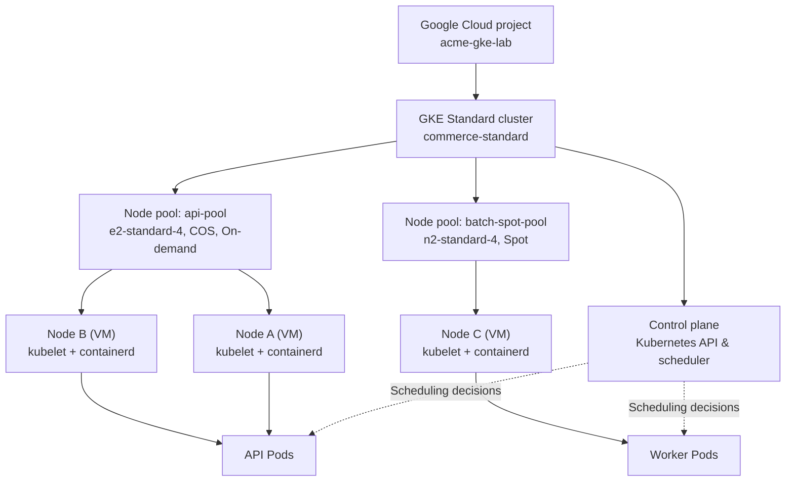
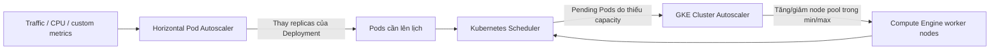

# Node pools, machine types và cấu hình node

## 1. Tại sao GKE cần node pools?

Hãy hình dung một nền tảng thương mại chạy trên **Google Kubernetes Engine (GKE)**. Hệ thống có API phục vụ đơn hàng, worker xử lý báo cáo, một dịch vụ cần bộ nhớ lớn và một tác vụ machine learning có thể cần GPU. Các ứng dụng đều chạy dưới dạng **Pods**, nhưng yêu cầu tài nguyên và tính sẵn sàng không giống nhau. Nếu mọi Pod chạy trên cùng một loại máy ảo, tổ chức dễ gặp tình trạng **thừa CPU nhưng thiếu RAM**, sử dụng máy GPU quá đắt cho tác vụ thường, hoặc ứng dụng quan trọng bị gián đoạn khi Spot VM bị thu hồi.

**Node pool** là nhóm các **Kubernetes worker nodes** trong một cluster GKE, sử dụng **cấu hình node chung**. Trong chế độ **GKE Standard**, mỗi node thường tương ứng một máy ảo **Compute Engine** được GKE quản lý; node pool dùng các thông số chung như machine type, loại image, boot disk, service account, labels, taints, mạng, khả năng autoscaling và chiến lược nâng cấp. GKE tạo và quản lý các Compute Engine Managed Instance Groups (MIGs) bên dưới node pool.

Node pool là cách đặt **ranh giới cấu hình hạ tầng** cho workload, nhưng không tự quyết định một Pod được đặt ở đâu. **Kubernetes scheduler** phân phối Pods lên các node đủ điều kiện, xét resource requests, node selectors, affinity, taints/tolerations, topology và chính sách khác.

Trong module **CLOUD_PROVIDERS_GCP**, bài học này nối kiến thức **Project, IAM, VPC/subnet, Compute Engine, GKE, Cloud Storage và các dịch vụ dữ liệu**, giúp bạn lựa chọn dịch vụ, bảo vệ tài nguyên, tự động hóa rollout, theo dõi độ tin cậy và kiểm soát chi phí khi vận hành ứng dụng.

Sau bài học, bạn có thể:

1. Phân biệt **cluster, node pool, node, Pod**, và hiểu nơi cấu hình mỗi loại tài nguyên.
2. So sánh **Standard** và **Autopilot**, bao gồm khả năng GKE tự tạo node pools cho những workload được hỗ trợ.
3. Lựa chọn **machine family/type** dựa trên CPU, RAM, kiến trúc, GPU, storage, mạng và chi phí.
4. Cấu hình **node image, boot disk, node service account, labels, taints, max Pods per node**, cùng các tùy chọn bảo mật.
5. Đọc và tạo node pool bằng `gcloud container node-pools`; điều khiển việc đặt Pods bằng Kubernetes YAML.
6. Hiểu **node pool autoscaling**, khác biệt với HPA, node auto-provisioning, ComputeClasses và các giới hạn về IP/quota.
7. Thiết kế nâng cấp/di chuyển node pool không gây gián đoạn ngoài kế hoạch; xử lý Pod `Pending`, node `NotReady` và sự cố chi phí.

> **Phạm vi:** Ví dụ dùng các tên giả định `acme-gke-lab`, `commerce-standard` và zone `asia-southeast1-a`. Tạo node pool có thể tạo VM, boot disks, địa chỉ IP và phí GKE. Chỉ chạy lệnh thay đổi tài nguyên khi có quyền và đã đánh giá tác động.

## 2. Quan hệ giữa cluster, node pool, node và Pod



### Các thành phần có trách nhiệm khác nhau

| Thành phần | Chức năng | Quản trị viên thường làm gì? |
| --- | --- | --- |
| **GKE cluster** | Ranh giới control plane/Kubernetes API, cấu hình mạng và chế độ vận hành | Chọn Standard/Autopilot, release channel, location, network |
| **Node pool** | Nhóm worker nodes có cùng cấu hình | Chọn VM type, image, disk, labels/taints, autoscaling và upgrade |
| **Node** | Máy worker thực thi Pods, có `kubelet` và container runtime | Quan sát capacity, allocatable, conditions và node pressure |
| **Pod** | Đơn vị chạy container cùng network/storage context | Khai báo requests/limits, probes, placement, security context |
| **Deployment/StatefulSet/Job** | Điều khiển vòng đời tập Pods theo mục tiêu ứng dụng | Replica, rollout, stateful identity, retry và availability |
| **Service / Ingress / Gateway** | Khả năng truy cập và cân bằng tải đến Pods | Thiết kế internal/external traffic, health checks, TLS |

**Node pool không phải một Kubernetes Namespace.** Namespace là ranh giới quản lý object Kubernetes và policy; node pool là ranh giới **cấu hình máy chạy workload**. Một namespace có thể trải trên nhiều node pools, và một node pool có thể chạy Pods từ nhiều namespaces nếu không bị scheduler/policy giới hạn.

### Một node pool có cấu hình chung

Node pool trong Standard sử dụng `NodeConfig` chung cho mọi node của pool. Bạn không nên sửa máy ảo bên dưới bằng Compute Engine Console rồi mong thay đổi tồn tại lâu dài; GKE có thể **recreate hoặc upgrade node**, đưa cấu hình về trạng thái do GKE quản lý. Để thay đổi machine type hoặc node image, hãy dùng **GKE node pool APIs/CLI** hoặc tạo pool mới rồi di chuyển workload.

## 3. Standard và Autopilot: ai quản lý node?

| Đặc điểm | **GKE Standard** | **GKE Autopilot** |
| --- | --- | --- |
| Tạo node pools | Bạn có thể tự tạo, cấu hình và quản lý Standard node pools | GKE **tự quản lý nodes**; không cần tạo Standard node pools thủ công |
| Chọn machine type cho node | Có, theo các loại Compute Engine được hỗ trợ | Thường khai báo yêu cầu Pod/ComputeClass; GKE cấp hạ tầng phù hợp |
| Node OS image | Chọn image được hỗ trợ như `COS_CONTAINERD`, `UBUNTU_CONTAINERD` hoặc Windows theo điều kiện | GKE quản lý node OS, chủ yếu COS/containerd |
| Boot disk/kubelet/system settings | Có quyền cấu hình nhiều tùy chọn node pool | Bị giới hạn theo API/đặc tính sản phẩm |
| Autoscaling | Có thể bật **cluster autoscaler** trên node pools | GKE tự điều chỉnh năng lực hạ tầng theo workload |
| Định vị workload | Node labels, taints, node affinity, ComputeClasses | Pod resource requests, selectors, ComputeClasses và các cơ chế được hỗ trợ |
| Trách nhiệm vận hành | Kiểm soát sâu hơn, phải lập kế hoạch capacity và node maintenance | Giảm quản trị node, vẫn cần quản trị ứng dụng, policy và chi phí |

**Một điểm cập nhật:** Trong GKE Standard hiện có cả **Autopilot-managed node pools** thông qua các **Autopilot ComputeClasses** được hỗ trợ. Không nên kết luận tất cả node pools trong Standard đều được tạo thủ công. Tài liệu cũng có cơ chế **node pool auto-creation** theo cluster/ComputeClass để GKE tự tạo các Standard node pools đáp ứng pending Pods.

**Autopilot không có nghĩa Kubernetes tự sửa mọi lỗi ứng dụng.** Bạn vẫn chịu trách nhiệm về container image, resource requests, HPA phù hợp, health probes, NetworkPolicy, RBAC, IAM, secrets, PersistentVolumes và mục tiêu SLO.

## 4. Cấu hình một node pool gồm những gì?

Trong GKE Standard, các lựa chọn phổ biến gồm:

| Thuộc tính | Ví dụ | Ảnh hưởng chính |
| --- | --- | --- |
| **Machine type** | `e2-standard-4`, `n2-standard-4` | vCPU, RAM, kiến trúc/khả năng hạ tầng và giá |
| **Node image** | `COS_CONTAINERD`, `UBUNTU_CONTAINERD` | OS, container runtime, hỗ trợ package/driver |
| **Boot disk** | `pd-balanced`, `100 GB` | Dung lượng hệ điều hành, image, writable container layers |
| **Node service account** | `gke-nodes@...` | Danh tính node khi gọi Google Cloud APIs |
| **Node labels** | `workload=api`, `tier=standard` | Scheduler lựa chọn node theo nhãn |
| **Node taints** | `workload=api:NoSchedule` | Chặn Pods không có toleration phù hợp |
| **Spot / on-demand** | `--spot` hoặc mặc định | Chi phí và khả năng bị thu hồi |
| **Max Pods per node** | `32` | Mật độ Pods và yêu cầu Pod IPv4 addresses |
| **Autoscaling limits** | `min=1, max=3` | Số nodes được cluster autoscaler bổ sung/cắt giảm |
| **Node locations** | Một hoặc nhiều zones | Capacity, resilience, disk/zone constraints |
| **Upgrade strategy** | Surge hoặc blue-green | Thời gian rollout và số nodes chạy tạm thời |
| **Security** | Shielded nodes, private nodes, metadata mode | Rủi ro tầng OS, quyền và đường truy cập mạng |
| **Accelerators** | GPU/TPU theo biến thể hỗ trợ | Loại workload AI/ML và quota |

**Không phải tất cả thông số đều sửa được tại chỗ mà không gián đoạn.** Một số thay đổi kích hoạt node recreation hoặc rolling replacement; những thay đổi về architecture (x86 sang Arm), GPU, OS hoặc network có thể cần pool mới. Xem API và kiểm thử trong môi trường nhỏ trước khi cập nhật.

## 5. Chọn machine type theo workload

Machine type quyết định **vCPU, bộ nhớ**, kiến trúc CPU, mức hiệu năng/disk/network tương thích và phần lớn chi phí node. Không chọn chỉ vì tên series mới hơn.

| Nhóm machine | Ví dụ thường gặp | Khi nên đánh giá | Cảnh báo |
| --- | --- | --- | --- |
| **Cost-optimized / general** | E2 | Web/API nhỏ, môi trường lab, workload cân bằng | Không phù hợp mọi yêu cầu hiệu năng CPU cao hoặc tính năng phần cứng đặc biệt |
| **General purpose cân bằng** | N2, N2D, N4 theo hỗ trợ | Dịch vụ production cân bằng CPU và RAM | Kiểm tra zone, nền tảng CPU, CUD/reservations |
| **Compute-optimized** | C3, C4 hoặc dòng tương ứng | CPU-bound services, high-throughput processing | Giá/vCPU và yêu cầu network/disk cần benchmark |
| **Memory-optimized** | M-series theo khả năng hỗ trợ | Caching lớn, analytics in-memory, JVM memory-heavy | VM lớn có thể làm chi phí và scheduling kém linh hoạt |
| **Accelerator-optimized** | A/G-series, GPU models cụ thể | Training/inference, xử lý song song GPU | GPU quota, driver, node image, scheduling và phí cao |
| **Arm-based** | T2A, C4A theo hỗ trợ | Ứng dụng đã có image multi-arch/arm64 | Docker image và thư viện native phải tương thích `arm64` |

**Đừng suy từ bảng rằng mọi machine series đều sẵn trong tất cả GKE regions/zones hoặc mọi cluster mode.** Trước khi chọn cần kiểm tra tính sẵn có Compute Engine, GKE version, image, accelerator và quota thực tế.

### 5.1. Ước tính từ requests chứ không chỉ limits

Giả sử một Pod API có:

```yaml
resources:
  requests:
    cpu: "250m"
    memory: "512Mi"
  limits:
    cpu: "500m"
    memory: "1Gi"
```

CPU `250m` nghĩa là **0,25 vCPU request**. Scheduler lập kế hoạch dựa vào **requests**; limits là một phần của cơ chế giới hạn sử dụng runtime, không phải ước lượng capacity để đặt Pods trực tiếp.

Với 12 replicas:

```text
CPU requests ứng dụng    = 12 × 0,25 = 3 vCPU
Memory requests ứng dụng = 12 × 512 Mi = 6144 Mi = 6 GiB
```

Đây **không phải** kết luận một VM 4 vCPU/16 GiB chắc chắn chứa 12 Pods. Node cần dành tài nguyên cho **OS, kubelet, system DaemonSets, eviction threshold**, còn networking và max Pods per node cũng có giới hạn. Nên xem **Allocatable** thực tế qua `kubectl describe node`, đo CPU/memory usage và chừa headroom cho rollout.

### 5.2. Khi nào chọn nhiều node nhỏ hay ít node lớn?

- **Nhiều node nhỏ:** tăng khả năng phân tán lỗi/rolling update và placement; có thể tăng overhead hệ thống và IP/disk.
- **Ít node lớn:** giảm một số overhead, thích hợp Pods lớn; nhưng có nguy cơ khó bin-pack khi requests không vừa và tác động lỗi từng node lớn hơn.
- **GPU/memory lớn:** có khi bắt buộc chọn máy chuyên dụng, không thể tối ưu chỉ bằng tăng số node thông thường.

Hãy đo **p95 latency, CPU throttling, memory OOM, network throughput, disk I/O và chi phí trên mỗi đơn vị công việc**, thay vì chọn chỉ từ số vCPU.

## 6. CPU architecture và tính tương thích container image

Phần lớn workload truyền thống chạy trên **x86_64/amd64**. Khi chọn Arm-based nodes, container image và thư viện có native code phải hỗ trợ **linux/arm64**.

Ví dụ node Kubernetes:

```text
kubernetes.io/arch=amd64
kubernetes.io/os=linux
```

hoặc:

```text
kubernetes.io/arch=arm64
kubernetes.io/os=linux
```

Trước khi chuyển đổi:

1. Kiểm tra container registry có **multi-architecture manifests**.
2. Kiểm tra libraries, Java/JNI, native plugins, security agents và monitoring DaemonSets.
3. Tạo node pool Arm mới rồi cho một workload canary chạy trước.
4. Xem image pull, test suite, performance/cost và health checks.
5. Chỉ di chuyển production sau khi các dependency phù hợp.

Theo tài liệu GKE về **migrate nodes**, khi chuyển giữa **x86 và Arm** trong Standard, nên **tạo node pool mới và di chuyển workloads**, không coi đây là một thay đổi machine type thông thường trên pool đang chạy.

## 7. Node OS image và container runtime

| Image type | Đặc tính | Khi lựa chọn |
| --- | --- | --- |
| `COS_CONTAINERD` | **Container-Optimized OS** được harden cho containers, dùng containerd; lựa chọn khuyến nghị chung | Đa số Linux workloads |
| `UBUNTU_CONTAINERD` | Ubuntu dùng containerd, linh hoạt hơn với một số libraries/filesystems/package workflows | Khi OS requirements không phù hợp COS |
| `WINDOWS_LTSC_CONTAINERD` | Windows Server LTSC với containerd | Workload Windows/.NET Framework yêu cầu Windows nodes |

**Autopilot Linux nodes sử dụng COS với containerd**, và GKE chịu trách nhiệm lựa chọn/áp dụng image theo chế độ quản lý. Trong Standard, node image được chọn tại lúc tạo node pool hoặc thay đổi qua quy trình update/upgrade được hỗ trợ.

Không viết automation phụ thuộc vào **Docker daemon trên node**; GKE dùng **containerd**. Nếu ứng dụng cần chạy Docker build, nên đánh giá Cloud Build, BuildKit hoặc giải pháp build riêng, không cài Docker daemon tùy tiện lên mọi node.

### COS hay Ubuntu?

- **COS:** bề mặt OS tối giản, được GKE tối ưu; không phù hợp nếu muốn tùy tiện cài mọi Debian package trên host.
- **Ubuntu:** cần thêm khả năng OS/library/driver được hỗ trợ, ví dụ những tình huống XFS, CephFS hoặc tooling đặc thù.
- **Windows:** node pools riêng, có giới hạn scheduling/network/security; không thể chạy Linux container image trên Windows node như thường.

Không SSH thủ công lên một node để cài package rồi nghĩ thay đổi sẽ sống sau rolling upgrade. Nên dùng **DaemonSet, container image, node bootstrap configuration và phương án GKE hỗ trợ**.

## 8. Boot disk, ephemeral storage và PersistentVolume

Node pool có **boot disk** chứa OS, container images, writable layers, logs và dữ liệu tạm của các Pods tùy cấu hình. Những thông số thường dùng:

- `--disk-type=pd-balanced` hoặc loại disk được hỗ trợ.
- `--disk-size=100`, số GB cấp cho boot disk.
- Tính năng **Local SSD / ephemeral storage** cho I/O tạm tốc độ cao khi tương thích.

**Tăng boot disk size không biến node thành hệ thống lưu trữ bền vững cho ứng dụng.** Khi node bị recreate, nâng cấp hoặc thay thế, dữ liệu trên ephemeral node storage có thể mất.

| Nhu cầu dữ liệu | Cách thường dùng | Lưu ý |
| --- | --- | --- |
| Container image cache và file tạm | Node boot disk / ephemeral storage | Có thể bị xóa khi node thay |
| Cache tốc độ cao có thể tái tạo | Local SSD nếu được hỗ trợ | Không dùng làm nguồn dữ liệu duy nhất |
| Database state cần giữ giữa lần tái tạo Pods | PersistentVolume/PersistentVolumeClaim | StorageClass, zone, attach/mount, backup và restore |
| Object files, logs xuất hoặc data lake | Cloud Storage | Không phải POSIX filesystem trực tiếp |
| Shared filesystem giữa nhiều Pods | Filestore/NFS hoặc CSI solution hỗ trợ | Kiểm tra concurrency, permissions, latency |

### Ephemeral-storage requests/limits

Pods có thể khai báo:

```yaml
resources:
  requests:
    ephemeral-storage: "1Gi"
  limits:
    ephemeral-storage: "4Gi"
```

Khi dùng chung với CPU/memory requests, scheduler xem tài nguyên khả dụng; **disk pressure** hoặc eviction có thể xảy ra nếu node hết dung lượng local. Không khắc phục dài hạn bằng cách chỉ tăng số Pods per node khi nguyên nhân là full disk.

### Storage và vùng địa lý

Persistent Disk dùng cho PersistentVolume thường có **giới hạn zone/region và attach behavior**. Khi node pool trải nhiều zone, Kubernetes scheduler cần cân nhắc **volume topology**. Một Pod StatefulSet có Persistent Disk zonal không thể mặc định chạy ở zone khác nếu disk không sẵn ở đó. Phải có replication/backup/DR riêng cho dữ liệu quan trọng.

## 9. Mạng, Pod IP ranges và max Pods per node

GKE VPC-native clusters gán Pod IP từ **secondary ranges** của subnet. Node có địa chỉ riêng và các Pod IP aliases theo cơ chế GKE. Điều này làm **số node**, **max Pods per node** và **CIDR Pod range** liên quan chặt chẽ.

Ví dụ:

```text
VPC: corp-prod
Subnet node primary range: 10.20.10.0/24
Pod secondary range: 10.60.0.0/16
Service secondary range: 10.70.0.0/20
Max Pods per node: 32 (ví dụ)
```

Nếu tăng `--max-pods-per-node`, GKE có thể cần **dải alias IP lớn hơn trên mỗi node**, làm ít nodes hơn có thể được tạo trong Pod CIDR ban đầu. Không xem `max-pods-per-node=110` là mục tiêu tối ưu: workload nhỏ, system Pods, kubelet constraints và khả năng scale phải được đánh giá.

### Các điểm cần kiểm tra

- Node pool ở đúng **region/zone** và subnet/VPC đã thiết kế.
- Secondary range cho Pods đủ chỗ khi autoscaler scale tới max.
- Với **Shared VPC**, host project quản trị subnet, firewall và IP; service project/GKE service agents cần đúng IAM.
- **Private nodes** có thể không có external IP; muốn image pull hoặc truy cập API bên ngoài cần thiết kế egress (Cloud NAT/Private Google Access hoặc phương án phù hợp).
- **NetworkPolicy, firewall và IAM** độc lập với lựa chọn node machine type.

## 10. Node service account và bảo mật node

### 10.1. Node identity và Workload Identity không giống nhau

**Node service account** là Google Cloud service account gắn với Compute Engine VM của node. Nó phục vụ những tác vụ node-level do GKE/kubelet/agents thực hiện, chẳng hạn đọc cấu hình hoặc gửi dữ liệu logging/monitoring theo quyền được cấp.

**Workload Identity Federation for GKE** giúp workload trong Pod truy cập Google Cloud APIs thông qua **Kubernetes ServiceAccount → IAM principal** theo mô hình được hỗ trợ. Không cần cấp mọi quyền ứng dụng cho **node service account**.

| Danh tính | Ai sử dụng? | Cần tránh |
| --- | --- | --- |
| **Node service account** | Node VM và thành phần node-level | Grant Editor/Owner chỉ để node chạy |
| **Kubernetes ServiceAccount (KSA)** | Pod và workload Kubernetes | Dùng một KSA có quyền rộng cho tất cả namespaces |
| **IAM principal / Google service account** | Truy cập Google Cloud APIs | Lưu JSON key lâu dài trong container image |
| **User IAM + Kubernetes RBAC** | Người vận hành GKE/Kubernetes API | Cấp cluster-admin cho mọi developer |

Một node pool có thể dùng cờ `--service-account=NODE_SA_EMAIL`. Trước khi tạo, cần bảo đảm node SA có các role tối thiểu mà GKE yêu cầu để vận hành; yêu cầu Logging/Monitoring hoặc Artifact Registry có thể phụ thuộc cấu hình cluster.

### 10.2. Shielded nodes và cấu hình an toàn

Các lựa chọn có thể gồm:

- **Shielded GKE Nodes**: vTPM/Integrity Monitoring, Secure Boot khi tương thích.
- **GKE Sandbox / gVisor** cho các workload cần cách ly nâng cao được hỗ trợ.
- **Private nodes** và hạn chế đường quản trị/metadata.
- **Workload Identity Federation**, Kubernetes RBAC, NetworkPolicy và Pod Security Standards.
- **Confidential GKE Nodes** cho một số machine/công nghệ theo khả năng hỗ trợ.

Đừng bật Secure Boot hoặc Confidential Nodes trên production chưa kiểm thử drivers/kernel/modules. Đồng thời, không coi các lựa chọn bảo mật này tự thay thế cập nhật image, runtime policy, secrets, vulnerability scanning và audit.

### 10.3. Labels khác với Resource Manager tags

**Node labels** như `workload=api` phục vụ Kubernetes scheduling; **GCE network tags** và **Resource Manager tags** được dùng trong những cơ chế firewall/policy khác. Chúng không phải một cấu hình duy nhất hay một tập nhãn được đồng bộ mặc định.

**Không dùng một label do người dùng có thể sửa làm ranh giới an ninh duy nhất.** Taints/labels hữu ích để bố trí workload, nhưng phân tách bảo mật đòi hỏi IAM/RBAC/NetworkPolicy/PSA và kiến trúc phù hợp.

## 11. Node labels, taints, tolerations và affinity

Kubernetes scheduler cần một cách biết **Pod nào nên chạy trên pool nào**.

### 11.1. Node labels và nodeSelector

GKE tự thêm label:

```text
cloud.google.com/gke-nodepool=<NODE_POOL_NAME>
```

Bạn cũng có thể thêm labels khi tạo pool:

```text
workload=api
tier=standard
environment=lab
```

Deployment có thể yêu cầu:

```yaml
spec:
  template:
    spec:
      nodeSelector:
        workload: api
```

**nodeSelector là điều kiện bắt buộc.** Nếu không có node nào mang label, Pod có thể ở trạng thái `Pending`. `nodeAffinity` cho phép diễn đạt điều kiện bắt buộc hoặc ưu tiên linh hoạt hơn.

### 11.2. Taints và tolerations

Nếu node pool chỉ dành cho ứng dụng API, tạo taint:

```text
workload=api:NoSchedule
```

Pod muốn chạy trên pool phải có toleration:

```yaml
tolerations:
  - key: workload
    operator: Equal
    value: api
    effect: NoSchedule
```

**Toleration chỉ làm Pod được phép chạy trên node đã bị taint; nó không bắt buộc Pod phải chọn node đó.** Để yêu cầu một pool cụ thể, kết hợp `nodeSelector` hoặc `requiredDuringSchedulingIgnoredDuringExecution` với toleration.

### 11.3. Ba tác động taint

| Taint effect | Ý nghĩa |
| --- | --- |
| `NoSchedule` | Pod mới không được xếp vào node nếu thiếu toleration |
| `PreferNoSchedule` | Scheduler cố tránh node, nhưng có thể đặt Pod khi cần |
| `NoExecute` | Có thể đẩy Pods đang chạy ra khỏi node nếu thiếu toleration (hoặc không có thời hạn được cho phép) |

Với production, đừng taint toàn bộ node pools đến mức **CoreDNS và system DaemonSets không có nơi chạy**. Đặc biệt khi dùng Spot/GPU pools, hãy giữ một pool on-demand thích hợp cho system workloads.

## 12. Ví dụ tạo node pool Standard bằng gcloud

Giả sử một cluster **Standard đã tồn tại**:

```text
Project:          acme-gke-lab
Cluster:          commerce-standard
Control plane location: asia-southeast1-a (zonal)
New node pool:    api-pool
Machine type:     e2-standard-4
Boot disk:        pd-balanced, 100 GB
Node image:       COS_CONTAINERD
Autoscaling:      1 đến 3 nodes (theo zone của ví dụ zonal)
Node label:       workload=api
Node taint:       workload=api:NoSchedule
Node SA:          gke-nodes@acme-gke-lab.iam.gserviceaccount.com
```

### 12.1. Preflight chỉ đọc

```bash
gcloud auth list
gcloud container clusters describe commerce-standard \
  --project=acme-gke-lab \
  --location=asia-southeast1-a \
  --format="yaml(name,status,location,network,subnetwork,currentMasterVersion,releaseChannel)"

gcloud container node-pools list \
  --cluster=commerce-standard \
  --location=asia-southeast1-a \
  --project=acme-gke-lab
```

Kiểm tra cluster là **Standard**, network/subnet có đủ Pod IP ranges, quota VM/vCPU/PD, billing đang bật, zone hỗ trợ machine type và node service account đã tồn tại với quyền node cần thiết. Nếu cluster là Autopilot, **không tạo node pool thủ công như ví dụ**.

### 12.2. Tạo node pool

```bash
# THAY ĐỔI TÀI NGUYÊN / PHÁT SINH CHI PHÍ: chỉ chạy trên lab được duyệt
gcloud container node-pools create api-pool \
  --cluster=commerce-standard \
  --location=asia-southeast1-a \
  --project=acme-gke-lab \
  --machine-type=e2-standard-4 \
  --num-nodes=1 \
  --disk-type=pd-balanced \
  --disk-size=100 \
  --image-type=COS_CONTAINERD \
  --node-labels=workload=api,environment=lab \
  --node-taints=workload=api:NoSchedule \
  --service-account=gke-nodes@acme-gke-lab.iam.gserviceaccount.com \
  --max-pods-per-node=32 \
  --enable-autorepair \
  --enable-autoupgrade \
  --enable-autoscaling \
  --min-nodes=1 \
  --max-nodes=3
```

Giải thích:

- `--num-nodes=1` là số node khởi tạo **theo mỗi zone được chọn**, không phải một cam kết tổng số trong mọi regional/multi-zonal configuration.
- `--min-nodes=1` và `--max-nodes=3` ở ví dụ này là giới hạn **per-zone** của autoscaler.
- Với **regional pool**, nếu muốn giới hạn **tổng số node trên tất cả zones**, dùng cặp `--total-min-nodes` / `--total-max-nodes`. Không kết hợp cặp total và per-zone trong cùng thao tác.
- `--node-taints` khiến Pods không có toleration không thể được scheduled vào pool.
- `--max-pods-per-node` tác động tới Pod IPv4 allocation.
- `--enable-autorepair` và `--enable-autoupgrade` không có nghĩa mọi lỗi ứng dụng hoặc Kubernetes Pod sẽ được GKE tự sửa.

### 12.3. Đọc lại sau khi tạo

```bash
gcloud container node-pools describe api-pool \
  --cluster=commerce-standard \
  --location=asia-southeast1-a \
  --project=acme-gke-lab \
  --format="yaml(name,status,config,autoscaling,management,upgradeSettings,locations)"
```

Trong output, xác minh `machineType`, `imageType`, `diskType`, `diskSizeGb`, `serviceAccount`, `labels`, `taints` và giới hạn autoscaling. Một lệnh Create thành công **không chứng minh Pods đã khỏe mạnh hoặc node đủ chỗ**.

### 12.4. Quan sát bằng kubectl

Để sử dụng `kubectl`, tài khoản cần quyền lấy cluster credentials và quyền Kubernetes API phù hợp:

```bash
# Thay đổi local kubeconfig, không tạo node trong cluster
gcloud container clusters get-credentials commerce-standard \
  --project=acme-gke-lab \
  --location=asia-southeast1-a

# CHỈ ĐỌC KUBERNETES
kubectl get nodes -L cloud.google.com/gke-nodepool,workload
kubectl get nodes -o wide
kubectl describe node ACTUAL_NODE_NAME
kubectl get pods -A -o wide
```

Xem `Capacity` và `Allocatable`, labels, taints, Conditions (`Ready`), system Pods và các sự kiện. Node pool `api-pool` không nhất thiết chỉ có một node ở mọi thời điểm vì autoscaler có thể mở rộng.

## 13. Ví dụ Deployment có định vị vào api-pool

Giả sử container ứng dụng `us-docker.pkg.dev/PROJECT_ID/REPO/api:VERSION` đã được build và quyền image pull đầy đủ. Ví dụ YAML này chạy 3 replicas, dùng labels/taint từ phần trước:

```yaml
apiVersion: apps/v1
kind: Deployment
metadata:
  name: api-demo
  namespace: default
spec:
  replicas: 3
  selector:
    matchLabels:
      app: api-demo
  template:
    metadata:
      labels:
        app: api-demo
    spec:
      nodeSelector:
        workload: api
      tolerations:
        - key: workload
          operator: Equal
          value: api
          effect: NoSchedule
      containers:
        - name: api
          image: us-docker.pkg.dev/PROJECT_ID/REPO/api:VERSION
          ports:
            - containerPort: 8080
          resources:
            requests:
              cpu: "250m"
              memory: "256Mi"
            limits:
              cpu: "500m"
              memory: "512Mi"
          readinessProbe:
            httpGet:
              path: /ready
              port: 8080
            initialDelaySeconds: 5
            periodSeconds: 10
```

**Lưu ý:** image URI và endpoint `/ready` chỉ là chỗ thay thế, không thể deploy thành công nếu image/đường dẫn thực không tồn tại hoặc workload thiếu IAM. Cần có container tương thích để sử dụng.

### Tại sao vừa cần nodeSelector vừa cần toleration?

- **nodeSelector** yêu cầu node có `workload=api`.
- **toleration** cho phép Pod đi qua rào cản taint `workload=api:NoSchedule`.
- Nếu thiếu selector, Pod có toleration có thể chạy ở pool khác.
- Nếu thiếu toleration, Pod muốn chạy vào `api-pool` vẫn có thể ở `Pending` vì taint chặn.

### Kiểm chứng nơi Pod được chạy

```bash
kubectl get pods -l app=api-demo -o wide
kubectl describe pod ACTUAL_POD_NAME
kubectl get nodes -L workload,cloud.google.com/gke-nodepool
```

Trong `kubectl describe pod`, xem **Events** và những lý do như `Insufficient cpu`, `Insufficient memory`, `untolerated taint`, `node(s) didn't match Pod's node affinity/selector` hoặc thiếu PersistentVolume/zone.

## 14. Autoscaling: HPA và Cluster Autoscaler không giống nhau



### 14.1. Horizontal Pod Autoscaler (HPA)

**HPA** điều chỉnh **số lượng Pod replicas** theo metrics được hỗ trợ, ví dụ CPU utilization hoặc custom metrics. HPA không trực tiếp tạo VM. Nếu tăng replicas lên 20 nhưng node pool không có đủ CPU/RAM, một số Pods sẽ `Pending`.

### 14.2. GKE Cluster Autoscaler

**Cluster Autoscaler** tăng/giảm **node count** trong node pool Standard với các giới hạn bạn thiết lập. Quyết định scale-up dựa trên **resource requests của những Pods không thể được scheduled**, cùng các constraint scheduling; không đơn giản là “CPU sử dụng cao thì tạo VM”.

Ví dụ: workload đang dùng 95% CPU thực tế nhưng requests của Pods vẫn vừa vào nodes hiện hữu; **cluster autoscaler có thể không scale-up** chỉ dựa trên số đo 95% ấy. Ngược lại, Pod mới `Pending` vì request CPU quá lớn hoặc không có node matching selector có thể kích hoạt đánh giá scale-up, nếu pool hợp lệ và quota/IP cho phép.

### 14.3. Giới hạn autoscaling per-zone và total

| Cặp flags | Ý nghĩa | Thường sử dụng |
| --- | --- | --- |
| `--min-nodes` / `--max-nodes` | Giới hạn **mỗi zone** trong node pool | Pool một zone hoặc khi muốn cân bằng mỗi zone |
| `--total-min-nodes` / `--total-max-nodes` | Giới hạn **tổng số nodes trong pool** across zones | Pool regional/multi-zonal cần trần tổng |

Ví dụ pool dùng **3 zones** với `--min-nodes=1`, `--max-nodes=3` có thể có **3 đến 9 nodes tổng**, tùy autoscaler và tình trạng thực tế. Nếu sử dụng `--total-min-nodes=1`, `--total-max-nodes=3` thì tổng min/max là 1–3, không phải 1–3 ở từng zone.

### 14.4. Location policy

Với node pool multi-zonal, GKE có `location_policy`:

- `BALANCED`: cố gắng phân bố capacity giữa zones, có xét yêu cầu Pods và khả năng cấp tài nguyên.
- `ANY`: ưu tiên zones còn nhiều capacity hoặc unused reservations; có thể dồn nodes vào một vài zones.

Thông thường, `BALANCED` là mặc định cho on-demand/reservations, còn `ANY` thường là mặc định cho Spot/flex-start theo tài liệu; **không kết luận mọi node pool đều có cùng mặc định**.

### 14.5. Khi autoscaler không scale

Những nguyên nhân thường gặp:

1. `max-nodes`/`total-max-nodes` đã chạm trần.
2. Compute Engine vCPU/GPU quota hoặc zonal capacity không đủ.
3. Pod selectors/affinity/taints không khớp bất kỳ pool nào có thể scale.
4. IP secondary range cho Pods hoặc primary subnet cho nodes không còn đủ.
5. Pod request lớn hơn **allocatable** của bất kỳ node type nào được phép.
6. PersistentVolume/zone hoặc topology constraints không thể thỏa.
7. Node auto-provisioning/ComputeClass không được bật hoặc cấu hình không phù hợp.

**Scale-down** cũng có thể bị trì hoãn vì PodDisruptionBudget, kube-system Pods, local storage hoặc các điều kiện an toàn. Không bỏ PDB chỉ để giảm chi phí khi chưa đánh giá ảnh hưởng.

## 15. Node auto-provisioning và ComputeClasses

Node pool autoscaling chỉ thay đổi số nodes trong **những pools đã có**. Nếu workload cần một **machine type khác** nhưng không có pool phù hợp, GKE Standard có thể dùng **node pool auto-creation**, qua:

- **Cluster-level node auto-provisioning:** tự tạo node pool mới theo pending Pods và chính sách limits của cluster.
- **ComputeClass theo workload:** khai báo các ưu tiên về compute properties; trong các phiên bản GKE hỗ trợ, có thể tạo Standard node pool phù hợp ComputeClass mà không cần bật cluster-level auto-provisioning.

Theo tài liệu GKE, **workload-level node pool auto-creation độc lập với cluster-level NAP** yêu cầu GKE version **1.33.3-gke.1136000** hoặc mới hơn tại thời điểm viết. Những trường hợp cũ hơn hoặc tính năng chuyên biệt có điều kiện riêng; nên xác minh cluster version và release channel.

### Một ví dụ tư duy thiết kế

Giả sử ứng dụng phân tích cần 8 vCPU/32 GiB RAM; pool hiện tại toàn E2 nhỏ. Có ba phương án:

1. **Tạo Standard node pool thủ công** với N2/N2D hoặc machine family phù hợp.
2. **Bật node auto-provisioning** cùng resource limits và chính sách node configuration.
3. **Dùng ComputeClass** để định nghĩa ưu tiên compute theo workload và cơ chế auto-creation được hỗ trợ.

ComputeClasses giảm việc cấu hình thủ công cho một số loại workload nhưng không thay nguyên tắc **right-size requests**, kiểm tra IAM, quota, cost và Pod scheduling rules.

**Cẩn trọng:** bật auto-provisioning trên cluster đang có pending Pods có thể khiến GKE **tạo node pools mới và phát sinh chi phí ngay**. Kiểm tra trước những `nodeSelectors`, ComputeClasses và giới hạn tài nguyên.

## 16. Spot node pools và workloads chịu gián đoạn

**Spot VMs** có giá thấp hơn on-demand nhưng có thể bị Google Cloud thu hồi khi cần tài nguyên. Spot phù hợp:

- Batch jobs có checkpoint và retry.
- Công việc xử lý ảnh/video có thể làm lại.
- Workers stateless, compute không giữ dữ liệu độc nhất.
- Một số AI training/jobs có cơ chế lưu trạng thái thường xuyên.

Không phù hợp làm nơi **duy nhất** chạy hệ thống điều phối hoặc database trọng yếu khi workload không chịu được thu hồi.

### 16.1. Mẫu tạo Spot node pool

```bash
# Có thể phát sinh chi phí, có nguy cơ bị thu hồi node
gcloud container node-pools create batch-spot-pool \
  --cluster=commerce-standard \
  --location=asia-southeast1-a \
  --project=acme-gke-lab \
  --machine-type=e2-standard-4 \
  --spot \
  --node-labels=workload=batch \
  --node-taints=workload=batch:NoSchedule \
  --enable-autoscaling \
  --min-nodes=0 \
  --max-nodes=5
```

Đây là **ví dụ một zone**. Nếu các system workloads không có nơi chạy khi pool về 0 hoặc bị thu hồi, cluster sẽ gặp lỗi; cần duy trì một **on-demand non-GPU pool** phù hợp.

### 16.2. Thời gian graceful termination

Theo thiết lập mặc định, GKE cho Pods khoảng **30 giây graceful termination** sau thông báo preemption; thời gian này không đồng nghĩa ứng dụng chắc chắn hoàn tất công việc. Các cấu hình nâng cao và phiên bản mới có thể điều chỉnh theo giới hạn. Hãy:

- Xử lý `SIGTERM` và ghi checkpoint kịp thời.
- Sử dụng queue với at-least-once semantics/idempotent processing khi phù hợp.
- Đặt `terminationGracePeriodSeconds` và logic shutdown thực tế.
- Chấp nhận trường hợp mất node đột ngột; không dựa vào local SSD làm nguồn dữ liệu duy nhất.

Spot nodes có label `cloud.google.com/gke-spot=true` theo phiên bản được hỗ trợ. Có thể dùng selector hoặc affinity để chọn Spot, nhưng **toleration/taint** được khuyến nghị để không vô tình đẩy system Pods lên Spot nodes.

## 17. Nâng cấp node pool và tránh downtime

Node pools chạy một **Kubernetes node version**, được quản lý theo cơ chế GKE release channel/auto-upgrade. GKE có thể upgrade node OS/image, kubelet hoặc thay node để áp dụng cấu hình mới. Việc nâng cấp **có thể làm Pods bị evict/recreate**.

### 17.1. Surge upgrades và blue-green upgrades

| Chiến lược | Cách hoạt động khái quát | Đánh đổi |
| --- | --- | --- |
| **Surge** | Tạo một số nodes mới vượt target size tạm thời, drain/replace nodes cũ theo đợt | Cần quota/IP/chi phí tăng tạm thời nhưng rollout nhanh hơn |
| **Blue-green** | Tạo tập nodes mới, di chuyển workloads có kiểm soát, có thời gian soak theo cấu hình | Giảm rủi ro rollout đối với một số workload; cần capacity tạm lớn hơn |
| **Autoscaled blue-green** | Biến thể có cơ chế tự mở rộng trong quy trình theo mức phát hành | Kiểm tra trạng thái Preview/GA trước khi triển khai |

Không cấu hình chiến lược giống nhau cho mọi workload. Cluster có GPU khan hiếm, Pods stateful, PersistentVolumes zonal hoặc PodDisruptionBudget chặt sẽ có tốc độ nâng cấp và yêu cầu capacity khác.

### 17.2. Readiness, replicas và PDB

Một Deployment có **1 replica** có thể ngừng phục vụ khi node bị drain dù load balancer hoặc node pool upgrade đúng kỹ thuật. Để tăng khả năng chịu lỗi:

1. Dùng nhiều replicas ở các nodes/zones khác nhau nếu có yêu cầu HA.
2. Cấu hình **readinessProbe** và **startupProbe/livenessProbe** hợp lý.
3. Dùng **PodDisruptionBudget** để giới hạn số Pods bị gián đoạn đồng thời trong voluntary disruptions.
4. Cấu hình **topology spread constraints** hoặc pod anti-affinity để không dồn tất cả replicas vào một node/zone.
5. Kiểm tra upgrade headroom, max surge/unavailable và thời gian shutdown.

PDB là một lớp điều phối gián đoạn, **không ngăn mọi lỗi phần cứng, preemption, OOM hoặc tất cả tác động do quản trị**.

### 17.3. Maintenance windows/exclusions

GKE có maintenance windows và exclusions cho automatic upgrades theo điều kiện hỗ trợ. Nhưng chúng **không chặn vĩnh viễn** các nâng cấp thiết yếu, ví dụ phiên bản đạt end-of-support. Manual upgrades có thể **bỏ qua** maintenance windows/exclusions. Với Standard release channel, một số phiên bản hỗ trợ **node-pool-specific maintenance exclusions**.

Đội SRE cần có lịch thay đổi, thông báo và chạy thử canary; không thiết kế ứng dụng dựa trên niềm tin rằng GKE sẽ không bao giờ thay node trong giờ làm việc.

### 17.4. Thay machine type

Tài liệu GKE hiện cho phép **thay machine attributes của một số node pool hiện hữu** qua luồng update được hỗ trợ, GKE sử dụng upgrade strategy để di chuyển workload; không phải mọi thay đổi đều cần tạo pool mới. Tuy nhiên, **tạo node pool mới rồi migrate** thường hữu ích khi đổi kiến trúc CPU, cần rollback nhanh hoặc muốn thử nghiệm không chạm pool đang ổn định.

Không sửa từng Compute Engine VM nằm dưới node pool; cấu hình có thể bị GKE ghi đè hoặc làm cluster lệch trạng thái.

## 18. Di chuyển workloads sang node pool mới

Tình huống: pool `api-old` hiện dùng machine type nhỏ, gặp nhiều OOM và node pressure. Đội nền tảng muốn chuyển sang `api-pool` mới có RAM lớn hơn.

### Quy trình khuyến nghị

1. **Đo hiện trạng**: Pod requests/limits, OOMKilled, container restarts, node allocatable, CPU throttling và traffic.
2. **Chọn machine type/OS/disk** có đủ tài nguyên; xem quota, zone và network.
3. **Tạo pool mới** và xác minh Nodes Ready, system agents hoạt động.
4. **Áp labels/taints và sửa workload manifests** bằng rollout có kiểm soát.
5. **Canary** một lượng nhỏ Pods, kiểm tra logs/metrics và networking/PersistentVolumes.
6. **Cordon/drain** những node cũ khi phù hợp, theo PDB và chính sách xử lý dữ liệu.
7. **Quan sát và rollback** nếu cần; chỉ xóa pool cũ sau khi xác minh toàn bộ Pods/volumes/daemonsets được chuyển.

Các lệnh Kubernetes quản trị có thể ảnh hưởng dịch vụ:

```bash
# CHỈ ĐỌC: xác định nodes cũ và Pods còn đang chạy
kubectl get nodes -L cloud.google.com/gke-nodepool
kubectl get pods -A -o wide

# THAY ĐỔI cluster: chỉ khi đã duyệt và hiểu PodDisruptionBudget
kubectl cordon ACTUAL_OLD_NODE_NAME
kubectl drain ACTUAL_OLD_NODE_NAME \
  --ignore-daemonsets \
  --delete-emptydir-data
```

`--delete-emptydir-data` cho phép xóa **dữ liệu ephemeral trên emptyDir** của Pods được drain. **Không chạy khi dữ liệu trong emptyDir là quan trọng** và chưa có cơ chế phục hồi. Với StatefulSet và PVC, kiểm tra volume attachment topology trước khi drain.

### Rollback

Để rollback, giữ pool cũ sẵn sàng trong giai đoạn soak, chuyển selector/affinity về pool cũ và quan sát. Nếu pool đã bị xóa, tạo lại có thể mất thời gian và gặp quota/capacity limit. Không giả định rollback luôn tức thì.

## 19. Chi phí của node pools và kiểm soát ngân sách

Chi phí GKE phụ thuộc cả **chế độ cluster** và **tài nguyên thực**. Với Standard, các thành phần thường gồm:

- **Compute Engine VM** theo machine type, zone và thời gian tồn tại.
- **Boot disks**, Local SSD/Hyperdisk và PersistentVolumes tùy cấu hình.
- **GKE cluster management fee** hoặc các khoản phí theo mô hình/bậc sản phẩm hiện hành, khấu trừ/credit nếu áp dụng.
- **Network egress**, cross-zone/cross-region traffic, load balancing, Cloud NAT.
- **Cloud Logging/Monitoring**, Artifact Registry, GPU licenses hoặc tài nguyên liên quan.
- **Autoscaling surge/blue-green nodes** tồn tại tạm thời khi upgrade.

### Công thức học cách dự toán

```text
Chi phí node pool (ước tính)
 = tổng (node-hours theo từng machine type × đơn giá tương ứng)
 + tổng (boot-disk GB-month theo disk type/location)
 + phụ phí GPU/Local SSD nếu có
 + load balancing, egress, logging và dịch vụ phụ thuộc
 + phần cluster management fee được phân bổ hợp lý
```

Ví dụ giả định: một pool duy trì **2 nodes** trong **10 giờ**, tổng là **20 node-hours** cho đúng machine type đó. Nếu autoscaler scale lên 4 nodes trong 2 giờ rồi quay về 2 nodes, phải tính số node-hours theo **đường đi thực tế**, không lấy mức max 4 nodes nhân toàn bộ 10 giờ.

### Các đòn bẩy tối ưu

1. **Right-size** CPU/memory requests dựa trên dữ liệu sử dụng và latency.
2. Chọn machine family phù hợp thay vì dùng machine type lớn cho mọi Pod.
3. Dùng **HPA + cluster autoscaler** cho workload có khả năng thay đổi replicas.
4. Tách **Spot pool** cho batch có thể retry, giữ on-demand cho hệ thống quan trọng.
5. Giảm disk/ephemeral storage lãng phí; theo dõi soft-deleted Cloud Storage hoặc snapshots riêng.
6. Xem reserved capacity, CUDs và mức giá thực theo billing account.
7. Theo dõi cluster efficiency và chargeback theo **namespace/labels** với **GKE cost allocation** khi có cấu hình hỗ trợ.

**Tối ưu giá không đồng nghĩa giảm số node tối đa.** Một pool quá nhỏ có thể gây latency, thiếu capacity cho rolling updates và Pod downtime, làm chi phí vận hành cao hơn khoản tiết kiệm compute.

## 20. Monitoring và troubleshooting node pools

### 20.1. Các tín hiệu cần theo dõi

| Tín hiệu | Nguồn | Câu hỏi |
| --- | --- | --- |
| `NodeReady`, node conditions | Kubernetes API / Cloud Monitoring | Node có sẵn sàng nhận Pod? |
| CPU/memory **allocatable** và utilization | `kubectl describe node`, Metrics Server/Monitoring | Tài nguyên thật còn bao nhiêu? |
| Pending Pods | `kubectl describe pod`, Events | Vì sao scheduler chưa đặt được Pod? |
| OOMKilled/restarts | Pod status/logs | Requests/limits hoặc memory leak có phù hợp? |
| DiskPressure/MemoryPressure | Node conditions | Node có bị eviction không? |
| Cluster autoscaler decisions | GKE autoscaler visibility logs | Scale-up/down có bị quota/constraints cản không? |
| Node pool operations | GKE operations / Cloud Audit Logs | Có upgrade, repair, resize hoặc recreate không? |
| VM/disk/GKE charges | Cloud Billing / GKE cost allocation | Pool/namespace nào phát sinh chi phí? |

### 20.2. Các lỗi phổ biến

| Hiện tượng | Nguyên nhân khả dĩ | Hướng kiểm tra |
| --- | --- | --- |
| Pod `Pending` với `Insufficient cpu` | Requests vượt allocatable của nodes hợp lệ | Requests, node allocatable, max nodes, quotas |
| Pod `Pending` với `untolerated taint` | Pod thiếu toleration | Node taints, Pod tolerations |
| Pod `Pending` vì selector | Không có pool đúng label/architecture | `kubectl get nodes --show-labels`, affinity/selector |
| Autoscaler không mở rộng | Max reached, quota, capacity hoặc không có pool matching | GKE autoscaler logs, Pod events, pool limits |
| Pool tạo node thất bại | VCPU/GPU quota, thiếu IP hoặc loại máy không có ở zone | Quota, subnet ranges, region availability |
| Node `NotReady` | Kubelet, CNI, disk/network/OS, node upgrade | Node conditions, operations, logs, SSH theo chính sách |
| `ImagePullBackOff` | Sai image/tag, registry permission hoặc egress | KSA/node SA, Artifact Registry IAM, DNS/NAT |
| OOMKilled | Container vượt memory limit, memory pressure hoặc leak | Pod status, usage, requests/limits, heap |
| Pod không di chuyển khi upgrade | PDB quá chặt, stateful PVC/zone hoặc Pod không drain được | PDB, Events, volume topology, upgrade strategy |
| Tăng chi phí khi nâng cấp | Surge/blue-green tạo nodes tạm, disks/GPUs nhiều | GKE operation window, Billing SKU, current node counts |
| Pod lên Spot rồi gián đoạn | Spot bị thu hồi theo thiết kế | Taints/tolerations, checkpoint, fallback on-demand |
| Không chạy được image trên Arm | Image không hỗ trợ `arm64` | Registry manifest, architecture labels, node selectors |

### 20.3. Trình tự điều tra Pods Pending

```bash
kubectl get pods -A --field-selector=status.phase=Pending
kubectl describe pod ACTUAL_POD_NAME -n NAMESPACE
kubectl get nodes -L cloud.google.com/gke-nodepool,workload
kubectl describe node ACTUAL_NODE_NAME
```

1. Đọc **Events** của Pod, không phỏng đoán nguyên nhân chỉ từ `Pending`.
2. So sánh resource requests với **Node Allocatable**, không chỉ capacity thô.
3. Kiểm tra nodeSelector/affinity và **taints/tolerations**.
4. Xem `max-nodes`, quota, IP ranges, reservations/capacity và autoscaler decisions.
5. Nếu Pod dùng PVC, kiểm tra PV topology/zone cùng CSI errors.
6. Chỉ sửa resource request, node pool hoặc scheduling rule sau khi hiểu workload; tránh cấp quyền IAM rộng hoặc mở firewall không liên quan.

### 20.4. Trình tự điều tra Node NotReady

Đọc `kubectl describe node`, xác định điều kiện `Ready`, `DiskPressure`, `MemoryPressure`, `PIDPressure` và thời gian heartbeat. Xem GKE node pool operations, kubelet/network plugin logs, hệ thống Logging, trạng thái VM và thay đổi gần đây. Phân biệt:

- **VM đã chết**: GKE autorepair có thể tạo lại node.
- **Node vẫn chạy nhưng thiếu network/IP**: cần kiểm tra CNI, subnet ranges và firewall.
- **Pod lỗi ứng dụng**: chưa chắc node bị lỗi; đừng tự drain cả pool.

## 21. Tình huống thiết kế 1: tách API và batch workers

Một tổ chức có API xử lý đơn hàng cần độ sẵn sàng cao, trong khi batch workers chạy báo cáo ban đêm, có thể retry khi lỗi.

**Thiết kế đề xuất:**

| Thành phần | Node pool | Tài nguyên và cấu hình | Lý do |
| --- | --- | --- | --- |
| API service | `api-pool` | On-demand E2/N2 phù hợp, autoscaling, nhiều nodes/zones khi cần | Tránh Spot preemption, đảm bảo capacity cho latency |
| Batch workers | `batch-spot-pool` | Spot VM, node taint, autoscaling min 0 nếu cluster/system support | Tiết kiệm cho việc có thể retry |
| System workloads | `system-pool` hoặc pool on-demand có capacity | Không phải Spot nếu yêu cầu độ tin cậy | CoreDNS/agents cần nơi chạy ổn định |

**Scheduler policy:** API Pods dùng nodeSelector và toleration khớp `api-pool`; batch Pods chọn `batch-spot-pool` và có logic checkpoint. HPA có thể điều chỉnh API replicas; cluster autoscaler thêm nodes khi pending Pods không vừa. Batch queue xử lý idempotent và lưu output ở Cloud Storage, không đặt dữ liệu duy nhất trên node-local disk.

### Những gì cần kiểm chứng

- API có ít nhất hai replicas trên hai nodes khác nhau khi cần HA.
- Readiness/rolling upgrades/PDB không làm mất tất cả endpoints đồng thời.
- Spot bị thu hồi không xóa mất kết quả đã hoàn thành.
- Node SA và Workload Identity của hai nhóm không được cấp quyền quá rộng.
- Billing phân tách được batch và API theo labels/namespace.

## 22. Tình huống thiết kế 2: AI inference dùng GPU

Một dịch vụ inference cần GPU trong một số giờ, còn gateway API chỉ dùng CPU. Đội nền tảng cân nhắc:

1. **Không đặt mọi Pod lên GPU nodes**. Dùng một pool GPU chuyên biệt, một pool CPU cho gateway/system workloads.
2. Chọn **machine family, accelerator model/count, GPU drivers và vùng** theo yêu cầu model.
3. Dùng **node taints**, GPU requests/limits và selectors/ComputeClass theo GKE version để chỉ Pod inference lên GPU.
4. Kiểm tra GPU quotas, reservations, thời gian khởi động/image pull và khả năng autoscaling.
5. Benchmark throughput/latency, batch size, VRAM và giá theo workload.
6. Cân nhắc Spot GPUs **chỉ khi có khả năng chịu gián đoạn**; online inference production có thể cần on-demand fallback.

**Lưu ý bảo mật:** service accounts để đọc model từ Cloud Storage/Artifact Registry cần quyền tối thiểu; GPU node/driver có yêu cầu kernel/node image đặc thù. Không tự đưa GPU operator hoặc host drivers vào production khi chưa đối chiếu compatibility của GKE.

## 23. Bài tập và câu hỏi kiểm tra

### Bài 1: Phân biệt bốn cấp

Cho cluster `commerce-standard` có node pool `api-pool`, node `gke-api-123` và Pod `api-demo-77bb`.

Hãy xác định nơi cấu hình:

1. Machine type và boot disk của mọi node trong pool.
2. CPU/memory requests của ứng dụng.
3. Node taints/labels áp dụng cho pool.
4. Số lượng Pod replicas.
5. Release channel/control plane location.

**Gợi ý:** (1) Node pool; (2) Pod/Deployment template; (3) Node pool; (4) Deployment/HPA; (5) Cluster.

### Bài 2: Tính requests và allocatable

Có 20 API Pods, mỗi Pod request `300m CPU` và `400Mi memory`.

```text
CPU requests    = 20 × 0,3 vCPU = 6 vCPU
Memory requests = 20 × 400 Mi = 8000 Mi (~7,81 GiB)
```

Vì sao không được kết luận một node 8 vCPU/8 GiB chắc chắn đủ cho 20 Pods? Hãy nêu ít nhất bốn lý do.

**Gợi ý:** OS/kubelet/system reserved, DaemonSets, eviction headroom, disk/network, max pods per node, rollout capacity và workload memory overhead.

### Bài 3: Giải thích Pod Pending

Pool `api-pool` có label `workload=api` và taint `workload=api:NoSchedule`. Pod có nodeSelector `workload=api` nhưng không có toleration. Pod có lên pool được không? Hãy thêm YAML cần thiết.

**Đáp án:** Không, vì taint `NoSchedule` vẫn chặn; cần toleration cùng key/value/effect. NodeSelector không thay thế toleration.

### Bài 4: Autoscaler và HPA

Giả sử Deployment có 3 replicas, HPA tăng lên 12 replicas khi CPU tăng. Cluster hiện chỉ đủ chỗ cho 5 Pods và node pool autoscaler giới hạn max 4 nodes.

Hãy mô tả **trình tự hoạt động** và những lý do có thể khiến 7 Pods còn lại bị `Pending`. **Gợi ý:** HPA tăng replicas; scheduler đặt những Pods còn chỗ; cluster autoscaler đánh giá pending Pods dựa requests/constraints và thêm nodes nếu max, quota, IP, location cho phép.

### Bài 5: Tính min/max regional pool

Một regional node pool trải 3 zones và dùng `--min-nodes=2`, `--max-nodes=5`. Hãy tính giới hạn tổng số node theo cách hiểu per-zone.

**Đáp án:** Min tổng **6 nodes**, max tổng **15 nodes** theo mô hình ba zones. Nếu muốn min tổng 2, max tổng 5, dùng cặp total min/max (với tính năng được hỗ trợ).

### Bài 6: Thiết kế migration

Ứng dụng đang chạy trên x86 Standard node pool, muốn chuyển sang Arm để giảm chi phí. Hãy nêu:

- Những việc phải kiểm tra ở container image/dependencies.
- Vì sao cần node pool mới.
- Cách dùng node labels/affinity và canary.
- Các kiểm thử health, rollback, dữ liệu PVC và quota.

### Bài 7: Thực hành đọc cấu hình (không tạo tài nguyên)

```bash
gcloud container node-pools list \
  --cluster=CLUSTER_NAME \
  --location=LOCATION \
  --project=PROJECT_ID

gcloud container node-pools describe NODE_POOL_NAME \
  --cluster=CLUSTER_NAME \
  --location=LOCATION \
  --project=PROJECT_ID
```

Hãy ghi lại machine type, node image, disk, service account, autoscaling limits, node locations, upgrade settings, labels và taints của một pool mà bạn được phép xem. Phân tích xem một Pod 4 vCPU request có thể chạy trên node pool đó không, sử dụng **Allocatable** thật từ Kubernetes API khi có quyền.

## 24. Checklist trước khi áp dụng node pool vào production

- [ ] Xác định **Standard/Autopilot** và ai quản lý nodes.
- [ ] Chọn đúng machine family/type theo CPU/RAM/architecture và zone/region availability.
- [ ] Đã đo Pod requests/limits, allocatable thực, daemonsets và headroom rollout.
- [ ] Xác minh image/node OS, containerd, compatibility x86/arm64/Windows.
- [ ] Boot disk, ephemeral storage, Local SSD và PVC đã được phân biệt.
- [ ] VPC/subnet, Pod secondary CIDR, max pods per node và network egress đủ capacity.
- [ ] Node service account và Workload Identity Federation được phân quyền tối thiểu.
- [ ] Node labels/taints/tolerations và affinity không làm system Pods mất nơi chạy.
- [ ] Chọn autoscaling per-zone hay total; biết HPA khác Cluster Autoscaler.
- [ ] Có cơ chế phát hiện quota/capacity/IP exhaustion và pending Pods.
- [ ] Spot node pools chỉ dùng với workload chịu gián đoạn, có checkpoint/fallback phù hợp.
- [ ] Đã chọn release channel, node auto-upgrades, maintenance windows và upgrade strategy.
- [ ] Có đủ surge/blue-green capacity, PodDisruptionBudget, replicas, readiness/rollback.
- [ ] Không sửa Compute Engine VMs bên dưới GKE node pool thủ công.
- [ ] Có Cloud Monitoring/Logging, autoscaler visibility, GKE operations và audit trail.
- [ ] Đã kiểm thử mất node, rolling update, image pull failure, scale max và tình huống zone mất.
- [ ] Ước tính tổng chi phí VM, disks, GPU, GKE fees, surge capacity, egress và logs.
- [ ] Có owner, runbook, tài liệu chọn pool và quy trình review IaC/CI/CD.

## 25. Tài liệu Google Cloud chính thức

Những khả năng node pools, machine types, versions, zones và flags có thể thay đổi. Kiểm tra các trang chính thức tại thời điểm vận hành:

1. [About node pools](https://cloud.google.com/kubernetes-engine/docs/concepts/node-pools)
2. [Adding and managing node pools](https://cloud.google.com/kubernetes-engine/docs/how-to/node-pools)
3. [gcloud container node-pools create](https://cloud.google.com/sdk/gcloud/reference/container/node-pools/create)
4. [Choose a machine type for nodes](https://cloud.google.com/kubernetes-engine/docs/how-to/machine-types)
5. [Migrate nodes to a different machine type](https://cloud.google.com/kubernetes-engine/docs/how-to/migrate-nodes)
6. [GKE node images](https://cloud.google.com/kubernetes-engine/docs/concepts/node-images)
7. [About GKE Autopilot](https://cloud.google.com/kubernetes-engine/docs/concepts/autopilot-overview)
8. [Cluster autoscaler concepts](https://cloud.google.com/kubernetes-engine/docs/concepts/cluster-autoscaler)
9. [Configuring GKE cluster autoscaler](https://cloud.google.com/kubernetes-engine/docs/how-to/cluster-autoscaler)
10. [Configure node pool auto-creation](https://cloud.google.com/kubernetes-engine/docs/how-to/node-auto-provisioning)
11. [Spot VMs in GKE](https://cloud.google.com/kubernetes-engine/docs/concepts/spot-vms)
12. [Standard cluster upgrades](https://cloud.google.com/kubernetes-engine/docs/concepts/cluster-upgrades)
13. [Maintenance windows and exclusions](https://cloud.google.com/kubernetes-engine/docs/concepts/maintenance-windows-and-exclusions)
14. [Workload Identity Federation for GKE](https://cloud.google.com/kubernetes-engine/docs/concepts/workload-identity)
15. [GKE pricing](https://cloud.google.com/kubernetes-engine/pricing)
16. [Compute Engine machine families](https://cloud.google.com/compute/docs/machine-resource)

**Ghi nhớ:** **Node pool** là ranh giới cấu hình chung của các worker nodes trong GKE, còn **Pods** quyết định nhu cầu tài nguyên và được Kubernetes scheduler đặt lên node phù hợp. Trong **Standard**, bạn lựa chọn machine type, image, disk, IAM, labels/taints và autoscaling; trong **Autopilot**, GKE quản lý phần lớn hạ tầng node. Thiết kế tốt phải kết hợp **requests/limits, VPC/IP capacity, HA, upgrade strategy, bảo mật, khả năng gián đoạn và tổng chi phí**, thay vì chỉ chọn máy ảo có nhiều CPU nhất.
