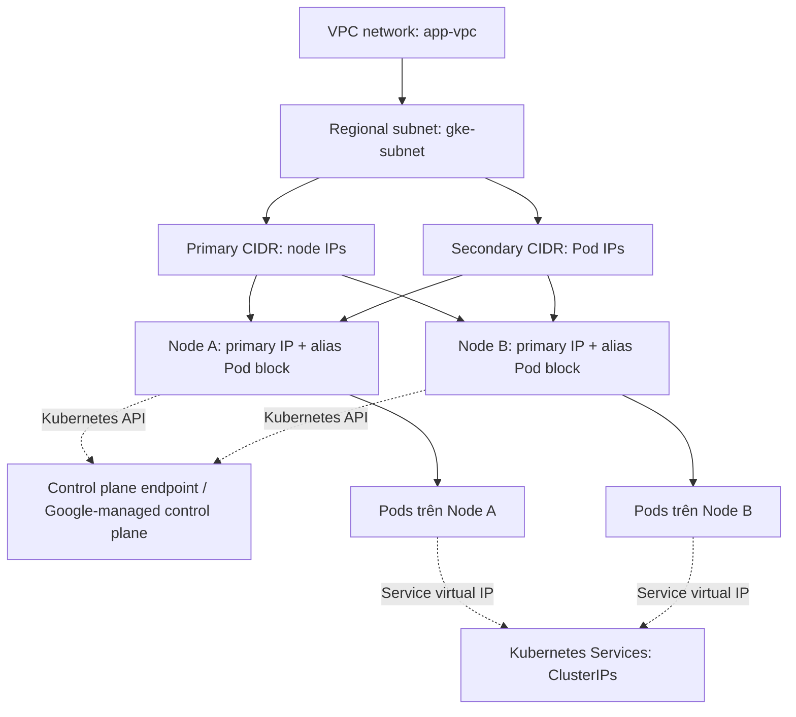

# VPC-native clusters và quy hoạch IP cho Pod

> **Chương:** GKE cơ bản  
> **Module:** CLOUD_PROVIDERS_GCP  
> **Phạm vi module:** Khám phá Google Cloud từ tổ chức project, IAM và VPC đến Compute Engine, GKE, Cloud Run, dịch vụ lưu trữ và cơ sở dữ liệu. Qua các tình huống triển khai, người học biết lựa chọn dịch vụ, bảo vệ tài nguyên, tự động hóa phát hành và theo dõi độ tin cậy cùng chi phí.

Khi triển khai ứng dụng trên **Google Kubernetes Engine (GKE)**, người học thường chú ý đến Deployment, Service, Pod và autoscaling. Tuy nhiên, cluster có thể không tạo thêm được node hoặc Pod dù CPU vẫn còn và quota VM chưa hết: nguyên nhân có thể là **địa chỉ IP dành cho node hoặc Pod đã cạn**. Vấn đề càng dễ xuất hiện khi có nhiều node pool, môi trường dev/staging/prod, kết nối hybrid với mạng văn phòng hoặc VPC chia sẻ giữa các project.

**VPC-native cluster** là chế độ mạng mặc định cho những GKE cluster mới. Nó sử dụng **alias IP addresses** trong Google Cloud VPC: node lấy IP từ **primary IPv4 range** của subnet, còn Pod được cấp địa chỉ từ **một hoặc nhiều secondary IPv4 ranges** dành cho Pod. Đối với Kubernetes Service kiểu ClusterIP, GKE dùng một dải Service IP riêng: có thể là secondary range do người dùng cấp hoặc **GKE-managed Service range**, tùy phiên bản và cấu hình.

Bài học này hướng dẫn cách đọc kiến trúc, tính dung lượng IP từ số node/Pods mỗi node, tự lập phương án CIDR, triển khai **một GKE Standard cluster trong project sandbox** và phát hiện sớm hiện tượng cạn Pod IP mà không phải thử thay đổi cluster production.

## Mục tiêu học tập

Sau bài học, bạn có thể:

1. Phân biệt **route-based legacy cluster** với **VPC-native cluster dùng alias IP**, và giải thích vai trò routing VPC.
2. Xác định phạm vi **primary range cho node**, **secondary range cho Pod**, **Service range**, và địa chỉ/endpoint control plane.
3. Tính số IP GKE cấp **cho từng node** theo `maxPodsPerNode`, không nhầm với số Pod đang chạy.
4. Lập bảng CIDR không chồng lấn với subnet, VPC peering, VPN/Interconnect, PSC, dịch vụ và các cluster khác.
5. Phân biệt các lựa chọn **user-managed** và **GKE-managed** Service IP, GKE Standard/Autopilot và Shared VPC.
6. Dùng Console và `gcloud` để đọc cấu hình network, tạo cluster lab với secondary ranges được xác định trước, kiểm tra địa chỉ node/Pod/Service.
7. Chẩn đoán cạn địa chỉ và hiểu hướng xử lý bằng **additional Pod ranges / discontiguous multi-Pod CIDR** hoặc thay đổi kiến trúc.
8. Đánh giá bảo mật, khả năng mở rộng, chi phí, ảnh hưởng tới networking và cách dọn tài nguyên GKE đúng quyền sở hữu.

## 1. GKE VPC-native cluster là gì?

Kubernetes có mô hình mạng cơ bản:

- Mỗi **Pod** được cấp IP riêng trong cluster.
- Các Pod có thể giao tiếp với nhau theo mô hình kết nối phẳng của Kubernetes khi chính sách và mạng cho phép.
- **Kubernetes Service** thường cung cấp địa chỉ ổn định để phân phối traffic đến một tập endpoint/Pod.
- Node là VM thực thi kubelet, container runtime và các Pod.

Trong GKE, **VPC-native networking** tích hợp địa chỉ Pod với VPC thông qua **alias IP ranges** được gán cho network interface của node. Google Cloud VPC có thể định tuyến các dải này mà không cần một route riêng biệt được tạo cho mỗi node giống như chế độ routes-based cũ.



Sơ đồ biểu thị mô hình **IPv4** phổ biến. GKE cũng hỗ trợ các lựa chọn IPv6/dual-stack theo những điều kiện riêng; không lấy nguyên phép tính IPv4 của bài này để thiết kế IPv6.

### 1.1. So sánh VPC-native và routes-based

| Tiêu chí | VPC-native (alias IP) | Routes-based (legacy) |
|---|---|---|
| Nguồn IP cho Pod | Secondary IPv4 ranges trên subnet, gán qua alias IP | Pod CIDR được phân bổ và định tuyến theo mô hình route của cluster |
| Định tuyến VPC | Không cần tạo một custom route riêng cho từng node chỉ để quảng bá Pod CIDR | Có các route do GKE quản lý cho phạm vi Pod theo cơ chế legacy |
| Tích hợp networking hiện đại | Là chế độ mặc định cho cluster mới; nền tảng cho nhiều tính năng GKE | Chỉ nên xem xét nếu có yêu cầu legacy rõ ràng |
| Quy hoạch | Phải dự trù primary node range, Pod range(s), Service range/managed Service range | Quy hoạch CIDR/route riêng và xem giới hạn tương ứng |
| Khuyến nghị | **Ưu tiên mặc định** cho triển khai mới | Không chọn cho thiết kế mới nếu không có lý do kỹ thuật được xác minh |

**VPC-native không đồng nghĩa “Pods có external IP”.** Pod IP thường được dùng trong mạng riêng của VPC. Việc Pod truy cập Internet, giao tiếp qua VPN hoặc nhận request từ Internet còn phụ thuộc route, NAT, firewall, load balancer và network policies.

### 1.2. VPC là phạm vi mạng, subnet là tài nguyên regional

Một **VPC** là resource mạng toàn cục trong project, nhưng **subnet có phạm vi region**. Zonal cluster nằm tại một zone của region; regional cluster có thể chạy node ở nhiều zone của cùng region. Những node đó sử dụng primary và secondary ranges của subnet trong region theo cấu hình.

Không tạo subnet ở `us-central1` rồi chỉ định cho cluster ở `asia-southeast1`. Trong Shared VPC, subnet có thể ở **host project**, trong khi GKE cluster thuộc **service project**; việc cấp quyền và cấp phát IP phải được phối hợp với đội mạng.

## 2. Ba loại địa chỉ cần phân biệt

| Thành phần | Nguồn IPv4 trong VPC-native cluster | Bài toán capacity |
|---|---|---|
| **Node** | **Primary IPv4 range** của subnet | Phải đủ IP cho VM node, VM khác cùng subnet, một số địa chỉ frontend và headroom |
| **Pod** | **Một hoặc nhiều secondary ranges** dành cho Pod trên subnet | Mỗi node được **dành trước cả một alias CIDR block** dựa vào max Pods/node |
| **Kubernetes Service (ClusterIP)** | Secondary Service IP range do người dùng/GKE cấu hình, hoặc dải **GKE-managed** | Phải đủ IP cho tổng số Service cần ClusterIP; không phải mỗi Pod một Service IP |
| **Control plane** | Endpoint và các IP/đường kết nối do GKE quản lý theo loại cluster | Cần quy hoạch truy cập control plane, PSC/private endpoint và tránh CIDR overlap |
| **LoadBalancer Service frontend** | Địa chỉ frontend của load balancer theo cấu hình external/internal | **Không tự động lấy từ Pod secondary range** |

### 2.1. Primary subnet range — Node IP

Ví dụ subnet `10.20.0.0/24` có tổng cộng **256 địa chỉ IPv4**. Với primary range của VPC subnet, Google Cloud giữ lại một số địa chỉ cho hạ tầng; trong cấu hình thông thường có **252 usable addresses**. Những địa chỉ còn phải chia cho node và các tài nguyên khác cùng sử dụng primary range.

**Không tính số node chỉ từ Pod secondary range.** Cluster sẽ không scale vượt capacity nếu primary range không còn IP cấp cho node, kể cả secondary Pod range vẫn còn nhiều địa chỉ.

### 2.2. Pod secondary range — Alias IP cho từng node

Node được cấp một **block** từ secondary Pod range. Kubelet/CNI sử dụng những địa chỉ thuộc block này để cấp IP cho Pod trên node. Quy mô block dựa vào **giới hạn Pods/node**, không chỉ số Pod đang chạy ở thời điểm đo.

Ví dụ:

```text
Pod secondary range: 10.24.0.0/20
  ├── Node A: một block /26 (64 địa chỉ)
  │     ├── Pod 1: IP trong block của A
  │     └── Pod 2: IP trong block của A
  ├── Node B: một block /26 (64 địa chỉ)
  │     └── Pod 3: IP trong block của B
  └── Các block khác được dự phòng cho các node tương lai
```

Mỗi Pod được cấp IP theo cơ chế hỗ trợ; một container mới nằm **trong cùng Pod** thường chia sẻ network namespace/IP với các container khác của Pod đó. Không tính một IP Pod cho **mỗi container**.

### 2.3. Service IP — Không phải Pod IP

Một Kubernetes `Service` kiểu `ClusterIP` có virtual IP tương đối ổn định. Cơ chế dữ liệu trên node (ví dụ iptables/eBPF tùy GKE dataplane) điều hướng yêu cầu từ Service IP đến endpoint Pod.

```text
Client Pod: 10.24.x.x
      │
      ▼
Service ClusterIP: 10.25.0.10 (ví dụ trong user-managed range)
      │
      ├── Pod A: 10.24.x.y
      └── Pod B: 10.24.z.w
```

**Quan trọng về phiên bản hiện đại:** với **GKE Autopilot từ 1.27** và **GKE Standard từ 1.29**, GKE mặc định có thể cấp Service IP từ dải **GKE-managed `34.118.224.0/20`** thay vì tạo riêng một subnet secondary range cho Services. Cách này tiết kiệm secondary-range quota và không đòi nhóm mạng tự chọn Service CIDR, trừ khi có lý do dùng custom range. Các cụm đã tạo từ trước có thể vẫn sử dụng range do người dùng quản lý.

Dải GKE-managed ở trên **không biến Service thành public endpoint Internet**. ClusterIP vẫn có ngữ nghĩa truy cập **nội bộ trong cluster**, và cách xử lý packet đến Service IP dựa vào dataplane của Kubernetes/GKE, không phải một forwarding rule công khai.

## 3. Vì sao Pod IP có thể cạn dù Pod còn ít?

GKE dành trước địa chỉ cho **block Pod IP trên từng node**. Mức cấp phát không tỉ lệ 1:1 với số Pod đang chạy.

Với giá trị tối đa `Q = maxPodsPerNode`, kích thước block theo số địa chỉ tối thiểu là:

\[
\text{Pod IPs reserved per node}
= 2^{\lceil \log_2(2Q)\rceil}
\]

Quy tắc: lấy **gấp đôi giới hạn Pods/node**, sau đó làm tròn lên **lũy thừa 2** gần nhất.

| Giới hạn Pods/node (Q) | Địa chỉ cần ít nhất (2Q) | Block cấp cho node | IP/block | Số node tối đa lý thuyết với Pod range /20 |
|---:|---:|---|---:|---:|
| 110 (GKE Standard default thông thường) | 220 | `/24` | 256 | 16 |
| 64 | 128 | `/25` | 128 | 32 |
| 32 (Autopilot default; ví dụ Standard tùy chỉnh) | 64 | `/26` | 64 | 64 |
| 16 | 32 | `/27` | 32 | 128 |
| 8 | 16 | `/28` | 16 | 256 |

**Đây là giới hạn tính theo Pod CIDR**, không phải số node thực sự được bảo đảm. Quota GKE/Compute Engine, primary subnet range, giới hạn cluster/node pool, IP fragmentation, zone capacity và tài nguyên khác vẫn có thể là yếu tố giới hạn nhỏ hơn. Một số chế độ có giới hạn riêng cho `maxPodsPerNode`.

### 3.1. Ví dụ /20 chỉ chứa 16 node nếu dùng 110 Pods/node

Giả sử Pod secondary CIDR là `10.24.0.0/20`:

- Tổng địa chỉ: `2^(32-20) = 4.096`.
- Standard default `Q=110` → mỗi node được block `/24` = 256 IP.
- Số node tối đa theo dải Pod: `4.096 / 256 = 16` node.
- Dù mỗi node chỉ chạy **5 Pod**, việc cấp phát vẫn dựa trên block `/24`.

Nếu autoscaler cần tạo **node thứ 17** để giải quyết CPU, node có thể không tạo được vì **không còn block Pod IP trống**, dù tổng số Pod đang chạy chỉ khoảng 80 và nhiều địa chỉ trong các block đã cấp chưa có Pod sử dụng.

### 3.2. Cùng /20 với Q=32

Nếu cluster/node pool hỗ trợ `Q=32`:

- GKE cấp `/26` = 64 IP cho mỗi node.
- `4.096 / 64 = 64` node tối đa theo IP Pod.
- Trong thực tế **không phải mọi slot Pod đều dùng được cho ứng dụng**, vì system Pods/DaemonSets, kube-reserved resources, policy và node capacity.

Bạn đánh đổi: có thể dùng không gian IP hiệu quả hơn nếu mỗi node chỉ cần ít Pods, nhưng **giới hạn Pods/node thấp hơn** và đôi khi cần thêm node để chạy số Pod tương đương. Điều đó có thể tác động chi phí VM, DaemonSets, CPU/memory và autoscaler.

### 3.3. Standard và Autopilot khác nhau

- **GKE Standard:** thông thường mặc định **110 Pods/node** và `/24`/node khi không tùy chỉnh; có thể cấu hình số Pods/node trong những lựa chọn cluster/node pool được hỗ trợ.
- **GKE Autopilot:** giới hạn theo mô hình quản lý node của Autopilot, **32 Pods/node** trong tài liệu hiện hành và không tùy chỉnh trực tiếp theo cách Standard. Tương ứng là `/26`/node trong mô hình IPv4 thông thường.

Không tạo một cluster Autopilot rồi cho rằng phải nhập `--max-pods-per-node=110` vì đã thấy giá trị đó trong ví dụ Standard.

## 4. Quy hoạch IP: từ yêu cầu kinh doanh đến CIDR

Một bản kế hoạch IP nên bắt đầu bằng **quy mô tối đa**, không phải số Pod tại ngày tạo cluster.

### 4.1. Thu thập nhu cầu

| Câu hỏi | Vì sao ảnh hưởng CIDR? |
|---|---|
| Mục tiêu tối đa **bao nhiêu node** sau 12–24 tháng? | Quyết định số block Pod IP và Node IP |
| Node pool nào cần 8/32/64/110 Pods/node? | Mỗi giá trị tiêu thụ Pod CIDR khác nhau |
| Autoscaler min/max, HPA/VPA và surge khi upgrade? | Cần thêm địa chỉ cho node/Pod mới tạm thời |
| Có nhiều node pools, zonal hay regional? | Tổng node và khả năng phân phối qua zone làm thay đổi headroom |
| Nhiều cluster cùng chia subnet/range? | Cần cộng dung lượng hoặc quản trị quota/assignment |
| Có VPN/Interconnect, peering, Shared VPC không? | CIDR không được gây xung đột đường đi hybrid |
| Có Service nhiều, LoadBalancer nội bộ, PSC hoặc các subnet khác? | Cần đủ địa chỉ phù hợp cho từng loại tài nguyên |
| Service range do GKE quản lý hay tự tạo? | Quyết định có cần thêm một secondary subnet range riêng |
| Có kế hoạch IPv6/dual-stack không? | Cần thiết kế routing/addressing riêng ngoài ví dụ IPv4 |

### 4.2. Sơ đồ phân bổ CIDR cho một hệ thống lab

Giả sử một ứng dụng có tối đa **40 node Standard** trong một region, mỗi node dự kiến không cần quá **32 Pod**. Nhóm mạng chọn:

| Thành phần | CIDR minh họa | Vai trò | Dung lượng |
|---|---|---|---|
| VPC | `gke-lab-vpc` | VPC custom-mode | Không có CIDR riêng toàn VPC |
| Subnet primary | `10.20.0.0/24` | Node IP và một số resource subnet | 256 IP tổng, thường 252 dùng được |
| Secondary `pods-gke` | `10.24.0.0/20` | Pod alias IP blocks | 4.096 IP, tối đa 64 block `/26` |
| Secondary `services-gke` | `10.25.0.0/22` | Kubernetes Service ClusterIPs (user-managed) | 1.024 địa chỉ theo kích thước CIDR |
| Control plane | Do GKE quản lý/cấu hình theo mode | Kết nối Kubernetes API | Cần xem routing/PSC và tránh overlap theo thiết kế |
| Additional Pod CIDRs | Chưa tạo, có dải dự phòng trong IP plan | Mở rộng khi Pod range ban đầu sắp cạn | Theo size và node pool |

Tất cả CIDR trên chỉ là ví dụ. Trong hệ thống thật, phải đối chiếu với **mọi subnet trong VPC, peered networks, routes động, mạng on-premises và dải IP dịch vụ**. Ví dụ nếu VPN tới văn phòng đã sử dụng `10.24.0.0/16`, không dùng `10.24.0.0/20` cho Pod dù nó chưa xuất hiện trong subnet hiện tại.

### 4.3. Tính capacity và headroom

Với Pod CIDR `/20` và `Q=32`:

```text
Pod range: /20             = 4.096 addresses
Allocation per node: /26  =    64 addresses
Capacity by Pod IPs       =    64 nodes
Expected max nodes        =    40 nodes
Remaining capacity        =    24 node blocks (nếu chưa dùng chung/phân mảnh)
```

**Cảnh báo:** 64 ở đây là giới hạn **tính riêng theo Pod range**; không phải target autoscaling được Google Cloud cam kết. Cần so với primary IP, GKE cluster quotas, node pool limit và tác động của các workload khác. Khi vượt 40 node dự báo, hãy xem đủ **surge khi nâng cấp**, scale-out trong sự cố zone và mức tăng trưởng tương lai, không dùng cạn toàn bộ 64 block.

### 4.4. Vì sao phải chọn CIDR có căn cứ?

Với GKE-managed secondary Pod range, Google Cloud có thể tự chọn một CIDR trong khoảng hợp lệ, nhưng nó **có thể không biết trước** những reserved ranges hay dynamic routes của mạng hybrid/peered networks sẽ xuất hiện sau này. Vì vậy môi trường doanh nghiệp nên ưu tiên **IPAM** (hệ thống quản lý không gian IP), dự trù dải IP và ghi rõ owner của từng secondary range.

**Không dùng tùy tiện các dải RFC 1918 phổ biến** rồi hy vọng Cloud Router/VPN sẽ giải quyết xung đột về sau. Overlapping CIDR có thể gây route ambiguity, không kết nối được Pod → on-prem hoặc khó chia sẻ VPC.

## 5. Các kiểu quản lý Pod và Service ranges

### 5.1. User-managed secondary ranges

Đội mạng tạo subnet và các secondary ranges trước, sau đó khi tạo GKE cluster chỉ định **tên** range:

```text
Subnet: gke-lab-subnet
  primary: 10.20.0.0/24
  secondary:
    pods-gke:      10.24.0.0/20
    services-gke:  10.25.0.0/22

GKE Standard cluster:
  cluster-secondary-range-name  = pods-gke
  services-secondary-range-name = services-gke
```

Ưu điểm là CIDR được phê duyệt trước, dễ quản trị trong **Shared VPC**, tuân thủ data networking plan. Đánh đổi là cần người quản trị network và IAM phù hợp; thay đổi secondary Service range sau khi cluster đã tạo **rất hạn chế**.

### 5.2. GKE-managed ranges

Nếu không chỉ định range theo tên, GKE có thể tạo/quản lý dải Pod và dải Service theo các giá trị mặc định/tùy chọn phù hợp phiên bản. GKE-managed Service range hiện đại mặc định `34.118.224.0/20` trong các điều kiện đã nêu. Điều này giảm nhu cầu tự tạo dải riêng cho Service.

Nếu môi trường có yêu cầu custom Service CIDR, bạn có thể chọn dải user-managed theo cách được hỗ trợ khi **tạo cluster**. **Không dựa vào ý tưởng “sẽ đổi Service CIDR sau”**, vì range Service không được thay đổi hoặc mở rộng tùy ý trong vòng đời cluster.

### 5.3. Dùng chung secondary ranges giữa nhiều cluster

Một subnet có thể được dùng bởi nhiều cluster và một số kiểu secondary range có thể được **chia sẻ** theo điều kiện sản phẩm. Điều này giúp tiết kiệm IP và số lượng ranges, nhưng tạo **cạnh tranh capacity**:

- Hai cluster dùng chung Pod range có thể cùng lấy các alias blocks; một cluster lớn có thể ăn hết phần dành cho cluster nhỏ.
- Primary node range cũng có thể bị các VM hoặc cluster khác dùng hết.
- Không phải mọi GKE-managed/additional Pod range đều được phép chia sẻ.
- Service range có những ràng buộc riêng, đặc biệt với Cloud DNS và phương thức cấp phát.

**Không suy diễn “cùng VPC” = “mọi cluster có thể tái sử dụng đúng dải IP mà không có giới hạn”**. Tra bảng giới hạn hỗ trợ và ghi nhận resource owner, quota, quy ước cấp phát.

## 6. Cách Pod traffic đi trong và ngoài VPC

### 6.1. Pod → Pod

Trong VPC-native cluster, Pod IP là địa chỉ có thể định tuyến qua VPC theo cấu hình, không phải bắt buộc có overlay NAT giữa mọi node.

```text
Pod A (Node A)
   10.24.0.x
        │
        ▼
VPC routing + GKE dataplane
        │
        ▼
Pod B (Node B)
   10.24.0.y
```

Kết nối thực tế vẫn có thể bị ảnh hưởng bởi **NetworkPolicy**, firewall, route, GKE Dataplane V2 và các cơ chế bảo mật hỗ trợ. Không cho rằng Pod có IP trong VPC nghĩa là toàn mạng có thể tự do kết nối vào mọi Pod.

### 6.2. Pod → Service

Service ClusterIP là **VIP ảo của Kubernetes**. Node dataplane xử lý Service → endpoint Pod. Với GKE-managed Service range `34.118.224.0/20`, VIP này **không phải public load balancer frontend** và không được truy cập từ laptop Internet như một địa chỉ public thông thường.

### 6.3. Pod → Internet hoặc API Google

Mô hình kết nối phụ thuộc:

- **Node có external IP hay không.**
- Route ra Internet và **Cloud NAT** cho workload/node không có external IP khi cần egress ra Internet.
- **Private Google Access**, đường đến Google API endpoints và lựa chọn network isolation phù hợp.
- Cấu hình IP masquerade/SNAT của cluster khi Pod IP được đưa ra ngoài.
- Firewall egress, network policy, DNS, proxy hoặc yêu cầu tổ chức.

**Pod IP được định tuyến trong VPC không đồng nghĩa được công khai ra Internet**. Nếu egress qua NAT hoặc node masquerade, phía đích có thể quan sát **IP nguồn đã được dịch**, không nhất thiết là Pod IP ban đầu.

### 6.4. Pod/Service IP và LoadBalancer frontend

| Thành phần | Địa chỉ client kết nối | Ghi chú |
|---|---|---|
| Pod | Pod IP từ secondary Pod range | Thường không phải địa chỉ client Internet sử dụng trực tiếp |
| ClusterIP Service | Service IP trong Service range/managed range | Endpoint logic nội bộ Kubernetes |
| Internal LoadBalancer | Private frontend IP theo subnet/kiến trúc LB | Quyền truy cập theo VPC và policy |
| External LoadBalancer / Ingress | Public frontend IP/DNS khi được cấu hình | Cần firewall, TLS, IAM/ứng dụng và chính sách bảo vệ |

Một `kubectl expose deployment --type=LoadBalancer` có thể tạo tài nguyên load balancing **có tính phí** và khả năng truy cập ngoài dự kiến. Không sử dụng trong bài lab IP planning chỉ để kiểm tra Pod IP.

## 7. Standard, Autopilot và Shared VPC ảnh hưởng gì?

### 7.1. Standard: tự quản lý node pools nhiều hơn

Trong GKE Standard, người quản trị có thể điều chỉnh **node pool**, giới hạn Pods/node và nhiều tính năng networking trong điều kiện sản phẩm cho phép. Việc hạ `maxPodsPerNode` giúp giảm alias block per node nhưng cũng có thể tăng số node cần thiết khi Pod density cao.

Một node pool `maxPodsPerNode=32` sẽ được phân bổ `/26`/node thay vì `/24`/node như mặc định `110` trong mô hình IPv4. Tuy nhiên, muốn thay đổi trên cụm đang chạy có thể phải **tạo node pool mới và migrate workloads**, không coi đây là cấu hình có thể sửa an toàn tức thời trên mọi pool.

### 7.2. Autopilot: ít quyền chỉnh node hơn

GKE Autopilot quản lý nhiều quyết định về node. Mô hình IP cần xét giới hạn **32 Pods/node** và các chính sách Autopilot, nhưng đội ứng dụng vẫn chịu trách nhiệm:

- Chọn VPC/subnet và điều kiện mạng khi tạo cluster.
- Tránh overlap với VPN, interconnect và VPC peering.
- Bảo đảm secondary Pod capacity đủ với số Pod/workload tương lai.
- Quản lý Workload Identity Federation, RBAC, NetworkPolicy, data security và chi phí.

Autopilot không có nghĩa Google Cloud tự biết chiến lược IP của mạng hybrid doanh nghiệp.

### 7.3. Shared VPC: host project và service project

Trong Shared VPC:

```text
Host project (network-team)
  VPC: shared-prod
  Subnet: gke-prod-subnet (primary + secondary ranges)
             │
             │ quyền dùng subnet / IAM phối hợp
             ▼
Service project (app-team)
  GKE cluster
  Node pools
  Deployments/Services
```

Đội mạng quản lý subnet/IPAM trong **host project**; đội ứng dụng tạo cluster trong **service project**. Tùy kiến trúc, GKE service agents, node identities và người tạo cluster cần các quyền phù hợp trên subnet/VPC/host project. Không cấp Owner toàn bộ host project chỉ để tạo cluster.

Khi mở rộng Pod IP bằng additional ranges trong Shared VPC, quy trình và lựa chọn khác cluster cùng project. **User-managed node-pool custom Pod range** trên subnet ở host project thường là cách phù hợp theo tài liệu; cần chủ mạng tạo secondary range và chủ GKE cấu hình node pool.

## 8. Thực hành A — Đọc cấu hình VPC-native cluster hiện có

**Đây là phần nên làm trước**, có thể thực hiện trên cluster do tổ chức cấp quyền **chỉ đọc**, không phát sinh cluster mới. Bạn cần Compute/GKE viewer permissions thích hợp để đọc VPC/subnet/cluster, và có quyền Kubernetes API nếu chạy `kubectl`.

### 8.1. Khai báo biến và kiểm tra project

Ví dụ Bash trong Cloud Shell:

```bash
PROJECT_ID="my-gke-ip-lab"
REGION="asia-southeast1"
ZONE="asia-southeast1-a"
NETWORK="gke-lab-vpc"
SUBNET="gke-lab-subnet"
CLUSTER="gke-ip-lab"

gcloud auth list --filter="status:ACTIVE"
gcloud projects describe "$PROJECT_ID" \
  --format="table(projectId,name,lifecycleState)"

# Không sửa gì: liệt kê VPC, subnet và cluster
gcloud compute networks list --project="$PROJECT_ID"
gcloud compute networks subnets list --project="$PROJECT_ID"
gcloud container clusters list --project="$PROJECT_ID"
```

### 8.2. Đọc secondary ranges của subnet

```bash
gcloud compute networks subnets describe "$SUBNET" \
  --project="$PROJECT_ID" \
  --region="$REGION" \
  --format="yaml(name,network,region,ipCidrRange,secondaryIpRanges,privateIpGoogleAccess)"
```

Trong output, tìm:

- `ipCidrRange`: **primary range** để cấp node IP.
- `secondaryIpRanges[].rangeName`: tên secondary range.
- `secondaryIpRanges[].ipCidrRange`: Pod CIDR, Service CIDR (nếu do người dùng cấu hình) hoặc các range khác cùng subnet.

**Không đoán “secondary range đầu tiên luôn là Pod”.** Phải đối chiếu tên range trong cấu hình cluster.

### 8.3. Đọc cluster IP allocation policy

Ví dụ cho **zonal cluster**; với regional cluster thay `--zone` bằng `--region`:

```bash
gcloud container clusters describe "$CLUSTER" \
  --project="$PROJECT_ID" \
  --zone="$ZONE" \
  --format="yaml(name,location,network,subnetwork,ipAllocationPolicy,networkConfig,defaultMaxPodsConstraint,nodePools)"
```

Cần hiểu các trường:

| Trường | Ý nghĩa |
|---|---|
| `ipAllocationPolicy.useIpAliases` | Cluster sử dụng alias IP/VPC-native |
| `ipAllocationPolicy.clusterSecondaryRangeName` | Secondary range chính cấp Pod IP nếu cấu hình theo tên |
| `ipAllocationPolicy.clusterIpv4CidrBlock` | CIDR Pod chính được cluster sử dụng |
| `ipAllocationPolicy.servicesSecondaryRangeName` | Secondary range Services nếu có |
| `ipAllocationPolicy.servicesIpv4CidrBlock` | Dải Service IP đã cấu hình/trả về |
| `defaultMaxPodsConstraint.maxPodsPerNode` | Giới hạn Pods/node mặc định theo thông tin cluster |
| `nodePools[].maxPodsConstraint` | Giới hạn Pods/node theo pool khi có |
| `nodePools[].config` | Một phần cấu hình node pool |

Một số trường có thể trống hoặc khác giữa các kiểu cluster/phiên bản; **không coi trống `servicesSecondaryRangeName` là lỗi** khi GKE sử dụng Service range do GKE quản lý.

### 8.4. Đọc node/pod/service IP qua Kubernetes

Chỉ khi được phép truy cập Kubernetes API:

```bash
# Ghi/cập nhật kubeconfig CỤC BỘ; không thay đổi resource cluster
gcloud container clusters get-credentials "$CLUSTER" \
  --project="$PROJECT_ID" \
  --zone="$ZONE"

# Chỉ đọc từ Kubernetes API
kubectl get nodes -o wide
kubectl get pods --all-namespaces -o wide
kubectl get services --all-namespaces -o wide

# Đọc block Pod CIDR mà node được gán
kubectl get nodes \
  -o jsonpath='{range .items[*]}{.metadata.name}{"\t"}{.spec.podCIDR}{"\n"}{end}'
```

**Ghi chú:** `get-credentials` chỉ thay kubeconfig trên máy hiện tại, nhưng có thể thay **current context**. Nếu máy đang có nhiều cluster, kiểm tra context trước khi chạy bất kỳ lệnh ghi nào. `kubectl get` sẽ bị từ chối nếu thiếu Kubernetes RBAC ngay cả khi bạn có quyền xem resource GKE bằng `gcloud`.

**Điều nên thấy:** Node internal IP nằm trong primary CIDR; Pod IP thuộc Pod range; Services kiểu ClusterIP có IP từ Service range tương ứng. Không kỳ vọng mọi Pod trên một node cùng IP hay mọi Kubernetes Service đều tạo external frontend.

## 9. Thực hành B — Tạo subnet với primary và secondary ranges

Phần này **tạo tài nguyên thật, có thể dẫn tới chi phí GKE/node/disk/logs**, chỉ chạy trong **project sandbox được cấp phép**. Không tạo resource trên VPC production. Nếu đã có VPC/subnet trong lab, phải kiểm tra chủ sở hữu và bỏ qua bước tạo trùng.

### 9.1. Kiểm tra trước khi ghi

1. **PROJECT_ID** đúng project sandbox, Billing đã bật và có budget/cảnh báo.
2. Đã phê duyệt CIDR `10.20.0.0/24`, `10.24.0.0/20`, `10.25.0.0/22` không trùng các subnet/route/VPN/peering/PSC liên quan.
3. GKE API, Compute Engine API và Service Networking/API cần thiết được bật theo chính sách; chỉ bật khi có quyền.
4. Zone/region, quota VM/CPU/SSD/IP và node machine type phù hợp.
5. Có kế hoạch truy cập control plane qua gcloud/kubectl, quyền Kubernetes RBAC và IAM thích hợp.
6. Không có VM, cluster hoặc dịch vụ khác dùng tên `gke-lab-vpc`/`gke-lab-subnet`.

### 9.2. Bật API khi được phép

```bash
# Chỉ chạy trong sandbox khi API chưa bật và bạn có quyền thay đổi
gcloud services enable \
  container.googleapis.com \
  compute.googleapis.com \
  --project="$PROJECT_ID"
```

### 9.3. Tạo custom VPC

```bash
# Tạo custom-mode VPC riêng cho lab, không dựa vào default network
gcloud compute networks create "$NETWORK" \
  --project="$PROJECT_ID" \
  --subnet-mode=custom

# Xác nhận network được tạo đúng
gcloud compute networks describe "$NETWORK" \
  --project="$PROJECT_ID"
```

### 9.4. Tạo regional subnet và secondary ranges

```bash
# Chỉ tạo sau khi IPAM/owner xác nhận cả ba CIDR không trùng
POD_RANGE_NAME="pods-gke"
SERVICE_RANGE_NAME="services-gke"

gcloud compute networks subnets create "$SUBNET" \
  --project="$PROJECT_ID" \
  --network="$NETWORK" \
  --region="$REGION" \
  --range="10.20.0.0/24" \
  --secondary-range="$POD_RANGE_NAME=10.24.0.0/20,$SERVICE_RANGE_NAME=10.25.0.0/22"

# Kiểm tra subnet primary và secondary ranges được tạo
gcloud compute networks subnets describe "$SUBNET" \
  --project="$PROJECT_ID" \
  --region="$REGION" \
  --format="yaml(name,ipCidrRange,secondaryIpRanges)"
```

**Đây là ví dụ Service range tự quản lý.** Với GKE Standard phiên bản hiện đại, bạn có thể chọn GKE-managed Service IP range thay vì tạo `services-gke` khi thiết kế thực tế. Bài lab tạo range riêng để nhìn được sự khác biệt **node / Pod / Service CIDR** ngay trên subnet.

## 10. Thực hành C — Tạo GKE Standard VPC-native cluster

**Cảnh báo:** lệnh tạo cluster sẽ phát sinh tài nguyên GKE/Compute Engine thực, chi phí có thể tiếp tục khi bạn không dùng, và có thể tạo node với network exposure theo mặc định của cấu hình. Không sử dụng cluster production hoặc dự án không được phép.

### 10.1. Ví dụ zonal cluster

```bash
gcloud container clusters create "$CLUSTER" \
  --project="$PROJECT_ID" \
  --zone="$ZONE" \
  --network="$NETWORK" \
  --subnetwork="$SUBNET" \
  --enable-ip-alias \
  --cluster-secondary-range-name="$POD_RANGE_NAME" \
  --services-secondary-range-name="$SERVICE_RANGE_NAME" \
  --max-pods-per-node=32 \
  --num-nodes=1 \
  --machine-type=e2-standard-2 \
  --release-channel=regular
```

Giải thích các tham số:

| Tham số | Vai trò |
|---|---|
| `--network`/`--subnetwork` | Chọn VPC/subnet trong region thích hợp |
| `--enable-ip-alias` | Dùng VPC-native alias IP |
| `--cluster-secondary-range-name` | Chỉ định secondary range `pods-gke` |
| `--services-secondary-range-name` | Chỉ định secondary range `services-gke` |
| `--max-pods-per-node=32` | Cấp block `/26` cho mỗi node trong mô hình này |
| `--num-nodes=1` | Zonal cluster bắt đầu với một node theo mẫu |
| `--machine-type=e2-standard-2` | Node VM loại mẫu, có chi phí/quota riêng |
| `--release-channel=regular` | Nhận các phiên bản theo kênh Regular, phù hợp chính sách nâng cấp nếu tổ chức chọn |

**Lưu ý:** lệnh trên chủ yếu minh họa **IP layout**, không phải baseline production. Mạng production còn phải thiết kế control plane access, **private nodes**, network isolation, Workload Identity Federation, firewall, release/maintenance windows, encryption, logging và monitoring. Không suy ra GKE cluster tạo với các mặc định này đã đáp ứng yêu cầu bảo mật của tổ chức.

### 10.2. Đọc lại cluster

```bash
gcloud container clusters describe "$CLUSTER" \
  --project="$PROJECT_ID" \
  --zone="$ZONE" \
  --format="yaml(name,status,location,ipAllocationPolicy,defaultMaxPodsConstraint,nodePools)"

# Đọc lại subnet; ba CIDR vẫn đúng
gcloud compute networks subnets describe "$SUBNET" \
  --project="$PROJECT_ID" \
  --region="$REGION" \
  --format="yaml(ipCidrRange,secondaryIpRanges)"
```

**Kỳ vọng:** `useIpAliases: true`, Pod range là `pods-gke` / `10.24.0.0/20`, Service range là `services-gke` / `10.25.0.0/22`, maxPods/node tương ứng 32. Với một node, `spec.podCIDR` của node nên là một block `/26` thuộc `10.24.0.0/20`; **địa chỉ cụ thể do GKE chọn**, không tự ấn định sẽ là block đầu tiên.

### 10.3. Quan sát địa chỉ trên cluster

```bash
gcloud container clusters get-credentials "$CLUSTER" \
  --project="$PROJECT_ID" \
  --zone="$ZONE"

kubectl get nodes -o wide
kubectl get pods -A -o wide
kubectl get services -A -o wide
kubectl describe node "$(kubectl get nodes -o jsonpath='{.items[0].metadata.name}')"
```

Xem `InternalIP` của node, `POD-CIDR`/`PodCIDR` và các Pod IP có trong cluster. Các Pod hệ thống sẽ tiêu thụ một phần giới hạn Pod/CPU của node; không cần tự tạo external load balancer để kiểm tra các dải IP.

## 11. Quy hoạch autoscaling và nâng cấp cluster

Khi Cluster Autoscaler tăng số node hoặc GKE tạo node mới trong quá trình nâng cấp, cần đủ **Node IP và Pod IP cho cả các node tạm thời**.

### 11.1. Ví dụ capacity trước và sau scale

Giả sử:

- Pod range: `/20`, có tổng 4.096 địa chỉ.
- Max Pods/node: 32, block mỗi node `/26` = 64 địa chỉ.
- Cluster dự kiến chạy tối đa 40 node.
- Node primary range `/24` với đủ địa chỉ cho VM nếu không dùng chung.

```text
Capacity Pod IP theo node: 64 node blocks
Đã cấp cho 40 node:        40 × 64 = 2.560 địa chỉ
Còn lại theo lý thuyết:   24 × 64 = 1.536 địa chỉ
Nếu upgrade/surge thêm 5: 45 node => còn 19 node blocks
```

Phép tính này **chưa tính các cluster/node pools khác có thể chia sẻ range**, tình trạng dải đã cấp, quota và giới hạn của thực tế. Nếu node pool hiện tại dùng maxPods/node khác, phải tính theo từng pool rồi cộng lại lượng alias IP dự trữ.

### 11.2. Nhầm lẫn dễ gặp

**“Cluster mới chạy 100 Pod, range /20 có 4.096 địa chỉ nên còn 3.996 IP để scale” — Sai.**

Không gian đã cấp cho node theo **khối alias CIDR**, không cấp từng địa chỉ cho một Pod ở mức cluster:

- 10 node Standard default Q=110 có thể sử dụng **10 × 256 = 2.560 IP** dù chỉ chạy 100 Pod.
- Khi node thứ 17 cần thêm `/24`, một Pod range `/20` không còn block mới nếu 16 node trước đã dùng đủ các block.
- Mở rộng lượng Pod chạy trên cùng node cũng bị ràng buộc CPU/memory và `maxPodsPerNode`, không chỉ số địa chỉ còn trống bên trong block.

### 11.3. Autohealing và upgrade surge

Trong khi repair node, nâng cấp node pool hoặc thay node, GKE có thể cần tài nguyên mới trước khi node cũ rời service. Cần xem:

- Cấu hình node pool upgrade, **max surge/max unavailable** hoặc cơ chế tương ứng.
- Cluster Autoscaler min/max nodes.
- PodDisruptionBudget, readiness và thời gian drain.
- Tình trạng IP của primary range và Pod range.
- Quota Compute Engine, zone capacity và disk.

**Không giảm surge xuống 0 hoặc cho phép gián đoạn lớn chỉ để né thiếu IP** mà chưa xét SLO và mức dư capacity. Có thể cần dự trù dải lớn hơn hoặc thiết kế thêm Pod ranges.

## 12. Cạn Pod IP: dấu hiệu, nguyên nhân và hướng xử lý

### 12.1. Những triệu chứng thường gặp

- GKE autoscaler cần thêm node nhưng node không được tạo vì subnet hoặc Pod IP range đã hết chỗ.
- Cluster có lỗi dạng **IP space of subnet is exhausted**, **insufficient free IP space for Pods**, hoặc lỗi allocation liên quan.
- Một node pool không mở rộng dù quota CPU/VM vẫn còn.
- Số Pod ít nhưng **số node đã tiêu thụ toàn bộ alias blocks**.
- Trong Shared VPC, một cluster dùng chung range chiếm gần hết vùng dành cho cluster khác.

Không kết luận mọi lỗi `Pod Pending` là thiếu Pod IP. Pod có thể Pending vì thiếu CPU/memory, taints/tolerations, node selector, persistent volume, quota hoặc admission policy; cần đọc **events và autoscaler status** trước.

### 12.2. Các bước chẩn đoán read-only

```bash
# Xem subnet và các secondary CIDRs
gcloud compute networks subnets describe "$SUBNET" \
  --project="$PROJECT_ID" --region="$REGION" \
  --format="yaml(ipCidrRange,secondaryIpRanges)"

# Xem IP allocation policy, node pools và tình trạng cluster
gcloud container clusters describe "$CLUSTER" \
  --project="$PROJECT_ID" --zone="$ZONE" \
  --format="yaml(status,ipAllocationPolicy,defaultMaxPodsConstraint,nodePools)"

# Nếu đã có quyền truy cập Kubernetes API
kubectl get nodes -o wide
kubectl get pods -A -o wide
kubectl get pods -A --field-selector=status.phase=Pending
kubectl get events -A --sort-by=.lastTimestamp
```

**Lưu ý:** Các lệnh `kubectl` phải đang trỏ **đúng context cluster**. `kubectl get events` có thể hiển thị thông tin ứng dụng nhạy cảm; chia sẻ kết quả đúng kênh được tổ chức phê duyệt.

### 12.3. Hướng xử lý theo nguyên nhân

| Nguyên nhân | Hướng xử lý | Điều không nên làm |
|---|---|---|
| Primary range cho node đầy | Đánh giá mở rộng primary subnet CIDR, chuyển workload, điều chỉnh node capacity | Đổi primary CIDR tùy tiện khi có peering/VPN |
| Pod secondary range đầy | Xem **additional Pod ranges / discontiguous multi-Pod CIDR** hoặc node pool mới dùng custom range | Sửa trực tiếp Pod IP của một node bằng tay |
| Node `maxPodsPerNode` quá cao so với Pod density | Cân nhắc node pool mới với Q thấp hơn, migrate workload có kiểm soát | Giảm Q trên mọi node đang chạy mà không tính service disruption |
| Nhiều cluster chia cùng dải | Phân vùng resource/IP plan, giám sát capacity từng cluster | Xóa secondary range đang dùng chung |
| CIDR overlap với hybrid | Quy hoạch lại CIDR và route theo người quản trị mạng | Thêm route ngẫu nhiên hoặc NAT thiếu thiết kế |
| `Pending` do CPU/memory chứ không phải IP | Tăng quota/capacity hoặc điều chỉnh requests/limits/placement | Thêm IP range nhưng không xử lý nguyên nhân |

### 12.4. Additional Pod ranges / discontiguous multi-Pod CIDR

GKE có thể sử dụng **nhiều Pod IPv4 ranges**, giúp mở rộng một cluster mà không buộc mọi node sử dụng cùng dải ban đầu.

Hai mô hình cần phân biệt:

1. **Cluster-level additional Pod ranges** do GKE quản lý, khi cluster và VPC hỗ trợ và ở cùng project theo các điều kiện sản phẩm.
2. **Custom Pod range cho node pool** tham chiếu một secondary range đã được tạo trên subnet, đặc biệt phù hợp trong **Shared VPC** khi VPC ở host project.

```text
VPC subnet
  primary: 10.20.0.0/24             -> Node IPs
  secondary pods-gke: 10.24.0.0/20 -> Node pool A (alias IP blocks)
  secondary pods-extra: 10.26.0.0/20 -> Node pool B (alias IP blocks)

Cluster
  Node pool A: tiếp tục dùng Pod range gốc
  Node pool B: lấy Pod blocks từ secondary range riêng
```

Ví dụ chỉ minh họa thiết kế; tên và CIDR phải được **IPAM/owner xác nhận**. Không sử dụng một câu lệnh sửa cluster chung chung để tự động “chuyển” toàn bộ Pods đang chạy sang dải mới; thường cần tạo pool mới, lên lịch migrate workloads và kiểm chứng connectivity.

**Quan trọng:** Service range khác Pod range. Việc GKE hỗ trợ thêm Pod ranges **không** có nghĩa bạn có thể tùy ý mở rộng hoặc đổi Service CIDR của cluster đang tồn tại.

## 13. Control plane, private cluster và vấn đề overlap

GKE có **control plane** do Google quản lý. Phương thức truy cập có thể qua IP/DNS endpoints và các mô hình **Private Service Connect (PSC)** tùy kiểu cluster, cấu hình network isolation và phiên bản.

Khi lập IP plan cần:

1. Xác định **node/Pod/Service ranges** đang cấp trong VPC.
2. Xem cấu hình **Kubernetes API endpoint** và quyền truy cập control plane.
3. Nếu môi trường dùng private control plane/CIDR, tránh overlap với subnet, peering và routes.
4. Không tự giả định mọi cluster mới cần một dải `--master-ipv4-cidr` theo kiểu cũ: tùy loại PSC/network isolation, thiết lập có thể khác.
5. Bảo đảm những người dùng `kubectl` có đường mạng và IAM/Kubernetes RBAC phù hợp; IP plan đúng chưa đảm bảo control plane có thể truy cập.

### Node IP private và Pod networking là hai khía cạnh

**VPC-native** cho biết cách GKE cấp/định tuyến Pod IP, không đồng nghĩa cluster **private** theo mọi nghĩa. Một VPC-native cluster có thể có node với external IP hoặc private nodes tùy cấu hình. Để đáp ứng yêu cầu chỉ kết nối riêng, phải thiết kế network isolation, NAT, control plane access, firewall và chính sách DNS độc lập.

## 14. Bảo mật mạng và danh tính của Pod

### 14.1. IP routing không phải authorization

Pod IP có thể được định tuyến trong VPC không có nghĩa mọi workload đều nên gọi được mọi Pod khác. Có các lớp bảo vệ:

| Lớp | Kiểm soát điển hình |
|---|---|
| **VPC firewall** | Luồng đến/đi khỏi VM nodes, các rule được GKE tạo và rule tùy chỉnh |
| **GKE NetworkPolicy / Dataplane V2 policy** | Kết nối giữa các Pod/workloads theo selector, namespace và khả năng hỗ trợ |
| **Kubernetes RBAC** | Ai được đọc/sửa API objects trong cluster |
| **Workload Identity Federation for GKE** | Pod/workload gọi Google Cloud APIs bằng danh tính tối thiểu |
| **Service IAM / app auth** | Quyền truy cập database, Pub/Sub, Cloud Storage, HTTP API |
| **Ingress/Gateway/Load Balancer** | Bề mặt tiếp nhận traffic, TLS, Cloud Armor, policy khi hỗ trợ |

**Đừng dùng IP whitelist cho Pod IP như phương thức nhận diện duy nhất**, vì Pod IP có thể thay khi reschedule. Với GKE workloads, dùng Kubernetes labels/selectors, service identities và cơ chế identity-aware phù hợp. Dải Pod CIDR có thể hữu ích cho mạng/firewall/troubleshooting, nhưng không đại diện cho một cá nhân hay Pod cố định.

### 14.2. VPC-native và SNAT/masquerade

Một số luồng Pod → địa chỉ ngoài dải không masquerade có thể **đổi IP nguồn** thành IP node trước khi rời node theo cấu hình ip-masq-agent/dataplane. Với Cloud NAT, IP public quan sát bên ngoài có thể là NAT IP. Vì vậy khi đọc firewall/log:

- Kiểm tra **điểm quan sát traffic** trước khi kết luận source IP phải là Pod IP.
- Đối chiếu node/Pod metadata, request IDs, logging và network policy.
- Không mở `0.0.0.0/0` cho mọi traffic vì “Pod IP thay đổi liên tục”.

### 14.3. DNS và Service discovery

CoreDNS và Cloud DNS for GKE (nếu cấu hình) giúp phân giải tên Kubernetes Service. Tên service ví dụ:

```text
api.default.svc.cluster.local
```

Phân giải thành Service IP hoặc tập địa chỉ tùy loại Service. Nếu DNS không hoạt động, Pod có thể không tìm được endpoint dù CIDR/routing đúng. **Lỗi DNS và lỗi cạn IP là hai nhóm khác nhau**; kiểm tra riêng `kube-dns`/DNS policy và IP allocation.

## 15. Quản trị IP trong sản xuất: IPAM, nhiều region và DR

Một quy trình IPAM tối thiểu nên ghi:

- Tên **VPC/subnet/region**, primary CIDR, Pod CIDR(s), Service CIDR và kiểu GKE-managed hay user-managed.
- Tên **cluster/node pool**, owner, service project/host project.
- **Max Pods/node**, số node tối đa dự kiến, autoscaler limits, số node tạm khi upgrade.
- Những dải **VPC peerings, dynamic routes, hybrid VPN/Interconnect, PSC và dịch vụ do Google quản lý** có nguy cơ overlap.
- **Dung lượng còn lại theo alias blocks** và thời điểm cần yêu cầu cấp thêm CIDR.
- Thay đổi có phê duyệt và hồ sơ rollback khi thêm node pool hoặc secondary range.

### 15.1. Multi-region và quy hoạch IP

Nếu kiến trúc có cluster ở Singapore và cluster ở Tokyo, mỗi cluster cần subnet **cùng region với cluster**, và IP plan phải tránh overlap theo các tuyến kết nối sẽ sử dụng. Do VPC subnets có scope regional, bạn không thể chuyển một subnet giữa region.

Hai cluster có thể dùng CIDR khác nhau, kết nối thông qua VPC/peering/hybrid hoặc tầng ứng dụng được thiết kế riêng. Việc tạo hai cluster với cùng tên Kubernetes Service không tự cung cấp multi-region routing/failover.

### 15.2. Disaster recovery

Phục hồi cluster ở region khác cần:

1. Subnet primary/secondary ranges có sẵn hoặc được tạo theo IPAM.
2. Image/artifacts, Kubernetes manifests và config/secret có thể triển khai lại.
3. IAM/Workload Identity Federation, DNS, route, firewall và control plane access phù hợp.
4. Persistent data backup/restore và database replication riêng.
5. Kiểm thử thời gian **RTO**, mức mất dữ liệu **RPO** và hành vi của load balancer.

**Cùng một Pod CIDR không tự mang dữ liệu hoặc danh tính Pod đến region dự phòng.** DR phải khôi phục toàn bộ thành phần ứng dụng và các dependency.

## 16. Quan sát GKE IP capacity và chi phí

### 16.1. Các tín hiệu cần theo dõi

| Chỉ số/sự kiện | Dấu hiệu | Hành động |
|---|---|---|
| Primary subnet IP usage | Còn ít địa chỉ cho node/ILB resources | Đánh giá mở rộng CIDR và phối hợp IPAM |
| Pod secondary usage | Alias blocks gần cạn dù Pod thực tế ít | Tính lại `maxPods/node` và cân nhắc additional ranges |
| Node count theo node pool | Autoscaler gần maximum hoặc tăng đột ngột | So capacity Pod CIDR/quota trước khi scale |
| `Pod Pending` và Events | IP exhaustion hoặc scheduling failure | Đọc nguyên nhân thay vì luôn thêm IP |
| GKE operations | Node create/upgrade thất bại | Xem error messages, region capacity và range |
| Pod/service connectivity | DNS, route, firewall, NetworkPolicy | Chẩn đoán theo tầng phù hợp |
| Cross-region/hybrid egress | Traffic hoặc NAT tăng | Kiểm tra Cloud Billing và network design |

Đặt cảnh báo **trước** khi secondary range sắp hết block cho node mới. Khi cluster đã đầy, một cập nhật nhỏ hoặc node repair có thể gặp khó vì không còn địa chỉ cho node thay thế.

### 16.2. Chi phí

Không gian CIDR tự thân không phải “mỗi Pod IP đều tính phí theo tháng” theo mô hình đơn giản; chi phí GKE phụ thuộc **cluster management, Compute Engine nodes hoặc Autopilot Pod resources, disks, networking, load balancing, Cloud NAT, egress và logging/monitoring** tùy chế độ.

Tối ưu IP không được thực hiện bằng cách nhồi quá nhiều Pods lên một VM nhỏ khiến CPU/memory contention và SLO xuống thấp. Mục tiêu là **cân bằng IP capacity, hiệu năng, bảo mật và chi phí**.

## 17. Dọn tài nguyên lab đúng thứ tự

**Chỉ xóa các resource đã tạo riêng trong bài lab**, không xóa cluster hiện hữu của người khác. Lệnh xóa cluster có thể xóa node pools/VM và ảnh hưởng workloads/dữ liệu liên quan; phải kiểm tra owner, snapshot/volume, quyền và các phụ thuộc trước.

### 17.1. Kiểm tra resource trước khi xóa

```bash
printf 'Project=%s Region=%s Zone=%s Cluster=%s Network=%s Subnet=%s\n' \
  "$PROJECT_ID" "$REGION" "$ZONE" "$CLUSTER" "$NETWORK" "$SUBNET"

gcloud container clusters describe "$CLUSTER" \
  --project="$PROJECT_ID" --zone="$ZONE" \
  --format="yaml(name,location,status,network,subnetwork,ipAllocationPolicy)"

gcloud compute networks subnets describe "$SUBNET" \
  --project="$PROJECT_ID" --region="$REGION" \
  --format="yaml(name,network,ipCidrRange,secondaryIpRanges)"
```

Nếu cluster đang chạy ứng dụng, có PVC/Persistent Disk, static IP, LoadBalancer Services, DNS records hoặc người dùng phụ thuộc, hãy lập kế hoạch **backup/migrate** và dọn riêng từng tài nguyên sau khi được phê duyệt.

### 17.2. Xóa cluster riêng của lab

```bash
# CHỈ nếu đúng cluster do bài lab tạo và không còn dữ liệu/workload cần giữ
gcloud container clusters delete "$CLUSTER" \
  --project="$PROJECT_ID" \
  --zone="$ZONE"
```

Đợi xóa cluster hoàn tất; xác minh **không còn node pools/load balancers/disks hoặc IP** do bài lab để lại trước khi xóa subnet/VPC.

### 17.3. Xóa subnet/VPC chỉ khi thuộc riêng lab

```bash
# Sau khi xác nhận subnet không còn VM, node, LB, range dùng chung
gcloud compute networks subnets delete "$SUBNET" \
  --project="$PROJECT_ID" \
  --region="$REGION"

# Xóa VPC lab chỉ nếu không còn subnet/rule/peering/resource phụ thuộc
gcloud compute networks delete "$NETWORK" \
  --project="$PROJECT_ID"
```

**Không tự chạy những lệnh trên trên Shared VPC host project hoặc mạng production.** Trong Shared VPC, subnet/IP ranges là tài nguyên dùng chung; chủ mạng phải đánh giá và thực hiện thao tác thay đổi.

### 17.4. Xác minh sau cleanup

```bash
gcloud container clusters list --project="$PROJECT_ID"
gcloud compute networks subnets list --project="$PROJECT_ID"
gcloud compute networks list --project="$PROJECT_ID"
```

Kiểm tra **Cloud Billing Reports**; số liệu có thể cập nhật trễ. Đặc biệt với GKE Standard, phí management/node/disks hoặc load balancer có thể đã phát sinh trong thời gian thực hành dù cluster đã xóa. Budget chỉ gửi cảnh báo, **không tự chặn chi phí**.

## 18. Troubleshooting: những lỗi phổ biến

| Triệu chứng | Nguyên nhân có thể | Cách xử lý |
|---|---|---|
| Tạo cluster không được do CIDR overlap | Primary/secondary ranges đụng subnet, route, mạng kết nối hoặc quy tắc phạm vi | Rà IPAM, VPC routes và peering; chọn CIDR khác có phê duyệt |
| Tạo cluster báo secondary range không tồn tại | Sai `rangeName`, subnet/region/project | Đối chiếu `subnets describe` và tham số `--cluster-secondary-range-name` |
| `useIpAliases` không phải true | Cluster legacy/range mode khác mong đợi | Kiểm tra mode và xem phương án migration, không chỉnh tay Pod CIDR |
| Node mới không tạo do IP hết | Primary range hoặc Pod range không còn address/block | Tính capacity cả hai ranges và đánh giá mở rộng |
| Có Pod IP trống nhưng node không scale | IP đã được reserve thành block mỗi node; không còn block mới | Tính `Q`, per-node prefix và số node tối đa |
| `Pod Pending` kéo dài | Có thể thiếu CPU/memory, taint, storage hoặc IP | Đọc `kubectl describe pod`, events và autoscaler |
| Cluster có Service IP ngoài secondary range | Sử dụng GKE-managed `34.118.224.0/20` | Xem `ipAllocationPolicy`; không coi là public exposure |
| `kubectl` timeout | Control plane endpoint, IAM/RBAC, firewall hoặc route | Kiểm tra context, endpoint access và kết nối riêng |
| Pod gọi Google API không được | Network egress/Private Google Access/NAT/DNS/IAM | Tách kiểm tra đường mạng với quyền workload |
| Pod ở cluster A không kết nối Pod B qua hybrid | CIDR overlap, routes, firewall hoặc NAT | Kiểm tra Pod ranges, VPN/Interconnect và policy |
| Shared VPC tạo cluster lỗi permission | Người tạo hoặc GKE service agent thiếu role subnet/host project | Xác định host/service project và cấp đúng quyền |
| Sau mở rộng Pod range Pod cũ chưa đổi IP | Additional range cấp cho node/node pool mới, không di chuyển mọi Pod ngay | Lập kế hoạch migrate/rollout, xem thực tế node pool |
| Xóa cluster rồi vẫn còn phí | Disk/IP/load balancer khác hoặc billing chưa cập nhật | Kiểm kê resource và Billing Reports |

### Quy trình chẩn đoán theo tầng

1. **Danh tính và scope:** đúng project, host/service project, VPC, subnet, region/zone chưa?
2. **CIDR:** node primary và Pod secondary, Service range có đúng/không overlap không?
3. **Capacity:** node count, `Q=maxPods/node`, alias block size, quota và autoscaler max?
4. **Node/Pod:** node creation errors, Pod scheduling events, node pool restrictions?
5. **Network:** VPC routes, firewall, NAT/masquerade, DNS và NetworkPolicy?
6. **Control plane:** API endpoint, kubeconfig, IAM và Kubernetes RBAC?
7. **Vận hành:** upgrade/surge, shared ranges, IPAM, logging và Billing?

## 19. Những tình huống áp dụng

### Tình huống A — Cluster ít Pod nhưng không tăng node được

Một GKE Standard cluster dùng Pod range `/20` với mặc định 110 Pods/node. Khi có 16 node, mỗi node chỉ chạy khoảng 5–10 Pod nhưng autoscaler không tạo được node thứ 17. Nguyên nhân là **mỗi node đã nhận `/24`**, nên `/20` đã cấp hết 16 block.

**Cách xử lý:** kiểm tra subnet/cluster policy, cân nhắc thêm Pod range/node pool khác hoặc thiết kế pool mới với Q thấp hơn nếu workload thích hợp; đừng coi “còn hàng nghìn địa chỉ Pod chưa dùng thực” là chắc còn capacity cấp node.

### Tình huống B — Công ty kết nối on-prem qua Cloud VPN

Ứng dụng trong cluster cần gọi hệ thống ERP on-prem dùng `10.24.0.0/16`. Đội vô tình chọn `10.24.0.0/20` làm Pod range. Địa chỉ nguồn Pod nằm trong vùng trùng với mạng on-prem, gây rối đường đi và xác định nguồn.

**Cách xử lý:** cập nhật IPAM, chọn Pod CIDR không overlap và thiết kế routing/security cùng người quản trị mạng. Không tạo route tùy tiện để “ưu tiên” một subnet rồi bỏ qua các Pod khác.

### Tình huống C — Nhiều cluster dùng Shared VPC

Một service project triển khai cluster dev, một service project khác chạy staging cùng VPC. Nếu cả hai dùng chung một Pod range mà không giám sát capacity, dev scale-out mạnh có thể chiếm alias blocks cần cho staging.

**Cách xử lý:** phân rõ ownership/quota/range, giám sát theo node pool và cân nhắc cấp secondary ranges riêng cho từng nhóm khi cần cô lập capacity; phối hợp quyền host/service project.

### Tình huống D — Dùng GKE-managed Service IP gây hiểu nhầm

Người học kiểm tra cluster Standard phiên bản mới và thấy Service ClusterIP thuộc `34.118.224.0/20`, trong khi subnet chỉ có Pod secondary range. Họ tưởng IP này public vì không thuộc RFC 1918.

**Cách xử lý:** xác minh GKE-managed Service CIDR trong `ipAllocationPolicy` và cơ chế ClusterIP. Service IP không phải frontend Internet; không thêm firewall/public route chỉ vì nhìn thấy một địa chỉ không thuộc RFC 1918.

### Tình huống E — Nâng cấp node pool khi IP gần cạn

Một production node pool gần đầy Pod secondary range; GKE cần thêm node tạm thời để nâng cấp nhưng không cấp được alias block mới. Việc nâng cấp có thể bị kẹt hoặc cần nhiều gián đoạn hơn dự kiến.

**Cách xử lý:** đặt cảnh báo trước, quy hoạch capacity cho upgrade surge và autoscaler, cân nhắc additional ranges hoặc chuyển pool có kiểm soát trước khi bước vào maintenance window.

## 20. Checklist quy hoạch và triển khai

| Mục cần rà soát | Bằng chứng/tiêu chí |
|---|---|
| **Mode** | Cluster VPC-native, `useIpAliases=true` |
| **Location** | VPC/subnet thuộc đúng region, cluster zonal/regional phù hợp |
| **Primary range** | Đủ Node IP và các resource chung, còn headroom cho scale/upgrade |
| **Pod range** | Một hoặc nhiều secondary ranges, tính capacity theo block mỗi node |
| **Pods/node** | Standard Q được chọn có căn cứ; Autopilot theo giới hạn nền tảng |
| **Service range** | GKE-managed hay user-managed được ghi rõ; không dựa vào default mơ hồ |
| **IPAM** | Không overlap với VPC, subnet, peering, hybrid và các range liên quan |
| **Shared VPC** | Host/service projects và quyền cấp phát subnet được phối hợp |
| **Cluster access** | Control plane endpoint, IAM/RBAC, DNS và route đã xác minh |
| **Pod security** | Workload Identity Federation, NetworkPolicy, VPC firewall phù hợp |
| **Egress** | Cloud NAT/Private Google Access và SNAT theo nhu cầu |
| **Autoscaling** | Tính thêm upgrade surge, repair và node pool headroom |
| **Observability** | Giám sát IP utilization, node creation errors, Pod Pending/events |
| **Chi phí** | GKE/node/disk/NAT/LB/logs có dự toán và Billing budget |
| **Cleanup** | Chỉ xóa cluster/subnet/VPC lab sau khi kiểm tra owner và phụ thuộc |

## 21. Câu hỏi tự kiểm tra

**1. VPC-native cluster dùng range nào để cấp IP cho node?**  
**Trả lời:** Primary IPv4 range của subnet gắn với cluster.

**2. Pod IP được cấp từ đâu?**  
**Trả lời:** Một hoặc nhiều secondary IPv4 ranges dành cho Pod trong subnet, dưới dạng alias blocks cho từng node.

**3. Vì sao 110 Pods/node tương ứng một block `/24`, thay vì /25?**  
**Trả lời:** GKE cấp ít nhất gấp đôi 110 = 220 địa chỉ rồi làm tròn lên lũy thừa hai gần nhất 256 địa chỉ, tương ứng /24.

**4. Pod secondary CIDR `/20` với Q=110 hỗ trợ tối đa bao nhiêu node theo IP Pod?**  
**Trả lời:** 4.096 / 256 = **16 node** nếu không có sự dùng chung/phân mảnh và chưa xét giới hạn khác.

**5. Cùng `/20` với Q=32 thì sao?**  
**Trả lời:** Mỗi node dùng /26 = 64 địa chỉ; giới hạn lý thuyết theo Pod IP là 4.096 / 64 = **64 node**.

**6. Một Pod chứa ba container có cần ba Pod IP không?**  
**Trả lời:** Thường không. Các container trong cùng Pod chia sẻ network namespace và IP của Pod.

**7. GKE Standard từ 1.29 có bắt buộc tạo secondary Service range riêng?**  
**Trả lời:** Không. Với cấu hình hỗ trợ, GKE-managed Service IP range mặc định có thể là `34.118.224.0/20`; nếu muốn user-managed custom Service range thì phải lên kế hoạch từ khi tạo cluster.

**8. Tại sao Service IP `34.118.224.x` không phải IP public để Internet gọi?**  
**Trả lời:** Vì đó là địa chỉ virtual của Kubernetes ClusterIP Service do GKE quản lý, được xử lý bởi dataplane trong cluster chứ không phải public forwarding rule.

**9. Cạn Pod IP thì có nên tăng `maxPodsPerNode` để có thêm node không?**  
**Trả lời:** Không theo cách đó. Tăng Q làm alias block **mỗi node lớn hơn**, có thể giảm số node mà Pod CIDR hỗ trợ. Cần xem density thực, thêm range hoặc tổ chức node pool phù hợp.

**10. Secondary Service range có thể thay đổi bất kỳ lúc nào sau khi tạo cluster không?**  
**Trả lời:** Không. Cần chọn kỹ vì việc thay/expand Service range bị hạn chế trong vòng đời cluster.

**11. Pod IP đã được định tuyến trong VPC thì có nghĩa mọi Pod được kết nối tùy ý?**  
**Trả lời:** Không. Firewall, NetworkPolicy, Dataplane V2, route và chính sách ứng dụng vẫn có thể hạn chế.

**12. `kubectl get pods -A` báo Pending có đủ chứng cứ cạn IP không?**  
**Trả lời:** Không. Cần đọc scheduling events, trạng thái autoscaler, primary/secondary ranges và quota.

**13. GKE Autopilot có cho tùy chỉnh 110 Pods/node như Standard không?**  
**Trả lời:** Không theo mô hình Autopilot hiện hành. Autopilot quản lý mật độ tối đa theo giới hạn của nền tảng (32 Pods/node trong tài liệu được tham khảo).

**14. Vì sao không dùng một subnet ở region khác cho cluster mới?**  
**Trả lời:** VPC subnet có phạm vi regional và phải phù hợp region chứa cluster/node.

## Ghi nhớ

- **VPC-native là chế độ mạng mặc định của GKE mới**, dùng alias IP ranges trong VPC thay vì mô hình per-node routes-based cũ.
- **Node IP** đến từ **primary subnet range**; **Pod IP** đến từ **secondary Pod range(s)**; **Service ClusterIP** từ dải user-managed hoặc GKE-managed.
- **Dung lượng Pod IP phải tính theo block cấp cho node**, thường bằng gấp đôi `maxPodsPerNode` rồi làm tròn lên lũy thừa hai: 110 → /24, 64 → /25, 32 → /26.
- **Dự trù cho node autoscaling, upgrade surge và nhiều node pools**; Pod CIDR lớn mà không có primary Node IP hoặc quota thì vẫn không scale được.
- **GKE-managed Service range hiện đại** có thể mặc định `34.118.224.0/20`; không mặc định đây là public frontend hoặc bắt buộc phải có Service secondary range trên subnet.
- **Tránh CIDR overlap**, nhất là Shared VPC, VPN, Interconnect và peering; nếu IP sắp cạn, đánh giá additional Pod ranges thay vì sửa thủ công Pod IP.
- **Routing, IAM, NetworkPolicy và egress là những lớp khác nhau**; không xem khả năng định tuyến Pod IP là đủ bảo mật.
- **Kiểm tra bằng `gcloud` và `kubectl` trước khi thay đổi**, dọn riêng cluster/subnet/VPC của lab theo quyền sở hữu và theo dõi chi phí.

## Tài liệu tham khảo chính thức

- [Google Cloud — VPC-native clusters và alias IP](https://cloud.google.com/kubernetes-engine/docs/concepts/alias-ips)
- [Google Cloud — GKE networking architecture](https://cloud.google.com/kubernetes-engine/docs/learn/learn-gke-net-architecture)
- [Google Cloud — Understand IP addressing in GKE](https://cloud.google.com/kubernetes-engine/docs/concepts/about-ip-addressing)
- [Google Cloud — Create a VPC-native cluster](https://cloud.google.com/kubernetes-engine/docs/how-to/alias-ips)
- [Google Cloud — Configure maximum Pods per node](https://cloud.google.com/kubernetes-engine/docs/how-to/flexible-pod-cidr)
- [Google Cloud — Troubleshoot IP address management in VPC clusters](https://cloud.google.com/kubernetes-engine/docs/troubleshooting/vpc-clusters)
- [Google Cloud — Add Pod IPv4 address ranges](https://cloud.google.com/kubernetes-engine/docs/how-to/multi-pod-cidr)
- [Google Cloud — Best practices for GKE networking](https://cloud.google.com/kubernetes-engine/docs/best-practices/networking)
- [Google Cloud — GKE IP address management strategies](https://cloud.google.com/kubernetes-engine/docs/concepts/gke-ip-address-mgmt-strategies)
- [Google Cloud — Customize network isolation](https://cloud.google.com/kubernetes-engine/docs/how-to/latest/network-isolation)
