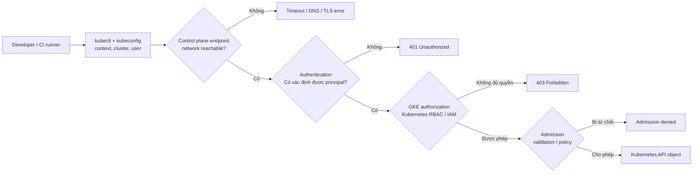
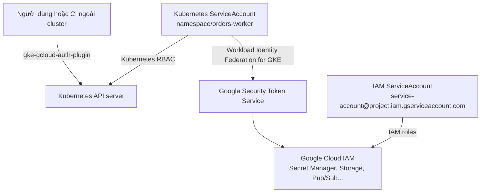
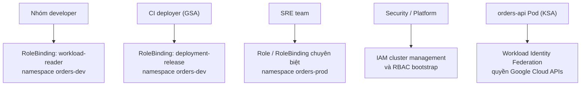

# Cấu hình kubectl, IAM và Kubernetes RBAC

Một nhóm phát triển đang vận hành ứng dụng Java trên Google Kubernetes Engine (GKE). Lập trình viên cần **xem Pod và log** trong namespace `orders-dev` để điều tra lỗi, nhóm phát hành cần cập nhật Deployment, còn nhóm bảo mật chịu trách nhiệm cấp quyền quản trị cluster. Nếu tất cả dùng tài khoản có `cluster-admin`, một lệnh nhầm có thể sửa Secret, xóa workload production hoặc mở rộng quyền ngoài ý muốn. Ngược lại, nếu chỉ cấp quyền Google Cloud IAM mà chưa hiểu Kubernetes RBAC, người dùng có thể chạy `gcloud container clusters get-credentials` thành công nhưng vẫn bị `Forbidden` khi gọi API.

Bài thuộc chương **GKE cơ bản** của module **CLOUD_PROVIDERS_GCP**. Trong lộ trình học Google Cloud từ project/IAM/VPC, Compute Engine, GKE, Cloud Run đến dữ liệu, tự động hóa và vận hành, việc hiểu **`kubectl`, kubeconfig, authentication, authorization, IAM và RBAC** là nền tảng để triển khai an toàn, phân chia trách nhiệm giữa platform và ứng dụng, đồng thời kiểm toán sự cố.

> Tên project, cluster, namespace, email và YAML dưới đây đều là **ví dụ học tập**. Các thao tác tạo RoleBinding/ClusterRoleBinding hoặc sửa IAM có thể cấp thêm quyền thật; chỉ thực hiện trên cluster được ủy quyền và sau khi kiểm tra `kubectl config current-context`. Không dán access token, kubeconfig đầy đủ hoặc khóa service account vào tài liệu công khai.

## Mục tiêu học tập

Sau bài này, bạn có thể:

1. Giải thích đường đi của lệnh `kubectl` đến **Kubernetes API server** và sự khác nhau giữa **network reachability, authentication, authorization và admission**.
2. Cài `kubectl`, `gke-gcloud-auth-plugin`, tạo/khoanh vùng `kubeconfig` bằng `gcloud container clusters get-credentials`, quản lý context an toàn.
3. Phân biệt quyền **Google Cloud IAM** ở project/cluster với **Kubernetes RBAC** trên tài nguyên trong cluster/namespace, kể cả cơ chế kết hợp của GKE.
4. Tạo **Role**, **ClusterRole**, **RoleBinding**, **ClusterRoleBinding** đúng scope, phân biệt các subject `User`, `Group` và `ServiceAccount`.
5. Thiết kế quyền chỉ đọc Pod/log, quyền phát hành Deployment hạn chế, tránh cấp `secrets`, `pods/exec` và `cluster-admin` không cần thiết.
6. Sử dụng `kubectl auth can-i`, `kubectl auth whoami`, gcloud và audit logs để giải thích `401`/`403`/timeout, không xử lý lỗi bằng cách cấp Owner tràn lan.
7. Phân biệt **Kubernetes ServiceAccount**, **IAM service account** và **Workload Identity Federation for GKE**, biết cách bảo vệ workload identity.
8. Viết runbook onboarding/offboarding, kiểm thử âm tính và quan sát thay đổi quyền production.

## 1. Một câu lệnh kubectl phải vượt qua những lớp nào?

`kubectl` là một **CLI client của Kubernetes API**, không phải công cụ SSH trực tiếp vào node. Lệnh như `kubectl get pods -n orders-dev` cần đi tới API server của cluster và được đánh giá quyền.



**Bốn lớp cần tách biệt:**

| Lớp | Câu hỏi | Ví dụ lỗi |
| --- | --- | --- |
| Network/TLS | Client có kết nối tới API server endpoint được không? | `i/o timeout`, DNS lookup failure, x509 TLS error |
| Authentication (**AuthN**) | Yêu cầu đến từ tài khoản nào? Token hợp lệ không? | `You must be logged in to the server`, 401 |
| Authorization (**AuthZ**) | Principal có quyền `list pods` ở namespace này không? | `Forbidden` với user/resource/verb |
| Admission | Object được phép tạo/sửa theo policies và validators không? | Pod Security Admission hoặc validating webhook từ chối |

Một credential hợp lệ **không tự cấp quyền**. Và một RoleBinding hợp lệ **không sửa được lỗi endpoint không thể truy cập**. Vì vậy khi xử lý sự cố phải phân loại đúng lớp trước khi thay IAM/RBAC.

### Hai “mặt phẳng” quản trị

- **Google Cloud control plane**: tài nguyên GKE cluster, node pool, network, IAM policies, project, billing, API enablement. Công cụ thường dùng: `gcloud container clusters ...`, Google Cloud Console, Terraform.
- **Kubernetes API plane**: namespaces, Pods, Deployments, Services, Secrets, Roles và RoleBindings trong cluster. Công cụ thường dùng: `kubectl ...` hoặc Kubernetes client libraries.

Thực tế có phần giao nhau: GKE tích hợp IAM và RBAC khi **ủy quyền** các Kubernetes API operations, nhưng không vì thế mà khái niệm project IAM và namespace RBAC trở thành một.

## 2. Ba thành phần cần có để dùng kubectl trên GKE

### 2.1 kubectl

`kubectl` gọi Kubernetes API qua HTTPS. Phiên bản client nên tương thích với phiên bản Kubernetes cluster theo **chính sách version skew** chính thức; cập nhật công cụ từ nguồn đáng tin và kiểm tra:

```bash
kubectl version --client
kubectl config get-contexts
```

Không dùng `kubectl get all --all-namespaces` để kết luận bạn đã nhìn thấy mọi tài nguyên: `all` không liệt kê toàn bộ Kubernetes resource types và lệnh còn cần quyền trên nhiều namespace.

### 2.2 gke-gcloud-auth-plugin

GKE sử dụng **`gke-gcloud-auth-plugin`** với cơ chế **Kubernetes exec credential plugin** để cấp Google identity token cho client. Đây là chương trình riêng mà kubeconfig tham chiếu; `kubectl` cần gọi được nó trong môi trường `PATH`.

```bash
# Chỉ kiểm tra phiên bản, không thay đổi tài nguyên GKE.
gcloud version
gke-gcloud-auth-plugin --version
kubectl version --client
```

Nếu chưa cài và đang dùng bản Google Cloud CLI cho phép cài components:

```bash
# Cài component trên máy có hỗ trợ Google Cloud CLI component manager.
gcloud components install gke-gcloud-auth-plugin
```

Trên Linux cài `gcloud` từ apt/yum, component manager có thể bị vô hiệu hóa; dùng package như `google-cloud-cli-gke-gcloud-auth-plugin` từ Google Cloud repository. Trong Cloud Shell, công cụ có thể đã có. **Không tải binary plugin từ trang không tin cậy** hoặc thêm một exec plugin tùy ý vào kubeconfig.

### 2.3 kubeconfig

Kubeconfig thường ở `~/.kube/config` và chứa các phần:

| Trường | Nội dung | Ý nghĩa |
| --- | --- | --- |
| `clusters` | API server URL và thông tin xác minh TLS | Client liên hệ endpoint nào |
| `users` | Cấu hình authentication/exec plugin | Client xác thực theo identity nào |
| `contexts` | Bộ ba cluster + user + namespace mặc định | Target của lệnh `kubectl` |
| `current-context` | Context đang được chọn | Nếu không truyền `--context`, lệnh dùng context này |

Kubeconfig **không phải Kubernetes RoleBinding**, cũng **không chứng minh** bạn có quyền dùng cluster. Nó có thể chứa hoặc tham chiếu thông tin nhạy cảm, nên chỉ chia sẻ bản đã được kiểm duyệt; tránh `kubectl config view --raw` trong CI log, issue hoặc chat.

## 3. Cấu hình gcloud và lấy kubeconfig cho cluster

Ví dụ:

```text
PROJECT_ID=retail-dev-01
CLUSTER_NAME=retail-gke-dev
CONTROL_PLANE_LOCATION=asia-southeast1
NAMESPACE=orders-dev
```

`CONTROL_PLANE_LOCATION` là **region** nếu cluster là regional, hoặc **zone** nếu cluster là zonal. Không tự suy rằng cluster regional có một zone cố định.

### 3.1 Kiểm tra principal Google Cloud trước

```bash
# Chỉ đọc trạng thái local và thông tin cluster được phép xem.
gcloud auth list
gcloud config get-value account
gcloud config get-value project

gcloud container clusters list \
  --project="retail-dev-01"

gcloud container clusters describe retail-gke-dev \
  --project="retail-dev-01" \
  --location="asia-southeast1"
```

Lệnh `describe` có thể hiển thị endpoint và các thiết lập điều khiển truy cập; khi chia sẻ output, kiểm duyệt những thông tin không cần thiết cho người nhận.

### 3.2 Lấy credentials

```bash
# GHI kubeconfig LOCAL: không tạo/sửa cluster trên Google Cloud.
gcloud container clusters get-credentials retail-gke-dev \
  --project="retail-dev-01" \
  --location="asia-southeast1"
```

Theo tài liệu GKE, để tạo kubeconfig entry người dùng cần ít nhất IAM permission **`container.clusters.get`**, có trong `roles/container.clusterViewer`. Quyền đó phục vụ nhận diện/kết nối tới cluster, **không tự cấp quyền list Pod hay sửa Deployment**. GKE còn áp dụng xác thực, mạng và ủy quyền RBAC/IAM cho các lệnh tiếp theo.

**Tác dụng phụ quan trọng:** `get-credentials` thêm/cập nhật context và **đổi `current-context`** sang cluster vừa lấy. Trên máy vận hành nhiều project, điều này có thể khiến lệnh `kubectl delete` sau đó tác động nhầm cluster. Luôn kiểm tra context và namespace ngay sau khi chạy.

### 3.3 Xem và chọn context an toàn

```bash
# Chỉ đọc.
kubectl config get-contexts
kubectl config current-context
kubectl config view --minify

# Đổi current context LOCAL (không thay đổi cluster).
kubectl config use-context "gke_retail-dev-01_asia-southeast1_retail-gke-dev"

# Đặt namespace mặc định cho context LOCAL.
kubectl config set-context --current --namespace=orders-dev

# Kiểm tra lại để chắc chắn không thao tác nhầm prod.
kubectl config current-context
```

Tên context `gke_PROJECT_LOCATION_CLUSTER` là định dạng thường thấy từ `get-credentials`, nhưng có thể đã bị rename hoặc khác trong môi trường cụ thể. Lấy tên **thực tế** từ `kubectl config get-contexts` rồi mới `use-context`. Với lệnh nhạy cảm, nên thêm cả `--context` lẫn `-n NAMESPACE` và dùng pipeline đã pin target.

### 3.4 Tách kubeconfig của lab khỏi cấu hình production

```bash
# Ví dụ Linux/Cloud Shell: sử dụng kubeconfig riêng cho lab.
mkdir -p "$HOME/.kube"
export KUBECONFIG="$HOME/.kube/gke-retail-lab"

# Lệnh này ghi vào file KUBECONFIG riêng.
gcloud container clusters get-credentials retail-gke-dev \
  --project="retail-dev-01" \
  --location="asia-southeast1"

kubectl config get-contexts
```

Khi `KUBECONFIG` là danh sách đường dẫn, `kubectl` có thể merge nhiều file; hiểu thứ tự và không đưa kubeconfig chứa credentials thật vào Git. CI nên dùng **kubeconfig tạo tạm, quyền file hạn chế, identity ngắn hạn** và dọn sau job; không dựa vào cấu hình trên laptop cá nhân.

## 4. Chọn endpoint control plane: external IP, internal IP, DNS

GKE có các lựa chọn **control plane endpoint** tùy thiết lập cluster:

| Endpoint | Đặc điểm | Điều kiện cần |
| --- | --- | --- |
| External IP-based endpoint | Endpoint IP bên ngoài nếu được bật và được policies cho phép | Network path, authorized networks khi cấu hình, IAM/RBAC |
| Internal IP-based endpoint | Dùng IP nội bộ của control plane | Client phải có đường đi mạng hợp lệ vào VPC/control plane |
| DNS-based endpoint | Tên DNS endpoint do GKE cung cấp với cơ chế truy cập/kiểm soát tương ứng | DNS resolution, đường mạng, IAM/network policy theo tài liệu |

Theo tài liệu hiện hành, `get-credentials` mặc định chọn canonical endpoint dựa trên cấu hình cluster; các lựa chọn tường minh:

```bash
# Sử dụng internal IP-based endpoint khi client có đường vào mạng nội bộ.
gcloud container clusters get-credentials retail-gke-dev \
  --project="retail-dev-01" \
  --location="asia-southeast1" \
  --internal-ip

# Hoặc chọn DNS-based endpoint khi cluster có cấu hình hỗ trợ.
gcloud container clusters get-credentials retail-gke-dev \
  --project="retail-dev-01" \
  --location="asia-southeast1" \
  --dns-endpoint
```

**Không chạy cả hai lệnh liên tiếp chỉ để thử trong production:** lần cuối có thể ghi đè entry/context kubeconfig. Chọn endpoint theo runbook và môi trường.

Nếu private endpoint chỉ truy cập qua VPC/VPN/Interconnect/bastion, việc cấp `cluster-admin` không giúp giải quyết lỗi TCP timeout. Ngược lại endpoint DNS hoạt động cũng **không mở khóa RBAC**.

### Lỗi kết nối khác lỗi quyền

```text
kubectl get pods -n orders-dev

Unable to connect to the server: dial tcp ... i/o timeout
    -> nghiêng về network / endpoint.

Error from server (Forbidden): pods is forbidden ...
    -> đã đến API server, cần phân tích authorization.
```

Không tắt TLS verification bằng `insecure-skip-tls-verify` để “sửa nhanh” một cấu hình endpoint/CA sai. Hãy lấy lại kubeconfig đúng endpoint, kiểm tra DNS/certificate chain và chính sách mạng.

## 5. GKE dùng IAM và Kubernetes RBAC cùng lúc như thế nào?

### 5.1 IAM: ai được quản trị tài nguyên Google Cloud?

IAM kiểm soát quyền trên Google Cloud projects, GKE clusters và một tập Kubernetes operations được GKE ánh xạ vào permissions IAM.

| IAM role/permission | Công dụng | Không tự bảo đảm |
| --- | --- | --- |
| `roles/container.clusterViewer` | Cho phép xem thông tin cluster; có `container.clusters.get` | Quyền đọc Deployment, Pod trong mọi namespace |
| `roles/container.viewer` | Cho phép xem GKE/Kubernetes objects theo IAM role tương ứng | Không phải ACL chi tiết cho một `Pod` hoặc namespace riêng |
| `roles/container.developer` | Có quyền phát triển/quản lý một số Kubernetes API objects theo IAM | Không thay thế ranh giới RBAC namespace khi cần least privilege |
| `roles/container.admin` | Quyền quản trị GKE và nhiều Kubernetes API operations | Không nên cấp cho developer thông thường |
| `container.clusters.get` | Cần thiết cho luồng dùng GKE credentials/authentication theo tài liệu | Không phải quyền `get pods` trong Kubernetes |

Vai trò trên có thể được cấp ở phạm vi project hoặc phạm vi Google Cloud IAM hỗ trợ. Với nhu cầu giới hạn **một namespace hoặc một resource name**, **RBAC** thường diễn đạt rõ hơn IAM.

### 5.2 RBAC: ai được làm gì với Kubernetes API object?

RBAC mô tả bộ ba:

```text
SUBJECT + VERB + RESOURCE + SCOPE

Ví dụ:
User dev.reader@example.com
  get, list, watch
  pods
  namespace orders-dev
```

RBAC được lưu trong cluster dưới dạng Kubernetes API objects, không phải IAM binding trên Google Cloud project.

### 5.3 GKE kết hợp hai cơ chế ủy quyền

Khi đã xác thực, GKE kiểm tra **Kubernetes RBAC trước**; nếu RBAC không cấp phép, GKE có thể kiểm tra **IAM permissions** tương ứng. Một hành động được cho phép nếu cơ chế phù hợp cấp quyền theo quy tắc của GKE. Đây không phải mô hình “phải có quyền chỉnh Pod ở cả IAM *và* RBAC mới được”, nhưng danh tính phải có điều kiện tối thiểu để xác thực/kết nối tới cluster. Không nên phụ thuộc vào IAM role rộng khi muốn chứng minh least privilege theo namespace.

**Hệ quả bảo mật:** Thu hồi một RoleBinding **chưa chắc thu hồi hoàn toàn quyền** nếu người dùng còn IAM role như `roles/container.developer` hoặc `roles/container.admin` có thể cho phép cùng hành động. Muốn thu hồi thực sự phải kiểm tra **quyền hiệu lực từ cả hai mặt phẳng**.

RBAC **chỉ cộng quyền**; nó không có “deny rule” để chặn một IAM role rộng đã cấp. Vì vậy hãy tránh “một role rộng ở project + một RBAC role hẹp trong namespace” rồi nghĩ role hẹp tự làm người dùng bị giới hạn.

## 6. Role, ClusterRole, RoleBinding, ClusterRoleBinding

Các đối tượng RBAC có ý nghĩa khác nhau:

| Object | Scope của định nghĩa | Có thể gắn với | Điều cần nhớ |
| --- | --- | --- | --- |
| **Role** | Một namespace | `RoleBinding` trong namespace đó | Quyền trên namespaced resources |
| **ClusterRole** | Cluster-scoped định nghĩa rules | `ClusterRoleBinding` hoặc `RoleBinding` | Dùng cho cluster-wide resources hoặc tái sử dụng role ở nhiều namespace |
| **RoleBinding** | Một namespace | `Role` hoặc `ClusterRole` | Giới hạn quyền được gán vào namespace của binding |
| **ClusterRoleBinding** | Toàn cluster | Chỉ `ClusterRole` | Có thể cho phép trên nhiều namespace và resources ở cấp cluster |

### Cách đọc ví dụ

```text
Role workload-reader in orders-dev
  + RoleBinding developers-reader in orders-dev
     -> User/Group được đọc workload trong orders-dev.

ClusterRole workload-reader-global
  + RoleBinding one-namespace-reader in orders-dev
     -> ClusterRole được dùng CHỈ trong orders-dev cho resources namespaced.

ClusterRole workload-reader-global
  + ClusterRoleBinding everywhere-reader
     -> Có thể đọc resources được cấp trên TOÀN CLUSTER.
```

**Trường hợp dễ gây lỗi:** `RoleBinding` tới `ClusterRole` chỉ cấp quyền **namespaced** trong namespace chứa binding; nó không biến `nodes` (cluster-scoped resource) thành đối tượng có namespace.

### Một RBAC rule gồm gì?

```yaml
rules:
  - apiGroups: [""]            # "" = Kubernetes core API group
    resources: ["pods"]        # Đối tượng Pod
    verbs: ["get","list","watch"]
```

Các verbs thường gặp: `get`, `list`, `watch`, `create`, `update`, `patch`, `delete`. Một số **subresources** dùng rules riêng, ví dụ:

- `pods/log`: đọc log, không đồng nghĩa quyền `get pods`.
- `pods/exec`: tương tác thực thi lệnh bên trong container, rủi ro cao hơn xem log.
- `deployments/scale`: cập nhật replica qua subresource.
- `secrets`: chứa dữ liệu nhạy cảm và access tokens/credentials.
- `serviceaccounts/token`: có thể tạo token cho một Kubernetes ServiceAccount; cần kiểm soát chặt.

Đừng cấp `resources: ["*"]`, `verbs: ["*"]` một cách mặc định. Quyền `list/watch secrets` có thể tiết lộ toàn bộ Secrets trong namespace, ngay cả khi dashboard chỉ định hiển thị “danh sách”.

## 7. Subject: User, Group, ServiceAccount

RBAC bind tới **subject**:

| Subject | `kind` | `name` điển hình | Ngữ cảnh |
| --- | --- | --- | --- |
| Google identity user | `User` | `dev.reader@example.com` | Người dùng gọi `kubectl` |
| Google Workspace/Cloud Identity group (đã bật Google Groups for RBAC) | `Group` | `gke-dev-readers@example.com` | Quản lý nhiều người qua group |
| Kubernetes ServiceAccount (KSA) | `ServiceAccount` | `report-worker` + `namespace: orders-dev` | Pod gọi Kubernetes API |
| IAM service account (GSA) dùng như Google identity | `User` | `ci-deployer@retail-dev-01.iam.gserviceaccount.com` | CI gọi GKE API bằng Google credentials |

**GSA ≠ KSA.** Một IAM service account là tài nguyên Google Cloud; một Kubernetes ServiceAccount là đối tượng trong namespace. Nếu muốn bind GSA làm principal người dùng của GKE API, dùng `kind: User` và email GSA. Nếu muốn bind **KSA**, dùng `kind: ServiceAccount` cùng `namespace`. Không dùng một cấu hình “ServiceAccount” duy nhất cho cả hai rồi kỳ vọng trùng danh tính.

### Google Groups for RBAC

GKE có tính năng **Google Groups for RBAC** để liên kết Kubernetes RBAC với nhóm được quản trị trong Google Workspace/Cloud Identity. Yêu cầu chính:

1. Tổ chức có Google Workspace hoặc Cloud Identity phù hợp.
2. Quản trị viên tạo group gốc tên bắt buộc `gke-security-groups` trên domain đã cấu hình.
3. Nhóm con như `gke-dev-readers@example.com` được đưa vào `gke-security-groups@example.com`; quản trị thành viên ở hệ thống nhóm.
4. Cluster được bật **Google Groups for RBAC** và chỉ định security group tương ứng.
5. RoleBinding/ClusterRoleBinding dùng `kind: Group` và **email chính xác (phân biệt hoa thường)** của group được hỗ trợ.

Thay đổi thành viên nhóm có thể mất thời gian để cache token/group membership được làm mới; **không dựa vào group propagation tức thì** khi thu hồi quyền khẩn cấp. Với production, lập quy trình offboarding và revocation nhiều lớp.

## 8. Lab: quyền chỉ xem Pod, Service, Deployment và logs

### Bối cảnh

Giả định:

```text
Project: retail-dev-01
Cluster: retail-gke-dev
Location: asia-southeast1
Namespace: orders-dev
User: dev.reader@example.com

Mục tiêu: cho phép đọc Pod, Service, Deployment và log
          trong orders-dev.
Không cho phép: sửa/xóa Deployment, xem Secrets, exec vào Pod,
                đọc Pod/log ở namespaces khác.
```

**Tiền điều kiện:** Admin đã được phê duyệt đang sử dụng context đúng cluster và có đủ quyền tạo namespace/Role/RoleBinding. User nhận quyền phải có Google identity hợp lệ, `container.clusters.get` IAM và đường mạng tới API server.

### 8.1 Tạo namespace (admin — thay đổi cluster)

```bash
# Chỉ chạy trên cluster lab sau khi kiểm tra current-context.
kubectl config current-context
kubectl create namespace orders-dev
```

Nếu namespace đã tồn tại, không cần tạo lại. Với production, quản lý Namespace, ResourceQuota, LimitRange, NetworkPolicy và Pod Security Admission qua IaC/GitOps thay vì thao tác thủ công.

### 8.2 Role chỉ đọc ở namespace

Manifest `role-workload-reader.yaml`:

```yaml
apiVersion: rbac.authorization.k8s.io/v1
kind: Role
metadata:
  name: workload-reader
  namespace: orders-dev
rules:
  - apiGroups: [""]
    resources: ["pods", "services", "events"]
    verbs: ["get", "list", "watch"]
  - apiGroups: [""]
    resources: ["pods/log"]
    verbs: ["get"]
  - apiGroups: ["apps"]
    resources: ["deployments", "replicasets"]
    verbs: ["get", "list", "watch"]
```

**Giải thích:**

- `apiGroups: [""]` là core API group cho Pod, Service và Event.
- `apps` là API group của Deployment/ReplicaSet.
- `get/list/watch` đủ cho việc xem đối tượng; `pods/log` cần khai báo riêng để xem logs.
- Không có quyền trên `secrets`, `pods/exec`, `pods/portforward`, `pods/attach` hoặc `delete/update`.
- Role chỉ có hiệu lực với **namespace `orders-dev`**; một user khác không có binding không được hưởng quyền chỉ vì Role tồn tại.

### 8.3 RoleBinding cho một user

Manifest `rolebinding-reader.yaml`:

```yaml
apiVersion: rbac.authorization.k8s.io/v1
kind: RoleBinding
metadata:
  name: workload-reader-dev
  namespace: orders-dev
subjects:
  - kind: User
    name: dev.reader@example.com
    apiGroup: rbac.authorization.k8s.io
roleRef:
  kind: Role
  name: workload-reader
  apiGroup: rbac.authorization.k8s.io
```

Ở đây `kind: User` là email Google identity đã xác thực; **không phải** một Kubernetes `User` resource có thể tạo bằng `kubectl create user`. Kubernetes không có API object `User` dùng để tự đăng ký người dùng như một Deployment.

### 8.4 Áp dụng và kiểm tra (admin)

```bash
# Các lệnh apply THAY ĐỔI RBAC, chỉ dành cho người được ủy quyền.
kubectl apply -f role-workload-reader.yaml
kubectl apply -f rolebinding-reader.yaml

# Kiểm tra phạm vi và tham chiếu:
kubectl get role workload-reader -n orders-dev -o yaml
kubectl get rolebinding workload-reader-dev -n orders-dev -o yaml
```

**Không gán `cluster-admin` để khắc phục một lỗi `kubectl apply`.** Người tạo/sửa Role hoặc Binding còn chịu **RBAC privilege-escalation checks**: phải đã có những quyền muốn cấp hoặc được phép `escalate`/`bind` theo quy tắc Kubernetes. Vì thế một IAM permission chung có thể không đủ để tự tạo Role cấp thêm các quyền mới.

### 8.5 Tự xác minh bằng chính tài khoản được cấp

Đăng nhập `dev.reader@example.com` theo đường GKE được phê duyệt, lấy credentials và chạy:

```bash
gcloud container clusters get-credentials retail-gke-dev \
  --project="retail-dev-01" \
  --location="asia-southeast1"

# Xem principal đã xác thực khi API/permission hỗ trợ.
kubectl auth whoami

# Kiểm tra từng quyền với namespace rõ ràng.
kubectl auth can-i get pods -n orders-dev
kubectl auth can-i list deployments.apps -n orders-dev
kubectl auth can-i get pods --subresource=log -n orders-dev

# Các phép kiểm tra từ chối, kết quả mong đợi là 'no'.
kubectl auth can-i delete deployments.apps -n orders-dev
kubectl auth can-i get secrets -n orders-dev
kubectl auth can-i create pods --subresource=exec -n orders-dev
kubectl auth can-i get pods -n payments-prod
```

Với cùng tài khoản, có thể chạy `kubectl get pods -n orders-dev` và `kubectl logs POD_NAME -n orders-dev` nếu được phép. **Không kết luận policy bị lỗi chỉ vì `kubectl get namespaces` (cluster-scoped) trả Forbidden:** quyền của lab chỉ dành cho objects trong một namespace.

**Lưu ý:** `kubectl auth can-i` kiểm tra khả năng được ủy quyền theo yêu cầu cụ thể. Cú pháp `--subresource` phụ thuộc phiên bản `kubectl`; đối với môi trường không hỗ trợ, dùng `kubectl auth can-i get pods/log -n orders-dev` hoặc thực hiện request đọc log an toàn theo tài liệu. Với các phép kiểm tra `--as`/impersonation, danh tính kiểm tra cũng cần **permission impersonate**; chạy `--as` không có quyền có thể khiến bài test thất bại vì lý do khác.

### 8.6 Lựa chọn RoleBinding theo Group

Nếu GKE đã bật Google Groups for RBAC, thay subject bằng:

```yaml
subjects:
  - kind: Group
    name: gke-dev-readers@example.com
    apiGroup: rbac.authorization.k8s.io
```

Đây là **đoạn YAML của phần `subjects`**, cần được ghép vào RoleBinding đầy đủ; không áp độc lập. Với nhóm nhân sự thay đổi thường xuyên, quản lý thành viên trên Google Workspace/Cloud Identity giúp tránh sửa từng binding khi nhân viên onboarding/offboarding.

## 9. Cấp quyền cập nhật Deployment nhưng không quản trị toàn cluster

Một nhóm CI/CD cần cập nhật image của Deployment trong `orders-dev`. Quyền khác hẳn viewer:

```yaml
apiVersion: rbac.authorization.k8s.io/v1
kind: Role
metadata:
  name: deployment-release
  namespace: orders-dev
rules:
  - apiGroups: ["apps"]
    resources: ["deployments"]
    verbs: ["get", "list", "watch", "update", "patch"]
  - apiGroups: ["apps"]
    resources: ["deployments/scale"]
    verbs: ["get", "update", "patch"]
```

Ví dụ RoleBinding cho **IAM service account** làm CI principal:

```yaml
apiVersion: rbac.authorization.k8s.io/v1
kind: RoleBinding
metadata:
  name: release-ci-binding
  namespace: orders-dev
subjects:
  - kind: User
    name: ci-gke-deployer@retail-dev-01.iam.gserviceaccount.com
    apiGroup: rbac.authorization.k8s.io
roleRef:
  kind: Role
  name: deployment-release
  apiGroup: rbac.authorization.k8s.io
```

**Giới hạn của ví dụ:** CI identity phải thực sự xác thực vào Kubernetes API server dưới **đúng email GSA**; một Kubernetes ServiceAccount tên `ci-gke-deployer` không khớp subject này. Ngoài ra, `update/patch deployments` có thể khiến workload mới chạy với **Kubernetes ServiceAccount có quyền mạnh**, mount volume/Secret hoặc làm thay đổi bảo mật ứng dụng. Vì thế chỉ cấp role sau khi có **Pod Security Admission, policy/admission controls, image approval, workload identity và trust boundary** thích hợp.

Một Role đọc/patch Deployment **không đủ** để làm mọi bước của `kubectl apply` nếu manifest còn tạo ConfigMap, Service, Secret, HPA hoặc mới tạo Deployment; nên cấp quyền theo các objects thật sự cần vận hành và kiểm thử quyền trước khi bật pipeline. Tránh `create secret` hoặc `pods/exec` mặc định.

### Giới hạn theo một object name

RBAC `resourceNames` cho phép giới hạn một số operations:

```yaml
rules:
  - apiGroups: ["apps"]
    resources: ["deployments"]
    resourceNames: ["orders-api"]
    verbs: ["get", "update", "patch"]
```

Đây là **đoạn `rules`** trong Role. Không dùng `list/watch` với `resourceNames` mà không hiểu yêu cầu field selector tương ứng; `create` nói chung không được giới hạn hiệu quả theo tên bằng cách này vì tên object có thể chưa được xác định tại lúc authorization.

## 10. Khi nào cần ClusterRole và ClusterRoleBinding?

Vài nghiệp vụ hợp lệ là **cluster-scoped**: quan sát `nodes`, quản trị `namespaces`, `PersistentVolumes` hoặc `CustomResourceDefinitions` (CRDs). Đó là các trường hợp cần cân nhắc `ClusterRole`.

### ClusterRole chỉ xem Node

```yaml
apiVersion: rbac.authorization.k8s.io/v1
kind: ClusterRole
metadata:
  name: node-observer
rules:
  - apiGroups: [""]
    resources: ["nodes"]
    verbs: ["get", "list", "watch"]
```

Để gán quyền này **toàn cluster** phải có `ClusterRoleBinding` đã được phê duyệt:

```yaml
apiVersion: rbac.authorization.k8s.io/v1
kind: ClusterRoleBinding
metadata:
  name: node-observers
subjects:
  - kind: Group
    name: gke-platform-readers@example.com
    apiGroup: rbac.authorization.k8s.io
roleRef:
  kind: ClusterRole
  name: node-observer
  apiGroup: rbac.authorization.k8s.io
```

**Chỉ dùng binding Group khi Google Groups for RBAC đã được cấu hình hợp lệ**. Nếu dùng User thì subject cần email user Google. Tránh tạo ClusterRoleBinding với `cluster-admin` cho `system:authenticated` hoặc mọi developer; thay đổi đó có thể trao quyền cực rộng cho bất kỳ principal nào xác thực được.

### Dùng ClusterRole trong một namespace

Một `ClusterRole` có thể chứa bộ quy tắc đọc Pod/Deployment và được reuse ở nhiều namespace với các `RoleBinding` khác nhau. Khi chỉ bind `ClusterRole` bằng `RoleBinding` trong `orders-dev`, quyền trên namespaced resources có phạm vi **chỉ `orders-dev`**, không mở thành toàn cluster.

Đây là mô hình hữu ích khi 10 team cần cùng permission set nhưng mỗi team chỉ được đọc namespace của mình: **định nghĩa một ClusterRole, tạo các RoleBindings riêng**, không cấp một ClusterRoleBinding toàn cluster.

## 11. Tài khoản dịch vụ: KSA, GSA và Workload Identity Federation

Ba dòng định danh dễ bị lẫn:



| Danh tính | Tồn tại ở đâu? | Dùng cho |
| --- | --- | --- |
| Google user/CI identity | Google Cloud identity/IAM | `gcloud`, `kubectl` từ developer/runner |
| Kubernetes ServiceAccount (KSA) | Namespace của Kubernetes cluster | Workload gọi Kubernetes API |
| IAM service account (GSA) | Google Cloud project | Workload gọi Google APIs theo IAM roles |
| Workload Identity Federation for GKE | Liên kết Kubernetes workload principal với IAM | GKE workload truy cập Google APIs không cần static service-account key |

### 11.1 Ví dụ KSA cho Pod đọc ConfigMap

```yaml
apiVersion: v1
kind: ServiceAccount
metadata:
  name: config-reader
  namespace: orders-dev
---
apiVersion: rbac.authorization.k8s.io/v1
kind: Role
metadata:
  name: config-reader
  namespace: orders-dev
rules:
  - apiGroups: [""]
    resources: ["configmaps"]
    verbs: ["get"]
---
apiVersion: rbac.authorization.k8s.io/v1
kind: RoleBinding
metadata:
  name: config-reader-binding
  namespace: orders-dev
subjects:
  - kind: ServiceAccount
    name: config-reader
    namespace: orders-dev
roleRef:
  kind: Role
  name: config-reader
  apiGroup: rbac.authorization.k8s.io
```

Ứng dụng Pod phải khai báo:

```yaml
spec:
  serviceAccountName: config-reader
```

Đây là đoạn **`spec` của Pod**; với Deployment nó thuộc `spec.template.spec`. Chỉ tạo KSA/RoleBinding không khiến mọi Pod tự dùng KSA đó. Mỗi namespace có `default` KSA, nhưng production nên dùng **KSA riêng, ít quyền** theo workload.

### 11.2 GKE workload muốn đọc Cloud Storage/Secret Manager

Không sử dụng Kubernetes RoleBinding để cấp `storage.objects.get` — đó là **Google Cloud IAM permission**. Cần cấu hình **Workload Identity Federation for GKE**, rồi cấp IAM role trên tài nguyên Storage/Secret Manager cho principal KSA (hoặc dùng IAM service account impersonation theo thiết kế). Nó có thể hoạt động bằng workload principal trực tiếp mà **không bắt buộc** KSA phải impersonate một GSA.

Ví dụ:

```text
KSA: orders-dev/orders-worker
    |
    +-- Kubernetes RBAC: đọc ConfigMap cần thiết ở orders-dev
    |
    +-- Workload Identity Federation:
        được cấp storage.objects.get trên bucket app-artifacts

KHÔNG suy ra:
  có Kubernetes cluster-admin -> có Storage Admin
  có Storage Admin -> được kubectl delete Pod
```

**Cảnh báo identity sameness:** Những clusters trong cùng Google Cloud project có thể dùng chung workload identity pool. Nếu IAM principal selector chỉ phân biệt tên namespace/KSA mà không giới hạn cluster, KSA trùng tên ở hai cluster trong cùng project có thể được nhận diện tương đương đối với một số chính sách. Đánh giá tách project/trust boundary hoặc condition/cluster restriction theo hướng dẫn chính thức.

## 12. Xác minh quyền bằng kubectl auth và truy vấn read-only

### Quy trình an toàn trước thay đổi

```bash
# Bước 1: target hiện hành.
kubectl config current-context
kubectl config get-contexts

# Bước 2: danh tính hiện hành.
gcloud auth list
kubectl auth whoami

# Bước 3: quyền thật sự trong namespace.
kubectl auth can-i get pods -n orders-dev
kubectl auth can-i list deployments.apps -n orders-dev
kubectl auth can-i delete deployments.apps -n orders-dev
kubectl auth can-i --list -n orders-dev

# Bước 4: kiểm tra đối tượng RBAC do admin cung cấp.
kubectl get rolebindings -n orders-dev
```

Lệnh `--list` cung cấp danh sách quyền mà API server báo về principal theo cơ chế SelfSubjectRulesReview; với một số authorizer/tích hợp, nó có thể **không thể hiện đầy đủ mọi quyền IAM**. Vì vậy dùng các phép thử `can-i` cụ thể và, nếu được ủy quyền, kiểm thử thao tác chỉ đọc/âm tính thực tế.

### Kiểm tra theo subject khác có giới hạn

Kubernetes cho phép `--as`/`--as-group` để kiểm tra impersonation, ví dụ:

```bash
# CHỈ dành cho admin đã được cấp quyền impersonate, không phải user thông thường.
kubectl auth can-i get pods \
  --as=dev.reader@example.com \
  --namespace=orders-dev
```

Nếu principal đang chạy không có `impersonate` permission, API server sẽ trả Forbidden ngay ở bước giả danh; điều đó **không chứng minh** user đích không có quyền đọc Pod. Với bài kiểm tra định kỳ, nên để user/group/CI chạy xác minh bằng **credentials của chính principal đó**, thay vì cấp `impersonate` rộng cho công cụ kiểm tra.

## 13. Hiểu lỗi 401, 403 và privilege escalation

### 13.1 401 / authentication lỗi

Ví dụ:

```text
error: You must be logged in to the server (Unauthorized)
```

Kiểm tra:

1. `gke-gcloud-auth-plugin --version` và khả năng tìm binary trong `PATH`.
2. `gcloud auth list`: active account đúng chưa? Token có còn hợp lệ?
3. `kubectl config current-context`, kubeconfig user/exec stanza đã trỏ đúng GKE plugin chưa?
4. IAM tối thiểu như `container.clusters.get` đối với account kết nối.
5. Nếu chạy từ CI/VM, token/scopes/impersonation config có đúng không; tránh key JSON dài hạn.

**Không sửa RoleBinding trước khi xác nhận client thực sự đã authenticate.**

### 13.2 403 / RBAC hoặc IAM thiếu

Ví dụ:

```text
Error from server (Forbidden): pods is forbidden:
User "dev.reader@example.com" cannot list resource "pods"
in API group "" in the namespace "orders-dev"
```

Đọc thông báo theo bốn trường: `User`, `verb=list`, `resource=pods`, `namespace=orders-dev`. Đối chiếu `kubectl auth can-i list pods -n orders-dev`, Role/RoleBinding và quyền IAM có thể cấp cùng action. Không thay thế bằng `roles/container.admin` chỉ để loại bỏ 403.

### 13.3 403 khi tạo Role/RoleBinding

Kubernetes có **privilege escalation prevention**:

- Khi tạo/sửa `Role`/`ClusterRole`, caller phải **đã nắm các quyền định cấp**, hoặc có quyền đặc biệt `escalate`.
- Khi bind một role, caller phải **đã có các quyền đang được bind** trong scope tương ứng, hoặc có quyền `bind` đối với role.

Đôi khi IAM cho phép cập nhật một object nhưng RBAC checks vẫn từ chối việc tạo role trao quyền mà caller không thực sự có. Đây là cơ chế an toàn, không phải lỗi cú pháp YAML. Để xử lý, đội platform cần **bootstrap RBAC với principal đủ quyền**, không trao `escalate`/`bind` bừa bãi.

### 13.4 IAM deny, organization policies và GKE controls

Khi role/binding đều có vẻ đúng nhưng thao tác không hoạt động, có thể còn:

- IAM Deny/Principal Access Boundary hoặc chính sách tổ chức hạn chế tài nguyên Google Cloud.
- VPC Service Controls / network policy cho API Google Cloud.
- Cluster endpoint policy, authorized networks, firewall, proxy và chứng chỉ TLS.
- Admission policies: Pod Security Admission, Gatekeeper/Policy Controller, validating/mutating webhook.
- Namespace chưa tồn tại, resource name sai hoặc API group khác.

**Authorization success không bảo đảm admission success**: nếu Pod bị từ chối do image policy, đừng tự cấp Kubernetes `cluster-admin` rồi cho rằng lỗi sẽ biến mất.

## 14. Audit logs và điều tra thay đổi quyền

Trong GKE, Audit Logs và Kubernetes API server logs hỗ trợ điều tra **ai đã thay đổi RoleBinding hoặc truy cập tài nguyên**. Theo cấu hình dịch vụ:

- **Google Cloud Audit Logs** ghi các sự kiện quản trị cluster/IAM ở mặt phẳng Google Cloud.
- **Kubernetes API audit** ghi hoạt động trên API server theo cấu hình logging hỗ trợ; GKE có thể ghi các lỗi quyền dạng `RBAC DENY` vào Admin Activity audit logs.
- **GKE control plane logs** và Cloud Logging giúp tìm request context, status và liên hệ với sự cố.

Ví dụ bộ lọc tham khảo trong Logs Explorer:

```text
"RBAC DENY"
```

Hoặc điều tra IAM thay đổi bằng service name/method tương ứng của `container.googleapis.com` hoặc `cloudresourcemanager.googleapis.com`. Cấu trúc log thực tế khác nhau theo loại operation, GKE version và lựa chọn bật Data Access logs; **không mặc định mọi lần đọc Pod đều có log chi tiết được lưu**.

### Quy trình điều tra một tình huống

1. Ghi **project, cluster, namespace, timestamp, principal** và lệnh gây lỗi.
2. Phân biệt mã lỗi `401`/`403`/`timeout`/`admission denied`.
3. Nếu 403, kiểm tra quyền được cấp từ **RBAC và IAM**, kể cả group memberships.
4. Tra các thay đổi gần đây của Role, ClusterRole, RoleBinding, ClusterRoleBinding, IAM allow bindings và group membership.
5. Xác nhận không có service account hoặc KSA cũ vẫn giữ quyền truy cập thay cho người dùng.
6. Sửa đúng scope, test quyền **được phép và bị từ chối**, ghi ticket/approval.

## 15. Case study: phân quyền GKE cho ứng dụng Java theo môi trường

Doanh nghiệp có dịch vụ `orders-api` (Java) chạy trên GKE, chia môi trường:

| Thành phần | Lab/Dev | Production |
| --- | --- | --- |
| Project | `retail-dev-01` | `retail-prod-01` |
| Cluster | `retail-gke-dev` | `retail-gke-prod` |
| Namespace | `orders-dev` | `orders-prod` |
| Developer | Đọc Pods/logs, không xóa | Có thể chỉ xem Pods/logs khi cần và có phê duyệt |
| CI pipeline | Patch Deployment dev | Deploy prod qua identity khác, có approval |
| SRE | Quan sát health và sự cố | Quyền vận hành theo nhóm/role chuyên biệt |
| Security | Quản trị role/group/identity | Review và audit quyền cluster |
| Java Pod | KSA riêng, Workload Identity Federation | KSA/IAM quyền tối thiểu cho Cloud SQL/Storage/Secret Manager |

### Thiết kế quyền



Ở production, người dùng chỉ có quyền xem không nên có `pods/exec` hoặc quyền tạo Pod. Một developer có quyền `patch Deployment` có thể đổi image, command, env vars và service account của Pod, vì vậy **đó vẫn là quyền đáng kể**; cần admission policies, artifact provenance và phê duyệt thay đổi ở CI.

### Một phát hiện an ninh

Kỹ sư `dev.reader@example.com` không còn thuộc nhóm SRE nhưng vẫn chạy:

```bash
kubectl delete deployment orders-api -n orders-prod
```

Nếu lệnh thành công dù RoleBinding đã bị xóa, hãy kiểm tra:

- Người dùng còn `roles/container.admin`/`roles/container.developer` trong **IAM** không?
- Họ còn nằm trong Google Group khác được `ClusterRoleBinding` cấp quyền không?
- `kubectl` hiện dùng Google identity khác hoặc impersonation không?
- Có quyền `cluster-admin` từ một ClusterRoleBinding rộng hoặc hệ thống cũ không?
- Đây có thực sự là production cluster hay context trỏ nhầm cluster?

**Đừng chỉ nhìn mỗi RoleBinding trong namespace.** Kiểm tra tổng hợp mọi nguồn cấp quyền và trạng thái context.

### Đề xuất các cổng kiểm tra trước production deploy

1. CI xác thực bằng **workload identity/impersonation ngắn hạn**, không có JSON key lưu trong repo.
2. Kubeconfig được sinh riêng cho đúng project/cluster và không được in ra logs.
3. `kubectl auth can-i` xác minh quyền CI cần, cùng negative tests cho quyền nhạy cảm.
4. Deployment manifest được kiểm tra Pod Security, image source/digest và service account.
5. Thay đổi có review, preview diff và rollout/rollback plan.
6. Sau deploy kiểm tra health, logs, SLO, audit và quyền còn tồn tại.

## 16. Bảng xử lý sự cố nhanh

| Triệu chứng | Phân lớp | Hướng xử lý |
| --- | --- | --- |
| `kubectl: command not found` | Client | Cài `kubectl` đúng phiên bản và `PATH` |
| `gke-gcloud-auth-plugin: executable file not found` | Auth plugin | Cài plugin, xác minh `--version` và PATH |
| `current-context is not set` | Kubeconfig | Lấy `get-credentials` cho cluster đúng, kiểm tra context |
| `You must be logged in to the server` | Authentication | Kiểm tra Google account, token, plugin, kubeconfig |
| `dial tcp ... i/o timeout` | Network | Endpoint, VPC/VPN, DNS, firewall, proxy và control plane access |
| `x509: certificate signed by unknown authority` | TLS | Cấu hình CA/endpoint đúng, không tắt TLS verification |
| `Forbidden: cannot list pods` | Authorization | IAM/RBAC verb/resource/namespace và group membership |
| `cannot list namespaces` dù `get pods -n orders-dev` được | Scope | Namespace là cluster-scoped resource; Role namespaced không cấp quyền đó |
| `get pods` được nhưng `kubectl logs` bị Forbidden | Subresource | Cần `get` trên `pods/log` |
| `kubectl exec` bị Forbidden | Subresource | Không tự mở `pods/exec`; chỉ cấp nếu có nhu cầu và review |
| `User attempting to grant RBAC permissions not held` | RBAC escalation checks | Bootstrap bằng admin phù hợp; tránh cấp `bind/escalate` rộng |
| Group mới được thêm nhưng quyền chưa có | Group cache | Xác minh `gke-security-groups`, cluster enablement, propagation |
| CI có IAM SA role nhưng GKE thấy subject khác | Identity | Kiểm tra credentials thực, KSA vs GSA và impersonation |
| Pod không đọc Cloud Storage dù RBAC đúng | Google APIs | Workload Identity Federation for GKE và bucket IAM, không phải RoleBinding |
| Pod bị admission webhook reject | Admission | Sửa manifest/policy mismatch, không chỉ IAM/RBAC |
| Người đã offboard vẫn có quyền | Effective access | Kiểm tra IAM role rộng, bindings khác, nhóm và credential/token cache |

## 17. Quy tắc bảo mật khi phân quyền GKE

### Nguyên tắc least privilege

- **Dành IAM cluster management** cho platform team và những principal thực sự cần thay cluster/node pools.
- **Dùng RBAC namespace-scoped** cho developers và app operators.
- **Không cấp `cluster-admin` cho mọi thành viên** hoặc group `system:authenticated`.
- **Tách quyền deploy và quyền đọc Secret**; `update Deployment` cũng là quyền đáng kể và cần kiểm soát.
- **Phân quyền CI theo môi trường**: identity dev không được tự triển khai prod.
- **KSA riêng cho workload**, giảm quyền Kubernetes API và Google Cloud APIs; tránh mặc định mọi Pod dùng KSA `default`.
- **Quản lý Group membership tập trung** và kiểm tra quyền hiệu lực sau offboarding.
- **Không sửa/xóa các system RBAC roles/bindings `system:*`**; thay đổi có thể làm cluster không ổn định.
- **Không đưa kubeconfig, bearer token, private key vào Git** hoặc ticket/log có phạm vi rộng.
- **Thiết lập admission policies, NetworkPolicies và audit** bên cạnh RBAC; RBAC không tự cô lập network.

### Những quyền thường cần review kỹ

| Quyền | Vì sao nhạy cảm |
| --- | --- |
| `secrets get/list/watch` | Có thể tiết lộ credentials và secrets trong namespace |
| `pods/exec create` hoặc các quyền exec tương ứng | Thực thi lệnh trong container, truy cập filesystem và ứng dụng |
| `pods/create` | Có thể khởi chạy workload dùng service account, volume hoặc host settings không an toàn |
| `deployments patch/update` | Có thể thay image/env/SA và gián tiếp chạy mã theo identity mạnh |
| `serviceaccounts/token create` | Cấp token đại diện KSA trong namespace |
| `roles escalate`/`clusterroles escalate` | Cho phép cấp quyền bản thân không sở hữu |
| `roles bind`/`clusterroles bind` | Cho phép bind quyền rộng của role cho subject |
| `cluster-admin` | Gần như toàn quyền quản trị Kubernetes API trong cluster |

**RBAC không phải sandbox**: để giảm rủi ro từ quyền tạo/chạy workload cần kết hợp Pod Security Admission, policy validation, giới hạn node/host access, Workload Identity Federation, image provenance và kiểm soát lưu lượng.

## 18. Thực hành bằng kịch bản kiểm tra

### Kịch bản A — Viewer trong đúng namespace

1. Tạo namespace `orders-dev` và Role/RoleBinding của mục 8 bằng tài khoản admin được phép.
2. Người dùng `dev.reader@example.com` lấy credentials cho cluster dev.
3. Kiểm tra `kubectl auth can-i get pods -n orders-dev` trả `yes`.
4. Kiểm tra `kubectl auth can-i get secrets -n orders-dev` và `delete deployments.apps` trả `no`.
5. Thử `kubectl get pods -n orders-dev` và `kubectl logs POD_NAME -n orders-dev`.
6. Rà soát IAM: account không có role rộng vô tình cấp các quyền ngoài lab.

### Kịch bản B — ClusterRole tái dùng trong hai namespace

Tạo một ClusterRole chỉ đọc Pods/Deployments và hai RoleBindings trong `orders-dev` và `payments-dev` cho hai nhóm khác nhau. Thảo luận: tại sao **không** dùng một ClusterRoleBinding chung nếu mỗi nhóm chỉ được truy cập namespace của mình?

### Kịch bản C — Phân biệt 403 do IAM hay RBAC

Khi `get-credentials` thành công mà `kubectl get pods -n orders-dev` trả Forbidden, kiểm tra cụ thể `User`, `verb`, `resource` và `namespace`. Nếu RBAC không cấp quyền, xác định IAM có thể cấp quyền tương ứng hay không. Đề xuất một **RoleBinding hẹp** thay vì `roles/container.admin` trên project.

### Kịch bản D — Quyền Pod khác quyền Google Cloud Storage

Pod đã có `Role` cho `get configmaps` nhưng truy cập Cloud Storage trả 403. Hãy xác định **Workload Identity Federation for GKE** và IAM bucket role là lớp cần kiểm tra, không thêm `cluster-admin`.

## 19. Bài tập và lời giải

### Bài 1 — Phân biệt AuthN/AuthZ

`kubectl get pods` trả `You must be logged in to the server`. Nên tạo RoleBinding mới ngay hay kiểm tra gì trước?

<details>
<summary>Gợi ý đáp án</summary>

Đây nghiêng về lỗi **authentication**. Kiểm tra kubeconfig context, gke-gcloud-auth-plugin, `gcloud auth list`, token và quyền tối thiểu để kết nối cluster. Chỉ kiểm tra RoleBinding sau khi danh tính đã được xác thực.
</details>

### Bài 2 — Quyền get-credentials

Một kỹ sư có `roles/container.clusterViewer` và chạy `get-credentials` thành công. Vì sao `kubectl delete deployment` vẫn có thể bị từ chối?

<details>
<summary>Đáp án</summary>

`container.clusters.get` cho phép lấy thông tin/credentials để kết nối; nó không tự cấp quyền xóa Deployment. Cần authorization phù hợp thông qua RBAC hoặc IAM. Theo least privilege, không cấp quyền delete nếu vai trò chỉ yêu cầu quan sát.
</details>

### Bài 3 — RoleBinding với ClusterRole

Một ClusterRole định nghĩa `get/list/watch pods`. Nếu bind nó bằng RoleBinding trong `orders-dev`, người dùng có quyền xem Pod ở `payments-dev` không?

<details>
<summary>Đáp án</summary>

**Không do RoleBinding đó.** Quyền namespaced từ ClusterRole chỉ có hiệu lực trong namespace của RoleBinding. Tuy nhiên người dùng vẫn có thể có quyền bổ sung từ IAM hoặc bindings khác; cần kiểm tra quyền hiệu lực.
</details>

### Bài 4 — Vì sao logs bị Forbidden?

`kubectl auth can-i get pods -n orders-dev` là `yes` nhưng `kubectl logs POD_NAME -n orders-dev` là `Forbidden`. Cần thêm rule gì?

<details>
<summary>Gợi ý đáp án</summary>

Cần quyền `get` trên subresource `pods/log` trong namespace tương ứng. Không cần cấp `pods/exec` hoặc `secrets` để đọc logs.
</details>

### Bài 5 — User và ServiceAccount

CI dùng Google IAM service account `ci-gke-deployer@retail-dev-01.iam.gserviceaccount.com`. Subject trong Kubernetes RoleBinding nên là `kind: ServiceAccount` với namespace `default` hay `kind: User` với email?

<details>
<summary>Đáp án</summary>

Khi GSA thực sự là Google identity gọi Kubernetes API, dùng **`kind: User` và đúng email GSA**. `kind: ServiceAccount` dùng cho **Kubernetes ServiceAccount** có name/namespace trong cluster. Luôn kiểm tra principal thực sự được xác thực.
</details>

### Bài 6 — IAM role rộng và RBAC hẹp

Người dùng có `roles/container.admin` ở project nhưng chỉ có RoleBinding đọc Pod trong `orders-dev`. Có thể coi họ bị giới hạn hoàn toàn vào namespace đó không?

<details>
<summary>Đáp án</summary>

Không. GKE có thể ủy quyền thông qua IAM ngay cả khi RBAC hẹp, nên vai trò IAM rộng có thể cấp thao tác ngoài namespace. Phải giảm IAM role và kiểm tra cả RBAC bindings để đạt least privilege.
</details>

### Bài 7 — Authentication plugin

`kubectl` báo không tìm thấy `gke-gcloud-auth-plugin`. Có nên mở firewall 443 hoặc thêm cluster-admin không?

<details>
<summary>Gợi ý đáp án</summary>

Không. Đây là lỗi **client-side authentication plugin**: cài plugin từ nguồn Google Cloud, kiểm tra version/PATH, chạy lại `get-credentials` và xác minh context. Firewall/RBAC không sửa được binary bị thiếu.
</details>

### Bài 8 — Phân quyền cho Google Group

Một RoleBinding có subject `kind: Group, name: gke-dev-readers@example.com` nhưng user thuộc group này vẫn không truy cập được cluster. Nêu ít nhất ba điểm cần xác minh.

<details>
<summary>Gợi ý đáp án</summary>

Kiểm tra cluster đã bật Google Groups for RBAC chưa, có `gke-security-groups@example.com` làm group gốc không, group con đã nested đúng chưa, case của email có khớp không, thời gian propagation của membership/token, IAM `container.clusters.get` và network endpoint.
</details>

### Bài 9 — Cấp quyền tạo Pod

Tại sao `create pods` không phải quyền “chỉ tạo một tài nguyên vô hại” trong production?

<details>
<summary>Gợi ý đáp án</summary>

Người có quyền tạo Pod có thể chạy image/command tùy ý với Kubernetes ServiceAccount mà họ chọn trong namespace, gắn volume hoặc sử dụng các thiết lập hạ tầng khác nếu policy cho phép. Cần Pod Security Admission/policy, kiểm soát workload identity, image và quyền tạo Pod.
</details>

### Bài 10 — Không thể bind quyền chưa sở hữu

Admin namespace có quyền tạo RoleBinding nhưng bị từ chối khi bind ClusterRole rất mạnh. Đây là lỗi gì và hướng sửa?

<details>
<summary>Gợi ý đáp án</summary>

Đây có thể là **RBAC privilege escalation prevention**: caller không sở hữu đủ quyền định bind hoặc thiếu permission đặc biệt `bind`. Hãy nhờ platform principal đủ quyền bootstrap binding theo quy trình, **không** cấp `bind`/`escalate` rộng cho mọi người.
</details>

### Bài 11 — Đường mạng vào API server

`get-credentials --internal-ip` thành công, nhưng laptop ở ngoài VPC chạy `kubectl get pods` trả `i/o timeout`. Vì sao tăng IAM role không giúp?

<details>
<summary>Gợi ý đáp án</summary>

Kubeconfig được ghi nhưng laptop **không có đường mạng** tới internal API server endpoint. Cần VPN, Interconnect, bastion, VPC access hoặc endpoint policy thích hợp; IAM/RBAC không tạo ra tuyến mạng.
</details>

### Bài 12 — Workload Identity Federation

Một Pod có Kubernetes Role đọc ConfigMap nhưng không đọc được Cloud Storage. Nó có nhất thiết cần `cluster-admin` hay JSON key của service account không?

<details>
<summary>Đáp án</summary>

Không. Hãy cấu hình **Workload Identity Federation for GKE** và gán IAM role tối thiểu trên bucket cho Kubernetes workload principal hoặc cơ chế impersonation được hỗ trợ. Không cần cấp `cluster-admin` hay lưu JSON private key.
</details>

## 20. Checklist vận hành GKE kubectl/IAM/RBAC

- [ ] Xác định đúng project/cluster/location, phiên bản `kubectl` và `gke-gcloud-auth-plugin`.
- [ ] Xác nhận `current-context`, namespace và đường tới endpoint trước các lệnh thay đổi.
- [ ] Có `container.clusters.get`/IAM tối thiểu để tạo kubeconfig, không cấp GKE Admin tràn lan.
- [ ] Tách mạng/TLS, AuthN, AuthZ và admission khi điều tra lỗi.
- [ ] Dùng Role/RoleBinding cho các team có quyền namespaced; ClusterRoleBinding khi thật sự cần cluster-wide.
- [ ] Không cấp `cluster-admin`, wildcard verbs/resources, `secrets`, `pods/exec` tùy tiện.
- [ ] Xác minh email subject `User` của GSA khác KSA `ServiceAccount`.
- [ ] Nếu dùng Google Groups for RBAC, đã xác nhận security group gốc và propagation.
- [ ] Kiểm tra permission thực qua `kubectl auth can-i`, bao gồm các quyền **phải bị từ chối**.
- [ ] Không coi một RBAC binding hẹp có thể vô hiệu hóa IAM role rộng.
- [ ] Dùng KSA riêng, Workload Identity Federation for GKE và IAM roles tối thiểu khi Pod gọi Google APIs.
- [ ] Có approval, IaC/GitOps, audit logs và rollback cho mọi thay đổi IAM/RBAC.
- [ ] Có onboarding/offboarding và kiểm tra quyền hiệu lực sau đổi nhóm/thu hồi account.
- [ ] Bảo vệ kubeconfig/credentials, không in token/`--raw` trong logs.
- [ ] Có runbook xử lý plugin thiếu, kubeconfig sai, 401, 403, network timeout và admission failure.
- [ ] Tài liệu namespace owners, team contacts, CI identity và quy trình break-glass được quản lý riêng.

## Tài liệu tham khảo chính thức

- [Install kubectl and configure cluster access](https://cloud.google.com/kubernetes-engine/docs/how-to/cluster-access-for-kubectl): plugin, `get-credentials`, kubeconfig và endpoints.
- [GKE access control](https://cloud.google.com/kubernetes-engine/docs/concepts/access-control): IAM, Kubernetes RBAC và đối tượng quản trị.
- [Authorize actions using Kubernetes RBAC](https://cloud.google.com/kubernetes-engine/docs/how-to/role-based-access-control): Role/Binding, thứ tự IAM/RBAC, escalation và kiểm thử.
- [Create IAM allow policies for GKE](https://cloud.google.com/kubernetes-engine/docs/how-to/iam): vai trò và permissions IAM.
- [Configure Google Groups for RBAC](https://cloud.google.com/kubernetes-engine/docs/how-to/google-groups-rbac): yêu cầu `gke-security-groups`, nhóm và tính nhất quán membership.
- [GKE RBAC best practices](https://cloud.google.com/kubernetes-engine/docs/best-practices/rbac): least privilege, privilege escalation và roles hệ thống.
- [Troubleshoot kubectl](https://cloud.google.com/kubernetes-engine/docs/troubleshooting/kubectl): plugin, kubeconfig và lỗi kết nối.
- [Troubleshoot GKE authentication](https://cloud.google.com/kubernetes-engine/docs/troubleshooting/authentication): 401/403, IAM/RBAC và workload identity.
- [About ServiceAccounts in GKE](https://cloud.google.com/kubernetes-engine/docs/how-to/service-accounts): KSA, IAM service account và node service account.
- [Workload Identity Federation for GKE](https://cloud.google.com/kubernetes-engine/docs/concepts/workload-identity): danh tính workload và truy cập Google Cloud APIs.
- [Kubernetes: Using RBAC Authorization](https://kubernetes.io/docs/reference/access-authn-authz/rbac/): API groups, resources, verbs, subject, namespace và privilege escalation checks.
- [Kubernetes: kubectl config](https://kubernetes.io/docs/reference/kubectl/generated/kubectl_config/): context, cluster, user và namespace.
- [Kubernetes: kubectl auth can-i](https://kubernetes.io/docs/reference/kubectl/generated/kubectl_auth/kubectl_auth_can-i/): xác minh SelfSubjectAccessReview và impersonation.

