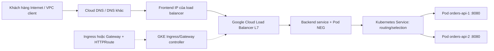
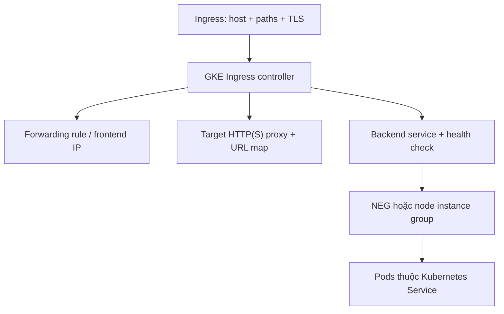
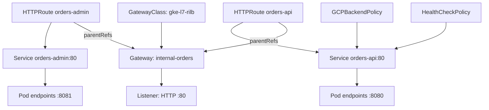
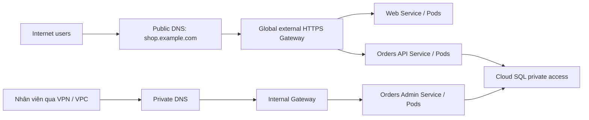

# Ingress, Gateway API và công bố dịch vụ GKE

Một ứng dụng đặt hàng gồm giao diện web, API và hệ thống xử lý nội bộ được chạy trên Google Kubernetes Engine (GKE). Các Pod hoạt động tốt trong cluster, nhưng khách hàng ngoài Internet chưa thể truy cập ứng dụng; còn quản trị viên muốn API nội bộ chỉ có thể gọi từ VPC công ty. Nếu công bố tất cả dịch vụ bằng một địa chỉ công khai hoặc cấu hình load balancer không đúng loại, hệ thống vừa tốn chi phí vừa có thể mở nhầm dữ liệu nhạy cảm.

Trên GKE, việc **công bố dịch vụ (service exposure)** có nhiều mức: Kubernetes `Service` kết nối tới Pod; `Service type LoadBalancer` hỗ trợ cân bằng tải ở tầng truyền tải cho nhiều trường hợp; **Ingress** và **Gateway API** định nghĩa việc tiếp nhận HTTP(S) và định tuyến ở tầng ứng dụng. GKE có các controller do Google quản lý để chuyển những tài nguyên Kubernetes phù hợp thành Google Cloud Load Balancing.

Bài thuộc chương **GKE cơ bản**, module `CLOUD_PROVIDERS_GCP`. Nó kết nối kiến thức tổ chức project/IAM, VPC, Compute Engine và GKE, Artifact Registry, Cloud Run, lựa chọn load balancer, bảo vệ dịch vụ, tự động hóa phát hành, theo dõi độ tin cậy và chi phí. Trọng tâm là **phân biệt đường đi của traffic, cấu hình đúng API/controller và giữ ranh giới public–private rõ ràng**.

> **Nguyên tắc:** Một Kubernetes Service có endpoint không đồng nghĩa workload được công bố an toàn. Phải xác định rõ **ai có thể truy cập, từ mạng nào, qua giao thức nào, được định tuyến tới Service/Pod nào và điều gì xảy ra khi backend không khỏe**.

## 1. Kết quả học tập

Sau bài học, bạn có thể:

1. Phân biệt `ClusterIP`, `NodePort`, `LoadBalancer`, Ingress và Gateway API theo tầng mạng và mục đích.
2. Giải thích GKE Ingress controller và Gateway controller tạo các tài nguyên Google Cloud Load Balancing nào.
3. Triển khai routing host/path dựa trên **Ingress** với annotation `gce` hoặc `gce-internal`, Service và backend Pods.
4. Triển khai **GatewayClass → Gateway → HTTPRoute → Service → Pod** và phân quyền cho hạ tầng/team ứng dụng.
5. Sử dụng GatewayClass phù hợp với global external, regional external hoặc regional internal Application Load Balancer.
6. Thiết kế health check, NEG, TLS certificate, DNS, static IP, Cloud Armor, NetworkPolicy và firewall rules theo mô hình.
7. Phân tích lỗi `404`, `502`, `503`, backend unhealthy, route chưa Accepted và thiếu quyền trong Shared VPC.
8. Lập kế hoạch rollout, migration từ Ingress sang Gateway API, dự phòng và kiểm soát chi phí.

## 2. Mô hình mạng từ client đến Pod



Sơ đồ thể hiện **quan hệ cấu hình**; với **container-native load balancing**, load balancer có thể gửi traffic trực tiếp tới **Pod IP:port trong Network Endpoint Group (NEG)**, không bắt buộc đi qua kube-proxy/ClusterIP trong dataplane. Kubernetes Service vẫn xác định Pod backends và port để controller tổng hợp endpoints.

### 2.1. Hai mặt phẳng cần phân biệt

- **Control plane:** bạn tạo/đổi Service, Ingress, Gateway, HTTPRoute; controller đồng bộ cấu hình sang forwarding rules, target proxy, URL maps, backend services, NEGs, health checks và các tài nguyên liên quan trong Google Cloud.
- **Data plane:** client gửi packet thật tới IP/frontend, load balancer áp rule và chuyển request tới endpoint khỏe mạnh. **Controller không xử lý từng HTTP request**, nên sự cố controller không đồng nghĩa ngay lập tức mất data plane, nhưng các thay đổi cấu hình mới có thể bị trì hoãn.

Việc đồng bộ cloud resources là bất đồng bộ: `kubectl apply` thành công chỉ chứng minh Kubernetes API đã nhận cấu hình, **chưa chứng minh** load balancer đã được cấp IP, certificate hoạt động hoặc backend healthy.

### 2.2. L4 và L7 khác nhau

| Tầng | Tiêu chí định tuyến | Ví dụ tài nguyên GKE | Trường hợp |
| --- | --- | --- | --- |
| Layer 4 | IP, port, TCP/UDP và thuộc tính kết nối | `Service type: LoadBalancer` | TCP database/protocol tùy biến, UDP, một dịch vụ cần frontend riêng |
| Layer 7 | HTTP Host header, path, một số headers và quy tắc request | `Ingress` hoặc `Gateway` + `HTTPRoute` | `shop.example.com` tới web, `/api` tới API, TLS termination |

Không dùng Ingress HTTP để mong nó tự định tuyến một giao thức TCP/UDP tùy biến. Với Gateway API, các loại Route khác như `TCPRoute`/`TLSRoute` có trạng thái hỗ trợ riêng theo GatewayClass; bài này tập trung vào **HTTPRoute và Application Load Balancer**.

## 3. Các kiểu Kubernetes Service

`Service` là tài nguyên cung cấp một endpoint ổn định cho tập Pod có nhãn phù hợp. Endpoint được cập nhật khi Pods tạo, chết hoặc thay thế. Service không tự bảo đảm backend sẵn sàng: Pod readiness và thông tin endpoint vẫn quan trọng.

| Kiểu Service | Phạm vi chính | Cách dùng | Rủi ro thường gặp |
| --- | --- | --- | --- |
| `ClusterIP` (mặc định) | Endpoint service nội bộ Kubernetes | API ↔ DB/cache hoặc backend cho Ingress/Gateway | Không tự có public IP; khó gọi trực tiếp từ ngoài nếu không có đường phù hợp |
| `NodePort` | Port được mở trên node IP | Một số đường LB hoặc controller tự quản lý | Phải hiểu firewall/node exposure, không có host/path rules |
| `LoadBalancer` | GKE tạo cloud load balancer theo loại và annotations | Dịch vụ TCP/UDP cần IP riêng, internal/external L4 | Nếu không đánh dấu internal có thể công bố public ngoài ý muốn |
| `ExternalName` | DNS alias trỏ tới tên miền khác | Trỏ dịch vụ tới hostname ngoài | Không tạo proxy hay endpoint kiểm soát quyền |
| Headless `clusterIP: None` | Trả về danh sách endpoint trực tiếp qua DNS | StatefulSet hoặc service discovery chuyên biệt | Không tự cung cấp load balancing L7 |

### 3.1. Service nội bộ mẫu

Ví dụ ứng dụng `orders-api` đã có Pods mang label `app: orders-api`, lắng nghe cổng 8080:

```yaml
apiVersion: v1
kind: Service
metadata:
  name: orders-api
  namespace: orders
spec:
  type: ClusterIP
  selector:
    app: orders-api
  ports:
  - name: http
    port: 80
    targetPort: 8080
    protocol: TCP
```

`port: 80` là port mà client/Kubernetes route tham chiếu trên **Service**, còn `targetPort: 8080` là port của ứng dụng **bên trong Pod**. Khi tạo Ingress hoặc HTTPRoute, `backendRef.port` phải phù hợp với **Service port 80**, không ngầm lấy targetPort 8080.

### 3.2. Khi chọn Service type LoadBalancer

Với dịch vụ TCP không cần host/path routing, `Service type: LoadBalancer` có thể tạo network load balancer. Một ví dụ **internal** dùng annotation do GKE hỗ trợ:

```yaml
apiVersion: v1
kind: Service
metadata:
  name: tcp-internal
  namespace: orders
  annotations:
    networking.gke.io/load-balancer-type: "Internal"
spec:
  type: LoadBalancer
  selector:
    app: tcp-worker
  ports:
  - name: tcp
    protocol: TCP
    port: 9000
    targetPort: 9000
```

Manifest chỉ minh họa; cần một workload `app: tcp-worker` có listener 9000 và VPC/client phù hợp. Service nội bộ **không đồng nghĩa** được gọi từ Internet. Trường hợp public LoadBalancer chỉ nên dùng khi đã chủ động lựa chọn exposure, IP, firewall và authentication.

## 4. GKE Ingress: API truyền thống cho HTTP(S)

**Kubernetes Ingress** mô tả các quy tắc HTTP(S) tới các Kubernetes Services. Với GKE-managed Ingress controller, hệ thống tạo một **external hoặc internal Application Load Balancer**, tùy class, rồi kết nối backend tới các Services/Pod endpoints.



Trong một GKE cluster có controller mặc định, **annotation `kubernetes.io/ingress.class` vẫn được GKE dùng** để xác định class, dù annotation này đã bị deprecated trong Kubernetes upstream.

| Giá trị annotation | Hành vi GKE Ingress |
| --- | --- |
| `gce` | Tạo external Application Load Balancer |
| `gce-internal` | Tạo internal Application Load Balancer |
| Không có annotation và không có `spec.ingressClassName` | GKE có thể nhận làm external Ingress mặc định |
| Annotation class khác | GKE Ingress controller không xử lý; controller bên thứ ba có thể xử lý |

**Bẫy quan trọng:** chỉ điền `spec.ingressClassName: gce-internal` **không phải cách chọn GKE internal Ingress**. Theo tài liệu GKE, hãy dùng `kubernetes.io/ingress.class: "gce-internal"`. Một manifest thiếu annotation có thể tạo load balancer public ngoài ý muốn, vì vậy cần chính sách kiểm soát việc tạo external load balancers tại tổ chức/cluster.

### 4.1. Những tính năng quanh Ingress

- **BackendConfig:** custom health check, timeout, Cloud Armor policy, session affinity, CDN và một số backend features theo khả năng hỗ trợ; gắn tới Service bằng annotation.
- **FrontendConfig:** cấu hình thuộc tính frontend được hỗ trợ, ví dụ SSL policy hoặc chuyển hướng HTTP→HTTPS khi dùng GKE Ingress tương thích.
- **Static IP:** external Ingress thường dùng annotation `kubernetes.io/ingress.global-static-ip-name`; internal dùng `kubernetes.io/ingress.regional-static-ip-name` với IP trong cùng region.
- **TLS:** có thể dùng Kubernetes TLS Secret, pre-shared Google Cloud certificates hoặc cơ chế managed certificates phù hợp với loại Ingress.
- **Container-native load balancing:** sử dụng **zonal NEGs** để load balancer health-check và chuyển traffic trực tiếp tới Pod endpoints khi được cấu hình/hỗ trợ.

Không thêm `BackendConfig`/`FrontendConfig` vào một **Gateway** rồi kỳ vọng nó được áp dụng: Gateway API dùng hệ **Policy** khác. Cũng không chỉnh thủ công các URL maps/backend services do GKE controller quản lý nếu cần bảo toàn cấu hình, vì lần reconcile sau có thể ghi đè thay đổi thủ công.

## 5. Ví dụ hoàn chỉnh: external Ingress theo path

Giả định namespace `orders` đã có Pods chạy HTTP trên port 8080, trả `HTTP 200` cho `GET /healthz`; dùng một sandbox GKE VPC-native cluster có quyền tạo load balancer. Các manifest có thể được lưu thành ba file để chạy trong sandbox, nhưng **không đồng thời công bố cùng ứng dụng bằng Ingress và Gateway demo nếu không muốn trả phí hai load balancers**.

### 5.1. Service có NEG và health check rõ ràng

```yaml
apiVersion: v1
kind: Service
metadata:
  name: orders-api
  namespace: orders
  annotations:
    cloud.google.com/neg: '{"ingress": true}'
    cloud.google.com/backend-config: '{"default": "orders-backend"}'
spec:
  type: ClusterIP
  selector:
    app: orders-api
  ports:
  - name: http
    port: 80
    targetPort: 8080
    protocol: TCP
---
apiVersion: cloud.google.com/v1
kind: BackendConfig
metadata:
  name: orders-backend
  namespace: orders
spec:
  healthCheck:
    type: HTTP
    requestPath: /healthz
    port: 8080
    checkIntervalSec: 15
```

BackendConfig health check **khác** Pod readinessProbe/livenessProbe: Google Cloud load balancer health-check tới endpoint được cấu hình; với NEG, `port: 8080` cần đúng port Pod thực sự lắng nghe. Nếu app chỉ trả `401` trên /healthz, load balancer có thể coi backend không khỏe mặc dù Pod `Ready`. Hãy đặt health endpoint riêng chỉ tiết lộ trạng thái tối thiểu.

### 5.2. Ingress định tuyến `/api`

```yaml
apiVersion: networking.k8s.io/v1
kind: Ingress
metadata:
  name: orders-public
  namespace: orders
  annotations:
    kubernetes.io/ingress.class: "gce"
spec:
  rules:
  - host: shop.example.com
    http:
      paths:
      - path: /api
        pathType: Prefix
        backend:
          service:
            name: orders-api
            port:
              number: 80
```

Ingress trên chỉ mô tả **HTTP routing**. Chưa có TLS, chứng chỉ thật, DNS record hoặc IP tĩnh; **không dùng HTTP không mã hóa để phát hành API sản xuất**. Khi vận hành thật, đặt HTTPS, chứng chỉ/redirect, DNS, WAF và authentication trước khi chuyển traffic thật. Với `pathType: Prefix`, backend thông thường **vẫn nhận path gốc `/api/...`**; không tự bỏ tiền tố như một reverse proxy rewrite nếu bạn chưa cấu hình tính năng tương ứng.

Lệnh triển khai **có thay đổi tài nguyên cloud và chi phí**:

```bash
# Chỉ chạy trong sandbox đã có namespace, Pods và quyền được cấp.
kubectl apply -f orders-ingress-service.yaml
kubectl apply -f orders-ingress.yaml

# CHỈ ĐỌC trạng thái và sự kiện đồng bộ.
kubectl -n orders get service orders-api
kubectl -n orders get ingress orders-public
kubectl -n orders describe ingress orders-public
kubectl -n orders get endpointslices \
  -l kubernetes.io/service-name=orders-api
```

Khi Ingress chưa có `ADDRESS`, kiểm tra events, controller logs khi có quyền, trạng thái provisioning và IAM/quotas. Khi IP đã xuất hiện, phải kiểm tra LB backend health và path/Host routing; không chỉ chạy `kubectl get ingress` rồi kết luận thành công.

## 6. Gateway API: tách trách nhiệm hạ tầng và ứng dụng

**Gateway API** là tập tài nguyên Kubernetes có mô hình vai trò rõ ràng, linh hoạt hơn Ingress cho nhiều tình huống routing. Trên GKE, một GatewayClass được Google quản lý có thể tạo Google Cloud Application Load Balancer tương ứng.

| Tài nguyên | Ai thường quản lý | Ý nghĩa |
| --- | --- | --- |
| `GatewayClass` | Infrastructure provider / platform operator | Xác định implementation/controller và loại load balancer |
| `Gateway` | Platform/network team | Frontend, listeners, ports, protocol, TLS và route attachment policy |
| `HTTPRoute` | Application team | Host/path/header rules, weighted backends và tham chiếu Kubernetes Services |
| `Service` | Application team | Service port và selector đến Pods |
| `HealthCheckPolicy` | App/platform team với RBAC | Health checks của backend Service |
| `GCPBackendPolicy` | App/platform team với RBAC | Cloud Armor/timeout/logging/affinity và một số backend configs |
| `GCPGatewayPolicy` | Platform team với RBAC | Thuộc tính frontend/gateway Google Cloud theo khả năng hỗ trợ |



So với Ingress, một Gateway có thể nhận Routes từ nhiều namespace/team **khi `allowedRoutes` và RBAC cho phép**. App team không nhất thiết được sửa Gateway frontend/TLS chỉ để thêm đường dẫn mới; platform team có thể giữ quyền kiểm soát public exposure.

### 6.1. Các GatewayClasses thường gặp trong GKE

| GatewayClass | Kiểu Google Cloud LB | Phạm vi | Chọn khi |
| --- | --- | --- | --- |
| `gke-l7-global-external-managed` | Global external Application Load Balancer | Public global frontend | Website/API toàn cầu, external HTTPS và routing L7 |
| `gke-l7-regional-external-managed` | Regional external Application Load Balancer | Public regional frontend | Yêu cầu LB công khai theo region, đặc tính và giá theo region |
| `gke-l7-rilb` | Internal Application Load Balancer | Private regional frontend | API nội bộ VPC, on-prem qua hybrid/private routing |
| `gke-l7-gxlb` | Classic Application Load Balancer | Public global frontend | Trường hợp cần hỗ trợ legacy/classic theo capability matrix |
| Biến thể hậu tố `-mc` | Multi-cluster load balancing | Nhiều cluster | Disaster recovery/đa region, cần fleet và thiết lập riêng |

Chỉ chọn classes **đã có trong cluster và phù hợp loại cluster, IP stack, phiên bản GKE**, kiểm tra lệnh `kubectl get gatewayclass` và bảng capability chính thức. Không giả định một lớp hỗ trợ tất cả TLS modes, URL rewrites, Cloud Armor, SSL policies hay TCP/TLSRoutes như lớp khác.

### 6.2. Bật Gateway API trong cluster được phép

GKE Autopilot có cơ chế bật Gateway API mặc định theo khả năng của phiên bản; với Standard và một số cluster hiện hữu, quản trị viên có thể cần bật **Standard Channel**:

```bash
# THAY ĐỔI CẤU HÌNH CLUSTER; cần được chủ sở hữu phê duyệt.
gcloud container clusters update CLUSTER_NAME \
  --project=PROJECT_ID \
  --location=CLUSTER_LOCATION \
  --gateway-api=standard

# CHỈ ĐỌC: sau khi GKE reconcile CRDs/controller.
kubectl get gatewayclass
kubectl get crds | grep 'gateway.networking.k8s.io'
gcloud container clusters describe CLUSTER_NAME \
  --project=PROJECT_ID \
  --location=CLUSTER_LOCATION \
  --format="yaml(networkConfig.gatewayApiConfig)"
```

Gateway controller cài **GatewayClasses/CRDs** bất đồng bộ; sau cập nhật cluster có thể cần thời gian trước khi chúng xuất hiện. Với GKE Gateway, không cài CRDs **Experimental channel** tùy ý trên Autopilot. Nên xem hỗ trợ phiên bản tại [GKE Gateway API](https://cloud.google.com/kubernetes-engine/docs/concepts/gateway-api) và [GatewayClass capabilities](https://cloud.google.com/kubernetes-engine/docs/how-to/gatewayclass-capabilities) trước khi dùng.

## 7. Ví dụ Gateway API: công bố API nội bộ trong một namespace

Ví dụ này dùng **internal Application Load Balancer** với GatewayClass `gke-l7-rilb` để tránh vô tình mở dịch vụ ra Internet. Giả sử cluster đã bật Gateway API Standard, namespace `orders` và Pods `orders-api` đang lắng nghe HTTP trên port 8080, trả `HTTP 200` tại `GET /healthz`. VPC và subnet phải đáp ứng yêu cầu GKE Gateway, đặc biệt **VPC-native cluster**, `HttpLoadBalancing` add-on và **proxy-only subnet** cho regional Gateway.

### 7.1. Gateway tiếp nhận HTTP từ VPC

```yaml
apiVersion: gateway.networking.k8s.io/v1
kind: Gateway
metadata:
  name: orders-internal
  namespace: orders
spec:
  gatewayClassName: gke-l7-rilb
  listeners:
  - name: http
    protocol: HTTP
    port: 80
    allowedRoutes:
      namespaces:
        from: Same
```

`allowedRoutes.namespaces.from: Same` chỉ cho phép Routes cùng namespace với Gateway. Listener **chỉ hỗ trợ HTTP ở cổng 80** trong ví dụ; không suy ra traffic đã mã hóa hoặc workload đã được xác thực. Với dữ liệu nhạy cảm, bổ sung HTTPS và kiểm tra end-to-end encryption theo loại GatewayClass.

### 7.2. HTTPRoute gắn một Service vào Gateway

```yaml
apiVersion: gateway.networking.k8s.io/v1
kind: HTTPRoute
metadata:
  name: orders-route
  namespace: orders
spec:
  parentRefs:
  - name: orders-internal
    sectionName: http
  hostnames:
  - orders.internal.example.com
  rules:
  - matches:
    - path:
        type: PathPrefix
        value: /api
    backendRefs:
    - name: orders-api
      port: 80
```

`parentRefs` chọn Gateway/listener, `hostnames` chọn HTTP Host header, `backendRefs.port: 80` là port của Kubernetes Service. Service liên kết tới Pod port 8080; HTTPRoute không tạo Deployment hay Pod mới. Đường dẫn `/api/...` thường được chuyển đến backend **nguyên vẹn**, không tự loại bỏ tiền tố nếu không cấu hình URL rewrite và không kiểm tra class hỗ trợ.

### 7.3. HealthCheckPolicy cho backend dùng `/healthz`

Khác một số cơ chế của GKE Ingress, GKE Gateway **không suy ra đường health check từ readinessProbe/livenessProbe**. Nếu app không trả 200 cho `GET /`, mặc định LB health check có thể thất bại. Tạo policy có cùng namespace với Service:

```yaml
apiVersion: networking.gke.io/v1
kind: HealthCheckPolicy
metadata:
  name: orders-healthcheck
  namespace: orders
spec:
  default:
    config:
      type: HTTP
      httpHealthCheck:
        requestPath: /healthz
        port: 8080
  targetRef:
    group: ""
    kind: Service
    name: orders-api
```

HealthCheckPolicy gắn vào **Service**, không gắn trực tiếp vào HTTPRoute. Endpoint `/healthz` phải trả **HTTP 200** nhanh, không redirect `301/302` và không yêu cầu Authorization header. Đường kiểm tra có thể bị giới hạn theo nguồn health checker bằng firewall nhưng không nên lộ nội dung vận hành nhạy cảm.

### 7.4. Áp dụng và kiểm tra

Lệnh `kubectl apply` sau đây **thay đổi Kubernetes và có thể tạo tài nguyên Google Cloud có phí**:

```bash
# Chỉ chạy trong sandbox đã có namespace, Service và Pods.
kubectl apply -f orders-internal-gateway.yaml
kubectl apply -f orders-route.yaml
kubectl apply -f orders-healthcheck.yaml

# CHỈ ĐỌC: trạng thái controller và endpoint.
kubectl -n orders get gateway orders-internal
kubectl -n orders describe gateway orders-internal
kubectl -n orders get httproute orders-route -o yaml
kubectl -n orders get healthcheckpolicy orders-healthcheck
kubectl -n orders get service orders-api
kubectl -n orders get endpointslices \
  -l kubernetes.io/service-name=orders-api
```

Khi Gateway đã nhận private IP, thử từ một VM trong VPC có đường đi/được phép truy cập:

```bash
# Chỉ thử tới INTERNAL_GATEWAY_IP được cấp trong sandbox.
curl --show-error \
  --header 'Host: orders.internal.example.com' \
  'http://INTERNAL_GATEWAY_IP/api/healthz'
```

Ví dụ yêu cầu app có đường `/api/healthz`. Nếu app chỉ có `/healthz`, request từ client có thể trả `404` **dù LB health check /healthz đạt**. Hai phép kiểm tra phục vụ hai mục đích: Pod health và application route.

### 7.5. Status Conditions đáng tin hơn việc chỉ thấy resource tồn tại

`kubectl apply` thành công không đồng nghĩa load balancer đã lập trình xong. Với Gateway/HTTPRoute, kiểm tra `Accepted`, `ResolvedRefs`, `Programmed/Reconciled` và lý do/quan hệ parent trong `status.conditions` theo controller. Nếu `Accepted=False`, xem listener/allowedRoutes/parentRef; nếu `ResolvedRefs=False`, xem tên Service, port hoặc cross-namespace permissions.

## 8. Cross-namespace routes và canary

Gateway API tách **Platform team** quản trị frontend với **Application team** quản trị routes, có thể đặt Gateway và Routes ở các namespaces khác nhau khi được phép.

### 8.1. allowedRoutes theo namespace label

Giả sử Gateway nằm trong namespace `platform` và chỉ chấp nhận các namespaces có label `shared-gateway-access: "true"`:

```yaml
apiVersion: gateway.networking.k8s.io/v1
kind: Gateway
metadata:
  name: shared-internal
  namespace: platform
spec:
  gatewayClassName: gke-l7-rilb
  listeners:
  - name: http
    protocol: HTTP
    port: 80
    allowedRoutes:
      namespaces:
        from: Selector
        selector:
          matchLabels:
            shared-gateway-access: "true"
```

HTTPRoute ở `orders` namespace có thể tham chiếu:

```yaml
apiVersion: gateway.networking.k8s.io/v1
kind: HTTPRoute
metadata:
  name: orders-shared-route
  namespace: orders
spec:
  parentRefs:
  - name: shared-internal
    namespace: platform
  hostnames:
  - orders.internal.example.com
  rules:
  - matches:
    - path:
        type: PathPrefix
        value: /
    backendRefs:
    - name: orders-api
      port: 80
```

Cluster admin phải kiểm soát **quyền đổi namespace labels**; nếu mọi team có thể tự gắn label cho namespace của mình, đó không phải ranh giới bảo mật vững. `allowedRoutes` cho phép **attach Route vào Gateway**, nhưng không tự cho phép tham chiếu **Service ở namespace khác**. Muốn có cross-namespace backendRef cần dùng `ReferenceGrant` trong namespace sở hữu backend, nếu implementation/GatewayClass hỗ trợ.

### 8.2. Weighted backendRefs cho phát hành canary

Ví dụ có hai Kubernetes Services `orders-api-v1` và `orders-api-v2` trỏ tới các Pod versions tương ứng:

```yaml
apiVersion: gateway.networking.k8s.io/v1
kind: HTTPRoute
metadata:
  name: orders-canary
  namespace: orders
spec:
  parentRefs:
  - name: orders-internal
  hostnames:
  - orders.internal.example.com
  rules:
  - matches:
    - path:
        type: PathPrefix
        value: /api
    backendRefs:
    - name: orders-api-v1
      port: 80
      weight: 90
    - name: orders-api-v2
      port: 80
      weight: 10
```

Đây là **mục tiêu tỷ lệ**, không bảo đảm đúng 90 request trong mỗi 100 request nhỏ; ảnh hưởng từ connection reuse, health, retries và phương thức load balancing phải được đánh giá. Khi áp dụng canary, hãy **thay thế/loại route có host/path trùng** với `orders-route` thay vì để hai HTTPRoutes đồng thời cạnh tranh và giả định thứ tự.

### 8.3. Các khả năng nâng cao cần tra capability matrix

Gateway API có các cơ chế header/method matching, redirects, URL rewrites, request mirroring, weighted traffic và một số tính năng regex tùy implementation. **Không phải mọi GatewayClass GKE hỗ trợ mọi trường của CRD**, đặc biệt với experimental fields, đa cluster, TCP/TLSRoute và regional/internal class. Kiểm tra bảng [GatewayClass capabilities](https://cloud.google.com/kubernetes-engine/docs/how-to/gatewayclass-capabilities) trước khi đưa tính năng vào production.

## 9. TLS, DNS, static IP và công bố public

Ví dụ HTTP có ích trong sandbox nhưng **API công khai cần HTTPS, certificate hợp lệ, DNS, bảo vệ quyền truy cập và kiểm soát abuse**. Khi chuyển từ internal LB sang external LB, không chỉ đổi một annotation: frontend IP, routing, proxy, quota, firewall, chứng chỉ và chính sách truy cập có thể thay đổi.

### 9.1. Từ frontend IP đến hostname

Quy trình thông dụng:

1. Xác định **internal hay external** theo đối tượng truy cập, khu vực và yêu cầu data residency.
2. Chọn GatewayClass/Ingress class phù hợp với **scope global hoặc regional**.
3. Cấp **static IP** tương thích nếu DNS cần giữ ổn định qua các lần thay đổi.
4. Cấu hình HTTPS listener và certificate đủ hostname/SAN, kiểm tra trạng thái chứng chỉ.
5. Đặt DNS A/AAAA record đúng địa chỉ và khả năng IPv4/IPv6 của frontend.
6. Kiểm tra route Host/path, backend health, WAF/auth và load balancer logging trước khi chuyển traffic.

Với **external GKE Ingress**, annotation `kubernetes.io/ingress.global-static-ip-name` trỏ tới tên **global static external IP** đã cấp. Với **internal Ingress**, dùng `kubernetes.io/ingress.regional-static-ip-name` và **regional private IP** trong VPC phù hợp. Không tráo scope giữa hai loại địa chỉ.

Với **GKE Gateway**, `spec.addresses` có thể tham chiếu IP đã đặt trước bằng `type: NamedAddress`:

```yaml
apiVersion: gateway.networking.k8s.io/v1
kind: Gateway
metadata:
  name: orders-public-demo
  namespace: orders
spec:
  gatewayClassName: gke-l7-global-external-managed
  addresses:
  - type: NamedAddress
    value: ORDERS_GLOBAL_STATIC_IP_NAME
  listeners:
  - name: http
    protocol: HTTP
    port: 80
```

Manifest chỉ minh họa cú pháp **IP tĩnh**, chưa có TLS nên **không dành cho production**. IP phải tồn tại và tương thích GatewayClass. Một Gateway kiểu internal sẽ cần IP có scope **regional** và subnet phù hợp; một Gateway regional external cần đúng regional external address/network tier. Khi sử dụng IPv6 hoặc dual-stack, đọc đúng bảng địa chỉ hỗ trợ trong tài liệu.

### 9.2. HTTPS: Ingress và Gateway dùng cơ chế khác nhau

| Trường hợp | Cơ chế triển khai certificate | Cần kiểm tra |
| --- | --- | --- |
| GKE external Ingress | Kubernetes TLS Secret, pre-shared certificate hoặc ManagedCertificate tùy trường hợp | Ingress class, certificate status, hostname, `FrontendConfig` nếu cần |
| GKE global external Gateway | Certificate Manager certificate map với annotation `networking.gke.io/certmap` hoặc phương án được hỗ trợ | Certificate map đã tồn tại, cert active, listener hostname khớp |
| GKE regional external Gateway | Regional self-managed SSL certificate hoặc Kubernetes TLS Secret theo khả năng hỗ trợ | **Không suy ra** Google-managed cert/certificate map được hỗ trợ như global Gateway |
| GKE internal Gateway | TLS termination bằng certificate mechanism được GatewayClass hỗ trợ | DNS nội bộ, trust chain, backend encryption nếu yêu cầu |

Ví dụ **global external Gateway HTTPS** dùng Certificate Manager certificate map đã cấu hình sẵn:

```yaml
apiVersion: gateway.networking.k8s.io/v1
kind: Gateway
metadata:
  name: orders-https
  namespace: orders
  annotations:
    networking.gke.io/certmap: orders-example-com-map
spec:
  gatewayClassName: gke-l7-global-external-managed
  listeners:
  - name: https
    protocol: HTTPS
    port: 443
    hostname: shop.example.com
```

Không đưa TLS private key vào repository. Khi dùng TLS Secret, phân quyền namespace và quy trình rotation. **TLS termination tại Google frontend không tự bảo đảm đường LB→Pod cũng mã hóa**; nếu yêu cầu xác thực mã hóa backend, tìm hiểu backend TLS và chế độ được GatewayClass hỗ trợ. Không áp dụng tài nguyên `ManagedCertificate` dùng cho Ingress vào Gateway rồi coi như đã có HTTPS.

### 9.3. DNS và chuyển traffic an toàn

Public Gateway nên dùng public DNS; internal Gateway thường dùng private Cloud DNS zone hoặc DNS qua kết nối hybrid. Kiểm tra A/AAAA record, TTL, certificate SAN và khả năng định tuyến từ vị trí client. Trước cutover, dự tính thời gian propagate DNS, giữ đường rollback và theo dõi load balancer frontend metrics.

Để thử HTTPS khi DNS chưa chuyển, có thể dùng `curl --resolve shop.example.com:443:IP_ADDRESS https://shop.example.com/api/...` **trong môi trường được phép**. Tránh `curl -k` để bỏ qua xác thực TLS rồi tuyên bố certificate đã đúng.

## 10. Health checks, readiness và container-native load balancing

Google Cloud Load Balancer tạo **health checks riêng** cho backend services, độc lập với probes mà kubelet thực hiện. Có ba góc nhìn:

| Lớp | Ai thực hiện | Ý nghĩa |
| --- | --- | --- |
| Kubernetes **readinessProbe** | Kubelet | Pod đã đủ điều kiện nhận traffic qua Kubernetes hay chưa |
| Pod endpoints / **NEG** | GKE controller/NEG integration | Những Pod IP:port nào có thể trở thành backend endpoint |
| Google Cloud **LB health check** | Health checkers của load balancer | Backend có trả đúng response trên port/path/protocol được LB kiểm tra không |

Với **container-native load balancing**, controller tạo hoặc quản lý **Network Endpoint Groups (NEGs)** chứa Pod IP:port. LB có thể chuyển request trực tiếp tới Pod endpoint, không cần qua NodePort/kube-proxy trong đường data plane. Nhưng NEG không thay thế Pod readiness, network routes hoặc health check.

### 10.1. Khác biệt về health check giữa Ingress và Gateway

- **GKE Ingress:** cấu hình tùy chỉnh health check bằng `BackendConfig` trỏ tới Kubernetes Service; GKE có thể suy luận một số tham số từ readinessProbe theo điều kiện.
- **GKE Gateway:** dùng `HealthCheckPolicy` trỏ tới Service; **không suy luận path hoặc port từ readiness/liveness probes** theo cách Ingress làm.

HTTP health checks của load balancer cần **HTTP 200 OK**, không nhận 301/302 redirect hoặc 401/403 authentication như một response khỏe. Một endpoint `/healthz` nhanh, ít tiết lộ dữ liệu, không bắt authentication headers là lựa chọn thường phù hợp; dùng firewall/policy để chỉ các nguồn health checking cần thiết được tiếp cận.

### 10.2. Firewall và proxy-only subnet

Với **regional internal/external Application Load Balancer** của GKE Gateway, cần **proxy-only subnet** được cấu hình phù hợp; traffic từ các IP proxy-only subnet và health check sources phải đến được backend qua VPC firewall. Trong Shared VPC, firewall resources nằm ở host project và GKE controller thường không tự động tạo đầy đủ các rules; platform/network team phải cấp đúng quyền và thiết lập rule thủ công khi cần.

Không sao chép cùng một CIDR health check cho mọi LB class, IP family và region. Kiểm tra:

1. Đúng backend protocol và port mà Pod đang lắng nghe;
2. Đúng **health checker sources** và **proxy-only subnet source** theo LB type;
3. VPC firewall rules cho node/Pod endpoints cùng network tags/service accounts thích hợp;
4. Shared VPC roles, routes và Organization Policy hạn chế firewall automation.

Không mở toàn bộ `0.0.0.0/0` vào mọi node chỉ vì backend unhealthy.

### 10.3. Graceful shutdown khi rolling update

Khi Pod bị terminate, cần thời gian để NEG và load balancer ngừng gửi request mới, trong khi ứng dụng hoàn tất request đang xử lý. Xem `terminationGracePeriodSeconds`, `preStop`, PodDisruptionBudget, readiness và **connection draining** trong BackendConfig/GCPBackendPolicy tùy controller. Giá trị quá ngắn có thể gây `502` khi rolling update; giá trị quá dài ảnh hưởng tốc độ thay thế Pods.

## 11. Bảo mật: public IP không đồng nghĩa truy cập ẩn danh

Ingress/Gateway định tuyến traffic nhưng không tự xác thực người dùng cuối. Một dịch vụ có public frontend cần bảo vệ theo nhiều lớp:

| Lớp | Chức năng | Khuyến nghị |
| --- | --- | --- |
| **DNS/TLS** | Đúng hostname và mã hóa client→frontend | HTTPS, certificate rotation, HSTS phù hợp |
| **GKE Gateway/Ingress** | Định tuyến Host/path, load balancing | Chọn external/internal rõ ràng, không công bố backend admin |
| **Cloud Armor** | WAF/rate limiting/anti-abuse theo LB class hỗ trợ | Gắn security policy đúng backend, thử rules có thể block |
| **Identity-Aware Proxy** | Xác thực truy cập với các LB/controllers được hỗ trợ | Kiểm tra compatibility cụ thể trước khi dùng |
| **Kubernetes RBAC** | Ai có quyền sửa Gateway/Ingress/Routes/Policies | Platform kiểm soát frontend public, app team chỉ sửa Routes được cấp |
| **NetworkPolicy** | Kiểm soát Pod ingress/egress nếu dataplane hỗ trợ | Không thay thế VPC firewall hoặc auth ứng dụng |
| **IAM/Workload Identity** | Quyền Pod/VM gọi Google APIs | Service accounts tối thiểu, không lưu JSON keys trong Pods |
| **VPC firewall** | Cho phép/chặn từ proxy, health check và các nguồn khác | Đúng nguồn, port, targets; tránh wide-open |

### 11.1. Backend/Frontend policies trong Gateway

Trong GKE Gateway, `GCPBackendPolicy` có thể gắn Cloud Armor và một số backend settings như timeout/logging; `GCPGatewayPolicy` điều chỉnh frontend settings như SSL policies hoặc global access theo khả năng class. Chúng phải cùng namespace với **target resource** theo quy tắc.

Ví dụ một **Cloud Armor security policy đã được platform tạo và review**:

```yaml
apiVersion: networking.gke.io/v1
kind: GCPBackendPolicy
metadata:
  name: orders-security
  namespace: orders
spec:
  default:
    securityPolicy: orders-waf-policy
  targetRef:
    group: ""
    kind: Service
    name: orders-api
```

Áp policy có thể thay đổi ngay luồng traffic, cần thử/giám sát các WAF rules và chắc chắn GatewayClass hỗ trợ. Với single-cluster Gateway, BackendPolicy/HealthCheckPolicy gắn vào **Service**; với multi-cluster Gateway thường dùng **ServiceImport** theo mô hình riêng. Không dùng `FrontendConfig` hoặc `BackendConfig` của Ingress để quản lý Gateway.

### 11.2. Đường bypass và phạm vi rủi ro

Một ứng dụng đã đi qua Gateway có Cloud Armor nhưng vẫn có một `Service type: LoadBalancer` public khác tới cùng Pods sẽ tạo **đường bypass WAF**. Kiểm kê toàn bộ Ingress/Gateway/LoadBalancer Services/NodePorts và external IP; phải chặn những con đường không nằm trong kiến trúc cho phép.

Internal Gateway dùng private IP không có nghĩa dữ liệu tự an toàn. Khách trong cùng VPC, Shared VPC hoặc on-prem qua Cloud VPN/Interconnect vẫn cần được xác thực và phân quyền nghiệp vụ, nhất là với hệ thống đa tenant hoặc chức năng quản trị.

## 12. Quan sát và chẩn đoán theo tầng

Khởi đầu từ Kubernetes và theo request tới Google Cloud Load Balancing. Một cấu hình YAML có thể đã được nhận nhưng resource cloud chưa sẵn sàng hoặc backend đang lỗi.

### 12.1. Các lệnh kiểm tra không thay đổi tài nguyên

```bash
kubectl config current-context
kubectl get nodes

# Service, endpoints và Pods.
kubectl -n orders get service orders-api -o yaml
kubectl -n orders get endpointslices \
  -l kubernetes.io/service-name=orders-api
kubectl -n orders get pods -l app=orders-api -o wide

# Ingress path khi chọn triển khai Ingress.
kubectl -n orders describe ingress orders-public

# Gateway path khi chọn triển khai Gateway.
kubectl get gatewayclass
kubectl -n orders describe gateway orders-internal
kubectl -n orders get httproute orders-route -o yaml
kubectl -n orders describe healthcheckpolicy orders-healthcheck

kubectl -n orders get events --sort-by=.lastTimestamp
```

Đừng chỉ kiểm tra một lệnh `kubectl get gateway`. Trong Google Cloud Console/Compute APIs, xem health của backend services và NEGs, forwarding rules, target proxies/URL maps, certificate status và VPC firewall. Khi dùng Shared VPC, một số tài nguyên/permissions có thể ở **host project**, không phải service project của cluster.

### 12.2. Ma trận nguyên nhân

| Hiện tượng | Khả năng thường gặp | Hướng xác minh |
| --- | --- | --- |
| Gateway chưa có IP | API chưa bật, GatewayClass chưa nhận, quota/IAM, subnet/controller reconcile | `kubectl get gatewayclass`, Gateway conditions, events, cluster API config |
| Ingress bất ngờ public | Không có annotation `gce-internal` | Kiểm tra annotation và inventory public load balancers |
| Ingress không được xử lý | Dùng `ingressClassName` thay annotation, controller add-on tắt | `describe ingress`, class table của GKE |
| HTTPRoute `Accepted=False` | Sai `parentRefs`, `allowedRoutes`, listener hoặc namespace | Status parents/conditions và nhãn namespace |
| HTTPRoute `ResolvedRefs=False` | Service không có, port sai, backend xuyên namespace chưa được phép | `backendRefs`, Service port, ReferenceGrant theo hỗ trợ |
| `404` | Host/path không match hoặc app path/URL rewrite khác | Gửi Host header đúng, kiểm tra route rules và app logs |
| `502/503` hoặc “No healthy upstream” | Không có healthy endpoint, health check path/port sai, firewall/NEG | Endpoints, readiness, health check HTTP 200, backend service health |
| TLS lỗi | Certificate chưa active, hostname/SAN sai, frontend listener thiếu | Certificate Manager/Secret, TLS handshake, DNS |
| Internal Gateway không truy cập từ laptop | Private IP không có route/VPN, DNS/firewall sai | Thử từ VPC VM/hybrid client, route và proxy subnet |
| Cloud Armor không chặn | Policy gắn nhầm backend, Gateway class không hỗ trợ hoặc đường bypass | GCPBackendPolicy status, LB backend, public LoadBalancer Services khác |
| Backend khỏe nhưng rollout lỗi | Pod shutdown nhanh, NEG removal/draining chưa xong, stateful app | Termination grace, readiness, connection draining và metrics |
| Chi phí tăng | Nhiều LB frontends/forwarding rules, egress/logging/Cloud Armor | Cloud Billing SKU, inventory LB và retention policies |

### 12.3. Tách lỗi frontend, routing, backend và ứng dụng

Theo dõi Cloud Monitoring/Logging: HTTP 4xx/5xx theo frontend/backend, latency p95/p99, request counts, bytes processed, health check status, endpoint count, Pod restarts/CPU/memory và network failures. Phân biệt:

1. **DNS/certificate/frontend:** request chưa đến đúng listener.
2. **L7 routing:** hostname hoặc path không khớp → 404 hay default backend.
3. **LB health:** không có healthy endpoints → 502/503.
4. **Ứng dụng:** LB chọn được Pod nhưng backend trả 4xx/5xx/timeout.
5. **Hạ tầng/permissions:** controller không tạo hoặc không cập nhật được LB vì quota/IAM/firewall.

Không suy ra mọi `404` do HTTPRoute; backend application cũng có thể trả 404 khi route đã match. Dùng request ID/traces và logs ở từng tầng để chứng minh.

## 13. Chọn Ingress, Gateway API hay Service LoadBalancer?

Không có lựa chọn luôn đúng cho mọi ứng dụng. Quyết định trước hết dựa vào **protocol, traffic scope, loại load balancer, quyền kiểm soát, độ phức tạp routing và hệ thống hiện hữu**.

| Câu hỏi | Service LoadBalancer | GKE Ingress | GKE Gateway API |
| --- | --- | --- | --- |
| Cần TCP/UDP không phải HTTP? | Thường phù hợp với L4 LB theo giao thức hỗ trợ | Không dành cho TCP/UDP tùy biến | Chỉ cân nhắc loại Route/GatewayClass cụ thể nếu hỗ trợ |
| Cần routing theo Host và path HTTP? | Không phải chức năng L4 | Có | Có qua HTTPRoute |
| Cần shared HTTP frontend cho nhiều team? | Mỗi Service thường có frontend riêng | Có thể dùng nhiều backend routes trong Ingress do team quản trị | **Thiết kế rõ Gateway do platform quản lý, Routes do các team quản lý** |
| Internal VPC access? | Có thể dùng internal LB Service | `gce-internal` | `gke-l7-rilb` và lớp tương ứng |
| External global HTTPS? | L4 không thay cho HTTP routing | `gce` (LB type theo cấu hình hỗ trợ) | `gke-l7-global-external-managed` |
| Cấu hình custom health check | Theo loại Service LB/annotations tương ứng | `BackendConfig` | `HealthCheckPolicy` |
| Cấu hình Cloud Armor/backend settings | Theo loại LB có hỗ trợ | `BackendConfig` | `GCPBackendPolicy` |
| Chia traffic có trọng số giữa Services | Không có HTTP rule | Hạn chế theo Ingress chuẩn/GKE controller | `HTTPRoute.backendRefs.weight` khi class hỗ trợ |
| Độ phức tạp vận hành | Thấp cho một dịch vụ L4 | Phù hợp hệ thống hiện hữu và use case đơn giản | Tốt khi nhiều teams, nhiều route policies, cần quản trị ranh giới |

**Khuyến nghị theo tình huống:**

- Một TCP service nội bộ cần IP riêng, không yêu cầu URL paths → cân nhắc internal `Service type: LoadBalancer`.
- Một ứng dụng HTTP hiện dùng GKE Ingress ổn định → chưa cần migration ngay nếu không có lợi ích rõ; nhưng giữ tài liệu và policy an toàn.
- Hệ thống microservices với nhiều namespace/team, cần platform sở hữu frontend và app team tự khai báo routes → cân nhắc **Gateway API**.
- Workload có yêu cầu nhiều cluster/region và failover → đánh giá **multi-cluster GatewayClasses**, fleet/ServiceExport/ServiceImport, tình trạng hỗ trợ, chi phí và RTO thực tế; không suy ra single-cluster Gateway tự có multi-region DR.
- Ứng dụng đơn giản trên Cloud Run → có thể dùng Cloud Run URL hoặc tích hợp external Application Load Balancer phù hợp, không cần tự triển khai GKE chỉ để routing HTTP.

### 13.1. Các giới hạn GKE Gateway cần xem trước

GKE Gateway hỗ trợ các lớp và trường theo **capability matrix**, không phải mọi tùy chọn Gateway API upstream đều hoạt động. Các yêu cầu quan trọng thường gồm VPC-native cluster, HTTP load balancing add-on và proxy-only subnet cho regional classes. Với Shared VPC, cần Google-managed service accounts và IAM/network rules trong host project.

Không thể gắn `FrontendConfig`, `BackendConfig` vào Gateway để cấu hình LB. Đối với nhiều Gateways thuộc **GatewayClasses không tương thích** (global/regional, internal/external, classic/managed), tránh dùng cùng Service backend nếu policies khác nhau; tạo Services tách biệt để tránh xung đột theo tài liệu GKE.

## 14. Chuyển từ GKE Ingress sang Gateway API

Migration **không phải đổi `kind: Ingress` thành `kind: Gateway`**. Cấu trúc tài nguyên, class, frontend TLS, health checks, policies, route status và mô hình quyền khác nhau. Ngoài ra migration có thể tạo load balancer thứ hai, thêm IP/certificate và chi phí cho tới khi cắt chuyển.

### 14.1. Bảng ánh xạ tư duy

| Thành phần Ingress | Cách diễn đạt với Gateway | Điều cần kiểm chứng |
| --- | --- | --- |
| Annotation `gce` / `gce-internal` | `GatewayClass` phù hợp external/internal | Không tự động cùng loại LB, IP tier và behavior |
| Ingress rules: host/path | `HTTPRoute.hostnames`, `matches`, `backendRefs` | Phân biệt PathPrefix, Exact, rewrite và precedence |
| Ingress TLS certificate | Gateway HTTPS listener, TLS Secret/cert map theo class | Cert management/rotation khác nhau |
| BackendConfig health check | HealthCheckPolicy trên Service | Gateway không suy readinessProbe parameters |
| BackendConfig backend policy | GCPBackendPolicy trên Service | Chỉ các field class hỗ trợ; có thể cần chia Services |
| FrontendConfig | GCPGatewayPolicy hoặc cấu hình Gateway/listener | Không phải ánh xạ một-một mọi chức năng |
| Ingress IP annotation | Gateway addresses hoặc address policy phù hợp | Cấp IP tĩnh đúng scope/global/regional |
| Một người quản trị Ingress | Platform quản lý Gateway, app team quản lý HTTPRoute | Namespace RBAC và allowedRoutes/ReferenceGrant |

### 14.2. Quy trình migration có thể rollback

1. **Kiểm kê Ingress cũ:** hostname, paths, TLS certs, static IP, BackendConfig, FrontendConfig, Cloud Armor, health checks, timeout, CDN, WAF và tất cả backend Services.
2. **Chọn GatewayClass:** dựa trên global/regional, internal/external, versions, multi-cluster và capacity tương ứng. Kiểm tra capability matrix; không mất tính năng đang sử dụng.
3. **Tách rõ route và backend policies:** tạo Gateway, HTTPRoutes, HealthCheckPolicy và GCPBackendPolicy/GCPGatewayPolicy phù hợp; kiểm tra Service ports.
4. **Triển khai song song có kiểm soát:** tạo frontend khác tạm thời và dùng hostname thử nghiệm/Host header riêng; không đụng IP đang phục vụ production khi chưa có rollback.
5. **Kiểm tra end-to-end:** DNS, TLS, path rewrite, backend health, Cloud Armor, logging, Pod shutdown/draining, latency và load tests trong giới hạn cho phép.
6. **Chuyển traffic theo đợt:** sử dụng DNS/IP/cutover workflow thích hợp; giữ một khoảng thời gian quan sát với metrics rõ ràng.
7. **Rollback khi cần:** trả hostname/traffic về frontend cũ đã được giữ sẵn; xác minh RTO và trạng thái LB, không xóa Ingress cũ quá sớm.
8. **Dọn tài nguyên có kiểm chứng:** sau khi stable và được phê duyệt, xóa LB dư thừa cùng forwarding rules/certificates, giữ static IP cần thiết theo retention để tránh phí.

Không áp đồng thời Ingress và Gateway cho cùng Service rồi nghĩ chúng chia sẻ một load balancer: mỗi controller có thể tạo **hạ tầng LB riêng**. Trong Shared VPC hoặc khi GKE console đang dùng tài nguyên do controller khác quản lý, cần xác định resource owner tránh sửa tay/đổi cấu hình không có chủ đích.

## 15. Tình huống thực tế: Orders API public và Admin API private

Một doanh nghiệp thương mại điện tử có:

- `shop.example.com`: website và Orders API Internet-facing; cần HTTPS, CDN cho tài nguyên tĩnh, Cloud Armor và canary releases.
- `orders-admin.internal.example.com`: admin API chỉ cho nhân viên qua VPC/Cloud VPN, cần kiểm soát quyền truy cập.
- Các Pods chạy trên regional GKE cluster với node pools đa zone; image lấy từ Artifact Registry theo digest.
- Cloud SQL là nơi lưu giao dịch; workload identity và VPC egress kiểm soát cách Pods gọi API/database.

### 15.1. Chọn hai đường truy cập



Đây là hai load balancers có **scope và policy khác nhau**. Đừng gắn admin HTTPRoute vào external Gateway chỉ vì tên route giống nhau. Dùng namespace/RBAC/allowedRoutes để quản lý ranh giới.

### 15.2. Bản thiết kế trách nhiệm

| Quyết định | Platform/network team | Application team |
| --- | --- | --- |
| Public vs private GatewayClass | Chọn global external và regional internal, IP/subnets, firewall | Không tự tạo external Gateway nếu không được phép |
| TLS và DNS | Certificate map, HTTPS listener, private DNS, rotation | Dùng đúng hostname, không log credentials |
| Routing | Đặt listener/allowedRoutes và hostname policy | Tạo HTTPRoute cho `/api`, thử canary/rollback |
| Health | Cho phép health checker/proxy traffic, hỗ trợ policy | Cung cấp `/healthz` HTTP 200, readiness/liveness probes, graceful shutdown |
| WAF/IAM | Cloud Armor policy, Organization Policy, RBAC, workload identities | Authn/authz và giới hạn quyền trong ứng dụng |
| Observability | LB logs/metrics/billing alerts và mạng | Traces, SLO, application errors, DB latency |

### 15.3. Tình huống lỗi giả định

Sau rollout, người dùng thấy `503` trên `/api/orders`, nhưng `kubectl get pods` báo mọi Pod `Ready`. Nghiên cứu:

1. Kiểm tra Gateway/HTTPRoute conditions và Service EndpointSlices, xác minh backendRef port 80 trỏ Pod port 8080.
2. Xem Google Cloud backend health: health check mặc định gọi `GET /` nhưng ứng dụng redirect `302` hoặc trả `401`; vì vậy LB coi mọi backend unhealthy.
3. Dùng `HealthCheckPolicy` trỏ `/healthz` trả 200 ở port 8080; xác minh health checker firewall.
4. Đợi controller reconcile, theo dõi backend healthy và thử request thật qua Host/path đúng.
5. Cập nhật pipeline để kiểm tra LB health từ bên ngoài cluster trước khi quảng bá release.

Chẩn đoán này minh họa sự khác nhau giữa **Kubernetes readiness** và **load balancer health checks**; không kết luận một lỗi production chỉ từ vài dòng trạng thái Pod.

### 15.4. Canary và ranh giới dữ liệu

Khi deploy v2, tạo hai Services (v1 và v2), dùng weighted HTTPRoute 95/5 hoặc 90/10 theo lớp hỗ trợ. Quan sát p95 latency, HTTP errors, connection reuse, database migrations và request retries. Nếu data schema không tương thích, chia 5% request chưa chắc an toàn: cần thiết kế backward-compatible migration và rollback dữ liệu theo ứng dụng.

## 16. Độ tin cậy, quota và chi phí

### 16.1. Tránh nhầm HA của Gateway với HA của workload

- Global external Gateway cung cấp frontend/load balancing thuộc scope global, **không tự biến cluster một region thành hệ thống đa region**.
- Regional GKE cluster với nodes đa zone tăng khả năng chịu lỗi zone, nhưng cần đủ Pods spread/topology, PDB, capacity và backend health.
- Internal Gateway có private frontend trong VPC/region; client on-prem còn phụ thuộc Cloud VPN/Interconnect, DNS và firewall.
- Multi-cluster Gateway có thể mở rộng đến nhiều clusters/regions nhưng cần fleet, service exports, chính sách traffic distribution, capacity, replication dữ liệu và DR testing riêng.
- Không coi availability của LB là availability của Cloud SQL, ứng dụng hoặc hệ thống nghiệp vụ đầu cuối.

Một load balancer public hoàn toàn có thể hoạt động trong khi không còn backend khỏe mạnh. SLO nên đo **request thành công từ vị trí client**, không chỉ trạng thái Gateway hoặc số Pods đã Running.

### 16.2. Ngân sách chi phí cần tính

| Nhóm tài nguyên | Có thể phát sinh phí | Giải pháp quản lý |
| --- | --- | --- |
| Google Cloud Load Balancing | Forwarding rules, proxy/load balancing data processing theo SKU | Kiểm kê số Ingress/Gateways, tránh tạo nhiều LB trùng nhu cầu |
| Network egress/ingress | Outbound traffic, cross-region, data transfer tùy đường đi | Chọn global/regional hợp lý, cache content static phù hợp |
| Public IP/certificates | Reservation, IP không sử dụng, Certificate Manager/managed certificate theo dịch vụ | Dọn IP và certificates không được dùng sau migration |
| Cloud Armor | WAF/rule evaluations, security policies và features tùy gói | Chỉ bật nơi cần, theo dõi false positive và Billing |
| GKE nodes/Pods | CPU/memory requests và autoscaling capacity | Horizontal/cluster autoscaling, graceful draining và resource quotas |
| Logging/Monitoring | LB logs, metrics, traces và ingest/retention | Sampling theo SLA và bảo vệ dữ liệu riêng trong logs |
| Multi-cluster | Hạ tầng nhiều clusters, load balancing và replication | Chứng minh lợi ích RTO/RPO so với chi phí |

**Thực hành tiết kiệm:** một shared Gateway được quản trị tốt có thể phục vụ nhiều HTTPRoutes thay vì tạo một LB cho từng app, nhưng phải cân nhắc blast radius, quyền sửa listener và security policies. Một lỗi ở shared frontend có thể ảnh hưởng nhiều teams; vì vậy tập trung chi phí cần đi kèm phân quyền và giám sát.

### 16.3. Không xóa tài nguyên đang phục vụ khi cleanup

`kubectl delete ingress` hoặc `kubectl delete gateway` có thể khiến controller dỡ bỏ Google Cloud LB components đã tạo. Trước khi xóa, kiểm tra DNS, certificate, static IP reuse, traffic còn đi vào, rollback window, policies và các Route/Services phụ thuộc. Không tự xóa resource GCP do controller quản lý trong Console khi chưa xác định đúng owner.

## 17. Bài tập thực hành

### Bài A — Chọn cách công bố đúng

Một hệ thống có database TCP trong VPC, Orders API public HTTP(S), Admin API private HTTP(S), và ứng dụng gRPC nội bộ. Chọn ClusterIP, internal LoadBalancer Service, Ingress hoặc GatewayClass cho từng trường hợp; giải thích giao thức/tầng mạng, IP scope, certificates và quyền truy cập.

### Bài B — Sửa cấu hình Ingress có thể lộ dữ liệu

Ingress của admin API chỉ có `spec.ingressClassName: gce-internal`, không có annotation class. GKE xử lý như thế nào? Hãy sửa manifest theo cách hỗ trợ và liệt kê điều kiện khiến LB bị public ngoài ý muốn. Đề xuất quy định RBAC/policy để hạn chế sai sót.

### Bài C — Tự xây lab internal Gateway

Trong sandbox được cấp quyền, dùng một Pod/Deployment có endpoint `/healthz`, Service port 80 → targetPort 8080, GatewayClass `gke-l7-rilb` và HTTPRoute host `orders.internal.example.com`, path `/api`. Viết checklist để xác minh:

- Cluster Gateway API, GatewayClass và proxy-only subnet đã sẵn sàng;
- Gateway/HTTPRoute conditions đúng;
- EndpointSlice chứa Pod IP:port mong muốn;
- HealthCheckPolicy gọi đúng path/port, trả 200;
- VM cùng VPC/hybrid client gửi đúng Host header và nhận response;
- Nguồn Internet không thể truy cập private frontend trực tiếp.

### Bài D — Cross-namespace authorization

Gateway ở namespace `platform`, Routes ở `orders` và `payments`. Chỉ `orders` được phép gắn Route vào listener public. Thiết kế `allowedRoutes` bằng namespace selectors, phân quyền ai được sửa namespace labels và khi nào phải có ReferenceGrant. Vì sao không thể chỉ dựa vào Kubernetes label mà bỏ qua RBAC?

### Bài E — Canary 90/10 và rollback

Một HTTPRoute có hai backendRefs tới `orders-api-v1` và `orders-api-v2` với weights 90/10. Xây dựng kế hoạch triển khai, giám sát error rate/latency, kiểm tra LB health, rollback và ngăn hai HTTPRoutes trùng host/path cạnh tranh. Giải thích vì sao tỷ lệ 90/10 không được bảo đảm chính xác trong mọi khoảng thời gian nhỏ.

### Bài F — Di chuyển Ingress sang Gateway

Một GKE Ingress đang có BackendConfig, FrontendConfig, TLS Secret, public DNS và Cloud Armor. Lập bảng mapping sang GatewayClass, Gateway, HTTPRoute, HealthCheckPolicy, GCPBackendPolicy và GCPGatewayPolicy; đánh dấu tính năng cần kiểm tra capability matrix. Đề xuất cách chạy song song và cutover có rollback.

### Bài G — Điều tra lỗi `503`

Tất cả Pods `Ready=True`, EndpointSlices có địa chỉ, nhưng external Gateway trả `503`. Hãy liệt kê thứ tự kiểm tra: Route conditions, Service port, NEG, LB backend health, health check URL/HTTP code, proxy-only subnet/firewall, container listener và app logs. Thử chứng minh hai giả thuyết khác nhau thay vì chỉ restart Pods.

### Bài H — Kiểm soát chi phí và đường bypass

Project có 12 Ingress, 9 Gateways và 4 public LoadBalancer Services cùng trỏ đến một số workloads. Team muốn giảm phí và bảo vệ WAF. Hãy lập inventory frontend IP, hostname, route, backend, Cloud Armor, DNS, chủ sở hữu và số traffic; chỉ ra các đường bypass và đề xuất hợp nhất hoặc tách frontend với lý do bảo mật rõ ràng.

### Câu hỏi tự kiểm tra

1. `ClusterIP`, `LoadBalancer` Service và Ingress khác nhau ở tầng xử lý traffic nào?
2. Vì sao không dùng `spec.ingressClassName: gce-internal` để yêu cầu GKE internal Ingress?
3. Trong Gateway API, GatewayClass, Gateway và HTTPRoute phân chia trách nhiệm thế nào?
4. `backendRefs.port` là Service port hay Pod targetPort?
5. Ingress dùng BackendConfig, còn Gateway dùng tài nguyên nào để tùy chỉnh health check?
6. Vì sao Pod `Ready=True` nhưng load balancer vẫn có thể không có healthy backend?
7. Khi cần một private HTTP frontend, chọn GatewayClass nào và cần điều kiện VPC nào?
8. Vì sao Gateway HTTPS với cert map global không tự áp dụng cho mọi regional Gateway?
9. `allowedRoutes` có tự cho Route quyền tham chiếu Service ở namespace khác không?
10. Vì sao một public LoadBalancer Service khác có thể bỏ qua Cloud Armor ở Gateway?
11. Tại sao dùng image digest, Pod readiness và connection draining quan trọng khi rollout?
12. Cần kiểm tra những nhóm phí nào trước khi hợp nhất nhiều Gateways?

**Quy trình ghi nhớ:** xác định **client, protocol và public/private scope** → chọn Service LB, Ingress hay Gateway → cấu hình đúng Service/Pod ports và host/path routes → chọn LB class và IP scope → thiết lập DNS/TLS/WAF/IAM/firewall → kiểm tra health check và NEG → triển khai có canary/rollback → giám sát SLO, chi phí và đường truy cập ngoài dự kiến.

## 18. Tài liệu chính thức

- [Expose applications on GKE](https://cloud.google.com/kubernetes-engine/docs/concepts/service-load-balancer)
- [GKE Ingress for Application Load Balancers](https://cloud.google.com/kubernetes-engine/docs/concepts/ingress)
- [GKE Ingress routing and security](https://cloud.google.com/kubernetes-engine/docs/concepts/ingress-routing-security)
- [Configure Ingress for external Application Load Balancers](https://cloud.google.com/kubernetes-engine/docs/how-to/load-balance-ingress)
- [Configure Ingress for internal Application Load Balancers](https://cloud.google.com/kubernetes-engine/docs/how-to/internal-load-balance-ingress)
- [GKE Ingress configuration / BackendConfig](https://cloud.google.com/kubernetes-engine/docs/how-to/ingress-configuration)
- [About GKE Gateway API](https://cloud.google.com/kubernetes-engine/docs/concepts/gateway-api)
- [Deploying Gateways on GKE](https://cloud.google.com/kubernetes-engine/docs/how-to/deploying-gateways)
- [Configure Gateway resources with Policies](https://cloud.google.com/kubernetes-engine/docs/how-to/configure-gateway-resources)
- [GatewayClass capabilities](https://cloud.google.com/kubernetes-engine/docs/how-to/gatewayclass-capabilities)
- [Troubleshoot GKE Ingress](https://cloud.google.com/kubernetes-engine/docs/troubleshooting/ingress)
- [Cloud Load Balancing overview](https://cloud.google.com/load-balancing/docs/load-balancing-overview)
- [Cloud Armor overview](https://cloud.google.com/armor/docs/cloud-armor-overview)
- [Google Cloud Load Balancing pricing](https://cloud.google.com/vpc/network-pricing)

GatewayClass capabilities, GKE versions, policy CRDs, cert mechanisms, firewall sources và giá có thể thay đổi. Khi triển khai thực tế, đối chiếu tài liệu của **đúng GKE cluster/version, Autopilot hay Standard, IP family, GatewayClass, VPC/Shared VPC và loại backend**; coi bài tập là hướng dẫn sandbox và chỉ kết luận cấu hình production an toàn sau khi đã kiểm thử đường public/private, TLS, health checks, routing, IAM và rollback.
