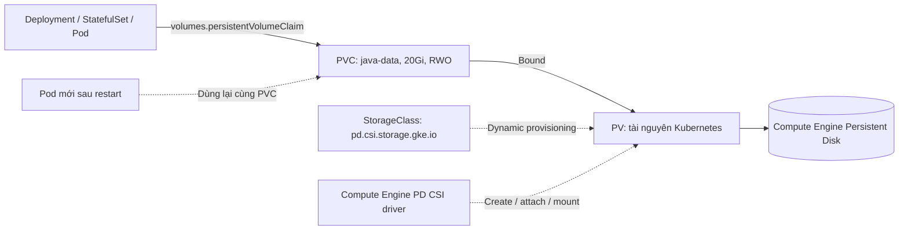
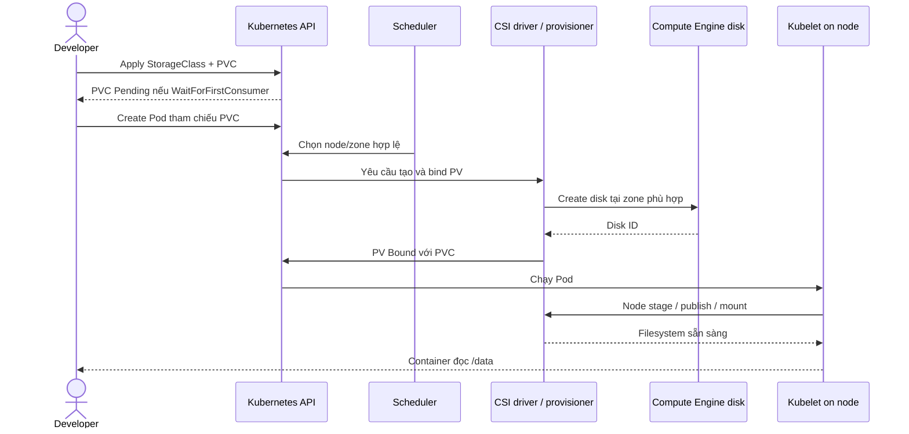
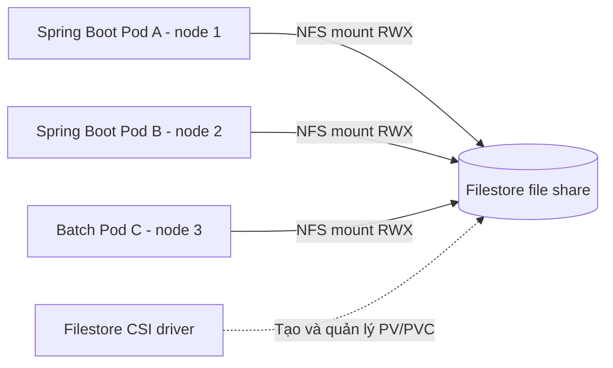
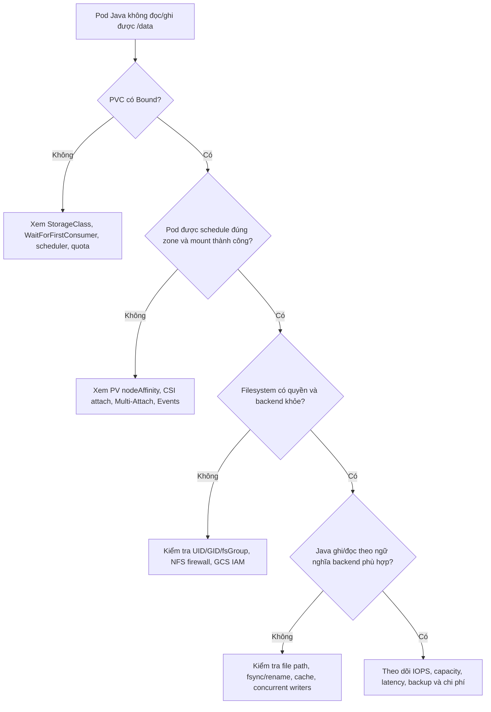

# PersistentVolume, CSI drivers và lưu trữ cho Pod

## 1. Bài toán: Pod Java bị thay nhưng dữ liệu phải còn

Một nhóm triển khai ứng dụng **Spring Boot** trên **Google Kubernetes Engine (GKE)**. API xử lý đơn hàng lưu dữ liệu chính trong **Cloud SQL**, nhưng một số thành phần còn cần ghi file: bộ xử lý tài liệu tạo file tạm lớn, worker lưu checkpoint để tiếp tục sau sự cố, một ứng dụng kế thừa lưu file cấu hình được cập nhật trong quá trình chạy, hoặc nhiều Pod cùng truy cập thư mục dữ liệu.

Trong Kubernetes, **Pod không phải đơn vị lưu trữ bền vững**. Nó có thể bị xóa, tạo lại trên node khác, bị đẩy ra khi nâng cấp node hoặc scale-down. Ghi file vào lớp ghi của container thường khiến dữ liệu biến mất khi container/Pod bị thay thế. Cần chọn một giải pháp lưu trữ theo đúng mức độ bền vững, khả năng truy cập đồng thời, hiệu năng và chi phí.

Các khái niệm trọng tâm là:

- **PersistentVolume (PV):** tài nguyên Kubernetes đại diện cho một vùng lưu trữ có vòng đời tách khỏi Pod.
- **PersistentVolumeClaim (PVC):** yêu cầu sử dụng một vùng lưu trữ với dung lượng, access mode và StorageClass xác định.
- **StorageClass:** mô tả cách hệ thống tạo/provision một PV, ví dụ loại Persistent Disk, reclaim policy và thời điểm binding.
- **Container Storage Interface (CSI) driver:** thành phần tích hợp giữa Kubernetes và hệ thống lưu trữ thực tế, ví dụ **Compute Engine Persistent Disk**, **Filestore** hoặc **Cloud Storage FUSE**.

Trong chương **GKE cơ bản** của mô-đun **CLOUD_PROVIDERS_GCP**, bài này giúp lập trình viên Java chọn được lưu trữ đúng cho Pod, bảo vệ dữ liệu khi deploy/scale, sử dụng GKE Autopilot hoặc Standard có chủ đích, và quản lý IAM, backup, giám sát, chi phí theo tình huống triển khai thực.

### Mục tiêu học tập

Sau bài này bạn có thể:

1. Phân biệt container filesystem, `emptyDir`, PV, PVC, StorageClass và CSI volume.
2. Giải thích vòng đời **PVC Pending → Bound → Pod mount → Released/deleted** và tác động của `reclaimPolicy`.
3. Phân biệt `ReadWriteOnce` (RWO), `ReadOnlyMany` (ROX), `ReadWriteMany` (RWX) và `ReadWriteOncePod` (RWOP).
4. Chọn **Persistent Disk/Hyperdisk**, **Filestore** hay **Cloud Storage FUSE** theo nhu cầu Java workload.
5. Tạo StorageClass/PVC/Pod bằng YAML trên GKE để kiểm chứng dữ liệu tồn tại sau khi xóa và tạo lại Pod.
6. Thiết kế **StatefulSet**, mở rộng volume, snapshot/backup và phục hồi khi hỏng node/zone.
7. Chẩn đoán lỗi `Pending`, `FailedMount`, `Multi-Attach`, thiếu IAM hoặc chi phí disk còn tồn tại sau khi xóa workload.

> **Phạm vi lab:** các manifest và lệnh là ví dụ để chạy trên một **cluster thử nghiệm có quyền và ngân sách hợp lệ**. Chúng không được tự thực thi khi đọc bài. Tạo PVC động có thể cấp **Compute Engine disk có tính phí**, ngay cả khi container chưa ghi dữ liệu; Filestore có thể cấp tài nguyên đắt hơn nhiều. Không áp dụng cleanup lên PVC hoặc disk production.

## 2. Từ Pod đến dữ liệu: ba lớp lưu trữ khác nhau

### 2.1. Lớp ghi của container và emptyDir

Mọi container có filesystem được tạo từ image và một lớp ghi tạm. Khi container được tạo mới, lớp ghi này không phải cơ chế lưu bền cho nghiệp vụ. Một volume `emptyDir` lại tồn tại trong suốt **vòng đời Pod**, được chia sẻ giữa các container trong cùng Pod, và có thể dùng cho file cache hoặc dữ liệu trung gian.

```yaml
apiVersion: v1
kind: Pod
metadata:
  name: java-temp-example
spec:
  containers:
    - name: worker
      image: busybox:1.36
      command: ["sh", "-c", "echo temp > /scratch/work.txt; sleep 3600"]
      volumeMounts:
        - name: scratch
          mountPath: /scratch
  volumes:
    - name: scratch
      emptyDir: {}
```

Nếu **container restart nhưng Pod vẫn tồn tại**, `emptyDir` thường còn. Nếu **Pod bị xóa hoặc chuyển sang node khác bằng cách tái tạo**, dữ liệu `emptyDir` **mất**. Đây là lựa chọn phù hợp với dữ liệu có thể tạo lại, **không phù hợp với bản ghi duy nhất**.

### 2.2. PersistentVolume: vòng đời độc lập với Pod

Khi ứng dụng khai báo PVC và mount nó trong Pod, Kubernetes kết nối Pod với một tài nguyên PV và một backend lưu trữ. Nếu Pod bị thay nhưng **PVC và backend vẫn còn**, Pod mới có thể mount lại dữ liệu đó trong những điều kiện truy cập/topology phù hợp.



**PV và PVC khác tầng:** PVC là yêu cầu trong **namespace**; PV là tài nguyên **cluster-scoped**; disk phía Google Cloud là tài nguyên hạ tầng ngoài đối tượng Kubernetes. PV `Bound` không tự chứng minh **file trong filesystem an toàn**, và xóa PVC có thể kích hoạt xóa disk tùy reclaim policy.

### 2.3. Không phải file nào cũng cần PV

| Nhu cầu | Giải pháp thường phù hợp | Vì sao |
| --- | --- | --- |
| Cache kết quả có thể tính lại, file giải nén tạm | `emptyDir` hoặc ephemeral storage | Không cần giữ sau khi Pod mất |
| Java API stateless và file upload cần chia sẻ toàn hệ thống | **Cloud Storage API/SDK** | Object storage bền, nhiều consumer; không cần filesystem mount |
| Một worker Java cần filesystem bền với một Pod ghi chính | **Persistent Disk CSI + PVC** | Block volume, filesystem và khả năng attach lại |
| Nhiều Pod trên nhiều node cần ghi chung thư mục | **Filestore CSI / NFS** | Shared filesystem hỗ trợ RWX |
| AI/ML hoặc batch cần đọc nhiều objects trong Cloud Storage qua đường file | **Cloud Storage FUSE CSI** | Mount bucket, phù hợp một số mẫu truy cập file/object |
| Database giao dịch cho Spring Boot production | **Cloud SQL** hoặc DB được quản trị phù hợp | Backup, HA và vận hành CSDL; tránh tự phát minh DB HA bằng PVC |

Một REST API lưu session trong file local để scale nhiều replica sẽ gặp lỗi ngay cả khi mỗi replica có PV riêng: **dữ liệu không tự đồng bộ giữa các PV**. Hãy tách trạng thái ứng dụng vào hệ thống dữ liệu phù hợp.

## 3. PV, PVC và StorageClass được kết nối thế nào?

### 3.1. Static và dynamic provisioning

**Static provisioning:** admin chuẩn bị một disk hoặc Filestore share sẵn, tạo **PV** khai báo backend đó; PVC tương thích sẽ bind vào PV. Dùng khi cần nhập dữ liệu có sẵn, kiểm soát chính xác disk ID, hoặc phục hồi từ tài nguyên đã lưu.

**Dynamic provisioning:** admin tạo **StorageClass**, ứng dụng tạo PVC, CSI provisioner tạo PV và backend lưu trữ tự động theo cấu hình. Đây là đường phổ biến trong GKE.



Đây là sơ đồ khái niệm: các thành phần CSI thực tế gồm **controller components**, **CSI external provisioner/attacher/resizer** và **node plugin**; scheduler, attach controller và kubelet phối hợp nhiều bước bất đồng bộ.

### 3.2. Trường quan trọng trong PVC

```yaml
apiVersion: v1
kind: PersistentVolumeClaim
metadata:
  name: java-data
  namespace: storage-lab
spec:
  accessModes:
    - ReadWriteOnce
  storageClassName: java-pd-lab
  resources:
    requests:
      storage: 20Gi
```

- `accessModes`: cách volume có thể được mount, **không phải Kubernetes RBAC**.
- `storageClassName`: trỏ tới StorageClass; nếu bỏ trống field, default class của cluster **có thể** được gán tự động.
- `resources.requests.storage`: dung lượng yêu cầu, không phải “chỉ bị tính phí khi ghi đủ 20Gi”.
- `volumeMode`: mặc định là `Filesystem`; `Block` yêu cầu Pod dùng `volumeDevices` thay vì mount path filesystem.
- `selector`, `volumeName`: có thể dùng khi cần bind tới PV đã chuẩn bị sẵn.

**Cẩn trọng với `storageClassName: ""`:** chuỗi rỗng tường minh có nghĩa **không sử dụng dynamic default StorageClass**; khác với việc bỏ field để hệ thống có thể áp dụng class mặc định.

### 3.3. Vòng đời và trạng thái

| Đối tượng | Trạng thái/khả năng | Giải thích |
| --- | --- | --- |
| PVC `Pending` | Chưa bind PV | Có thể bình thường khi dùng `WaitForFirstConsumer` và chưa có Pod tiêu thụ |
| PVC/PV `Bound` | Yêu cầu và volume đã gắn quan hệ | Không đảm bảo app mount được nếu node/zone/quyền gặp lỗi |
| PV `Released` | PVC đã bị xóa, PV không còn được claim đó dùng | Với `Retain`, backend còn nhưng cần admin thu hồi/chuẩn bị để tái sử dụng |
| PV `Failed` | Có lỗi trong vòng đời PV | Kiểm tra Events, CSI controller, cloud resource |
| Pod `Pending` / `ContainerCreating` | Có thể lỗi scheduling, attach hoặc mount | Xem `kubectl describe pod` và các Events |

Không giải quyết PVC Pending bằng cách **xóa PVC ngay** trên hệ thống thật: PVC có thể đang thuộc StatefulSet và liên quan disk chưa được sao lưu.

## 4. Access modes, topology và ràng buộc sử dụng chung

### 4.1. Bốn access modes

| Chế độ | Ý nghĩa Kubernetes | Ví dụ sử dụng |
| --- | --- | --- |
| `ReadWriteOnce` (**RWO**) | Đọc/ghi trên **một node** ở cùng thời điểm | Persistent Disk với một writer node |
| `ReadOnlyMany` (**ROX**) | Nhiều node có thể mount **read-only** nếu driver cho phép | Bộ dữ liệu chỉ đọc |
| `ReadWriteMany` (**RWX**) | Nhiều node có thể mount **read-write** nếu driver cho phép | Filestore/NFS cho nhiều Pod |
| `ReadWriteOncePod` (**RWOP**) | Chỉ **một Pod** trong cluster có thể mount read-write | Tránh hai Pod cùng dùng một PVC CSI khi feature/driver hỗ trợ |

**Bẫy quan trọng:** RWO là **một node**, không phải một Pod. Hai Pod trên **cùng node** có thể dùng một volume RWO, còn Pod trên node khác có thể gặp **Multi-Attach error**. Nếu yêu cầu bảo vệ tránh hai Pod đồng thời mount, xét **RWOP** theo hỗ trợ CSI driver và phiên bản Kubernetes, hoặc thiết kế khóa giao dịch ở lớp ứng dụng.

Access modes là **khả năng và điều kiện scheduling/mount**, không tự bảo vệ quyền đọc file của Linux, không thay IAM/ACL và không cung cấp cơ chế khóa ghi ở tầng ứng dụng. RWX cho phép truy cập đồng thời **không đồng nghĩa cập nhật file an toàn khi có tranh chấp**.

### 4.2. WaitForFirstConsumer và zone

Compute Engine Persistent Disk thông thường là tài nguyên **zonal**. Disk tạo ở `asia-southeast1-a` không thể tùy ý attach vào node ở `asia-southeast1-b`. Nếu StorageClass dùng `Immediate`, hệ thống có thể cấp disk trước khi biết Pod phải chạy zone nào, làm Pod bị `Pending` do xung đột topology.

`WaitForFirstConsumer` trì hoãn việc chọn/bind PV cho đến khi có Pod tiêu thụ và scheduler đã cân nhắc node, taints/tolerations, affinity và zone. Đây là lựa chọn nên ưu tiên cho storage **có ràng buộc topology**.

```yaml
apiVersion: storage.k8s.io/v1
kind: StorageClass
metadata:
  name: java-pd-lab
provisioner: pd.csi.storage.gke.io
parameters:
  type: pd-balanced
volumeBindingMode: WaitForFirstConsumer
allowVolumeExpansion: true
reclaimPolicy: Delete
```

**Không thêm `nodeName` bằng tay** vào Pod khi StorageClass dùng `WaitForFirstConsumer`: việc bỏ qua scheduler có thể khiến PVC mãi Pending. Nếu muốn giới hạn node/zone, dùng **nodeSelector/affinity** theo cơ chế scheduler được hỗ trợ.

### 4.3. Reclaim policy: xóa claim có xóa disk không?

| `reclaimPolicy` | Khi PVC bị xóa | Phù hợp |
| --- | --- | --- |
| `Delete` | PV và disk backend được cấp động thường bị **xóa** theo controller | Lab, scratch persistent data, workloads dễ tái tạo |
| `Retain` | PV chuyển `Released`, disk/dữ liệu **được giữ** và cần xử lý thủ công | Dữ liệu cần kiểm tra, quy trình phục hồi/phê duyệt riêng |

**Phải xem reclaim policy của PV thực tế**, không chỉ file StorageClass ở Git. Thay đổi StorageClass sau khi volume đã được cấp không tự đảm bảo mọi PV cũ đổi chính sách. Nếu PVC thuộc StatefulSet, còn cần xét **`persistentVolumeClaimRetentionPolicy`** của StatefulSet (khi được hỗ trợ) vì mặc định PVC thường được giữ lại khi StatefulSet bị xóa/scale-down.

Một disk có `Retain` vẫn có thể **phát sinh phí hàng tháng** dù Pod/namespace không còn. Với `Delete`, xóa nhầm claim có thể gây mất dữ liệu vĩnh viễn nếu không có backup/snapshot.

## 5. Container Storage Interface (CSI) là gì?

Kubernetes không nên hard-code logic cho từng nhà cung cấp block disk/NFS/object storage trong lõi. **CSI** là giao diện chuẩn để nhà cung cấp xây **driver**. Driver tương tác với Kubernetes và backend lưu trữ thông qua các tác vụ như:

1. **CreateVolume/DeleteVolume:** cấp hoặc xóa backend volume.
2. **ControllerPublishVolume:** attach disk vào node nếu backend yêu cầu.
3. **NodeStageVolume/NodePublishVolume:** mount hoặc chuẩn bị volume trên node, đưa vào container.
4. **ControllerExpandVolume/NodeExpandVolume:** mở rộng dung lượng khi được hỗ trợ.
5. **CreateSnapshot/DeleteSnapshot:** tạo và quản lý CSI snapshots khi có controller/driver hỗ trợ.

Trong GKE, driver được triển khai và cập nhật **cùng vòng đời phiên bản GKE/add-on được hỗ trợ**; tránh tự chỉnh các controller của driver được GKE quản lý nếu tài liệu không cho phép.

### 5.1. Ba CSI drivers cần biết

| Storage backend | Driver/provisioner | Kiểu truy cập điển hình | Lựa chọn phù hợp |
| --- | --- | --- | --- |
| **Compute Engine Persistent Disk** | `pd.csi.storage.gke.io` | RWO, có ROX/RWOP theo khả năng và cách attach | File state của một writer, worker có checkpoint |
| **Hyperdisk** | Thông qua Compute Engine PD CSI driver với tham số loại disk phù hợp | Phụ thuộc Hyperdisk type/machine series | Tải IOPS/throughput cần cấu hình riêng |
| **Filestore** | `filestore.csi.storage.gke.io` | RWX NFS | Nhiều Pod/VM cùng truy cập filesystem |
| **Cloud Storage FUSE** | `gcsfuse.csi.storage.gke.io` | PV tĩnh hoặc CSI ephemeral; access modes Kubernetes theo hình thức cấu hình | Đọc/ghi Cloud Storage objects bằng file API khi ngữ nghĩa phù hợp |

Khác nhau về **latency, IOPS, durability, region/zone, khả năng mount, quota, consistency, backup và giá**. Không đánh đồng “driver hỗ trợ RWX” với “hệ thống hoạt động như một POSIX shared filesystem có lock/rename atomic”.

### 5.2. Tại sao không dùng hostPath cho production?

`hostPath` mount thư mục của **node** vào Pod; dữ liệu gắn với node, không phải PV có khả năng tái gắn vào node khác. Nó cũng làm tăng bề mặt tấn công vì container có thể nhìn thấy filesystem host. Dùng `hostPath` trong các workload đặc quyền được kiểm soát khi thật sự cần, **không xem là phương án lưu trữ bền chung cho Spring Boot**.

## 6. GKE Autopilot và Standard: điều gì được quản lý?

### 6.1. Compute Engine Persistent Disk CSI driver

Theo tài liệu GKE:

- **Autopilot:** Compute Engine Persistent Disk CSI driver **được bật sẵn** và không cho vô hiệu hóa.
- **Standard:** cần **bật add-on CSI driver** nếu cluster chưa được bật; không giả định mọi cluster cũ đã có driver vì cơ chế mặc định thay đổi theo phiên bản.
- Sau khi driver được bật, GKE cung cấp StorageClasses như `standard-rwo` (balanced PD) và `premium-rwo` (SSD PD). **Autopilot thường có default class `standard-rwo`**; ở Standard, default class hiện có thể là loại khác, nên luôn xem bằng `kubectl get storageclass`.

Ví dụ chỉ dành cho **Standard cluster đã có** và chỉ cần khi driver chưa bật:

```bash
gcloud container clusters update CLUSTER_NAME \
  --location=CLUSTER_LOCATION \
  --update-addons=GcePersistentDiskCsiDriver=ENABLED

kubectl get csidrivers
kubectl get storageclass
```

Đừng chỉnh GKE CSI add-on production chỉ để chạy bài lab. Việc thay đổi add-on có thể tác động các PVC đang sử dụng driver.

### 6.2. Filestore CSI driver

Filestore cung cấp NFS filesystem dùng chung. Các StorageClasses có thể bao gồm `zonal-rwx`, `enterprise-rwx`, `enterprise-multishare-rwx`, `standard-rwx` và `premium-rwx` tùy **GKE version và service tier**. Trên **GKE 1.36.3+**, Filestore CSI được bật theo mặc định trên **cluster mới**; các Standard clusters cũ có thể cần bật add-on:

```bash
gcloud container clusters update CLUSTER_NAME \
  --location=CLUSTER_LOCATION \
  --update-addons=GcpFilestoreCsiDriver=ENABLED
```

Một số tier mới có version requirements cao và **minimum instance size lớn** (thường từ 1 TiB với các lựa chọn được liệt kê). Không tạo PVC Filestore trong lab chưa được dự toán. Các auto-installed StorageClasses có thể mặc định dùng mạng `default`; nếu GKE đang dùng VPC khác/Shared VPC, cần tạo **StorageClass với network phù hợp** và cấu hình firewall.

### 6.3. Cloud Storage FUSE CSI driver

GKE quản lý Cloud Storage FUSE CSI driver trên những cluster hỗ trợ. Để mount bucket thông qua driver, workload thường cần **Workload Identity Federation for GKE**, Kubernetes ServiceAccount có quyền Cloud Storage tương ứng, annotation `gke-gcsfuse/volumes: "true"` và cấu hình volume `gcsfuse.csi.storage.gke.io`.

Trên môi trường dùng GKE Sandbox, driver này **không được hỗ trợ**. Không lấy việc volume mount được trong một Pod privileged mà suy rằng nó hoạt động trong mọi RuntimeClass.

## 7. Lab an toàn: Persistent Disk CSI + PVC + Pod

Phần lab dùng một cluster GKE **đã tồn tại**. Không tạo cluster mới vì chi phí/năng lực quản trị và không mặc định tạo Filestore. Cần `kubectl` truy cập đúng cluster, bật Compute Engine PD CSI driver và quota để cấp một **balanced persistent disk 20 GiB**. Lệnh dưới đây là **Bash**; với PowerShell, cú pháp quoting/pipe có thể khác.

**Không chạy trên namespace hoặc PV production.** Trước khi tiếp tục, xác nhận `kubectl config current-context` là cluster thử nghiệm, project/billing hợp lệ, có quyền tạo namespace, StorageClass, PVC và Pod.

### Bước 1 — Xác minh cluster và driver

```bash
gcloud config set project PROJECT_ID
gcloud container clusters get-credentials CLUSTER_NAME \
  --location=CLUSTER_LOCATION \
  --project=PROJECT_ID

kubectl config current-context
kubectl get nodes -o wide
kubectl get csidrivers
kubectl get storageclass
kubectl create namespace storage-lab
```

Nếu `pd.csi.storage.gke.io` chưa có, dừng lab và kiểm tra chế độ cluster/add-on theo mục 6. Không tự cài driver từ Internet rồi ghi đè add-on do GKE quản lý.

### Bước 2 — Tạo StorageClass riêng cho lab

Lưu nội dung thành `java-pd-sc.yaml` trên máy quản trị:

```yaml
apiVersion: storage.k8s.io/v1
kind: StorageClass
metadata:
  name: java-pd-lab
provisioner: pd.csi.storage.gke.io
parameters:
  type: pd-balanced
volumeBindingMode: WaitForFirstConsumer
allowVolumeExpansion: true
reclaimPolicy: Delete
```

```bash
kubectl apply -f java-pd-sc.yaml
kubectl get storageclass java-pd-lab -o yaml
```

**StorageClass là tài nguyên toàn cluster**, không nằm trong namespace. `reclaimPolicy: Delete` giúp lab dọn disk khi PVC bị xóa; **production có dữ liệu quan trọng** nên cân nhắc `Retain` và backup thay vì sao chép mặc định này.

### Bước 3 — Tạo PVC 20 GiB

Lưu `java-pvc.yaml`:

```yaml
apiVersion: v1
kind: PersistentVolumeClaim
metadata:
  name: java-pd-data
  namespace: storage-lab
spec:
  accessModes:
    - ReadWriteOnce
  storageClassName: java-pd-lab
  resources:
    requests:
      storage: 20Gi
```

```bash
kubectl apply -f java-pvc.yaml
kubectl get pvc java-pd-data -n storage-lab
kubectl describe pvc java-pd-data -n storage-lab
```

Ở thời điểm này PVC có thể **Pending bình thường** vì StorageClass dùng `WaitForFirstConsumer`. **Không coi Pending là lỗi** khi chưa có Pod tham chiếu PVC.

### Bước 4 — Tạo Pod ghi dữ liệu trên volume

Lưu `storage-writer.yaml`:

```yaml
apiVersion: v1
kind: Pod
metadata:
  name: storage-writer
  namespace: storage-lab
  labels:
    app: storage-lab
spec:
  terminationGracePeriodSeconds: 30
  containers:
    - name: writer
      image: busybox:1.36
      command: ["/bin/sh", "-c"]
      args:
        - |
          if [ ! -f /data/first-start.txt ]; then
            date -u > /data/first-start.txt
          fi
          echo "Pod runs on $(hostname)"
          cat /data/first-start.txt
          sleep 3600
      volumeMounts:
        - name: data
          mountPath: /data
  volumes:
    - name: data
      persistentVolumeClaim:
        claimName: java-pd-data
```

```bash
kubectl apply -f storage-writer.yaml

kubectl get pod,pvc -n storage-lab -o wide
kubectl get pv
kubectl describe pod storage-writer -n storage-lab
kubectl logs storage-writer -n storage-lab
kubectl exec -n storage-lab storage-writer -- \
  cat /data/first-start.txt
```

Khi Pod được scheduler chọn node/zone phù hợp, CSI driver tạo disk/PV, attach vào node rồi mount vào `/data`. PVC sẽ thành `Bound` và Pod thường chuyển `Running`. Nếu Pod vẫn `Pending`, đọc phần **Events** trong `kubectl describe` trước khi sửa class hoặc xóa claim.

### Bước 5 — Xóa Pod rồi dùng lại **chính PVC**

```bash
kubectl delete pod storage-writer -n storage-lab
kubectl apply -f storage-writer.yaml

kubectl get pod,pvc -n storage-lab -o wide
kubectl exec -n storage-lab storage-writer -- \
  cat /data/first-start.txt
```

Nếu PVC/disk còn nguyên và Pod có thể được schedule/mount hợp lệ, nội dung `first-start.txt` từ lần đầu **vẫn còn**. Đây là minh chứng rằng **dữ liệu nằm ngoài Pod**, không phải vì Kubernetes giữ lại container cũ.

**Không cố tạo hai Pods ở hai nodes khác nhau cùng mount RWO disk để chứng minh RWX**: attach có thể bị từ chối và tạo ra lỗi kéo dài. Muốn chia sẻ filesystem nhiều nodes, xem Filestore ở mục 10.

### Bước 6 — Quan sát PV và cloud disk

```bash
kubectl get pvc java-pd-data -n storage-lab \
  -o jsonpath='{.spec.volumeName}'

kubectl get pv -o wide
kubectl describe pvc java-pd-data -n storage-lab
kubectl describe pod storage-writer -n storage-lab
```

Từ `kubectl get pv -o yaml` (đúng PV của lab), quan sát `spec.csi.driver`, `spec.csi.volumeHandle`, `spec.nodeAffinity`, `persistentVolumeReclaimPolicy` và thông tin zone. Trên Google Cloud Console có thể xem Compute Engine Disks để xác minh tài nguyên tương ứng, nhưng **không xóa disk trực tiếp** khi vẫn được PVC/CSI quản lý.

### Bước 7 — Cleanup đúng thứ tự

Lab dùng `reclaimPolicy: Delete`. Chỉ xóa các resource **có tên lab** sau khi đã sao chép mọi dữ liệu cần giữ:

```bash
kubectl delete pod storage-writer -n storage-lab
kubectl delete pvc java-pd-data -n storage-lab

# Chờ PV/disk đã được thu hồi, kiểm tra tài nguyên thật:
kubectl get pv

kubectl delete storageclass java-pd-lab
kubectl delete namespace storage-lab
```

**Không chạy `kubectl delete namespace` hoặc `kubectl delete pvc --all` trong namespace production**. Nếu PVC/PV ở trạng thái `Terminating`, không tùy tiện gỡ finalizers hoặc xóa disk thủ công; điều tra CSI events và volume attachment trước. Sau cleanup kiểm tra **Compute Engine Disks**, snapshots và Cloud Billing để chắc không còn tài nguyên lab tính phí.

## 8. Java trên PV: trạng thái nào nên lưu thành file?

Một ứng dụng Java có thể ghi **checkpoint** lên filesystem được mount từ PVC, ví dụ `/var/lib/java-worker`, để tiếp tục xử lý sau khi Pod được tạo lại. Nhưng cần xác định file có phải **nguồn dữ liệu chính** hay chỉ là bản tạm có thể phục hồi từ Pub/Sub/Cloud SQL.

### 8.1. Ví dụ Spring Boot đọc và ghi checkpoint

Đoạn Java dưới đây giả sử Pod đã mount PVC vào `/var/lib/java-worker` và process có quyền ghi:

```java
package dev.example.gke;

import java.io.IOException;
import java.nio.charset.StandardCharsets;
import java.nio.file.Files;
import java.nio.file.Path;
import java.nio.file.StandardCopyOption;
import org.springframework.boot.ApplicationArguments;
import org.springframework.boot.ApplicationRunner;
import org.springframework.stereotype.Component;

@Component
public class StartupCheckpoint implements ApplicationRunner {
    private static final Path DIR = Path.of("/var/lib/java-worker");
    private static final Path STATE = DIR.resolve("checkpoint.txt");

    @Override
    public void run(ApplicationArguments args) throws IOException {
        Files.createDirectories(DIR);

        if (Files.exists(STATE)) {
            String previous = Files.readString(STATE, StandardCharsets.UTF_8);
            System.out.println("Recovered checkpoint: " + previous);
        } else {
            Path tmp = DIR.resolve("checkpoint.tmp");
            Files.writeString(tmp, "offset=0\n", StandardCharsets.UTF_8);
            Files.move(tmp, STATE,
                    StandardCopyOption.REPLACE_EXISTING,
                    StandardCopyOption.ATOMIC_MOVE);
            System.out.println("Initialized checkpoint");
        }
    }
}
```

Ví dụ dùng `ATOMIC_MOVE` cho filesystem hỗ trợ; **các backend lưu trữ có ngữ nghĩa khác nhau**, đặc biệt Cloud Storage FUSE, không đảm bảo cùng hỗ trợ atomic rename. Trong production, xử lý `AtomicMoveNotSupportedException`, ghi bền/`fsync` khi cần, retry idempotent và đối soát với hệ thống nguồn. **Không dùng file checkpoint này như một cơ sở dữ liệu giao dịch hoặc cơ chế đồng bộ nhiều writers.**

### 8.2. Quyền filesystem khi chạy non-root

Container thường nên chạy với user không có quyền root. Nếu PD được format/mount với owner `root`, process UID 10001 có thể bị `Permission denied`. Có thể dùng `securityContext` với `runAsUser`, `runAsGroup` và `fsGroup` khi driver/backend hỗ trợ:

```yaml
spec:
  securityContext:
    runAsUser: 10001
    runAsGroup: 10001
    fsGroup: 10001
  containers:
    - name: java-worker
      image: REGION-docker.pkg.dev/PROJECT_ID/REPO/java-worker:TAG
      volumeMounts:
        - name: checkpoint
          mountPath: /var/lib/java-worker
  volumes:
    - name: checkpoint
      persistentVolumeClaim:
        claimName: java-pd-data
```

Đây là **đoạn `spec` của Pod, không phải manifest hoàn chỉnh**. Với Filestore/NFS, quyền UID/GID và export settings phải tương thích. Với Cloud Storage FUSE, ngữ nghĩa POSIX và ACL không giống ext4. Tránh dùng `chmod -R 777` như cách sửa mọi lỗi permission.

### 8.3. Scaling không tự đồng bộ dữ liệu

Nếu Deployment có 3 replicas nhưng tất cả mount cùng một PVC RWO, cluster có thể **không schedule được** Pods trên nhiều nodes; nếu tất cả cùng node, ứng dụng lại có thể **ghi đè checkpoint của nhau**. Có ba hướng:

1. Chỉ một writer với RWO/RWOP và controller phù hợp.
2. Mỗi replica có PVC riêng qua **StatefulSet volumeClaimTemplates**.
3. Nếu thật sự cần shared files, dùng **Filestore RWX**, đồng thời thiết kế application-level locking/transaction phù hợp.

Với xử lý đơn hàng, nhiều replica **nên chia sẻ Cloud SQL hoặc một queue/broker**, không chia sẻ một file mutable để giả làm coordination service.

## 9. StatefulSet: mỗi Java replica có PVC ổn định

**StatefulSet** duy trì danh tính Pod có thứ tự như `ledger-0`, `ledger-1`. Khi kết hợp `volumeClaimTemplates`, mỗi Pod nhận một PVC riêng, ví dụ `data-ledger-0` và `data-ledger-1`. Khi Pod được thay thế, cùng danh tính có thể dùng lại **PVC tương ứng**.

Ví dụ kiến trúc cho ứng dụng Java đã có image riêng; trước khi áp dụng phải thay `IMAGE_URI` bằng image digest hợp lệ trong Artifact Registry, cấp IAM pull image và xác minh cluster/node resources:

```yaml
apiVersion: v1
kind: Service
metadata:
  name: ledger-headless
  namespace: storage-lab
spec:
  clusterIP: None
  selector:
    app: ledger
  ports:
    - name: http
      port: 8080
      targetPort: 8080
---
apiVersion: apps/v1
kind: StatefulSet
metadata:
  name: ledger
  namespace: storage-lab
spec:
  serviceName: ledger-headless
  replicas: 2
  selector:
    matchLabels:
      app: ledger
  template:
    metadata:
      labels:
        app: ledger
    spec:
      containers:
        - name: java
          image: IMAGE_URI
          ports:
            - containerPort: 8080
          volumeMounts:
            - name: data
              mountPath: /var/lib/ledger
  volumeClaimTemplates:
    - metadata:
        name: data
      spec:
        accessModes:
          - ReadWriteOnce
        storageClassName: java-pd-lab
        resources:
          requests:
            storage: 20Gi
```

Nếu scale từ 2 về 1 replica, PVC của replica `ledger-1` **thường được giữ theo mặc định**, không tự xóa ngay. Khi scale trở lại 2, Pod mới có thể dùng claim cũ. Tùy phiên bản Kubernetes/GKE, trường **`persistentVolumeClaimRetentionPolicy`** cho phép thay cách xóa claim khi StatefulSet bị xóa hoặc scale-down. **Kiểm tra chính sách trên StatefulSet và PV trước khi xóa.**

**StatefulSet không tự tạo replication dữ liệu** giữa `ledger-0` và `ledger-1`. Nếu hai replica phục vụ cùng database, cần cơ chế replication/quorum của chính phần mềm. Với Spring Boot API stateless, một **Deployment** thường đơn giản và rẻ vận hành hơn.

## 10. Filestore CSI: thư mục RWX cho nhiều Pod

### 10.1. Tại sao Filestore khác Persistent Disk?

**Filestore** là dịch vụ NFS được quản lý, cung cấp **shared filesystem** có thể mount từ nhiều Pod/nodes được phép. Nó phù hợp khi ứng dụng Java phải duy trì bộ thư mục dùng chung có file-locking/metadata theo khả năng NFS; ví dụ một ứng dụng kế thừa dùng shared directory cho các bản PDF đã tạo.



Vì nhiều Pod cùng viết được, ứng dụng cần xử lý **concurrent modification** và quy tắc lock. Một “shared folder” không giải quyết transaction, ordering hoặc distributed consensus của ứng dụng.

### 10.2. PVC minh họa dùng StorageClass RWX được cài sẵn

Chỉ sử dụng khi cluster/version và service tier **đã được xác nhận**:

```yaml
apiVersion: v1
kind: PersistentVolumeClaim
metadata:
  name: shared-files
  namespace: storage-lab
spec:
  accessModes:
    - ReadWriteMany
  storageClassName: enterprise-rwx
  resources:
    requests:
      storage: 1Ti
```

**Không tự chạy manifest này trong lab nhỏ**: nó có thể cấp **Filestore instance tối thiểu 1 TiB**, kéo theo phí lưu trữ/năng lực đáng kể. Các class như `enterprise-rwx`, `zonal-rwx`, `standard-rwx` hoặc `regional-rwx` tùy GKE version/tier, network và quota; kiểm tra `kubectl get storageclass`, yêu cầu minimum size và hỗ trợ NFSv3/NFSv4.1 trước khi apply.

### 10.3. Những điều cần kiểm tra

- **Network/VPC:** GKE nodes phải truy cập được IP Filestore, có firewall NFS, route và thiết kế Shared VPC phù hợp.
- **Capacity và price:** Filestore có minimum size theo tier; không tính phí như một PVC PD nhỏ vài GiB.
- **Access control:** quyền filesystem POSIX/NFS, `fsGroup` và giới hạn IP/source; Kubernetes RBAC không thay quyền NFS.
- **Topology:** lựa chọn tier và location ảnh hưởng độ bền/khả dụng; RWX không tự bảo đảm chống lỗi region.
- **Data protection:** Filestore backup/CSI snapshot có điều kiện theo tier; backup là tài nguyên/dữ liệu riêng, không đồng nhất với Pod restart.
- **Scaling:** nhiều Pod mount chung không có nghĩa storage throughput vô hạn; theo dõi NFS latency/IOPS và throughput thực.

## 11. Cloud Storage FUSE CSI: bucket là object store, không phải disk

**Cloud Storage FUSE CSI** cho phép ứng dụng đọc/ghi Cloud Storage objects qua filesystem mount từ Pod. Có hai cách dùng:

1. **CSI ephemeral volume:** khai báo trực tiếp trong Pod `spec.volumes[].csi`, **không cần PV/PVC**; **dữ liệu nằm trong Cloud Storage bucket**, không mất theo vòng đời Pod mặc dù loại volume trong Kubernetes gọi là ephemeral.
2. **Static PV + PVC:** tạo PV trỏ tới bucket đã có rồi để Pod sử dụng PVC; dùng khi muốn quản lý kết nối qua API PV/PVC.

Tên “ephemeral volume” ở đây mô tả **cách volume gắn với Pod**, không đồng nghĩa xóa Pod sẽ xóa object trong bucket.

### 11.1. Pod đọc bucket theo cách an toàn

Manifest minh họa **chỉ đọc** một bucket đã tồn tại, sau khi cấu hình Kubernetes ServiceAccount `storage-reader` và **Workload Identity Federation for GKE/IAM** đúng:

```yaml
apiVersion: v1
kind: Pod
metadata:
  name: gcs-reader
  namespace: storage-lab
  annotations:
    gke-gcsfuse/volumes: "true"
spec:
  serviceAccountName: storage-reader
  terminationGracePeriodSeconds: 60
  containers:
    - name: reader
      image: busybox:1.36
      command: ["sleep", "3600"]
      volumeMounts:
        - name: bucket-files
          mountPath: /data
          readOnly: true
  volumes:
    - name: bucket-files
      csi:
        driver: gcsfuse.csi.storage.gke.io
        readOnly: true
        volumeAttributes:
          bucketName: BUCKET_NAME
          mountOptions: "implicit-dirs"
```

GKE có thể chèn **sidecar** để thực hiện thao tác FUSE. Nếu Pod có hai containers (app + sidecar), đó là đặc điểm kiến trúc, không phải leak container. Trước khi apply, kiểm tra **cluster version/Linux**, Workload Identity, quyền `storage.objects.get/list` hoặc role tương ứng của service account, network tới Cloud Storage và việc bucket tồn tại.

### 11.2. Điểm khác POSIX rất quan trọng với Java

Cloud Storage là **object storage**. FUSE trình bày giao diện file nhưng có khác biệt về:

- **Atomic rename, file append và concurrent writes:** không coi như ext4/NFS trong mọi trường hợp.
- **Latency:** list/open/read nhiều file nhỏ có thể gây request/API latency và chi phí lớn.
- **Cache/consistency:** file/metadata cache có TTL hoặc chính sách khác; một Pod cập nhật object không đảm bảo Pod khác thấy ngay theo kỳ vọng của filesystem local.
- **IAM:** quyền Cloud Storage của runtime identity, không chỉ Unix mode bits.
- **Feature limitations:** Cloud Storage FUSE CSI **không hỗ trợ CSI volume snapshots, cloning hoặc volume expansion** theo tài liệu hiện hành.

**Lựa chọn cho Java:** nếu Spring Boot chỉ cần upload/download documents, **Google Cloud Storage Java client library** thường tự nhiên hơn FUSE vì thao tác object là đơn vị nguyên tử. FUSE phù hợp khi phần mềm thực sự yêu cầu đường dẫn file hoặc pipeline ML đọc dữ liệu qua filesystem; benchmark theo pattern thực tế trước khi đưa lên production.

## 12. Volume expansion, snapshot và backup

### 12.1. Tăng dung lượng PVC

Nếu StorageClass có `allowVolumeExpansion: true` và CSI driver/backend hỗ trợ, bạn có thể tăng `spec.resources.requests.storage` của PVC:

```bash
# Khi dữ liệu lab cần tăng từ 20Gi lên 30Gi:
kubectl patch pvc java-pd-data -n storage-lab \
  --type=merge \
  -p '{"spec":{"resources":{"requests":{"storage":"30Gi"}}}}'

kubectl get pvc java-pd-data -n storage-lab
kubectl describe pvc java-pd-data -n storage-lab
```

**Không thu nhỏ PVC bằng cách đổi 30Gi thành 20Gi**: volume shrink không được hỗ trợ theo mô hình thông thường. Thao tác resize có thể đòi hỏi backend update, filesystem resize và đôi khi remount/restart tùy driver/filesystem; kiểm tra `status.capacity`, Events và filesystem bên trong Pod. Dung lượng lớn hơn có thể làm **giá disk tăng**.

### 12.2. VolumeSnapshot là gì?

**CSI VolumeSnapshot** là Kubernetes API để tạo ảnh chụp volume tại một thời điểm. Nó dùng:

- `VolumeSnapshotClass` với CSI driver name và deletion policy.
- `VolumeSnapshot` tham chiếu PVC nguồn.
- `VolumeSnapshotContent` đại diện snapshot backend được tạo/liên kết.

Ví dụ chỉ dành cho cluster đã có **VolumeSnapshot CRDs/controller** và Compute Engine PD CSI hỗ trợ snapshot:

```yaml
apiVersion: snapshot.storage.k8s.io/v1
kind: VolumeSnapshotClass
metadata:
  name: java-pd-snapshots
driver: pd.csi.storage.gke.io
deletionPolicy: Retain
---
apiVersion: snapshot.storage.k8s.io/v1
kind: VolumeSnapshot
metadata:
  name: java-pd-snapshot-1
  namespace: storage-lab
spec:
  volumeSnapshotClassName: java-pd-snapshots
  source:
    persistentVolumeClaimName: java-pd-data
```

```bash
kubectl api-resources | grep -i volumesnapshot
kubectl get volumesnapshotclass
# Chỉ apply manifest khi driver/controller/chi phí đã được xác nhận.
kubectl get volumesnapshot -n storage-lab
```

Lựa chọn `deletionPolicy: Retain` nghĩa là xóa đối tượng Kubernetes **không tự bảo đảm xóa snapshot phía cloud**; phải có quy trình kiểm kê/cleanup riêng. Snapshot có phí lưu trữ. Không giả định snapshot **application-consistent**: với cơ sở dữ liệu hoặc Java process đang ghi, cần **quiesce/flush**, backup theo chuẩn DB và xác minh phục hồi.

### 12.3. Backup khác snapshot

| Cơ chế | Bảo vệ khỏi | Không tự giải quyết |
| --- | --- | --- |
| Pod restart + PVC | Pod bị thay, process chết | Disk bị xóa, corruption, zone disaster |
| Zonal Persistent Disk | Node lỗi nếu reattach được tại cùng zone | Mất zone, thao tác xóa disk, app-level corruption |
| Regional Persistent Disk | Một số tình huống hỏng zone qua sao chép giữa hai zone | Không phải multiwriter DB, không thay backup/restore |
| Disk snapshot/CSI VolumeSnapshot | Mất dữ liệu disk sau thời điểm snapshot, khi backup còn | Transaction consistency nếu app không chuẩn bị |
| Filestore backup | Khôi phục bản sao share theo service features | Không luôn restore in-place, cần thiết kế thời gian restore |
| Database-aware backup | Khôi phục logic/tính nhất quán nghiệp vụ | Không thay yêu cầu mạng, IAM, RPO/RTO và kiểm tra restore |

Nên thiết kế theo **RPO (mất tối đa bao nhiêu dữ liệu)** và **RTO (phục hồi trong bao lâu)** của workload. Đối với dữ liệu giao dịch, **Cloud SQL HA + backup/PITR** thường phù hợp hơn tự lưu database vào một PVC GKE không có quy trình HA/backup hoàn chỉnh.

## 13. Scheduling và khả năng phục hồi khi hỏng node hoặc zone

### 13.1. Pod và disk có thể lệch zone

Một disk `pd-balanced` zonal đã được cấp ở zone A có thể bị scheduler từ chối nếu Pod chỉ được phép chạy zone B. Với `WaitForFirstConsumer`, disk ban đầu được cấp theo zone của node tiêu thụ, nhưng **sau khi bound thì topology của disk không tự thay đổi** khi bạn thêm Pod affinity mới.

Khi node A hỏng, controller tạo lại Pod trên **node khác cùng zone** nếu còn capacity và disk được detach/attach hợp lệ. Trong giai đoạn đó có thể gặp `Multi-Attach` do disk chưa detach khỏi node cũ; đây không phải lúc nào cũng là lỗi permission.

### 13.2. Regional Persistent Disk không phải shared RWX

**Regional Persistent Disk** sao chép dữ liệu đồng bộ qua hai zone trong cùng region cho các cấu hình được hỗ trợ. Nó cải thiện khả năng phục hồi theo kiến trúc, nhưng thường vẫn theo mô hình **một writer attach** và có thao tác failover phù hợp; **không tự biến thành filesystem RWX cho nhiều Pod cùng sửa file**.

Trước khi chọn, kiểm tra loại disk, machine series, CSI driver support, yêu cầu zone, chi phí replication, latency và phương thức recovery khi mất zone. Không tự quảng cáo “regional PD = PostgreSQL HA”: database có logic transaction và recovery riêng.

### 13.3. StatefulSet và sự cố nhiều replica

Nếu StatefulSet có hai PVC khác nhau và một Pod bị hỏng, Pod có thể được tạo lại với PVC cùng ordinal. Nhưng **hai PVC không tự replication**. Nếu dữ liệu của replica A cần còn ở replica B sau mất zone, phải có cơ chế đồng bộ hoặc backup/restore ở lớp ứng dụng.

**PodDisruptionBudget**, anti-affinity, topology spread constraints và node auto-upgrade giúp quản lý placement/availability của Pods; chúng không tự tạo thêm bản sao dữ liệu trên disk.

## 14. IAM, mã hóa, quyền filesystem và giới hạn bảo mật

### 14.1. Phân biệt ba miền quyền

| Miền | Ai áp dụng? | Ví dụ |
| --- | --- | --- |
| Kubernetes API | RBAC, namespace, admission policy | Ai được tạo PVC, Pod, StorageClass, snapshot |
| Google Cloud resource | IAM của node/service account/CSI controller theo chế độ cluster | Ai được tạo/attach disk, truy cập Filestore/Cloud Storage |
| Filesystem/application | UID, GID, `fsGroup`, NFS exports, IAM trên object bucket | Process Java có thể đọc/ghi file nào |

**Một người có quyền tạo PVC không tự có quyền đọc file trong một bucket Cloud Storage khác.** GKE ServiceAccount qua Workload Identity Federation chỉ giải quyết phần **identity tới Google Cloud APIs**, còn PV/PVC access modes không thay thế bảo mật tại filesystem và DB.

### 14.2. Encryption và secrets

Compute Engine disks được mã hóa theo cơ chế của dịch vụ; với yêu cầu tổ chức, có thể sử dụng **CMEK qua Cloud KMS** khi StorageClass/driver và loại disk hỗ trợ, kèm IAM đúng cho service agent. Với Filestore và Cloud Storage, xem cơ chế mã hóa riêng của từng sản phẩm.

Không để database password/token trong image, manifest PVC, annotation hoặc file local trên disk không được bảo vệ. Dùng **Secret Manager**, Kubernetes Secrets phù hợp và giới hạn RBAC; Kubernetes Secret mặc định **không phải dịch vụ quản lý secret toàn diện** nếu không có biện pháp encryption/access bổ sung.

### 14.3. Dữ liệu cá nhân và chính sách xóa

`reclaimPolicy: Retain` là cơ chế giữ backend disk để admin xử lý, **không phải WORM retention legal hold**. Ngược lại, `reclaimPolicy: Delete` có thể xóa disk khi PVC bị xóa dù luật/nghiệp vụ cần giữ dữ liệu. Với hồ sơ phải giữ lâu, thiết kế backup, retention và quyền riêng trong **Cloud Storage/Cloud SQL** thay vì tự cho rằng một PVC là kho lưu trữ tuân thủ.

## 15. Quan sát, chẩn đoán lỗi CSI và PV/PVC

### 15.1. Bộ lệnh điều tra read-only

```bash
kubectl config current-context
kubectl get storageclass
kubectl get csidrivers
kubectl get pvc -A
kubectl get pv -o wide
kubectl get pod -A -o wide

kubectl describe pvc java-pd-data -n storage-lab
kubectl describe pod storage-writer -n storage-lab
kubectl get events -n storage-lab --sort-by=.lastTimestamp

# Chỉ liệt kê volume attachments khi có quyền:
kubectl get volumeattachments
```

Khi điều tra production, không đọc/ghi tràn lan lên PVC trong namespace của team khác; dữ liệu volume có thể chứa thông tin nhạy cảm.

### 15.2. Bảng lỗi theo tầng

| Hiện tượng | Nguyên nhân thường gặp | Kiểm tra và hướng xử lý |
| --- | --- | --- |
| PVC `Pending` dù chưa có Pod | `WaitForFirstConsumer` đang chờ scheduling | Tạo Pod tiêu thụ hoặc chờ controller; đây có thể là bình thường |
| PVC `Pending` sau khi Pod tồn tại | Sai class/driver, thiếu quota, không có node/zone hợp lệ | `describe pvc/pod`, Events, StorageClass, node selectors |
| `no persistent volumes available` | Static PV không khớp size/access mode/class | So PV/PVC, `storageClassName` và `volumeName` |
| `provisioning failed` | CSI add-on chưa bật, quota/permission hoặc disk type không hỗ trợ | CSI driver, project IAM/quota, machine series |
| `volume node affinity conflict` | Pod chỉ được schedule vào zone khác zone disk | PV `nodeAffinity`, Pod affinity và node zones |
| `Multi-Attach error` | RWO disk đang attach ở node khác | Kiểm tra Pod/VolumeAttachment; đợi detach hợp lệ, không force detach bừa |
| `FailedMount` hoặc `MountVolume.SetUp failed` | Filesystem, node plugin, OS permissions, network với NFS/FUSE | Pod Events, CSI driver logs, fsGroup, firewall và backend health |
| `Permission denied` khi Java ghi file | UID/GID/`fsGroup`, NFS export hoặc GCS IAM sai | Pod securityContext, file owner/mode, IAM |
| PVC resize không đổi | Class chưa `allowVolumeExpansion`, driver/size limit, filesystem chưa resize | PVC Conditions/Events và backend disk size |
| StatefulSet xóa mà disk còn | PVC retention mặc định giữ hoặc PV `Retain` | StatefulSet policy, PVC/PV inventory và Billing |
| GCS FUSE mount được nhưng IO chậm | Quá nhiều API operations, cache không phù hợp, object size nhỏ | FUSE metrics, Cloud Storage request charges, benchmark |
| Xóa PVC làm mất disk | PV `reclaimPolicy: Delete` | Backup/snapshot và thay quy trình quản trị |
| Disk đang tồn tại nhưng Pod mới không mount | Kết nối zone/topology, access mode, driver hoặc finalizer | `describe pod/pvc/pv`, VolumeAttachment, Compute Engine disk |

### 15.3. Quy trình debug theo thứ tự



Không kết luận chỉ từ trạng thái `Pod Running` rằng PVC hoạt động đúng. Test **đọc/ghi**, restart Pod và (khi được phép) diễn tập restore từ backup/snapshot mới chứng minh chuỗi phục hồi.

## 16. Chi phí và lựa chọn phương án theo workload

### 16.1. Những thành phần tính phí

- **Persistent Disk/Hyperdisk:** dung lượng đã provision (GB/tháng), loại disk, performance IOPS/throughput cho các tier áp dụng, snapshot và data transfer khi có.
- **Filestore:** mức dung lượng/công suất tối thiểu theo tier, khả năng performance scaling, backups và network.
- **Cloud Storage FUSE:** phí Cloud Storage **GB-month, operations, retrieval/network egress**, và có thể có bộ nhớ/cache phụ trợ trên node.
- **GKE:** Autopilot/Standard cluster charges, node CPU/RAM, CSI sidecar/system containers, logging/monitoring.
- **Disk/PV orphan:** volume còn tồn tại sau khi xóa Pod/namespace vẫn có thể tiếp tục tính phí, nhất là khi `Retain` hoặc snapshot deletion policy giữ tài nguyên.

### 16.2. Ví dụ dự toán dung lượng

Giả sử StatefulSet có **3 replicas**, mỗi replica cấp một **PVC 100 GiB** từ balanced Persistent Disk; mỗi VM hiện chỉ ghi khoảng **15 GiB**.

```text
Dung lượng disk provision = 3 × 100 GiB = 300 GiB.
Dung lượng ứng dụng đã ghi = 3 × 15 GiB = 45 GiB.
Phí PD thường dựa trên dung lượng provision 300 GiB,
không phải chỉ 45 GiB file đang chiếm.
```

Nếu giữ lại PVC của replica cũ sau scale-down, dung lượng disk giữ lại vẫn phát sinh phí. Với storage thực tế, luôn đo **cả requested/provisioned capacity và filesystem usage**, chọn đúng class/region và lập policy dọn tài nguyên có phê duyệt.

### 16.3. Ma trận quyết định nhanh

| Yêu cầu của Java workload | Đề xuất sơ bộ | Điều cần kiểm chứng |
| --- | --- | --- |
| Worker duy nhất ghi file bền, Pod có thể restart | PD CSI + PVC RWO/RWOP | Zone, single-writer, snapshot/backup |
| 3 replicas muốn chia sẻ file thư viện writable | Filestore RWX | NFS semantics, file locking, min-size, chi phí |
| Spring Boot API upload/download chứng từ | Cloud Storage Java SDK | Object consistency, permissions, retention, API costs |
| Batch cần mount dataset trong Cloud Storage | Cloud Storage FUSE CSI | Cache, read/write semantics, Workload Identity, latency |
| Logs phát sinh theo container | Stdout/stderr + Cloud Logging | Không dùng PVC để giữ log thường |
| CSDL giao dịch và HA nhiều zone | Cloud SQL hoặc DB platform phù hợp | RPO/RTO, backups, transactions, failover |

Chọn hệ thống lưu trữ theo **yêu cầu ứng dụng**, không theo việc mọi backend đều tạo ra một đường `/data` giống nhau trong container.

## 17. Bài thực hành, câu hỏi và checklist

### Bài A — Phân biệt các loại volume

Một Pod Java cần: (1) giải nén file tạm, (2) giữ checkpoint qua restart, (3) phục vụ PDF cho nhiều replica, (4) ghi giao dịch SQL. Hãy ánh xạ mỗi nhu cầu tới `emptyDir`, PD PVC, Filestore/Cloud Storage và Cloud SQL; giải thích vì sao chỉ một loại storage không phù hợp cho cả bốn.

### Bài B — PVC và WaitForFirstConsumer

Trong cluster test, tạo StorageClass `java-pd-lab` và PVC `java-pd-data`. Ghi lại trạng thái PVC **trước khi có Pod** và **sau khi Pod được schedule**. Kiểm tra PV có `nodeAffinity` và disk đã tạo thuộc zone nào; giải thích vì sao `WaitForFirstConsumer` tránh chọn sai topology.

### Bài C — Restart Pod có mất dữ liệu không?

Ghi `first-start.txt`, xóa Pod, tạo lại Pod bằng cùng PVC và kiểm tra nội dung. So sánh với `emptyDir`. Sau đó dự đoán điều gì xảy ra nếu xóa **PVC** khi `reclaimPolicy: Delete`; **không dùng dữ liệu thật** để thử.

### Bài D — StatefulSet và dữ liệu theo replica

Thiết kế StatefulSet có 3 Java replicas, mỗi replica PVC riêng. Nếu `ledger-1` bị xóa rồi tạo lại, nó có nhận đúng PVC cũ không? Nếu scale về 1 rồi lên 3, các PVC có còn không? Kiểm tra `persistentVolumeClaimRetentionPolicy` thực tế và giải thích vì sao các PVC **không tự replication**.

### Bài E — So sánh PD, Filestore và Cloud Storage FUSE

Một hệ thống Java cũ cần cùng ghi vào một thư mục NFS từ 10 Pods khác nhau; nhóm khác cần đọc hàng triệu object JSON từ bucket; đội thứ ba cần block disk IOPS cao cho một worker. Chọn storage backend, nêu loại CSI, access mode, IAM, cost và thách thức IO semantics cho từng trường hợp.

### Bài F — Runbook sự cố và chi phí

Pod mất khả năng mount do `Multi-Attach error`. Hãy liệt kê các lệnh **chỉ đọc**, xác định Pod/node đang giữ attachment, phương án chờ detach an toàn và kiểm chứng sau phục hồi. Tính phí provisioned capacity của một StatefulSet có 3 PVC 100 GiB, so với 45 GiB dữ liệu thật.

### Checklist tự đánh giá

- [ ] Tôi phân biệt được **container writable layer**, `emptyDir`, PV, PVC và StorageClass.
- [ ] Tôi hiểu **static vs dynamic provisioning**, vai trò CSI controller/node plugins.
- [ ] Tôi biết RWO là **một node**, RWOP là **một Pod**, RWX là **nhiều node** nếu backend hỗ trợ.
- [ ] Tôi biết tại sao `WaitForFirstConsumer` quan trọng với **zonal Persistent Disk**.
- [ ] Tôi kiểm tra StorageClass mặc định thực tế thay vì đoán theo tên hoặc cluster mode.
- [ ] Tôi tạo và đọc được PVC/PV, quan sát dữ liệu còn sau khi **Pod được tạo lại**.
- [ ] Tôi biết khác biệt giữa `Delete` và `Retain`, kể cả sau khi StatefulSet/namespace bị xóa.
- [ ] Tôi chọn đúng **PD/Hyperdisk, Filestore hoặc Cloud Storage FUSE** cho ứng dụng Java.
- [ ] Tôi hiểu StatefulSet `volumeClaimTemplates` không tự replication dữ liệu.
- [ ] Tôi biết resize không phải shrink, snapshot không tự đảm bảo application consistency.
- [ ] Tôi phân biệt IAM Google Cloud, Kubernetes RBAC, Linux UID/GID và quyền NFS/FUSE.
- [ ] Tôi biết xem Events, VolumeAttachment, topology, CSI failures và disk orphan.
- [ ] Tôi ước tính chi phí từ **provisioned capacity**, snapshots, tier và dữ liệu còn sau cleanup.

**Kết luận:** PV/PVC giúp dữ liệu của ứng dụng GKE có vòng đời độc lập với Pod, còn CSI kết nối Kubernetes với những backend lưu trữ cụ thể. Nhưng **PV không tự bảo đảm HA, backup, replication, bảo mật dữ liệu hoặc truy cập nhiều writers**. Thiết kế đúng cho Java trên Google Cloud đòi hỏi lựa chọn access mode/StorageClass theo I/O thực tế, tôn trọng ràng buộc zone, đặt reclaim policy có chủ đích, kiểm tra khả năng restore và quản lý chi phí của volume vẫn tồn tại dù Pod đã biến mất.

## 18. Tài liệu Google Cloud và Kubernetes tham khảo

- [GKE: Storage options overview](https://cloud.google.com/kubernetes-engine/docs/concepts/storage-overview)
- [GKE: PersistentVolumes và provisioning](https://cloud.google.com/kubernetes-engine/docs/concepts/persistent-volumes)
- [GKE: Compute Engine persistent disk CSI driver](https://cloud.google.com/kubernetes-engine/docs/how-to/persistent-volumes/gce-pd-csi-driver)
- [GKE: Filestore CSI driver](https://cloud.google.com/kubernetes-engine/docs/how-to/persistent-volumes/filestore-csi-driver)
- [GKE: Cloud Storage FUSE CSI driver overview](https://cloud.google.com/kubernetes-engine/docs/concepts/cloud-storage-fuse-csi-driver)
- [GKE: Mount Cloud Storage buckets as CSI ephemeral volumes](https://cloud.google.com/kubernetes-engine/docs/how-to/cloud-storage-fuse-csi-driver-ephemeral)
- [Kubernetes: Persistent Volumes](https://kubernetes.io/docs/concepts/storage/persistent-volumes/)
- [Kubernetes: Storage Classes, binding mode và reclaim](https://kubernetes.io/docs/concepts/storage/storage-classes/)
- [Kubernetes: StatefulSet](https://kubernetes.io/docs/concepts/workloads/controllers/statefulset/)
- [Kubernetes: Volume Snapshots](https://kubernetes.io/docs/concepts/storage/volume-snapshots/)
- [Kubernetes: CSI and volume expansion](https://kubernetes.io/docs/concepts/storage/volume-pvc-datasource/)
- [Google Cloud: Persistent Disk pricing](https://cloud.google.com/compute/disks-image-pricing)
- [Google Cloud: Filestore pricing](https://cloud.google.com/filestore/pricing)
- [Google Cloud: Cloud Storage pricing](https://cloud.google.com/storage/pricing)
