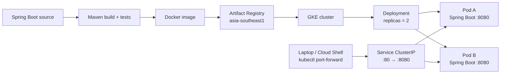
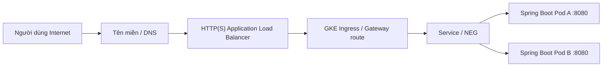
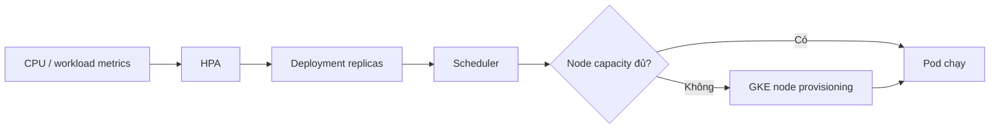

# Thực hành triển khai Spring Boot trên Google Kubernetes Engine (GKE)

Một ứng dụng REST API viết bằng **Spring Boot** có thể chạy trên máy lập trình với `java -jar`, nhưng để phục vụ người dùng trên Google Cloud còn cần đóng gói image, đưa image lên registry, triển khai các Pod, công bố điểm truy cập, kiểm tra sức khỏe, cập nhật phiên bản và xử lý lỗi. Bài này hướng dẫn toàn bộ chuỗi **Spring Boot → Maven → Docker → Artifact Registry → GKE → Deployment/Service → kiểm thử → rollout/rollback**.

Bài thuộc chương **GKE cơ bản** của module `CLOUD_PROVIDERS_GCP`. Người học sẽ vận dụng kiến thức tổ chức project, IAM, VPC, Compute Engine và load balancing để triển khai một ứng dụng container, đồng thời hiểu cách bảo vệ tài nguyên, tự động hóa phát hành, giám sát độ tin cậy và kiểm soát chi phí. Phần chính sử dụng **Service ClusterIP và port-forward** để kiểm thử mà không cần mở một HTTP endpoint ra Internet; một phần tùy chọn giải thích cách đưa API ra ngoài qua GKE Ingress.

> **Cảnh báo thực hành:** Project, cluster, registry và service account trong ví dụ đều là tên giả định. Lệnh tạo cluster, repository, cấp quyền IAM, push image, tạo Ingress và xóa tài nguyên có thể **thay đổi hạ tầng thật và phát sinh phí**. Chỉ chạy trong môi trường lab được ủy quyền, kiểm tra project và `kubectl context` trước thao tác. Các lệnh shell bên dưới viết cho Bash/Linux/macOS/Cloud Shell; nếu dùng PowerShell, cần điều chỉnh cú pháp.

## 1. Mục tiêu và kết quả cần đạt

Sau bài này, bạn có thể:

1. Tạo **Spring Boot REST API** có `/api/hello` và health endpoints của Actuator.
2. Build JAR bằng **Maven Wrapper**, viết Dockerfile Java 21 và kiểm thử container local.
3. Push image vào **Artifact Registry Docker repository**, phân biệt quyền push và quyền image pull.
4. Chọn cluster GKE **Standard hoặc Autopilot**, truy cập Kubernetes API bằng `gcloud`/`kubectl`.
5. Định nghĩa **Namespace, Kubernetes ServiceAccount, Deployment và Service** với image, resource requests/limits và probes.
6. Kiểm tra Pod/Deployment/Service và gọi ứng dụng qua **`kubectl port-forward`**.
7. Tìm hiểu cách dùng **Ingress/Load Balancer**, HTTPS và chính sách truy cập nếu API cần public.
8. Thực hành cập nhật image, quan sát **rolling update** và rollback.
9. Nhận diện lỗi **ImagePullBackOff, Pending, CrashLoopBackOff, OOMKilled, readiness/HTTP 503**, cùng nguyên nhân về IAM và mạng.
10. Thiết lập tư duy production về **Workload Identity Federation, secrets, autoscaling, observability, quota, cost và cleanup**.

**Tiêu chí hoàn thành:** trong namespace `orders-lab` có Deployment mong muốn 2 Pod Spring Boot ready; Service nội bộ `orders-api` cổng 80 trỏ tới container cổng 8080; gọi `http://127.0.0.1:8080/api/hello` qua port-forward trả JSON; có thể xác định image version và đọc logs.

## 2. Kiến trúc bài lab

Ứng dụng ví dụ tên `orders-api`, không yêu cầu database trong phần nền tảng. Những bước kết nối Cloud SQL, Cloud Storage và triển khai ra Internet được tách riêng để tránh lỗi ở hạ tầng che lấp lỗi của chính ứng dụng.



| Thành phần | Vai trò | Điểm cần nhớ |
| --- | --- | --- |
| **Maven** | Biên dịch, chạy test và tạo executable JAR. | JAR phải tương thích với JRE của image. |
| **Docker image** | Đóng gói JAR và runtime, phân phối nhất quán. | Image tag có thể thay đổi; production nên pin digest. |
| **Artifact Registry** | Lưu image và kiểm soát quyền push/pull. | IAM của người build không tự truyền sang node hoặc Pod. |
| **GKE cluster** | Kubernetes API và hạ tầng thực thi Pods. | Standard và Autopilot quản lý nodes khác nhau. |
| **Deployment** | Duy trì replicas và quản lý rollout. | Pod có thể đổi tên/IP khi được thay thế. |
| **Service ClusterIP** | Tên/địa chỉ nội bộ chuyển tiếp tới Pod endpoints phù hợp. | Không tự cấp external IP hoặc HTTPS. |
| **Kubernetes ServiceAccount** | Danh tính Kubernetes gắn với Pod. | Truy cập Google Cloud API cần phương án identity/IAM riêng. |
| **Ingress/Gateway** | Tùy chọn công bố/định tuyến traffic từ ngoài cluster. | Có thể tạo Load Balancer và phát sinh phí. |

Một Pod đang `Running` không có nghĩa ứng dụng `Ready`. Một Deployment có 2 replicas không tự bảo đảm hai Pod ở hai zone, cũng không tạo điểm vào public.

## 3. Chuẩn bị project, công cụ và quyền

### 3.1. Yêu cầu đầu vào

| Mục | Cần có |
| --- | --- |
| Google Cloud | Project lab có billing, quota và các APIs phù hợp. |
| Java | JDK 21 và Maven Wrapper từ Spring Initializr. |
| Container build | Docker CLI/Engine hoặc Cloud Build được cấp quyền. |
| CLI | `gcloud`, `kubectl` và `gke-gcloud-auth-plugin` tương thích. |
| Artifact Registry | Docker repository trong region được phép. |
| GKE | Cluster Standard/Autopilot hiện có hoặc quyền tạo cluster lab. |
| IAM/RBAC | Quyền tạo/đọc resources của cluster; quyền push image tại repository. |
| Networking | Build host tới registry, cluster kéo image, quản trị viên tới Kubernetes API. |

Bài này giả định VPC/subnet đã được thiết kế. Nếu sử dụng Shared VPC, cần phối hợp **host project và subnet permissions**. Không mở firewall toàn Internet để khắc phục các lỗi chưa xác định nguyên nhân.

### 3.2. Khai báo biến trên Bash

```bash
PROJECT_ID="orders-dev"
REGION="asia-southeast1"
CLUSTER_NAME="orders-gke-lab"
NAMESPACE="orders-lab"
REPO="spring-apps"
APP="orders-api"
IMAGE_URI="$REGION-docker.pkg.dev/$PROJECT_ID/$REPO/$APP:v1"

printf 'Project=%s\nCluster=%s\nImage=%s\n' \
  "$PROJECT_ID" "$CLUSTER_NAME" "$IMAGE_URI"
```

Những biến chỉ có hiệu lực trong shell hiện tại. Khi mở terminal mới, cần khai báo lại các biến cần dùng. Không dùng nguyên ví dụ `orders-dev` nếu project thật có ID khác.

### 3.3. Kiểm tra trước khi thực hiện thay đổi

```bash
# Lệnh chỉ đọc
gcloud auth list
gcloud config get-value project
gcloud services list --enabled --project="$PROJECT_ID"
gcloud container clusters list --project="$PROJECT_ID"
gcloud artifacts repositories list \
  --project="$PROJECT_ID" --location="$REGION"
```

Các dịch vụ tối thiểu thường cần gồm **Kubernetes Engine API** và **Artifact Registry API**. Nếu chưa bật, người có quyền phù hợp có thể thực hiện trong project lab:

```bash
# THAY ĐỔI CẤU HÌNH PROJECT: chỉ chạy khi được cho phép.
gcloud services enable \
  container.googleapis.com \
  artifactregistry.googleapis.com \
  --project="$PROJECT_ID"
```

Xác minh quota CPU, Pod IP và vùng hoạt động của GKE, cũng như ngân sách. **Tạo cluster mới có thể phát sinh phí ngay cả khi ứng dụng chưa nhận request**, tùy chế độ/tài nguyên được cấp phát.

## 4. Tạo ứng dụng REST API Spring Boot

### 4.1. Khởi tạo dự án

Mở [Spring Initializr](https://start.spring.io/) và chọn:

- **Project:** Maven; **Language:** Java.
- **Spring Boot:** bản stable còn được hỗ trợ và tương thích Java 21.
- **Group:** `com.example`; **Artifact:** `orders-api`; **Package:** `com.example.orders`.
- **Packaging:** Jar; **Java:** 21.
- **Dependencies:** **Spring Web**, **Spring Boot Actuator**.

Giải nén project. Spring Initializr tạo `pom.xml`, `mvnw`, `mvnw.cmd` và cấu trúc source. Hai dependency chính trong `pom.xml` có dạng:

```xml
<dependency>
    <groupId>org.springframework.boot</groupId>
    <artifactId>spring-boot-starter-web</artifactId>
</dependency>
<dependency>
    <groupId>org.springframework.boot</groupId>
    <artifactId>spring-boot-starter-actuator</artifactId>
</dependency>
```

Đây chỉ là **phần dependency**, không phải một `pom.xml` đầy đủ. Giữ bản Spring Boot parent, plugin và test dependencies do Initializr sinh; không tự chắp vá các phiên bản không tương thích.

### 4.2. Viết Java controller

Đặt nội dung sau trong `src/main/java/com/example/orders/OrdersApplication.java`:

```java
package com.example.orders;

import java.util.Map;
import org.springframework.boot.SpringApplication;
import org.springframework.boot.autoconfigure.SpringBootApplication;
import org.springframework.web.bind.annotation.GetMapping;
import org.springframework.web.bind.annotation.RestController;

@SpringBootApplication
public class OrdersApplication {
    public static void main(String[] args) {
        SpringApplication.run(OrdersApplication.class, args);
    }
}

@RestController
class HelloController {
    @GetMapping("/api/hello")
    public Map<String, String> hello() {
        return Map.of(
            "service", "orders-api",
            "message", "Spring Boot running on GKE"
        );
    }
}
```

Endpoint đơn giản cố tình không gọi database hoặc API ngoài: điều này giúp phân biệt lỗi **container/deployment/network** với lỗi dependency của hệ thống thực.

### 4.3. Actuator và health probes

Trong `src/main/resources/application.yml`:

```yaml
server:
  port: 8080
  shutdown: graceful

spring:
  application:
    name: orders-api
  lifecycle:
    timeout-per-shutdown-phase: 20s

management:
  endpoint:
    health:
      probes:
        enabled: true
  endpoints:
    web:
      exposure:
        include: health,info
```

Những endpoint sử dụng trong manifest Kubernetes:

| Endpoint | Mục đích |
| --- | --- |
| `GET /api/hello` | Thử nghiệp vụ HTTP cơ bản. |
| `GET /actuator/health/liveness` | Liveness: tiến trình ứng dụng có còn hoạt động theo kiểm tra không? |
| `GET /actuator/health/readiness` | Readiness: ứng dụng đã sẵn sàng phục vụ request chưa? |

**Readiness ≠ liveness.** Khi ứng dụng chưa khởi động xong, readiness thất bại là bình thường; nếu liveness restart quá sớm, container có thể bị `CrashLoopBackOff`. Không nên đưa tình trạng của một database chung vào liveness nếu điều này khiến hàng loạt Pods cùng restart mỗi khi database chậm.

### 4.4. Chạy unit tests, build và gọi local

Tại thư mục dự án trên máy phát triển:

```bash
./mvnw test
./mvnw package
java -jar target/*.jar
```

Mở terminal khác:

```bash
curl -i http://127.0.0.1:8080/api/hello
curl -i http://127.0.0.1:8080/actuator/health/liveness
curl -i http://127.0.0.1:8080/actuator/health/readiness
```

Kết quả mong đợi `/api/hello` trả HTTP 200 và JSON có `"service":"orders-api"`. Nếu cổng 8080 đã được sử dụng, kiểm tra tiến trình đang lắng nghe trước khi sửa cấu hình trên nhiều tầng.

**Production không nên bỏ qua tests** để đẩy image nhanh. Ngoài unit tests cần xem integration tests, kiểm tra dependency vulnerabilities và image scanning theo quy trình nhóm.

## 5. Đóng gói Spring Boot thành container

### 5.1. Dockerfile

Tạo `Dockerfile` ở thư mục gốc:

```dockerfile
FROM eclipse-temurin:21-jre

WORKDIR /app
COPY --chown=10001:10001 target/*.jar /app/app.jar

USER 10001:10001
EXPOSE 8080

ENTRYPOINT ["java", "-XX:MaxRAMPercentage=70.0", "-jar", "/app/app.jar"]
```

- Base image dùng **Java 21 runtime** thay vì JDK build environment.
- `COPY target/*.jar` giả định thư mục `target/` có một executable JAR duy nhất khớp pattern. Nếu Maven tạo nhiều JAR phụ, cần chọn đúng file thay vì copy wildcard mơ hồ.
- `USER 10001:10001` tránh chạy container bằng root.
- `EXPOSE` mô tả cổng container; **không tự mở public port**.
- `MaxRAMPercentage` chỉ định tỷ lệ heap tối đa theo memory limit mà JVM nhìn thấy; vẫn cần dung lượng cho non-heap, thread stack, direct memory và cache.

Image tag Java ở đây nhằm giúp dễ học. Với production, hãy kiểm chứng và **pin base image theo digest**, tạo SBOM/scan và cập nhật bản vá có kiểm soát.

### 5.2. Build và kiểm tra container local

Sau khi `./mvnw package` thành công:

```bash
docker build -t orders-api:local .

# Chỉ bind trên loopback để không phơi API thử nghiệm trong LAN.
docker run --rm -p 127.0.0.1:8080:8080 orders-api:local
```

Từ terminal khác:

```bash
curl -i http://127.0.0.1:8080/api/hello
curl -i http://127.0.0.1:8080/actuator/health/readiness
```

Nếu container không chạy, xem output của `docker run` hoặc `docker logs`; kiểm tra JAR, Java version, quyền filesystem và cổng HTTP. Chạy Docker local thành công **không chứng minh** image pull, IAM hoặc Pod scheduling trên GKE đã đúng.

### 5.3. Version image phải rõ ràng

`v1` và `latest` là **tag có thể trỏ sang digest mới** khi bị push lại. Đối với CI/CD:

1. Dùng một tag riêng cho mỗi commit/build.
2. Lưu **OCI image digest** của artifact đã push.
3. Khai báo `image: ...@sha256:...` khi triển khai production để cố định nội dung.
4. Không cấp quyền push toàn registry cho mọi tài khoản.
5. Có chính sách quét image và cập nhật base image khi có lỗ hổng.

Trong lab dùng tag `v1` để đơn giản hóa các bước.

## 6. Push image lên Artifact Registry

Tên đầy đủ một image thường theo cấu trúc:

```text
LOCATION-docker.pkg.dev/PROJECT_ID/REPOSITORY/IMAGE:TAG

asia-southeast1-docker.pkg.dev/orders-dev/spring-apps/orders-api:v1
```

### 6.1. Tạo repository nếu chưa tồn tại

```bash
# Chỉ đọc
gcloud artifacts repositories list \
  --project="$PROJECT_ID" \
  --location="$REGION"

# THAY ĐỔI TÀI NGUYÊN: chỉ chạy nếu spring-apps chưa tồn tại
# và bạn có quyền tạo repository trong project lab.
gcloud artifacts repositories create "$REPO" \
  --project="$PROJECT_ID" \
  --location="$REGION" \
  --repository-format=docker \
  --description="Spring Boot GKE lab images"
```

Nếu repository là tài nguyên dùng chung, không tự đổi chính sách hoặc xóa sau khi thực hành.

### 6.2. Xác thực Docker, tag và push

```bash
# Cho Docker sử dụng credential helper của gcloud với Artifact Registry.
gcloud auth configure-docker "$REGION-docker.pkg.dev"

docker tag orders-api:local "$IMAGE_URI"
docker push "$IMAGE_URI"

# Xác minh registry có image
gcloud artifacts docker images list \
  "$REGION-docker.pkg.dev/$PROJECT_ID/$REPO" \
  --project="$PROJECT_ID"
```

Tài khoản build/push cần quyền thích hợp, ví dụ Artifact Registry Writer trên repository. **Node image pull identity** cũng phải có quyền đọc image. Trong nhiều cấu hình cùng project, quyền có thể đã được thiết lập; với repo cross-project hoặc node service account hạn chế, hãy xác minh quyền `roles/artifactregistry.reader` ở phạm vi cần thiết.

**Không nhầm ba danh tính:**

| Principal | Việc làm | Quyền cần thiết |
| --- | --- | --- |
| Developer/CI builder | Build/push image | Artifact Registry Writer hoặc permission tương đương tại repo. |
| Node image-pull identity | Tải image để khởi chạy container | Artifact Registry Reader tại repo phù hợp. |
| Pod runtime identity | Spring Boot gọi Cloud Storage/Secret Manager/Cloud SQL | Quyền IAM của ứng dụng, khác quyền pull image. |

### 6.3. Cloud Build (tùy chọn)

Không muốn cài Docker local? Có thể sử dụng Cloud Build nếu project đã bật API và build identity có quyền thích hợp:

```bash
# THAY ĐỔI TÀI NGUYÊN: gửi source để build/push image.
gcloud builds submit --project="$PROJECT_ID" --tag="$IMAGE_URI" .
```

**Điều kiện quan trọng:** Dockerfile hiện chỉ copy `target/*.jar`, nên JAR phải tồn tại trong **build context** được gửi lên Cloud Build. Nếu source upload loại trừ `target/` hoặc CI build từ source sạch, cần thêm **bước Maven trước** hoặc dùng **multi-stage Dockerfile**. Không giả định Cloud Build tự chạy `./mvnw package` khi Dockerfile không có bước build.

## 7. Chuẩn bị và truy cập GKE cluster

### 7.1. Standard hay Autopilot?

| Lựa chọn | Đặc điểm | Khi dùng cho lab |
| --- | --- | --- |
| **GKE Standard** | Tự chọn/quản lý node pools, machine types và nhiều cấu hình node. | Tốt khi đã có cluster Standard hoặc cần thực hành node management. |
| **GKE Autopilot** | GKE quản lý provisioning hạ tầng nodes dựa trên yêu cầu Pods và tính năng hỗ trợ. | Tốt khi tập trung vào Kubernetes manifests/ứng dụng mà không muốn sizing node pool. |

Không phải cứ cần Spring Boot là phải tạo GKE cluster. Nếu chỉ có HTTP API stateless và ít yêu cầu Kubernetes, **Cloud Run** cũng đáng đánh giá vì giảm công vận hành cluster.

### 7.2. Ưu tiên dùng cluster đã có

```bash
gcloud container clusters list \
  --project="$PROJECT_ID"
```

Xác định đúng tên, location (region hoặc zone), mode, quyền, mạng và owner của cluster lab. Tránh tạo cluster mới khi tổ chức đã có môi trường thử nghiệm phù hợp.

Nếu **được phép tạo cluster Autopilot riêng**, VPC/subnet và IP ranges đã sẵn sàng:

```bash
NETWORK="orders-vpc"
SUBNET="gke-subnet"

# TẠO CLUSTER THẬT: có thể phát sinh phí.
gcloud container clusters create-auto "$CLUSTER_NAME" \
  --project="$PROJECT_ID" \
  --region="$REGION" \
  --network="$NETWORK" \
  --subnetwork="$SUBNET"
```

Lệnh trên là **khung cấu hình lab**. Organization Policy có thể yêu cầu private nodes, private control-plane endpoint, release channel hoặc tiêu chí bảo mật khác. Chỉ dùng khi network/subnet, quyền Shared VPC và regional capacity đã được chuẩn bị. Với cluster hiện có, bỏ qua lệnh tạo.

### 7.3. Lấy kubeconfig và xem trạng thái

```bash
# Sửa kubeconfig trên máy chạy lệnh, không tạo cluster.
gcloud container clusters get-credentials "$CLUSTER_NAME" \
  --project="$PROJECT_ID" \
  --location="$REGION"

kubectl config current-context
kubectl cluster-info
kubectl get nodes -o wide
kubectl get namespaces
```

Nếu cluster là **zonal**, tham số `--location` phải dùng zone thực, ví dụ `asia-southeast1-b`. `get-credentials` có thể đổi current Kubernetes context: **luôn xem context trước mỗi lệnh apply/delete**. Nếu `kubectl` báo unauthorized/forbidden, xem authentication plugin, IAM và Kubernetes RBAC; không cấp cluster-admin một cách vội vàng.

## 8. Kubernetes manifest: Deployment và Service cho Spring Boot

Tạo file `k8s/orders-gke.yaml` ở project Spring Boot của người học. Nội dung có **bốn resource**: Namespace, Kubernetes ServiceAccount, Deployment và Service. Đây là ví dụ mà người học copy để thực hành, **không phải file được worker tạo thêm trong repository học liệu**.

```yaml
apiVersion: v1
kind: Namespace
metadata:
  name: orders-lab
  labels:
    app.kubernetes.io/part-of: orders-lab
---
apiVersion: v1
kind: ServiceAccount
metadata:
  name: orders-api
  namespace: orders-lab
---
apiVersion: apps/v1
kind: Deployment
metadata:
  name: orders-api
  namespace: orders-lab
spec:
  replicas: 2
  revisionHistoryLimit: 5
  strategy:
    type: RollingUpdate
    rollingUpdate:
      maxSurge: 1
      maxUnavailable: 0
  selector:
    matchLabels:
      app: orders-api
  template:
    metadata:
      labels:
        app: orders-api
    spec:
      serviceAccountName: orders-api
      terminationGracePeriodSeconds: 30
      securityContext:
        runAsNonRoot: true
        runAsUser: 10001
        runAsGroup: 10001
        seccompProfile:
          type: RuntimeDefault
      containers:
        - name: orders-api
          image: IMAGE_URI_REPLACE_ME
          imagePullPolicy: IfNotPresent
          ports:
            - name: http
              containerPort: 8080
          resources:
            requests:
              cpu: "250m"
              memory: "512Mi"
            limits:
              cpu: "1"
              memory: "1Gi"
          securityContext:
            allowPrivilegeEscalation: false
            readOnlyRootFilesystem: true
            capabilities:
              drop: ["ALL"]
          volumeMounts:
            - name: temp
              mountPath: /tmp
          startupProbe:
            httpGet:
              path: /actuator/health/liveness
              port: http
            periodSeconds: 5
            failureThreshold: 24
          readinessProbe:
            httpGet:
              path: /actuator/health/readiness
              port: http
            periodSeconds: 5
            failureThreshold: 3
          livenessProbe:
            httpGet:
              path: /actuator/health/liveness
              port: http
            periodSeconds: 10
            failureThreshold: 3
      volumes:
        - name: temp
          emptyDir:
            sizeLimit: 256Mi
---
apiVersion: v1
kind: Service
metadata:
  name: orders-api
  namespace: orders-lab
spec:
  type: ClusterIP
  selector:
    app: orders-api
  ports:
    - name: http
      port: 80
      targetPort: http
      protocol: TCP
```

### 8.1. Giải thích từng phần

| Trường | Tác dụng | Lỗi thường gặp |
| --- | --- | --- |
| `metadata.namespace` | Đặt ứng dụng vào không gian tài nguyên lab. | Apply sang namespace production do context/manifest sai. |
| `ServiceAccount` | Danh tính Kubernetes của Pod. | Nghĩ rằng KSA tự có mọi IAM role Google Cloud. |
| `replicas: 2` | Duy trì hai bản sao ứng dụng. | Không có node capacity để schedule cả hai. |
| `IMAGE_URI_REPLACE_ME` | Placeholder của image thực. | Quên thay, dẫn đến lỗi pull image. |
| `requests/limits` | Cấp CPU/memory cho scheduler và giới hạn runtime. | JVM OOM hoặc Pod Pending nếu sizing sai. |
| `startupProbe` | Cho Spring Boot thời gian khởi động trước các probe khác. | Thời gian cho startup quá ngắn, gây restart. |
| `readinessProbe` | Chỉ đưa Pod sẵn sàng vào Service endpoints. | Sai path/port, Pod chạy nhưng không nhận request. |
| `livenessProbe` | Phát hiện container treo để restart. | Probe gọi database chung và tạo restart storm. |
| `readOnlyRootFilesystem` | Giới hạn vùng ghi trong container. | Ứng dụng cần ghi temp nhưng không có volume writable. |
| `Service port 80 → targetPort http` | Chuyển tiếp vào container 8080. | Service selector hoặc port name không khớp. |

`emptyDir` tại `/tmp` phục vụ dữ liệu tạm khi root filesystem read-only. **Nó không phải nơi lưu dữ liệu nghiệp vụ bền vững**. Khi Pod bị thay, nội dung tạm này có thể mất.

### 8.2. Vì sao cần startup, readiness và liveness?

Ví dụ Spring Boot cần hơn một phút để nạp dependencies:

```text
Container start
  → JVM khởi động
  → Spring context / embedded server được tạo
  → startup probe thành công
  → readiness chuyển thành ready
  → Service đưa Pod vào danh sách backend
```

- **Startup** tránh khởi động chậm bị nhầm với tiến trình đã hỏng.
- **Readiness** xác định có nên gửi traffic mới vào Pod không.
- **Liveness** xác định khi nào cần restart container vì không còn phản hồi phù hợp.

Các mốc của probe phải đo từ ứng dụng thật. Nếu health endpoint không phản ánh readiness của các dependency cần thiết, Kubernetes có thể gửi traffic vào Pod đang không phục vụ được; nếu liveness quá nhạy, ứng dụng có thể bị restart liên tục.

### 8.3. Requests/limits và Java memory

`memory: 1Gi` trong ví dụ là mức giới hạn container, không đồng nghĩa JVM có toàn bộ 1 GiB cho heap. Ngoài heap còn non-heap, metaspace, native memory, threads và buffers. Tham số `MaxRAMPercentage=70.0` của Dockerfile là điểm khởi đầu, **phải đo memory footprint thực tế** trước khi sản xuất.

GKE Autopilot có thể áp dụng minimum resource requests và admission policies tùy workload/compute class; nếu manifest bị reject, đọc thông báo và điều chỉnh cấu hình đúng chính sách thay vì cố vượt hạn chế.

## 9. Triển khai lên GKE và kiểm tra Service

### 9.1. Bước an toàn trước khi apply

Kiểm tra Kubernetes context, namespace và image:

```bash
kubectl config current-context
printf 'Image to deploy: %s\n' "$IMAGE_URI"

# Chỉ đọc: nếu namespace đã có, xác minh chủ sở hữu trước khi tiếp tục.
kubectl get namespace "$NAMESPACE" --show-labels
```

Nếu `orders-lab` là namespace của người khác, **không apply hoặc xóa namespace đó**. Hãy chọn tên khác và cập nhật `metadata.namespace` trong manifest, các lệnh `kubectl` và IAM workload principal liên quan.

### 9.2. Thay image placeholder và apply manifest

Trên Bash, có thể thay `IMAGE_URI_REPLACE_ME` khi gửi manifest tới Kubernetes API, không sửa file YAML nguồn:

```bash
# THAY ĐỔI TÀI NGUYÊN KUBERNETES trong context hiện tại.
sed "s|IMAGE_URI_REPLACE_ME|$IMAGE_URI|g" k8s/orders-gke.yaml \
  | kubectl apply -f -
```

Lệnh dùng `sed` trên môi trường có cú pháp tương thích; nếu dùng Helm/Kustomize/GitOps trong dự án thực, hãy dùng cơ chế render/version chính thức. Kiểm tra lại manifest đã render và image URI trước khi áp vào production. Không áp dụng khi current context chưa đúng project/cluster.

**Vì sao dùng Deployment?** Kubernetes Deployment và ReplicaSet điều phối số Pod theo desired state. Nếu một Pod bị hỏng hoặc bị xóa, controller có thể tạo Pod thay thế; nhưng điều đó còn phụ thuộc node/CPU/memory/IP quota và khả năng khởi động ứng dụng.

### 9.3. Xác minh rollout, Pod và Service

```bash
kubectl rollout status deployment/orders-api \
  --namespace="$NAMESPACE" \
  --timeout=300s

kubectl get deployment orders-api -n "$NAMESPACE"
kubectl get pods -n "$NAMESPACE" -l app=orders-api -o wide
kubectl get service orders-api -n "$NAMESPACE" -o wide
kubectl get events -n "$NAMESPACE" --sort-by=.lastTimestamp
```

Khi triển khai thành công, kỳ vọng dữ liệu tương tự:

```text
Deployment: orders-api
  Desired replicas: 2
  Available:        2

Service: orders-api
  Type: ClusterIP
  Service port: 80
  Pod targetPort: 8080

Pods:
  orders-api-...  Running  Ready 1/1
  orders-api-...  Running  Ready 1/1
```

Đây là **kết quả minh họa**, không phải output từ cluster thật. Nếu Pod `Running` nhưng `READY=0/1`, kiểm tra endpoint readiness, startup timing và lỗi ứng dụng; nếu Pod `Pending`, đọc thông báo scheduling và quota.

### 9.4. Gọi REST API qua port-forward

Trên terminal A:

```bash
# Tạo tunnel tạm thời để test, không công bố external IP.
kubectl port-forward \
  -n "$NAMESPACE" \
  service/orders-api 8080:80
```

Trên terminal B:

```bash
curl -i http://127.0.0.1:8080/api/hello
curl -i http://127.0.0.1:8080/actuator/health/liveness
curl -i http://127.0.0.1:8080/actuator/health/readiness
```

Kết quả `/api/hello` dự kiến:

```json
{
  "service": "orders-api",
  "message": "Spring Boot running on GKE"
}
```

Port-forward chạy foreground; dừng bằng Ctrl+C. Nếu cổng local 8080 đang bị chiếm, dùng `18080:80` và đổi URL client thành `http://127.0.0.1:18080`.

**Port-forward phù hợp cho kiểm thử và chẩn đoán**, không thay thế frontend HTTPS, DNS, authentication và HA của một dịch vụ public thực tế. Mất kết nối `kubectl` sẽ kết thúc tunnel.

### 9.5. Kiểm tra Service từ bên trong cluster (tùy chọn)

Kubernetes DNS cung cấp tên `orders-api.orders-lab.svc.cluster.local` trong cấu hình cluster domain tương ứng. Nếu muốn kiểm tra đường Service DNS từ Pod khác, dùng image `curl` đã được tổ chức phê duyệt:

```bash
# TẠO POD TẠM THỜI: chỉ trong namespace lab.
kubectl run curl-check \
  -n "$NAMESPACE" \
  --restart=Never \
  --image=curlimages/curl:8.10.1 \
  --command -- curl -i http://orders-api:80/api/hello

kubectl logs curl-check -n "$NAMESPACE"

# Xóa riêng Pod kiểm tra khi xong.
kubectl delete pod curl-check -n "$NAMESPACE"
```

Nếu policy cấm pull public registry, sử dụng image nội bộ được duyệt; không mở egress không giới hạn chỉ để thử. Nếu namespace có NetworkPolicy default-deny, cần rule mạng phù hợp cho Pod test.

## 10. Công bố API ra ngoài bằng Ingress (tùy chọn)

Service kiểu `ClusterIP` ở trên chỉ dùng trong cluster hoặc qua đường kết nối được phép. Nếu người dùng Internet cần truy cập Spring Boot API, có thể dùng **GKE Ingress/Gateway** và Google Cloud **Application Load Balancer**, kết hợp DNS, TLS và chính sách bảo vệ.



**Bật Ingress public có thể tạo frontend Internet thực và phát sinh phí Load Balancing**. Không làm bước này khi yêu cầu chỉ là thử code qua port-forward.

### 10.1. Chuẩn bị backend Service tương thích

GKE Ingress controller có thể sử dụng **Network Endpoint Group (NEG)** để đưa Pod endpoints làm backend theo mô hình container-native load balancing. Với loại Service/Ingress được hỗ trợ và sau khi đã xác minh cluster configuration, có thể thêm annotation:

```bash
# THAY ĐỔI SERVICE: chỉ chạy trên cluster/controller hỗ trợ cách này.
kubectl annotate service orders-api \
  -n "$NAMESPACE" \
  'cloud.google.com/neg={"ingress":true}' \
  --overwrite
```

Trong dự án dùng GitOps, nên ghi annotation vào manifest nguồn thay vì chỉ sửa trực tiếp ở cluster. Không phải mọi chế độ Gateway/Ingress/Service đều cần hoặc sử dụng cùng loại NEG; hãy kiểm tra tài liệu controller đang dùng.

### 10.2. Ingress HTTP mẫu cho lab có phê duyệt

File `k8s/orders-ingress-lab.yaml` chỉ minh họa đường HTTP không mã hóa; **không đủ cho production**:

```yaml
apiVersion: networking.k8s.io/v1
kind: Ingress
metadata:
  name: orders-api
  namespace: orders-lab
  annotations:
    kubernetes.io/ingress.class: "gce"
spec:
  rules:
    - http:
        paths:
          - path: /
            pathType: Prefix
            backend:
              service:
                name: orders-api
                port:
                  number: 80
```

Nếu nhóm platform cho phép tạo public HTTP endpoint **tạm thời trong lab**:

```bash
# THAY ĐỔI HẠ TẦNG: có thể tạo external HTTP Load Balancer và IP.
kubectl apply -f k8s/orders-ingress-lab.yaml

kubectl get ingress orders-api -n "$NAMESPACE"
kubectl describe ingress orders-api -n "$NAMESPACE"
```

Khi Ingress có frontend IP và backend healthy, có thể thử `http://EXTERNAL_IP/api/hello`. Việc provisioning có thể qua nhiều bước; Ingress object tồn tại chưa chứng minh Load Balancer đã hoàn thành hoặc endpoint khỏe.

### 10.3. Yêu cầu tối thiểu nếu đưa ra production

- Chọn **external/internal Load Balancer** đúng với đối tượng được phép truy cập.
- Dùng **HTTPS/TLS**, domain hợp lệ, certificate rotation và DNS ổn định.
- Xác định backend NEG/health checks, đường firewall và kiểu Ingress/Gateway được GKE hỗ trợ.
- Bật **authentication/authorization** cho API, không dùng URL khó đoán làm kiểm soát truy cập.
- Đánh giá **Cloud Armor, IAP, rate limiting, WAF** theo loại LB và use case hỗ trợ.
- Kiểm tra private Pods/nodes, đường bypass backend, network policies và service identity.
- Có static IP, logging/metrics, runbook, quota và dự toán chi phí khi cần.

Với API nội bộ, nên đánh giá **Internal Application Load Balancer hoặc Gateway nội bộ** trong kiến trúc được hỗ trợ, thay vì công bố HTTP public rồi chỉ che tên miền bằng private DNS.

## 11. Quản lý cấu hình và quyền ứng dụng

### 11.1. Ba loại danh tính khác nhau

Một hệ thống GKE thường có:

| Danh tính | Hành động | Cách phân quyền |
| --- | --- | --- |
| **CI/build principal** | Test, build và push image. | Quyền Artifact Registry Writer trên repository cần thiết. |
| **Deploy principal** | Thay đổi Deployment, Service, HPA/Ingress trong namespace. | IAM + Kubernetes RBAC đúng phạm vi, không tự dùng `cluster-admin`. |
| **Node image-pull identity** | Pull image từ Artifact Registry. | Quyền Artifact Registry Reader theo cơ chế node/GKE hỗ trợ. |
| **Runtime Pod workload principal** | Spring Boot gọi Cloud Storage, Secret Manager, Pub/Sub/Cloud SQL APIs. | Workload Identity Federation và role IAM tối thiểu trên tài nguyên cụ thể. |

Người tạo cluster có Storage Admin **không đồng nghĩa ứng dụng trong Pod được đọc Cloud Storage**. Kubernetes ServiceAccount (KSA) cũng khác **IAM service account**.

### 11.2. Workload Identity Federation for GKE

Nếu ứng dụng mở rộng cần đọc `gs://orders-catalog-dev`, nên dùng **Workload Identity Federation for GKE** thay vì lưu service account JSON key trong image. Trong cluster được cấu hình phù hợp, KSA `orders-lab/orders-api` có thể đại diện một workload principal khi được Google IAM cho phép.

Ví dụ cấp quyền chỉ đọc ở bucket bằng principal trực tiếp (chỉ chạy khi đã xác minh cấu hình WIF và resource):

```bash
PROJECT_NUMBER="$(gcloud projects describe "$PROJECT_ID" \
  --format='value(projectNumber)')"

KSA_PRINCIPAL="principal://iam.googleapis.com/projects/$PROJECT_NUMBER/locations/global/workloadIdentityPools/$PROJECT_ID.svc.id.goog/subject/ns/orders-lab/sa/orders-api"

# CẤP IAM THẬT: chỉ cần nếu API thực sự đọc bucket này.
gcloud storage buckets add-iam-policy-binding \
  gs://orders-catalog-dev \
  --member="$KSA_PRINCIPAL" \
  --role="roles/storage.objectViewer"
```

Lưu ý:

1. Project number/pool, namespace và KSA trong member string phải **khớp thực tế**.
2. Cluster phải hỗ trợ và bật WIF trong cấu hình tương ứng.
3. Bucket và IAM scope phải chính xác; quyền đọc không cấp quyền xóa.
4. Spring Boot có thể sử dụng Google Cloud client libraries với **Application Default Credentials** từ workload identity mechanism.
5. Có những luồng tích hợp yêu cầu **impersonate IAM service account** thay vì cấp role trực tiếp cho principal; không trộn cấu hình hai phương án tùy tiện.

REST API `/api/hello` hiện tại **không cần quyền Cloud Storage**, vì thế không cần chạy lệnh cấp IAM này để hoàn thành lab chính.

### 11.3. Secrets và môi trường

Không nhúng password/token vào:

- `application.yml` đã commit Git ở dạng rõ chữ.
- Dockerfile, Docker image layers hoặc build logs.
- Một Kubernetes ConfigMap lưu dữ liệu bí mật.
- Các biến shell/history lưu lâu dài hoặc nội dung ticket công khai.

Có thể sử dụng **Secret Manager** và tích hợp GKE phù hợp, hoặc Kubernetes Secret có RBAC/encryption được cấu hình cẩn thận. Base64 trong Kubernetes Secret **không phải mã hóa để bảo vệ dữ liệu nguồn**.

Nếu mở rộng ứng dụng để gọi Cloud SQL, cần thiết kế **private connectivity/Cloud SQL connectors hoặc Auth Proxy, IAM, database credentials, TLS và connection pool**. Tăng từ 2 lên 20 Pods cũng có thể tăng số kết nối tới DB; Kubernetes không tự giải quyết saturation của database.

## 12. Tạo phiên bản mới, rollout và rollback

### 12.1. Build image v2

Giả sử bạn sửa thông điệp trả về tại `HelloController` và bổ sung tests. Trong thư mục ứng dụng:

```bash
./mvnw test
./mvnw package

IMAGE_URI_V2="$REGION-docker.pkg.dev/$PROJECT_ID/$REPO/$APP:v2"

docker build -t "$IMAGE_URI_V2" .
docker push "$IMAGE_URI_V2"
```

**Không push lại tag `v1`** chỉ để thay bytes của bản đã phát hành. Với production nên dùng image digest bất biến và audit được.

### 12.2. Cập nhật Deployment

```bash
# THAY ĐỔI WORKLOAD: dùng tên container đúng trong manifest.
kubectl set image deployment/orders-api \
  orders-api="$IMAGE_URI_V2" \
  -n "$NAMESPACE"

kubectl rollout status deployment/orders-api \
  -n "$NAMESPACE" \
  --timeout=300s

kubectl rollout history deployment/orders-api -n "$NAMESPACE"
kubectl get pods -n "$NAMESPACE" -l app=orders-api -o wide
```

Deployment sẽ cố thay Pod theo chiến lược RollingUpdate: `maxSurge: 1`, `maxUnavailable: 0` trong manifest mẫu. Nhưng **không có cam kết zero downtime chỉ nhờ hai trường này**: phải có capacity dư, probes đúng, graceful shutdown, backend health và dependency ổn định.

Khi tổ chức dùng **GitOps/Helm/Kustomize**, `kubectl set image` chỉ là cách thực hành dễ hiểu và có thể tạo configuration drift. Trong production hãy sửa Git/manifest nguồn và chạy pipeline được phê duyệt.

### 12.3. Rollback khi bản mới lỗi

```bash
# THAY ĐỔI WORKLOAD: quay về revision trước còn trong history.
kubectl rollout undo deployment/orders-api -n "$NAMESPACE"
kubectl rollout status deployment/orders-api \
  -n "$NAMESPACE" \
  --timeout=300s
```

Rollback chỉ quay lại **Pod template/image**, **không tự hoàn tác schema database hoặc dữ liệu đã ghi**. Cần chiến lược migration tương thích ngược và backup nếu hệ thống có DB.

### 12.4. Kiểm tra một rollout thực sự

Ngoài trạng thái `rollout status`, hãy so trước/sau:

- Pod ready, restarts, CPU/memory.
- HTTP p95/p99 latency và 5xx.
- Request throughput và error rate nghiệp vụ.
- Cloud SQL/Redis/external API dependency health nếu ứng dụng dùng.
- Log application exceptions và health probe failures.

Nếu v2 lỗi ngay ở bước startup, đọc `kubectl logs --previous` và Events trước khi quyết định rollback. Với lỗi nghiêm trọng, khôi phục bản trước đã được kiểm chứng thường an toàn hơn tăng resource vô căn cứ.

## 13. HPA, độ tin cậy và chiến lược scale

### 13.1. Scale Pod khác scale node

**Horizontal Pod Autoscaler (HPA)** có thể điều chỉnh `Deployment.spec.replicas` dựa trên metric. Trong Standard, **cluster autoscaler/node auto-provisioning** có thể bổ sung node capacity khi Pod không schedule được; trong Autopilot GKE quản lý provisioning hạ tầng theo khả năng được hỗ trợ.



HPA **không tự tạo node** và việc có node mới không bảo đảm ứng dụng đã sẵn sàng. Quota CPU, node resource availability, IP ranges, Artifact Registry, startup và Cloud SQL đều có thể giới hạn tốc độ scale.

### 13.2. HPA CPU mẫu (tùy chọn)

Khi metrics pipeline đã hoạt động:

```bash
# THAY ĐỔI WORKLOAD: thêm HPA cho Deployment lab.
kubectl autoscale deployment orders-api \
  -n "$NAMESPACE" \
  --cpu-percent=65 \
  --min=2 \
  --max=6

kubectl get hpa -n "$NAMESPACE"
kubectl describe hpa orders-api -n "$NAMESPACE"
```

HPA CPU utilization dùng **CPU requests** làm cơ sở tính tỷ lệ. Resource requests sai hoặc workload chờ I/O/DB làm CPU thấp có thể khiến HPA phản ứng không đúng yêu cầu kinh doanh. Trong production, nên quản lý HPA bằng YAML/GitOps và tránh để automation khác ghi đè replicas một cách không kiểm soát.

### 13.3. Hai Pods chưa bảo đảm high availability

Một regional GKE cluster giúp control plane có thiết kế sẵn sàng cao theo sản phẩm, nhưng workload vẫn cần:

1. Nhiều replicas và readiness phản ánh năng lực phục vụ.
2. Phân bố Pods trên nodes/zones bằng topology spread/anti-affinity khi phù hợp.
3. Node/IP/quota capacity đủ cho rollout và lỗi một node/zone.
4. PodDisruptionBudget cho các loại gián đoạn tự nguyện cần kiểm soát.
5. Database/storage có HA, backup và DR độc lập.
6. Kiểm thử mất Pod/node/zone, graceful termination và rollout under load.

Ba Pods cùng kết nối một Cloud SQL instance đang quá tải vẫn có thể làm ứng dụng thất bại. **Scaling chỉ hiệu quả khi bottleneck đúng nằm ở nơi bạn tăng năng lực.**

## 14. Giám sát và xử lý lỗi triển khai

### 14.1. Bộ lệnh chẩn đoán chỉ đọc

```bash
kubectl get deployments,pods,services -n "$NAMESPACE" -o wide
kubectl get events -n "$NAMESPACE" --sort-by=.lastTimestamp
kubectl describe deployment orders-api -n "$NAMESPACE"

# Chọn POD_NAME thực từ danh sách trước khi chạy:
kubectl describe pod POD_NAME -n "$NAMESPACE"
kubectl logs POD_NAME -n "$NAMESPACE" --tail=100
kubectl logs POD_NAME -n "$NAMESPACE" --previous --tail=100

kubectl get service orders-api -n "$NAMESPACE" -o yaml
kubectl get endpointslices -n "$NAMESPACE" \
  -l kubernetes.io/service-name=orders-api
```

Logs có thể chứa token, thông tin nội bộ hoặc dữ liệu người dùng; không đăng nguyên văn vào kênh công khai.

### 14.2. Bảng lỗi thường gặp

| Hiện tượng | Nguyên nhân có thể | Hướng kiểm tra |
| --- | --- | --- |
| `kubectl Unauthorized/Forbidden` | Context, IAM authentication hoặc Kubernetes RBAC sai. | `kubectl config current-context`, principal, Role/RoleBinding. |
| Pod `Pending` | CPU/memory/IP không đủ, quota, taint/affinity hoặc policy. | `describe pod`, Events, node/autoscaling/quota. |
| `ImagePullBackOff` | Image URI/tag sai, registry thiếu quyền Reader hoặc lỗi network. | Pod Events, Artifact Registry image, node pull identity. |
| `CrashLoopBackOff` | JAR/JVM lỗi, env/secret thiếu, app exit hoặc probe restart. | `kubectl logs --previous` và Pod Events. |
| `OOMKilled` | Heap + non-heap vượt memory limit. | Memory metrics, JVM settings, sizing requests/limits. |
| Pod `Running` nhưng `Ready 0/1` | App chưa mở port hoặc probe path/status sai. | Spring Actuator endpoints, logs, readiness. |
| Service không có endpoint | `selector` không match labels hoặc Pods chưa ready. | `get endpointslices`, labels và Service config. |
| Port-forward từ chối kết nối | Pod không ready, container không listen 8080, local port bị chiếm. | Service targetPort, app logs, dùng local port khác. |
| External Ingress HTTP `502/503` | Backend/NEG unhealthy, route/health check hoặc LB chưa sẵn sàng. | `describe ingress`, backend health, Events, network policies. |
| API gọi Cloud Storage trả `403` | WIF/KSA/IAM bucket chưa đúng. | Workload principal, permission trên bucket, Cloud Audit Logs. |
| Đổi image nhưng response vẫn cũ | Tag bị ghi đè, rollout chưa tạo Pods mới hoặc image cache. | Image digest/Pod imageID, rollout history, tag version. |
| Request tăng nhưng latency vẫn cao | DB bottleneck, CPU throttling, insufficient upstream connections. | p95 traces, CPU/memory, connection pool, DB metrics. |

### 14.3. Quy trình điều tra HTTP 503

1. **Pod:** có Running không, restart count và `kubectl describe pod` báo gì?
2. **Readiness:** endpoint `/actuator/health/readiness` trả 200 chưa?
3. **Service:** selector và EndpointSlices đã có endpoints ready chưa?
4. **Ports:** Service 80 → named container port 8080 có đúng không?
5. **Ingress/Load Balancer:** backend health, NEG, firewall/proxy và routing có hoạt động không?
6. **Dependencies:** Cloud SQL, secret, API ngoài có lỗi hay timeout không?
7. **Capacity:** requests/limits/quota/nodes có đủ, có CPU throttling/OOM không?

Không sửa mọi lỗi bằng mở firewall `0.0.0.0/0` hoặc cấp `roles/owner`. Một lỗi readiness có thể hoàn toàn nằm ở Java app hoặc health endpoint, không liên quan tới IAM project.

## 15. Logging, SLO và CI/CD an toàn

### 15.1. Log và metrics ở các lớp

Ứng dụng container nên ghi log có cấu trúc qua **stdout/stderr** để GKE thu thập theo Logging configuration. Không cần ghi liên tục vào file bên trong root filesystem read-only.

| Tầng | Tín hiệu nên giám sát | Công cụ |
| --- | --- | --- |
| Deployment | Desired/available replicas, rollout revisions. | `kubectl`, GKE dashboards. |
| Pod/container | Restarts, OOM, readiness, CPU/memory. | `kubectl`, Cloud Monitoring. |
| HTTP | Request rate, p95/p99 latency, 4xx/5xx. | Spring Actuator/Micrometer + collector/integration phù hợp. |
| Image/pipeline | Build failures, vulnerability reports, deployment status. | Artifact Registry, CI/CD logs. |
| Security | IAM/RBAC denied, changes, secrets accesses. | Audit Logs, RBAC/configuration audits. |
| Data | Cloud SQL connections/errors, Cloud Storage API failures. | Dịch vụ managed tương ứng. |
| Cost | Cluster/Pod compute, LB, network, storage, logs. | Cloud Billing và cost labels. |

Spring Boot Actuator chỉ cung cấp health/metrics ở tầng ứng dụng; **không tự đồng nghĩa tất cả metrics sẽ được gửi vào Cloud Monitoring**. Muốn xuất cần cấu hình exporter/collector hoặc tích hợp được tổ chức hỗ trợ.

### 15.2. Pipeline triển khai

```mermaid
flowchart LR
    PR["PR + code review"] --> TEST["Tests + dependency scan"]
    TEST --> BUILD["Maven + Docker build"]
    BUILD --> SCAN["Image scan/provenance"]
    SCAN --> PUSH["Artifact Registry"]
    PUSH --> APPROVE["Environment approval"]
    APPROVE --> GITOPS["Kustomize/Helm/GitOps apply digest"]
    GITOPS --> CHECK["Rollout + SLO verification"]
    CHECK --> RB["Rollback if needed"]
```



Nên tách **build principal**, **deploy principal** và **runtime workload identity**, tránh một Owner credential dùng mọi công đoạn. Release nên kiểm tra diff, phiên bản API Kubernetes, hình ảnh đã ký/scan, readiness và khả năng rollback.

### 15.3. Runbook vận hành

Khi có alert 5xx tăng:

1. Xác minh phiên bản image và thời điểm rollout gần nhất.
2. Xem Pod count/ready, retries, restarts và error logs.
3. Kiểm tra dependencies và kết nối Cloud SQL/Storage.
4. So sánh SLO p95/error với mức trước release.
5. Nếu rõ do release và rollback an toàn, dùng pipeline/GitOps hoặc `rollout undo` theo quy trình được duyệt.
6. Xác nhận sự cố đã hết và tạo post-incident review; không chỉ kết thúc ở bước restart Pods.

## 16. Chi phí, quotas và so sánh với Cloud Run

| Khoản mục | Có thể phát sinh phí | Cách kiểm soát |
| --- | --- | --- |
| **Cluster/GKE management** | Phí theo chế độ và chính sách giá hiện hành. | Tận dụng cluster lab đã tồn tại. |
| **Standard nodes** | Compute Engine VMs/disks có thể tính cả lúc ít Pod. | Right-size node pools, autoscaling hợp lý. |
| **Autopilot workloads** | Phí tài nguyên Pod/compute class và thành phần khác theo mô hình giá. | Requests/limits theo benchmark, min replicas có cơ sở. |
| **Artifact Registry** | Lưu image, vận hành repository và chi phí liên quan. | Retention, dọn image cũ có kiểm soát. |
| **Ingress/LB** | Forwarding rules, traffic, edge security, IP. | Chỉ tạo public endpoint khi thực sự cần. |
| **Networking** | Egress, cross-region, NAT/traffic phụ trợ. | Đặt compute/data gần nhau theo thiết kế. |
| **Logging/Monitoring** | Dữ liệu ingest, retention, traces. | Chọn metric/log và sampling theo SLO. |
| **Managed dependencies** | Cloud SQL, Storage, Pub/Sub, Secret Manager. | Dự toán cả hệ thống, không chỉ Pod. |

Tăng replicas từ 2 lên 10 có thể tăng đồng thời số kết nối DB, log volume và phí workload. **Budget alert không tự dừng cluster**; quota cũng không phải trần chi phí tuyệt đối.

Nếu chỉ triển khai một Spring Boot HTTP API stateless, cần so với **Cloud Run**: nó có thể giảm trách nhiệm vận hành Kubernetes, nodes và Service/Ingress. GKE có lợi khi tổ chức cần namespaces/RBAC, nhiều workload phối hợp, scheduling/network/storage policies hoặc nền tảng Kubernetes đã có.

## 17. Dọn tài nguyên lab an toàn

### 17.1. Kiểm kê trước khi xóa

```bash
kubectl config current-context
kubectl get all -n "$NAMESPACE"
kubectl get ingress -n "$NAMESPACE"
kubectl get hpa -n "$NAMESPACE"
```

Nếu namespace không thuộc riêng bài thực hành, **không xóa namespace**. Kiểm tra mọi PVC/Secret/ConfigMap và ứng dụng có thể đang sử dụng namespace trước khi dọn.

### 17.2. Xóa tài nguyên tùy chọn

```bash
# Lệnh THAY ĐỔI: chỉ xóa resource do lab tạo.
kubectl delete ingress orders-api \
  -n "$NAMESPACE" --ignore-not-found

kubectl delete hpa orders-api \
  -n "$NAMESPACE" --ignore-not-found
```

Sau khi xóa Ingress, kiểm tra các Load Balancer resources và IP liên quan đã được thu hồi theo controller. Không suy luận **mọi chi phí ngừng lập tức** chỉ vì Kubernetes object đã biến mất.

### 17.3. Xóa namespace nếu thuộc riêng lab

```bash
# XÓA THẬT tất cả resource namespaced: chỉ chạy với namespace lab sở hữu riêng.
kubectl delete namespace "$NAMESPACE"
```

Với namespace production chứa PVC, xóa namespace có thể ảnh hưởng tới dữ liệu tùy StorageClass/PV reclaim policy. Bài lab này không tạo PVC.

### 17.4. Chỉ xóa cluster/repository nếu đã tạo mới cho lab

```bash
# XÓA CLUSTER THẬT: chỉ khi cluster do bạn tạo riêng,
# không còn người dùng/tài nguyên cần giữ.
gcloud container clusters delete "$CLUSTER_NAME" \
  --project="$PROJECT_ID" \
  --region="$REGION"
```

Nếu cluster là **zonal**, dùng đúng zone thay vì region. Nếu repository `spring-apps` là tài nguyên chung, **giữ nguyên**. Kiểm tra images, registry storage, load balancers, IP, disks, Cloud NAT, logs và billing trước khi kết luận lab đã được dọn hết phí.

## 18. Bài tập vận dụng có đáp án

### Bài tập 1 — ImagePullBackOff

Developer push image thành công bằng tài khoản cá nhân nhưng Pod báo `ImagePullBackOff`. Vì sao?

**Đáp án:** GKE kéo image bằng cơ chế/image-pull identity của node/cluster, không tự dùng tài khoản của developer. Kiểm tra image URI/tag, repository IAM Reader, registry/DNS/network và Pod Events.

### Bài tập 2 — Deployment không có ready Pods

Spring Boot log báo ứng dụng đang chạy, nhưng `kubectl get pods` cho thấy `Running 0/1`. Cần điều tra gì?

**Đáp án:** Kiểm tra startup/readiness probe path/port/HTTP code, thời gian khởi động, khả năng Service targetPort match container, logs và `kubectl describe pod`. `Running` không chứng minh `Ready`.

### Bài tập 3 — HTTP 503 từ Service

Deployment có 2 Pods, nhưng Service không có EndpointSlices chứa ready endpoints.

**Đáp án:** So sánh `Service.spec.selector` với `Pod.metadata.labels`; kiểm tra Pods có ready không. Không tăng firewall/Ingress trước khi đường Service nội bộ hoạt động.

### Bài tập 4 — OOMKilled

Ứng dụng chạy local nhưng liên tục `OOMKilled` ở memory limit 256 MiB.

**Đáp án:** JVM dùng cả heap và non-heap; đo memory peak, kiểm tra `MaxRAMPercentage`, GC và requests/limits. Tăng limit có cơ sở hoặc giảm memory usage; đừng chỉ nới liveness probe.

### Bài tập 5 — Public endpoint ngoài ý muốn

Một kỹ sư đổi Service thành `LoadBalancer` để test nhanh, phát sinh external IP.

**Đáp án:** Nếu chỉ cần thử từ máy quản trị, dùng `kubectl port-forward`. LoadBalancer có thể tạo resource public và phí; production cần HTTPS, auth, firewall/edge policies và thiết kế đúng loại LB.

### Bài tập 6 — Rollout không đổi image

Team push lại tag `v1`, apply YAML không đổi rồi thấy response cũ.

**Đáp án:** Mutable tag và Deployment template không thay đổi có thể khiến Pods không rollout hoặc dùng cached image. Dùng immutable tag/digest, kiểm tra Pod imageID và rollout history.

### Bài tập 7 — Quyền Cloud Storage của Pod

Người deploy có Storage Admin nhưng ứng dụng gọi Cloud Storage bị 403.

**Đáp án:** Runtime identity khác deployer. Xác minh KSA, Workload Identity Federation, principal và IAM bucket permissions; cấp role hẹp cho workload, không dùng key cá nhân.

### Bài tập 8 — HPA làm database quá tải

HPA tăng từ 2 lên 8 Pods, đồng thời Cloud SQL vượt giới hạn connections.

**Đáp án:** Pod scaling có thể nhân số connection pools. Kiểm soát max connections và pool per Pod, retries/timeouts, Cloud SQL capacity, metric scaling và downstream rate limits.

### Bài tập 9 — Rollback không sửa schema

Sau deploy v2 có DB migration không tương thích, rollback về v1 nhưng API vẫn lỗi.

**Đáp án:** `rollout undo` chỉ hoàn tác Pod template/image, không đảo ngược schema/data. Cần migrations tương thích tiến/lùi và kế hoạch backup/restore riêng.

### Bài tập 10 — Một Pod trên regional cluster

Nhóm có một replica trên GKE regional và tuyên bố ứng dụng đã chống lỗi zone.

**Đáp án:** Regional control plane không tự đem lại HA cho workload một replica. Cần replicas và topology spread phù hợp, node capacity, readiness, LB và database HA/backup.

## 19. Checklist trước khi đưa Spring Boot lên GKE production

- [ ] Chọn GKE vì nhu cầu Kubernetes, đã cân nhắc Cloud Run/Compute Engine.
- [ ] Project, billing, cluster location/mode, VPC/subnet/IP ranges và quota đã được phê duyệt.
- [ ] Spring Boot/JDK còn hỗ trợ; có tests, dependency checks và image scan.
- [ ] Dockerfile không chạy root, có resource/cgroup tuning, base image pin digest.
- [ ] Artifact Registry IAM phân tách build push và node pull.
- [ ] Namespace/KSA/RBAC và runtime IAM least privilege, không dùng key JSON dài hạn.
- [ ] Deploy bằng image digest bất biến, quản lý manifests/GitOps, kiểm tra context.
- [ ] Requests/limits theo benchmark; root filesystem/temp dirs và security context phù hợp.
- [ ] Có startup/readiness/liveness đúng ý nghĩa và graceful shutdown.
- [ ] Service selector/ports và EndpointSlices được kiểm tra trước Ingress public.
- [ ] Ingress/Gateway dùng HTTPS, DNS, auth, health checks và chính sách edge phù hợp.
- [ ] NetworkPolicy/VPC firewall đã kiểm tra cả luồng được phép và bị chặn.
- [ ] Autoscaling Pods và node capacity có quota headroom, không làm nghẽn DB.
- [ ] Cloud SQL/Storage/Secret Manager có quyền, network, backups và DR phù hợp.
- [ ] Có log, metrics, traces, dashboard/alerts theo SLO.
- [ ] CI/CD có review, approval, verification và rollback chạy được.
- [ ] Có thử load/rollout, lost Pod, Pod Pending, image pull failure và 5xx.
- [ ] Tính GKE compute, Artifact Registry, LB, network, Logging và dependencies.
- [ ] Có owner/runbook và quy trình cleanup các môi trường không còn dùng.

## 20. Tổng kết

Đưa Spring Boot lên GKE không kết thúc ở lệnh `kubectl apply`. Một quy trình triển khai đúng cần:

1. **Spring Boot có REST endpoint và health probes** để Kubernetes biết lúc nào có thể gửi request.
2. **Maven build + Docker image** có runtime và bảo mật phù hợp, được push lên Artifact Registry với quyền hẹp.
3. **GKE cluster/kubectl context đúng**, node pull được image và có đủ CPU/memory/IP.
4. **Deployment/Service chuẩn** với replicas, probes, resources, security context và ClusterIP.
5. **Kiểm thử trước qua port-forward**, chỉ mở Ingress/Gateway public khi đã thiết kế HTTPS, DNS và authentication.
6. **Rollout/rollback được kiểm soát**, dữ liệu và schema database có phương án riêng.
7. **Quan sát, mở rộng và dọn dẹp an toàn** để đáp ứng SLO mà không tạo chi phí ngoài dự kiến.

Bài lab giúp xác minh đường đi từ **mã Java đến HTTP response trong Pod**. Trong production, độ tin cậy phụ thuộc thêm vào bảo mật danh tính, khả năng phục hồi backend/database, giới hạn tài nguyên, chiến lược triển khai và vận hành liên tục.

### Tài liệu tham khảo

- [GKE documentation](https://cloud.google.com/kubernetes-engine/docs)
- [GKE Autopilot overview](https://cloud.google.com/kubernetes-engine/docs/concepts/autopilot-overview)
- [Create Autopilot clusters](https://cloud.google.com/kubernetes-engine/docs/how-to/creating-an-autopilot-cluster)
- [Artifact Registry Docker authentication](https://cloud.google.com/artifact-registry/docs/docker/authentication)
- [Artifact Registry access control](https://cloud.google.com/artifact-registry/docs/access-control)
- [GKE Ingress](https://cloud.google.com/kubernetes-engine/docs/concepts/ingress)
- [GKE Gateway API](https://cloud.google.com/kubernetes-engine/docs/concepts/gateway-api)
- [Workload Identity Federation for GKE](https://cloud.google.com/kubernetes-engine/docs/concepts/workload-identity)
- [Kubernetes Deployments](https://kubernetes.io/docs/concepts/workloads/controllers/deployment/)
- [Kubernetes Services](https://kubernetes.io/docs/concepts/services-networking/service/)
- [Kubernetes probes](https://kubernetes.io/docs/concepts/configuration/liveness-readiness-startup-probes/)
- [Spring Boot Actuator endpoints](https://docs.spring.io/spring-boot/reference/actuator/endpoints.html)
- [Spring Boot Kubernetes probes](https://docs.spring.io/spring-boot/reference/actuator/endpoints.html#actuator.endpoints.kubernetes-probes)

