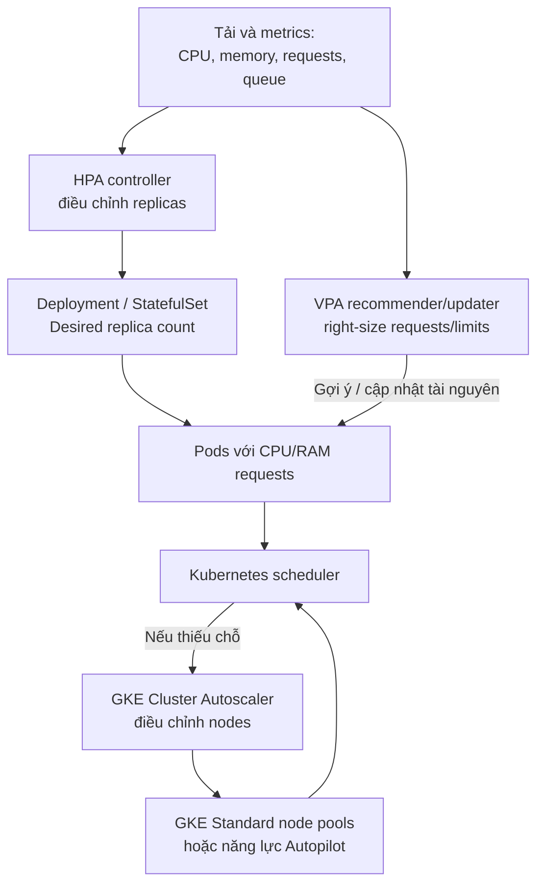
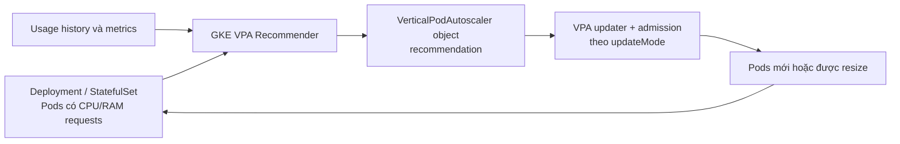
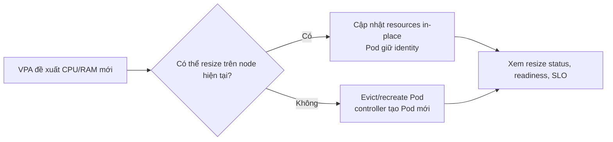
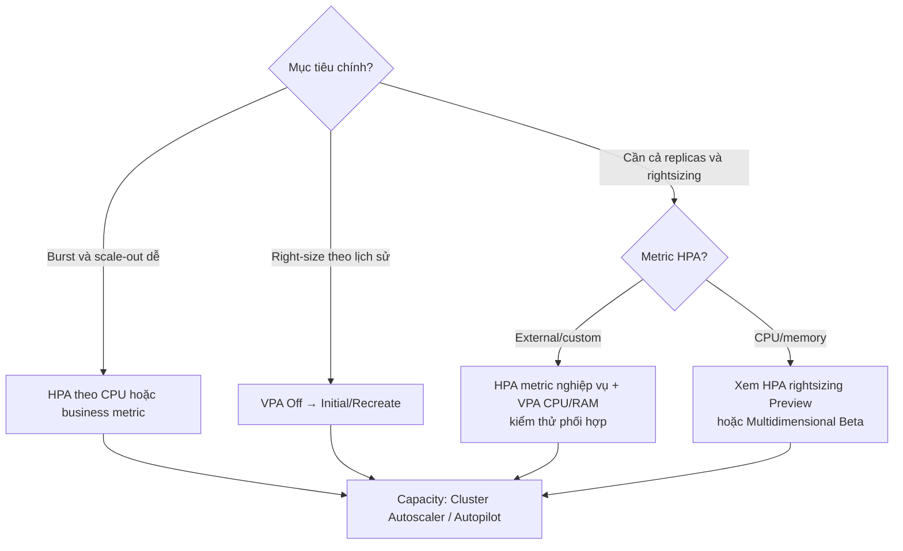

# Horizontal Pod Autoscaling và Vertical Pod Autoscaling trên GKE

## 1. Bài toán: khi tải thay đổi, nên tăng số Pod hay tăng tài nguyên mỗi Pod?

Một nền tảng thương mại điện tử chạy trên **Google Kubernetes Engine (GKE)** có ba loại workload:

- **API đơn hàng:** số request tăng đột biến trong giờ cao điểm, mỗi replica có thể phục vụ độc lập.
- **Worker xử lý hàng đợi:** số thông điệp tăng giảm theo chiến dịch; phần việc có thể chia cho nhiều bản sao.
- **Dịch vụ phân tích hoặc JVM:** ít replica, lượng bộ nhớ cần thiết thay đổi theo kích thước dữ liệu và hành vi garbage collection.

Nếu giữ số Pod và mức CPU/RAM cố định, ứng dụng có thể bị nghẽn khi tải tăng nhưng lãng phí tài nguyên khi tải giảm. Kubernetes và GKE hỗ trợ các cơ chế **autoscaling** để điều chỉnh hai chiều khác nhau:

1. **Horizontal Pod Autoscaling (HPA):** thay đổi **số lượng Pod replicas** của một workload.
2. **Vertical Pod Autoscaling (VPA):** đề xuất hoặc cập nhật **CPU/memory requests và limits của container** để mỗi Pod có kích thước phù hợp hơn.

Một cơ chế thứ ba thường xuất hiện trong kiến trúc GKE là **Cluster Autoscaler**: điều chỉnh **số worker nodes** khi Pods không còn chỗ chạy hoặc khi có thể thu gọn. Ba cơ chế liên quan nhưng **không thay thế nhau**.

Trong module **CLOUD_PROVIDERS_GCP**, bài học này thuộc chương **GKE nâng cao và vận hành**, gắn với kiến thức Project/IAM, VPC, Compute Engine, node pools, Cloud Run, lưu trữ và database. Mục tiêu là biết chọn cơ chế mở rộng, bảo vệ tài nguyên, tự động hóa phát hành và giám sát **độ tin cậy cùng tổng chi phí**.

Sau khi học, bạn có thể:

1. Phân biệt **HPA, VPA, Cluster Autoscaler** bằng thay đổi mà từng bộ điều khiển thực hiện.
2. Giải thích **requests, limits, CPU utilization, metrics API** và cách các giá trị này quyết định scaling.
3. Tạo **HorizontalPodAutoscaler** với `autoscaling/v2`, giới hạn replicas và hành vi tăng/giảm.
4. Tạo **VerticalPodAutoscaler** trong GKE, đọc `recommendation` và lựa chọn `Off`, `Initial`, `Auto/Recreate` hoặc `InPlaceOrRecreate`.
5. Tránh **xung đột HPA/VPA** khi cùng điều khiển một chỉ số CPU/memory; nhận biết các phương án GKE chuyên biệt.
6. Hiểu vì sao node capacity, quota, Pod IP ranges, scheduling và PDB có thể làm scaling không đạt mục tiêu.
7. Đọc Events/Conditions, thiết kế SLO, thử nghiệm tải và quản trị chi phí autoscaling.

> **Phạm vi thực hành:** Các cluster, Namespace và image names bên dưới là **giả định**. Lệnh `kubectl apply` hoặc `gcloud container clusters update` làm thay đổi tài nguyên thật; chỉ chạy ở cluster thử nghiệm được cấp quyền. Các tính năng Preview/Beta có giới hạn hỗ trợ và có thể thay đổi theo phiên bản GKE.

## 2. Kiến thức nền: requests, limits và tài nguyên khả dụng

Scheduler không chỉ nhìn CPU/RAM đang sử dụng. Để quyết định đặt Pod lên node, Kubernetes dựa chủ yếu vào **resource requests**, các ràng buộc scheduling và phần tài nguyên **Allocatable** còn lại của node.

Ví dụ một container API:

```yaml
resources:
  requests:
    cpu: "250m"
    memory: "512Mi"
  limits:
    cpu: "1000m"
    memory: "1Gi"
```

### 2.1. Hiểu các đơn vị

| Trường | Ví dụ | Ý nghĩa |
| --- | --- | --- |
| `requests.cpu` | `250m` | Yêu cầu 250 millicores = **0,25 vCPU** |
| `requests.memory` | `512Mi` | Yêu cầu khoảng 512 mebibytes memory |
| `limits.cpu` | `1000m` | Giới hạn CPU tương ứng 1 vCPU; runtime có thể **throttle** CPU |
| `limits.memory` | `1Gi` | Giới hạn bộ nhớ; container có thể bị **OOMKilled** khi vượt mức |

**Request không phải số CPU cứng được dùng cố định.** Pod có thể dùng ít hơn, hoặc dùng nhiều hơn request đến mức limit/capacity cho phép. Request là đầu vào cho scheduling, nhiều phép tính autoscaling và một số cơ chế phân bổ/quản trị chi phí.

Ví dụ 10 Pod, mỗi Pod request 250m CPU và 512Mi memory:

```text
Tổng CPU requests    = 10 × 0,25 vCPU = 2,5 vCPU
Tổng memory requests = 10 × 512 Mi     = 5120 Mi = 5 GiB
```

Không kết luận một node 4 vCPU/8 GiB chắc chắn chứa đủ 10 Pods: node có phần reserved cho OS/kubelet, system DaemonSets, giới hạn Pod IP, tài nguyên ephemeral storage và các ràng buộc topology khác. Dùng `kubectl describe node` để xem **Allocatable**.

### 2.2. HPA và VPA cùng “nhìn” requests nhưng theo hai cách

- Với **HPA CPU utilization**, phần trăm CPU được tính **tương đối với CPU request**: sử dụng CPU 300m trên request 400m tương đương **75% utilization**.
- Với **VPA**, CPU/memory usage lịch sử và nhu cầu thực tế giúp tạo recommendation cho **requests/limits**. VPA không quyết định mỗi Deployment nên có bao nhiêu replica.
- Với **Cluster Autoscaler**, những Pod chưa được scheduled do thiếu capacity cùng resource requests/constraints là tín hiệu quan trọng để tăng node.

### 2.3. Chọn requests/limits phù hợp

- **CPU request quá thấp:** scheduler có thể gom quá nhiều Pods; HPA theo CPU có thể tính utilization cao hơn dù ứng dụng vẫn đang phục vụ bình thường, dẫn đến scale-out sớm.
- **CPU request quá cao:** HPA tính utilization thấp hơn, và node nhanh đầy bởi requests dù CPU thực tế rảnh.
- **Memory request quá thấp:** node có thể bị memory pressure, ứng dụng bị eviction/điều kiện OOM.
- **Memory limit quá thấp:** container bị OOMKilled; chỉ tăng số Pod không sửa được ứng dụng vốn cần nhiều RAM cho mỗi bản sao.
- **Memory limit quá cao hoặc không phù hợp:** một replica có thể ảnh hưởng đến các ứng dụng khác nếu không có kiểm soát.

Trên **GKE Autopilot**, requests và tỷ lệ CPU:memory còn chịu các **mức tối thiểu/giới hạn cấu hình** của compute class tương ứng. Không lấy quy tắc Standard áp nguyên xi cho Autopilot.

## 3. Ba vòng điều khiển autoscaling trong GKE



| Bộ điều khiển | “Núm điều chỉnh” | Khi thích hợp | Không tự làm gì? |
| --- | --- | --- | --- |
| **HPA** | `spec.replicas` của workload | Nhiều replicas tương đương, tải dao động | Không tạo node, không tăng RAM của một Pod |
| **VPA** | CPU/memory requests và limits ở container | Rightsizing workload lâu dài, nhu cầu mỗi replica thay đổi | Không tăng số replicas để xử lý burst |
| **Cluster Autoscaler** | Số VM worker nodes trong pool Standard | Cần node để đặt Pods, hoặc thu gọn nodes rảnh | Không tự sửa requests/limits hay replicas của Deployment |
| **Node auto-provisioning / ComputeClasses** | Loại node pool hoặc compute configuration được phép | Có workload không vừa những pool đang có | Không sửa lỗi image, IAM, dữ liệu hay ứng dụng |

**Ví dụ đường đi:** HPA nâng từ 4 lên 10 replicas → scheduler đặt 6 Pod mới → 3 Pod bị `Pending` vì node không đủ CPU requests → Cluster Autoscaler xem liệu có thể thêm node trong giới hạn và quota hay không. Nếu còn IP/quota/capacity, node mới được tạo và Pods được xếp lịch. **Không có bảo đảm tức thời**: provisioning, image pull và readiness đều cần thời gian.

## 4. Horizontal Pod Autoscaling hoạt động như thế nào?

Một **HorizontalPodAutoscaler** là Kubernetes API object, thường quản lý Deployment, StatefulSet hoặc tài nguyên hỗ trợ **scale subresource**. HPA chạy vòng lặp điều khiển, lấy metrics, tính số replicas mong muốn rồi cập nhật workload.

Các nguồn metric:

1. **Resource metrics:** CPU và memory từ Kubernetes resource metrics API.
2. **Custom metrics:** metric liên quan Pods hoặc Kubernetes objects; ví dụ requests/second do ứng dụng xuất ra.
3. **External metrics:** số thông điệp chờ trong Pub/Sub hoặc độ sâu hàng đợi nằm ngoài cluster.
4. Một số **tính năng GKE chuyên biệt**, ví dụ autoscaling theo lưu lượng Gateway load balancer, có điều kiện về phiên bản và GatewayClass.

Với custom/external metrics, không chỉ viết tên metric trong HPA rồi mặc định Kubernetes hiểu: phải có **metrics adapter/integration** có thể trả dữ liệu qua Kubernetes API, cùng quyền Cloud Monitoring nếu dùng đường tích hợp này.

### 4.1. CPU utilization tính theo request

Giả sử một container:

```text
CPU request:      400m
CPU usage:        280m
CPU utilization:  280 / 400 = 70%
HPA target:       50%
```

Đây là **70% của request**, không phải “70% CPU của máy ảo”. Nếu ứng dụng có CPU usage 280m mà request chỉ 100m, HPA có thể thấy **280%**, dù container vẫn chạy được trên node có capacity.

Khi dùng metric `Resource` với target `type: Utilization`, **mọi container liên quan phải có request cho resource đó** để HPA tính đúng. Thiếu request có thể khiến controller không có đủ dữ liệu và báo lỗi.

### 4.2. Công thức tính replica mong muốn

Với một metric đã xác định:

\[
\text{desiredReplicas} =
\left\lceil
\text{currentReplicas}\times
\frac{\text{currentMetricValue}}{\text{desiredMetricValue}}
\right\rceil
\]

Giả sử có **4 replicas**, CPU utilization trung bình **80%** trong khi target **50%**:

```text
desiredReplicas = ceil(4 × 80/50)
                = ceil(6,4)
                = 7
```

Kết quả này còn chịu **minReplicas/maxReplicas**, tolerance, readiness/missing metrics, stabilization và scaling policies. Nó không có nghĩa sau một lần đọc metric HPA chắc chắn chuyển ngay từ 4 sang 7 Pods.

### 4.3. Multiple metrics

Nếu HPA dùng nhiều metrics, controller tính một đề xuất replicas cho mỗi metric rồi chọn **đề xuất lớn nhất** để đáp ứng tải. Ví dụ:

```text
CPU đề xuất:         6 replicas
Memory đề xuất:      8 replicas
Queue depth đề xuất: 12 replicas
→ HPA có thể chọn 12 (sau các giới hạn/chính sách khác)
```

Khi một số metric không lấy được dữ liệu, Kubernetes có các quy tắc bảo thủ: có thể vẫn **scale up** theo metric hợp lệ nhưng **không scale down** nếu metric còn lỗi. Vì vậy `<unknown>` trong HPA status có thể làm scale-down bị trì hoãn.

## 5. Độ ổn định HPA: tolerance, stabilization và behavior

Autoscaling tốt không chỉ là phản ứng nhanh; nó phải tránh **thrashing/flapping** (scale lên xuống liên tục).

### 5.1. Tolerance

Trong cấu hình mặc định phổ biến của GKE, HPA dùng **tolerance khoảng 10%** quanh target để bỏ qua thay đổi nhỏ. Ví dụ target CPU **60%** và quan sát **64%**:

```text
ratio = 64/60 ≈ 1,067
Sai lệch khoảng 6,7% → thường không scale chỉ vì thay đổi này.
```

Không dùng con số 10% như quy tắc vĩnh viễn cho mọi phiên bản hoặc HPA configuration; các tính năng mới có thể cho phép cấu hình tolerance cụ thể.

### 5.2. Stabilization window

HPA thường **ổn định việc scale-down** trong cửa sổ khoảng **300 giây (5 phút)** mặc định trên GKE. Nó cân nhắc lịch sử recommendations để tránh giảm replica quá nhanh khi tải vừa hạ rồi tăng lại.

Điều này giải thích vì sao load test kết thúc nhưng Pod count không giảm ngay; cần xem **`behavior` và Events**, không kết luận autoscaler hỏng.

### 5.3. Khai báo chính sách scale-up/scale-down

`autoscaling/v2` hỗ trợ cấu hình `behavior`:

```yaml
behavior:
  scaleUp:
    stabilizationWindowSeconds: 0
    policies:
      - type: Pods
        value: 4
        periodSeconds: 60
      - type: Percent
        value: 100
        periodSeconds: 60
    selectPolicy: Max
  scaleDown:
    stabilizationWindowSeconds: 300
    policies:
      - type: Percent
        value: 25
        periodSeconds: 60
    selectPolicy: Min
```

Ý nghĩa: scale-up cho phép tăng tối đa 4 Pods hoặc 100% trong khoảng chính sách theo phương án chọn `Max`; scale-down hạn chế giảm quá nhanh. Đây là **cấu hình ví dụ**, phải kiểm thử với SLO, tốc độ Pod Ready, Cloud Load Balancing, quota, chi phí và thời gian scale node.

**Đừng đánh đồng scale-down chậm với lỗi.** Một mức ổn định có chủ đích có thể bảo vệ ứng dụng trước traffic dao động.

## 6. Chuẩn bị lab HPA an toàn trên GKE

Giả sử bạn có cluster **Standard hoặc Autopilot** đã được tạo và được phép quản trị namespace thử nghiệm:

```text
Project:       acme-gke-lab
Cluster:       commerce-standard
Location:      asia-southeast1-a
Namespace:     autoscaling-lab
Deployment:    web-hpa-demo
HPA:           web-hpa-demo
Container:     web
```

### 6.1. Điều kiện trước khi tạo HPA

- Workload đã có CPU/memory requests phù hợp.
- GKE có đường **resource metrics API** hoạt động; có thể kiểm tra với `kubectl top`.
- Replica đủ phân bố để chịu gián đoạn; node pool/Autopilot còn capacity hoặc có cơ chế mở rộng node.
- Có quyền đọc/ghi Deployment/HPA trong namespace; không cần `cluster-admin` nếu chỉ làm bài lab namespace.
- Có quota về Pods, CPU/RAM, IP ranges, node pools và billing.
- Ứng dụng có readinessProbe thích hợp; không đặt traffic vào Pod chưa sẵn sàng.

### 6.2. Preflight chỉ đọc

```bash
gcloud container clusters describe commerce-standard \
  --project=acme-gke-lab \
  --location=asia-southeast1-a \
  --format="yaml(name,status,location,autopilot,releaseChannel)"

gcloud container clusters get-credentials commerce-standard \
  --project=acme-gke-lab \
  --location=asia-southeast1-a

kubectl cluster-info
kubectl get nodes
kubectl top nodes
```

Lệnh `get-credentials` cập nhật **kubeconfig cục bộ**, không tạo tài nguyên cluster. Nếu không có metrics từ `kubectl top`, cần kiểm tra metric pipeline/permissions trước khi dựa vào HPA CPU.

## 7. Lab HPA: Deployment và HorizontalPodAutoscaler

Để tránh phụ thuộc vào image tùy biến, ví dụ dùng image NGINX công khai đã được tổ chức chấp thuận; trên production nên **pin image digest** và quét lỗ hổng.

### 7.1. Kubernetes manifest cho Deployment

```yaml
apiVersion: apps/v1
kind: Deployment
metadata:
  name: web-hpa-demo
  namespace: autoscaling-lab
spec:
  replicas: 2
  selector:
    matchLabels:
      app: web-hpa-demo
  template:
    metadata:
      labels:
        app: web-hpa-demo
    spec:
      containers:
        - name: web
          image: nginx:1.27
          ports:
            - containerPort: 80
          resources:
            requests:
              cpu: "200m"
              memory: "128Mi"
            limits:
              memory: "256Mi"
          readinessProbe:
            httpGet:
              path: /
              port: 80
            initialDelaySeconds: 3
            periodSeconds: 5
---
apiVersion: v1
kind: Service
metadata:
  name: web-hpa-demo
  namespace: autoscaling-lab
spec:
  selector:
    app: web-hpa-demo
  ports:
    - port: 80
      targetPort: 80
  type: ClusterIP
```

**Ghi chú:** việc **không đặt CPU limit** ở ví dụ này cho phép container dùng CPU rảnh trên node (vẫn chịu giới hạn theo tài nguyên node và các chính sách GKE). Memory limit đã được giới hạn để minh họa; trong thực tế phải đo OOM và cân nhắc đồng bộ memory requests/limits theo SLO/chi phí.

### 7.2. HPA autoscaling/v2 theo CPU

```yaml
apiVersion: autoscaling/v2
kind: HorizontalPodAutoscaler
metadata:
  name: web-hpa-demo
  namespace: autoscaling-lab
spec:
  scaleTargetRef:
    apiVersion: apps/v1
    kind: Deployment
    name: web-hpa-demo
  minReplicas: 2
  maxReplicas: 8
  metrics:
    - type: Resource
      resource:
        name: cpu
        target:
          type: Utilization
          averageUtilization: 60
  behavior:
    scaleUp:
      stabilizationWindowSeconds: 0
      policies:
        - type: Pods
          value: 4
          periodSeconds: 60
        - type: Percent
          value: 100
          periodSeconds: 60
      selectPolicy: Max
    scaleDown:
      stabilizationWindowSeconds: 300
      policies:
        - type: Percent
          value: 25
          periodSeconds: 60
```

Khi CPU trung bình vượt target đủ xa và có metrics hợp lệ, HPA có thể tăng số replicas đến trần **8**. Nó **không tăng CPU request 200m của từng Pod**, cũng không trực tiếp tạo node.

### 7.3. Áp dụng manifest

Trong lab, lưu hai manifests vào file `web-deployment.yaml` và `web-hpa.yaml` bằng công cụ của bạn, sau đó:

```bash
# Thao tác thay đổi cluster, chỉ chạy trong môi trường lab
kubectl create namespace autoscaling-lab
kubectl apply -f web-deployment.yaml
kubectl apply -f web-hpa.yaml

# Chỉ đọc sau khi apply
kubectl -n autoscaling-lab get deployment,service,hpa
kubectl -n autoscaling-lab describe hpa web-hpa-demo
```

Ví dụ `nginx:1.27` chỉ phục vụ minh họa manifest; **không giả định image đã được kiểm tra bảo mật hoặc còn đáp ứng chính sách tổ chức** ở mọi thời điểm. Nếu Namespace đã tồn tại, lệnh `create namespace` có thể trả `AlreadyExists`; không cần xóa namespace để chạy lại.

## 8. Quan sát HPA hoạt động trong tải thử nghiệm

### 8.1. Các lệnh chỉ đọc

```bash
kubectl -n autoscaling-lab get hpa web-hpa-demo -w
kubectl -n autoscaling-lab describe hpa web-hpa-demo
kubectl -n autoscaling-lab get deploy web-hpa-demo
kubectl -n autoscaling-lab get pods -o wide
kubectl -n autoscaling-lab top pods
kubectl -n autoscaling-lab get events --sort-by=.lastTimestamp
```

Trong `kubectl get hpa`, một dòng minh họa:

```text
NAME           REFERENCE                 TARGETS    MINPODS  MAXPODS  REPLICAS
web-hpa-demo   Deployment/web-hpa-demo   72%/60%    2        8        4
```

Đây là **kết quả giả định**, không phải số liệu một cluster thật. `72%/60%` nghĩa CPU utilization được quan sát là 72% so với target 60%; đây là **phần trăm CPU request**, không phải node CPU utilization.

### 8.2. Sinh tải đúng cách

Muốn chứng kiến HPA mở rộng cần ứng dụng thật sự sử dụng CPU, hoặc tạo công việc phù hợp. **Chỉ gửi nhiều HTTP GET đến trang NGINX tĩnh chưa chắc làm CPU vượt target**. Có thể dùng k6, hey, wrk hoặc load generator trong namespace lab, nhưng:

- Không bắn tải vào production URL hoặc IP ngoài phạm vi phép thử.
- Theo dõi CPU usage, response latency, error rate và Pod Ready.
- Giới hạn thời gian, số request và tổng tài nguyên có thể tạo.
- Ngừng load generator khi hết bài học; theo dõi scale-down vì có stabilization delay.

### 8.3. Vì sao replicas không tăng ngay?

Một số lý do:

1. CPU thực tế chưa vượt đủ xa khỏi target/tolerance.
2. Resource metrics chưa có dữ liệu, đặc biệt ngay sau khi Pod mới chạy.
3. CPU request thiếu ở một container hoặc metric không hợp lệ.
4. HPA đã chạm `maxReplicas`.
5. Controller còn đang chờ stabilization/scaling policies.
6. HPA đã tăng desired replicas nhưng Pods mới còn `Pending` vì thiếu node/quota/IP.

**Phải phân biệt “HPA không tăng desired replicas” với “HPA đã tăng nhưng cluster không đặt được Pods”.** Hai lỗi này cần hai runbook khác nhau.

## 9. HPA theo memory, custom và external metrics

### 9.1. Memory utilization không có nghĩa memory leak sẽ hết

HPA có thể theo **memory utilization** hoặc **AverageValue**:

```yaml
metrics:
  - type: Resource
    resource:
      name: memory
      target:
        type: AverageValue
        averageValue: 600Mi
```

Đây là **đoạn spec rút gọn**, không phải HPA object đầy đủ. `AverageValue` dùng mức memory usage trung bình trên mỗi Pod, **không phải tỷ lệ phần trăm của request**.

Với memory cache tăng theo thời gian, HPA scale out có thể không làm memory của Pod hiện hữu giảm. Một **memory leak** cần sửa code, giới hạn bộ nhớ và right-sizing; không thể chỉ tăng replicas mãi mãi.

### 9.2. HPA theo backlog hàng đợi

Một worker đọc **Pub/Sub** có thể cần tăng replicas khi số message chờ xử lý tăng. Thường nên cân nhắc metric như **unacked messages hoặc độ trễ xử lý hàng đợi**, vì CPU không luôn phản ánh backlog.

Ví dụ ý tưởng HPA dùng external metric:

```yaml
apiVersion: autoscaling/v2
kind: HorizontalPodAutoscaler
metadata:
  name: worker-hpa
  namespace: autoscaling-lab
spec:
  scaleTargetRef:
    apiVersion: apps/v1
    kind: Deployment
    name: worker
  minReplicas: 1
  maxReplicas: 20
  metrics:
    - type: External
      external:
        metric:
          name: pubsub_unacked_messages_per_worker
        target:
          type: AverageValue
          averageValue: "100"
```

**Chỉ là mẫu minh họa:** `pubsub_unacked_messages_per_worker` **không phải tên metric sẵn có**. Cần cấu hình GKE Cloud Monitoring/custom-external metrics adapter hoặc giải pháp autoscaler được hỗ trợ để **thực sự cung cấp metric đúng tên và scope**. Nếu adapter không có metric này, HPA báo `<unknown>` và không đạt mục tiêu.

Thiết kế theo backlog còn cần **idempotency, retry, deduplication, dead-letter queue và giới hạn API/database downstream**. HPA tăng 20 workers có thể làm database nghẽn nếu backend chưa được thiết kế.

### 9.3. HPA dựa trên lưu lượng Gateway

GKE có **traffic-based autoscaling** tích hợp các Gateway workloads được hỗ trợ, dùng request rate hoặc capacity utilization từ load balancer. Tính năng này có yêu cầu GKE/GatewayClass, API và cơ chế metric đặc thù; **không áp dụng mặc định cho mọi Service type LoadBalancer hoặc mọi Ingress**.

Đối với website cần điều phối theo HTTP request rate thay vì CPU, đây là hướng đáng nghiên cứu, nhưng hãy đọc tài liệu **Configure traffic-based autoscaling** trước khi đưa vào production.

### 9.4. HPA và zero replicas

Với HPA thông thường trong các phiên bản trước, `minReplicas` thường phải **ít nhất 1**, và scale workload thủ công xuống 0 có thể khiến HPA tạm dừng cho đến khi được scale lên. Các phiên bản **GKE 1.37 trở lên** có tính năng **scale to/from zero** theo các điều kiện riêng như custom/external metrics qua **AutoscalingMetric resource**. **Không chỉ thay `minReplicas: 0` trong một HPA CPU cũ rồi mong hệ thống tự thức dậy**.

Khi cần scale-to-zero ở tầng ứng dụng, cũng cân nhắc **Cloud Run** hoặc hệ thống event-driven phù hợp; cần đánh giá cold start, latency và chi phí.

## 10. Vertical Pod Autoscaling hoạt động như thế nào?

**Vertical Pod Autoscaler (VPA)** phân tích **lịch sử CPU/memory usage** và tính những resource requests phù hợp cho **container-level resources** của Pods do một controller quản lý.



Trong GKE, implementation VPA **được Google quản lý** và khác một số chi tiết so với việc tự cài open-source VPA:

- GKE dùng **historical data**, kể cả một số metrics được thu trước khi tạo VPA.
- VPA components được vận hành theo cơ chế control plane do GKE quản lý, không cần bạn cài một bản VPA upstream cạnh tranh trong cluster.
- Recommendation có thể xét **node capacity và resource quotas** theo mô hình GKE.
- Khi cần cập nhật resource bằng recreate, VPA có thể phối hợp với **Cluster Autoscaler** để chuẩn bị capacity.

**VPA không phải cách tự “tăng RAM của tất cả Pods khi người dùng tăng”.** Nó chủ yếu dùng để **right-size mỗi replica** theo hành vi sử dụng qua thời gian; workload phải sống đủ lâu và tương đối đồng nhất để recommendation có ý nghĩa.

### 10.1. VPA hoạt động với workload nào?

Các workload có controller quản lý Pods, ví dụ **Deployment, StatefulSet, ReplicaSet và ReplicationController** theo API được hỗ trợ. **Standalone Pods** không phải mục tiêu VPA phù hợp vì VPA cần controller để tạo lại Pod khi cần.

VPA quản lý **container-level** `spec.containers[].resources`. VPA **không hỗ trợ Pod-level resource specification** `spec.resources` trong tài liệu hiện hành.

### 10.2. VPA phù hợp trường hợp nào?

| Workload | Phù hợp VPA? | Lưu ý |
| --- | --- | --- |
| Service ít biến động, mỗi replica dùng tài nguyên tương đối giống nhau | **Có thể rất phù hợp** | Recommendation dựa trên history |
| Job/Pods chạy rất ngắn và biến mất | **Ít phù hợp** | Thiếu lịch sử ổn định |
| Service burst cực nhanh trong vài phút | **Không nên chỉ dùng VPA** | HPA phản ứng theo tải nhanh hơn |
| Workload JVM memory-heavy | **Thận trọng/không khuyến nghị VPA tự động theo tài liệu GKE** | Heap/GC/working set khiến memory recommendation kém tin cậy |
| Workload rất nhạy cảm với eviction | Dùng `Off`/`Initial` hoặc quy trình riêng | `Recreate` có thể gây gián đoạn |
| Nhiều replicas có usage rất khác nhau | Cần phân nhóm workload | Một VPA cho tất cả dễ over/under-provision |

## 11. Bật VPA trên GKE Standard và Autopilot

### 11.1. Standard clusters

Với **GKE Standard**, cần **bật Vertical Pod Autoscaling trên cluster** trước khi tạo VPA objects:

```bash
# Chỉ đọc: kiểm tra cluster và tính năng
gcloud container clusters describe commerce-standard \
  --project=acme-gke-lab \
  --location=asia-southeast1-a \
  --format="yaml(name,verticalPodAutoscaling,autopilot,releaseChannel,currentMasterVersion)"

# THAY ĐỔI CLUSTER: chỉ chạy khi được phê duyệt
gcloud container clusters update commerce-standard \
  --project=acme-gke-lab \
  --location=asia-southeast1-a \
  --enable-vertical-pod-autoscaling
```

**Cần lên lịch thay đổi:** việc bật hoặc tắt tính năng VPA có thể kích hoạt thao tác trên **control plane** và có những gián đoạn/cảnh báo theo tài liệu. Không bật trên production đang có SLO nghiêm ngặt mà chưa kiểm tra maintenance policy và tác động.

### 11.2. Autopilot clusters

Trên **GKE Autopilot**, VPA **được bật mặc định**. GKE quản lý phần lớn capacity node và có **mức tối thiểu requests/tỷ lệ CPU-memory** cho các ComputeClasses. VPA recommendations có thể bị giới hạn/điều chỉnh theo các quy tắc Autopilot.

Không tự cài một VPA controller khác vào Autopilot để “thay thế” cơ chế managed của GKE; dễ tạo hành vi khó dự đoán và có thể trái chính sách cluster.

### 11.3. Kiểm tra CRD/API

```bash
# Chỉ đọc sau khi feature đã bật
kubectl api-resources | grep -i verticalpodautoscaler
kubectl get verticalpodautoscalers -A
```

Trong PowerShell, dùng `Select-String` thay `grep`. Nếu lệnh không thấy VPA resources, kiểm tra **cluster credentials, quyền RBAC và trạng thái bật tính năng**, không tự ý cài upstream autoscaler khi chưa xác định GKE đang quản lý gì.

## 12. VPA update modes: Off, Initial, Recreate và InPlaceOrRecreate

| `updateMode` | Hành vi | Đánh đổi / lúc nên chọn |
| --- | --- | --- |
| **`Off`** | Chỉ tạo recommendation, **không tự thay requests** | Bước đầu an toàn để phân tích, dùng trong CI/CD rightsizing |
| **`Initial`** | Đặt requests khi Pod được **tạo mới**, không đổi Pod đang chạy sau đó | Tránh eviction do VPA cho Pods hiện hữu, nhưng Pods có thể không đồng đều trong rollout |
| **`Auto`** | Mặc định khi bỏ `updateMode`; hành vi như `Recreate` | Tự áp recommendation khi đủ điều kiện, có khả năng recreate Pods |
| **`Recreate`** | Khi cần cập nhật, VPA **evict/recreate** Pod để áp requests mới | Có thể gián đoạn; cần nhiều replicas, PDB, quota và node capacity |
| **`InPlaceOrRecreate`** | Thử thay resource requests/limits **ngay trên Pod đang chạy**; nếu không thể thì recreate | **Preview**, GKE **1.34.0-gke.2201000+**; không cam kết zero downtime |

### 12.1. Không đồng nhất Auto với in-place

Trong GKE hiện hành, **`Auto` và `Recreate` có cùng hành vi**. Đặt `Auto` **không có nghĩa** VPA sẽ tự nhận diện để resize in-place theo mặc định. Muốn chế độ thử in-place phải cấu hình **`InPlaceOrRecreate`** và đáp ứng yêu cầu phiên bản.

### 12.2. Recreate và PodDisruptionBudget

VPA có thể sử dụng cơ chế **eviction** để thay một Pod. Vì vậy:

- Cần **≥2 replicas** hoặc kế hoạch thay thế phù hợp khi yêu cầu không gián đoạn.
- **PodDisruptionBudget (PDB)** giúp kiểm soát mức gián đoạn đồng thời, nhưng quá chặt có thể khiến VPA không cập nhật.
- **ReadinessProbe** chỉ đưa Pod vào luồng traffic khi đã sẵn sàng.
- **Cluster Autoscaler** có thể cần thêm node khi Pod mới có request lớn hơn.
- Với **StatefulSet** hoặc ứng dụng dùng PersistentVolumes zonal, cần kiểm tra volume attach, zone và logic recovery.

Theo tài liệu GKE, mặc định tối thiểu replicas khi VPA thực hiện eviction **thay đổi theo phiên bản**: với **GKE ≤1.35.1**, mặc định là **2**; từ **1.35.2 trở lên**, mặc định là **1**. Có trường `spec.updatePolicy.minReplicas` để cấu hình theo điều kiện hỗ trợ. **Không dựa vào mặc định** khi SLO yêu cầu nhiều replicas; khai báo PDB và kiểm thử.

### 12.3. Khi nào in-place bị chuyển thành recreate?

`InPlaceOrRecreate` có thể **fallback** sang recreate nếu:

1. Node hiện tại không có đủ **Allocatable** cho request mới.
2. Resize làm thay đổi **QoS class**, ví dụ từ Burstable sang Guaranteed.
3. `resizePolicy` của container yêu cầu `RestartContainer` với resource tương ứng.
4. Update bị kẹt (`infeasible`/`deferred`) quá lâu.
5. Một số điều kiện khác của GKE/Autopilot không cho resize ngay tại chỗ.

Nếu `resizePolicy` không được khai báo, tài liệu cho biết mặc định `NotRequired` với CPU và memory cho cơ chế này. **Dù chọn NotRequired, vẫn có khả năng Pod bị tái tạo.** Phải xem feature ở trạng thái Preview và lập kế hoạch gián đoạn.

## 13. Lab VPA an toàn: chỉ lấy recommendation bằng Off mode

Để **không tạo conflict** với HPA ở phần trước, lab VPA dùng **Deployment khác tên**, ví dụ `worker-vpa-demo`. Đề xuất bắt đầu ở **Off mode** để nhìn giá trị khuyến nghị mà không thay đổi workload.

### 13.1. Deployment ví dụ

```yaml
apiVersion: apps/v1
kind: Deployment
metadata:
  name: worker-vpa-demo
  namespace: autoscaling-lab
spec:
  replicas: 3
  selector:
    matchLabels:
      app: worker-vpa-demo
  template:
    metadata:
      labels:
        app: worker-vpa-demo
    spec:
      containers:
        - name: worker
          image: nginx:1.27
          resources:
            requests:
              cpu: "100m"
              memory: "128Mi"
            limits:
              memory: "512Mi"
          readinessProbe:
            httpGet:
              path: /
              port: 80
            initialDelaySeconds: 3
            periodSeconds: 10
```

Ví dụ image không tạo workload CPU/memory đặc thù; **VPA cần lịch sử thực tế** để có recommendation hữu ích. Với một workload chạy rất ít phút, có thể không thấy recommendation đáng tin cậy.

### 13.2. VerticalPodAutoscaler resource

```yaml
apiVersion: autoscaling.k8s.io/v1
kind: VerticalPodAutoscaler
metadata:
  name: worker-vpa-demo
  namespace: autoscaling-lab
spec:
  targetRef:
    apiVersion: apps/v1
    kind: Deployment
    name: worker-vpa-demo
  updatePolicy:
    updateMode: "Off"
  resourcePolicy:
    containerPolicies:
      - containerName: worker
        minAllowed:
          cpu: "100m"
          memory: "128Mi"
        maxAllowed:
          cpu: "2"
          memory: "2Gi"
        controlledResources:
          - cpu
          - memory
        controlledValues: RequestsOnly
```

**Giải thích các trường:**

- `targetRef` trỏ tới Deployment mục tiêu, không phải Node hoặc một Pod name riêng.
- `updateMode: Off` chỉ tạo recommendations.
- `minAllowed` và `maxAllowed` chặn recommendation vượt khoảng mà tổ chức cho phép.
- `controlledResources` chọn CPU và memory.
- `controlledValues: RequestsOnly` chỉ yêu cầu VPA điều chỉnh requests (khi auto mode được chọn), không tự tăng limits; cần xem requests/limits có còn hợp lệ với Autopilot và policy khác không.

### 13.3. Áp dụng và đọc recommendation

```bash
# Sau khi bật VPA feature (Standard) và tạo namespace lab:
kubectl apply -f worker-vpa-deployment.yaml
kubectl apply -f worker-vpa.yaml

# CHỈ ĐỌC
kubectl -n autoscaling-lab get vpa worker-vpa-demo
kubectl -n autoscaling-lab describe vpa worker-vpa-demo
kubectl -n autoscaling-lab get vpa worker-vpa-demo -o yaml
kubectl -n autoscaling-lab get pods -l app=worker-vpa-demo -o wide
```

Đọc `status.recommendation.containerRecommendations`. Đối với workload mới, **đừng kỳ vọng VPA cho recommendation chính xác chỉ sau vài phút**; GKE khuyến nghị tối ưu từ lịch sử, thường hữu ích hơn với workload chạy ít nhất khoảng **24 giờ**.

### 13.4. Mẫu status để hiểu recommendation

```yaml
status:
  recommendation:
    containerRecommendations:
      - containerName: worker
        lowerBound:
          cpu: 100m
          memory: 160Mi
        target:
          cpu: 280m
          memory: 400Mi
        upperBound:
          cpu: 600m
          memory: 900Mi
        uncappedTarget:
          cpu: 280m
          memory: 400Mi
```

**Đây là status giả định**; không phải số đã đo trên cluster. `target` là khuyến nghị chính, `lowerBound`/`upperBound` là khoảng tham chiếu, `uncappedTarget` chưa áp các ràng buộc trong resourcePolicy; các giá trị có thể khác nhau khi policy giới hạn recommendation.

## 14. Chuyển VPA sang Initial hoặc Recreate khi đã kiểm chứng

Sau khi có history và kiểm tra SLO, nếu muốn GKE áp recommendation:

### 14.1. Initial mode

```yaml
updatePolicy:
  updateMode: "Initial"
```

Pod hiện hữu **không tự thay** CPU/memory requests; các Pod được tạo mới có thể nhận recommendation. Điều này giúp tránh VPA chủ động evict đang chạy, nhưng trong một giai đoạn rollout có thể tồn tại Pods với sizes khác nhau.

### 14.2. Recreate mode

```yaml
updatePolicy:
  updateMode: "Recreate"
  minReplicas: 2
```

Với mode này, VPA có thể evict các Pods và controller tạo lại. `minReplicas: 2` là một **guardrail ví dụ** cho workload có replica đủ nhiều; nó không tự chứng minh zero downtime. Cần kết hợp **PDB, readiness, replica count, node headroom, startup time** và kiểm thử.

Đối với workload critical, có thể bắt đầu bằng `Off`, sau đó dùng recommendation để **cập nhật Deployment manifest qua GitOps** trong đợt rollout đã lập lịch, thay vì bật recreate tự động.

### 14.3. Lưu ý về container sidecar

Trong một Pod có app container và sidecar log agent, không phải lúc nào cả hai cũng nên được VPA thay đổi. Có thể tắt scaling của sidecar:

```yaml
resourcePolicy:
  containerPolicies:
    - containerName: log-sidecar
      mode: "Off"
    - containerName: app
      controlledResources: ["cpu", "memory"]
```

`mode: Off` ở **ContainerResourcePolicy** là cấu hình riêng từng container, khác với `updatePolicy.updateMode: Off` của toàn VPA. Đừng nhầm hai trường có cùng chuỗi `Off` nhưng khác phạm vi.

## 15. In-place resizing trên GKE: lợi ích và giới hạn

Kubernetes từ các phiên bản mới hỗ trợ **in-place Pod resource resize** qua API, và GKE có mode VPA `InPlaceOrRecreate` (**Preview**) trên phiên bản được hỗ trợ.

### 15.1. Khi nào phù hợp?

Một dịch vụ có nhiều replicas, cần tăng CPU request từ 300m lên 500m mà không muốn đợi Pod mới pull image và khởi động lại. Nếu node còn capacity và update không làm vi phạm policies, in-place resize có thể giảm gián đoạn.



### 15.2. Ví dụ spec tham khảo

```yaml
apiVersion: autoscaling.k8s.io/v1
kind: VerticalPodAutoscaler
metadata:
  name: app-vpa-inplace
  namespace: autoscaling-lab
spec:
  targetRef:
    apiVersion: apps/v1
    kind: Deployment
    name: app-inplace
  updatePolicy:
    updateMode: "InPlaceOrRecreate"
  resourcePolicy:
    containerPolicies:
      - containerName: app
        controlledResources: ["cpu", "memory"]
```

**Không áp dụng manifest này nếu cluster chưa đáp ứng yêu cầu Preview/GKE version.** Ở workload manifest, trường `resizePolicy` có thể yêu cầu `NotRequired` hoặc `RestartContainer` cho từng resource theo phiên bản Kubernetes được hỗ trợ.

### 15.3. Cách kiểm thử thực tế

1. Kiểm tra **GKE version ≥1.34.0-gke.2201000** và tính năng Preview đã được cho phép.
2. Chọn workload có nhiều replicas và PDB/health probes.
3. Xem `kubectl describe pod`, resource requests, `resize` conditions và Events trước/sau.
4. Kiểm tra container uptime/restarts và tên Pod để phân biệt in-place với recreate.
5. Tạo tình huống node thiếu capacity trong lab để hiểu fallback, **không** cưỡng ép sự cố production.
6. Giữ rollback plan và đo p95/p99 latency, error rate.

**Kết luận:** In-place có thể giảm một số lần tái tạo Pod, nhưng **không phải cam kết zero-downtime** và không thay thế capacity planning.

## 16. Xung đột HPA và VPA: vì sao không nên dùng tùy tiện cùng một metric?

Đây là bẫy thiết kế quan trọng của autoscaling nâng cao. Nếu **HPA theo CPU utilization** và **VPA cũng thay CPU requests**, cả hai có thể tác động qua lại đến cùng tỷ lệ:

```text
HPA CPU utilization = CPU usage / CPU request

VPA thay CPU request
    ↓
HPA nhìn thấy CPU utilization mới dù CPU usage chưa thay
    ↓
HPA thay replica count
    ↓
CPU usage mỗi replica đổi do tải được phân phối lại
    ↓
VPA thu thập lịch sử mới và có thể điều chỉnh requests tiếp
```

### Ví dụ số học

Giả sử ban đầu có 4 Pods, mỗi Pod:

```text
CPU request:    200m
CPU usage:      150m
HPA utilization: 150/200 = 75%
HPA target:      60%
```

HPA có thể muốn tăng replicas do 75% lớn hơn 60%. Nếu VPA tăng request mỗi Pod lên **300m** nhưng usage tạm giữ 150m:

```text
HPA utilization mới = 150/300 = 50%
```

Khi đó HPA lại có lý do **giảm** replicas. Tải trên mỗi Pod sau giảm có thể tăng, kích hoạt một vòng phản hồi khó dự đoán. Với memory utilization, thay memory requests cũng ảnh hưởng tỷ lệ theo cách tương tự.

### 16.1. Quy tắc chung

**Không dùng HPA và VPA thông thường để cùng điều khiển CPU/memory của một workload** nếu chưa sử dụng cơ chế GKE chuyên dụng có hỗ trợ. Tài liệu GKE nêu rõ giới hạn này. HPA với VPA có thể phối hợp khi:

- **HPA theo custom/external metric** (ví dụ queue depth), trong khi VPA tối ưu CPU/memory requests.
- **HPA rightsizing with VPA (Preview)** cho HPA theo CPU, dùng cơ chế thiết kế riêng để giảm xung đột.
- **Multidimensional Pod autoscaling (Beta)**, điều chỉnh replicas theo CPU và requests memory theo cách tích hợp.

Đừng tạo hai HPA objects cùng scale một Deployment; Kubernetes không có cơ chế hòa giải hai controller tùy tiện cùng cập nhật `replicas`.

### 16.2. HPA rightsizing with VPA

GKE có tính năng **HPA rightsizing with VPA (Preview)** giúp tối ưu CPU requests của workload đang dùng HPA CPU mà tránh conflict thông thường. Nó có điều kiện phiên bản/cấu hình và không phải hành vi mặc định của việc tạo hai resources HPA/VPA.

**Chỉ nên thử trong lab khi xác nhận tính năng đang được hỗ trợ.** Đọc hướng dẫn chính thức, xem trước tác động đến HPA targets, resource policies, tối thiểu CPU/memory và cách theo dõi recommendation.

### 16.3. Multidimensional Pod autoscaling

**MultidimPodAutoscaler (Beta)** kết hợp **horizontal scaling theo CPU** với **vertical scaling memory** trong một cơ chế. Đây là lựa chọn GKE chuyên biệt cho workload muốn scale-out theo CPU nhưng cần right-size memory.

Điều quan trọng:

- Dùng API/resource của **multidimensional Pod autoscaling**, không chỉ chồng HPA và VPA mặc định.
- Standard cluster cần bật VPA theo điều kiện tính năng.
- Kiểm tra giới hạn cho resource metrics, loại workload, GKE version và behavior.
- Không mặc định Beta sẵn cho production có yêu cầu hỗ trợ nghiêm ngặt.

### 16.4. Chọn sơ đồ phối hợp



## 17. Cách HPA/VPA tương tác với node pools và Cluster Autoscaler

Một HPA có thể tính đúng **desiredReplicas=20**, nhưng 12 Pods vẫn `Pending` nếu node pool thiếu tài nguyên. Tương tự, VPA có thể đề xuất **3 GiB memory** cho mỗi Pod, trong khi không có node nào thỏa request mới.

### Tình huống 1: HPA tạo nhiều Pending Pods

```text
HPA: desiredReplicas = 16
Deployment: 16 Pods đã được tạo
Running/Ready: 9
Pending: 7 vì Insufficient cpu
Cluster Autoscaler: xem có pool phù hợp và room để scale không
```

Kiểm tra:

1. `kubectl describe pod` xem Events.
2. Node `Allocatable` và resource requests.
3. Giới hạn min/max node pools, quota, zonal capacity và Pod IP ranges.
4. Taints/tolerations, nodeSelector/affinity, topology spread, PVC zones.
5. Autoscaler visibility logs của GKE.

**Tăng `maxReplicas` của HPA không giải quyết được việc thiếu node**, thậm chí tạo thêm Pods Pending.

### Tình huống 2: VPA đề xuất Pod lớn hơn machine type

```text
Node allocatable memory:   6 GiB (ví dụ)
VPA recommended request:   8 GiB
Kết quả: một Pod 8 GiB không thể vừa node 6 GiB
```

Hướng xử lý: điều chỉnh VPA `maxAllowed`, chọn machine type lớn hơn, cho phép node auto-provisioning phù hợp hoặc xem lại ứng dụng. Không nên ép VPA xuống thấp hơn mức ứng dụng thật sự cần chỉ để Pod vào node.

### Tình huống 3: Autopilot

GKE Autopilot thường cấp hạ tầng dựa trên resource requests của workload, nhưng vẫn có các **minima, CPU:memory ratios, compute classes, quotas, provisioning delays**. Một Pod quá lớn hoặc trái cấu hình Autopilot có thể bị điều chỉnh hoặc từ chối/không được scheduled.

### Công thức năng lực gần đúng

```text
CPU requests toàn workload
  ≈ số replicas × CPU request trung bình / Pod

Memory requests toàn workload
  ≈ số replicas × memory request trung bình / Pod
```

Nếu HPA tăng replicas **2 lần** và VPA tăng memory request mỗi Pod **1,5 lần**, tổng memory requests có thể tăng gần **3 lần**. Capacity và hóa đơn VM/Autopilot có thể tăng nhanh hơn kỳ vọng nếu chỉ nhìn mỗi controller.

## 18. VPA với QoS, memory/OOM, PDB và lifecycle Pods

### 18.1. QoS classes

Kubernetes có những QoS classes **Guaranteed**, **Burstable**, **BestEffort** liên quan requests/limits; chúng ảnh hưởng xử lý khi node chịu áp lực tài nguyên. VPA thay requests/limits có thể làm Pod đổi QoS class. Với in-place resizing, thay đổi QoS có thể khiến GKE **recreate**.

### 18.2. OOM và VPA recommendation

Nếu container bị **OOMKilled**, VPA có cơ chế ghi nhận và tăng recommendation về memory khi Pod được tái tạo. Nhưng:

- VPA không chữa **memory leak** hoặc lỗi garbage collection.
- Giới hạn `maxAllowed` có thể chặn recommendation cần thiết.
- Memory usage không phản ánh hoàn hảo **JVM heap/GC**; tài liệu GKE cảnh báo VPA chưa phù hợp cho một số JVM workloads.
- Với ứng dụng dùng cache theo dung lượng RAM, tăng request có thể làm cache lớn hơn, khiến xu hướng memory tiếp tục tăng.

### 18.3. PDB, rolling update và ready replicas

Trước khi bật VPA `Auto/Recreate`, cần có:

- Deployment với replicas đủ lớn và **PDB** phản ánh SLO.
- Readiness/startup probes và thời gian shutdown hợp lý.
- Khả năng pull image, volume attach và application recovery.
- Budget cho node mới hoặc headroom khi Pod tăng request.
- Chính sách canary, rollback và audit.

Ví dụ một PDB cho ứng dụng có ba replicas:

```yaml
apiVersion: policy/v1
kind: PodDisruptionBudget
metadata:
  name: worker-vpa-pdb
  namespace: autoscaling-lab
spec:
  minAvailable: 2
  selector:
    matchLabels:
      app: worker-vpa-demo
```

Một PDB quá chặt như `minAvailable: 3` khi chỉ có 3 replicas có thể **ngăn mọi voluntary eviction**, khiến VPA không thể thay Pods theo mode Recreate. Nhưng PDB không ngăn **mọi sự cố ngoài ý muốn**, ví dụ mất VM đột ngột.

## 19. Tình huống thực tế: API tải cao, worker và dịch vụ stateful

### 19.1. API stateless có traffic theo giờ

**Đặc điểm:** nhiều bản sao tương đương, có thể thêm/giảm Pods, CPU usage tương đối liên quan throughput.

**Cách tiếp cận:**

1. Đặt CPU/memory requests dựa trên load test.
2. Bật HPA theo CPU hoặc requests-per-second tùy hệ thống.
3. Đặt `minReplicas` đủ giữ latency/cold start trong giờ thấp.
4. Dùng cluster autoscaler/node pools có đủ quota/IP/surge capacity.
5. Dùng VPA **`Off` để quan sát** nhưng không tự bật VPA thay CPU requests khi HPA dùng CPU utilization.
6. Theo dõi p95 latency, 5xx, CPU throttling, HPA scaling Events và chi phí.

### 19.2. Worker xử lý Pub/Sub backlog

**Đặc điểm:** mỗi worker xử lý nhiều messages; số message tồn đọng phản ánh tải tốt hơn CPU ở một số giai đoạn.

**Cách tiếp cận:**

1. HPA theo **external backlog metric** được tích hợp đúng.
2. VPA có thể right-size CPU/memory theo lịch sử nếu đã kiểm thử không gây gián đoạn quá mức.
3. Giới hạn `maxReplicas` để không làm database/API downstream quá tải.
4. Tác vụ phải **idempotent** và có retry/dead-letter handling.
5. Đặt PDB và graceful shutdown để giảm mất công việc khi Pod bị thay.

### 19.3. Dịch vụ stateful hoặc JVM

**Đặc điểm:** memory working set, heap, kết nối database hoặc state có giá trị.

**Cách tiếp cận:**

- Không mặc định bật VPA `Auto` cho JVM theo khuyến cáo hiện hành; ưu tiên đo heap/GC, manual rightsizing hoặc `Off` rồi review.
- Nếu HPA scale-out làm tăng kết nối database, phải tính giới hạn connection pool và replica coordination.
- Nếu Pod gắn PersistentVolume, xem topology, read/write modes, backup và thời gian attach lại.
- Có kế hoạch rolling replacement, PDB và rollback trước khi nâng RAM/CPU bằng VPA.

### 19.4. Chọn HPA, VPA hay cả hai?

| Workload | Nhu cầu chính | Cấu hình nên đánh giá |
| --- | --- | --- |
| HTTP API stateless, traffic burst | Phản ứng nhanh bằng nhiều replicas | **HPA** + autoscaled node pool |
| Batch worker theo queue | Tăng thông lượng khi backlog lớn | **HPA external metric** + capacity controls |
| Service ổn định, requests đặt quá cao | Right-size theo lịch sử | **VPA Off** → review → Initial/Recreate nếu phù hợp |
| JVM khó ước lượng heap | Giám sát chuyên sâu memory | Manual sizing và `VPA Off` chỉ tham khảo |
| Workload cần HPA CPU và auto right-size CPU | Tránh vòng phản hồi | Xem **HPA rightsizing with VPA (Preview)** |
| Workload cần CPU-driven replica + auto memory | Điều khiển hai chiều | **Multidimensional Pod autoscaling (Beta)** theo điều kiện |
| Workload ít replica, rất nhạy gián đoạn | Không muốn VPA evict tùy ý | `Off`/`Initial` và controlled rollout |

## 20. Monitoring, SLO và chi phí của autoscaling

### 20.1. Những tín hiệu nên theo dõi

| Chỉ số | Lý do | Nguồn thường dùng |
| --- | --- | --- |
| HPA desired/current replicas | Thấy scaling intent và kết quả | `kubectl get/describe hpa`, Cloud Monitoring |
| HPA current/target metrics | Phân biệt đúng tín hiệu và target | HPA status/Conditions/Events |
| Pod Ready/Available | Biết replicas có thực sự phục vụ | Deployment status, Service endpoints |
| CPU usage và CPU throttling | Phát hiện giới hạn/requests bất hợp lý | Metrics Server, Cloud Monitoring, container metrics |
| Memory working set, OOMKilled | Phát hiện memory pressure và crash | K8s status, Cloud Monitoring/Logging |
| VPA recommendation target/lower/upper | Theo dõi rightsizing | `kubectl describe vpa`, GKE Monitoring |
| VPA eviction/recreate events | Hiểu tác động lên availability | Pod Events và GKE audit logs |
| Pending Pods / scheduling failures | Phát hiện thiếu node/quota/IP | `kubectl describe pod`, Cluster Autoscaler visibility |
| Node count, quota và capacity | Đánh giá HPA/VPA có đủ hạ tầng | Node pool/Compute Engine metrics |
| Application p95/p99 latency, 5xx | Đo SLO người dùng cuối | Application/Load Balancing metrics |
| Chi phí vCPU, memory, disk, GPU, egress | Tối ưu ngân sách | Cloud Billing/GKE cost allocation |

**Một HPA đạt target CPU không tự chứng minh SLO tốt.** Người dùng vẫn có thể gặp latency cao do Cloud SQL, Cloud Storage, external API, pod startup hoặc network bottleneck.

### 20.2. SLO nên dẫn dắt scaling

Ví dụ service có SLO giả định:

```text
99,9% HTTP requests thành công trong 30 ngày
p95 latency < 300 ms trong giờ phục vụ
không quá 1% requests gặp 5xx khi rollout/scale
```

Các ngưỡng trên chỉ minh họa, không phải cam kết của Google Cloud. Dùng dữ liệu thực để chọn:

- HPA CPU target hoặc business metric.
- Min replicas để tránh cold start/scale-up quá muộn.
- Max replicas để giới hạn chi phí/downstream pressure.
- VPA min/max allowed và update mode.
- Node pool autoscaling limits, surge headroom và budget.

### 20.3. Vì sao “giảm requests” không luôn giảm phí?

Trong **Standard** cluster, hóa đơn Compute Engine phụ thuộc **VM nodes thực sự đang chạy**. VPA giảm request có thể cải thiện bin-packing, nhưng **chỉ tiết kiệm node cost** nếu Cluster Autoscaler thật sự có thể giảm node count; PDB, affinity hoặc Pod topology có thể ngăn scale-down.

Trong **Autopilot**, chi phí có thể phụ thuộc vào resource requests, ComputeClass, chế độ billing và cấu hình workload. Vì vậy VPA giảm requests **có thể thay đổi chi phí trực tiếp** theo cơ chế áp dụng, nhưng không suy ra phần trăm tiết kiệm nếu chưa đọc SKU/bảng giá.

HPA tăng số replicas cũng có thể tăng số lần kết nối, Cloud Logging volume và network traffic. Đánh giá **total cost per successful request/job**, không chỉ giá mỗi Pod.

## 21. Troubleshooting HPA: từ biểu hiện đến nguyên nhân

| Hiện tượng | Nguyên nhân có thể | Hướng điều tra |
| --- | --- | --- |
| `TARGETS <unknown>/60%` | Thiếu metrics API/adapter, missing requests hoặc resource metrics lỗi | `kubectl describe hpa`, `kubectl top`, metrics API, requests của từng container |
| HPA không tăng dù CPU node cao | HPA tính CPU **theo Pod requests**, không theo CPU node | Xem Pod CPU utilization và HPA target |
| HPA chạm 8 replicas rồi dừng | `maxReplicas: 8` | Xem HPA spec, SLO, quota và downstream trước khi nâng |
| HPA tăng desired nhưng Pods Pending | Node/quota/IP/taints/affinity/PVC constraints | `describe pod`, node pools, Cluster Autoscaler logs |
| HPA không scale-down sau hết tải | Stabilization window, metrics missing, PDB/Pods không Ready | HPA `behavior`/Events và metrics |
| HPA scale lên xuống liên tục | Target quá nhạy, requests sai, metrics không ổn định | Tolerance, stabilization, pod startup và traffic pattern |
| 4xx/5xx tăng sau scale-out | Backend database/API quá tải hoặc readiness sai | Connection pools, rate limits, readiness, app logs |
| HPA trên memory không chữa OOM | Memory leak/working set của mỗi Pod không giảm | Inspect memory per Pod, VPA/manual sizing, heap |
| HPA và VPA thay CPU gây dao động | Hai controller làm thay request và replica cùng metric | Tách metrics hoặc dùng tính năng GKE phối hợp chuyên dụng |
| HPA không scale từ 0 | Cấu hình/version không hỗ trợ zero scaling | Kiểm tra GKE 1.37+, AutoscalingMetric/external metric và docs |
| HPA báo lỗi multiple HPA | Hai HPA cùng scale một workload | Chỉ định một HPA làm controller replicas |

### Trình tự lệnh điều tra

```bash
kubectl -n autoscaling-lab describe hpa web-hpa-demo
kubectl -n autoscaling-lab get hpa web-hpa-demo -o yaml
kubectl -n autoscaling-lab get deploy web-hpa-demo -o yaml
kubectl -n autoscaling-lab get pods -o wide
kubectl -n autoscaling-lab top pods
kubectl -n autoscaling-lab get events --sort-by=.lastTimestamp
```

Đọc phần **Conditions**:

- `AbleToScale`: controller có thể đọc/điều khiển scale target không?
- `ScalingActive`: metric hợp lệ và scaling được kích hoạt không?
- `ScalingLimited`: đã chạm giới hạn min/max hoặc policy chưa?

Trong Events, các lý do thường giúp phân biệt `FailedGetResourceMetric`, `FailedComputeMetricsReplicas`, `SuccessfulRescale` hoặc lỗi liên quan scale target.

## 22. Troubleshooting VPA: recommendation có nhưng không áp dụng

| Hiện tượng | Nguyên nhân có thể | Cách xử lý |
| --- | --- | --- |
| Không thấy VPA CRD/resources | Standard chưa bật VPA, nhầm cluster hoặc RBAC không đủ | Xem cluster config, enable theo quy trình, kiểm tra kubeconfig |
| VPA chưa có target recommendation | Workload mới, thiếu history/metric hoặc không match target | Đợi history, xem VPA Conditions, targetRef/namespace |
| `updateMode: Off` và Pods không đổi | **Đúng thiết kế** | Đọc recommendation rồi sửa manifest thủ công hoặc chọn mode khác |
| `Initial` không đổi Pod đang chạy | **Đúng thiết kế** | Chỉ Pod mới nhận requests do VPA |
| `Recreate` chưa evict Pod | History chưa đủ, recommendation chưa đủ khác biệt, replica/PDB guardrails | Đọc VPA status, PDB, Events, minReplicas và capacity |
| Pod mới request cao rồi Pending | Node không đủ resources/quota hoặc VPA max quá lớn | Xem scheduler, Cluster Autoscaler, machine type, `maxAllowed` |
| `InPlaceOrRecreate` vẫn restart Pods | QoS change, thiếu capacity, timeout hoặc `RestartContainer` | Xem Pod resize status và fallback; Preview không bảo đảm in-place |
| VPA làm workload JVM kém ổn định | Memory/heap logic không phản ánh tốt working set | Chuyển Off/Initial, manual memory sizing, GC metrics |
| VPA và HPA cùng CPU gây flapping | CPU request thay làm HPA utilization đổi | Không chồng hai cơ chế mặc định cùng metric |
| Pod OOM liên tục dù VPA bật | Limit thấp, recommendation bị cap, ứng dụng leak hoặc update chưa kịp | Xem OOM events, limits/requests, policies, heap và code |
| VPA đổi resource của sidecar không mong muốn | Không có container policy | `containerPolicies[].mode: Off` cho sidecar |

### Các lệnh đọc trạng thái VPA

```bash
kubectl -n autoscaling-lab describe vpa worker-vpa-demo
kubectl -n autoscaling-lab get vpa worker-vpa-demo -o yaml
kubectl -n autoscaling-lab get deployment worker-vpa-demo -o yaml
kubectl -n autoscaling-lab describe pod ACTUAL_POD_NAME
kubectl -n autoscaling-lab get pdb
kubectl -n autoscaling-lab get events --sort-by=.lastTimestamp
```

Kiểm tra `status.conditions` của VPA: `RecommendationProvided`, `LowConfidence`, `NoPodsMatched`, `FetchingHistory`. Nếu `NoPodsMatched`, hãy kiểm tra targetRef và labels; nếu `LowConfidence`, không vội áp recommendation vào production.

## 23. Bảo mật, quản trị thay đổi và kiểm chứng CI/CD

Autoscaler có thể gây sự cố **dù không có lỗi IAM**: scale-out quá lớn làm cạn quota, scale-down quá nhanh gây mất kết nối, hay VPA Recreate làm ứng dụng gián đoạn. Cần quy trình thay đổi rõ ràng:

1. **Least privilege:** chỉ nhóm có trách nhiệm được sửa Deployment, HPA, VPA, PDB, quota và node-pool autoscaling; cấp quyền Kubernetes RBAC theo namespace khi phù hợp.
2. **GitOps/IaC:** quản lý manifest HPA/VPA trong repository review được. Tránh script CI chạy `kubectl scale` định kỳ rồi tranh quyền với HPA.
3. **ResourceQuota và LimitRange:** giới hạn tổng CPU/memory/Pod count, nhưng kiểm tra rằng quota không vô tình chặn scaling hợp lệ.
4. **Budget và alerts:** đặt maxReplicas hợp lý; theo dõi node scale-out, Pod requests, GPU costs, logging và network egress.
5. **Pod Security:** autoscaling không cấp thêm quyền OS/Google Cloud API; vẫn cần Workload Identity Federation, RBAC, NetworkPolicy, container security.
6. **Readiness/PDB:** kiểm soát gián đoạn, đặc biệt VPA recreate và node pool upgrades.
7. **Audit:** lưu thay đổi manifest/policy, người thực hiện, phiên bản ứng dụng và thời điểm scaling để điều tra.
8. **Kiểm thử trước khi mở auto mode:** VPA `Off` ít gián đoạn hơn để thu thập dữ liệu, không nên bật `Auto` diện rộng ngay từ đầu.

### Kế hoạch rollout an toàn

| Giai đoạn | HPA | VPA | Điều kiện chuyển giai đoạn |
| --- | --- | --- | --- |
| **Quan sát** | Đo CPU, memory, RPS, queue, SLO | Tạo `Off` cho workload riêng | Có đủ history và metric coverage |
| **Canary** | Một Deployment với min/max nhỏ | `Initial` hoặc Recreate với nhiều replicas | Không gây OOM/Pending/outage |
| **Thử chịu lỗi** | Load test, node shortage, backlog spike | Simulate eviction/restart | SLO còn đạt, PDB/CA hoạt động |
| **Production** | Target/behavior theo SLO | Mode thích hợp sau review | Dashboard, alert, on-call, rollback sẵn |
| **Tối ưu** | Điều chỉnh max/target có dữ liệu | Xem recommendation và cost | Tiết kiệm thực, không làm tăng lỗi |

**Không đo chỉ mỗi desired replicas và số node.** Phải đo **tỷ lệ request thành công, p95/p99 latency, thời gian khởi động, OOM, queue age và tổng chi phí** trước/sau.

## 24. Bài tập và câu hỏi kiểm chứng

### Bài 1: Phân loại đúng controller

Chọn cơ chế phù hợp:

1. API tăng từ 4 lên 12 Pods khi tải tăng.
2. Worker có request memory 8 GiB nhưng sử dụng ổn định khoảng 1 GiB, muốn gợi ý giảm.
3. HPA đã tạo 20 Pods nhưng nhiều Pod `Pending` vì node thiếu CPU.
4. Một Pod bị OOM vì container cần nhiều RAM hơn limit.

**Đáp án gợi ý:** (1) HPA; (2) VPA `Off` để quan sát rồi quyền chỉnh; (3) Cluster Autoscaler/capacity, không phải VPA; (4) sửa memory sizing, xem VPA/manual sizing và nguyên nhân ứng dụng.

### Bài 2: Tính HPA

Một Deployment có **5 replicas**, CPU utilization trung bình **90%**, target **60%**, min **2**, max **12**.

```text
desiredReplicas = ceil(5 × 90 / 60)
                = ceil(7,5)
                = 8
```

Vì sao thực tế có thể không lên 8 ngay? Nêu **ít nhất bốn** cơ chế/giới hạn cần kiểm tra: tolerance, stabilization/behavior, metric missing, node quota/capacity, Pods not Ready, resource requests hoặc maxReplicas.

### Bài 3: HPA và VPA xung đột

HPA theo CPU target 70%. VPA tự tăng CPU requests của mỗi Pod từ 200m lên 400m khi usage không đổi. CPU utilization mà HPA nhìn thấy sẽ thay đổi ra sao? Vì sao có thể giảm replicas ngoài mong muốn?

**Gợi ý:** utilization giảm gần **một nửa** nếu usage giữ nguyên; HPA có thể nghĩ có dư capacity. Cần tránh VPA thông thường trên cùng CPU hoặc dùng cơ chế GKE phối hợp chuyên dụng.

### Bài 4: Phân biệt VPA update modes

Với mỗi mode `Off`, `Initial`, `Recreate` và `InPlaceOrRecreate`, hãy trả lời:

- Nó có tự cập nhật request của Pod đang chạy không?
- Có khả năng evict/recreate Pod không?
- Chế độ nào là Preview và yêu cầu GKE version nào?

**Đáp án tóm tắt:** Off không apply; Initial chỉ áp cho Pod mới; Recreate/Auto có thể evict; InPlaceOrRecreate cố resize trực tiếp nhưng fallback recreate, Preview trên **GKE 1.34.0-gke.2201000+**.

### Bài 5: Chẩn đoán metric unknown

HPA có CPU target 60% nhưng cột TARGETS hiện `<unknown>/60%`. Một container sidecar không khai báo CPU request; Metrics Server vừa gặp lỗi. Hãy thiết kế trình tự xác minh thay vì chỉ tăng maxReplicas.

**Gợi ý:** `kubectl describe hpa` và Events → kiểm tra request của **mọi container** → `kubectl top pods`/metrics API → adapter/metrics backend → kết quả sau khi sửa; không gán lỗi cho GKE node count ngay.

### Bài 6: Thiết kế worker Pub/Sub

Một queue có backlog dao động từ 0 đến 100.000 messages. Mỗi worker xử lý ~30 messages/s, nhưng Cloud SQL chỉ chịu được 50 concurrent connections.

- Nên dùng HPA CPU hay external queue metric?
- Đặt `maxReplicas` dựa trên điều gì?
- VPA có thể giúp ở đâu?
- Những gì phải đo ở Cloud SQL và log ứng dụng?

**Gợi ý:** External queue metric có thể phù hợp hơn; cap replicas theo tốc độ worker và giới hạn downstream; VPA right-size resources nếu workload tương đối ổn định; bổ sung connection pooling, retry/idempotency và SLO backlog age.

### Bài 7: Quan sát cluster có thật bằng lệnh chỉ đọc

```bash
kubectl get hpa -A
kubectl get vpa -A
kubectl get deployments -A
kubectl get pods -A -o wide
kubectl top pods -A
```

Chọn một Deployment mà bạn có quyền xem. Ghi lại **replicas hiện tại/mong muốn**, resource requests, HPA target, VPA recommendation (nếu có), tình trạng Ready, node capacity và những Events liên quan. **Không thay đổi manifest production** để làm bài này.

## 25. Checklist triển khai HPA/VPA trên GKE

- [ ] Đã phân biệt **HPA, VPA và Cluster Autoscaler** cùng phạm vi tài nguyên mỗi controller thay đổi.
- [ ] Resource requests CPU/memory được khai báo và đo dựa trên usage thực, không chỉ lấy defaults.
- [ ] HPA có metric phù hợp tải nghiệp vụ, không chỉ chọn CPU vì dễ bật.
- [ ] Đã kiểm tra metric availability/API/adapter và fallback khi custom/external metrics thiếu dữ liệu.
- [ ] `minReplicas` đủ tránh cold start/outage; `maxReplicas` tránh vượt quota/downstream budget.
- [ ] HPA `behavior`/tolerance/stabilization phù hợp SLO và không flapping.
- [ ] Standard cluster đã bật VPA qua quy trình change management; Autopilot có VPA mặc định.
- [ ] VPA recommendation có history đủ dài; không áp giá trị `LowConfidence` mù quáng.
- [ ] VPA `resourcePolicy` có bounds và controlledResources phù hợp.
- [ ] Bắt đầu `Off` để quan sát; `Initial/Recreate` chỉ bật sau kiểm thử.
- [ ] `Auto` tương đương `Recreate`; `InPlaceOrRecreate` còn Preview và có thể fallback.
- [ ] Không chồng HPA CPU/memory và VPA thông thường trên cùng metric mà chưa có cơ chế phối hợp hỗ trợ.
- [ ] Với HPA+VPA chuyên biệt, đã kiểm tra điều kiện Preview/Beta, version và khả năng rollback.
- [ ] Pods có readiness/startup probes, PDB và replicas đáp ứng yêu cầu availability.
- [ ] Node pool/Autopilot có quota, IP ranges, CPU/RAM, zone capacity và autoscaling headroom.
- [ ] PersistentVolume topology, StatefulSet recovery và workload JVM đã được đánh giá riêng.
- [ ] Có dashboard về HPA replicas, VPA target, Pods Pending/Ready, OOM, latency và error rate.
- [ ] Đã load test và kiểm thử failover, missing metrics, max scale, node shortage, VPA eviction.
- [ ] IAM/RBAC, GitOps và lịch nâng cấp tránh thay đổi autoscaler ngoài kiểm soát.
- [ ] Đã dự toán VM/Autopilot requests, GKE fees, disks, GPU, egress, Cloud Logging và downstream services.

## 26. Tài liệu Google Cloud và Kubernetes chính thức

Các phiên bản và tính năng mới thay đổi theo thời gian. Trước khi triển khai, đối chiếu những trang sau:

1. [GKE Horizontal Pod autoscaling overview](https://cloud.google.com/kubernetes-engine/docs/concepts/horizontalpodautoscaler)
2. [Configure Horizontal Pod autoscaling](https://cloud.google.com/kubernetes-engine/docs/how-to/horizontal-pod-autoscaling)
3. [Troubleshoot Horizontal Pod autoscaling](https://cloud.google.com/kubernetes-engine/docs/troubleshooting/horizontal-pod-autoscaling)
4. [GKE Vertical Pod autoscaling overview](https://cloud.google.com/kubernetes-engine/docs/concepts/verticalpodautoscaler)
5. [Configure Vertical Pod autoscaling](https://cloud.google.com/kubernetes-engine/docs/how-to/vertical-pod-autoscaling)
6. [Troubleshoot Vertical Pod autoscaling](https://cloud.google.com/kubernetes-engine/docs/troubleshooting/vertical-pod-autoscaling)
7. [Rightsize HPA workloads with VPA (Preview)](https://cloud.google.com/kubernetes-engine/docs/how-to/rightsize-hpa-workloads-with-vpa)
8. [Configure multidimensional Pod autoscaling (Beta)](https://cloud.google.com/kubernetes-engine/docs/how-to/multidimensional-pod-autoscaling)
9. [GKE Cluster Autoscaler](https://cloud.google.com/kubernetes-engine/docs/concepts/cluster-autoscaler)
10. [Kubernetes Horizontal Pod Autoscaler](https://kubernetes.io/docs/tasks/run-application/horizontal-pod-autoscale/)
11. [Kubernetes resource requests and limits](https://kubernetes.io/docs/concepts/configuration/manage-resources-containers/)
12. [Kubernetes PodDisruptionBudget](https://kubernetes.io/docs/tasks/run-application/configure-pdb/)
13. [GKE Autopilot overview](https://cloud.google.com/kubernetes-engine/docs/concepts/autopilot-overview)
14. [GKE pricing](https://cloud.google.com/kubernetes-engine/pricing)

**Ghi nhớ:** **HPA tăng hoặc giảm số Pod**, **VPA điều chỉnh kích thước tài nguyên của từng Pod**, còn **Cluster Autoscaler tạo hoặc thu hẹp số node** để có nơi chạy Pods. Thành công không đo bằng số lần autoscaler ra quyết định mà bằng **SLO, khả năng chịu gián đoạn, dữ liệu ứng dụng và chi phí thực tế**. Khi phối hợp HPA với VPA, nhất thiết phải kiểm soát **vòng phản hồi qua CPU/memory requests**, quyền thay đổi, tính năng GKE được hỗ trợ và kế hoạch rollback.
