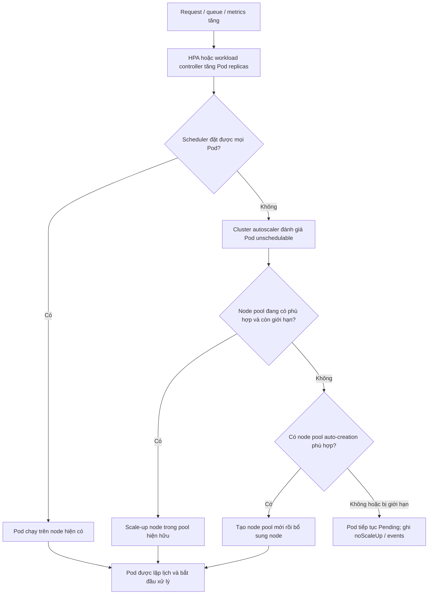
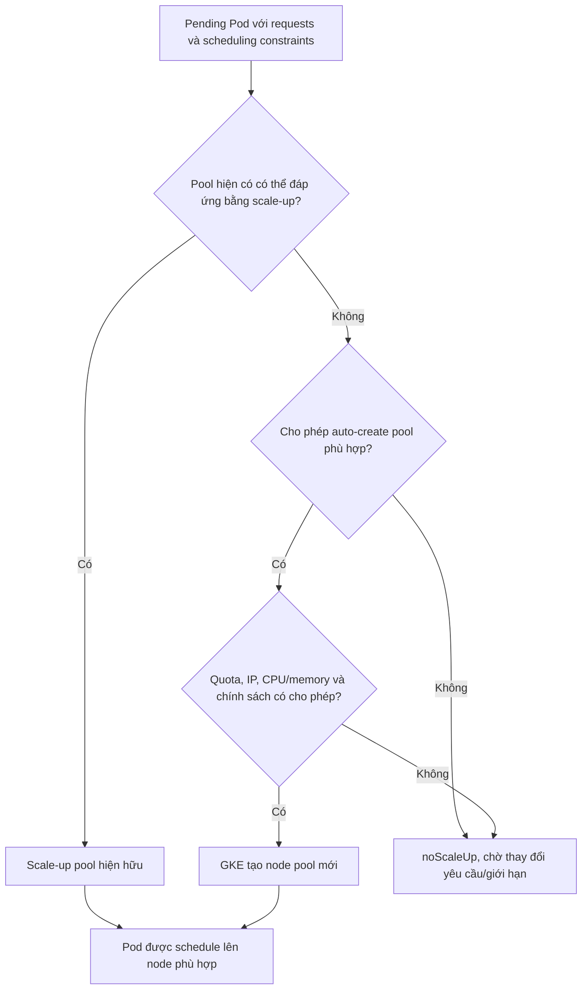

# Cluster autoscaler và node auto-provisioning

> **Chương:** GKE nâng cao và vận hành  
> **Module:** CLOUD_PROVIDERS_GCP  
> **Phạm vi module:** Khám phá Google Cloud từ tổ chức project, IAM và VPC đến Compute Engine, GKE, Cloud Run, dịch vụ lưu trữ và cơ sở dữ liệu. Qua các tình huống triển khai, người học biết lựa chọn dịch vụ, bảo vệ tài nguyên, tự động hóa phát hành và theo dõi độ tin cậy cùng chi phí.

Khi lượng request tăng, một Deployment có thể cần thêm Pod. Nhưng nếu các node hiện có không còn đủ CPU, bộ nhớ, GPU hoặc tài nguyên khác để đặt Pod mới, việc tăng `replicas` chỉ khiến Pod nằm ở trạng thái `Pending`. Ở chiều ngược lại, khi traffic giảm, một cluster giữ quá nhiều node nhàn rỗi sẽ gây chi phí Compute Engine không cần thiết.

**Cluster autoscaler (CA)** của Google Kubernetes Engine (GKE) điều chỉnh **số lượng node trong các node pool** theo nhu cầu lập lịch của Pod. **Node auto-provisioning (NAP)**, hiện được mô tả trong tài liệu GKE bằng khái niệm **node pool auto-creation**, còn có khả năng **tạo node pool mới** khi những pool hiện tại không phù hợp. Trên các phiên bản GKE mới, **ComputeClass** cho phép định nghĩa yêu cầu node và bật khả năng tạo pool ở **phạm vi workload**; cấu hình NAP **toàn cluster** vẫn có thể sử dụng khi thực sự cần.

Tự động mở rộng không phải “bật nút rồi quên”. Hành vi của CA/NAP chịu ảnh hưởng của **Pod resource requests**, giới hạn node pool và tài nguyên toàn cluster, Kubernetes scheduler, vùng cung cấp VM, IP Pod, quota, PodDisruptionBudget, ràng buộc chọn node, giá tài nguyên và chính sách vận hành. Bài học này giải thích cơ chế, hướng dẫn kiểm tra và thiết lập lab có giới hạn, rồi tập trung vào troubleshooting và vận hành an toàn.

## Mục tiêu học tập

Sau khi học, bạn có thể:

1. Phân biệt **HPA**, **VPA**, **Cluster autoscaler** và **node pool auto-creation/NAP**, nhận biết chúng tương tác ra sao.
2. Giải thích cách CA dựa trên **Pods không thể được lập lịch** và `requests`, không đơn giản dựa vào “CPU thực tế đạt 80%”.
3. Cấu hình giới hạn `--min-nodes`/`--max-nodes` hoặc `--total-min-nodes`/`--total-max-nodes` cho node pool GKE Standard.
4. Hiểu vì sao CA có thể từ chối scale-up và vì sao `PodDisruptionBudget`, node affinity hoặc annotation có thể ngăn scale-down.
5. Phân biệt **cluster-level NAP** với **ComputeClass workload-level node pool auto-creation**, gồm yêu cầu phiên bản và giới hạn tài nguyên.
6. Kiểm tra trạng thái GKE bằng Console, `gcloud`, `kubectl` và Cloud Logging autoscaler visibility events.
7. Thiết kế thử nghiệm tăng/giảm số Pod trên **cluster sandbox** và thu dọn workload không ảnh hưởng tài nguyên dùng chung.
8. Đánh giá tác động đến SLO, quota, chi phí VM/GKE, IP addressing, bảo mật và tốc độ triển khai.

## 1. Bốn lớp mở rộng dễ bị nhầm

Khi nhìn biểu đồ hạ tầng, cần biết **bộ điều khiển nào thay đổi đối tượng nào**:

| Thành phần | Đối tượng điều chỉnh | Tín hiệu chính | Có tự tạo node pool mới không? |
|---|---|---|---|
| **Horizontal Pod Autoscaler (HPA)** | Số **replicas** của Deployment/StatefulSet được hỗ trợ | CPU/memory utilization hoặc metrics theo cấu hình | Không |
| **Vertical Pod Autoscaler (VPA)** | Khuyến nghị/điều chỉnh **resource requests/limits** của container theo chế độ | Mức dùng tài nguyên quan sát được | Không |
| **Cluster autoscaler** | Số **node** trong node pool hiện có | Pod cần chỗ để schedule; kiểm tra khả năng hợp nhất node khi giảm tải | Không phải tự tạo pool trong chế độ autoscaling pool đơn thuần |
| **Node pool auto-creation / NAP** | **Node pools mới** cùng các node phù hợp | Workload chưa schedule được và yêu cầu loại node phù hợp | **Có**, nếu tính năng và các ràng buộc cho phép |

Một số trường hợp ComputeClass còn hỗ trợ các chiến lược consolidation và tối ưu node, hoặc chạy workload với Autopilot mode ngay trong Standard. Do đó cần đọc rõ **GKE version, cluster mode, ComputeClass và giới hạn tính năng**, thay vì coi NAP chỉ có một hành vi duy nhất qua mọi phiên bản.

### 1.1. Chuỗi phản ứng với traffic tăng



Sơ đồ là **mô hình khái niệm**. Trong triển khai thật, các quyết định phụ thuộc các bộ điều khiển và những sự kiện bất đồng bộ; việc tạo node có thể mất nhiều thời gian hơn việc lập lịch Pod trên node đã có.

### 1.2. Ví dụ dễ hiểu

Một Deployment có 2 Pod, mỗi Pod `requests.cpu=500m`. Khi HPA tăng thành 8 Pod, tổng CPU **được yêu cầu** xấp xỉ `8 × 0,5 = 4 vCPU`, chưa tính system Pods và các workloads khác. Nếu hai node hiện tại không còn đủ **allocatable CPU** để chứa thêm Pod, scheduler giữ một số Pod ở trạng thái Pending. CA có thể tăng node trong pool phù hợp, miễn là quota/IP/capacity và giới hạn node pool còn đủ.

**Không thể suy luận chính xác số node từ `4 vCPU` chia cho số vCPU danh nghĩa của máy.** Kubelet, GKE/system pods, DaemonSet requests, eviction reservations, memory, ephemeral storage và affinity đều tác động tới việc Pod có đặt được lên node hay không.

## 2. Cluster autoscaler vận hành theo requests và scheduler

### 2.1. Điều kiện thường kích hoạt scale-up

CA quan sát **Pod chưa được lập lịch** mà việc thêm node có thể giúp giải quyết. Nó mô phỏng khả năng đặt Pod vào node mới thuộc những node pool hiện có theo thông tin scheduler, gồm:

- CPU/memory `requests` của container và overhead được tính theo cách Kubernetes áp dụng.
- Số Pod tối đa/node và **allocatable resources**, kể cả yêu cầu của DaemonSets.
- Node selectors, node affinity, taints/tolerations và một số yêu cầu topology/placement.
- Storage/volume compatibility, GPU/TPU hoặc những tài nguyên mở rộng.
- Giới hạn `min/max nodes`, cấu hình node pool, quota, IP, vùng Compute Engine và chính sách tạo node.

Nếu một Pod có `requests.cpu=8` mà node pool chỉ dùng loại máy không có đủ CPU allocatable cho **một Pod duy nhất**, chỉ tăng **số lượng** node cùng loại có thể vẫn không giải quyết được. Đây là trường hợp node pool auto-creation hoặc một node pool đúng machine type có thể phù hợp hơn.

### 2.2. Requests, limits và mức CPU đang dùng

| Thuộc tính | Ý nghĩa với scheduler / autoscaler |
|---|---|
| `resources.requests.cpu` | CPU được dùng làm cơ sở lập lịch; thiếu requests có thể khiến scheduler đánh giá workload nhỏ hơn thực tế |
| `resources.requests.memory` | Bộ nhớ tối thiểu yêu cầu; ảnh hưởng khả năng đặt Pod lên node |
| `resources.limits.cpu` | Giới hạn CPU runtime, có thể dẫn đến throttling; không thay cho requests để tính chỗ |
| `resources.limits.memory` | Giới hạn bộ nhớ runtime; có thể dẫn tới OOM kill |
| CPU/memory sử dụng thực tế | Giúp HPA/VPA/monitoring đánh giá tải, nhưng CA không đơn thuần scale theo một ngưỡng utilization của VM |

Khi thiếu `requests` hoặc để requests quá nhỏ so với nhu cầu, cluster có thể trông còn chỗ dù khi chạy thật gây contention/OOM. Ngược lại, đặt requests quá cao làm các Pod Pending, dẫn đến nhiều node hơn và tăng chi phí.

**Nguyên tắc vận hành:** đặt requests có căn cứ dựa trên metrics, nhu cầu ứng dụng và SLO; giữ limits theo chính sách; kết hợp HPA/VPA sao cho chúng không điều chỉnh cùng thuộc tính một cách xung đột.

### 2.3. Scale-up không tức thì

Quá trình thường gồm: CA quyết định mở rộng → GKE yêu cầu Compute Engine tạo VM/node → guest OS/GKE agent khởi động → kubelet đăng ký → DaemonSets và system Pods chạy → scheduler đặt workload → image được kéo → readiness đạt.

Nếu app cần phục vụ trong vài giây, **không thể kỳ vọng cold node provision giống Pod chạy trên node sẵn có**. Tùy SLO, có thể giữ một mức **minimum nodes/capacity buffer**, hoặc tận dụng biện pháp dự phòng hợp lệ để giảm thời gian chờ.

## 3. Scale-down: tiết kiệm tài nguyên nhưng phải bảo vệ availability

Khi workload giảm, CA tìm node có thể loại bỏ sau khi di chuyển hoặc cho kết thúc các Pod một cách hợp lệ. **Node ít CPU sử dụng không nhất thiết là node có thể xóa**.

### 3.1. Những yếu tố có thể chặn scale-down

| Yếu tố | Vì sao cản trở? | Điều nên làm |
|---|---|---|
| **PodDisruptionBudget (PDB)** | Eviction có thể làm giảm số replica sẵn sàng dưới ngưỡng cho phép | Đánh giá PDB cùng số replicas và SLO |
| **Pod không có controller** | Không bảo đảm Pod sẽ được tạo lại sau khi node bị xóa | Chuyển thành Deployment/Job nếu phù hợp |
| **Node affinity / anti-affinity / topology** | Không có node khác phù hợp để chuyển Pod | Kiểm tra placement, zone và pool design |
| Annotation `cluster-autoscaler.kubernetes.io/safe-to-evict: "false"` | Thể hiện workload không được CA tự eviction theo cơ chế hỗ trợ | Chỉ dùng khi thật sự cần, có owner và thời hạn xem lại |
| **Storage / volume restrictions** | Volume không thể gắn ở node/zone khác hoặc local data không thể chuyển | Thiết kế topology và backup phù hợp |
| **System Pods** | Một số ràng buộc của Pod hệ thống làm CA không xóa node | Xem khả năng xử lý theo GKE version, không tự sửa hệ thống |
| **Autoscaling minimum** | Node pool đã ở kích thước tối thiểu | Hạ minimum chỉ khi ứng dụng chịu được và có phê duyệt |

PDB đúng có thể **cố ý giữ capacity dư** để đạt availability. Đừng coi mọi node còn lại là “lãng phí” rồi sửa PDB thành 0 mà chưa đánh giá hậu quả.

### 3.2. PDB ví dụ

```yaml
apiVersion: policy/v1
kind: PodDisruptionBudget
metadata:
  name: checkout-pdb
  namespace: production
spec:
  minAvailable: 2
  selector:
    matchLabels:
      app: checkout
```

Với ứng dụng có 3 replicas healthy, PDB này thường cho phép **một** Pod bị gián đoạn theo chính sách. Nếu chỉ còn đúng 2 replicas hoặc một Pod chưa ready, eviction có thể bị chặn. PDB không bảo vệ khỏi mọi loại outage và không được xem là sự thay thế replica phân bố đa zone.

**Đây là ví dụ lý thuyết; không apply vào namespace production trong bài lab.**

### 3.3. Scale-down grace và tác động đến request

Khi xóa node, Kubernetes có thể drain và gửi SIGTERM cho container. Ứng dụng nên xử lý graceful shutdown, đóng kết nối, checkpoint jobs và kết thúc request đang xử lý trong giới hạn nền tảng. GKE có cơ chế tôn trọng disruption/termination theo phiên bản, nhưng **không bảo đảm request không bị ngắt** nếu code hoặc load balancer chưa được thiết kế.

Một Pod chạy job lâu có thể cần checkpoint và retry an toàn; tránh lạm dụng annotation `safe-to-evict=false` trên toàn bộ workloads vì có thể làm các node không bao giờ được giảm.

## 4. Node pool autoscaling ở GKE Standard

**Node pool autoscaling** giữ số node trong một pool được quản trị phù hợp nhu cầu, với giới hạn đã cấu hình. Bạn vẫn chịu trách nhiệm lựa chọn **machine type**, disk, image, node locations, node SA, taints/labels, maintenance và giới hạn pool.

### 4.1. Phân biệt giới hạn theo zone và tổng pool

| GKE CLI flags | Phạm vi áp dụng | Ví dụ và hệ quả |
|---|---|---|
| `--min-nodes` và `--max-nodes` | Số node **mỗi zone** cho pool theo mô hình cấu hình này | Regional pool 3 zone với max=3 có thể có tới 9 node tổng |
| `--total-min-nodes` và `--total-max-nodes` | Tổng node **cả node pool** (hỗ trợ trên phiên bản phù hợp) | Regional pool 3 zone với total-max=6 có trần 6 node tổng |

Hai cặp flags trên **loại trừ nhau**. Không truyền cả `--min-nodes` và `--total-min-nodes` trong một lệnh. GKE có thể phân phối node theo zone/cấu hình location policy, capacity và nhu cầu.

### 4.2. Ví dụ cấu hình một zonal pool

```text
Cluster: checkout-lab, zone asia-southeast1-a
Node pool: app-pool
Autoscaling:
  min nodes = 1
  max nodes = 3

Hiện tại:
  1 node, 2 Pods application + Pods hệ thống

Khi replicas tăng:
  Pods Pending vì CPU/memory requests không còn fit
  → CA có thể tăng lên 2 hoặc 3 nodes

Khi traffic giảm:
  Nếu có thể di chuyển Pod và không vướng PDB/affinity
  → CA có thể giảm node, nhưng không dưới min=1
```

**Không cần thêm node nếu mọi Pod mới vẫn fit trên một node.** HPA tăng replicas không có nghĩa CA luôn tăng node; còn những Pod Pending vì lý do không thể giải quyết bằng node mới cũng có thể không kích hoạt scale-up.

### 4.3. Regional pool cần tính cả nhiều zone

Với một regional cluster ở 3 zones, `--min-nodes=1 --max-nodes=3` có thể tương ứng tối đa **9 nodes**, thay vì 3 nodes toàn cluster. Chi phí và quota phải dựa trên tổng các zone. Nếu muốn giới hạn tổng pool, dùng `--total-min-nodes`/`--total-max-nodes` khi cấu hình và GKE version hỗ trợ.

Node auto-provisioning toàn cluster có **resource limits CPU/memory** khác với **min/max số node của pool**. Không đánh đồng hai loại trần.

## 5. Node auto-provisioning (NAP) tạo thêm node pool khi nào?

Nếu pool hiện có dùng máy `e2-standard-2` nhưng Pod cần GPU, máy có nhiều memory hoặc cấu hình đặc biệt mà không pool nào đáp ứng, chỉ tăng node hiện hữu không giúp Pod chạy. **Node pool auto-creation** cho phép GKE thiết kế/tạo pool phù hợp dựa vào **Pod specifications, ComputeClasses và giới hạn hỗ trợ**.



### 5.1. Không phải mọi Pod Pending sẽ tạo pool

NAP chỉ hoạt động khi:

- Cluster/version và phương thức cấu hình hỗ trợ **node pool auto-creation**.
- Pod/ComputeClass biểu diễn yêu cầu có thể ánh xạ thành VM/node type được phép.
- Quota Compute Engine, IP node/Pod, GPU/TPU availability, region/zone và những giới hạn tài nguyên còn chỗ.
- Các tổ chức policies/IAM, cấu hình Node SA, image pull, node taints và mạng cho phép.
- Việc tạo pool mới không phá giới hạn hoặc chính sách của cluster.

**NAP không tự sửa một image lỗi, sai PVC zone, thiếu IAM cho Pod hoặc một NodeSelector vô nghĩa.** Trước khi thêm tài nguyên, cần xác minh lỗi scheduler thật.

### 5.2. NAP không có nghĩa tạo mỗi Pod một VM

GKE có thể gom nhiều Pod lên một VM theo requests và chiến lược tối ưu, đồng thời tạo node pool gồm nhiều node. Việc GKE tạo pool mới không đồng nghĩa một workload sẽ luôn chạy trên pool riêng bất biến; ComputeClasses, taints/labels và scheduler mới quyết định placement.

### 5.3. Tương tác với Cluster autoscaler

Sau khi một pool được tạo, GKE vẫn có thể tăng/giảm số node của pool đó theo nhu cầu. Với những pool do auto-creation quản lý, khi không còn dùng và đáp ứng điều kiện, GKE còn có thể xóa pool. Hành vi này phụ thuộc cấu hình/vòng đời của cluster và tính năng tương ứng.

**Không tự sửa/xóa các pool do GKE tạo khi chưa hiểu chúng đang phục vụ workloads nào.** Nếu một Pod có dữ liệu stateful, chọn pool/zone/volume và disruption policy cần đặc biệt cẩn trọng.

## 6. Hai cách bật auto-creation hiện hành

Google Cloud phát triển NAP theo hai hình thức, có thể cùng tồn tại:

| Cách | Phạm vi | Khi nên chọn |
|---|---|---|
| **ComputeClass workload-level auto-creation** | Chỉ workload chọn ComputeClass hoặc được áp class theo policy | **Ưu tiên** cho Standard mới có GKE từ `1.33.3-gke.1136000` trở lên, khi muốn kiểm soát theo nhóm workload |
| **Cluster-level node auto-provisioning** | Cấu hình toàn cluster, có thể áp cho nhiều Pod Pending đủ điều kiện | Khi cần cơ chế toàn cluster, hỗ trợ phiên bản cũ hoặc default node config không thể biểu diễn bằng class |

Tài liệu GKE hiện tại khuyến nghị **ComputeClasses** trong phần lớn trường hợp; trên phiên bản mới, class có `spec.nodePoolAutoCreation.enabled=true` có thể tự tạo pool **mà không bật NAP toàn cluster**.

### 6.1. ComputeClass mô tả phần cứng ở cấp workload

ComputeClass là **Kubernetes custom resource** do GKE cung cấp:

```yaml
apiVersion: cloud.google.com/v1
kind: ComputeClass
metadata:
  name: lab-e2
spec:
  nodePoolAutoCreation:
    enabled: true
  priorities:
    - machineFamily: e2
  whenUnsatisfiable: DoNotScaleUp
```

Ý nghĩa:

- GKE có thể tự tạo pool dành cho workload chọn `lab-e2`, trên cluster/version hỗ trợ.
- GKE ưu tiên loại máy thuộc **E2 family** theo điều kiện tương thích/khả dụng.
- `whenUnsatisfiable: DoNotScaleUp` **không** tự bỏ qua ràng buộc family khi không có capacity phù hợp. Trong lab nếu gặp thiếu capacity, phải chẩn đoán; không đặt cứng family để rồi đánh giá CA hỏng.

Nếu ưu tiên khả dụng hơn việc giữ một loại máy, có thể thiết kế **fallback priorities** và `ScaleUpAnyway` theo tài liệu, nhưng phải hiểu thay đổi đó có thể dẫn đến **node type/giá khác** dự kiến. Đừng copy trực tiếp chính sách của workload GPU vào workload web thông thường.

### 6.2. Chọn class trong workload

Ứng dụng dùng node selector GKE:

```yaml
apiVersion: apps/v1
kind: Deployment
metadata:
  name: report-worker
  namespace: autoscale-lab
spec:
  replicas: 2
  selector:
    matchLabels:
      app: report-worker
  template:
    metadata:
      labels:
        app: report-worker
    spec:
      nodeSelector:
        cloud.google.com/compute-class: lab-e2
      containers:
        - name: web
          image: us-docker.pkg.dev/google-samples/containers/gke/hello-app:1.0
          resources:
            requests:
              cpu: "500m"
              memory: "256Mi"
            limits:
              memory: "512Mi"
          ports:
            - containerPort: 8080
```

Chỉ khi ComputeClass `lab-e2` đã tồn tại, cluster hỗ trợ và tất cả điều kiện scheduler phù hợp, việc tạo Pod có thể kích hoạt GKE tạo pool mới. **Đây là manifest minh họa**; workload thực tế phải có image phù hợp, securityContext, readiness, service account, data/storage và monitoring theo yêu cầu.

### 6.3. Cluster-level NAP cần giới hạn tài nguyên tổng

Với cấu hình **NAP toàn cluster**, phải đặt giới hạn **CPU và memory** để GKE biết trần tài nguyên có thể tạo. Đây là giới hạn **tổng trên toàn cluster**, gồm cả node pools tạo thủ công, không phải chỉ phần tài nguyên của pool mới.

Ví dụ GKE Standard sandbox:

```bash
# CHỈ cấu hình trên cluster lab nếu đã kiểm tra Pod specifications,
# autoscaling limits, IAM và chi phí. Đây là thay đổi phạm vi toàn cluster.
gcloud container clusters update "$CLUSTER" \
  --project="$PROJECT_ID" \
  --location="$LOCATION" \
  --enable-autoprovisioning \
  --min-cpu=0 \
  --min-memory=0 \
  --max-cpu=16 \
  --max-memory=64
```

**Đơn vị:** giới hạn CPU theo core/vCPU tương ứng; memory tính bằng **GiB** theo flags. Chỉ số 16 core/64 GiB ở đây là **ví dụ giới hạn sandbox**, phải chọn theo các node hiện có và giới hạn máy được phép.

Nếu cluster **đã có hơn 16 core** trong các node pools, giới hạn `--max-cpu=16` là không phù hợp và có thể chặn mọi tăng trưởng. Với GPU/TPU cần có những **resource limits tương ứng** khi sử dụng chế độ này; không giả định thiết lập CPU/memory đủ cho mọi accelerator.

**Lưu ý an toàn:** bật NAP toàn cluster có thể ngay lập tức khiến những Pod Pending có selector tương thích làm GKE tạo **node pool mới** và phát sinh VM/disk/IP/chi phí. Kiểm tra Pod đang Pending **trước** khi bật.

### 6.4. NAP toàn cluster và ComputeClass không loại trừ nhau

Khi cùng tồn tại, quy tắc lựa chọn node attributes thường xét:

1. Yêu cầu được ghi trong **ComputeClass hoặc Pod specification**.
2. Giá trị mặc định từ **cluster-level NAP** nếu thuộc tính đó chưa được đặt.
3. Giá trị mặc định của cluster/Google Cloud nếu chưa có cấu hình khác.

Đừng giả định cluster-level settings luôn ghi đè một class do platform team định nghĩa. Sự ưu tiên thuộc tính và hành vi scale-up phải được thử ở cluster phiên bản đích.

### 6.5. NAP khác Autopilot

| Khía cạnh | GKE Standard với NAP/ComputeClass | GKE Autopilot |
|---|---|---|
| Quản lý pool thủ công | Có thể vẫn quản lý các pool riêng | GKE quản lý node/pool theo mô hình Autopilot |
| Auto-creation | Bật theo cluster-level hoặc workload-level khi hỗ trợ | Nền tảng tự tạo/quản lý theo workload |
| Tùy chỉnh node | Rộng hơn theo giới hạn Standard, ComputeClass và chính sách | Giới hạn bởi Autopilot compute model và policies |
| Billing | Thường có chi phí cluster/nodes/đĩa/tài nguyên khác theo tier và mode | Theo mô hình giá/loại workload của Autopilot |
| Ai tối ưu requests? | Đội ứng dụng và platform team | Đội ứng dụng vẫn cần requests có căn cứ, GKE quản lý phần node |

Không cần bật NAP theo cách Standard trong Autopilot cluster. Ngoài ra, các **Autopilot mode workloads trong Standard** có cơ chế riêng với ComputeClasses; phải xác định rõ class nào đang dùng.

## 7. Quota, IP và giới hạn khiến autoscaling dừng

CA/NAP không thể vượt các ranh giới thực:

| Ranh giới | Biểu hiện khi chạm trần | Cách phòng tránh |
|---|---|---|
| **`max-nodes`/`total-max-nodes` của pool** | Pod Pending, CA không được phép tăng pool | Thiết kế giới hạn theo max load và HA |
| **NAP cluster CPU/memory limits** | Không tạo thêm nodes/pools dù workload cần | Tính tổng resources từ tất cả node pools |
| **Compute Engine CPU/GPU/quota** | Node VM tạo lỗi quota | Theo dõi quota theo region/machine family |
| **Zone capacity** | Loại máy/GPU tạm hết tài nguyên | Fallback zones/families và capacity plan |
| **Primary subnet IPv4 range** | Không còn IP cho VM node | Dự trù Node IP và upgrade surge |
| **Pod secondary CIDR** | Không còn alias block để cấp cho node mới | Tính Pod IP theo max Pods/node và additional ranges |
| **Max Pods/node** | Node có slot Pod hữu hạn, dù CPU còn | Điều chỉnh density ở pool thích hợp |
| **Node SA/IAM & organization policies** | GKE/node không tạo được hoặc không kéo được image | Đặt identity/quyền rõ ràng, không xóa service agents |
| **PVC / topology constraints** | Pod không thể đặt tại zone/pool hiện có | Rà storage topology và thiết kế HA |

### 7.1. Ví dụ cạn Pod IP

Một VPC-native cluster có Pod secondary CIDR `/20` (4.096 địa chỉ). Nếu pool Standard để `maxPodsPerNode=110`, GKE có thể cần một block `/24` (256 địa chỉ) mỗi node. **Giới hạn lý thuyết theo Pod IP là 16 node** cho dải này, dù mỗi node chỉ đang chạy vài Pod. Tăng quota vCPU không giải quyết được việc thiếu alias block.

Khi thấy `scale.up.error.ip.space.exhausted`, phải kiểm tra **cả node primary range và Pod secondary ranges**. Việc bổ sung Pod CIDR/node pool mới cần IPAM, phối hợp networking và giới hạn GKE. Không tự sửa địa chỉ Pod/node bằng tay.

### 7.2. NAP không tự giúp tránh xung đột CIDR

Ngay cả khi NAP tạo được loại pool mới, nó vẫn phải gắn vào VPC/subnet/Pod ranges phù hợp. Nếu secondary range dùng chung đã đầy hoặc xung đột route hybrid, việc tạo pool mới có thể thất bại. Giám sát IP capacity phải đi cùng kế hoạch autoscaling.

## 8. Thiết kế một chiến lược autoscaling có SLO

Một chiến lược vận hành nên trả lời:

1. Workload muốn đáp ứng tải lớn nhất bao nhiêu request/giây hoặc jobs đang chờ?
2. HPA/VPA có metrics và requests đáng tin cậy chưa?
3. Node type nào phù hợp CPU/memory/ephemeral storage/GPU?
4. Có phải workload stateless và được phép chuyển Pod giữa node/zone?
5. PDB, anti-affinity, topology spread và PVC có ngăn di chuyển Pod không?
6. Cần giữ bao nhiêu **buffer** để chống cold node startup?
7. Max cost/quota/IP đã đủ cho traffic spike và upgrade surge?
8. Khi vượt giới hạn, hệ thống degrade/queue/backpressure như thế nào?
9. Khi giảm tải, nên co node nhanh hay ưu tiên tránh gián đoạn?
10. Ai có quyền thay ComputeClass/NAP settings và ai trực sự cố scaling?

### 8.1. Kịch bản webshop

Một ứng dụng có:

- Bình thường 4 replicas, mỗi Pod requests `500m CPU` và `512Mi memory`.
- HPA tối đa 12 replicas khi lưu lượng tăng.
- Node pool chính sử dụng `e2-standard-2` và CA min=2, max=6 **trên zonal lab**.
- PDB đảm bảo tối thiểu 2 replica sẵn sàng (theo SLO).

**Tổng CPU requests ở 12 replicas** là khoảng `6 vCPU`, chưa tính hệ thống. Nhưng số node cần thiết **không thể chốt chính xác bằng một phép chia**, vì mỗi VM có allocatable resources thấp hơn số vCPU danh nghĩa, Pod placement constraints và overhead.

Nếu workload có thêm một job GPU, có thể dùng **ComputeClass riêng cho GPU** thay vì đổi pool CPU thường; workload GPU cần resource limits/quota và capacity được kiểm chứng riêng.

### 8.2. Availability và giá thành

| Quyết định | Lợi ích | Đánh đổi |
|---|---|---|
| Node pool minimum lớn hơn 0 | Có capacity chờ request, giảm cold start node | VM có phí cả khi ít tải |
| Max nodes nhỏ | Khống chế mức mở rộng ở pool | Có nguy cơ Pod Pending khi traffic spike |
| ComputeClass chọn máy lớn | Fit Pod lớn, giảm fragmentation | Giá cao, khó lấy capacity ở vài zone |
| ComputeClass có fallback | Tăng cơ hội provision khi family chính không có | Giá/kỹ thuật có thể khác dự kiến |
| Scale-down thận trọng | Ít evictions/churn, tốt cho SLO | Duy trì node nhàn rỗi lâu hơn |
| Spot nodes cho fault-tolerant batch | Có thể giảm chi phí compute | VM có thể bị preempt; job phải retry/checkpoint |

**Autoscaling không phải giới hạn chi phí cứng.** Budget alerts không tự dừng node, còn NAP có thể tạo thêm pool khi có Pod Pending phù hợp. Phải phối hợp quota, pool limits, NAP limits, Cloud Billing và chính sách workload.

## 9. Thực hành A — Kiểm kê cluster hiện có (chỉ đọc)

**Nên thực hiện phần này trước mọi thao tác ghi**. Bạn cần quyền xem cluster/node pools, và Kubernetes RBAC nếu truy cập Pod/events. Không cần bật NAP hoặc scale Deployment chỉ để học cách đọc trạng thái.

### 9.1. Xác nhận project và cluster

Trong Cloud Shell hoặc terminal Bash:

```bash
PROJECT_ID="my-gke-autoscaling-lab"
LOCATION="asia-southeast1-a"    # Zonal cluster; regional cluster dùng region
CLUSTER="autoscaling-lab"
POOL="app-pool"
NAMESPACE="autoscale-lab"

gcloud auth list --filter="status:ACTIVE"
gcloud projects describe "$PROJECT_ID" \
  --format="table(projectId,name,lifecycleState)"

gcloud container clusters list --project="$PROJECT_ID"
gcloud container node-pools list \
  --cluster="$CLUSTER" \
  --location="$LOCATION" \
  --project="$PROJECT_ID"
```

**Nếu cluster hoặc pool không tồn tại**, đừng tạo mới trong project production. Bài lab giả định có **GKE Standard cluster riêng được chuẩn bị trước**; tạo cluster mới là một bài toán chi phí/bảo mật riêng.

### 9.2. Đọc cluster autoscaling và NAP settings

```bash
gcloud container clusters describe "$CLUSTER" \
  --location="$LOCATION" \
  --project="$PROJECT_ID" \
  --format="yaml(name,location,status,currentMasterVersion,autoscaling,nodePools,ipAllocationPolicy)"

gcloud container node-pools describe "$POOL" \
  --cluster="$CLUSTER" \
  --location="$LOCATION" \
  --project="$PROJECT_ID" \
  --format="yaml(name,status,config.machineType,autoscaling,locations,management)"
```

Trong kết quả, tập trung:

- `nodePools[].autoscaling.enabled`: autoscaling của từng pool.
- `minNodeCount/maxNodeCount` hoặc `totalMinNodeCount/totalMaxNodeCount` theo cấu hình.
- `cluster.autoscaling.enableNodeAutoprovisioning` và `resourceLimits` nếu dùng cluster-level NAP.
- `nodePools[].config.machineType`, node locations, disk và node SA.
- IP allocation policy của VPC-native cluster để đánh giá còn Pod alias blocks không.

Đọc thực tế version GKE trước khi áp dụng ComputeClass auto-creation; đừng lấy ví dụ dành cho version mới hơn chạy trên cluster cũ.

### 9.3. Kiểm tra lịch sử và trạng thái Pod

```bash
# Lệnh này thay/cập nhật kubeconfig CỤC BỘ, không sửa cluster resource.
gcloud container clusters get-credentials "$CLUSTER" \
  --location="$LOCATION" \
  --project="$PROJECT_ID"

# Chỉ đọc từ Kubernetes API
kubectl config current-context
kubectl get nodes -o wide
kubectl get pods -A -o wide
kubectl get pods -A --field-selector=status.phase=Pending
kubectl get pdb -A
kubectl get events -A --sort-by=.lastTimestamp
```

**Không chạy `kubectl apply/delete` nếu `current-context` không trỏ đúng cluster lab.** `gcloud` IAM và Kubernetes RBAC khác nhau: có quyền xem cluster bằng `gcloud` chưa chắc được xem all-namespaces qua `kubectl`.

### 9.4. Diễn giải ví dụ kết quả

```text
Pool app-pool:
  autoscaling.enabled: true
  minNodeCount: 1
  maxNodeCount: 3
  current nodes: 2

Deployment checkout:
  desired replicas: 8
  running: 5
  Pending: 3

Điều cần điều tra:
  Các Pending Pods có thật sự thiếu allocatable CPU/memory?
  Có affinity/taint/PVC/topology không?
  CA còn min/max quota, IP và zone capacity?
  Có noScaleUp event ghi nguyên nhân chưa?
```

**Không tự động kết luận cần tăng max nodes** chỉ từ một dòng `Pending`; phải đọc Kubernetes events và autoscaler logs.

## 10. Thực hành B — Bật autoscaling cho node pool Standard lab

Phần này **thay đổi tài nguyên GCP** và có thể tạo/xóa VM node, ảnh hưởng chi phí, IP và ứng dụng. **Chỉ chạy trên pool sandbox được phép thay đổi** sau khi kiểm tra pool hiện tại không chia sẻ production workloads.

### 10.1. Console

1. Mở **Kubernetes Engine → Clusters** trong đúng project.
2. Chọn cluster lab, vào **Nodes → Node Pools → app-pool**.
3. Chọn **Edit**, tìm **Autoscaling**, bật tính năng.
4. Nhập min=1 và max=3 **cho zonal pool mẫu**; với regional pool, xác định rõ ý nghĩa mỗi zone hoặc total.
5. Xem lại quota, IP, disk, machine type và những workload hiện có.
6. Lưu thay đổi, đọc lại cấu hình pool và theo dõi các node.

### 10.2. gcloud — giới hạn zonal 1–3 nodes

```bash
# CHỈ chạy trong cluster/node pool sandbox, với permission thích hợp.
gcloud container clusters update "$CLUSTER" \
  --project="$PROJECT_ID" \
  --location="$LOCATION" \
  --node-pool="$POOL" \
  --enable-autoscaling \
  --min-nodes=1 \
  --max-nodes=3

# Đọc lại thay đổi
gcloud container node-pools describe "$POOL" \
  --cluster="$CLUSTER" \
  --location="$LOCATION" \
  --project="$PROJECT_ID" \
  --format="yaml(name,autoscaling,status)"
```

Với một **regional node pool**, nếu muốn tổng 3–6 nodes thay vì mỗi zone 3–6, kiểm tra khả năng hỗ trợ rồi dùng:

```bash
# Ví dụ riêng cho REGIONAL node pool, không chạy đồng thời với ví dụ zonal.
# LOCATION phải là region thực của cluster.
gcloud container clusters update "$CLUSTER" \
  --project="$PROJECT_ID" \
  --location="$LOCATION" \
  --node-pool="$POOL" \
  --enable-autoscaling \
  --total-min-nodes=3 \
  --total-max-nodes=6
```

Hai lựa chọn trên có phạm vi khác nhau, **không gộp flags theo zone và total**. Thay `LOCATION` cho chính xác thay vì dùng location trong một ví dụ zonal khi chạy với regional cluster.

## 11. Thực hành C — Tạo nhu cầu scale-up bằng workload cô lập

**Chỉ thực hiện nếu cluster và node pool đều thuộc lab**. Cách ít rủi ro hơn là kiểm tra workload hiện hữu bằng lệnh read-only. Nếu muốn thấy CA hoạt động, sử dụng namespace `autoscale-lab` và một Deployment **không có Service/LoadBalancer public**, giới hạn replicas và resource requests rõ ràng.

### 11.1. Tạo namespace và Deployment nhỏ

Với `kubectl` đã trỏ cluster lab:

```bash
kubectl create namespace autoscale-lab
```

Áp dụng file YAML sau trong **namespace lab** bằng manifest riêng (không tạo file trong repository học liệu):

```yaml
apiVersion: apps/v1
kind: Deployment
metadata:
  name: cpu-request-lab
  namespace: autoscale-lab
spec:
  replicas: 2
  selector:
    matchLabels:
      app: cpu-request-lab
  template:
    metadata:
      labels:
        app: cpu-request-lab
    spec:
      containers:
        - name: web
          image: us-docker.pkg.dev/google-samples/containers/gke/hello-app:1.0
          ports:
            - containerPort: 8080
          resources:
            requests:
              cpu: "500m"
              memory: "256Mi"
            limits:
              memory: "512Mi"
```

Ở Cloud Shell, lưu manifest lab được trình bày vào một file tạm **trên máy người học**, ví dụ `cpu-request-lab.yaml`, sau đó chạy:

```bash
kubectl apply -f cpu-request-lab.yaml
kubectl -n autoscale-lab get deployment,pods -o wide
kubectl get nodes -o wide
```

**Lưu ý:** `requests.cpu=500m` không làm container luôn dùng 0,5 CPU; nó **đặt nhu cầu tài nguyên khi schedule**. Phép thử này không cần flood HTTP hoặc tạo tải tấn công.

### 11.2. Tăng replicas có giới hạn

Sau khi tính quota/chi phí và chỉ trên cluster lab:

```bash
# Tăng replicas để tạo nhu cầu scheduling; giới hạn trong phạm vi lab.
kubectl -n autoscale-lab scale deployment cpu-request-lab \
  --replicas=6

# Quan sát, không sửa thêm
kubectl -n autoscale-lab get pods -o wide
kubectl -n autoscale-lab get deployment cpu-request-lab
kubectl get nodes -o wide
kubectl -n autoscale-lab get events --sort-by=.lastTimestamp
```

**Có thể không thấy scale-up** nếu số replicas mới vẫn vừa tài nguyên của các node hiện tại. Đó **không phải lỗi** của CA. Ngược lại, nếu requests/limits, taint hoặc pool max không phù hợp, Pod có thể Pending dù cluster có autoscaling.

Không liên tục tăng lên hàng trăm replicas “để ép” CA; điều đó có thể tạo nhiều VM, tăng chi phí và gây thiếu quota/IP cho toàn cluster.

### 11.3. Giảm replicas để quan sát scale-down

```bash
kubectl -n autoscale-lab scale deployment cpu-request-lab \
  --replicas=2

kubectl -n autoscale-lab get pods -o wide
kubectl get nodes -o wide
```

CA có thể **không giảm node ngay** sau khi Pod biến mất; cần thời gian quan sát và điều kiện eviction/placement. Không ép xóa node VM bên dưới GKE khi chưa hiểu trạng thái điều phối.

## 12. Thực hành D — ComputeClass workload-level auto-creation (tùy chọn)

**Phần này nâng cao và có khả năng tạo node pool mới**, nên chỉ thực hiện trong cluster GKE Standard sandbox đủ phiên bản **`1.33.3-gke.1136000` trở lên** theo khả năng hỗ trợ. Nếu chỉ muốn học cơ chế CA trên pool có sẵn, có thể **bỏ qua toàn bộ phần này**.

### 12.1. Kiểm tra điều kiện

```bash
# Đọc version và trạng thái cluster
gcloud container clusters describe "$CLUSTER" \
  --project="$PROJECT_ID" \
  --location="$LOCATION" \
  --format="yaml(currentMasterVersion,status,autoscaling)"

# Đọc các ComputeClasses đã có trong cluster
kubectl get computeclasses

# Xem node pools hiện tại để so sau lab
gcloud container node-pools list \
  --cluster="$CLUSTER" \
  --location="$LOCATION" \
  --project="$PROJECT_ID"
```

**Nếu CRD ComputeClass chưa có hoặc version không hỗ trợ**, không áp manifest; nâng cấp GKE là một thay đổi lớn, không nằm trong bài lab này.

### 12.2. Áp dụng ComputeClass lab

Sử dụng manifest `ComputeClass` của mục 6.1, lưu thành file lab riêng `computeclass-lab-e2.yaml`, rồi:

```bash
# Chỉ trong cluster sandbox có quyền quản lý ComputeClass.
kubectl apply -f computeclass-lab-e2.yaml
kubectl get computeclass lab-e2 -o yaml
```

ComputeClass là **resource có phạm vi cluster**, không bị giới hạn bởi namespace lab. Đừng trùng tên một ComputeClass production hoặc sửa class `default` của tổ chức.

### 12.3. Tạo workload chọn ComputeClass

Sử dụng manifest `Deployment report-worker` ở mục 6.2, đảm bảo namespace `autoscale-lab` tồn tại và tên image/requests phù hợp. Áp dụng file lab:

```bash
kubectl apply -f report-worker-lab.yaml
kubectl -n autoscale-lab get pods -o wide
kubectl get nodes -L cloud.google.com/compute-class
gcloud container node-pools list \
  --cluster="$CLUSTER" --location="$LOCATION" --project="$PROJECT_ID"
```

**Kết quả có thể xảy ra:**

- Nếu node/pool sẵn có phù hợp class và scheduler, Pod được lập lịch mà không cần tạo pool mới.
- Nếu không có pool phù hợp và auto-creation được phép, GKE có thể tạo pool tương ứng.
- Nếu thiếu quota, IP, family không khả dụng hoặc ràng buộc `DoNotScaleUp` không thỏa, Pod vẫn Pending và có `noScaleUp` event.

Để bảo đảm không tăng chi phí ngoài dự kiến, **không thay đổi selector hoặc tăng replicas thử lại nhiều lần** khi chưa hiểu nguyên nhân; cần kiểm tra Logs và giới hạn.

### 12.4. Lưu ý khi chỉ bật ComputeClass, không bật NAP toàn cluster

Trên những phiên bản hỗ trợ, ComputeClass auto-creation có thể hoạt động mà **không yêu cầu cluster-level NAP resourceLimits**. Đó là điểm khác biệt quan trọng với cách bật `--enable-autoprovisioning` toàn cluster.

Nếu project đã dùng **cluster-level NAP**, giá trị CPU/memory resourceLimits vẫn có thể hạn chế việc mở rộng của tất cả node pools. Kiểm tra cả hai nguồn cấu hình trước khi kết luận GKE không làm đúng yêu cầu class.

## 13. Thực hành E — Cluster-level NAP (chỉ tham khảo khi có nhu cầu)

Chế độ này thay đổi hành vi của **toàn cluster**, nên không phải bước mặc định sau phần ComputeClass. **Không cần bật cả hai** để hoàn tất bài học.

### 13.1. Cần chuẩn bị gì?

- GKE Standard cluster sandbox, người phụ trách đã duyệt.
- Kiểm kê mọi Pod Pending/ComputeClass/namespace và xác nhận không có workload sẽ tạo node ngoài dự kiến.
- Tổng CPU/memory hiện có và giới hạn cao nhất chấp nhận.
- Node service account, scopes, image pull, Workload Identity Federation và IAM phù hợp.
- IP node/Pod, quota GPU/TPU (nếu cần), các zone được phép sử dụng.
- Cloud Billing budget và phương án rollback rõ ràng.

### 13.2. Thao tác qua Console

1. Mở **Kubernetes Engine → Clusters**, chọn cluster Standard lab.
2. Chọn **Details → Automation → Node auto-provisioning** (tên màn hình có thể thay đổi).
3. Bật node auto-provisioning.
4. Đặt **minimum/maximum CPU và memory**; thêm GPU/TPU resource limits khi workload yêu cầu.
5. Cấu hình node locations, SA/scopes, repair/upgrade theo chính sách nếu cần.
6. Xem lại các Pod có thể trigger auto-creation và đánh giá chi phí.
7. Lưu và xác minh trạng thái cùng danh sách node pools.

Lệnh CLI tương ứng đã trình bày ở mục 6.3. Không chạy lệnh đó hai lần ở nhiều bước nếu không có lý do kiểm tra thực tế.

### 13.3. Tắt cluster-level NAP khác xóa pool

```bash
# CHỈ chạy nếu bạn vừa bật NAP toàn cluster riêng cho lab,
# đã xác minh trạng thái ban đầu và có quyền khôi phục.
gcloud container clusters update "$CLUSTER" \
  --project="$PROJECT_ID" \
  --location="$LOCATION" \
  --no-enable-autoprovisioning
```

**Không giả định lệnh tắt NAP sẽ tự xóa mọi pool tự tạo**, hoặc ngăn mọi ComputeClass-based auto-creation trên GKE phiên bản mới. Tính năng lớp ComputeClass có thể vẫn tạo pool theo cấu hình riêng. Tắt NAP cũng có thể thay đổi vòng đời autoscaling của các auto-created pools hiện có; cần đọc tài liệu và ghi rõ các pool sẽ được giữ lại, chuyển quyền quản lý hoặc dọn theo quy trình.

## 14. Theo dõi Cluster autoscaler bằng Cloud Logging

GKE ghi **autoscaler visibility events** vào Cloud Logging, giúp giải thích **vì sao mở rộng hoặc không mở rộng**. Đây là nguồn quan trọng hơn phỏng đoán từ biểu đồ CPU.

### 14.1. Các loại event chính

| Event | Điều nó cho biết |
|---|---|
| `status` | Trạng thái gần đây của autoscaled node pools và số node mong muốn |
| `scaleUp` | CA đã quyết định mở rộng và định hướng node groups |
| `scaleDown` | CA đã quyết định thu nhỏ/node eviction |
| `eventResult` | Kết quả thành công/thất bại của thao tác scale |
| `noScaleUp` | Có Pod chưa schedule được nhưng CA không thể tăng node |
| `noScaleDown` | Có node nhưng chưa thể xóa vì một hoặc nhiều ràng buộc |
| `nodePoolCreated` | NAP/auto-creation tạo một node pool mới |
| `nodePoolDeleted` | Auto-creation xóa node pool theo vòng đời |

**`noScaleUp` không được bảo đảm phát sinh cho mọi lý do ở mọi chu kỳ**: events là best-effort. Một dòng `scaleUp` cũng **không tự chứng minh** Pod đã Ready hoặc ứng dụng hết 5xx; cần kiểm tra `eventResult`, nodes, Pods và SLO.

### 14.2. Logs Explorer query

Trong **Logging → Logs Explorer**, chọn project chứa cluster và time range phù hợp:

```text
resource.type="k8s_cluster"
log_id("container.googleapis.com/cluster-autoscaler-visibility")
```

Có thể lọc thêm theo cluster resource labels hoặc trường JSON theo schema thực tế, ví dụ:

```text
resource.type="k8s_cluster"
log_id("container.googleapis.com/cluster-autoscaler-visibility")
jsonPayload.noDecisionStatus.noScaleUp:*
```

Hoặc xem những sự kiện scale-up:

```text
resource.type="k8s_cluster"
log_id("container.googleapis.com/cluster-autoscaler-visibility")
jsonPayload.decision.scaleUp:*
```

Schema log có nhiều trường lồng nhau và có thể khác theo loại event. Nếu filter không trả kết quả, **bỏ điều kiện JSON bổ sung** để quan sát log gốc trước, không kết luận không có autoscaler.

### 14.3. Ý nghĩa một số message IDs

| Message ID | Gợi ý nguyên nhân |
|---|---|
| `scale.up.error.quota.exceeded` | Hạn mức Compute Engine bị vượt |
| `scale.up.error.out.of.resources` | Zone tạm thời thiếu capacity loại VM được chọn |
| `scale.up.error.ip.space.exhausted` | Thiếu IP node hoặc Pod alias blocks |
| `scale.up.error.service.account.deleted` | Service account phục vụ tạo node đã bị xóa hoặc không còn hợp lệ |
| `no.scale.up.mig.failing.predicate` | Workload không fit node của pool đó, ví dụ NodeAffinity/taint |
| `no.scale.up.nap.disabled` | NAP toàn cluster không bật trong tình huống cần nó (xét cơ chế cụ thể) |
| `no.scale.down.node.pod.not.enough.pdb` | PDB đang chặn eviction |
| `scale.down.error.failed.to.evict.pods` | Không thể đuổi Pod khỏi node một cách hợp lệ |

Các **message IDs** là manh mối, không phải một lệnh sửa chung. Trước khi tăng max node/quota hay thay PDB, cần xem **chi tiết Pod, pool, zone và constraints** của sự kiện.

### 14.4. Console notification và thời gian giữ log

GKE Console hiển thị các cảnh báo như **Can't scale up**, **Can't scale up pods** và **Can't scale up a node pool**. Với sự kiện mới, notification thường có gợi ý và đường tới Logs; với lỗi cũ, phải tìm trong Cloud Logging theo thời gian lưu giữ/log policy của tổ chức.

Cloud Monitoring còn có các chỉ số về **node provisioning attempts, failures và pending Pods**, một số được phân theo ComputeClass. Không lấy số lượng attempts trừ failures trong một thời điểm ngắn để suy ra successes tuyệt đối vì quá trình provision bất đồng bộ.

## 15. Chẩn đoán Pod Pending đúng cách

### 15.1. Kubernetes events trước, autoscaler logs sau

```bash
# Đảm bảo kubectl hiện tại trỏ đúng cluster cần điều tra
kubectl config current-context

# Chỉ đọc: xem Pod Pending
kubectl get pods -A --field-selector=status.phase=Pending

# Với một Pod thật, thay namespace và tên trước khi chạy
kubectl -n autoscale-lab describe pod POD_NAME

# Xem scheduling events và tình trạng nodes
kubectl get events -A --sort-by=.lastTimestamp
kubectl get nodes -o wide
kubectl describe nodes
```

Trong `describe pod`, các dòng có `FailedScheduling`, `Insufficient cpu`, `Insufficient memory`, `didn't match Pod's node affinity/selector` hoặc `untolerated taint` giúp khoanh vùng vấn đề.

Nếu không có scheduling event và Pod đang `ContainerCreating` hoặc `ImagePullBackOff`, việc tăng node có thể **không giải quyết** lỗi image, network hoặc credentials.

### 15.2. Quy trình xác minh sáu lớp

1. **Scheduler:** Pod có thật sự unschedulable? Vì CPU/memory hay vì selector/taint/PVC?
2. **Pool compatibility:** Có pool node type/location phù hợp? CA cho phép tăng pool tới mức nào?
3. **NAP/ComputeClass:** Auto-creation có được bật đúng version và workload selector không? `DoNotScaleUp` có chặn fallback?
4. **Hạ tầng:** quota, IP node/Pod, capacity zone, GPU/TPU availability, IAM/node SA.
5. **Kiểm tra hành động:** autoscaler visibility logs chứa `noScaleUp`/`scaleUp`/`eventResult` gì?
6. **Workload:** sau khi có node, Pod có Ready? Container khởi chạy, kết nối dependency và app SLO ra sao?

**Không xử lý lỗi `ImagePullBackOff` bằng cách bật NAP toàn cluster**. Hãy sửa image/repository permission/network nếu đó là nguyên nhân gốc.

## 16. Chẩn đoán node không scale-down

Nếu metrics cho thấy CPU rất thấp nhưng node không bị xóa:

1. Xác minh node pool đã bật autoscaling và **current size lớn hơn minimum**.
2. Đọc PDB của namespace liên quan bằng `kubectl get pdb -A`.
3. Rà các Pod có annotation `safe-to-evict=false` và những Pod không do controller quản lý.
4. Kiểm tra node affinity/anti-affinity, topology spread và PVC/zone.
5. Xem `noScaleDown`/`scaleDown` events trong Cloud Logging.
6. Nếu node vừa được provision, kiểm tra khoảng chờ và chính sách consolidation của version/ComputeClass.
7. Xác minh việc xóa node có làm gián đoạn SLO hoặc giảm HA không.

### 16.1. Khi PDB thật sự là vấn đề

Giả sử Deployment có 2 replicas và PDB `minAvailable: 2`. Nếu mọi replica đều quan trọng và không thể mất một Pod, việc scale-down bị chặn là **có chủ ý**. Để giảm node, có thể:

- Tăng replicas, tạo chỗ thay thế và kiểm tra cân bằng tài nguyên.
- Thiết kế `maxUnavailable` hoặc `minAvailable` theo khả năng chịu lỗi thật.
- Tối ưu placement/requests và vùng phân bố Pods.

**Không sửa PDB trong production chỉ để giảm một VM** khi điều đó phá cam kết availability. Chi phí duy trì buffer có thể hợp lý nếu SLO yêu cầu.

### 16.2. Vì sao GKE version quan trọng?

Quy tắc di chuyển system Pods thay đổi qua phiên bản GKE. Ví dụ từ các bản GKE `1.32.4-gke.1236000` trở lên, autoscaler có thể xem xét một số `kube-system` Pods sau khi chúng chạy đủ thời gian theo điều kiện; các bản trước có thể giữ node lại lâu hơn. Khi xử lý lỗi này, xem **GKE version thực và tài liệu của version đó**, không áp lời khuyên từ một blog cũ cho mọi cluster.

## 17. Quản trị chi phí, quota và giới hạn rủi ro

### 17.1. Thành phần phí

- **Compute Engine nodes:** vCPU, RAM, machine family, disk, local SSD/GPU nếu sử dụng.
- **GKE cluster management:** theo tier/mode và bảng giá hiện hành.
- **Node pool mới do NAP:** VM, boot disk, IP, image pulling, log, network và các dịch vụ phụ thuộc.
- **Cloud NAT/load balancing/egress:** khi thiết kế mạng sử dụng.
- **Cloud Logging/Monitoring:** ingest, retention và data transfer theo cấu hình/bảng giá.

CA có thể giảm phí node khi không còn cần capacity, nhưng **không bảo đảm tổng phí giảm** nếu thiết kế requests chưa phù hợp, min nodes quá cao, DaemonSets/PDB chặn scale-down hoặc workload luôn cần nodes lớn.

### 17.2. Budget không ngăn autoscaling

Cloud Billing budget và alerts giúp đội vận hành biết chi phí, nhưng không trực tiếp chặn CA/NAP. Hãy đặt:

- Giới hạn node pool và NAP resource limits hợp lý.
- Quota có kiểm soát, nhưng không dùng quota quá chặt khiến service thường xuyên Pending.
- Owner/cost labels, môi trường dev/prod tách biệt, quyền create/update node pools tối thiểu.
- Cảnh báo node count, VM quota, pending Pods, node provisioning failures và costs tăng bất thường.
- Chính sách release để tránh một rollout lỗi tạo nhiều Pod Pending và dẫn tới tăng compute không mong muốn.

### 17.3. Tối ưu requests trước khi tối ưu node count

Ví dụ 50 Pod cùng đặt `requests.cpu=2` dù trung bình chỉ cần 200m, scheduler phải dành lượng CPU lớn hơn nhiều so với nhu cầu thực tế và có thể kích hoạt nhiều node không cần thiết. Dùng Cloud Monitoring/metrics theo tải, VPA recommendation và kiểm thử để chọn requests đáp ứng p95/p99 latency, memory peak và recovery.

Không hạ requests cực nhỏ chỉ để giảm node count nếu nó khiến OOM, CPU throttling hoặc request timeouts. Tối ưu tài nguyên là **cân đối SLO và chi phí**, không chạy cluster nhỏ nhất bằng mọi giá.

### 17.4. Spot VMs và batch

Pool dùng Spot VMs có thể phù hợp công việc chịu gián đoạn như batch, CI runners hoặc queue consumers có retry/checkpoint. Tuy nhiên **Spot VM có thể bị thu hồi**; autoscaling không bảo đảm luôn có capacity. Khi cần high availability, thiết kế fallback, PDB và workload priorities phù hợp, có thể sử dụng on-demand pool cho thành phần thiết yếu.

## 18. Bảo mật và phân quyền khi tự động tạo node

Tăng node và tạo pool mới là các thao tác **hạ tầng có đặc quyền**. Trong GKE, các service agents và node service accounts có vai trò riêng; không dùng một SA có Owner trên project để mọi workload truy cập.

### 18.1. Những danh tính cần phân biệt

| Danh tính | Vai trò trong autoscaling |
|---|---|
| **Cluster/platform administrator** | Tạo/cập nhật cluster, node pools, NAP limits và ComputeClasses |
| **GKE service agent / service identities** | Thực hiện các thao tác nền tảng được GKE quản lý theo permissions của dịch vụ |
| **Node service account** | Node/kubelet/agent dùng để kéo image và gửi log/metrics theo cấu hình |
| **Workload identity (KSA + WIF for GKE)** | Pod gọi Google Cloud APIs bằng permissions tối thiểu |
| **Deployer/operator Kubernetes RBAC** | Ai được sửa Deployment/ComputeClass/PDB trong cluster |

**Node pool mới có thể chạy code của nhiều workloads** nên default node SA/scopes, shielded nodes, image type, network security và chính sách bảo mật phải được xác minh trước khi bật NAP.

### 18.2. Quyền chỉnh ComputeClass là nhạy cảm

ComputeClass có thể ảnh hưởng máy nào được provision, node tags/taints và chi phí. Không cho mọi namespace developer sửa ComputeClass cấp cluster hoặc class `default`. Dùng Kubernetes RBAC/phân quyền nền tảng để giữ ranh giới:

- Đội platform quản lý ComputeClasses và resource limits.
- Đội ứng dụng chọn class được phê duyệt qua manifest.
- Audit thay đổi class/Pod/cluster và đánh giá quota/cost impact.

Một thay đổi class có thể khiến những Pod mới được schedule trên node type khác, hoặc làm Pod Pending nếu `whenUnsatisfiable` quá chặt.

### 18.3. Không mở network chỉ để chữa scaling

Nếu node mới không tải được image, hãy kiểm tra DNS, Artifact Registry access, Private Google Access/NAT và firewall egress. Không tự mở inbound `0.0.0.0/0`, tắt network policy hoặc cấp Editor cho node SA khi lỗi là thiếu kết nối mạng.

## 19. Ba tình huống vận hành

### Tình huống A — HPA tăng replicas, CA không tăng node

Ứng dụng checkout có HPA 2–12 replicas. Traffic tăng mạnh, HPA tạo Pod mới nhưng nhiều Pod Pending. Event báo `Insufficient cpu`, trong khi pool Standard đã đạt `max-nodes=3`.

**Cách xử lý:** đo requests/allocatable, xem autoscaler visibility logs, quota/IP và khả năng tăng giới hạn pool. Nếu nâng max, phải tính chi phí và SLO; nếu Pod quá lớn so với machine type, thay pool/node type hoặc ComputeClass phù hợp chứ không tăng count vô hạn.

### Tình huống B — Job cần GPU nhưng chỉ có CPU pool

Nhóm ML tạo Job yêu cầu GPU. Cluster hiện chỉ có pool E2 không GPU. CA có thể không tìm thấy pool có thể fit, và Pod Pending vì thiếu `nvidia.com/gpu`.

**Cách xử lý:** đánh giá ComputeClass/auto-creation có GPU priorities/limits theo tính năng hỗ trợ, quota GPU và capacity đúng zone. Nếu GPU không sẵn có, Job phải chờ hoặc có fallback hợp lệ; không “chữa” bằng cách mở min-nodes CPU pool.

### Tình huống C — Node rảnh nhưng không scale-down vì PDB

Deployment chỉ còn 2 replicas, PDB yêu cầu `minAvailable=2`. CA không thể evict Pod để gỡ node. Số VM giữ nguyên dù CPU usage thấp.

**Cách xử lý:** xác minh PDB bảo vệ SLO; cân nhắc bố trí replicas/HA phù hợp hoặc điều chỉnh chính sách qua change review. Không tự giảm PDB xuống 0 chỉ để xóa node.

### Tình huống D — Bật NAP toàn cluster và chi phí tăng

Platform team bật cluster-level NAP khi còn nhiều Pods Pending từ các thử nghiệm cũ. NAP tạo thêm pools dựa vào những selectors hợp lệ, khiến số VM và disk tăng ngoài dự toán.

**Cách xử lý:** kiểm kê Pod Pending trước khi bật, dùng ComputeClasses ở phạm vi workload nếu phiên bản cho phép, đặt NAP resource limits và cảnh báo. Khi dừng NAP, không mặc định các pool hiện có được xóa; cần inventory và xử lý vòng đời theo runbook.

### Tình huống E — Cạn Pod IP dù vCPU quota còn nhiều

Cluster có Pod secondary range quá nhỏ so với số alias blocks/node. Autoscaler log báo `scale.up.error.ip.space.exhausted`. Dù quota CPU chưa hết, node mới không thể nhận IP.

**Cách xử lý:** quy hoạch secondary ranges, xem additional Pod CIDRs hoặc node pool mới theo khả năng GKE; phối hợp IPAM/Shared VPC và tính upgrade surge. Không sửa CIDR chạy production khi chưa đánh giá route/hybrid.

## 20. Dọn tài nguyên lab và khôi phục trạng thái

**Chỉ dọn resource của bài lab**, không xóa cluster/VM/node pool shared hoặc các ComputeClasses do platform team quản lý. Việc dừng/thu nhỏ node pool production có thể làm mất HA; tránh dùng lệnh xóa Node trực tiếp với mục tiêu tiết kiệm chi phí.

### 20.1. Dọn workload lab trước

```bash
# Chỉ những Deployment do bài lab tạo.
kubectl -n autoscale-lab get deployments,pods

kubectl -n autoscale-lab delete deployment cpu-request-lab \
  --ignore-not-found

kubectl -n autoscale-lab delete deployment report-worker \
  --ignore-not-found

# Xác nhận không còn Pod/Job/Service/PVC lab cần giữ
kubectl -n autoscale-lab get all
kubectl -n autoscale-lab get pvc
```

Nếu namespace `autoscale-lab` **được tạo riêng cho bài này** và không còn tài nguyên của người khác, có thể xóa:

```bash
# Chỉ xóa namespace dành riêng cho lab sau khi owner đồng ý
kubectl delete namespace autoscale-lab
```

**Xóa namespace có thể xóa tài nguyên namespaced**, không chỉ các Deployments đã được minh họa. Kiểm tra kỹ trước khi chạy.

### 20.2. Xóa ComputeClass lab khi không còn workload sử dụng

```bash
kubectl get computeclass lab-e2 -o yaml

# CHỈ xóa class tên lab-e2 do chính bài lab tạo,
# sau khi xác minh không có namespace/workload khác phụ thuộc.
kubectl delete computeclass lab-e2 --ignore-not-found
```

Xóa ComputeClass không mặc nhiên xóa những node pools đã được auto-created, vì chúng có thể còn Pod phụ thuộc hoặc có vòng đời khác theo GKE. Phải kiểm kê pool riêng bằng `gcloud container node-pools list`.

### 20.3. Khôi phục autoscaling node pool

Nếu node pool `app-pool` ban đầu **chưa bật autoscaling** và bạn đã bật chỉ cho lab, sau khi thu dọn workloads và được chủ môi trường xác nhận có thể dùng:

```bash
# Chỉ khi đó là trạng thái GỐC đã được ghi lại trước lab.
gcloud container clusters update "$CLUSTER" \
  --project="$PROJECT_ID" \
  --location="$LOCATION" \
  --node-pool="$POOL" \
  --no-enable-autoscaling
```

Nếu autoscaling **đã bật trước lab**, phải khôi phục **min/max ban đầu** chứ không tắt tính năng. Không tự resize/xóa VM bằng Compute Engine Console để “trả số node về 1”; hãy dùng đúng quy trình vận hành GKE.

### 20.4. Chỉ tắt NAP nếu đã bật trong lab và có kế hoạch

Lệnh `--no-enable-autoprovisioning` đã giới thiệu ở mục 13.3. Trước khi chạy, xác minh cấu hình trước lab và tình trạng những auto-created pools. **Trên một số GKE versions, tắt cluster-level NAP không ngăn ComputeClass-based auto-creation**, và không mặc nhiên xóa pool đã tạo.

### 20.5. Kiểm tra hậu dọn và billing

```bash
gcloud container clusters describe "$CLUSTER" \
  --location="$LOCATION" --project="$PROJECT_ID" \
  --format="yaml(name,autoscaling,nodePools)"

gcloud container node-pools list \
  --cluster="$CLUSTER" --location="$LOCATION" --project="$PROJECT_ID"

kubectl get nodes -o wide
kubectl get computeclasses
```

Kiểm tra Cloud Billing Reports, quota, disk, load balancer và những VM/nodes còn chạy. Billing có thể cập nhật trễ; **budget alert không phải hạn mức chi tiêu cứng**.

**Không xóa cluster sandbox được người khác cung cấp** chỉ vì đã hoàn thành lab. Nếu một cluster mới được tạo riêng phục vụ học tập, chủ tài nguyên phải xác nhận cách xóa cluster, PVs/disks và các dependencies theo runbook khác.

## 21. Troubleshooting tổng hợp

| Triệu chứng | Nguyên nhân có thể | Hướng xử lý |
|---|---|---|
| Pod Pending, CA không scale-up | Scheduler constraints, pool max, quota hoặc IP | Xem `describe pod`, `noScaleUp` và node pool limits |
| CPU VM cao nhưng CA không scale | Chưa có Pod unschedulable, requests nhỏ hoặc HPA chưa tăng replicas | Kiểm tra HPA, requests và khả năng scheduling |
| Thêm node nhưng Pod vẫn Pending | Node type không fit GPU/memory, taints, affinity hoặc PVC topology | Kiểm tra machine type, labels, limits và Pod events |
| Regional pool có nhiều nodes hơn dự đoán | `--max-nodes` tính theo zone, không phải total | Dùng `--total-max-nodes` khi phù hợp |
| NAP không tạo pool mới | Chưa bật đúng mode/version, ComputeClass không được chọn hoặc resource limit | Xem ComputeClass, cluster NAP, quotas và logs |
| ComputeClass tạo pool ngoài ý muốn | Class/default/pending Pod kích hoạt auto-creation | Giới hạn RBAC, class scope và xem lại Pod selectors |
| `noScaleUp` báo failing predicate | Selector, taint/toleration, node affinity, topology | Sửa cấu hình Pod/pool có căn cứ, không cấp quota bừa bãi |
| `scale.up.error.out.of.resources` | Zone thiếu capacity machine type | Dùng phù hợp zone/family fallback hoặc đợi |
| `scale.up.error.quota.exceeded` | CPU/GPU/node quota thiếu | Điều chỉnh quota/capacity plan |
| `scale.up.error.ip.space.exhausted` | Primary Node IP hoặc secondary Pod CIDR hết | IPAM, mở rộng ranges theo tính năng |
| Node ít tải nhưng không xóa | PDB, safe-to-evict=false, controller/affinity hoặc pool minimum | Xem `noScaleDown` và yêu cầu availability |
| Pod mới lỗi kéo image | Artifact Registry IAM/egress/DNS | Xác định node pull identity và network |
| Auto-created pool mới có lỗi IAM | Node SA bị xóa hoặc thiếu quyền hợp lệ | Kiểm tra GKE service identities/node SA theo policy |
| VM cost tăng dù tải giảm | Requests quá cao, min nodes, PDB, multiple pools, Spot/overprovision | Điều tra consolidation, requests và billing |
| Tắt NAP rồi vẫn có pool mới | ComputeClass-based auto-creation có thể còn bật trên version mới | Kiểm tra ComputeClasses và cluster/version |
| Pod chạy nhưng 5xx vẫn cao | App/dependency, readiness, DB connections hoặc cold start | Xem SLO, logs và tracing, không chỉ node count |

### Quy trình điều tra nhanh

```text
Pod không chạy?
  ├── Không Pending → xem image, startup, readiness, runtime error
  └── Pending → đọc scheduler events
       ├── Thiếu CPU/memory, có pool phù hợp?
       │      ├── Có → xem min/max, quota/IP, autoscaler log
       │      └── Không → xem ComputeClass/NAP và hardware availability
       └── Affinity/taint/PVC/permission?
              └── Sửa ràng buộc/lifecycle, không chỉ thêm VM

Node không giảm?
  ├── Đang ở min nodes?
  ├── PDB / safe-to-evict / affinity / controller?
  └── noScaleDown events và consolidation rules?
```

## 22. Checklist đưa autoscaling vào production

| Nhóm | Điều cần xác minh |
|---|---|
| **HPA/VPA** | Workload requests đáng tin, metrics và policy tương thích |
| **CA** | Bật trên node pool phù hợp, min/max và per-zone/total rõ ràng |
| **NAP** | Cần thật hay không? Dùng ComputeClass workload-level hoặc cluster-level có chủ đích |
| **ComputeClass** | Version hỗ trợ, priorities/fallback, auto-creation, quyền quản lý class |
| **SLO** | Cold-start node, readiness và min capacity đủ yêu cầu |
| **PodDisruptionBudget** | Có mức gián đoạn được chấp nhận, không chặn consolidation vô hạn |
| **Scheduling** | Node affinity, taints/tolerations, topology, PVC/zone được kiểm chứng |
| **Networking** | Primary Node IP, secondary Pod IP, DNS, NAT và image pull hoạt động |
| **Quota/capacity** | CPU/memory/GPU/TPU quotas, machine types và zone availability |
| **IAM** | Node SA, GKE service agent, workload identities và RBAC tối thiểu |
| **Security** | Node images, container runtime, shielded nodes và network policies |
| **Monitoring** | `noScaleUp`, `noScaleDown`, pending Pods, node provisioning failures và SLO |
| **Cost** | GKE/VM/disk/network/logs, budgets, labels, VM pool limits |
| **Runbook** | Người phụ trách, rollback cấu hình autoscaling, cleanup và quy trình sự cố |

## 23. Câu hỏi tự kiểm tra

**1. Vì sao Deployment tăng replicas nhưng CA có thể không tăng node?**  
**Trả lời:** nếu tất cả Pod vẫn fit trên node hiện có, CA không cần scale-up; nếu Pod Pending vì lý do node mới không giải quyết, CA cũng có thể từ chối.

**2. Cluster autoscaler tự tạo node pool GPU mới trong mọi cluster Standard không?**  
**Trả lời:** không. CA pool thông thường chỉ đổi số node pool đã có; để tạo pool mới cần node pool auto-creation qua ComputeClass hoặc NAP được cấu hình/hỗ trợ.

**3. `resources.requests.cpu` khác `limits.cpu` thế nào khi autoscale?**  
**Trả lời:** scheduler dùng requests để xác định khả năng đặt Pod; limits giới hạn mức sử dụng runtime và không thay cho requests.

**4. Khi nào `--max-nodes=3` có thể có tổng 9 node?**  
**Trả lời:** trong regional node pool ba zone, flags min/max theo zone có thể cho phép tối đa 3 node mỗi zone, tức 9 node tổng.

**5. Tại sao `max CPU=16` khi bật cluster-level NAP không có nghĩa NAP được tạo thêm 16 vCPU?**  
**Trả lời:** đó là giới hạn tài nguyên **tổng toàn cluster**, gồm cả node pool tạo sẵn và tự động, không phải ngân sách CPU riêng cho NAP.

**6. ComputeClass auto-creation từ GKE version nào có thể hoạt động mà không cần bật NAP toàn cluster?**  
**Trả lời:** từ **`1.33.3-gke.1136000`** trở lên theo tài liệu GKE hiện hành, khi cluster/mode và class đáp ứng điều kiện hỗ trợ.

**7. Hạ `maxNodes` có tự giảm node ngay không?**  
**Trả lời:** không nhất thiết; autoscaler còn xem mức minimum, PDB, scheduling/eviction và trạng thái workloads.

**8. `safe-to-evict=false` có thể gây tác động gì?**  
**Trả lời:** có thể ngăn CA di chuyển Pod để xóa node, dẫn đến cluster không scale-down như mong muốn.

**9. `noScaleUp` có chứng minh cloud thiếu CPU quota không?**  
**Trả lời:** không. Cần đọc message IDs/chi tiết; nguyên nhân có thể do affinity, taint, GPU, IP, NAP config hoặc quota.

**10. Pod Pending vì image pull lỗi có được giải quyết bằng NAP không?**  
**Trả lời:** không chắc và thường không đúng hướng; cần kiểm tra registry IAM, DNS, egress và image reference.

**11. CA có thể tạo node khi primary IP còn nhưng Pod range đã cạn không?**  
**Trả lời:** có thể không. VPC-native node cần cả node IP và alias Pod IP block; lỗi `ip.space.exhausted` có thể liên quan hai loại địa chỉ.

**12. Vì sao không tắt PDB để node nhàn rỗi bị xóa nhanh hơn?**  
**Trả lời:** PDB có thể bảo vệ availability; bỏ PDB sai cách làm giảm số Pod phục vụ dưới yêu cầu và gây downtime.

**13. Tắt cluster-level NAP có bảo đảm không còn auto-created pools?**  
**Trả lời:** không. Những pool tồn tại có vòng đời riêng; trên GKE mới ComputeClass-based auto-creation có thể tiếp tục.

**14. NAP có thể gây phát sinh chi phí ngay khi vừa bật không?**  
**Trả lời:** có. Pod Pending hợp lệ có thể kích hoạt tạo node pool và VM mới; phải kiểm kê trước, đặt limits và theo dõi Billing.

**15. Vì sao cần đo SLO ngoài số node?**  
**Trả lời:** có node mới chưa chắc ứng dụng ready, image pull thành công, database đủ connection hoặc latency/5xx đáp ứng yêu cầu.

## Ghi nhớ

- **HPA tăng/giảm Pods, CA tăng/giảm nodes trong pool, NAP/ComputeClass có thể tạo node pools mới.** Chúng giải quyết các tầng capacity khác nhau.
- **CA dựa vào khả năng lập lịch và Pod resource requests**, không chỉ biểu đồ CPU VM hoặc một mốc utilization cố định.
- **Giới hạn node pools** theo zone và theo tổng pool khác nhau; **cluster-level NAP limits** áp lên tổng CPU/memory của cả cluster.
- **ComputeClass workload-level auto-creation** là lựa chọn ưu tiên trong GKE Standard đủ phiên bản khi cần phân quyền/định dạng phần cứng theo workload.
- **Scale-down chịu ràng buộc availability** như PDB, affinity, data placement, safe-to-evict và chính sách minimum.
- **Quota, IP, vùng Compute Engine và mạng** có thể chặn scaling dù Pod Pending; phải điều tra `noScaleUp`/`noScaleDown`/`eventResult`.
- **Giữ SLO và chi phí trong tầm kiểm soát** bằng requests hợp lý, capacity buffers, logging, resource limits và budget alerts; budget không tự chặn phí.
- **Lab cần cô lập và rollback đúng cấu hình cũ**; không tự xóa node pool/cluster dùng chung hoặc thay PDB production để ép scale-down.

## Tài liệu tham khảo chính thức

- [Google Cloud — About GKE cluster autoscaling](https://cloud.google.com/kubernetes-engine/docs/concepts/cluster-autoscaler)
- [Google Cloud — Autoscaling a GKE cluster](https://cloud.google.com/kubernetes-engine/docs/how-to/cluster-autoscaler)
- [Google Cloud — About node pool auto-creation](https://cloud.google.com/kubernetes-engine/docs/concepts/node-auto-provisioning)
- [Google Cloud — Configure node pool auto-creation](https://cloud.google.com/kubernetes-engine/docs/how-to/node-auto-provisioning)
- [Google Cloud — About GKE ComputeClasses](https://cloud.google.com/kubernetes-engine/docs/concepts/about-compute-classes)
- [Google Cloud — Control autoscaled node attributes with custom ComputeClasses](https://cloud.google.com/kubernetes-engine/docs/how-to/node-attributes-compute-classes)
- [Google Cloud — View cluster autoscaler events and metrics](https://cloud.google.com/kubernetes-engine/docs/how-to/cluster-autoscaler-visibility)
- [Google Cloud — Troubleshoot cluster autoscaler not scaling up](https://cloud.google.com/kubernetes-engine/docs/troubleshooting/cluster-autoscaler-scale-up)
- [Google Cloud — Troubleshoot cluster autoscaler not scaling down](https://cloud.google.com/kubernetes-engine/docs/troubleshooting/cluster-autoscaler-scale-down)
- [Google Cloud — Troubleshoot IP address management in VPC clusters](https://cloud.google.com/kubernetes-engine/docs/troubleshooting/vpc-clusters)
- [Google Cloud — Optimize GKE costs](https://cloud.google.com/kubernetes-engine/docs/concepts/cluster-autoscaler#cost)
