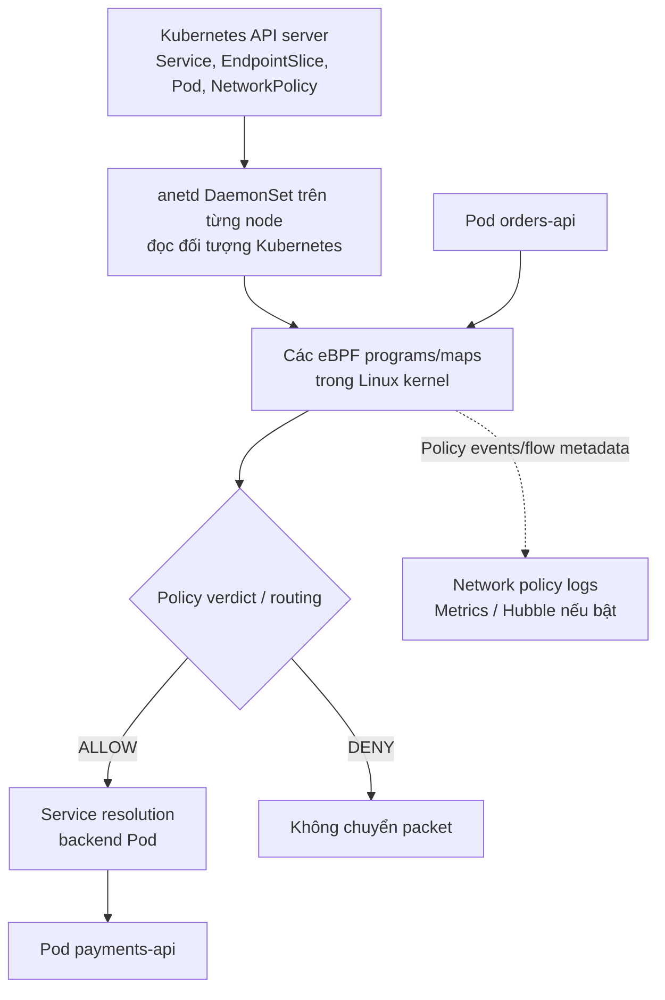
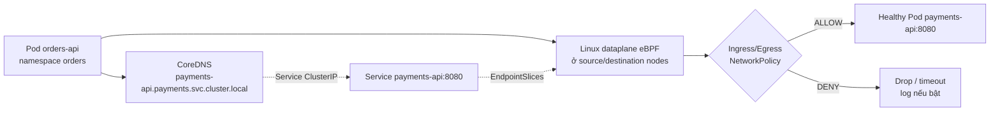

# GKE Dataplane V2 và quan sát kết nối

Một dịch vụ Java trên Google Kubernetes Engine (GKE) đột nhiên không gọi được API thanh toán trong namespace khác. Pod vẫn `Running`, DNS vẫn trả đúng IP, Service đã có endpoint, nhưng request TCP bị timeout sau khi nhóm bảo mật cập nhật `NetworkPolicy`. Nếu chỉ đọc log của ứng dụng, nhóm vận hành rất khó phân biệt vấn đề ở **Service routing**, **DNS**, **policy**, **VPC firewall**, **egress NAT** hay chính ứng dụng đích. **GKE Dataplane V2** cung cấp dataplane dựa trên **eBPF** và những cơ chế quan sát để phân tích các luồng kết nối của Kubernetes gần hơn với vị trí chúng được xử lý.

Bài này thuộc chương **GKE nâng cao và vận hành** trong module **CLOUD_PROVIDERS_GCP**. Nội dung kết nối kiến trúc project, IAM, VPC, GKE, Cloud Run, lưu trữ và cơ sở dữ liệu với vận hành độ tin cậy: hiểu luồng Pod-to-Pod, Service, Internet/on-premises; áp dụng NetworkPolicy; bật và đọc network policy logging, metrics, Hubble flow observability; xử lý lỗi và kiểm soát chi phí. Các ví dụ dùng GKE trên Google Cloud, không áp dụng máy móc cho GKE on AWS/Azure hoặc Google Distributed Cloud.

> Các project, cluster, namespace, image và workload ở đây đều là **môi trường giả định**. Lệnh tạo cluster, bật telemetry, tạo Pod hay áp `NetworkPolicy` có thể thay đổi chi phí và cắt kết nối. Chỉ chạy khi có quyền, đã kiểm tra `kubectl config current-context` và có phương án rollback. Không ghi payload, token hay dữ liệu khách hàng vào log quan sát mạng.

## Mục tiêu học tập

Sau bài học, bạn có thể:

1. Giải thích dataplane của GKE, **eBPF**, **Cilium**, `anetd`, Service load balancing và NetworkPolicy enforcement.
2. Phân biệt **GKE Dataplane V2** với dataplane sử dụng `kube-proxy`/`iptables` và nhận diện các giới hạn cần thử nghiệm.
3. Xác minh cluster đang dùng Dataplane V2, biết cách chọn khi tạo **Standard cluster**, trạng thái mặc định với **Autopilot** và lưu ý về lộ trình di chuyển cluster cũ.
4. Viết `NetworkPolicy` giới hạn Pod ingress/egress, hiểu additive allow, default deny, selectors và yêu cầu cho DNS/metadata server.
5. Dùng **NetworkLogging CRD** và **Cloud Logging `policy-action`** để quan sát policy **allow/deny**, phân biệt việc thực thi policy với sự hiện diện của log.
6. Cấu hình **Dataplane V2 metrics** cùng Managed Service for Prometheus, đọc flow metrics và nhận biết giới hạn cardinality/sampling.
7. Phân biệt logging với **Hubble flow observability** tùy chọn để xem metadata luồng và quan hệ giữa Services.
8. Chẩn đoán kết nối bằng một runbook nhiều lớp, bảo vệ SLO và chi phí quan sát.

## 1. Dataplane trong GKE là gì?

**Control plane** của Kubernetes lưu trạng thái mong muốn (Pod, Service, EndpointSlice, NetworkPolicy) và chạy các controller/scheduler. **Dataplane** trên node thực hiện công việc thực tế: đưa packet tới Pod đích, chọn backend cho Service, kiểm tra policy và theo dõi kết nối.



Đây là sơ đồ **logic**; đường đi packet cụ thể phụ thuộc cùng node/khác node, chiều ingress/egress, loại Service, phiên bản GKE và cấu hình mạng. Không hiểu mũi tên eBPF→Service là mọi packet đều đi qua một daemon ở user space: chính **eBPF chạy trong kernel** xử lý phần dataplane, còn `anetd` lập trình và quản lý cấu hình.

### Các thuật ngữ chính

| Thuật ngữ | Vai trò | Dễ nhầm với |
| --- | --- | --- |
| **eBPF** | Công nghệ chạy chương trình được kiểm tra trong Linux kernel, thao tác packet/state theo cấu hình | Một giao thức mạng mới |
| **Cilium-based dataplane** | Công nghệ nền được GKE quản lý để xử lý Service và NetworkPolicy | Cài đặt Cilium tùy ý có toàn quyền cấu hình |
| **`anetd`** | Agent/DaemonSet GKE Dataplane V2 trên các node | `kube-proxy` |
| **eBPF maps** | Cấu trúc dữ liệu trong kernel lưu policy, Service backend, connection state... | Kubernetes ConfigMap |
| **NetworkPolicy** | Kubernetes API khai báo traffic **được phép** vào/ra Pods | VPC firewall rule hoặc IAM role |
| **NetworkLogging** | GKE CRD quy định policy events nào được ghi log | Bản thân một NetworkPolicy |
| **Hubble** | Công cụ/đường quan sát network flows của dataplane khi bật | Bắt toàn bộ HTTP body/TLS payload |
| **EndpointSlice** | Danh sách endpoint/port/ready state của Service | Control plane endpoint |

### Dataplane V2 không phải một tiện ích Java

Ứng dụng Java vẫn gọi `https://payments-api...` theo cách thông thường. Sự khác biệt nằm ở node/kernel xử lý Service lookup, routing và policy. Vì vậy JVM exceptions như `ConnectException`, `SocketTimeoutException` hay `UnknownHostException` chỉ là **triệu chứng ở tầng ứng dụng**, cần đối chiếu bằng chứng mạng trước khi thay mã.

## 2. Dataplane V2 so với mô hình kube-proxy truyền thống

Ở GKE không sử dụng Dataplane V2, Service routing thường dựa trên `kube-proxy` và quy tắc `iptables`. Dataplane V2 dùng **eBPF** cho Kubernetes Services và NetworkPolicy, không phụ thuộc `kube-proxy` để định tuyến Service.

| Khía cạnh | Kube-proxy/iptables (mô hình điển hình) | GKE Dataplane V2 |
| --- | --- | --- |
| Service ClusterIP/Backend routing | `kube-proxy` cập nhật luật iptables | eBPF programs/maps do `anetd` quản lý |
| Kubernetes NetworkPolicy | Cần engine hỗ trợ, ví dụ Calico | **Tích hợp và luôn được thực thi** |
| Quan sát policy decisions | Phụ thuộc plugin/tooling | Có **network policy logging** tích hợp; phải cấu hình để có logs |
| Flow metadata/metrics | Dùng monitoring/agent khác | Có bộ **Dataplane V2 observability** khi bật |
| Vận hành | Kiểm tra kube-proxy rules | Kiểm tra `anetd`, EndpointSlice, policy và telemetry |
| Giới hạn | Phụ thuộc kube-proxy mode và số lượng rules | Có giới hạn riêng của eBPF maps, kernel, labels và phiên bản |

Không kết luận Dataplane V2 **luôn nhanh hơn bao nhiêu phần trăm**: hiệu năng thực tế thay đổi theo workload, Service count, connections, Pod churn, instance type và vị trí. Đo baseline CPU/latency/packet drop trước và sau thay đổi. Dataplane V2 dùng eBPF maps có giới hạn capacity; không nên coi nó có thể mở rộng vô hạn.

### Lợi ích và trách nhiệm

- **Khả năng mở rộng:** giảm một số bottleneck liên quan Service rules của kube-proxy/iptables.
- **Bảo mật:** NetworkPolicy enforcement tích hợp, không cần tự cài Calico chỉ để bật policy.
- **Vận hành:** có policy logging, dataplane metrics, flow observability được GKE hỗ trợ.
- **Giới hạn hỗ trợ:** không tự sửa các cấu hình nội bộ `anetd`/`cilium-config` hoặc đính kèm **custom eBPF programs** lên các network interfaces do GKE quản lý; có nguy cơ xung đột, mất kết nối và không được hỗ trợ.

## 3. Kiểm tra cluster đang dùng dataplane nào

Ví dụ project/cluster:

```text
PROJECT_ID=retail-dev-01
CLUSTER=retail-gke-dev
LOCATION=asia-southeast1
NAMESPACE=dpv2-lab
```

**Bước 1 — Xem gcloud principal/context và thông tin cluster:**

```bash
PROJECT_ID="retail-dev-01"
CLUSTER="retail-gke-dev"
LOCATION="asia-southeast1"

gcloud auth list
gcloud config get-value project

# Chỉ đọc cấu hình cluster.
gcloud container clusters describe "$CLUSTER" \
  --project="$PROJECT_ID" \
  --location="$LOCATION" \
  --format="yaml(name,location,networkConfig.datapathProvider,currentMasterVersion)"
```

Giá trị `networkConfig.datapathProvider: ADVANCED_DATAPATH` xác nhận Dataplane V2. Đừng chỉ kiểm tra tên cluster, vì Standard clusters có thể đang dùng dataplane khác.

**Bước 2 — Dùng kubectl với context đúng:**

```bash
# Ghi vào kubeconfig cục bộ; không tạo hoặc sửa cluster.
gcloud container clusters get-credentials "$CLUSTER" \
  --project="$PROJECT_ID" --location="$LOCATION"

kubectl config current-context
kubectl get nodes -o wide

# Xem anetd DaemonSet Pods của Dataplane V2.
kubectl -n kube-system get pods -l k8s-app=cilium -o wide
```

Nếu Dataplane V2 được bật, output selector `k8s-app=cilium` thường có Pods tên bắt đầu bằng `anetd-`. Không coi thiếu quyền RBAC xem `kube-system` là bằng chứng dataplane chưa chạy; ưu tiên `gcloud describe` khi không có quyền đọc kube-system.

**Bước 3 — Kiểm tra `NetworkPolicy`:**

```bash
kubectl get networkpolicy --all-namespaces
kubectl get networklogging default -o yaml
```

Lệnh thứ hai chỉ hợp lệ trong cluster Dataplane V2 có CRD `NetworkLogging`. Không khởi tạo một CRD tùy ý hoặc cài Cilium bản khác chỉ vì `networklogging` chưa hiện; cần kiểm tra cluster, GKE version và RBAC.

## 4. Chọn Dataplane V2 khi tạo cluster và khi nâng cấp

### Standard và Autopilot

- **Autopilot:** Dataplane V2 bật mặc định ở các cluster Autopilot mới.
- **Standard:** có thể chọn `--enable-dataplane-v2` khi **tạo cluster**.
- Tính năng NetworkPolicy enforcement đã có sẵn trong Dataplane V2. Lệnh bật/tắt addon NetworkPolicy theo kiểu Calico có thể **bị từ chối**; không cần và không nên cấu hình song song.

Ví dụ tạo cluster Standard phục vụ **môi trường lab**, phát sinh phí tài nguyên:

```bash
# THAY ĐỔI HẠ TẦNG / PHÁT SINH PHÍ.
# Kiểm tra network/subnet, quota, version, node pool và bảo mật trước khi chạy.
gcloud container clusters create retail-gke-dpv2-lab \
  --project="retail-dev-01" \
  --location="asia-southeast1" \
  --enable-ip-alias \
  --enable-dataplane-v2 \
  --num-nodes=1
```

`--num-nodes=1` trong cụm **regional** có thể được áp dụng theo số node **mỗi zone** tùy node locations, làm chi phí cao hơn kỳ vọng. Đây chỉ là cú pháp minh họa; không dùng mặc định để dự toán một VM duy nhất. Production cần private control plane/endpoints, Workload Identity Federation, node pools, autoscaling, logging, monitoring, image security, quota và IaC riêng.

### Có thể chuyển cluster Dataplane V1 hiện có sang V2 không?

Với quy trình **ổn định/phổ thông**, setting dataplane được chọn khi tạo cluster, không thể đơn giản `gcloud clusters update --enable-dataplane-v2` trên một cluster cũ. **Tuy nhiên**, tài liệu GKE mới hiện có **lộ trình migration *Preview*** dành cho một số **Standard VPC-native clusters** đủ điều kiện. Đây không phải tính năng ổn định áp dụng cho mọi cluster.

Tại thời điểm soạn bài, tài liệu migration Preview yêu cầu tối thiểu:

- VPC-native cluster (không phải routes-based).
- GKE cluster version **1.35.3-gke.1155000** trở lên.
- Node pool version **1.35.1-gke.1516000** trở lên.
- Nếu dùng Cloud Service Mesh/Istio: bản tương thích **1.23** trở lên theo yêu cầu CNI.
- Không có custom CNI thay thế GKE-managed CNI hoặc custom eBPF programs trên các interfaces GKE quản lý.

**Migration không thể quay lại Dataplane V1** sau khi chuyển, cần đánh giá giới hạn, thử staging, bảo đảm SLO và theo dõi disruption. Nếu cluster không đủ điều kiện hoặc chính sách không cho Preview, cách an toàn là **tạo cluster V2 mới và migrate workloads** theo kế hoạch thay thế. Đọc tài liệu chính thức đúng thời điểm triển khai, không dựa trên một đoạn lệnh cũ trong bài học.

## 5. Luồng Pod-to-Pod, Pod-to-Service và egress

### Pod A tới Service B



Đây là mô hình suy luận, không phải packet trace chính xác. **DNS lookup** trả ClusterIP trước; dataplane sẽ xử lý traffic đến Service và chọn endpoint phù hợp. Nếu Pod đích chưa **Ready** hoặc Service không có endpoint, triệu chứng có thể là timeout, không nhất thiết là policy deny.

### Những loại traffic phải phân biệt

| Luồng | Thành phần cần kiểm tra | Gợi ý |
| --- | --- | --- |
| **Pod → Pod cùng node** | Pod IP, policy, process listen, dataplane | Không đi ra Internet |
| **Pod → Pod khác node** | Pod CIDR/routes, node health, policy, VPC | Xác định source/dest node |
| **Pod → ClusterIP Service** | DNS, Service port/targetPort, EndpointSlice, eBPF routing | Service có backend Ready? |
| **Pod → Internet** | DNS, egress policy, SNAT/Cloud NAT, firewall, upstream | Không có external IP có thể cần NAT |
| **Pod → Cloud SQL/Google APIs** | Private/public endpoint, VPC route, IAM, Workload Identity Federation | Network allow không đồng nghĩa IAM allow |
| **Ingress từ external LB/Gateway** | GKE Gateway/Ingress, health check, Service, endpoint, policy | NetworkPolicy có thể ảnh hưởng traffic vào Pod |
| **Hybrid on-premises** | VPC, Cloud VPN/Interconnect, routes, DNS, firewall | eBPF không thay thế routing ngoài cluster |

### Service-to-Pod và readiness

Khi Service không có endpoint Ready, một kết nối tới ClusterIP trong Dataplane V2 **có thể timeout**. Ở kube-proxy truyền thống, có lúc lỗi được trả nhanh hơn như `connection refused`. Chỉ dựa vào timeout để phán đoán policy deny là không đủ; kiểm tra `EndpointSlice`, readiness probe và application port.

## 6. Kubernetes NetworkPolicy trong Dataplane V2

NetworkPolicy là **policy tầng L3/L4** trong mô hình Kubernetes chuẩn: chọn Pods và cho phép traffic dựa trên peers (`podSelector`, `namespaceSelector`, `ipBlock`), protocol và port. Nó **không tự phân quyền HTTP URL path** hoặc user identity, không thay thế mTLS/service mesh hoặc IAM.

### Nguyên tắc quan trọng

1. Nếu chưa có policy chọn một Pod cho chiều ingress, mặc định traffic ingress vào Pod đó **không bị cô lập bởi NetworkPolicy**.
2. Khi có policy chọn Pod cho `Ingress`, chỉ traffic khớp các **allow rules** của các policies liên quan được phép; những traffic khác bị cô lập.
3. Với `Egress` cũng tương tự.
4. **Rules cộng dồn (additive)**: nhiều NetworkPolicies cho cùng Pod tạo **hợp các allow rules**. Một policy “deny” không ghi đè một policy khác đang allow.
5. Kết nối thường cần hợp lệ **cả egress policy của source lẫn ingress policy của destination** nếu hai Pod bị cô lập.
6. Policy dựa trên **labels**, không phải một whitelist tĩnh theo tên Pod; thay label selector có thể thay bề mặt truy cập.

### Default deny toàn ingress một namespace

```yaml
apiVersion: networking.k8s.io/v1
kind: NetworkPolicy
metadata:
  name: deny-all-ingress
  namespace: dpv2-lab
spec:
  podSelector: {}
  policyTypes: ["Ingress"]
  ingress: []
```

Nếu áp policy này trong namespace đang chạy, các connections mới vào Pods ở đó có thể bị chặn trừ khi một policy khác **cho phép tương ứng**. **Không áp ngay trên production**; soạn danh sách dependencies, mở đúng lối cho DNS/monitoring/ingress và thử staging trước.

### Default deny ingress + egress

```yaml
apiVersion: networking.k8s.io/v1
kind: NetworkPolicy
metadata:
  name: deny-all-ingress-egress
  namespace: dpv2-lab
spec:
  podSelector: {}
  policyTypes:
    - Ingress
    - Egress
  ingress: []
  egress: []
```

Sau khi bật Egress isolation, **DNS**, metadata server, outbound database/Google APIs và telemetry có thể bị ảnh hưởng nếu không có policy allow thích hợp. Không chỉ cần kiểm tra `curl`: hãy thử Cloud DNS resolution, ADC credentials, startup probes và monitoring agent.

### NetworkPolicy không thay VPC firewall

VPC firewall policies áp dụng trên đường mạng/tài nguyên GCP; Kubernetes NetworkPolicy áp dụng cho Pods theo identity/labels và namespace. Một kết nối có thể bị chặn ở **một trong hai lớp**, hoặc bị ngăn bởi firewall của dịch vụ đích. Mở NetworkPolicy không tự mở VPC firewall, và mở VPC firewall không vô hiệu hóa NetworkPolicy.

## 7. Lab: chỉ cho một Pod client gọi web Service

Mục tiêu lab: chạy một web Pod `nginx` và hai client Pods trong namespace `dpv2-lab`. Policy chỉ cho client có `access: allowed` kết nối tới web port 80. Client còn lại phải bị chặn; ta dùng logs và metrics (nếu đã bật) để tìm bằng chứng.

### Trước khi làm

```bash
gcloud auth list
kubectl config current-context
kubectl get nodes
kubectl get networkpolicy -A

# THAY ĐỔI cluster, chỉ chạy trên cluster lab được cho phép.
kubectl create namespace dpv2-lab
```

Nếu namespace đã tồn tại, không tạo lại. Người thực hành cần Kubernetes RBAC phù hợp, không dùng `cluster-admin` tràn lan.

### Deployment và Service thử nghiệm

Lưu manifest **trên máy làm lab** thành `web-lab.yaml`:

```yaml
apiVersion: apps/v1
kind: Deployment
metadata:
  name: web
  namespace: dpv2-lab
spec:
  replicas: 1
  selector:
    matchLabels:
      app: web
  template:
    metadata:
      labels:
        app: web
    spec:
      containers:
        - name: nginx
          image: nginx:1.27.5
          ports:
            - containerPort: 80
          readinessProbe:
            httpGet:
              path: /
              port: 80
            initialDelaySeconds: 2
            periodSeconds: 5
---
apiVersion: v1
kind: Service
metadata:
  name: web
  namespace: dpv2-lab
spec:
  selector:
    app: web
  ports:
    - name: http
      protocol: TCP
      port: 80
      targetPort: 80
```

Tag image chỉ dùng cho lab; production nên pin **digest** được kiểm tra, thiết lập resource requests/limits, Pod Security và network policies đầy đủ.

### NetworkPolicy cho phép đúng client

Lưu `web-allow.yaml`:

```yaml
apiVersion: networking.k8s.io/v1
kind: NetworkPolicy
metadata:
  name: allow-approved-clients-to-web
  namespace: dpv2-lab
spec:
  podSelector:
    matchLabels:
      app: web
  policyTypes:
    - Ingress
  ingress:
    - from:
        - podSelector:
            matchLabels:
              access: allowed
      ports:
        - protocol: TCP
          port: 80
```

Đây là **selector cùng namespace**, không phải allow cho mọi namespace. Policy này chọn `app=web` để cô lập chiều ingress của web, rồi cho phép **Pods có label `access=allowed`** trong cùng namespace tới TCP/80. Nó **không cách ly egress** của web và không chọn các Pods client làm đối tượng cần cô lập.

### Áp dụng và sinh request

```bash
# Thay đổi resources trong namespace lab.
kubectl apply -f web-lab.yaml
kubectl apply -f web-allow.yaml

kubectl -n dpv2-lab rollout status deployment/web
kubectl -n dpv2-lab get service web
kubectl -n dpv2-lab get endpointslice -l kubernetes.io/service-name=web
kubectl -n dpv2-lab describe networkpolicy allow-approved-clients-to-web

# Hai client Pods chỉ phục vụ lab.
kubectl -n dpv2-lab run allowed \
  --image=curlimages/curl:8.11.1 \
  --labels="access=allowed" \
  --restart=Never --command -- sleep 3600

kubectl -n dpv2-lab run blocked \
  --image=curlimages/curl:8.11.1 \
  --labels="access=blocked" \
  --restart=Never --command -- sleep 3600

kubectl -n dpv2-lab wait --for=condition=Ready pod/allowed --timeout=120s
kubectl -n dpv2-lab wait --for=condition=Ready pod/blocked --timeout=120s
```

**Kiểm tra được phép:**

```bash
kubectl -n dpv2-lab exec allowed -- \
  curl -sS -m 5 -o /dev/null -w "HTTP %{http_code}\n" http://web
```

Kỳ vọng HTTP `200`. **Kiểm tra bị từ chối:**

```bash
kubectl -n dpv2-lab exec blocked -- \
  curl -v -m 5 http://web
```

Kỳ vọng request không thiết lập được kết nối đúng thời hạn hoặc bị drop theo dataplane; kết quả cụ thể tùy kernel/GKE version. **Lệnh trả timeout không tự chứng minh policy chặn**: đối chiếu `NetworkPolicy`, EndpointSlice, readiness và policy logs nếu bật. Để loại trừ lỗi web Pod, luôn so sánh kết quả từ client `allowed` và `blocked` trong cùng thời điểm.

### Dọn lab (thay đổi resources)

Sau khi xác nhận không dùng namespace lab cho workload khác:

```bash
kubectl -n dpv2-lab delete pod allowed blocked --ignore-not-found
kubectl -n dpv2-lab delete networkpolicy allow-approved-clients-to-web \
  --ignore-not-found
kubectl -n dpv2-lab delete service web --ignore-not-found
kubectl -n dpv2-lab delete deployment web --ignore-not-found
```

Không xóa nguyên namespace bằng lệnh wildcard khi chưa xác nhận owner/resources bên trong. Nếu đây là cluster lab độc lập, việc xóa cluster cần quy trình riêng sau khi kiểm tra dữ liệu và ngân sách.

## 8. Những trường hợp NetworkPolicy cần xử lý cẩn thận

### 8.1 Chọn namespaces và Pods chính xác

Để cho phép `orders-api` ở namespace `orders` gọi `payments-api` trong namespace `payments`, cần xác nhận **labels ở cả namespace và Pod**. Một policy ingress trong namespace `payments` có thể viết:

```yaml
apiVersion: networking.k8s.io/v1
kind: NetworkPolicy
metadata:
  name: allow-orders-to-payments
  namespace: payments
spec:
  podSelector:
    matchLabels:
      app: payments-api
  policyTypes: ["Ingress"]
  ingress:
    - from:
        - namespaceSelector:
            matchLabels:
              kubernetes.io/metadata.name: orders
          podSelector:
            matchLabels:
              app: orders-api
      ports:
        - protocol: TCP
          port: 8080
```

Trong cùng **một phần tử** của `from`, `namespaceSelector` **và** `podSelector` được kết hợp với quan hệ **AND**: chỉ Pod `app=orders-api` ở namespace `orders`. Nhưng hai phần tử riêng:

```yaml
from:
  - namespaceSelector:
      matchLabels:
        kubernetes.io/metadata.name: orders
  - podSelector:
      matchLabels:
        app: orders-api
```

lại mang nghĩa **OR**: cho phép **mọi Pod ở namespace orders** hoặc **Pod có label orders-api trong chính namespace của policy**. Đây là lỗi YAML thường dẫn tới mở rộng quyền ngoài chủ đích. Kiểm tra indentation, namespace labels và `kubectl get networkpolicy ... -o yaml` sau khi áp dụng.

### 8.2 Khi dùng ipBlock

Trong Dataplane V2, **không dùng Pod IP hoặc Service ClusterIP trong `ipBlock.cidr`** để thay cho selectors; GKE có giới hạn với các địa chỉ đó. Hãy dùng `podSelector`/`namespaceSelector` cho workloads trong cluster. `ipBlock` phù hợp hơn khi chính sách cho phép một mạng bên ngoài cụ thể theo khả năng thực thi thực tế.

IP của Pod có thể thay khi Pod bị recreate. Dựa trên labels/namespace giúp chính sách duy trì ý nghĩa ngay cả khi IP đổi.

### 8.3 Port range và `endPort`

`NetworkPolicy` có trường `endPort` để mô tả dải cổng. Với **GKE Dataplane V2 phiên bản trước 1.32**, trường này **không được hỗ trợ** và có thể bị API server loại bỏ. Trong GKE **1.32 trở lên**, tính năng được hỗ trợ theo tài liệu.

Sau khi tạo, **đọc lại object**:

```bash
kubectl get networkpolicy -n dpv2-lab \
  allow-approved-clients-to-web -o yaml
```

**Object được Kubernetes lưu** là nguồn kiểm tra trực tiếp, không phải chỉ file YAML trước khi apply. Khi cần một policy bảo vệ nghiêm ngặt trên cluster cũ, không dùng range chưa được hỗ trợ mà nghĩ luật đang hoạt động.

### 8.4 DNS khi bật egress isolation

Một ứng dụng có thể đủ quyền TCP tới IP đích nhưng không resolve được `payments-api.payments.svc.cluster.local` vì đã deny DNS. Với GKE, DNS có thể đi qua **kube-dns** hoặc **NodeLocal DNSCache** tùy cấu hình, nên phải quan sát đường đi thực.

Ví dụ một **đoạn egress allow DNS** cho Pod đã bị isolation, chỉ mang tính tham khảo khi kube-dns Pods có labels tương ứng:

```yaml
egress:
  - to:
      - namespaceSelector:
          matchLabels:
            kubernetes.io/metadata.name: kube-system
        podSelector:
          matchLabels:
            k8s-app: kube-dns
    ports:
      - protocol: UDP
        port: 53
      - protocol: TCP
        port: 53
```

Nếu cluster sử dụng NodeLocal DNSCache, luồng DNS có thể không đi tới đối tượng Pod label này; phải xác minh `kube-system`, địa chỉ nameserver trong `/etc/resolv.conf` và tài liệu DNS của GKE. Đoạn trên là **phần `spec.egress`**, không thể apply độc lập như một NetworkPolicy hoàn chỉnh.

### 8.5 Workload Identity Federation và metadata

Nếu Pod dùng **Workload Identity Federation for GKE** mà egress đã bị cô lập, cần cho phép truy cập tới **GKE metadata server**. Với GKE Dataplane V2, tài liệu yêu cầu egress tới **`169.254.169.254/32` trên TCP 80 và 8080** khi cần cơ chế này.

Ví dụ đoạn `spec.egress`:

```yaml
egress:
  - to:
      - ipBlock:
          cidr: 169.254.169.254/32
    ports:
      - protocol: TCP
        port: 80
      - protocol: TCP
        port: 8080
```

**Đừng gộp rule này thành quyền egress tới toàn bộ `169.254.0.0/16`** nếu không cần. Policy ở GKE Dataplane V1/cluster cũ có thể sử dụng địa chỉ/port metadata khác; không copy nguyên giữa các dataplanes.

### 8.6 Health probes từ node

Với một số GKE phiên bản 1.35 mới, node-local health checks và NodeLocal DNSCache có thể xuất phát từ **`169.254.4.6`** thay vì địa chỉ node Pod CIDR thường gặp. Kubernetes NetworkPolicy tiêu chuẩn tự cho phép một số node-local probes, nhưng **ứng dụng tự cấu hình IP allowlist** có thể từ chối. Nếu thấy readiness probe bất ngờ lỗi sau upgrade, kiểm tra app ACL và version release notes trước khi mở toàn dải mạng.

## 9. Network policy logging: ghi lại quyết định allow/deny

**Network policy logging** là chức năng đi kèm Dataplane V2, nhưng log thực tế phải được **cấu hình**. Nó ghi các **sự kiện kết nối** liên quan đến policy, không bắt toàn bộ payload và không bảo đảm mỗi packet đều được ghi.

### NetworkLogging CRD

GKE tạo một object **`NetworkLogging` tên `default`** trong cluster Dataplane V2 mới. Chỉ có **một** object loại này cho cluster và không đổi tên được.

Kiểm tra trước khi sửa:

```bash
# Chỉ đọc, cần RBAC phù hợp:
kubectl get networklogging default -o yaml
kubectl describe networklogging default
```

Ví dụ cấu hình **ưu tiên ghi deny**, tránh ghi mọi allow events trong production:

```yaml
apiVersion: networking.gke.io/v1alpha1
kind: NetworkLogging
metadata:
  name: default
spec:
  cluster:
    allow:
      log: false
      delegate: false
    deny:
      log: true
      delegate: false
```

Đây là **thay đổi cấu hình quan sát trên toàn cluster**. Đối với lab được phép, admin có thể lưu thành `networklogging-deny.yaml` rồi áp dụng:

```bash
# THAY ĐỔI NetworkLogging cluster-wide.
kubectl apply -f networklogging-deny.yaml

# Đọc lại và kiểm tra events nếu cấu hình không hợp lệ.
kubectl get networklogging default -o yaml
kubectl describe networklogging default
```

Trước khi apply, nên **lưu lại giá trị policy trước đó trong runbook/change ticket**. Không sửa CRD để thử nếu không có quyền và kế hoạch rollback.

### Cho phép ghi cả allow và deny

Trong staging có thể cần xem cả hai phía để xác minh:

```yaml
apiVersion: networking.gke.io/v1alpha1
kind: NetworkLogging
metadata:
  name: default
spec:
  cluster:
    allow:
      log: true
      delegate: false
    deny:
      log: true
      delegate: false
```

**Cảnh báo:** Ghi toàn bộ allowed connections trong cluster có thể tạo rất nhiều events, tăng khối lượng log được lưu và làm khó tìm lỗi. Nên bật theo thời gian/nhóm có chủ đích.

### Chế độ `delegate`

`delegate` cho phép ủy quyền phạm vi log có chủ đích:

| Cấu hình | Ý nghĩa | Điều kiện |
| --- | --- | --- |
| `cluster.allow.log=true, delegate=false` | Ghi các allowed connections trong cluster | Dễ tăng log volume |
| `cluster.deny.log=true, delegate=false` | Ghi denied connections | Phù hợp giai đoạn điều tra |
| `cluster.allow.log=true, delegate=true` | Chỉ ghi allow khi policy có annotation bật logging | Annotation ở **NetworkPolicy** |
| `cluster.deny.log=true, delegate=true` | Chỉ ghi deny cho Pods trong namespace được chọn | Annotation ở **Namespace** |

Với allow logging theo từng policy, thêm annotation sau lên **NetworkPolicy**:

```yaml
metadata:
  annotations:
    policy.network.gke.io/enable-logging: "true"
```

Với deny logging theo namespace, thêm annotation:

```yaml
metadata:
  annotations:
    policy.network.gke.io/enable-deny-logging: "true"
```

Không đặt `delegate=true` nếu `log=false` cho cùng loại allow/deny: cấu hình đó **không hợp lệ**. Chọn chế độ delegation sau khi đánh giá tính bảo mật, dung lượng log, namespace owners và phạm vi quan sát.

### Network policy logs không phải mọi packet

- Log phản ánh **kết nối** và policy verdict theo cơ chế của dataplane, không phải full packet capture.
- Trên mỗi node có giới hạn log rate; tài liệu mô tả có thể ghi tối đa khoảng **500 connections/s** trước khi drop log events, trong khi **policy vẫn được thực thi**.
- Vì vậy `không tìm thấy log` **không chứng minh** kết nối chưa xảy ra hoặc NetworkPolicy không hoạt động.
- Có thể dùng metric `policy_logging` do `anetd` xuất ra để kiểm tra dropped logs theo tài liệu, nhưng truy cập endpoint nội bộ node/Pod phải có quyền thích hợp; không mở cổng metrics nội bộ công khai.

## 10. Xem policy logs trong Cloud Logging

Khi Cloud Logging được bật, network policy logs đi vào log tên **`policy-action`** với resource type **`k8s_node`**.

### Bộ lọc Logs Explorer

```text
resource.type="k8s_node"
resource.labels.cluster_name="retail-gke-dev"
resource.labels.location="asia-southeast1"
logName="projects/retail-dev-01/logs/policy-action"
```

Để chỉ tìm những connections bị deny, thêm:

```text
jsonPayload.disposition="deny"
```

Để điều tra Pod đích cụ thể, có thể lọc các trường:

```text
jsonPayload.dest.pod_namespace="dpv2-lab"
jsonPayload.dest.pod_name=~"web"
```

Để xác định policy liên quan:

```text
jsonPayload.policies.namespace="dpv2-lab"
jsonPayload.policies.name="allow-approved-clients-to-web"
```

**Các đoạn trên là bộ lọc bổ sung**, cần ghép với điều kiện log chung, tùy log entry và field thực tế. Một denied connection không nhất thiết được gắn tên **allow policy** bạn đang kỳ vọng, vì không có rule nào khớp. Đọc payload của một log entry thật trước khi đưa field vào alert production.

### CLI chỉ đọc

```bash
PROJECT_ID="retail-dev-01"
CLUSTER="retail-gke-dev"
LOCATION="asia-southeast1"

gcloud logging read \
  'resource.type="k8s_node" AND resource.labels.cluster_name="retail-gke-dev" AND jsonPayload.disposition="deny"' \
  --project="$PROJECT_ID" \
  --limit=25 \
  --format="table(timestamp,jsonPayload.disposition,jsonPayload.src.pod_name,jsonPayload.dest.pod_name)"
```

Nếu CLI không trả kết quả, kiểm tra quyền `roles/logging.viewer` (hoặc quyền hẹp tương đương), khoảng thời gian, tên project, cấu hình `NetworkLogging` và log exclusions. Không tự cấp quyền Logs Viewer cho mọi developer trên production nếu logs chứa chi tiết networking nhạy cảm.

### Đọc một sự kiện đúng cách

Ví dụ logic của một policy event (không phải JSON schema chuẩn):

```text
Time:         2026-11-19T01:23:45Z
Source Pod:   dpv2-lab/blocked
Destination:  dpv2-lab/web-xxxxx:80
Disposition:  deny
Protocol:     TCP
Policy:       No matching ingress allow rule
```

Diễn giải: tại một thời điểm, dataplane xác định **một kết nối không có quyền** theo policy và đã không chuyển packet. Nó không nói chắc rằng web process bị hỏng, DNS sai, browser cache lỗi hoặc ứng dụng Java có bug.

### Trường hợp không có log

| Khả năng | Cách xác minh |
| --- | --- |
| NetworkLogging không bật `deny.log` | `kubectl get networklogging default -o yaml` |
| `delegate=true` nhưng thiếu annotation | Kiểm tra namespace/networkpolicy metadata |
| Logging bị tắt hoặc log exclusion | Cấu hình GKE/Cloud Logging và sink |
| Vượt log rate limit | Kiểm tra dropped log counters nếu có quyền |
| Request bị lỗi trước policy evaluation | DNS, EndpointSlice, firewall hoặc route |
| Không có lưu lượng trong thời gian lọc | Chạy request thử có kiểm soát và mở rộng time range |
| Không đủ IAM xem logs | Kiểm tra quyền Logging Viewer/scope |

## 11. Dataplane V2 metrics và Managed Service for Prometheus

**Metrics** trả lời các câu hỏi “bao nhiêu?”, “xu hướng tăng hay giảm?”, “namespace nào có egress nhiều?” thay vì cung cấp đầy đủ từng luồng. GKE Dataplane V2 observability được tài liệu hỗ trợ từ **GKE 1.32 trở lên** với những điều kiện phiên bản/tính năng cụ thể.

### Hai lớp quan sát khác nhau

| Công cụ | Loại dữ liệu | Hợp với |
| --- | --- | --- |
| Network policy logging | Allowed/denied connection events trong Cloud Logging | Tìm rule chặn cụ thể, điều tra thay đổi policy |
| Dataplane V2 metrics | Flow counters/rates/labels qua Managed Prometheus/Cloud Monitoring | Dashboard, alert, baseline, thống kê mạng |
| Hubble flow observability | Metadata của live/historical flows theo khả năng lưu/buffer | Quan sát kết nối giữa workloads và policy verdict |
| VPC Flow Logs | Metadata lưu lượng ở lớp VPC interface/subnet | Đi qua VPC/hybrid/egress, không thay thế Pod policy context |
| Application traces/logs | HTTP spans, status, exception, correlation IDs | Xác định user request, latency và lỗi nghiệp vụ |

Không bật tất cả mà không đánh giá **lượng dữ liệu, phân quyền xem, sampling và lưu giữ**.

### Bật metrics trên Dataplane V2 cluster hiện có

Tài liệu GKE hỗ trợ bật **metrics riêng**, độc lập với Hubble tools, trên cluster Dataplane V2 đủ điều kiện. Lệnh sau **thay đổi cấu hình quan sát**:

```bash
# THAY ĐỔI CLUSTER: chỉ trên cluster GKE Dataplane V2 đủ điều kiện.
gcloud container clusters update retail-gke-dev \
  --project="retail-dev-01" \
  --location="asia-southeast1" \
  --enable-managed-prometheus \
  --enable-dataplane-v2-metrics
```

Trước khi thực hiện, xác minh `networkConfig.datapathProvider`, version, quota và chính sách của tổ chức. Cờ `--enable-dataplane-v2-metrics` **không phải** cờ bật dataplane cho một cluster Dataplane V1 cũ. Trên Standard cluster, mở metrics port ở node theo mô hình của tính năng; hãy bảo vệ quyền truy cập và tuân thủ network policies.

### Khi tạo cluster Standard mới

```bash
# TẠO HẠ TẦNG: tính phí cluster/nodes/metrics.
gcloud container clusters create retail-gke-dpv2-lab \
  --project="retail-dev-01" \
  --location="asia-southeast1" \
  --enable-ip-alias \
  --enable-dataplane-v2 \
  --enable-managed-prometheus \
  --enable-dataplane-v2-metrics
```

Đây là **phương án thay thế** lệnh tạo cluster ở mục 4, **không chạy cả hai lệnh cùng tên**. Với Autopilot, dùng lệnh tạo Autopilot tương ứng và những flags hỗ trợ; không áp mọi flag Standard nguyên xi.

### Đọc metrics

Trong **Cloud Monitoring → Metrics Explorer**, tìm các dataplane metrics như:

- `pod_flow_ingress_flows_count`: số luồng vào Pod được tổng hợp theo labels.
- `pod_flow_egress_flows_count`: số luồng ra Pod được tổng hợp theo labels.

Tên đầy đủ trong Metrics Explorer có thể có dạng **`prometheus/.../counter`** tùy cách hiển thị và phiên bản; chọn đúng metric đã thực sự được ingest thay vì gõ một tên đoán trước. Nhóm theo cluster, namespace, workload/source/destination hoặc policy labels được hỗ trợ.

### Các câu hỏi dashboard nên trả lời

1. Tốc độ connections/flows **đến và đi** của namespace `orders` tăng bất thường không?
2. Khi rollout `NetworkPolicy` mới, **deny events** và connection error có cùng tăng không?
3. Egress đến destinations bên ngoài nào vượt baseline?
4. Có Pod/node nào có flow rate khác hẳn các Pod cùng Deployment không?
5. Có sự tương quan với application `5xx`, `p95/p99 latency`, CPU/node saturation và HPA scale không?

**Flow count không phải số lượng request HTTP**: một TCP connection có thể chứa nhiều HTTP requests (HTTP keep-alive, HTTP/2) và một request có thể dùng nhiều connections. Không suy luận số business transactions từ counter mạng.

### Cardinality, sampling và chi phí

Metrics nhiều labels (pod name, destination, port, policy, direction...) có thể tạo **time-series cardinality** cao và tăng billable samples/chi phí Monitoring. Chỉ bật nhãn/dimensions và retention thực sự cần cho SLO; xem Metrics Management và Billing sau khi triển khai.

Một `Pod` được recreate đổi tên/identity cũng khiến series thay đổi. Với dashboard xu hướng, ưu tiên aggregation theo **namespace/workload/service** nếu dùng được, thay vì cố giữ mỗi Pod name dài hạn.

## 12. Hubble flow observability: xem kết nối thay vì chỉ counter

GKE cung cấp **Dataplane V2 flow observability** tùy chọn (dựa trên Hubble). Nó **không tự bật chỉ vì Dataplane V2 đang chạy**. Tính năng này có thể được bật/tắt **độc lập** với Dataplane V2 metrics trong những cluster/phiên bản được hỗ trợ.

### Bật Hubble/flow observability

```bash
# THAY ĐỔI CLUSTER: bật flow observability.
# Chỉ áp dụng khi GKE version, chế độ và quyền hỗ trợ.
gcloud container clusters update retail-gke-dev \
  --project="retail-dev-01" \
  --location="asia-southeast1" \
  --enable-dataplane-v2-flow-observability
```

Kiểm tra cấu hình sản phẩm về **private endpoint**, IAM, network và khả năng tiếp cận; không chủ động đưa endpoint observability ra Internet. Nếu GKE version/edition không cho phép, không tự cài agent quyền cao để lách giới hạn.

### Đọc flow metadata bằng Hubble CLI do GKE triển khai

Theo tài liệu hiện hành, khi tính năng được bật, GKE có namespace **`gke-managed-dpv2-observability`** và deployment **`hubble-relay`** với container **`hubble-cli`**.

```bash
# Chỉ đọc, cần RBAC cho get Pods và exec trong namespace hệ thống.
kubectl get deployment -n gke-managed-dpv2-observability

# Xem một lượng flow metadata giới hạn.
kubectl exec deployment/hubble-relay \
  -c hubble-cli \
  -n gke-managed-dpv2-observability \
  -- hubble observe

# Xem luồng liên quan namespace dpv2-lab.
kubectl exec deployment/hubble-relay \
  -c hubble-cli \
  -n gke-managed-dpv2-observability \
  -- hubble observe -n dpv2-lab
```

Để theo dõi live flows, CLI có `hubble observe -f`; tránh mở stream vô hạn trong CI hay hệ thống ghi log tự động. Cần kiểm tra flags chính xác theo bản Hubble CLI triển khai ở cluster.

**Cảnh báo RBAC:** `kubectl exec` vào namespace hệ thống là quyền nhạy cảm, có thể dùng cho thực thi lệnh bên trong Pod. Chỉ nhóm platform/SRE đủ quyền và có approval nên sử dụng. Không tạo ClusterRoleBinding rộng cho developers để xem Hubble.

### Hubble UI và service dependencies

Hubble UI có thể mô tả luồng **source workload → destination workload**, protocol/port, policy verdict và mốc thời gian, giúp tìm các phụ thuộc mà tài liệu không ghi rõ. Nhưng:

- Flow visibility phụ thuộc việc đã bật feature, quyền truy cập và retention/buffer.
- Data có thể bị mất do sampling, giới hạn CPU, memory hoặc tool downtime; không dùng làm sổ cái lưu lượng tuyệt đối.
- Không kỳ vọng thấy nội dung TLS đã mã hóa, request body hay secret tokens.
- UI/relay endpoint riêng cần được bảo vệ theo hướng dẫn GKE.

### Hubble flow khác network policy log

Hubble tập trung vào **đường đi/metadata của kết nối**, giúp thấy flows giữa Services và hiện tượng drop; `policy-action` tập trung vào những **sự kiện thực thi chính sách** được ghi trong Cloud Logging. Hai nguồn có phạm vi, cấu hình và cơ chế giới hạn khác nhau; kết hợp với logs ứng dụng để hiểu ảnh hưởng tới người dùng.

## 13. Runbook chẩn đoán kết nối nhiều lớp

Khi một service Java báo `ConnectTimeoutException`, hãy đi từ **bằng chứng ít xâm lấn** đến việc xác định lớp lỗi, thay vì chỉnh sửa policy ngay.

### Bước 0 — Khoanh vùng sự cố

Ghi:

```text
Project / Cluster / Location:
Namespace nguồn và Pod:
Namespace đích / Service / Port:
Khoảng thời gian UTC:
Lệnh request và triệu chứng:
Version ứng dụng / thời điểm deploy:
Các thay đổi NetworkPolicy/VPC/firewall/ingress gần đây:
```

Xác nhận `current-context` và không chứa PII trong log/ticket.

### Bước 1 — Workload và DNS

```bash
kubectl config current-context
kubectl get pods -n orders -o wide
kubectl get pods -n payments -o wide
kubectl get service -n payments payments-api -o wide
kubectl get endpointslice -n payments \
  -l kubernetes.io/service-name=payments-api
```

Nếu EndpointSlice không có backend Ready, kiểm tra Deployment replicas, Pod readiness, container port và label selector. Không sửa eBPF khi Kubernetes chưa cung cấp endpoint hợp lệ.

Trong Pod debug đã được phép:

```bash
# Chạy trong shell container có nslookup/curl hoặc một Pod debug được phê duyệt.
nslookup payments-api.payments.svc.cluster.local
curl -v --connect-timeout 3 --max-time 8 \
  http://payments-api.payments.svc.cluster.local:8080/healthz
```

Nếu DNS thất bại, kiểm tra CoreDNS/NodeLocal DNSCache, `/etc/resolv.conf` và egress UDP/TCP/53. Nếu DNS được nhưng TCP timeout, chuyển sang Service/NetworkPolicy/route.

### Bước 2 — NetworkPolicy ở cả hai đầu

```bash
kubectl get networkpolicy -n orders -o yaml
kubectl get networkpolicy -n payments -o yaml

kubectl get namespace orders payments --show-labels
kubectl get pod -n orders -l app=orders-api --show-labels
kubectl get pod -n payments -l app=payments-api --show-labels
```

So sánh **Pod labels**, **namespace labels**, `policyTypes`, `egress.to` và `ingress.from`. Nếu nguồn bị Egress isolation hoặc đích bị Ingress isolation, cả hai chiều cần có allow rules tương ứng. Không nhầm `podSelector: {}` (tất cả Pods) với một selector cụ thể.

### Bước 3 — Policy logs và Hubble flow

1. Trong Cloud Logging, lọc `policy-action` theo cluster/time/destination.
2. Tìm `jsonPayload.disposition="deny"` và xem source/destination labels.
3. Nếu Hubble được bật, xem flows namespace nguồn/đích và port.
4. So sánh một **kết nối được phép** với kết nối bị lỗi; xác minh log chưa bị drop do rate limit.

Nếu log ghi **deny**, xác định policy/selector và thay đổi tối thiểu. Nếu không có deny, kiểm tra logging config và các lớp bên ngoài; **không kết luận đã allow** chỉ vì không có deny event.

### Bước 4 — VPC, external traffic và hybrid

- Pod→external Internet: Cloud NAT, route, DNS public, `ip-masq-agent`/SNAT, firewall egress và upstream allowlist.
- Pod→Cloud SQL: endpoint private/public, VPC route, NetworkPolicy, IAM/Workload Identity Federation, Cloud SQL Auth Proxy hoặc connector.
- Pod→on-premises: Cloud VPN/Interconnect, BGP route advertisements, DNS forwarders, firewall hai phía và return path.
- Ingress→Pod: Gateway/Ingress/backend health, NEG endpoints, health check, Service targetPort và policy.

**NetworkPolicy allow không thay thế external ACL/authorization**. Một Pod gọi Cloud Storage có thể nhận HTTP 403 do IAM ngay cả khi network kết nối tốt.

### Bước 5 — Node và dataplane health

```bash
kubectl get nodes -o wide
kubectl -n kube-system get pods -l k8s-app=cilium -o wide
kubectl get events -A --sort-by=.lastTimestamp
```

Chỉ khi đã có bằng chứng node/dataplane lỗi mới cần xem log của `anetd` hoặc kubelet theo quyền được cấp. **Không tự restart `anetd` DaemonSet, xóa `cilium-config`, sửa eBPF maps hoặc đính kèm probe eBPF lạ** trong production; những thao tác này có thể làm đứt kết nối diện rộng.

### Bước 6 — Chứng minh sửa lỗi và đề phòng tái phát

Sau thay đổi policy đúng scope:

1. Chạy lại một request **được phép** và một request **phải bị từ chối**.
2. Kiểm tra healthy EndpointSlices, Logs Explorer và flow metrics.
3. Đối chiếu `5xx`/`p95 latency`/success rate của Java service.
4. Ghi change ID, nguyên nhân gốc, kiểm thử regression và kế hoạch rollback.

## 14. Các giới hạn kỹ thuật cần biết khi vận hành

Từng phiên bản GKE có thể có known issues; trước upgrade phải đọc **release notes của đúng minor/patch version** và thử trên staging.

| Tình huống | Ý nghĩa vận hành | Điều nên làm |
| --- | --- | --- |
| Không có `kube-proxy` | Đây là thiết kế của Dataplane V2, không phải dịch vụ bị thiếu | Kiểm tra `anetd` và eBPF routing |
| `hostPort` + passthrough LB/NodePort range | Có các giới hạn kết nối trên Dataplane V2 | Ưu tiên Service `NodePort`/Gateway phù hợp |
| `endPort` trên GKE dưới 1.32 | Port range policy có thể bị bỏ qua | Đọc lại object; nâng version/đổi thiết kế |
| Not-ready endpoints | Connections tới Service có thể timeout | Kiểm tra readiness/EndpointSlice trước khi sửa policy |
| Cilium identity churn | Pod labels có cardinality quá cao gây nhiều identities | Giảm high-cardinality labels và theo release notes |
| Custom eBPF/CNI | Có thể xung đột với eBPF do GKE cài | Không đính kèm vào interfaces GKE quản lý |
| NodeLocal DNS/health source IP sau GKE 1.35 | App ACL có thể thiếu `169.254.4.6` | Kiểm tra readiness, app allowlist và version |
| Cloud Service Mesh/Istio upgrade | CNI compatibility với phiên bản GKE mới | Đối chiếu yêu cầu CNI/Istio trước upgrade |
| Kỳ vọng policy ghi mọi connection | Log generation có giới hạn/được cấu hình | Không dùng “không có log” làm chứng cứ duy nhất |
| Google Groups/RBAC thiếu quyền quan sát | Không đọc được `kube-system` hoặc observability namespace | Cấp quyền xem có scope, không mở Cluster Admin tràn lan |

### Service Mesh và L7 policies

**NetworkPolicy tiêu chuẩn** quản lý chủ yếu L3/L4; mTLS, HTTP routing, retries, circuit breaking, per-method authorization và distributed tracing thuộc các lớp khác như Cloud Service Mesh, Gateway API và ứng dụng. Việc eBPF cho phép một TCP connection không bảo đảm backend có quyền IAM để đọc database hoặc chấp nhận JWT từ người dùng.

## 15. Giám sát SLO và chi phí của tính năng observability

Vận hành dataplane không chỉ là “log thấy deny”. Một dashboard nên kết hợp:

| Tín hiệu | Metric/log nguồn | Ý nghĩa |
| --- | --- | --- |
| Application success rate | App logs/traces/SLO | Tác động thực tế lên người dùng |
| TCP connect latency/errors | App telemetry, client synthetic tests | Có đang timeout hoặc reset không? |
| Allowed/denied connection events | `policy-action` Cloud Logging | Có thay đổi policy verdict? |
| Ingress/egress flow count | Dataplane V2 Prometheus metrics | Xu hướng network connections/namespace |
| Endpoint ready count | Kubernetes EndpointSlice/Deployment | Service có healthy backend không? |
| Node/`anetd` readiness | Kubernetes node/DaemonSet status | Dataplane agents có healthy? |
| DNS latency/failures | CoreDNS/NodeLocal DNS metrics và app logs | Lỗi hostname resolution? |
| Egress NAT/network traffic | VPC/Cloud NAT/Flow Logs/Billing | Tắc nghẽn hoặc phí ngoài cluster? |
| Log ingestion & cardinality | Cloud Logging/Monitoring Billing | Observability có vượt ngân sách? |

### Ví dụ giả định về tỷ lệ denial

Trong 15 phút, nếu pipeline quan sát được 3.000 denied connection events và 97.000 allowed events:

```text
Observed deny share = 3.000 / (3.000 + 97.000) × 100 = 3%
```

Đây là **tỷ lệ trên log events thu được**, **không phải xác suất packet bị drop thật**, do log sampling/rate limit và nhiều packets trong một connection. Không dùng con số này làm SLA hoặc bằng chứng tấn công nếu chưa xác thực.

### Giá và vận hành dữ liệu quan sát

- **Network policy logging:** không có phí tạo log riêng theo tài liệu, nhưng **Cloud Logging storage/retention/routing** có thể tính phí.
- **Dataplane metrics:** Google Cloud Managed Service for Prometheus/Cloud Monitoring có phí theo dữ liệu được ingest và chính sách định giá hiện hành.
- **Hubble flow observability:** có thể dùng CPU/memory/network cho các thành phần observability và xuất dữ liệu; kiểm tra điều kiện/tính phí của tính năng ở thời điểm triển khai.
- **VPC Flow Logs:** có cấu hình sampling/aggregation và chi phí log riêng, không tương đương `policy-action`.
- **Tác động gián tiếp:** debug Pods/CLI, LB, NAT, egress cross-region và storage nếu lưu telemetry lâu.

Đặt budget/alerts, lọc theo project/cluster/namespace và giới hạn retention phù hợp với chính sách an ninh. Không thu thập nhãn chứa thông tin nhạy cảm hoặc lưu full URL/query token vào telemetry.

## 16. Bảo mật quyền xem thông tin kết nối

Flow metadata dù không chứa payload vẫn có thể tiết lộ **tên namespace, workload, node, địa chỉ IP đích và quan hệ giữa các dịch vụ**. Đây là thông tin về kiến trúc và đôi khi có tính nhạy cảm.

### Phân quyền theo trách nhiệm

| Vai trò đội | Cần làm | Quyền nên cấp |
| --- | --- | --- |
| Developer | Xem app logs và connectivity trong namespace mình | Kubernetes RBAC + Cloud Logging filter/scope thích hợp |
| SRE | Quan sát nhiều namespaces/cluster, điều tra incident | Quyền đọc logs/metrics + một số Kubernetes cluster-scoped read |
| Platform admin | Cấu hình NetworkLogging, dataplane flags, GKE cluster | Quyền cập nhật được kiểm soát và change approval |
| Security | Audit deny events, policy changes, compliance | Quyền xem audit/logs riêng, kiểm soát retention |
| CI/CD | Áp NetworkPolicy cho namespace được ủy quyền | Quyền `networkpolicies` đúng namespace, không phải `cluster-admin` |

`kubectl exec` vào `anetd`/Hubble components là quyền thực thi lệnh trong Pod hệ thống, **khác** quyền chỉ xem Logs Explorer. Không khuyến nghị cấp `pods/exec` trên toàn `kube-system` cho mọi developer.

### Nguyên tắc phòng ngừa

1. Quản lý NetworkPolicies bằng IaC/GitOps, có review từ owner workload và security.
2. Kiểm thử **đúng cả phép allow lẫn phép deny**, tránh mở rộng selector vì dấu thụt YAML.
3. Đừng tự đổi các managed components `anetd`, Cilium ConfigMap hoặc eBPF programs.
4. Tách identity dev/prod; tránh dùng credential có `container.admin` chỉ để debug policy.
5. Giới hạn quyền đọc logs/flow metadata, giữ log retention theo nhu cầu và không ghi secrets.
6. Bảo đảm có đường **break-glass** được kiểm toán khi một policy lỗi chặn telemetry/ứng dụng diện rộng.

## 17. Case study: orders-api Java không gọi được payments-api

### Bối cảnh

Một doanh nghiệp triển khai:

```text
Project: retail-prod-01
Cluster: retail-gke-prod (Dataplane V2)
Source: orders/orders-api
Destination: payments/payments-api:8080
Symptoms: Java SocketTimeoutException sau rollout NetworkPolicy
Application SLO: tỷ lệ thanh toán thành công > 99,9%
```

Lưu ý SLO chỉ là **mục tiêu giả định của tình huống**, không phải cam kết của Google Cloud.

### Dữ kiện

- Cả hai Deployments có Pod `Running`.
- `payments-api` Service đã có EndpointSlice trỏ tới Pod Ready.
- DNS `payments-api.payments.svc.cluster.local` phân giải thành ClusterIP.
- NetworkPolicy mới ở `payments` kết hợp `namespaceSelector` và `podSelector` **trong cùng một phần tử (AND)**, nhưng sau đợt đổi labels, policy vẫn yêu cầu namespace label `team=orders-old` và Pod label `app=orders-api-v1`. Trong khi đó namespace và Pod nguồn đang mang `team=orders` và `app=orders-api`; vì vậy **không có allow rule nào khớp**.
- Network policy logging ghi các events `deny` đến Pod payments port 8080 khi có request thử.

### Hướng xử lý

1. **Kiểm tra context và thời điểm deploy**: ghi change ID và baseline latency/error.
2. **Xác minh nguồn**: `kubectl -n orders get pods --show-labels`, so với label đang nằm trong policy.
3. **Xác minh đích**: `kubectl -n payments get pods --show-labels`, Service, EndpointSlice, readiness.
4. **Đọc policy thực tế** `kubectl get networkpolicy -n payments -o yaml`: phân biệt selector AND/OR, ingress TCP/8080, namespace.
5. **Đọc policy-action logs**: xác minh deny event, source/dest Pod và port, tránh suy luận từ client timeout.
6. **Sửa tối thiểu** các label selectors cho khớp nguồn thực tế, vẫn kết hợp `namespaceSelector + podSelector` trong **cùng một phần tử** để tránh mở rộng quyền theo OR; xét thêm egress policy của nguồn nếu đang isolate.
7. **Canary kiểm thử**: request từ orders-api được phép; request từ namespace không liên quan vẫn bị deny.
8. **Quan sát**: payment success rate, p95 latency, allowed/denied logs và error rate phục hồi về baseline.
9. **Hậu kiểm**: thêm automated NetworkPolicy tests và policy-as-code validation để tránh tái diễn.

### Nguyên nhân gốc và bài học

Không phải Java client “bị kẹt”, cũng không phải DNS hay Cloud NAT. Sai khác ở **labels đã thay đổi nhưng policy chưa được cập nhật**, được xác minh bằng thử nghiệm cùng policy log. Không cần sửa IAM project, restart node hoặc tắt Dataplane V2.

## 18. Kịch bản vận hành và bài tập

### Bài 1 — Vì sao không có kube-proxy?

Bạn chạy `kubectl -n kube-system get daemonsets` và không thấy `kube-proxy` trong cluster Dataplane V2. Có phải cluster hỏng không?

<details>
<summary>Gợi ý đáp án</summary>

Không. Dataplane V2 dùng eBPF và agent `anetd` để xử lý Service routing; không phụ thuộc kube-proxy như mô hình cũ. Kiểm tra `networkConfig.datapathProvider=ADVANCED_DATAPATH`, `anetd` và connectivity theo SLO.
</details>

### Bài 2 — Default deny làm hỏng DNS

Một Pod chạy `curl http://10.0.0.5:8080` được nhưng `curl http://api.internal` báo không tìm thấy hostname ngay sau khi áp egress default deny. Cần kiểm tra gì?

<details>
<summary>Gợi ý đáp án</summary>

Kiểm tra DNS resolver trong `/etc/resolv.conf`, CoreDNS/NodeLocal DNSCache, egress UDP/TCP/53 và policies chọn Pod nguồn. Không mở mọi egress khi chỉ cần allow tới DNS đúng địa chỉ/service.
</details>

### Bài 3 — AND/OR của selectors

NetworkPolicy trong `payments` có hai phần tử `from`: một chỉ có `namespaceSelector: orders`, phần kia chỉ có `podSelector: app=orders-api`. Nó có đúng là “chỉ orders-api ở namespace orders” không?

<details>
<summary>Đáp án</summary>

Không. Hai phần tử là **OR**. Muốn **AND**, đặt `namespaceSelector` và `podSelector` trong **cùng một phần tử** của `from`. Nhớ kiểm tra nhãn thật và quyền hiệu lực từ các policies khác.
</details>

### Bài 4 — Policy logs không có entry

Client bị timeout, nhưng Logs Explorer không có `jsonPayload.disposition="deny"`. Có thể khẳng định NetworkPolicy không chặn không?

<details>
<summary>Đáp án</summary>

Không. Logging có thể chưa bật/delegate sai, bị log exclusion/rate limit hoặc lỗi xảy ra trước policy; còn cần kiểm tra namespace, time range, IAM, DNS, EndpointSlice, network và Hubble flows nếu có.
</details>

### Bài 5 — Source và destination

Trong một cluster, cả `orders-api` và `payments-api` đều bị Egress/Ingress isolation. Nếu chỉ thêm Ingress allow ở payments-api, liệu kết nối từ orders chắc chắn thành công?

<details>
<summary>Gợi ý đáp án</summary>

Không chắc. Cần một **Egress allow** của source phù hợp bên cạnh Ingress allow của destination, cộng với DNS, routes, Service/EndpointSlice và process listen đúng cổng.
</details>

### Bài 6 — Không đúng kiểu lỗi

`kubectl get endpointslice` không có backend Ready và request tới ClusterIP timeout. Có nên tắt NetworkPolicy để sửa ngay?

<details>
<summary>Gợi ý đáp án</summary>

Không. Tập trung vào Deployment replicas, Pod readiness, Service selector/targetPort và application health. Dataplane V2 có thể trả timeout khi Service không có endpoint Ready. Chỉ sửa policy khi đã có bằng chứng.
</details>

### Bài 7 — Metadata server bị deny

Sau khi áp default deny egress, Java workload dùng Workload Identity Federation không gọi được Cloud Storage và có lỗi lấy token. NetworkPolicy cần xét đường nào?

<details>
<summary>Gợi ý đáp án</summary>

Với Dataplane V2, kiểm tra egress TCP tới `169.254.169.254/32` cổng `80` và `8080` theo yêu cầu metadata server, sau đó kiểm tra IAM quyền đọc bucket. Cho phép network không tự cấp quyền `storage.objects.get`.
</details>

### Bài 8 — Metrics so với HTTP requests

Trong Monitoring, `pod_flow_egress_flows_count` tăng 1.000 sau một phút. Có thể kết luận ứng dụng phát đúng 1.000 HTTP requests không?

<details>
<summary>Đáp án</summary>

Không. Flow không tương đương request: HTTP keep-alive/HTTP2 multiplexing, retries, connection pooling và sampling/aggregation có thể khác. Để đếm business requests cần app metrics/traces hoặc gateway metrics.
</details>

### Bài 9 — Chi phí quan sát

SRE bật `allow.log=true, delegate=false` trên production và Cloud Logging volume tăng mạnh. Bạn sẽ tối ưu thế nào mà vẫn điều tra được sự cố?

<details>
<summary>Gợi ý đáp án</summary>

Chuyển sang ghi deny events, hoặc `allow.log=true, delegate=true` và annotate đúng NetworkPolicies cần xem; giới hạn thời gian, retention, filter và quyền đọc. Kiểm tra log drop counters và đo chi phí/SLO trước khi thay.
</details>

### Bài 10 — Cluster cũ có thể “update Dataplane V2” không?

Đội DevOps muốn chạy một lệnh `update --enable-dataplane-v2` trên mọi Standard cluster cũ. Có đúng không?

<details>
<summary>Đáp án</summary>

Không. Dataplane thường được chọn khi tạo cluster. GKE có **migration Preview** cho một số VPC-native clusters phiên bản mới đủ điều kiện và **không thể quay lại V1**. Không bật đại trà bằng update; cần eligibility assessment và kế hoạch migration hoặc tạo cluster mới.
</details>

### Bài 11 — Không nên chỉnh `cilium-config`

Một người muốn thay `cilium-config` hoặc cài custom eBPF program vào `eth0` của node để ghi thêm log. Rủi ro gì?

<details>
<summary>Gợi ý đáp án</summary>

GKE Dataplane V2 được quản lý; custom eBPF/CNI hoặc sửa ConfigMap nội bộ có thể xung đột với agent `anetd`, làm mất Service routing/policy enforcement và bị coi là cấu hình không hỗ trợ. Dùng Logging, Monitoring và Hubble theo tính năng chính thức.
</details>

### Bài 12 — RBAC cho Hubble

Một developer chỉ có quyền `get pods` trong namespace `orders` muốn chạy `kubectl exec` vào `gke-managed-dpv2-observability`. Có nên tạo ClusterRoleBinding rộng để họ làm vậy?

<details>
<summary>Đáp án</summary>

Không. `pods/exec` ở namespace observability là quyền nhạy cảm. Ưu tiên Cloud Logging/Monitoring dashboard có phạm vi phù hợp hoặc một quy trình SRE được kiểm soát. Không cấp `cluster-admin` chỉ để xem flows.
</details>

## 19. Những hiểu lầm phổ biến

| Nhận định sai | Cách hiểu đúng |
| --- | --- |
| “Dataplane V2 là kube-proxy được nâng phiên bản” | V2 dùng eBPF/Cilium-based dataplane, không phụ thuộc kube-proxy cho Service routing |
| “NetworkPolicy trên Dataplane V2 cần cài Calico thủ công” | Policy enforcement đã tích hợp |
| “Bật Dataplane V2 là tự có đủ logs/metrics/Hubble” | Logging CRD, Prometheus metrics và flow observability có cấu hình riêng |
| “Không có deny log nghĩa packet được allow” | Có thể log chưa bật, bị drop/sampling hoặc lỗi trước policy |
| “Policy chỉ deny mọi thứ” | NetworkPolicy dùng **additive allow**, không ghi đè policy allow khác |
| “Hai selectors trong hai mục from là AND” | Đó là OR; đặt cùng một phần tử mới là AND |
| “ipBlock Pod/Service IP giống selector” | Dataplane V2 có giới hạn với Pod/Service IP; dùng selectors cho workload |
| “Một TCP flow = một HTTP request” | Connection pooling/HTTP2 làm chúng khác nhau |
| “Node local health probes luôn tới từ Pod CIDR gateway .1” | Một số GKE version dùng `169.254.4.6` |
| “Mất Cloud Storage nghĩa NetworkPolicy chắc chắn đang deny” | Có thể IAM hoặc metadata server, DNS/egress, client credentials |
| “Tắt network policy addon sẽ giảm vấn đề V2” | Dataplane V2 có enforcement tích hợp, không bật/tắt như Calico addon |
| “Migration V1→V2 có rollback dễ dàng” | Migration Preview có điều kiện và không thể revert |
| “Hubble luôn thu đủ traffic và TLS payload” | Hubble chủ yếu flow metadata, không phải full packet capture |
| “Thêm container privileged vào node để debug eBPF là vô hại” | Có thể xung đột GKE-managed eBPF và gây sự cố mạng |

## 20. Checklist vận hành production

- [ ] Đã xác minh Dataplane V2 bằng `ADVANCED_DATAPATH` và sức khỏe `anetd`.
- [ ] Kiểm tra GKE version, giới hạn `hostPort`/`endPort`/Cloud Service Mesh trước khi upgrade.
- [ ] Có bản đồ các dịch vụ gọi nhau theo namespace/port và traffic ingress/egress cần thiết.
- [ ] NetworkPolicies được quản lý bằng GitOps/IaC; có review labels/namespace selectors/AND-OR.
- [ ] Không dùng Pod IP/Service ClusterIP trong `ipBlock` khi policy yêu cầu định danh workload.
- [ ] Có allow path cho DNS, metadata server, ingress health check và dependencies thật trước khi áp egress default deny.
- [ ] Có lab/canary test cho traffic **được phép** và **phải bị từ chối**.
- [ ] NetworkLogging `default` được cấu hình theo mục tiêu giám sát, không ghi toàn bộ allow events vô thời hạn.
- [ ] Cloud Logging `policy-action` đang hoạt động, có alert/filter phù hợp; hiểu giới hạn log generation.
- [ ] Dataplane V2 metrics/Managed Prometheus được bật khi cần, có dashboard và kiểm soát cardinality.
- [ ] Flow observability/Hubble chỉ được bật và truy cập theo RBAC/IAM có chủ đích.
- [ ] Dashboard kết hợp policy logs, flow metrics, EndpointSlice/readiness, VPC/NAT và application SLO.
- [ ] Có runbook phân biệt DNS/Service/NetworkPolicy/VPC/firewall/IAM/admission và không sửa dataplane vô căn cứ.
- [ ] Không sửa các thành phần `anetd`/Cilium managed hay đính kèm custom eBPF vào GKE interfaces.
- [ ] Có kế hoạch quota, ngân sách Logs/Monitoring, retention và bảo vệ thông tin network metadata.
- [ ] Các thay đổi cluster, migration/upgrade, policies có approval, rollback plan và post-deploy verification.

## Tài liệu tham khảo chính thức

- [GKE Dataplane V2 overview](https://cloud.google.com/kubernetes-engine/docs/concepts/dataplane-v2): eBPF, `anetd`, Service routing, security và giới hạn.
- [Using GKE Dataplane V2](https://cloud.google.com/kubernetes-engine/docs/how-to/dataplane-v2): tạo cluster, kiểm tra `ADVANCED_DATAPATH` và troubleshooting.
- [Network policy on GKE](https://cloud.google.com/kubernetes-engine/docs/how-to/network-policy): selectors, egress tới metadata server và những giới hạn Dataplane V2.
- [Kubernetes Network Policies](https://kubernetes.io/docs/concepts/services-networking/network-policies/): policyTypes, additive allow, ingress/egress và selectors.
- [Use network policy logging](https://cloud.google.com/kubernetes-engine/docs/how-to/network-policy-logging): `NetworkLogging` CRD, `policy-action`, delegate và log rate limit.
- [GKE Dataplane V2 observability overview](https://cloud.google.com/kubernetes-engine/docs/concepts/about-dpv2-observability): metrics và Hubble flow observability.
- [Configure GKE Dataplane V2 observability](https://cloud.google.com/kubernetes-engine/docs/how-to/configure-dpv2-observability): enable metrics/flow observability và Managed Service for Prometheus.
- [Observe your traffic with GKE Dataplane V2](https://cloud.google.com/kubernetes-engine/docs/how-to/observe-your-traffic): Metrics Explorer, Service dependencies và Hubble CLI.
- [About migrating to GKE Dataplane V2](https://cloud.google.com/kubernetes-engine/docs/concepts/about-migrating-dataplane-v2): điều kiện migration Preview, giới hạn và không thể revert.
- [Learn GKE networking architecture](https://cloud.google.com/kubernetes-engine/docs/learn/learn-gke-net-architecture): Pod IPs, Services, routes và các lớp dataplane.
- [Best practices for GKE networking](https://cloud.google.com/kubernetes-engine/docs/best-practices/networking): topology, security và observability.
- [Cloud Logging pricing](https://cloud.google.com/stackdriver/pricing): kiểm soát chi phí logging/monitoring.
- [Google Cloud Pricing Calculator](https://cloud.google.com/products/calculator): dự toán hệ thống GKE và tài nguyên kèm theo.


