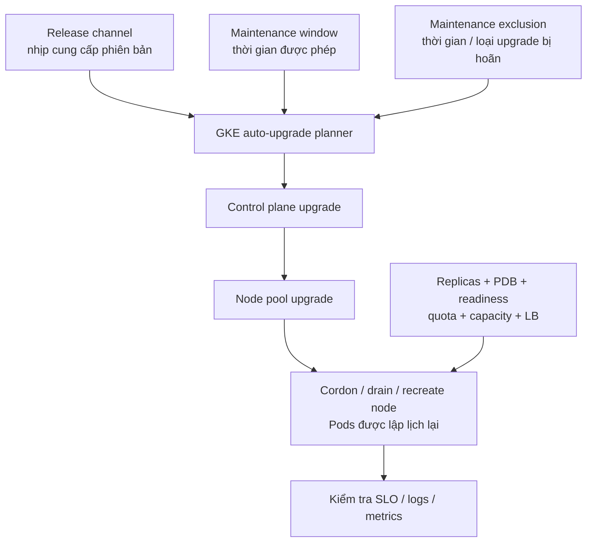

# Release channels, maintenance windows và nâng cấp cluster

Trên **Google Kubernetes Engine (GKE)**, việc nâng cấp Kubernetes không phải chỉ chọn một số phiên bản mới. Một đợt nâng cấp có thể tác động tới **control plane**, **node pools**, khả năng lập lịch Pod, các API Kubernetes đã bị ngừng hỗ trợ và độ sẵn sàng của ứng dụng. Đội vận hành cần biết **khi nào GKE có thể nâng cấp**, **phiên bản nào được phép triển khai** và **làm sao bảo toàn dịch vụ khi node được thay thế**.

Bài thuộc chương **GKE nâng cao và vận hành** của mô-đun `CLOUD_PROVIDERS_GCP`. Trong hành trình tìm hiểu Google Cloud từ project, IAM, VPC đến Compute Engine, GKE, Cloud Run, lưu trữ, cơ sở dữ liệu, tự động hóa phát hành và tối ưu độ tin cậy/chi phí, bài này xây dựng một **runbook nâng cấp GKE có kiểm soát**. Ví dụ dùng một cluster lab đã tồn tại, không tạo cluster mới và không thực thi thay đổi production.

## 1. Mục tiêu và phạm vi

Sau bài học, bạn có thể:

1. So sánh bốn **release channels**: Rapid, Regular, Stable và Extended.
2. Hiểu vòng đời **minor/patch version**, hỗ trợ phiên bản và giới hạn của tính năng “No channel”.
3. Cấu hình **maintenance window** theo UTC, RRULE và yêu cầu thời lượng tối thiểu; dùng **maintenance exclusion** đúng mục đích.
4. Phân biệt nâng cấp **control plane** và **node pool** trong GKE Standard/Autopilot.
5. Chọn **surge** hoặc **blue-green** cho node pools phù hợp, chuẩn bị PDB, replicas, readiness và quota.
6. Kiểm kê phiên bản, chính sách bảo trì, node pool và workload trước khi thay đổi.
7. Thực hiện kiểm thử trước/sau, theo dõi operation, xác định điều kiện rollback và xử lý nâng cấp dở dang.
8. Áp dụng checklist, bài tập và kế hoạch nâng cấp vào dịch vụ có SLO cụ thể.

**Ranh giới lab:** các lệnh chỉ đọc có thể dùng trên cluster được cấp quyền quan sát. Lệnh `update`/`upgrade` trong bài **có tác động thật** đến cluster; chỉ chạy khi đã được phê duyệt, có change window và phương án phục hồi. Giá trị cluster/project là placeholder.

## 2. Mô hình nâng cấp GKE



**Không đánh đồng các cơ chế:**

| Cơ chế | Quyết định | Không bảo đảm |
| --- | --- | --- |
| **Release channel** | Tốc độ tiếp nhận phiên bản và lịch auto-upgrade | Không “khóa” cluster mãi ở một version |
| **Maintenance window** | Khi nào các tác vụ tự động có thể bắt đầu/tiếp tục, nếu thuộc loại tôn trọng policy | Không ngăn manual upgrade hoặc mọi sửa lỗi khẩn cấp |
| **Maintenance exclusion** | Tạm hoãn những loại nâng cấp tự động được chỉ định | Không vượt ngày hết hỗ trợ hay chặn mọi can thiệp an ninh |
| **Node upgrade strategy** | Cách thay thế node trong pool | Không tự tạo Pod replicas, sửa app hoặc database |
| **PodDisruptionBudget (PDB)** | Mức gián đoạn tự nguyện Kubernetes nên tránh | Không phải cam kết tuyệt đối không gián đoạn |
| **Application readiness/SLO** | Workload có thể nhận traffic đúng không | Không được suy ra chỉ từ phiên bản cluster |

Đối với **Standard**, đội nền tảng kiểm soát nhiều cài đặt node pools; **Autopilot** tự quản lý phần lớn hạ tầng node nên không cung cấp toàn bộ tùy chọn node pool như Standard.

## 3. Release channels: chọn theo mức chấp nhận thay đổi

| Channel | Đặc điểm | Khi cân nhắc |
| --- | --- | --- |
| **Rapid** | Nhận minor version/tính năng mới sớm nhất; thời gian kiểm chứng trên GKE ngắn hơn | Môi trường thử nghiệm, nhóm cần tính năng mới và có pipeline kiểm chứng mạnh |
| **Regular** | Nhận phiên bản sau Rapid; cân bằng giữa tốc độ và độ chín | Mặc định phù hợp nhiều ứng dụng production |
| **Stable** | Nhận phiên bản muộn hơn Regular, thêm thời gian quan sát lỗi | Ứng dụng ưu tiên giảm tốc độ thay đổi hơn nhận tính năng sớm |
| **Extended** | Dành cho **Standard** ở các cấu hình đủ điều kiện; kéo dài hỗ trợ minor version, có **phí hỗ trợ mở rộng** khi vào giai đoạn đó | Ứng dụng khó nâng minor đúng chu kỳ tiêu chuẩn, cần lập kế hoạch dài hơn |

**Không có “channel an toàn tuyệt đối”.** Tất cả channel đều cần kiểm tra compatibility; bản vá bảo mật quan trọng có thể được GKE đẩy theo ngoại lệ dù chưa đến lịch thông thường. Lịch minor/patch khác nhau theo channel, region và tiến trình rollout. Khi quyết định, đọc **GKE release schedule và release notes**, không hard-code một số version vào runbook lâu dài.

### 3.1. Chính sách version và hỗ trợ

Một version Kubernetes có dạng `MAJOR.MINOR.PATCH-gke.BUILD`. Ví dụ `1.34.x-gke.y` chỉ minh họa ký hiệu; **không dùng chuỗi ví dụ làm version đích thực tế**.

- **Patch**: cập nhật bảo mật/sửa lỗi trong cùng minor.
- **Minor**: thêm/bỏ API, thay đổi hành vi; cần kiểm tra deprecations và version skew.
- **Standard support**: giai đoạn hỗ trợ thông thường của minor version.
- **Extended support**: Extended channel có thể duy trì minor lâu hơn, với những điều kiện/tính năng và phí bổ sung.

Theo tài liệu GKE versioning hiện hành, vòng hỗ trợ điển hình của minor có **khoảng 14 tháng standard support**, tiếp đến tối đa **24 tháng tổng cộng** cho Extended; phải kiểm tra lịch của **minor version thực tế** vì thời điểm được đưa vào channel và end-of-support là biến số.

**No channel** là cấu hình đang bị loại bỏ: Google Cloud thông báo ngừng vào **14/06/2027**. Không chọn nó như chiến lược “tắt nâng cấp”: control plane vẫn được tự động nâng cấp; cluster Standard hiện có nên lập kế hoạch chuyển sang release channel được hỗ trợ.

### 3.2. Quy trình chọn channel

1. Liệt kê API/add-ons/CRD và phiên bản Kubernetes ứng dụng đã được kiểm thử.
2. Ghi mức chấp nhận đổi mới: cần tính năng mới, yêu cầu ổn định, lịch release của team.
3. Chọn channel tương ứng; tách **test/staging** và **production** để thử phiên bản sớm trước khi dùng thật.
4. Gắn lịch release notes/deprecation reviews vào quy trình sprint.
5. Theo dõi end-of-support, đặc biệt nếu chọn Extended để mua thêm thời gian thay vì trì hoãn vô thời hạn.

Thay channel có thể làm **thay đổi tập phiên bản và lịch auto-upgrade**; không chuyển ngay trên production chỉ để “nâng lên Stable”. Kiểm tra version đang chạy, versions có sẵn ở channel đích và maintenance policy trước khi đổi.

## 4. Maintenance windows: cho phép bảo trì vào khung giờ rõ ràng

**Maintenance window** là khoảng thời gian lặp lại mà GKE có thể dùng cho những tác vụ bảo trì tự động **thuộc loại tôn trọng policy**. Một cluster chỉ có **một** cấu hình maintenance window tại một thời điểm; cập nhật mới sẽ thay cấu hình cũ.

Các giới hạn cần nhớ:

- Phải cho phép **ít nhất 48 giờ** bảo trì trong **92 ngày trượt**.
- Chỉ các khoảng **liên tục ít nhất 4 giờ** mới được tính vào điều kiện trên.
- Cấu hình `--maintenance-window-start` dùng mốc RFC 5545, `--maintenance-window-duration` dùng thời lượng, `--maintenance-window-recurrence` dùng RRULE.
- **Ngày trong RRULE được tính theo UTC**. Việc quy đổi sang giờ Việt Nam **UTC+7** cần kiểm tra ngày bị lệch khi đi qua nửa đêm.
- Một upgrade có thể kéo dài qua window; GKE sẽ cố tạm dừng/tiếp tục ở window sau. Cluster vẫn có thể có **node pools chạy nhiều patch version trong thời gian chuyển tiếp**.

**Ví dụ lịch thực tế:** bảo trì vào **23:00–07:00 giờ Việt Nam**, các đêm thứ Hai, thứ Tư và thứ Sáu. Mốc bắt đầu UTC tương ứng là **16:00Z** của cùng ngày, mỗi lần 8 giờ. Ba lần mỗi tuần giúp đáp ứng ngưỡng tối thiểu 48 giờ/92 ngày trong điều kiện lặp đều.

Cần phối hợp lịch này với thời điểm traffic cao, on-call, backup, job batch, release freeze và múi giờ của những nhóm vận hành khác. Maintenance window **không phải cam kết không có downtime**; readiness và capacity của ứng dụng vẫn quyết định trải nghiệm người dùng.

## 5. Maintenance exclusions: tạm hoãn đúng loại upgrade

Khi có chiến dịch bán hàng lớn, chuyển đổi database hoặc kỳ audit, đội vận hành có thể dùng **maintenance exclusion** trong thời hạn xác định. Exclusion khác window: window nói *khi nào cho phép*, exclusion nói *loại tác vụ nào tạm không cho phép*.

| Scope CLI | Control plane | Node pools | Mục đích |
| --- | --- | --- | --- |
| `no_upgrades` | Hoãn minor và patch tự động | Hoãn minor và patch tự động | Đóng băng ngắn hạn trong sự kiện quan trọng |
| `no_minor_upgrades` | Cho phép patch, hoãn minor | Cho phép patch, hoãn minor | Giữ bản vá bảo mật trong khi trì hoãn thay đổi minor |
| `no_minor_or_node_upgrades` | Cho phép patch control plane, hoãn minor | Hoãn cả patch và minor node | Khi node cần được kiểm thử/điều phối riêng |

Các scope chi tiết chỉ áp dụng với cluster **đã vào release channel**; cluster không có channel (deprecated) bị giới hạn ở scope mặc định phù hợp.

**Giới hạn:** exclusion `no_upgrades` thông thường không vượt quá **90 ngày**, tối đa **3 exclusion** kiểu này và vẫn phải bảo đảm thời gian bảo trì tối thiểu; tổng số cluster exclusions cũng có giới hạn. Những loại hoãn khác không được kéo dài vô điều kiện quá end-of-support. Ở thời điểm cần bảo vệ an ninh/hết hỗ trợ, GKE vẫn có thể thực hiện nâng cấp bắt buộc. Exclusion phải có **owner, lý do, ngày hết hạn và kế hoạch catch-up**.

Không dùng exclusion để thay thế việc sửa API deprecated hoặc duy trì node không được vá. Nếu chọn `no_minor_or_node_upgrades`, phải chủ động quản lý node version để không vi phạm **version skew**.

## 6. Upgrade control plane và node pools

GKE nâng cấp hai lớp **riêng biệt**:

| Thành phần | Khi nâng cấp | Khả năng gián đoạn |
| --- | --- | --- |
| **Control plane** | Kubernetes API server và thành phần quản lý | Cluster **zonal** có thể tạm không nhận thay đổi API; workloads đang chạy thường tiếp tục xử lý. Cluster **regional** nâng các replica lần lượt, tăng HA của API |
| **Node pool** | VM/node image, kubelet, kube-proxy và môi trường chạy Pod | Node bị cordon/drain/recreate; Pods phải được lập lịch và khởi động lại ở node phù hợp |

**Thứ tự thông thường:** control plane trước, sau đó node pools; có thể có thời gian chúng dùng phiên bản khác nhau **trong giới hạn version skew mà GKE hỗ trợ**. Không suy rằng xong nâng cấp control plane nghĩa là toàn bộ nodes đã nâng.

GKE **không cho vô hiệu hóa vĩnh viễn các nâng cấp control plane cần thiết**. Maintenance policies giúp điều phối thời điểm auto-upgrade, còn **manual upgrades bỏ qua maintenance window và exclusion**: nếu vận hành viên chủ động chạy lệnh thủ công sai thời điểm, policy không chặn thay đổi đó.

### 6.1. Standard và Autopilot

- **Standard:** người vận hành chọn node pool strategy phù hợp (surge/blue-green), có thể điều chỉnh sizing và chủ động nâng cấp pool. Auto-upgrade node mặc định được khuyến nghị duy trì.
- **Autopilot:** GKE quản lý nodes và chiến lược nâng cấp hạ tầng nhiều hơn; người dùng chủ yếu chuẩn bị workload/Pod readiness, capacity theo yêu cầu và maintenance policy. Không áp lệnh cấu hình Standard node pool một cách máy móc cho Autopilot.

Bất kể mode nào, **không đổi thẳng hai minor versions bằng một manual upgrade**; kiểm tra các bước nâng cấp được hỗ trợ và target versions từ GKE server config.

## 7. Node upgrade strategies và mức độ gián đoạn

### 7.1. Surge upgrade

GKE tạo thêm một số **surge nodes** để nhận Pods rồi thay node cũ theo từng đợt.

- `maxSurge`: tối đa số node bổ sung trong quá trình nâng.
- `maxUnavailable`: số node có thể không sẵn sàng do nâng cấp, theo chiến lược.
- Ví dụ `maxSurge=1`, `maxUnavailable=0` ưu tiên không mất capacity danh nghĩa, nhưng phải **có quota/physical capacity** để tạo surge node.

### 7.2. Blue-green upgrade

GKE giữ pool cũ (**blue**) và tạo pool mới (**green**), chuyển workloads theo lô và có **soak time** để kiểm chứng. Phù hợp workload nhạy cảm với thay đổi và cần đường rollback trước khi pool cũ bị xóa.

| Tiêu chí | Surge | Blue-green |
| --- | --- | --- |
| Tiêu thụ thêm tài nguyên | Theo maxSurge, thường tiết kiệm hơn | Có thể cần **xấp xỉ gấp đôi** số node tạm thời |
| Kiểm soát triển khai | maxSurge/maxUnavailable | Batch, soak, kiểm chứng từng giai đoạn |
| Phục hồi khi đang nâng | Có thể hủy/rollback upgrade chưa hoàn tất theo điều kiện | Giữ blue pool để rollback trong giai đoạn cho phép |
| Chọn khi | Workload chịu được rolling replacement | Workload nhạy cảm và cần soak/rollback mạnh |

Các tùy chọn nâng cao như **autoscaled blue-green** hoặc **concurrent node pool upgrades** có thể ở giai đoạn Preview, yêu cầu kiểm tra mức hỗ trợ và rủi ro trước khi áp dụng. Không giả định mọi node pool/machine type đều hỗ trợ tất cả chiến lược.

### 7.3. PDB không phải khóa cứng

Trong quá trình node upgrade, GKE cố tôn trọng **PodDisruptionBudget** và `terminationGracePeriodSeconds`, nhưng theo cơ chế hiện hành có giới hạn **tối đa khoảng 1 giờ**. Nếu Pods không được chuyển đi trong khoảng này, GKE có thể tiếp tục nâng cấp để bảo đảm lifecycle của node. PDB `maxUnavailable: 0` vì vậy **không** hứa giữ 100% Pods vô thời hạn.

Các thành phần cần chuẩn bị **cùng nhau**: ≥2 replicas cho workload cần HA; readinessProbe chính xác; Pod topology spread/anti-affinity; PDB; tài nguyên node dự phòng; graceful shutdown; kiểm tra external dependencies và traffic draining.

## 8. Preflight: kiểm kê cluster không thay đổi trạng thái

Dùng Bash/Cloud Shell với quyền xem GKE. Mọi biến đều phải được thay bằng tài nguyên **được phép quản trị**.

```bash
PROJECT_ID="YOUR_LAB_PROJECT_ID"
CLUSTER="YOUR_EXISTING_GKE_CLUSTER"
LOCATION="YOUR_CLUSTER_REGION_OR_ZONE"
POOL="YOUR_STANDARD_NODE_POOL"

gcloud --version
gcloud auth list

gcloud projects describe "$PROJECT_ID" \
  --format="yaml(projectId,lifecycleState)"

gcloud container clusters describe "$CLUSTER" \
  --project="$PROJECT_ID" \
  --location="$LOCATION" \
  --format="yaml(name,location,status,currentMasterVersion,currentNodeVersion,releaseChannel,maintenancePolicy)"

gcloud container node-pools list \
  --project="$PROJECT_ID" \
  --cluster="$CLUSTER" \
  --location="$LOCATION"

gcloud container get-server-config \
  --project="$PROJECT_ID" \
  --location="$LOCATION"
```

**Checklist trước khi viết:** cluster tồn tại, không có upgrade operation đang chạy, biết đây là Standard hay Autopilot, channel chính xác, ngày end-of-support và versions thực sự được phép dùng. `get-server-config` trả tập phiên bản theo location; không đoán target version từ ví dụ của khóa học.

Đối với Standard node pool có trong phạm vi quản trị:

```bash
gcloud container node-pools describe "$POOL" \
  --project="$PROJECT_ID" \
  --cluster="$CLUSTER" \
  --location="$LOCATION" \
  --format="yaml(name,version,status,management,upgradeSettings)"
```

Node pools có thể chứa máy dùng GPU/TPU hoặc cấu hình đặc biệt; nếu đang chạy workload không checkpoint được, phải lập chiến lược riêng thay vì áp kế hoạch drain thông thường.

### 8.1. Kiểm tra Kubernetes workloads

Lệnh sau **thay đổi kubeconfig trên máy người thao tác**, nhưng không sửa cluster; chỉ sử dụng trên môi trường đã được cho phép:

```bash
gcloud container clusters get-credentials "$CLUSTER" \
  --project="$PROJECT_ID" \
  --location="$LOCATION"

kubectl config current-context
kubectl get nodes -o wide
kubectl get deploy,statefulset -A
kubectl get pdb -A
kubectl get pods -A -o wide
```

Xác minh context **đúng cluster** trước bất kỳ lệnh `kubectl apply`/`delete` nào. Nếu thiếu quyền để đọc namespace, cần quyền Kubernetes RBAC theo quy trình, không xin cluster-admin chỉ để thử lab.

### 8.2. Bản ghi baseline

| Hạng mục | Cần ghi lại |
| --- | --- |
| Cluster | Project, region/zone, Standard/Autopilot, channel |
| Version | Control plane, từng node pool, supported target, ngày end-of-support |
| Maintenance | Window/UTC RRULE, exclusions, expiry, owner |
| Workload | Replicas ready, PDB, probes, namespace quotas |
| Hạ tầng | Quota/capacity cho surge hoặc green nodes, disk, reservations |
| SLO | Request rate, 5xx, p95/p99, latency tới database, error budget |
| Rollback | Manifest/GitOps revision, backup/restore data, cảnh báo và runbook |

## 9. Lab A: xem và lựa chọn release channel

**Không cần đổi channel để hoàn thành bài.** Trước tiên đọc giá trị hiện tại:

```bash
gcloud container clusters describe "$CLUSTER" \
  --project="$PROJECT_ID" \
  --location="$LOCATION" \
  --format="value(releaseChannel.channel)"
```

Nếu output rỗng, cluster có thể không được enroll; cần xác minh loại cluster và yêu cầu chuyển đổi **No channel** trước mốc ngừng hỗ trợ. Muốn xem release schedule của channel hoặc phiên bản có thể nâng, dùng Cloud Console **GKE → Cluster details** và `gcloud container get-server-config`, rồi đối chiếu release notes.

**Ví dụ thay channel (ghi cấu hình, tùy chọn, chỉ trên cluster lab được duyệt):**

```bash
# Không chạy nếu chưa có kế hoạch version/upgrade và approval.
gcloud container clusters update "$CLUSTER" \
  --project="$PROJECT_ID" \
  --location="$LOCATION" \
  --release-channel=regular
```

Chuyển sang một channel khác có thể làm thay đổi lịch và target auto-upgrade. Với Extended, không được suy rằng có thể chuyển sang Regular/Stable ngay nếu minor hiện tại đã **ngoài standard support**; có thể phải nâng minor trước và sửa exclusions.

## 10. Lab B: cấu hình maintenance window theo UTC

Ví dụ **thay đổi chính sách** cho cluster lab: bảo trì trong ba đêm/tuần, từ **23:00 đến 07:00 giờ Việt Nam** (UTC 16:00–00:00 ngày hôm sau).

```bash
# GHI: chỉ thực thi sau khi người sở hữu cluster duyệt lịch.
gcloud container clusters update "$CLUSTER" \
  --project="$PROJECT_ID" \
  --location="$LOCATION" \
  --maintenance-window-start="2026-11-23T16:00:00Z" \
  --maintenance-window-duration="8H" \
  --maintenance-window-recurrence="FREQ=WEEKLY;BYDAY=MO,WE,FR"
```

`2026-11-23` là **ngày thứ Hai** dùng làm điểm bắt đầu ví dụ. Quy tắc theo UTC tạo các window 8 giờ bắt đầu lúc 16:00Z thứ Hai/Tư/Sáu; tương ứng 23:00–07:00 Việt Nam. Khi dùng về sau, có thể thay ngày DTSTART phù hợp với thời điểm áp dụng, nhưng cần giữ tính đúng đắn RRULE/UTC.

Readback:

```bash
gcloud container clusters describe "$CLUSTER" \
  --project="$PROJECT_ID" \
  --location="$LOCATION" \
  --format="yaml(maintenancePolicy)"
```

**Xác minh:** policy thể hiện start/duration/recurrence dự định; lịch đáp ứng ít nhất 48 giờ trong 92 ngày trượt, các khung tối thiểu 4 giờ liên tục. Việc update thành công chưa chứng minh một upgrade sẽ kết thúc trong 8 giờ: node pools lớn, PDB và thiếu quota có thể làm upgrade phải tiếp tục ở kỳ sau.

Nếu cần gỡ **window của riêng lab** khi hoàn tất, sau khi xác nhận owner và sao lưu chính sách cũ:

```bash
# GHI: xóa maintenance window trên cluster đang chọn.
gcloud container clusters update "$CLUSTER" \
  --project="$PROJECT_ID" \
  --location="$LOCATION" \
  --clear-maintenance-window
```

Với cluster dùng chung, **khôi phục policy ban đầu** chứ không tự xóa window đang phục vụ nhóm khác.

## 11. Lab C: thêm maintenance exclusion theo chiến dịch

Giả sử team muốn giữ **minor version** ổn định trong giai đoạn cuối năm nhưng vẫn cho GKE áp **patch tự động**. Khi cluster đã có release channel, dùng scope `no_minor_upgrades`.

```bash
# GHI: ví dụ lịch lab; đổi phạm vi ngày sau khi review.
gcloud container clusters update "$CLUSTER" \
  --project="$PROJECT_ID" \
  --location="$LOCATION" \
  --add-maintenance-exclusion-name="year-end-lab" \
  --add-maintenance-exclusion-start="2026-12-20T00:00:00Z" \
  --add-maintenance-exclusion-end="2027-01-03T00:00:00Z" \
  --add-maintenance-exclusion-scope="no_minor_upgrades"
```

Lệnh chỉ minh họa một **exclusion 14 ngày**, **không** đảm bảo GKE không có tác vụ khác. Đừng thêm `no_upgrades` để chặn patch bảo mật chỉ vì không muốn vận hành trong kỳ nghỉ. Phải rà end-of-support, chủ sở hữu chính sách và lịch triển khai ứng dụng.

Readback:

```bash
gcloud container clusters describe "$CLUSTER" \
  --project="$PROJECT_ID" \
  --location="$LOCATION" \
  --format="yaml(maintenancePolicy)"
```

Khi hết chiến dịch hoặc cần tháo exclusion do lab tạo:

```bash
# GHI: chỉ xóa đúng exclusion do lab sở hữu.
gcloud container clusters update "$CLUSTER" \
  --project="$PROJECT_ID" \
  --location="$LOCATION" \
  --remove-maintenance-exclusion="year-end-lab"
```

**Thực hành cần ghi lại:** window quyết định khi nào bảo trì tự động được thực hiện; exclusion quyết định loại auto-upgrade bị tạm hoãn trong một khoảng ngày. Manual upgrades vẫn có thể bỏ qua cả hai, vì vậy quy trình phê duyệt change là bắt buộc.

## 12. Chuẩn bị Pod trước node upgrade

Một node upgrade có thể khiến Pods bị evict và tạo lại. Các điều kiện tối thiểu:

- Deployment có nhiều replica và phân bố ở node/zone khác nhau khi cần HA.
- `readinessProbe` chỉ báo Ready khi app thật sự có thể nhận traffic.
- `startupProbe`/`livenessProbe` tránh restart nhầm khi ứng dụng warm-up.
- Graceful termination đủ thời gian kết thúc request/flush state.
- PDB cho phép **ít nhất một mức gián đoạn thực tế**; không khóa toàn bộ voluntary evictions.
- Có CPU/memory, IP address và disk/volume capacity cho replacement Pods.
- Có thể backup/restore các workload stateful và kiểm tra CSI/CRD/webhooks/operator compatibility.

### 12.1. PDB mẫu

Với Deployment `checkout-api` đã có **ít nhất 3 replicas** và label `app: checkout-api`, có thể đặt:

```yaml
apiVersion: policy/v1
kind: PodDisruptionBudget
metadata:
  name: checkout-api-pdb
spec:
  minAvailable: 2
  selector:
    matchLabels:
      app: checkout-api
```

**Đây là ví dụ dành cho một workload cụ thể, không tự động apply vào cluster.** Trước khi thêm, xác minh namespace, selector và replica count. Nếu số ready replicas chỉ là 2, PDB `minAvailable: 2` có thể làm quá trình drain bị chờ. GKE node upgrades vẫn có **giới hạn thời gian** tôn trọng PDB; khi tới hạn, disruption có thể tiếp diễn.

Để giảm khả năng hai replicas cùng nằm trên một node/zone, cân nhắc `topologySpreadConstraints` hoặc anti-affinity. Đặt rule quá cứng (`DoNotSchedule` khi thiếu nodes) có thể gây `Pending`; trước mỗi nâng cấp phải đối chiếu topology thật.

### 12.2. Ma trận sẵn sàng

| Trường hợp | Rủi ro | Kiểm soát |
| --- | --- | --- |
| Một Pod, không replica dự phòng | Mất service khi node reboot/recreate | Scale replicas và thử multi-node |
| Replicas nằm cùng node | Mất hết khi node thay | Topology spread + kiểm tra scheduling |
| PDB minAvailable bằng replicas | Không thể drain trơn tru | Chọn disruption budget phù hợp |
| Readiness luôn trả 200 | LB gửi traffic tới app chưa sẵn sàng | Probe kiểm tra state phục vụ thật |
| Không còn quota để thêm node | Surge/blue-green không cấp được node mới | Dự trù quota, capacity hoặc reservations |
| Stateful app dùng disk/local state | Mất dữ liệu hoặc mount thất bại | Backup, HA storage, thử restore |
| Deprecated Kubernetes API | Add-ons/CRDs/app có thể lỗi khi đổi minor | Inventory API usage, migration và smoke test |

## 13. Lab D: cấu hình node upgrade strategy cho Standard

Chỉ làm với **Standard node pool thuộc lab**. Trong `maxSurge=1` và `maxUnavailable=0`, GKE cố tạo thêm một node rồi chuyển Pods, nhưng vẫn phụ thuộc quota/capacity.

```bash
# GHI: chọn surge strategy phù hợp với pool đã kiểm chứng.
gcloud container node-pools update "$POOL" \
  --project="$PROJECT_ID" \
  --cluster="$CLUSTER" \
  --location="$LOCATION" \
  --enable-surge-upgrade \
  --max-surge-upgrade=1 \
  --max-unavailable-upgrade=0
```

Readback:

```bash
gcloud container node-pools describe "$POOL" \
  --project="$PROJECT_ID" \
  --cluster="$CLUSTER" \
  --location="$LOCATION" \
  --format="yaml(upgradeSettings,management,version)"
```

**Không chạy trên Autopilot-managed node pool** nếu loại node pool đó không cho cấu hình upgrade strategy. Nếu workload yêu cầu soak dài và rollback trước khi node cũ bị xóa, đánh giá **blue-green** qua một node pool Standard thử nghiệm, kèm tính toán chi phí/capacity bổ sung.

## 14. Manual upgrade: runbook có cổng phê duyệt

Manual upgrade **bỏ qua maintenance windows/exclusions**. Vì vậy phần này tách **lệnh đọc có thể tự chạy** khỏi **lệnh ghi chỉ được thực hiện sau change approval**.

### 14.1. Chọn target version

```bash
# Chỉ đọc: các version hợp lệ cho location/channel.
gcloud container get-server-config \
  --project="$PROJECT_ID" \
  --location="$LOCATION"

# Chỉ đọc: control plane và node pool hiện tại.
gcloud container clusters describe "$CLUSTER" \
  --project="$PROJECT_ID" \
  --location="$LOCATION" \
  --format="yaml(currentMasterVersion,currentNodeVersion,releaseChannel)"

gcloud container node-pools describe "$POOL" \
  --project="$PROJECT_ID" \
  --cluster="$CLUSTER" \
  --location="$LOCATION" \
  --format="yaml(version,upgradeSettings)"
```

Chọn version được GKE công bố **thực sự hỗ trợ** cho cluster/channel/location. Đối chiếu **deprecation warnings**, CRDs, add-ons, security controls và target node version. Nếu phải đổi minor, thường nâng theo **từng minor** được hỗ trợ, không nhảy nhiều minor một lần.

### 14.2. Nâng control plane (ghi, cần phê duyệt)

```bash
# Điền version TỪ SERVER CONFIG, không dùng placeholder nguyên xi.
TARGET_CP_VERSION="REPLACE_WITH_SUPPORTED_VERSION"

gcloud container clusters upgrade "$CLUSTER" \
  --project="$PROJECT_ID" \
  --location="$LOCATION" \
  --master \
  --cluster-version="$TARGET_CP_VERSION"
```

Khi control plane đang nâng, GKE zonal cluster có thể tạm không nhận thao tác Kubernetes API; regional control plane có HA tốt hơn. Workloads có thể tiếp tục phục vụ nhưng **không nên đồng thời deploy các thay đổi ứng dụng lớn** trong cửa sổ này.

### 14.3. Nâng một node pool (ghi, cần phê duyệt)

Sau khi control plane khỏe, dự kiến workload đủ capacity và pool được chọn có quyền nâng:

```bash
TARGET_NODE_VERSION="REPLACE_WITH_SUPPORTED_NODE_VERSION"

gcloud container clusters upgrade "$CLUSTER" \
  --project="$PROJECT_ID" \
  --location="$LOCATION" \
  --node-pool="$POOL" \
  --cluster-version="$TARGET_NODE_VERSION"
```

Không tự nâng tất cả pools song song. Thử **canary node pool** hoặc pool ít rủi ro trước, rồi triển khai theo nhóm. Trường hợp GKE Autopilot phải tuân thủ phương pháp nâng cấp và mức kiểm soát của mode ấy; đừng áp cấu hình Standard lên hạ tầng do GKE quản lý.

### 14.4. Quan sát operation và ứng dụng

```bash
gcloud container operations list \
  --project="$PROJECT_ID" \
  --location="$LOCATION"

gcloud container clusters describe "$CLUSTER" \
  --project="$PROJECT_ID" \
  --location="$LOCATION" \
  --format="yaml(status,currentMasterVersion,currentNodeVersion)"

gcloud container node-pools describe "$POOL" \
  --project="$PROJECT_ID" \
  --cluster="$CLUSTER" \
  --location="$LOCATION" \
  --format="yaml(status,version,upgradeSettings)"

kubectl get nodes -o wide
kubectl get pods -A -o wide
kubectl get pdb -A
```

Không kết luận hoàn tất chỉ vì `gcloud` đã trả mã thành công: cần đối chiếu **operation status**, từng node version/Ready, Pod readiness, request errors và SLO sau nâng cấp. Một pool có thể ở trạng thái **mixed-version** tạm thời khi nâng bị gián đoạn.

## 15. Phân tích kết quả và rollback khi nâng cấp gặp lỗi

### 15.1. Dấu hiệu cần dừng rollout

- HTTP 5xx tăng, p95/p99 vượt SLO hoặc error budget bị tiêu hao nhanh.
- Pod không schedule vì thiếu CPU/memory, taints, topology hoặc quota.
- `CrashLoopBackOff`, lỗi CNI/CSI, admission webhook hay operator.
- PDB khiến drain dừng lâu; replacement Pods chưa Ready.
- Control plane/API không ổn định, deployment bị từ chối vì deprecated API.

**Phản ứng:** tạm dừng thay đổi ứng dụng, xác định operation/node pools đang bị ảnh hưởng, bảo vệ dữ liệu và giảm tải nếu cần. Chỉ thực hiện cancel/rollback khi xác nhận trạng thái operation và giới hạn sản phẩm.

### 15.2. Không nhầm rollback app với rollback cluster

- **App rollback:** `kubectl rollout undo deployment/...` quay lại Pod template cũ. Việc này **không hạ phiên bản Kubernetes**.
- **Node pool rollback:** có lệnh rollback cho upgrade **đang dở dang, lỗi hoặc bị hủy** theo điều kiện. Khi pool đã nâng cấp thành công, cần quy trình **downgrade** riêng nếu bản cũ còn được hỗ trợ; không mặc định rollback được.
- **Control plane:** không có “rollback một nút bấm” cho mọi minor version. Cần lập kế hoạch phục hồi với GKE support, backups/manifests và compatibility strategy; ưu tiên tránh nâng sai ngay từ preflight.

Ví dụ **chỉ dùng với node pool upgrade chưa hoàn tất đã được duyệt rollback**:

```bash
gcloud container node-pools rollback "$POOL" \
  --project="$PROJECT_ID" \
  --cluster="$CLUSTER" \
  --location="$LOCATION"
```

Đây là **lệnh thay đổi hạ tầng**, không phải bước cleanup mặc định. Nếu upgrade đã hoàn tất, lệnh có thể không áp dụng và phải xem tài liệu downgrade, version availability và rủi ro dữ liệu.

## 16. Theo dõi SLO, chi phí và quota

| Đối tượng | Tín hiệu | Ý nghĩa |
| --- | --- | --- |
| Cluster | Channel, current/target version, operations, end-of-support | Nhìn thấy tiến độ/lịch nâng |
| Control plane | API error/latency, admission và deployment failures | Phát hiện gián đoạn vận hành |
| Nodes | Ready/NotReady, version, CPU/memory, số surge/green nodes | Nhận biết thiếu capacity và mixed-version |
| Workloads | Ready replicas, PDB disruptionsAllowed, restarts, Pending | Khả năng phục vụ thật |
| Traffic | Request rate, 5xx, p95/p99, queue length | Tác động tới người dùng |
| Chi phí | Compute Engine nodes, disk, egress, logging, GKE và Extended support | Chi phí trong/ngoài thời điểm nâng |
| Security | Deprecated APIs, CVEs, image scanning, IAM/policy | Khả năng tương thích và rủi ro |

**Tính capacity khi nâng:** surge cần VM bổ sung; blue-green có thể **gần gấp đôi số node** trong một giai đoạn. Quota được cấp **không bảo đảm physical capacity** có sẵn ở zone; hãy kiểm tra reservations, machine type và budget. Nếu tăng node nhưng không có IP trong subnet/secondary ranges, Pods cũng có thể không lên Ready.

Không dùng “cluster lên version mới” làm chỉ số thành công duy nhất. Kết quả đạt là **version hợp lệ + control plane/node pools ổn định + workloads đạt SLO + không còn tác vụ nâng cấp ngoài dự kiến**.

## 17. Ví dụ thực tế: chuẩn bị đợt bán hàng lớn

Một doanh nghiệp thương mại điện tử chạy GKE Standard regional cluster, ba node pools cho API, worker và batch. Một bản minor Kubernetes mới đã có ở channel Regular, nhưng chiến dịch bán hàng sẽ bắt đầu sau ba tuần.

Kế hoạch hợp lý:

1. **T-21 ngày:** đọc release notes, kiểm tra deprecated APIs, add-ons, CRDs; thử minor mới trên staging.
2. **T-14 ngày:** đánh giá khả năng khởi động node replacement, quota surge, PDB/readiness và backup; kiểm tra tải peak trên staging.
3. **T-7 ngày:** nếu chưa đủ tự tin, đặt exclusion `no_minor_upgrades` chỉ bao phủ chiến dịch; **patch vẫn được phép**.
4. **Trong chiến dịch:** giám sát 5xx/p99/Pod capacity; không triển khai manual upgrades ngoài quy trình incident.
5. **Sau chiến dịch:** gỡ exclusion, thực hiện nâng cấp có kiểm soát theo pool; ghi lại operation ID và kết quả smoke test.

**Sai lầm cần tránh:** tạo `no_upgrades` vô thời hạn để giữ cluster “ổn định”. Việc đó trì hoãn patch bảo mật, không phải quản trị rủi ro lâu dài.

## 18. Troubleshooting nhanh

| Hiện tượng | Nguyên nhân thường gặp | Cách kiểm tra |
| --- | --- | --- |
| Auto-upgrade không chạy | Chưa tới lịch channel, window/exclusion đang chặn, rollout trì hoãn | Cluster maintenancePolicy, release schedule |
| Exclusion từ chối tạo | Scope/channel hoặc end-of-support không phù hợp; giới hạn số exclusions | Channel, timestamps, GKE docs |
| Window sai ngày giờ | RRULE dùng UTC, đổi ngày khi qua múi giờ | Start UTC, BYDAY và giờ địa phương |
| Upgrade bị kéo dài qua nhiều kỳ | Window ngắn, nhiều nodes, PDB, thiếu quota | Operations, node pool settings, Ready Pods |
| Surge pool không cấp được VM | Thiếu quota/physical capacity, IP hoặc loại máy | GKE operations, Compute quota, subnet ranges |
| Pod Pending sau upgrade | Node affinity/taints, CPU/memory, CSI | `kubectl describe pod`, node allocatable |
| PDB ngăn drain | Không đủ healthy replicas, selector sai, quá ít capacity | `kubectl get pdb -A`, ready replicas |
| 5xx tăng dù nodes Ready | Readiness sai, endpoint/backend không khỏe, app startup | Service endpoints, probes, app logs |
| API Kubernetes bị từ chối | Deprecated API/CRD/webhook chưa tương thích | Release notes, API usage, admission logs |
| Node versions khác nhau | Upgrade pool đang dở dang hoặc window kết thúc | Node list, operations, pool version |
| Muốn rollback cluster ngay | Control plane và nodes có quy tắc downgrade khác | Kiểm tra loại upgrade, hỗ trợ version, GKE docs |
| Chi phí tăng sau blue-green | Blue và green nodes cùng tồn tại trong soak time | Node count, VM hours, Billing |

## 19. Bài tập tự luyện

### Bài 1 — chọn release channel

Nhóm cần thử Kubernetes minor mới ngay khi GKE hỗ trợ, có staging và bộ integration tests tốt; ứng dụng production lại ưu tiên ổn định.

**Đáp án:** dùng **Rapid** cho môi trường kiểm thử phù hợp; cân nhắc **Regular/Stable** cho production theo khả năng chấp nhận thay đổi. Không cần đặt tất cả clusters ở cùng channel.

### Bài 2 — window đủ thời lượng?

Team đặt maintenance window **2 giờ mỗi Chủ nhật**.

**Đáp án:** không đạt yêu cầu; mỗi khoảng liên tục dưới **4 giờ**, và tổng thời gian bảo trì cũng không đạt ngưỡng 48 giờ/92 ngày. Cần thiết kế lịch dài và đủ thường xuyên hơn.

### Bài 3 — đổi sang giờ Việt Nam

Team muốn window 23:00–07:00 giờ Việt Nam vào đêm thứ Hai, Tư, Sáu.

**Đáp án:** dùng UTC bắt đầu 16:00Z các ngày `MO,WE,FR`, duration 8H; phải kiểm tra RRULE ở UTC và lịch thực tế khi áp dụng.

### Bài 4 — hoãn minor nhưng giữ patch

Một chương trình thanh toán không muốn nâng minor trong kỳ quyết toán, nhưng vẫn nhận bản vá.

**Đáp án:** trên cluster đã vào release channel, cân nhắc exclusion `no_minor_upgrades` với thời hạn đủ ngắn, không chọn `no_upgrades` nếu không có lý do an ninh/tuân thủ đặc biệt.

### Bài 5 — PDB có ngăn thay node vĩnh viễn?

Deployment hai replicas, PDB `minAvailable: 2`; một upgrade đang drain node.

**Đáp án:** không. Drain có thể bị trì hoãn, nhưng GKE node upgrade có giới hạn tôn trọng PDB khoảng một giờ. Nên có đủ replicas/capacity và đặt PDB cho phép disruption hợp lý.

### Bài 6 — chọn surge hay blue-green

Pool chứa API nhạy cảm, muốn kiểm thử trên nodes mới trước khi xóa nodes cũ; có đủ quota và chi phí dự phòng.

**Đáp án:** cân nhắc **blue-green** và soak time trên Standard pool; surge tiết kiệm tài nguyên hơn nhưng không giữ đồng thời toàn bộ pool cũ/new theo mô hình này.

### Bài 7 — manual upgrade trong exclusion

Cluster có exclusion `no_minor_upgrades` tuần tới, một kỹ sư chạy `gcloud container clusters upgrade --master` thủ công.

**Đáp án:** manual upgrade **bỏ qua** maintenance policy. Cần change approval/guardrails ở quy trình người vận hành, không xem exclusion là ACL.

### Bài 8 — xong control plane, nodes vẫn cũ

Control plane lên version mới nhưng node pool vẫn ở patch trước và app báo Pod Pending.

**Đáp án:** đây không tự động là lỗi version; kiểm tra **version skew**, node upgrade operation, quotas, scheduling, PDB, node pool health, workloads. Không kết luận “nâng cấp thành công” khi application SLO chưa đạt.

### Bài 9 — rollback sau thành công

Node pool đã nâng cấp xong, team định chạy `node-pools rollback` để trở về phiên bản cũ.

**Đáp án:** rollback thường dành cho upgrade chưa hoàn tất/lỗi/hủy; pool đã nâng thành công cần kiểm tra **downgrade** được hỗ trợ, target version availability và rủi ro. Không coi rollback là thao tác không rủi ro.

## 20. Checklist trước và sau nâng cấp

**Trước thay đổi**

- [ ] Biết cluster type, channel, current versions và ngày end-of-support.
- [ ] Đối chiếu release schedule, supported targets và deprecation/API compatibility.
- [ ] Maintenance window đủ **48 giờ/92 ngày**, thời gian theo UTC.
- [ ] Exclusions có owner, scope, expiry; không cản patch ngoài chủ đích.
- [ ] Kiểm tra workloads, PDB, replicas, readiness/liveness/startup và topology.
- [ ] Có quota/capacity/IP đủ cho surge/green nodes và budget.
- [ ] Backup/stateful restore, canary, smoke tests, SLO và escalation đã chuẩn bị.
- [ ] Đã duyệt lệnh manual upgrade riêng nếu có; không mặc định policy sẽ chặn.

**Sau thay đổi**

- [ ] Control plane và từng node pool ở version được duyệt; operations thành công.
- [ ] Không còn node `NotReady` hoặc Pod `Pending` ngoài dự kiến.
- [ ] Readiness, PDB, Service endpoints, 5xx, p95/p99 và SLO đạt.
- [ ] Giám sát thêm một chu kỳ tải peak; không xóa artifact/backup phục vụ rollback quá sớm.
- [ ] Cập nhật runbook, release record, số liệu chi phí và lesson learned.

## 21. Thu hồi thay đổi lab và phạm vi cleanup

Bài này **không tạo cluster mới**. Nó có thể **cập nhật release channel, maintenance window, exclusion hoặc node upgrade settings** nếu người học chủ động thực hiện các phần ghi.

- Gỡ **exclusion do lab tạo** bằng `--remove-maintenance-exclusion="year-end-lab"` sau khi kiểm tra policy.
- **Khôi phục maintenance window ban đầu** (nếu có); chỉ dùng `--clear-maintenance-window` khi chính người sở hữu xác nhận cần gỡ hoàn toàn.
- **Không tự đặt lại release channel** chỉ để “dọn lab” nếu cấu hình mới đã trở thành chính sách vận hành; rollback channel phải được review như một change riêng.
- **Không downgrade control plane/node pool** để cleanup. Upgrade có vòng đời riêng và giới hạn hỗ trợ; giữ nguyên trạng thái cluster đã được phê duyệt.
- Ghi lại policy sau cleanup qua `gcloud container clusters describe ... --format="yaml(maintenancePolicy,releaseChannel)"`.

Nếu bạn chỉ làm phần read-only, **không có tài nguyên mới nào cần xóa**. GKE nodes, logs, monitoring và các tính năng mở rộng vẫn có phí theo cấu hình thực tế; không suy từ việc chưa tạo resource mới rằng chi phí đang bằng 0.

## 22. Tài liệu Google Cloud chính thức

- [About GKE release channels](https://cloud.google.com/kubernetes-engine/docs/concepts/release-channels): ý nghĩa Rapid/Regular/Stable/Extended và No channel.
- [Use release channels](https://cloud.google.com/kubernetes-engine/docs/how-to/release-channels): xem, đăng ký và chuyển channel bằng `gcloud`.
- [GKE versioning and support](https://cloud.google.com/kubernetes-engine/versioning): standard/extended support, end-of-support.
- [GKE release schedule](https://cloud.google.com/kubernetes-engine/docs/release-schedule): lịch phát hành/auto-upgrade theo channel.
- [Maintenance windows and exclusions](https://cloud.google.com/kubernetes-engine/docs/concepts/maintenance-windows-and-exclusions): ngữ nghĩa và những ngoại lệ.
- [Configure maintenance windows and exclusions](https://cloud.google.com/kubernetes-engine/docs/how-to/maintenance-windows-and-exclusions): cú pháp window RRULE, exclusion scope và giới hạn.
- [Standard cluster upgrades](https://cloud.google.com/kubernetes-engine/docs/concepts/cluster-upgrades): control plane, node pool và chiến lược nâng.
- [Manually upgrade a cluster](https://cloud.google.com/kubernetes-engine/docs/how-to/upgrading-a-cluster): kiểm tra target, manual upgrade và node pool rollback.
- [Node upgrade strategies](https://cloud.google.com/kubernetes-engine/docs/concepts/node-upgrade-strategies): surge/blue-green.
- [Ensure resources for node upgrades](https://cloud.google.com/kubernetes-engine/docs/how-to/node-upgrades-quota): quota/capacity cần cho nâng cấp.
- [PodDisruptionBudget — Kubernetes](https://kubernetes.io/docs/tasks/run-application/configure-pdb/): phân bổ gián đoạn Pods.

**Kết luận:** vận hành nâng cấp GKE đáng tin cậy là một chuỗi quyết định có thể kiểm chứng: **channel phù hợp → window/exclusion có thời hạn → phiên bản tương thích → node upgrade strategy đủ capacity → ứng dụng đạt SLO sau nâng**. Cluster lên version mới chỉ là bước kỹ thuật; thành công thực sự là các Pod, API, dữ liệu và người dùng vẫn được phục vụ trong giới hạn rủi ro mà đội vận hành đã chấp nhận.
