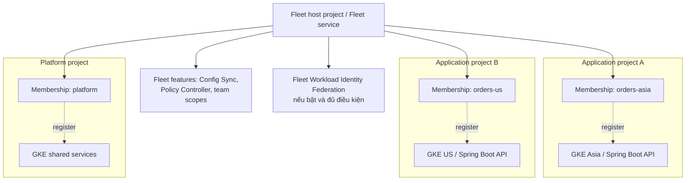
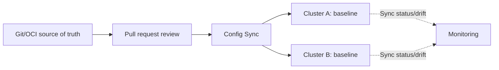
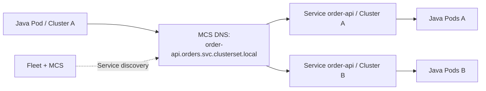
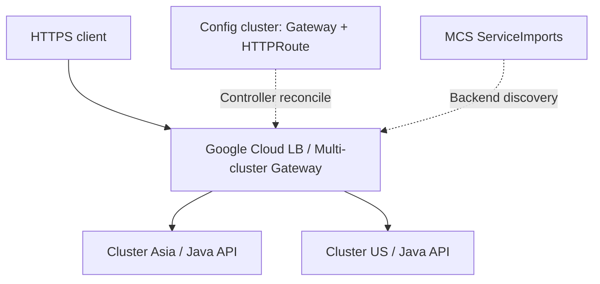
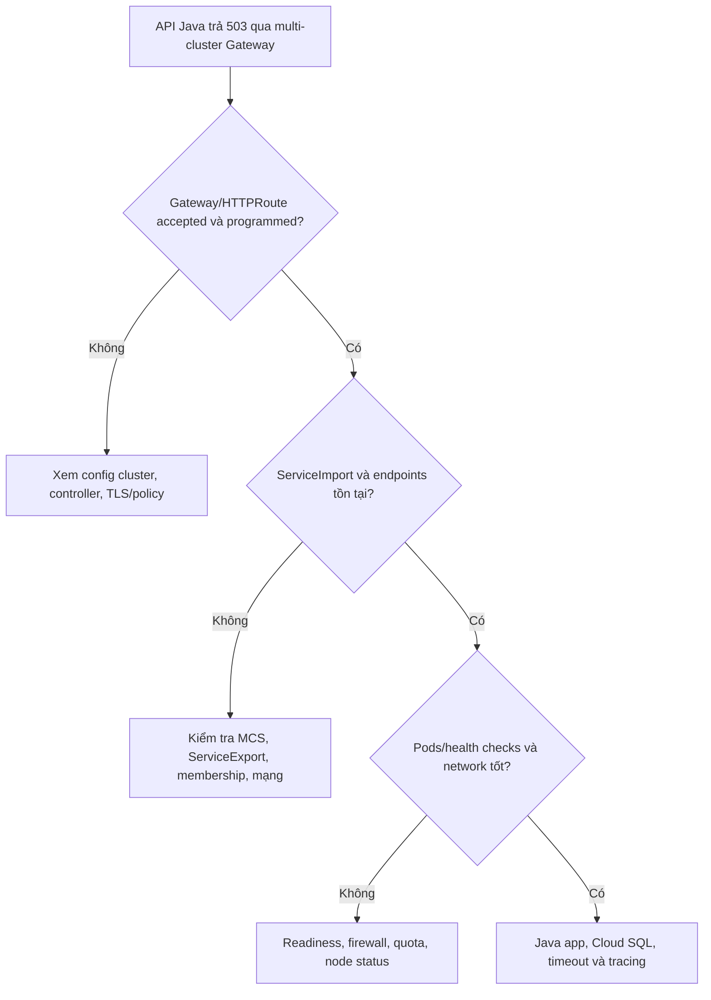

# GKE fleet và quản trị nhiều cluster

## 1. Khi một GKE cluster không còn đủ

Một API **Java/Spring Boot** chạy trên hai GKE clusters ở hai region. Đội nền tảng cần áp dụng cùng quy tắc bảo mật, quản lý quyền và triển khai nâng cấp theo từng đợt; đội ứng dụng cần xem sức khỏe backend và định tuyến traffic qua nhiều cluster. Nếu quản trị riêng từng cluster bằng `kubectl`, cấu hình dễ lệch và người vận hành có thể thao tác nhầm context.

**GKE fleet** là một tập hợp logic các Kubernetes clusters được đăng ký vào **fleet host project** thông qua **Fleet service (Hub)**. Fleet là nền tảng cho quản trị tập trung, policy, workload identity và các dịch vụ đa cluster; **nó không gộp Kubernetes API servers, schedulers, networks hoặc storage thành một cluster duy nhất**.

Trong chương **GKE nâng cao và vận hành** thuộc mô-đun **CLOUD_PROVIDERS_GCP**, bài này nối kiến thức project/IAM, VPC, GKE, Cloud Load Balancing, lưu trữ, CI/CD và giám sát để thiết kế một hệ thống nhiều cluster có khả năng vận hành, cô lập và phục hồi phù hợp.

**Mục tiêu:** sau bài học, bạn biết chọn ranh giới fleet; đăng ký/kiểm tra memberships; phân biệt Config Sync, Policy Controller, team scopes và fleet Workload Identity Federation; hiểu Multi-cluster Services (MCS) và multi-cluster Gateway; xây runbook nâng cấp, quan sát, rollback và tính chi phí.

> **Lưu ý:** Đăng ký một cluster vào fleet có thể làm thay đổi mô hình workload identity và cách các fleet-level features tác động đến cluster. Các lệnh thay đổi cấu hình chỉ dành cho **cluster lab được cho phép**; không di chuyển hoặc unregister cluster production để thử nghiệm.

## 2. Fleet host project, membership và phạm vi hoạt động



- **Fleet host project** quản lý fleet, memberships và cấu hình các fleet features. Nó không nhất thiết là project chứa mỗi GKE cluster.
- **Membership** đại diện cho một cluster đã đăng ký; tên membership phải **duy nhất trong fleet**, ngay cả khi hai projects có cluster trùng tên.
- **Một project** chỉ có **một fleet hoặc không có fleet**. Mỗi cluster thuộc tối đa một fleet; các cluster cùng một project đã đăng ký phải thuộc cùng fleet.
- Membership của GKE trên Google Cloud đăng ký bằng `gcloud` hiện hành thường có location theo **region của cluster**. Membership cũ hoặc cluster loại khác có thể có location `global`. Luôn lấy location từ kết quả thực tế.
- Fleet hỗ trợ GKE trên Google Cloud và một số clusters on-premises, multicloud hoặc **attached third-party Kubernetes**; feature availability khác nhau. Quota mặc định được công bố là **250 clusters/fleet**, có thể yêu cầu tăng.

| Fleet hỗ trợ | Fleet không tự đảm bảo |
| --- | --- |
| Kiểm kê cluster đa project, tập trung quản trị | Các cluster có network route tới nhau |
| Áp dụng cấu hình/chính sách qua tính năng được bật | Namespace và Kubernetes API được gộp vật lý |
| Identity, team ownership và service discovery đa cluster | Dữ liệu Cloud SQL/PV được replication |
| Điều phối quản lý/nâng cấp theo fleet | SLO, failover hoặc DR nếu ứng dụng chưa thiết kế |

## 3. Ranh giới tin cậy và nguyên tắc sameness

Một số tính năng fleet dựa trên giả định **sameness**: namespace, Service hoặc Kubernetes ServiceAccount **cùng tên trong các cluster thành viên** được xem là đại diện cho **cùng mục đích logic**.

Ví dụ: namespace `orders`, Service `order-api` và Kubernetes ServiceAccount `order-api` ở hai clusters thuộc cùng một ứng dụng Java production. Điều đó hợp lý cho cấu hình, khám phá dịch vụ và workload identity chung. Ngược lại, nếu cluster A có namespace `orders` production nhưng cluster B dùng tên `orders` cho nhóm thử nghiệm không được tin cậy, việc xem chúng như “cùng danh tính” có thể gây sai quyền.

| Phương án | Khi nên dùng | Cần quản trị |
| --- | --- | --- |
| Một fleet cho các clusters production chung trust boundary | Đồng bộ identity, cấu hình, multi-cluster services | Sai policy có thể ảnh hưởng đồng loạt |
| Hai fleets tách **production** và **development** | Owner/quyền/trust khác nhau | Quản trị thêm hai bộ cấu hình |
| Một fleet đa project trong organization | Billing/team riêng, quản trị nền tảng chung | IAM và service agent cross-project |
| Fleet có attached Kubernetes cluster ngoài GCP | Kiểm kê và tính năng hỗ trợ multi-cloud | Hỗ trợ feature, kết nối và phí vCPU |

**Fleet không phải ranh giới cô lập bảo mật cứng.** Nếu các clusters có nhóm quản trị không tin cậy nhau, nên thiết kế **fleets tách biệt**. Bên trong một fleet cùng trust boundary, dùng team scopes/fleet namespaces để phân quyền.

Trước khi gom clusters, lập bảng **project/region/owner**, kiểm tra **namespace và KSA trùng tên**, chuẩn IAM, VPC/Shared VPC, GKE versions, cùng các yêu cầu dữ liệu (RPO/RTO).

## 4. Đăng ký GKE cluster vào fleet bằng gcloud

### 4.1. Regular và lightweight membership

| Loại membership | Mục tiêu | Giới hạn |
| --- | --- | --- |
| **Regular** | Sử dụng fleet features được hỗ trợ | Cần chuẩn bị IAM, workload identity và compatibility |
| **Lightweight** | Đăng ký gọn để dùng **fleet-based rollout sequencing** cho upgrades | Không dùng fleet-level features, default logs/metrics hay **fleet Workload Identity Federation** |

Nếu muốn Config Sync, Policy Controller hoặc MCS trên cluster, không chỉ đăng ký lightweight. Có thể chuyển sang regular sau khi kiểm tra các điều kiện.

### 4.2. Kiểm kê read-only

```bash
gcloud container fleet memberships list --project=FLEET_HOST_PROJECT
gcloud container clusters list --project=APP_PROJECT_A
gcloud container clusters list --project=APP_PROJECT_B
```

Ghi lại **tên, project, zone/region, membership name/location** và xem cluster đã thuộc fleet nào. Không chỉ dựa vào tên vì cluster ở hai project có thể trùng tên.

### 4.3. Đăng ký cluster **đã tồn tại** ở môi trường lab

Nếu cluster và fleet **cùng project**:

```bash
gcloud container clusters update LAB_CLUSTER \
  --project=LAB_PROJECT \
  --location=CLUSTER_LOCATION \
  --enable-fleet
```

Nếu cluster ở project khác với **fleet host**:

```bash
gcloud container clusters update LAB_CLUSTER \
  --project=APP_PROJECT_A \
  --location=CLUSTER_LOCATION \
  --fleet-project=FLEET_HOST_PROJECT
```

Các lệnh là **hai phương án**, không phải hai bước phải chạy liên tiếp. Có thể thêm `--membership-type=LIGHTWEIGHT` khi cần loại membership đó. Cần bật APIs phù hợp và cấp quyền ở **cả project sở hữu cluster và fleet host project**; với cross-project registration, GKE Hub service agent của fleet host phải có `roles/gkehub.serviceAgent` trong project của cluster theo tài liệu. Không cấp Project Owner chỉ để vượt lỗi quyền.

Nếu cluster đã bật **Workload Identity Federation for GKE**, đăng ký regular bằng CLI có thể bật **fleet Workload Identity Federation**; kiểm toán namespace/KSA và các bindings IAM trước khi cập nhật.

### 4.4. Kiểm tra kết quả

```bash
gcloud container fleet memberships list --project=FLEET_HOST_PROJECT

# MEMBERSHIP_LOCATION lấy từ list, không tự giả định global.
gcloud container fleet memberships describe MEMBERSHIP_NAME \
  --project=FLEET_HOST_PROJECT \
  --location=MEMBERSHIP_LOCATION

gcloud container clusters describe LAB_CLUSTER \
  --project=APP_PROJECT_A \
  --location=CLUSTER_LOCATION
```

Membership có mặt nghĩa là **đã đăng ký**; không chứng minh mọi feature đã bật hoặc cấu hình policy đã được đồng bộ.

**Không tùy tiện unregister:** với cluster GKE đăng ký bằng `gcloud container clusters update/create`, `--clear-fleet-project` có thể tháo membership mà **không xóa cluster**, nhưng thay đổi fleet Workload Identity và feature dependencies có thể làm workloads mất quyền hoặc mất service discovery. Google Cloud **không khuyến nghị chuyển cluster giữa fleets bằng unregister rồi đăng ký lại** khi có workload phụ thuộc fleet identity.

## 5. Quản lý cấu hình với Config Sync

**Config Sync** đồng bộ Kubernetes manifests từ nguồn chuẩn **Git/OCI** tới các member clusters được cấu hình. Nó hữu ích cho Namespace, RBAC, NetworkPolicy, ResourceQuota hoặc các baseline manifests của platform team.



Một manifest đơn giản có thể được quản lý thống nhất:

```yaml
apiVersion: v1
kind: Namespace
metadata:
  name: orders
  labels:
    owner: commerce
    environment: production
```

**Fleet defaults** giúp các cluster mới phù hợp điều kiện kế thừa cài đặt Config Sync. **Các cluster đã đăng ký trước không tự nhận toàn bộ thay đổi default**, trừ khi được đồng bộ/cấu hình theo quy trình. Trước khi bật đồng bộ, xác nhận Git credentials, branch/revision, nguồn sở hữu resource và việc tích hợp Helm/CI.

Quy trình an toàn: **canary cluster → quan sát Sync status, drift và policy violations → rollout nhóm tiếp theo → rollback source revision**. Tránh để `kubectl apply`, Helm và Config Sync đồng thời là chủ sở hữu của cùng resource.

## 6. Policy Controller: policy-as-code không phải GitOps

**Policy Controller** dùng cơ chế admission và audit để đánh giá resources theo constraints, ví dụ cấm privileged containers, yêu cầu resource requests hoặc giới hạn image sources. Nó có thể được cấu hình như một fleet-level feature nếu cluster hỗ trợ.

| Công cụ | Nhiệm vụ | Rủi ro nếu cấu hình sai |
| --- | --- | --- |
| **Config Sync** | Khai báo và đồng bộ **trạng thái mong muốn** | Đẩy manifest lỗi đến nhiều cluster |
| **Policy Controller** | Kiểm tra và có thể **từ chối** resources vi phạm | Chặn Deployment, controller hoặc system workloads |
| **Kubernetes RBAC** | Quyết định ai được gọi Kubernetes API | Không thay IAM Google Cloud |
| **Binary Authorization** | Kiểm soát việc triển khai image theo policy | Không thay toàn bộ workload policy và scanning |

Khi bắt đầu, dùng **audit/dry-run**, xem vi phạm thực, cấu hình ngoại lệ cho system namespaces cần thiết rồi mới tăng dần phạm vi **enforce**. Bật enforce toàn fleet cùng lúc không phải là một thay đổi nhỏ.

## 7. Team scopes, fleet namespaces và phân quyền

**Team scope** chọn tập cluster mà một đội phụ trách; một cluster có thể thuộc nhiều scopes. **Fleet namespaces** quản lý namespace logic trong team scope và quyền truy cập tương ứng trên các member clusters được chọn.

| Scope | Clusters | Fleet namespace | Quyền mong muốn |
| --- | --- | --- | --- |
| `commerce` | `orders-asia`, `orders-us` | `orders` | Java team quản lý workload trong namespace |
| `data-platform` | `platform` | `pipelines` | Data team vận hành workflows riêng |

Các quyền liên quan phải kết hợp **fleet IAM/scope permissions**, **Kubernetes RBAC** và **Google Cloud IAM cho runtime**. Có quyền xem dashboard fleet **không đồng nghĩa** có quyền sửa mọi Deployment. Scopes là cơ chế quản trị theo nhóm, **không thay thế tách fleets nếu trust boundary khác nhau**.

## 8. Fleet Workload Identity Federation: tiện lợi và rủi ro

**Workload Identity Federation** cho phép Pods gọi Google Cloud APIs bằng danh tính ngắn hạn, tránh lưu service account JSON key. **Fleet Workload Identity Federation** mở rộng mô hình này sang các cluster cùng fleet; fleet host project cung cấp workload identity pool mặc định.

Ví dụ hai clusters có cùng:

```text
Namespace: orders
Kubernetes ServiceAccount: order-api
Fleet host project: shared-fleet-host
```

Theo mô hình **implicit identity sameness**, các workload có cùng principal identifier có thể được IAM xem như **một principal**, kể cả khi chúng chạy ở các project khác nhau. Điều này phù hợp khi cả hai là cùng API Spring Boot, nhưng rủi ro nếu nhóm ít tin cậy có quyền tạo KSA/Pod cùng tên.

**Biện pháp:** chuẩn hóa namespace/KSA ownership, giới hạn ai được tạo workload, kiểm tra IAM grants, tách fleets theo trust boundary. Một số lựa chọn **explicit identity sameness** bằng self-managed pool ở cấp team scope còn ở giai đoạn **Preview**; không xem là tính năng mặc định của mọi cluster.

Với Java Google Cloud client libraries dùng **Application Default Credentials (ADC)**, code thường không cần thay theo fleet. Nhưng để gọi Cloud Storage, Pub/Sub hay Secret Manager, **phải cấp IAM cho đúng workload principal trên tài nguyên đích**; việc đăng ký fleet không cấp tự động các quyền nghiệp vụ.

## 9. Multi-cluster Services: tìm dịch vụ giữa các cluster

**Multi-cluster Services (MCS)** cho phép export Kubernetes Service từ cluster nguồn; các member clusters được hỗ trợ nhận **ServiceImport** và service discovery qua DNS tên `SERVICE.NAMESPACE.svc.clusterset.local`.



MCS cần **cùng fleet**, feature/APIs được bật, Kubernetes Service đã tồn tại, network reachability và DNS/firewall phù hợp. Theo giới hạn hiện hành, **một multi-cluster Service chỉ được export từ cùng một project và cùng một VPC network**, dù một fleet có thể trải nhiều project/VPC; MCS có thêm ràng buộc với NetworkPolicy và add-ons.

### Manifest ServiceExport

Khi Service `order-api` đã tồn tại trong namespace `orders` trên cả hai clusters:

```yaml
apiVersion: net.gke.io/v1
kind: ServiceExport
metadata:
  name: order-api
  namespace: orders
```

```bash
# Chỉ với contexts của cluster LAB đã có Service và MCS controller.
kubectl --context=GKE_A_CONTEXT apply -f service-export.yaml
kubectl --context=GKE_B_CONTEXT apply -f service-export.yaml

kubectl --context=GKE_A_CONTEXT get serviceexports -n orders
kubectl --context=GKE_A_CONTEXT get serviceimports -n orders
kubectl --context=GKE_B_CONTEXT get serviceimports -n orders
```

Trên fleet host, khi đã thỏa prerequisites:

```bash
gcloud container fleet multi-cluster-services enable \
  --project=FLEET_HOST_PROJECT
```

Đây là **các mảnh cấu hình minh họa**, chưa phải lab end-to-end: cần tạo Service/Deployment, chuẩn bị mạng và quyền, bật APIs và xác nhận controller hoạt động. MCS **không tự deploy cùng Java image hoặc đồng bộ Cloud SQL** sang cluster khác.

## 10. Multi-cluster Gateway: routing HTTP(S) qua nhiều cluster

Với Spring Boot API được công bố ra Internet qua một hostname, **multi-cluster Gateway** dùng một **config cluster** để chứa resources như `Gateway` và `HTTPRoute`. Controller dựa vào MCS để biết backends và tạo/cập nhật Google Cloud load balancing resources theo loại GatewayClass được hỗ trợ.



| Tài nguyên | Nơi quản lý | Vai trò |
| --- | --- | --- |
| Java Pods + Kubernetes Services | Mỗi workload cluster | Phục vụ request thật |
| ServiceExport/ServiceImport | MCS | Khám phá services đa cluster |
| Gateway, HTTPRoute, liên quan TLS/policy | **Config cluster** | Định nghĩa frontend/routing |
| Google Cloud Load Balancer | Hạ tầng do controller quản lý | Chuyển request tới backends |

**Multi Cluster Ingress** và **multi-cluster Gateway** không phải hai tên gọi hoàn toàn đồng nghĩa: tài nguyên Kubernetes và cách cấu hình khác nhau, dù một số bước enable liên quan cùng tính năng Fleet Ingress. Cần xác minh loại load balancer, GatewayClass, health checks, TLS, Cloud Armor, config cluster availability và quota trước khi bật.

Config cluster nên có độ sẵn sàng cao để điều khiển thay đổi routing. Nếu config cluster mất kết nối, reconciliation có thể gián đoạn; **không khẳng định mọi request lập tức thất bại** vì load balancer đã được lập trình có thể tiếp tục phục vụ. Hai cluster API khỏe nhưng dùng **một Cloud SQL region duy nhất** cũng chưa bảo đảm DR: phải thiết kế dữ liệu/backup/failover theo RTO/RPO riêng.

## 11. Truy cập cluster và quan sát vận hành

**Connect gateway** cho phép truy cập Kubernetes API của các fleet members qua Google Cloud, kể cả trong một số mô hình private/ngoài GCP. Người dùng vẫn cần **IAM liên quan fleet/gateway** và **Kubernetes RBAC** cho thao tác cụ thể.

```bash
gcloud container fleet memberships list --project=FLEET_HOST_PROJECT

# Chỉ với membership mà bạn được cấp quyền.
gcloud container fleet memberships get-credentials MEMBERSHIP_NAME \
  --project=FLEET_HOST_PROJECT

kubectl config current-context
kubectl get namespaces
```

Để tránh chỉnh sai cluster, automation phải dùng **`kubectl --context=...`** và xác nhận context trước thay đổi. Fleet không biến `kubectl get pods` thành truy vấn toàn fleet.

| Lớp giám sát | Những tín hiệu quan trọng |
| --- | --- |
| Fleet | Membership status/location, feature health, registration errors |
| Policy/Config Sync | Sync status, drift, admission violations |
| GKE | Node readiness, GKE upgrades, Pod restarts, CSI mounts |
| MCS/Gateway | ServiceImport, HTTPRoute status, backend health, 5xx/latency |
| Java application | SLO, p95/p99, JVM GC, Cloud SQL/HikariCP, business errors |
| Security | Denied IAM, identity mismatches, VPC/DNS/firewall |
| Cost | GKE, load balancer, cross-region egress, Cloud Logging |

**Fleet dashboard healthy không đồng nghĩa API Java đáp ứng SLO.** Cần kết hợp fleet state, Kubernetes telemetry, backend health và dữ liệu nghiệp vụ.

## 12. Nâng cấp và khả năng chịu lỗi đa cluster

Quy trình upgrade có kiểm soát:

1. **Inventory** GKE version, node pools, CSI, Gateway, Policy Controller, Java runtime của từng cluster.
2. **Canary cluster**: nâng một nhóm ít rủi ro, thử Java readiness, IAM, network, data access và policy sync.
3. **Wave 1 production**: nâng một phần, đo p95 latency, 5xx, Pod disruptions và health.
4. **Wave 2 production**: nâng cluster còn lại khi metrics/rollback criteria đạt; giữ đủ capacity dự phòng.
5. **Xác minh cuối** routing, dữ liệu, chi phí và hoàn thành change record.

GKE có **fleet-based rollout sequencing** cho các trường hợp được hỗ trợ, nhưng nó không thay **PodDisruptionBudget**, rolling update, readiness/graceful shutdown, quota và kế hoạch rollback ứng dụng. Không nâng đồng thời mọi cluster đang phục vụ để “giữ versions nhất quán”.

**DR phải tính cả dữ liệu:** MCS/Gateway không tự replication Cloud SQL/PersistentVolume. Nếu cluster B ở region dự phòng vẫn phụ thuộc database ở region A, mất region A có thể khiến toàn bộ API không tạo đơn được. Xác định **RTO/RPO**, chiến lược Cloud SQL HA/replica/backup, DNS, secrets và diễn tập failover.

## 13. Quyền, mạng và chi phí

**Bảo mật:** phân quyền fleet administrator, cluster operator và app developer; cấu hình IAM cho fleet host service agents khi cross-project; chuẩn hóa namespace/KSA để tránh identity collision; GitOps qua pull request; bật Policy Controller từ audit đến enforce; dùng TLS/Cloud Armor đúng đường vào; kiểm soát VPC/network reachability thay vì mở firewall rộng giữa hai clusters.

**Chi phí:** việc **đăng ký GKE cluster vào fleet không có phí registration riêng** theo tài liệu hiện hành, nhưng:

- GKE cluster/node/Autopilot usage, disk và resources vẫn có phí.
- Một số fleet features như Cloud Service Mesh/Multi Cluster Ingress có phí riêng; **attached third-party clusters** có thể tính phí theo vCPU.
- Multi-cluster Gateway dùng Load Balancing, IP, health check, egress/inter-region data transfer.
- Cloud Logging/Monitoring, Artifact Registry, CI/CD và network connectivity phát sinh phí theo mức sử dụng.

Thiết kế **billing labels/project budgets** và theo dõi **chi phí một yêu cầu Java thành công**, không chỉ phí fleet. Budget alert không tự giới hạn số cluster hoặc chặn hóa đơn.

## 14. Runbook chẩn đoán

| Triệu chứng | Khả năng chính | Bước kiểm tra |
| --- | --- | --- |
| Registration thất bại | Trùng membership, project đã có fleet khác, IAM/APIs | Cluster + fleet host project, service agent, location |
| Có membership nhưng feature không hoạt động | Lightweight hoặc chưa enable/config | Membership type, feature compatibility và status |
| Config Sync lỗi | Git/OCI credentials, revision, quyền hoặc resource conflict | Source of truth, drift, controller status |
| Policy Controller chặn Java deployment | Constraint enforce, thiếu exemptions | Violation/audit, namespace và rollout policy |
| Pod không gọi Cloud Storage | Fleet WIF principal mismatch/IAM | Namespace/KSA names, pool, resource IAM |
| Không thấy ServiceImport | MCS prerequisites, export, VPC/DNS | ServiceExport, APIs, Service, network |
| Gateway 503 | Backend hoặc Gateway config | Gateway/HTTPRoute conditions, health, Java logs |
| Connect gateway trả Forbidden | IAM hoặc Kubernetes RBAC | Identity, gateway role, RBAC, context |
| Upgrade gây 5xx | Readiness, node capacity, db pool | Rollout, PDB, error budget, Cloud SQL |



Đừng unregister cluster hoặc tắt Policy Controller toàn fleet khi chỉ một endpoint lỗi. Khoanh vùng theo chuỗi **membership → feature → Kubernetes resource → network → Java application**.

## 15. Bài thực hành và checklist

### Bài A — Kiểm kê read-only, không tạo tài nguyên

Với quyền Viewer trong môi trường hợp lệ:

```bash
gcloud container fleet memberships list --project=FLEET_HOST_PROJECT
gcloud container fleet scopes list --project=FLEET_HOST_PROJECT
gcloud container clusters list --project=APP_PROJECT_A
gcloud container clusters list --project=APP_PROJECT_B
kubectl config get-contexts
```

**Bài nộp:** bảng project/region/cluster/membership/location/owner, regular hay lightweight, fleet features và **namespace/KSA trùng tên có nguy cơ khác quyền**. Đề xuất nên giữ một fleet hay tách hai fleets, nêu lý do trust.

### Bài B — Đăng ký lab và kiểm tra MCS (tùy quyền)

Chỉ dùng **hai cluster thử nghiệm đã có**, được phép đăng ký trong cùng fleet và đáp ứng networking:

1. Đăng ký bằng `--enable-fleet` (cùng project) hoặc `--fleet-project` (cross-project), xác minh membership list/describe.
2. Kiểm tra quyền fleet Workload Identity và sự tương đồng của `orders` namespace/KSA.
3. Nếu MCS prerequisites đã đủ, bật MCS và tạo `ServiceExport` cho service `order-api`, xác nhận `ServiceImport` ở hai clusters.
4. Gửi một số request smoke test có kiểm soát từ Pod Java test tới `order-api.orders.svc.clusterset.local`; đo kết quả và log.
5. Dọn **chỉ các tài nguyên namespace/ServiceExport do lab sở hữu**; đánh giá dependencies trước khi disable feature hay unregister. Không xóa cluster, namespace production hay load balancer dùng chung.

### Bài C — Thiết kế DR

Hai clusters GKE chạy Spring Boot cùng phục vụ `api.example.com` qua multi-cluster Gateway, nhưng Cloud SQL chỉ có một region. Vẽ sơ đồ **failure domain**; đề xuất RTO/RPO, cơ chế dữ liệu, nâng cấp theo waves, điều kiện rollback và nơi giám sát 503. Trả lời vì sao fleet membership không tự bảo đảm failover.

### Checklist

- [ ] Tôi hiểu fleet host project, membership name/location và giới hạn fleet/project.
- [ ] Tôi chọn fleet theo **trust boundary**, không chỉ số lượng clusters.
- [ ] Tôi đã rà soát namespace, Service và Kubernetes ServiceAccount sameness.
- [ ] Tôi biết regular khác lightweight membership.
- [ ] Tôi phân biệt Config Sync (đồng bộ) và Policy Controller (đánh giá/enforce).
- [ ] Tôi hiểu team scopes/fleet namespaces và không coi đó là cô lập cứng.
- [ ] Tôi xác định IAM cho fleet WIF; không đưa key JSON vào image Java.
- [ ] Tôi hiểu ServiceExport/ServiceImport, MCS DNS và giới hạn VPC/project.
- [ ] Tôi biết config cluster/Gateway/HTTPRoute, cùng cách Connect gateway dùng IAM+RBAC.
- [ ] Tôi có runbook upgrade theo waves, đo SLO và kế hoạch DR cho dữ liệu.
- [ ] Tôi dự toán được GKE, multi-cluster LB, network egress, logging và fleet features.

**Kết luận:** GKE fleet giải quyết bài toán **quản trị tập trung** nhiều clusters; hiệu quả phụ thuộc vào **ranh giới tin cậy, identity, source of truth và quy trình vận hành**. Với Java trên Google Cloud, dùng fleet để chuẩn hóa và điều phối nhưng vẫn thiết kế **network, data replication, failover, application SLO và chi phí** ở đúng lớp của chúng.

## 16. Nguồn Google Cloud tham khảo

- [Fleet management overview](https://cloud.google.com/kubernetes-engine/docs/fleets-overview)
- [How fleets work](https://cloud.google.com/kubernetes-engine/fleet-management/docs/fleet-concepts)
- [Plan fleet resources, quotas and limits](https://cloud.google.com/kubernetes-engine/fleet-management/docs/fleet-concepts/plan-fleets)
- [Register GKE cluster](https://cloud.google.com/kubernetes-engine/fleet-management/docs/register/gke)
- [Unregister a cluster](https://cloud.google.com/kubernetes-engine/fleet-management/docs/unregister)
- [Fleet Workload Identity Federation](https://cloud.google.com/kubernetes-engine/fleet-management/docs/about-fleet-workload-identity-federation)
- [Team scopes and fleet namespaces](https://cloud.google.com/kubernetes-engine/fleet-management/docs/team-management)
- [Config Sync fleet defaults](https://cloud.google.com/kubernetes-engine/config-sync/docs/how-to/install-fleet)
- [Policy Controller installation](https://cloud.google.com/kubernetes-engine/policy-controller/docs/how-to/installing-policy-controller)
- [Multi-cluster Services](https://cloud.google.com/kubernetes-engine/docs/how-to/multi-cluster-services)
- [Multi-cluster Gateways](https://cloud.google.com/kubernetes-engine/docs/concepts/multi-cluster-gateways)
- [Prepare multi-cluster Gateway environment](https://cloud.google.com/kubernetes-engine/docs/how-to/prepare-environment-multi-cluster-gateways)
- [GKE pricing](https://cloud.google.com/kubernetes-engine/pricing)
