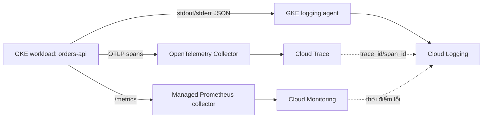
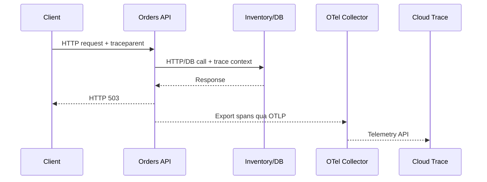
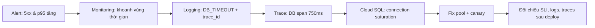

# Thu thập logs, metrics và traces cho GKE

Giả sử ứng dụng Orders trên Google Kubernetes Engine (GKE) bắt đầu trả chậm sau một đợt phát hành. `kubectl get pods` vẫn báo `Running`, nhưng một số yêu cầu trả HTTP 503. **Logs** cho biết request nào lỗi, **metrics** cho biết lỗi bắt đầu khi nào và ảnh hưởng bao nhiêu người dùng, còn **traces** chỉ ra thời gian nằm ở API, database hay dịch vụ downstream. Quan sát đủ ba tín hiệu giúp tìm nguyên nhân thay vì thử khởi động lại Pod.

Bài này thuộc chương **GKE nâng cao và vận hành** của module `CLOUD_PROVIDERS_GCP`. Nội dung áp dụng cho ứng dụng container chạy trên GKE Standard và Autopilot, kết nối Cloud Logging, Cloud Monitoring, Managed Service for Prometheus và Cloud Trace. Mục tiêu là thiết kế **pipeline telemetry có thể kiểm chứng, phục vụ SLO và không làm lộ dữ liệu hay tăng chi phí thiếu kiểm soát**.

> Ví dụ sử dụng project `orders-lab`, cluster `orders-gke`, namespace `orders` và Service `orders-api`. Đây là giá trị minh họa, không phải tài nguyên có thật. Các lệnh thay đổi cluster hoặc workload được đánh dấu và chỉ nên thực hiện trong sandbox được cấp quyền.

## 1. Kết quả học tập

Sau bài, bạn có thể:

1. Phân biệt logs, metrics và traces; chọn tín hiệu cho sự cố cụ thể.
2. Kiểm tra GKE system/workload/control-plane logging và metrics collection.
3. Phát **structured JSON logs** ra `stdout/stderr`, lọc trong Logs Explorer và liên kết tới trace.
4. Xuất application metrics theo Prometheus, cấu hình `PodMonitoring` và truy vấn bằng PromQL.
5. Instrument ứng dụng với OpenTelemetry, gửi OTLP qua Collector tới Cloud Trace.
6. Thiết kế dashboard, alert, bảo mật dữ liệu và tối ưu cardinality, volume, sampling.
7. Điều tra một sự cố thực tế bằng cả ba tín hiệu và xác minh pipeline trước khi vận hành.

## 2. Ba tín hiệu, ba câu hỏi

| Tín hiệu | Dữ liệu | Câu hỏi điển hình | Sản phẩm |
| --- | --- | --- | --- |
| **Logs** | Sự kiện có timestamp, severity, message và context | Request nào trả 503? Pod nào ghi lỗi kết nối DB? | Cloud Logging, Logs Explorer |
| **Metrics** | Chuỗi số theo thời gian và labels | Tỷ lệ lỗi, CPU, memory, queue depth thay đổi khi nào? | Cloud Monitoring, Managed Service for Prometheus |
| **Traces** | Các spans trong một request xuyên nhiều dịch vụ | 900 ms latency nằm ở API, DB hay downstream? | Cloud Trace / Trace Explorer |



Đây là cấu hình phối hợp được khuyến nghị, **không phải cứ tạo cluster là tự có application traces**. GKE có thể tự thu thập một số system/workload logs và infrastructure metrics; custom Prometheus metrics cần endpoint và scrape policy; traces cần instrument/export riêng. Collector cũng có thể gửi **cả ba tín hiệu OTLP**, nhưng không cần triển khai thêm một collector chỉ để đọc logs từ `stdout/stderr` vốn đã được GKE hỗ trợ.

## 3. Kiểm tra cấu hình telemetry của cluster

Với GKE, chế độ Logging có các thành phần chính:

| Nhóm log | Cấu hình/nguồn | Ví dụ |
| --- | --- | --- |
| **SYSTEM** | System Pods, kubelet/container runtime, sự kiện Kubernetes | Node lỗi, DNS, scheduler system events |
| **WORKLOAD** | Containers thuộc user workloads; logs ghi trên stdout/stderr | `orders-api` request/error logs |
| **Control plane component logs** | Tùy chọn API server, scheduler, controller manager | Lỗi admission, scheduler/controller |
| **Audit logs** | Cloud Audit Logs theo dịch vụ và loại log | Ai thay đổi cluster/IAM, thao tác API |

**Autopilot** yêu cầu system logging/metrics; với **Standard**, có thể tùy chỉnh thành phần thu thập theo khả năng phiên bản. Bật logging không tự thu thập ứng dụng ghi log **chỉ vào file nội bộ trong container**: nên ghi ra `stdout/stderr` hoặc thiết kế collector phù hợp. Control plane logs có thể phải bật riêng; thay đổi cấu hình control plane logging có thể kích hoạt restart control plane, cần lên lịch theo loại cluster.

### 3.1. Lệnh chỉ đọc

```bash
# Không thay đổi cluster.
gcloud container clusters describe orders-gke \
  --project=orders-lab \
  --location=asia-southeast1 \
  --format="yaml(loggingConfig,monitoringConfig)"

kubectl config current-context
kubectl -n orders get pods -o wide
kubectl -n orders logs deploy/orders-api --since=15m --tail=100
```

`kubectl logs` đọc luồng log của container qua Kubernetes; nó **không phải kho lưu trữ lâu dài**. Logs của Pod đã bị xóa/restart có thể không còn truy cập theo cách này, trong khi Cloud Logging hỗ trợ truy vấn tập trung theo chính sách retention.

### 3.2. Ví dụ thay đổi cấu hình (không chạy mặc định)

```bash
# CÓ THAY ĐỔI CLUSTER: chỉ quản trị viên thực hiện sau khi xem cấu hình hiện tại.
gcloud container clusters update orders-gke \
  --project=orders-lab \
  --location=asia-southeast1 \
  --logging=SYSTEM,WORKLOAD
```

Các options khác (API server, scheduler, controller manager; metrics packages và cấu hình Autopilot) có quy tắc riêng. Khi cập nhật, kiểm tra phiên bản GKE, settings hiện hữu và tổ chức trước để không vô tình loại bỏ dữ liệu chẩn đoán. **GKE system metrics** được thu thập qua Cloud Monitoring; custom application metrics không xuất hiện chỉ nhờ bật `--monitoring=SYSTEM`.

## 4. Logs: ghi một sự kiện JSON cho mỗi dòng

GKE logging agent có thể đọc JSON **một dòng trên stdout/stderr** và chuyển thành structured log entry. Các trường như `severity`, `message` và một số trường đặc biệt `logging.googleapis.com/*` được Cloud Logging nhận diện; trường nghiệp vụ khác nằm trong `jsonPayload`.

Ví dụ một bản ghi phát từ ứng dụng, không chứa thông tin định danh khách hàng:

```json
{
  "severity": "ERROR",
  "message": "orders DB request timed out",
  "service": "orders-api",
  "environment": "staging",
  "operation": "create_order",
  "duration_ms": 930,
  "error_code": "DB_TIMEOUT",
  "logging.googleapis.com/trace": "projects/orders-lab/traces/0123456789abcdef0123456789abcdef",
  "logging.googleapis.com/spanId": "0123456789abcdef"
}
```

Khi phát ra stdout trong thực tế, **phải serialize thành một dòng JSON**, không xuống dòng giữa các field như khối minh họa. Nếu dùng `printf`/JSON logger, bật flush phù hợp và ghi timestamp UTC; Cloud Logging có thể tự gắn metadata `resource.type=k8s_container`, project, cluster, namespace, pod và container.

**Không log** access tokens, `Authorization` headers, passwords, session IDs, nội dung thẻ thanh toán hay toàn bộ request bodies. Dùng error code có danh mục ổn định và trace ID để điều tra; chỉ lưu identifiers nghiệp vụ đã được xử lý theo chính sách dữ liệu.

### 4.1. Lọc logs theo cluster, namespace và severity

Trong **Logs Explorer**, sử dụng Logging query language:

```text
resource.type="k8s_container"
resource.labels.cluster_name="orders-gke"
resource.labels.namespace_name="orders"
resource.labels.container_name="orders-api"
severity>=ERROR
```

Lọc theo field riêng:

```text
resource.type="k8s_container"
resource.labels.namespace_name="orders"
jsonPayload.error_code="DB_TIMEOUT"
```

Từ gcloud, có thể đọc logs theo cùng cú pháp filter:

```bash
# CHỈ ĐỌC; giới hạn số lượng để không đưa thông tin nhạy cảm ra terminal.
gcloud logging read \
  'resource.type="k8s_container" AND resource.labels.namespace_name="orders" AND severity>=ERROR' \
  --project=orders-lab \
  --freshness=30m \
  --limit=30 \
  --format='table(timestamp,severity,resource.labels.pod_name,jsonPayload.message)'
```

Khi logs không xuất hiện, kiểm tra **ứng dụng có thực sự ghi stdout/stderr**, workload logging bật, thời gian lọc, đúng project/cluster và quyền `roles/logging.viewer`. Nếu dữ liệu bị loại ở logging sink/exclusion, việc chỉnh câu query không mang log đã bị loại trở lại.

### 4.2. System logs, control-plane logs và audit

| Nguồn | Resource/đầu mối truy vấn | Khi cần |
| --- | --- | --- |
| Application containers | `k8s_container` + namespace/pod/container | 5xx, crash, lỗi dependency |
| System workloads/kubelet | `k8s_container`/`k8s_node` tùy nguồn | Node pressure, runtime failure |
| Control-plane components | `k8s_control_plane_component`, khi đã bật | API server/scheduler/controller |
| Kubernetes events | Events trong GKE logs và `kubectl get events` | Scheduling, image pull, Evicted, probes |
| Cloud Audit Logs | `cloudaudit.googleapis.com` theo logName/resource | Ai sửa IAM, config, GKE APIs |

Audit logging có loại và quyền truy cập riêng; **Data Access audit logs** có thể không bật mặc định cho nhiều dịch vụ và có yêu cầu IAM để xem. Không dùng application logs để thay audit trail.

## 5. Metrics: đo hiệu năng hệ thống và ứng dụng

GKE system metrics thông thường bao gồm CPU, memory, disk và network theo khả năng thu thập. Kube-state metrics cho thấy trạng thái Pod/Deployment/HPA/PVC; cAdvisor/Kubelet metrics có thông tin chi tiết về container. Các **metrics packages** có điều kiện bật riêng và cần tránh thu trùng dữ liệu nếu đã cài exporter tự quản lý.

Đối với Orders API, nên đo **RED** (Rate, Errors, Duration); đối với node/cluster, theo dõi CPU, memory, disk, Pod Pending, OOMKilled, restarts và quota.

| Metric | Loại | Label nên giữ ổn định |
| --- | --- | --- |
| `orders_http_requests_total` | Counter | `route` dạng template, `method`, `status_class` |
| `orders_http_request_duration_seconds` | Histogram | `route` dạng template, `method` |
| `orders_queue_depth` | Gauge | `queue` thuộc tập hữu hạn |
| Container CPU/memory | GKE system metrics | Cluster/namespace/workload labels mặc định |
| Pod desired/available replicas | Kube-state metrics | Namespace/deployment |

**Không dùng `user_id`, `order_id`, email hoặc raw URL làm metric labels:** mỗi giá trị riêng tạo thêm time series, làm tăng cardinality, ingestion và chi phí. Giữ `route="/orders/{id}"` thay vì `route="/orders/1234"`. Với histograms, chọn số buckets đủ để tính p95/p99 ở mục tiêu SLO; quá nhiều buckets làm tăng series.

### 5.1. Managed Service for Prometheus và PodMonitoring

Managed collection của Google Cloud Managed Service for Prometheus được bật mặc định trên nhiều phiên bản GKE mới; cần kiểm tra thực tế. Nó thu thập metrics từ **target được khai báo**, không tự tìm mọi `/metrics` endpoint. Một `PodMonitoring` trong namespace `orders` chỉ chọn Pods cùng namespace qua labels.

Giả sử Pods `app: orders-api` cung cấp HTTP metrics tại port **được đặt tên `metrics`** và đường `/metrics`:

```yaml
apiVersion: monitoring.googleapis.com/v1
kind: PodMonitoring
metadata:
  name: orders-api-metrics
  namespace: orders
spec:
  selector:
    matchLabels:
      app: orders-api
  endpoints:
  - port: metrics
    path: /metrics
    interval: 30s
```

Deployment container phải khai báo một named port tương ứng:

```yaml
# Trích đoạn Deployment, không phải manifest độc lập.
containers:
- name: orders-api
  image: IMAGE_DIGEST_DA_KIEM_TRA
  ports:
  - name: http
    containerPort: 8080
  - name: metrics
    containerPort: 9090
```

Lệnh áp dụng và kiểm tra:

```bash
# THAY ĐỔI: chỉ áp vào cluster sandbox có managed collection.
kubectl apply -f orders-podmonitoring.yaml

# CHỈ ĐỌC:
kubectl -n orders get podmonitoring orders-api-metrics
kubectl -n orders describe podmonitoring orders-api-metrics
kubectl -n orders get pods -l app=orders-api -o wide
```

Trong Cloud Monitoring Metrics Explorer, truy vấn Prometheus metrics bằng PromQL. Nếu không có dữ liệu, kiểm tra selector khớp Pod labels, named port `metrics`, ứng dụng lắng nghe trên `0.0.0.0:9090` hoặc địa chỉ phù hợp, collector reachability/NetworkPolicy, scrape status và quyền ghi monitoring.

### 5.2. Truy vấn PromQL theo SLI

Ví dụ công thức **tỷ lệ HTTP 5xx trong 5 phút**, giả định ứng dụng xuất counter có label `status_class="5xx"`:

```promql
sum(rate(orders_http_requests_total{status_class="5xx"}[5m]))
/
clamp_min(sum(rate(orders_http_requests_total[5m])), 1e-9)
```

Ví dụ **p95 latency**, nếu ứng dụng xuất Prometheus histogram chuẩn:

```promql
histogram_quantile(
  0.95,
  sum by (le) (rate(orders_http_request_duration_seconds_bucket[5m]))
)
```

Kết quả latency theo **giây**. Metrics phải đến từ cùng workload/scope; nếu nhiều clusters cùng gửi series trùng tên, hãy thêm bộ lọc cluster/namespace/service thích hợp vào cả tử và mẫu. Khi request volume quá thấp, tỷ lệ lỗi dễ biến động mạnh; bổ sung điều kiện về số request tối thiểu để tránh cảnh báo nhiễu.

### 5.3. Ưu tiên metric nào?

| Tầng | Tín hiệu nên quan sát | Hành động khi bất thường |
| --- | --- | --- |
| Business/API | RPS, 5xx ratio, p95/p99 latency, queue depth | Kiểm tra route, dependency, traffic burst |
| Pod | CPU throttling, memory, OOMKilled, restart count | So requests/limits, profiling và rollout |
| Deployment/HPA | Ready vs desired replicas, Pending Pods, scaling delay | Xem node capacity, HPA thresholds và quota |
| Node | CPU/memory pressure, disk, network | Kiểm tra autoscaler, noisy neighbor, storage |
| Control plane | API server/scheduler metrics nếu được bật | Điều tra quá tải API hoặc scheduling |

Đừng cố gom mọi metric có sẵn lên một dashboard. Dashboard vận hành nên mở đầu bằng **SLI người dùng** rồi đi xuống tài nguyên ảnh hưởng; ứng dụng `orders-api` có thể mất kết nối Cloud SQL dù CPU và memory của cluster vẫn bình thường.

## 6. Traces: theo một request qua nhiều dịch vụ

**Distributed trace** gồm một trace ID và nhiều spans. Một span có `start/end time`, tên operation, status và attributes; span con mang context từ span cha khi request đi qua API, job queue hoặc dependency.

```text
Trace 0123456789abcdef0123456789abcdef  (request POST /orders)
  ├─ HTTP server orders-api                 940 ms
  │   ├─ Validate order                    12 ms
  │   ├─ inventory-service HTTP            80 ms
  │   └─ Cloud SQL insert                  760 ms
  └─ HTTP response                         503
```

Một trace cho thấy vùng tiêu tốn thời gian; nó không tự chứng minh SQL đang chậm **vì sao**. Kết hợp DB metrics, logs và query analysis để xác nhận nguyên nhân.

### 6.1. Instrument bằng OpenTelemetry

Google Cloud khuyến nghị ứng dụng GKE dùng **OpenTelemetry SDK hoặc zero-code instrumentation** phù hợp ngôn ngữ, gửi OTLP tới **Google-Built OpenTelemetry Collector**, rồi Collector xuất sang Google Cloud Observability qua Telemetry (OTLP) API. Đây là lựa chọn có thể dùng chung cho Java, Go, Python, Node.js, nhưng cách tích hợp và SDK dependencies khác nhau.



Một trích đoạn **environment variables trong Deployment**, giả định Collector đã chạy dưới tên `opentelemetry-collector` ở namespace `opentelemetry` và lắng nghe **OTLP/gRPC 4317**:

```yaml
# Đặt trong containers[].env của Deployment đã được instrument.
env:
- name: OTEL_SERVICE_NAME
  value: orders-api
- name: OTEL_EXPORTER_OTLP_PROTOCOL
  value: grpc
- name: OTEL_EXPORTER_OTLP_ENDPOINT
  value: http://opentelemetry-collector.opentelemetry.svc.cluster.local:4317
- name: OTEL_TRACES_SAMPLER
  value: parentbased_traceidratio
- name: OTEL_TRACES_SAMPLER_ARG
  value: "0.10"
```

Đoạn này **không tự instrument một ứng dụng chưa có OTel SDK/agent**. Cần cài instrumentation phù hợp ngôn ngữ và đường truyền **Pod → Collector**. Với OTLP/HTTP, thường dùng cổng 4318 và protocol khác; không đặt `grpc` vào endpoint chỉ nhận HTTP. Giá trị 10% là ví dụ sampling; đối với traffic thấp hoặc điều tra lỗi có thể cần chính sách sampling khác.

### 6.2. Trace context và log correlation

Trace context thường được truyền qua HTTP header **W3C `traceparent`**. Ứng dụng cần propagate khi gọi downstream; nếu bỏ header ở proxy hoặc async worker, một hành trình nghiệp vụ sẽ xuất hiện thành **nhiều traces rời rạc**.

Với Cloud Logging, thêm các trường:

- `logging.googleapis.com/trace` = `projects/PROJECT_ID/traces/TRACE_ID` (trace ID 32 ký tự hex).
- `logging.googleapis.com/spanId` = span ID 16 ký tự hex.
- Tùy framework, thêm `logging.googleapis.com/trace_sampled` là boolean nếu có thông tin sampling.

Các giá trị phải **lấy từ span context đang hoạt động**, không tự sinh trace ID khác chỉ cho log. Logs Explorer có thể liên kết đến trace tương ứng khi spans đã được gửi, trace ID hợp lệ và người xem có quyền. Nếu span bị sampling loại bỏ hoặc pipeline export lỗi, log có trace ID vẫn có thể tồn tại nhưng không có trace đầy đủ để mở.

### 6.3. Collector cần quyền gì?

Google-Built OpenTelemetry Collector trên GKE có thể dùng **Workload Identity Federation for GKE** để ghi dữ liệu, không cần key JSON dài hạn. Tài khoản workload của Collector có thể cần:

| Quyền IAM | Khi sử dụng |
| --- | --- |
| `roles/cloudtrace.agent` | Ghi traces vào Cloud Trace |
| `roles/monitoring.metricWriter` | Xuất metrics |
| `roles/logging.logWriter` | Xuất logs qua Collector |

Quyền áp dụng cho **Kubernetes ServiceAccount của Collector/Google identity tương ứng**, không cấp cho mọi ứng dụng hoặc người đọc dashboards. Bật Telemetry, Cloud Trace, Cloud Logging, Cloud Monitoring APIs theo kiến trúc exporter; xác minh Google Cloud project đích và policy mạng. Xem tài liệu Collector để có manifest production được duyệt thay vì copy cấu hình demo có thể thay đổi theo phiên bản.

## 7. Liên kết ba tín hiệu khi điều tra

Theo một chuỗi thao tác nhất quán:

1. **Metrics:** phát hiện 5xx tăng từ 0,2% lên 5% khoảng 09:30, p95 tăng từ 180 ms lên 920 ms.
2. **Logs:** lọc `resource.type="k8s_container"`, `namespace="orders"`, severity `ERROR` trong cùng thời gian; tìm `error_code="DB_TIMEOUT"` và trace ID.
3. **Trace:** mở span theo trace ID để xem thời gian ở `Cloud SQL insert` có tăng hay không.
4. **Hạ tầng:** đối chiếu Pod restarts, CPU throttling, Cloud SQL connections/locks và đợt rollout.
5. **Kết luận:** chỉ xác nhận root cause khi nhiều nguồn dữ liệu hỗ trợ; deploy fix/canary rồi đo lại cùng SLIs.

Nếu metrics cho thấy 5xx tăng nhưng không có logs, kiểm tra logging pipeline; nếu có logs nhưng không có trace, kiểm tra instrumentation/export/sampling. **Thiếu tín hiệu không phải bằng chứng hệ thống không có lỗi**.

## 8. Dashboard, SLI/SLO và cảnh báo

Một dashboard Orders API đủ để on-call dùng nên có **RPS**, **5xx ratio**, **p95/p99 latency**, **Pod ready/desired**, **CPU/memory**, **DB request latency**, **Collector health** và đường mở Logs/Traces. Không cần hàng chục biểu đồ chỉ vì chúng có sẵn.

| Chỉ số | Ví dụ mục tiêu | Cảnh báo phù hợp |
| --- | --- | --- |
| Availability | 99,9% requests thành công trong 30 ngày | Burn-rate alert theo error budget |
| Latency | 95% requests dưới 300 ms | p95 vượt ngưỡng với volume đủ lớn |
| Platform health | 100% critical Pods có sẵn sau rollout | Ready replicas thiếu kéo dài |
| Telemetry health | Logs/metrics/traces có dữ liệu trong cửa sổ kỳ vọng | Scrape/export thất bại, ingestion lag |

Ví dụ **cảnh báo minh họa**: 5xx ratio lớn hơn 2% trong 10 phút **và** ít nhất 100 requests trong cửa sổ đó. Trên production, nên ưu tiên **multi-window burn-rate alerts** theo SLO và cơ chế giảm trùng lặp/tránh paging cho một request lẻ.

Gắn owner, mức ưu tiên, runbook, dashboard và kênh on-call cho mỗi alert. Đặt chính sách về silence trong maintenance, escalation và thời gian giải quyết; không để cảnh báo chỉ gửi email không ai sở hữu.

## 9. Bảo mật telemetry và quyền IAM

Telemetry cũng là **dữ liệu nhạy cảm**. Traces có thể chứa URLs, HTTP headers, DB statements; logs có thể chứa token, email hoặc nội dung khách hàng. Quy trình tối thiểu:

- **Minimize:** không đưa PII, JWT, password, request body hoặc SQL parameter nhạy cảm vào logs/spans/metric labels.
- **Redact ở nguồn:** dùng allowlist fields, masking và kiểm thử secret leakage trong CI.
- **Workload Identity:** collector/agents dùng IAM tối thiểu cho writes; người xem dùng `roles/logging.viewer`, `roles/monitoring.viewer` và quyền xem traces tương ứng.
- **Hạn chế quyền truy vấn:** audit/Data Access logs hoặc log buckets có thông tin riêng cần role phù hợp; xem chính sách IAM/log views thay vì cấp Editor toàn project.
- **Bảo vệ pipeline:** mTLS/NetworkPolicy cho OTLP endpoint khi cần, xác minh export destination/project, không đưa collector endpoint public.
- **Retention và audit:** phân loại log bucket, retention, logs router/sinks; giữ audit/security logs theo yêu cầu và quản lý quyền xóa.

Khi gửi telemetry đến project quan sát tập trung, cần rõ quyền cross-project và data residency. Đừng mặc định telemetry chỉ có ít rủi ro vì “không phải dữ liệu nghiệp vụ”.

## 10. Chi phí: giảm volume, cardinality và sampling đúng cách

| Nguồn chi phí | Nguyên nhân tăng | Biện pháp |
| --- | --- | --- |
| Cloud Logging | Log INFO từng request, debug payload lớn, retention dài | Log theo sự kiện quan trọng, sampling INFO, redaction, exclusions có kiểm soát |
| Managed Prometheus | Quá nhiều time series/buckets, scrape interval ngắn | Hạn chế labels/cardinality, loại metrics không hữu ích, cân nhắc interval |
| Cloud Trace | Nhiều spans trên mỗi request, sampling rate cao | Sampling theo SLO/use case, tránh ghi spans vụn |
| Collector | CPU/memory, egress và overload/drop | Batch, memory limiter, scaling, self-observability |
| Sinks/exports | BigQuery/Cloud Storage/Pub/Sub storage và processing | Retention/cold storage phù hợp, giới hạn trường được xuất |

GKE **system metrics** có chính sách phí khác custom application metrics; nhiều system metrics được thu thập miễn phí, nhưng **Managed Service for Prometheus** và các sản phẩm Logging/Trace có đơn vị tính phí riêng. Đối chiếu bảng giá hiện hành theo region, project, lượng bytes/samples và retention.

**Không giảm chi phí bằng cách loại bỏ toàn bộ ERROR logs hoặc tắt system telemetry quan trọng.** Thử nghiệm giảm cardinality, điều chỉnh log level, sampling, scrape rate và exclusions trên sandbox; so sánh khả năng phát hiện sự cố trước/sau. Nếu giữ tỷ lệ trace sampling 10%, phải chấp nhận nhiều request không có spans và lựa chọn bổ sung cơ chế quan sát lỗi có chủ đích khi cần.

## 11. Troubleshooting: tín hiệu bị thiếu hoặc sai

| Triệu chứng | Nguyên nhân cần kiểm tra | Thử nghiệm an toàn |
| --- | --- | --- |
| `kubectl logs` có dữ liệu, Logs Explorer rỗng | Workload logging tắt, sai project/cluster, exclusion, quyền đọc | Kiểm tra `loggingConfig`, logName, query time range và `roles/logging.viewer` |
| Logs Explorer có log nhưng không parse JSON | Ứng dụng ghi JSON nhiều dòng hoặc không hợp lệ | Kiểm tra một dòng stdout gốc và cấu hình formatter |
| Chỉ thấy system logs | `WORKLOAD` chưa bật hoặc application ghi file thay stdout | So cluster settings với container log stream |
| `/metrics` trả 200 nhưng Metrics Explorer rỗng | Chưa có PodMonitoring, selector/port sai, scrape bị chặn | `kubectl describe podmonitoring`, đối chiếu Pod labels và named port |
| Prometheus metrics trùng/tăng mạnh | Hai collectors cùng scrape hoặc label cardinality cao | Kiểm kê PodMonitoring/ServiceMonitor/exporters, loại series trùng |
| `kubectl top` có dữ liệu nhưng app counter không có | System metrics khác application metrics | Kiểm tra app instrumentation, endpoint và managed collection |
| Không có traces | Chưa instrument, sai OTLP port/protocol, export IAM/network hoặc sampling | Kiểm tra OTel SDK, Collector logs/health, `roles/cloudtrace.agent` và sampling |
| Có traces nhưng không khớp logs | Trace ID trong log sai, project khác, spans bị sample out | Dùng active span context và `projects/PROJECT_ID/traces/TRACE_ID` |
| Trace bị tách thành nhiều phần | Client/proxy/worker không propagate trace context | Kiểm tra `traceparent` và queue message propagation |
| Dashboard có biểu đồ nhưng alert không báo | Alert policy/filter/notification chưa đúng, cửa sổ dài | Thử synthetic error trong sandbox và kiểm tra notification channel |

### 11.1. Kiểm tra collector và quyền

Với một Collector được triển khai theo hướng dẫn chính thức ở namespace `opentelemetry`:

```bash
# CHỈ ĐỌC: tên deployment thực tế có thể khác.
kubectl -n opentelemetry get pods
kubectl -n opentelemetry get services
kubectl -n opentelemetry logs deploy/opentelemetry-collector \
  --since=15m --tail=100
```

Nếu có nhiều replicas/DaemonSet hoặc tên khác, chọn đúng Pod/container. Xem metrics tự quan sát của Collector về queue, export failures và dropped data; phân biệt **application chưa gửi spans** với **Collector nhận nhưng không xuất được**. Đừng công bố receiver OTLP `0.0.0.0:4317` ra Internet khi không có authentication/mạng bảo vệ.

## 12. Case study: tìm nguyên nhân 503 sau rollout

Ứng dụng Orders có ba replicas trên GKE. Sau phát hành `v2` lúc 09:30, request rate gần như không đổi nhưng tỷ lệ 503 tăng từ 0,1% lên 4%, p95 tăng từ 180 ms lên 900 ms. CPU không tăng nhiều.

| Bước | Nguồn | Phát hiện giả định | Ý nghĩa |
| --- | --- | --- | --- |
| 1 | Monitoring RED dashboard | 5xx tăng cùng timestamp rollout | Cần điều tra bản mới, chưa đủ kết luận |
| 2 | Logs Explorer | `DB_TIMEOUT` tập trung ở Pods `v2` | Có liên quan đường DB |
| 3 | Trace Explorer | Span `database.insert_order` chiếm 750/900 ms | Nút thắt ở downstream/DB call |
| 4 | Cloud SQL metrics và app config | Connection pool v2 đặt cao hơn, DB connections chạm giới hạn | Bằng chứng củng cố giả thuyết |
| 5 | Rollback/canary | Hạ pool size, triển khai v2.1, 5xx trở về 0,1% | Xác minh bằng SLO sau thay đổi |

Đường điều tra:



Nếu không có traces vì sampling, vẫn có thể dùng logs+metrics+DB metrics; nhưng **không tự điền thông tin một span chưa được thu thập**. Khi sự cố đã xử lý, cập nhật dashboard/alerts và runbook theo lỗi thực tế, tránh biến một giả thuyết thành nguyên nhân mặc định cho mọi lần 503.

## 13. Bài tập thực hành

Các bài dưới đây chỉ thực hiện trên **cluster sandbox** hoặc dữ liệu mẫu đã được phép kiểm tra; không cần ghi request bodies hay secrets vào log.

### Bài A — Soi cấu hình sẵn có

Chạy các lệnh **chỉ đọc** ở mục 3 và ghi lại: logging mode, system metrics, trạng thái managed Prometheus, nơi xem control-plane/audit logs. Phân biệt những gì GKE thu tự động với những gì ứng dụng phải instrument.

### Bài B — Structured logging và lọc

Cho ứng dụng thử ghi một dòng JSON gồm `severity=ERROR`, `error_code=DB_TIMEOUT`, `duration_ms=930` (không có PII). Tạo Logs Explorer query lọc namespace, severity và error_code; ghi lại lý do logs nên có trace ID nhưng không chứa bearer tokens.

### Bài C — PodMonitoring

Một Deployment có labels `app: orders-api` và exporter `/metrics` ở container port 9090 tên `metrics`. Viết PodMonitoring scrape mỗi 30s; kiểm tra target status. Nếu target không xuất hiện, nêu ba kiểm tra đầu tiên về labels, port và collector/network.

### Bài D — PromQL và labels

Sử dụng counter HTTP requests theo `status_class` và histogram duration để viết truy vấn tính 5xx ratio, p95 latency. Một developer đề xuất thêm `order_id` làm metric label: giải thích tác động lên cardinality, chi phí và cách thay thế bằng trace/log context.

### Bài E — Traces và correlation

Một request đi từ API tới inventory, rồi ghi DB. Vẽ 3 spans có cùng trace ID, nêu cách truyền `traceparent`, cấu hình OTLP/gRPC 4317 và format `logging.googleapis.com/trace`. Điều gì xảy ra nếu SDK dùng 10% sampling và request cụ thể không được lấy mẫu?

### Bài F — Thiết kế SLO và chi phí

Đặt SLO availability 99,9% trong 30 ngày cho Orders API. Thiết kế dashboard tối đa tám biểu đồ, một burn-rate alert, quyền IAM xem/ghi và kế hoạch giảm INFO log volume/metric label cardinality mà vẫn giữ khả năng điều tra sự cố 503.

### Bài G — Diễn tập thiếu telemetry

Trong sandbox, giả lập một scraper không khớp label và một Collector thiếu quyền ghi Cloud Trace. Viết runbook chẩn đoán **không cấp Owner toàn project**, phân biệt lỗi instrumentation, network, IAM và query; đề xuất cách xác minh sau khi sửa.

### Câu hỏi tự kiểm tra

1. Logs, metrics và traces trả lời các câu hỏi khác nhau thế nào?
2. Vì sao GKE `Running/Ready` không bảo đảm HTTP p95 thấp?
3. App viết log vào file trong container có mặc nhiên được GKE thu không?
4. `PodMonitoring` chọn mục tiêu bằng namespace, label và port ra sao?
5. Vì sao `user_id` là một metric label nguy hiểm?
6. Điều gì cần thiết để logs liên kết tới Cloud Trace?
7. Trace sampling ảnh hưởng việc điều tra request đơn lẻ như thế nào?
8. Người đọc Logs Explorer và Collector ghi trace có cần cùng IAM role không?
9. Vì sao không nên chỉ dựa trên CPU usage để giải thích 503?
10. Làm sao giảm chi phí observability mà không phá khả năng phát hiện lỗi?

## 14. Checklist triển khai và tài liệu chính thức

Trước khi coi hệ thống quan sát đã sẵn sàng:

- [ ] Xác định project, cluster, namespace, workload owner và SLO.
- [ ] Logs hệ thống/ứng dụng xuất hiện đúng nơi, JSON parse được, không rò rỉ secret/PII.
- [ ] Metrics system và ứng dụng có dữ liệu, `PodMonitoring` targets khỏe, không scrape trùng.
- [ ] OpenTelemetry instrumentation hoạt động; OTLP endpoint được bảo vệ; spans hiển thị trên Cloud Trace.
- [ ] Trace ID liên kết log và span thực tế; kiểm tra khi sampling và khi exporter lỗi.
- [ ] Dashboard, alerts và runbooks được diễn tập bằng sự kiện thử nghiệm.
- [ ] Quyền ghi/đọc telemetry, retention, billing và cardinality có chủ sở hữu.

Nguồn Google Cloud để đối chiếu trước khi triển khai:

- [About GKE logs](https://cloud.google.com/kubernetes-engine/docs/concepts/about-logs)
- [View GKE logs](https://cloud.google.com/kubernetes-engine/docs/how-to/view-logs)
- [Configure GKE metrics collection](https://cloud.google.com/kubernetes-engine/docs/how-to/configure-metrics)
- [Managed Service for Prometheus — managed collection](https://cloud.google.com/stackdriver/docs/managed-prometheus/setup-managed)
- [Collect kube-state metrics](https://cloud.google.com/kubernetes-engine/docs/how-to/kube-state-metrics)
- [Cloud Logging structured logging](https://cloud.google.com/logging/docs/structured-logging)
- [Choose an instrumentation approach](https://cloud.google.com/stackdriver/docs/instrumentation/choose-approach)
- [Google-Built OpenTelemetry Collector on GKE](https://cloud.google.com/stackdriver/docs/instrumentation/opentelemetry-collector-gke)
- [Cloud Trace instrumentation](https://cloud.google.com/trace/docs/setup)
- [Troubleshoot missing GKE logs](https://cloud.google.com/kubernetes-engine/docs/troubleshooting/logging)
- [Cloud Monitoring alerting](https://cloud.google.com/monitoring/alerts)
- [Google Cloud Observability pricing](https://cloud.google.com/stackdriver/pricing)

**Ghi nhớ:** metrics phát hiện và lượng hóa vấn đề; logs cung cấp sự kiện cụ thể; traces nối các bước của cùng request. Chất lượng vận hành phụ thuộc cả **instrumentation đúng, thu thập đủ, liên kết được tín hiệu, quyền truy cập an toàn và khả năng hành động theo SLO** — không chỉ phụ thuộc số lượng dashboards.
