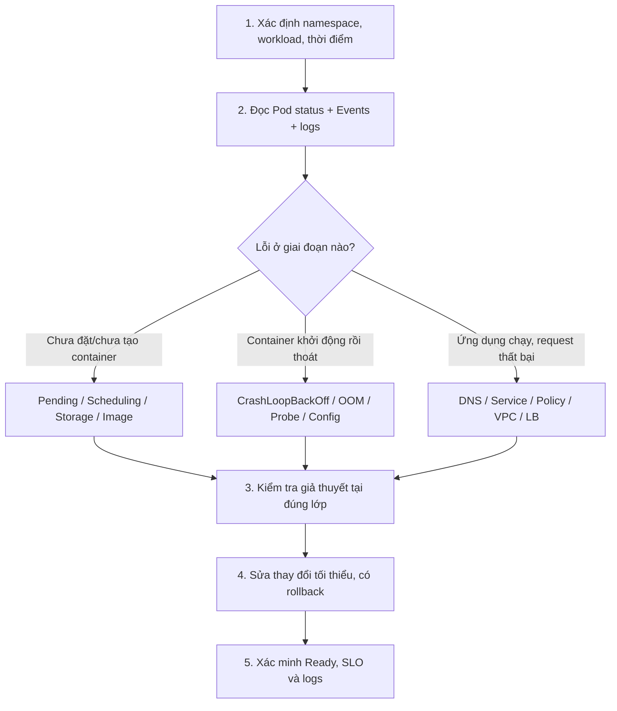
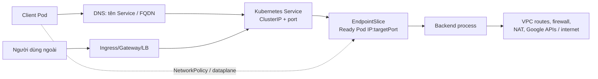

# Thực hành xử lý Pod pending, crash loop và lỗi networking

## 1. Mục tiêu và nguyên tắc chẩn đoán

Trong **Google Kubernetes Engine (GKE)**, ba sự cố thường bị gọi chung là “Pod không chạy” thực chất xảy ra ở các giai đoạn khác nhau:

- **`Pending`:** Pod chưa được scheduled, hoặc đã được gán node nhưng chưa hoàn tất chuẩn bị môi trường chạy.
- **`CrashLoopBackOff`:** container đã chạy rồi thoát hoặc bị dừng lặp lại; kubelet đang tăng thời gian chờ trước lần restart tiếp theo.
- **Lỗi networking:** Pod có thể đang `Running` và `Ready` nhưng không phân giải DNS, không kết nối được Service, database, internet hoặc load balancer.

Bài học thuộc chương **GKE nâng cao và vận hành** của **CLOUD_PROVIDERS_GCP**, nối kiến thức về IAM, VPC, Compute Engine, GKE Standard/Autopilot, Cloud Run và các dịch vụ dữ liệu. Mục tiêu không phải ghi nhớ hàng loạt lệnh, mà là **tìm bằng chứng và sửa đúng lớp lỗi**.

Sau bài học, bạn sẽ biết đọc Pod status/Events/logs, phân tích tài nguyên và scheduling, xác định lỗi ứng dụng/probes, kiểm tra DNS/Service/NetworkPolicy/VPC, thực hành ba tình huống trong lab và xác minh tác động đến độ tin cậy cùng chi phí.

> **An toàn:** Các lệnh ghi rõ *chỉ đọc* có thể dùng khi được cấp quyền. Những lệnh `kubectl apply`, `delete`, `rollout` hoặc sửa cluster phải có phê duyệt. Không xóa/restart workloads, sửa firewall hay tắt NetworkPolicy trên production chỉ để thử. Không đưa Secret, access token hoặc dữ liệu khách hàng vào báo cáo sự cố.

## 2. Runbook 5 bước dùng cho mọi sự cố



### Bộ lệnh thu thập ban đầu — chỉ đọc

Thay `NAMESPACE`, `POD_NAME` và `DEPLOYMENT_NAME` bằng giá trị thực:

```bash
kubectl config current-context
kubectl get pods -A -o wide
kubectl -n NAMESPACE get pod POD_NAME -o wide
kubectl -n NAMESPACE describe pod POD_NAME
kubectl -n NAMESPACE get events --sort-by=.lastTimestamp
kubectl -n NAMESPACE get deploy DEPLOYMENT_NAME
kubectl -n NAMESPACE get pod POD_NAME -o yaml
```

**Đọc theo thứ tự:** `status.phase`, `spec.nodeName`, `containerStatuses[].state`, `lastState`, `restartCount`, **Conditions** và mục **Events** cuối `describe`. Cột `STATUS` của `kubectl get pods` có thể hiển thị `CrashLoopBackOff` hoặc `ContainerCreating`, nhưng đây **không phải** các giá trị của `status.phase`. Events có thời hạn lưu và có thể đã mất khi điều tra muộn.

| Quan sát | Lớp cần xem trước | Chứng cứ then chốt |
| --- | --- | --- |
| `Pending`, `FailedScheduling` | Scheduler, CPU/RAM, selectors, taints, PVC | Pod Events, Node Allocatable |
| `Pending`, `ContainerCreating` | Image, volume, CNI, sandbox | `FailedMount`, `FailedCreatePodSandBox`, `ErrImagePull` |
| `CrashLoopBackOff` | Process, exit code, config, probes, OOM | `logs --previous`, `lastState`, `Unhealthy` |
| `Running` nhưng request lỗi | Service, EndpointSlice, DNS, NetworkPolicy, VPC | Service selector, endpoints, lookup, TCP test |
| Chỉ lỗi từ bên ngoài cluster | Ingress/Gateway, load balancer, health checks | Backend health, NEG, TLS, firewall |

## 3. Nhánh A — Pod Pending: tìm nguyên nhân không đặt được Pod

**`Pending` không luôn có nghĩa cluster thiếu CPU.** Kiểm tra `spec.nodeName`:

- **Rỗng:** scheduler chưa chọn được node; tập trung vào `FailedScheduling`.
- **Đã có node:** có thể đang pull image, mount PVC, tạo network sandbox hoặc chờ container khởi động.

### 3.1. Các lỗi scheduling phổ biến

| Event hoặc dấu hiệu | Diễn giải | Hướng xử lý |
| --- | --- | --- |
| `Insufficient cpu` / `memory` | Pod requests không vừa Node Allocatable | Right-size requests, tăng capacity/node pool |
| `untolerated taint` | Node có taint, Pod thiếu toleration | Chỉnh placement policy có chủ đích |
| `didn't match Pod's node affinity/selector` | Selector/affinity không khớp node | Sửa selector/labels hoặc tạo pool tương thích |
| `Too many pods` / `OutOfPods` | Chạm mật độ Pod trên node | Xem max Pods/node, Pod CIDR, autoscaler |
| `volume node affinity conflict` | PVC/PV ràng buộc zone khác | Xem StorageClass, PV topology, node locations |
| `unbound immediate PersistentVolumeClaims` | PVC chưa bind được PV | Kiểm tra PVC Events, quota, CSI, StorageClass |
| `FailedCreatePodSandBox` | CNI/IP/network setup lỗi | Đọc node/kubelet/network agent logs |

Lệnh chỉ đọc:

```bash
kubectl -n NAMESPACE describe pod POD_NAME
kubectl get nodes -o wide
kubectl describe node NODE_NAME
kubectl -n NAMESPACE get pvc
kubectl -n NAMESPACE describe pvc PVC_NAME
```

**Requests ≠ usage.** Scheduler đặt Pod theo CPU/RAM **requests**, không theo CPU usage tức thời. Hãy đối chiếu từng container request, phần tài nguyên dành cho hệ thống và `Allocatable` thực của node. Một Pod request 6 GiB không thể chạy trên node chỉ còn 4 GiB allocatable, dù biểu đồ RAM usage đang thấp.

### 3.2. Kiểm tra GKE Cluster Autoscaler

Nếu autoscaling bật mà Pod vẫn Pending, hỏi lần lượt:

1. Pod có phù hợp **machine type, architecture, taints, selectors, topology** của bất kỳ pool nào có thể tăng node không?
2. Pool đã chạm `max-nodes` / `total-max-nodes` chưa?
3. Project còn **CPU/GPU quota**, zonal capacity và đủ **subnet/Pod IP range** không?
4. Autoscaler có thông báo **no scale-up** hay lỗi provisioning trong **GKE Cluster Autoscaler visibility logs** không?
5. Pod có ràng buộc PVC zonal, PDB hoặc policy chặn lựa chọn khác không?

**Không tăng `maxReplicas` của HPA để chữa lỗi thiếu node.** HPA thay số Pod; Cluster Autoscaler mới điều chỉnh capacity worker. Autopilot cũng cần quota, IP và workload phù hợp chính sách cấp phát node.

### 3.3. Pending sau khi được gán node

Kiểm tra phần `Waiting.reason` của từng container:

- `ErrImagePull` / `ImagePullBackOff`: sai image/tag, Artifact Registry permissions, registry unavailable, DNS/egress.
- `ContainerCreating` kèm `FailedMount`: Secret/ConfigMap/PVC không tồn tại, CSI mount hoặc zone không khớp.
- `FailedCreatePodSandBox`: thiếu IP, CNI/Dataplane agent hoặc cấu hình node/network.

Đây là lỗi khác với `CrashLoopBackOff`: một container **chưa pull được image** chưa từng chạy tiến trình ứng dụng để sinh crash loop.

## 4. Lab A — tái hiện và sửa lỗi FailedScheduling

Chỉ thực hiện trong **namespace riêng**. Đây là một bài tập gây `Pending` có chủ đích, không tác động tới cấu hình node hiện hữu.

### 4.1. Manifest gây lỗi

```yaml
apiVersion: v1
kind: Pod
metadata:
  name: pending-lab
  namespace: gke-diag-lab
spec:
  restartPolicy: Never
  nodeSelector:
    training.example.com/unavailable: "true"
  containers:
    - name: app
      image: busybox:1.36
      command: ["sh", "-c", "sleep 3600"]
      resources:
        requests:
          cpu: "50m"
          memory: "32Mi"
        limits:
          memory: "64Mi"
```

Giả định **không node nào có label `training.example.com/unavailable=true`**. Lưu YAML thành `pending-lab.yaml`:

```bash
# THAY ĐỔI cluster: chỉ trong môi trường thử nghiệm
kubectl create namespace gke-diag-lab
kubectl apply -f pending-lab.yaml

# CHỈ ĐỌC: xem đúng nguyên nhân
kubectl -n gke-diag-lab get pod pending-lab -o wide
kubectl -n gke-diag-lab describe pod pending-lab
kubectl get nodes --show-labels
```

**Kỳ vọng:** Pod Pending, Event có nội dung không khớp node selector/affinity. Nếu cluster có node thật sự mang nhãn này, bài thử không còn tái hiện lỗi và bạn phải điều chỉnh nhãn test sao cho không khớp — chỉ trong manifest lab.

### 4.2. Khắc phục đúng phạm vi

Xóa **`nodeSelector` không hợp lệ** khỏi Pod manifest rồi tạo lại Pod thử nghiệm; trường placement của Pod có nhiều giới hạn cập nhật tại chỗ. Với Pod lab dùng `restartPolicy: Never`, có thể:

```bash
# THAY ĐỔI: chỉ xóa Pod test, không xóa node/Deployment production
kubectl -n gke-diag-lab delete pod pending-lab
# Sửa pending-lab.yaml: bỏ block nodeSelector, sau đó:
kubectl apply -f pending-lab.yaml
kubectl -n gke-diag-lab get pod pending-lab -w
```

Pod vẫn có thể Pending vì **lý do khác** (quota, node unavailable, image pull). Khi đó đọc Events mới thay vì kết luận lab sai. Không thêm label giả lên node production chỉ để chạy Pod test.

## 5. Nhánh B — CrashLoopBackOff: container chạy rồi thoát

`CrashLoopBackOff` nghĩa là kubelet **đợi trước lần restart tiếp theo** sau nhiều lần container kết thúc. Nguyên nhân phải tìm ở **process exit, OOM, probe hoặc dependencies**; bản thân trạng thái BackOff không chỉ ra nguyên nhân cụ thể.

### 5.1. Ba lệnh có giá trị nhất

```bash
kubectl -n NAMESPACE describe pod POD_NAME
kubectl -n NAMESPACE logs POD_NAME -c CONTAINER_NAME --tail=100
kubectl -n NAMESPACE logs POD_NAME -c CONTAINER_NAME --previous --tail=100
```

`--previous` xem log của **instance container trước lần restart hiện tại**, thường rất quan trọng vì container lỗi có thể chạy chỉ vài giây. Nếu Pod có sidecar, luôn chỉ định `-c` đúng container. Khi chưa tồn tại container lần trước, lệnh có thể không có dữ liệu.

### 5.2. Đọc lastState và Events

| Dấu hiệu | Khả năng cao | Bước xác nhận |
| --- | --- | --- |
| `Reason: OOMKilled` | Container bị kill vì memory | Xem memory limit/usage, OOM events, heap/GC |
| `Exit Code: 1` hoặc `2` | App lỗi, command/args hoặc config sai | `logs --previous`, Env/Secret references |
| `Exit Code: 137` | Process nhận SIGKILL; **có thể** OOM | Cần xác nhận `Reason`/node logs, không suy luận chỉ từ 137 |
| `Exit Code: 143` | Process nhận SIGTERM | Kiểm tra rollout/drain/shutdown, không mặc định là lỗi |
| `Unhealthy: Liveness probe failed` | Kubelet restart do liveness probe | Probe port/path/timing, startup duration, app logs |
| `CreateContainerConfigError` | ConfigMap/Secret/env hoặc spec lỗi | Events; container thường **chưa khởi động** |
| `Completed` rồi restart liên tục | Lệnh chạy xong nhưng restart policy `Always` | Workload có cần dùng `Job` thay Deployment? |

### 5.3. Phân biệt ba probes

- **Startup probe:** cho ứng dụng có thời gian khởi động dài; trong lúc chưa thành công, liveness/readiness không chạy theo cơ chế probe chuẩn.
- **Readiness probe:** quyết định Pod có sẵn sàng nhận traffic qua Service hay không; **không trực tiếp restart** container.
- **Liveness probe:** phát hiện ứng dụng kẹt và **có thể restart** container sau đủ lần lỗi.

Ví dụ cho web app thực sự có `/startup`, `/ready` và `/healthz`:

```yaml
startupProbe:
  httpGet:
    path: /startup
    port: 8080
  periodSeconds: 5
  failureThreshold: 24   # Cho phép khoảng 120 giây khởi động
readinessProbe:
  httpGet:
    path: /ready
    port: 8080
  periodSeconds: 5
livenessProbe:
  httpGet:
    path: /healthz
    port: 8080
  periodSeconds: 10
  failureThreshold: 3
```

Các endpoint **chỉ minh họa**; không copy vào NGINX hoặc ứng dụng không có những routes này. Một liveness probe phụ thuộc database bên ngoài có thể gây restart hàng loạt khi database tạm chậm. Nên tách **readiness** (đủ điều kiện nhận traffic) khỏi **liveness** (tiến trình cần khởi động lại).

### 5.4. OOM cần xử lý tận gốc

Nếu `lastState.terminated.reason=OOMKilled`:

1. So `requests.memory`, `limits.memory` với memory usage p95/peak và giới hạn node.
2. Đọc application logs/heap dump đã được bảo vệ, xem memory leak, cache, concurrency và batch size.
3. Nếu limit thấp hơn nhu cầu hợp lệ, điều chỉnh **requests và limits** có kiểm soát; VPA `Off` có thể cung cấp recommendation.
4. Kiểm tra sau sửa: không còn OOMKilled, restart count ổn định, p95 latency và chi phí chấp nhận được.

Tăng RAM vô hạn hoặc tăng replicas không phải cách sửa chắc chắn cho memory leak; có thể chỉ trì hoãn sự cố.

## 6. Lab B — cố ý tạo CrashLoopBackOff

Manifest chỉ chạy một command rồi thoát với mã lỗi:

```yaml
apiVersion: apps/v1
kind: Deployment
metadata:
  name: crashloop-lab
  namespace: gke-diag-lab
spec:
  replicas: 1
  selector:
    matchLabels:
      app: crashloop-lab
  template:
    metadata:
      labels:
        app: crashloop-lab
    spec:
      containers:
        - name: app
          image: busybox:1.36
          command: ["sh", "-c", "echo 'config invalid' >&2; exit 2"]
          resources:
            requests:
              cpu: "50m"
              memory: "32Mi"
            limits:
              memory: "64Mi"
```

Lưu `crashloop-lab.yaml` trong máy của bạn; khi namespace lab đã tồn tại:

```bash
# THAY ĐỔI lab
kubectl apply -f crashloop-lab.yaml

# CHỈ ĐỌC
kubectl -n gke-diag-lab get pods -l app=crashloop-lab -w
kubectl -n gke-diag-lab describe pod ACTUAL_POD_NAME
kubectl -n gke-diag-lab logs ACTUAL_POD_NAME -c app --previous
```

**Kỳ vọng:** container khởi động, in `config invalid` rồi thoát `Exit Code: 2`; Kubernetes restart theo `restartPolicy: Always` của Deployment và dần báo `CrashLoopBackOff`. **Đây không phải OOM**, cũng không phải lỗi scheduler.

**Cách sửa:** thay command trong manifest thành `["sh", "-c", "echo ready; sleep 3600"]`, sau đó `kubectl apply -f crashloop-lab.yaml` và kiểm tra rollout. Kết quả mong đợi là container không tiếp tục thoát, `READY 1/1` và không có restarts mới ở Pod sau rollout. **Đừng xóa Pod lặp lại** để “chữa” command sai: ReplicaSet sẽ tạo lại với cùng lỗi.

## 7. Nhánh C — networking: định vị lỗi theo đường đi

Một request từ Pod thường đi qua các lớp sau:



**Kiểm tra từ gần đến xa:** DNS name → Service/IP/port → EndpointSlice/Pod readiness → backend listener → NetworkPolicy → VPC/firewall/NAT → load balancer. Không sửa VPC firewall khi lỗi thật sự do **Service selector không chọn Pod nào**.

### 7.1. Ma trận lỗi nhanh

| Hiện tượng | Nghi vấn trước | Kiểm tra |
| --- | --- | --- |
| `no such host` / `NXDOMAIN` | Sai tên/namespace, Service chưa tồn tại, DNS record | `get svc`, `nslookup`, `resolv.conf` |
| DNS `i/o timeout` | DNS Pods, NetworkPolicy chặn UDP/TCP 53, upstream | DNS pods/Service, policy, networking logs |
| `Connection refused` | Không có listener, sai `targetPort`, app chưa ready | Service/endpoints, container port/process |
| `Connection timed out` | NetworkPolicy, firewall, route, NAT, peer unreachable | So thử direct Pod IP, policy, VPC path |
| `503` / `502` từ LB | Backend không healthy, NEG/health check/TLS/port | Ingress/Gateway, LB backend health |
| Chỉ Pod private không gọi internet được | Cloud NAT/Private Google Access/egress | Node external IP, NAT config, routes, DNS |
| Chỉ một vài nodes bị lỗi | Dataplane agent/conntrack/IP/MTU/node issue | So Pod placement theo node/zone |

**Một lỗi 403 từ Cloud Storage/Artifact Registry thường là IAM hoặc API authorization**, không nhất thiết là network. Dùng request/HTTP status và audit logs để phân biệt.

## 8. Kiểm tra DNS bên trong Pod

Tên Service cùng namespace thường là `backend`; qua namespace khác dùng:

```text
backend.gke-diag-lab.svc.cluster.local
```

Các bước chỉ đọc với Pod có sẵn công cụ:

```bash
kubectl -n NAMESPACE exec POD_NAME -- cat /etc/resolv.conf
kubectl -n NAMESPACE exec POD_NAME -- nslookup kubernetes.default.svc.cluster.local
kubectl -n NAMESPACE exec POD_NAME -- nslookup BACKEND_SERVICE.BACKEND_NAMESPACE.svc.cluster.local
kubectl -n kube-system get svc kube-dns
kubectl -n kube-system get pods -l k8s-app=kube-dns -o wide
```

**Điều kiện:** container phải có `cat`/`nslookup`; distroless images thường không có shell hoặc tiện ích. GKE có thể sử dụng **kube-dns, NodeLocal DNSCache hoặc Cloud DNS for GKE** tùy cấu hình, vì vậy đừng mặc định mọi Pod đều truy vấn trực tiếp cùng một nameserver.

Nếu lookup tên Kubernetes thành công nhưng external domain thất bại, điều tra **upstream DNS, egress policy và VPC/NAT** thay vì xóa Service. Nếu `NXDOMAIN`, kiểm tra spelling và namespace trước; nếu **timeout**, tập trung connectivity và DNS backend. Đọc `/etc/resolv.conf` để thấy `nameserver`, `search` và `ndots`.

Với **default-deny egress NetworkPolicy**, phải cho phép DNS traffic đúng endpoint theo kiến trúc DNS thực tế. **Không dùng `ipBlock.cidr` trỏ thẳng tới Pod/Service IP trong GKE Dataplane V2**; loại policy này có giới hạn và nên dùng selectors khi phù hợp.

## 9. Kiểm tra Service, EndpointSlice và cổng ứng dụng

### 9.1. Các lệnh chỉ đọc

```bash
kubectl -n NAMESPACE get service BACKEND_SERVICE -o yaml
kubectl -n NAMESPACE get pods --show-labels -o wide
kubectl -n NAMESPACE get endpointslice \
  -l kubernetes.io/service-name=BACKEND_SERVICE -o wide
kubectl -n NAMESPACE describe service BACKEND_SERVICE
kubectl -n NAMESPACE describe pod BACKEND_POD
```

**EndpointSlice** là API chính để phản ánh endpoints của Service. Nếu **không có backend endpoints sẵn sàng**, kiểm tra `spec.selector` của Service so với labels Pods, `readinessProbe` và port mapping. `kubectl get endpoints` vẫn hữu ích ở một số nơi nhưng API Endpoints truyền thống có giới hạn và đã được thay thế dần bởi EndpointSlice.

### 9.2. Ví dụ sai selector

Pod backend mang nhãn:

```yaml
metadata:
  labels:
    app: inventory
```

Nhưng Service lại khai báo:

```yaml
apiVersion: v1
kind: Service
metadata:
  name: inventory
  namespace: gke-diag-lab
spec:
  selector:
    app: payment  # SAI so với app: inventory của Pod
  ports:
    - port: 80
      targetPort: 8080
  type: ClusterIP
```

DNS `inventory.gke-diag-lab.svc.cluster.local` **vẫn có thể phân giải ra ClusterIP**, nhưng Service **không chọn backend đúng**. Cách sửa là thay `selector.app` thành `inventory` **nếu đó đúng là workload được phép phục vụ**, rồi xác minh EndpointSlice có địa chỉ Pod **Ready**.

### 9.3. Port và readiness

`port: 80` là cổng client gọi trên Service; `targetPort: 8080` phải tương ứng **cổng process trong container thực sự lắng nghe**. Trường `containerPort` chỉ mô tả cổng trong Pod spec; nó **không tự làm ứng dụng mở listener**. Ngoài ra, một app chỉ bind `127.0.0.1` trong container có thể không nhận được kết nối tới Pod IP.

Lệnh kiểm tra trực tiếp (nếu container có công cụ):

```bash
kubectl -n NAMESPACE exec BACKEND_POD -- sh -c 'cat /proc/net/tcp'
```

Đây chỉ là một dấu hiệu socket ở tầng Linux, không thay được test ứng dụng đầy đủ. Có thể dùng một **debug Pod có image và công cụ đã được phê duyệt** trong cùng namespace để `nslookup`/`curl`/`wget` tới cả **Pod IP** và **Service ClusterIP**. Không chạy công cụ debug không rõ nguồn hoặc yêu cầu privileged access trên production.

## 10. NetworkPolicy, Dataplane V2 và đường kết nối Google Cloud

### 10.1. NetworkPolicy

NetworkPolicy được chọn bằng **Pod labels** và áp dụng theo **namespace**. Với Pod bị cô lập theo ingress/egress, các allow rules sẽ quyết định những kết nối nào được phép. Một policy chỉ ảnh hưởng khi cluster dùng plugin **enforce network policies**, ví dụ **GKE Dataplane V2 (Cilium)** hoặc Calico ở Standard.

```bash
# CHỈ ĐỌC
kubectl -n NAMESPACE get networkpolicy
kubectl -n NAMESPACE describe networkpolicy POLICY_NAME
kubectl -n NAMESPACE get pods --show-labels
```

Đừng sửa/xóa tất cả policy để thử. Phân tích **cả phía nguồn và phía đích**, ingress/egress, namespaceSelector/podSelector, port/protocol và cấu hình DNS. Trong GKE Dataplane V2, tránh **`ipBlock` trỏ tới Pod/Service IP**; sử dụng labels và selectors theo khuyến nghị.

**Workload Identity Federation for GKE** cũng cần quyền egress tới metadata server. Với GKE Dataplane V2, tài liệu NetworkPolicy nêu endpoint `169.254.169.254/32` TCP **80/8080**; với dataplane khác, địa chỉ/port có thể khác. Một default-deny egress không có ngoại lệ thích hợp có thể gây lỗi lấy credentials dù ứng dụng chỉ trông như bị lỗi Cloud Storage.

### 10.2. VPC, firewall, NAT và private nodes

Khi Pod gọi **Cloud SQL**, Google APIs hoặc internet, xét:

1. DNS đã giải đúng private/public endpoint chưa?
2. NetworkPolicy có cho egress không?
3. VPC firewall, hierarchical firewall, route, PSC/VPC peering hoặc VPN có cho phép luồng không?
4. Node có external IP không; nếu private, **Cloud NAT**/đường egress thích hợp có được thiết kế cho **các dải địa chỉ cần NAT** không?
5. Với Google APIs, cấu hình **Private Google Access/Private Service Connect**, DNS và IAM có đúng không?
6. Nếu kết nối bị ngắt dưới tải cao, **Cloud NAT port exhaustion** hoặc quá nhiều kết nối tới cùng đích có phải nguyên nhân?

**Cloud NAT chỉ xử lý egress theo cấu hình**, không phải ingress/load balancer và không tự cấp quyền IAM. Không sửa firewall bằng quy tắc `0.0.0.0/0` chỉ để xem request có thành công hay không. Dùng **Network Intelligence Center Connectivity Tests**, VPC Flow Logs hoặc Cloud NAT logs/metrics khi đã được bật và có quyền đọc phù hợp.

### 10.3. GKE Dataplane V2

Autopilot dùng **GKE Dataplane V2** theo kiến trúc hiện hành; Standard có thể bật Dataplane V2 hoặc dùng cấu hình networking khác. Khi một số node có lỗi mạng bất thường, kiểm tra:

```bash
kubectl -n kube-system get pods -l k8s-app=cilium -o wide
kubectl -n kube-system get pods -o wide
```

Các Pod agent liên quan thường mang tên `anetd-...`. Trong Cloud Logging, lọc cluster/node/namespace và log của network agent để tìm drop hoặc lỗi cấu hình. Không SSH hoặc restart `anetd` tùy tiện; đó là thành phần hạ tầng có thể ảnh hưởng nhiều Pods.

## 11. Truy cập từ bên ngoài cluster: Ingress, Gateway và load balancer

Khi `curl` nội bộ tới Service thành công nhưng người dùng ngoài vẫn nhận `502`/`503`:

- Đọc `Ingress` hoặc `Gateway`, routes, TLS/certificate và frontend IP.
- Kiểm tra Service selector, EndpointSlice, **NEG/backend service** được ánh xạ đúng.
- Xem **load balancer health check** tới đúng port/path; readiness của Kubernetes và health của LB có thể khác nhau.
- Kiểm tra firewall cho health-check/proxy traffic và Cloud Armor/IAP nếu có.
- Đối chiếu **Cloud Logging load balancer logs**, response flags, backend errors và thời điểm rollout.

```bash
# CHỈ ĐỌC
kubectl -n NAMESPACE get ingress,service
kubectl -n NAMESPACE describe ingress INGRESS_NAME
kubectl -n NAMESPACE get gateway,httproute
kubectl -n NAMESPACE describe service BACKEND_SERVICE
```

**Không kết luận “lỗi mạng VPC” chỉ từ HTTP 503.** Backend không Ready, sai Service selector hoặc sai health-check path thường gây lỗi cùng biểu hiện. Chỉ dùng `gateway/httproute` nếu cluster đã cài CRDs/Gateway API phù hợp.

## 12. Cloud Logging, Events và cách đối chiếu thay đổi

### 12.1. Xem container logs trong Cloud Logging

GKE có thể chuyển stdout/stderr của container tới **Cloud Logging** khi logging được bật:

```text
resource.type="k8s_container"
resource.labels.cluster_name="CLUSTER_NAME"
resource.labels.namespace_name="NAMESPACE"
resource.labels.pod_name="POD_NAME"
severity>=ERROR
```

Đây là **Logging Query Language**, không phải lệnh shell. Không phải mọi lỗi ứng dụng đều có `severity=ERROR`; nếu không thấy log, bỏ filter severity, tăng time range và kiểm tra cấu hình logging/retention.

### 12.2. Kubelet và autoscaler

GKE CrashLoopBackOff docs có hướng dẫn truy tìm **liveness probe restart** trong `k8s_node` kubelet logs; GKE Cluster Autoscaler visibility logs giúp phân tích lỗi scale-up. Khi cần, sử dụng filter theo cluster, node, Pod UID và time window để tránh nhầm Pod cũ sau rollout với Pod hiện tại.

### 12.3. Điều gì đã thay đổi?

So sánh thời điểm sự cố với:

- Deployment revision, image digest, ConfigMap/Secret references.
- Node pool upgrade, cluster release channel, machine type, quota/IP changes.
- NetworkPolicy, firewall, Ingress/Gateway, DNS hoặc NAT config.
- Cloud Audit Logs/Kubernetes API audit logs và GitOps/CI/CD deploy history.

```bash
# CHỈ ĐỌC
kubectl -n NAMESPACE rollout history deployment/DEPLOYMENT_NAME
kubectl -n NAMESPACE describe deployment DEPLOYMENT_NAME
kubectl -n NAMESPACE get events --sort-by=.lastTimestamp
```

Rollback cần có **bằng chứng version trước đó hoạt động**, tương thích schema dữ liệu và phê duyệt. Đừng rollback lệnh database migration chỉ vì container ứng dụng mới crash.

## 13. Ba tình huống tổng hợp

### Tình huống 1 — HPA tạo Pods Pending

Sau chiến dịch bán hàng, HPA nâng replicas từ 4 lên 12; sáu Pod mới Pending và Event báo `Insufficient cpu`. Trình tự:

1. Đối chiếu requests của Pod với Node Allocatable.
2. Xem node pool autoscaling limits, quota vCPU, zonal capacity, Pod CIDR.
3. Kiểm tra selectors/taints để bảo đảm có pool có thể mở rộng.
4. Khi đủ năng lực và được duyệt, điều chỉnh capacity/requests theo load test.
5. Xác minh `READY`, p95 latency, 5xx và billing sau scale.

**Không sửa bằng cách** ép requests CPU xuống cực thấp để đánh lừa scheduler; điều đó có thể tăng contention và throttling.

### Tình huống 2 — CrashLoop sau deploy

Pod mới có restart count tăng, `Last State: Terminated` và `Exit Code: 1`. `logs --previous` ghi `missing DB_HOST`.

1. Kiểm tra Deployment env, ConfigMap/Secret keys và tên namespace.
2. Xác định secret nào thiếu, không in giá trị bí mật ra ticket.
3. Khôi phục config chính xác qua GitOps, rollout một bản đã kiểm thử.
4. Theo dõi restart, readiness, kết nối database và request errors.

Tăng memory limit hoặc restart node không giải quyết lỗi thiếu biến môi trường.

### Tình huống 3 — DNS hoạt động nhưng Service không trả lời

`nslookup inventory.gke-diag-lab.svc.cluster.local` thành công, nhưng request tới Service timeout; `EndpointSlice` không có địa chỉ sẵn sàng.

1. So sánh Service selector với Pod labels.
2. Kiểm tra Pod Ready và readinessProbe.
3. Xác minh `port`/`targetPort` và listener.
4. Nếu endpoints và listener đúng nhưng vẫn lỗi, mới điều tra NetworkPolicy/dataplane.
5. Gọi lại từ client Pod và xem logs, metrics, timeouts.

Một ClusterIP phân giải được chỉ chứng minh **DNS record của Service tồn tại**, không chứng minh backend khỏe.

## 14. Phân biệt Standard và Autopilot khi điều tra

| Vấn đề | GKE Standard | GKE Autopilot |
| --- | --- | --- |
| Quản lý node capacity | Đọc node pools, machine type, autoscaling, MIG/backend VM | Hạ tầng node do GKE quản lý, tập trung Pod requests, ComputeClass và quota |
| SSH/debug host | Có thể theo quyền, nhưng rất rủi ro trên production | Quyền truy cập node/privileged debugging bị hạn chế hơn |
| Network dataplane | Có thể Standard dataplane hoặc Dataplane V2 tùy cluster | Dataplane V2 theo cơ chế managed |
| Pending do resources | Requests, allocatable, nodes, quota, IP | Requests, Autopilot constraints, quota/provisioning |
| Bước xử lý ưu tiên | Dữ liệu Pod/Events/logs trước, rồi node/network | Cũng bắt đầu bằng Pod/Events/logs; không phụ thuộc SSH node |

**Không copy một lệnh chỉnh sửa VM GCE bên dưới GKE để sửa lỗi GKE node.** Những VM này do GKE quản lý và có thể bị recreate; phải dùng đúng API GKE hoặc lộ trình hỗ trợ sản phẩm.

## 15. Checklist trước khi đóng sự cố

- [ ] Đã xác nhận **context/cluster, namespace, Pod UID, image revision** và thời điểm lỗi.
- [ ] Có bằng chứng từ **Events, status/lastState, logs --previous** hoặc test networking phù hợp.
- [ ] Đã phân biệt `Pending` trước/sau scheduling, lỗi image pull và `CrashLoopBackOff`.
- [ ] Đã kiểm tra requests/limits, labels/taints, PVC topology và Cluster Autoscaler khi Pending.
- [ ] Với CrashLoop: đã kiểm tra command/config, exit reason, OOM và probes.
- [ ] Với networking: đã kiểm tra DNS → Service → EndpointSlice → backend → NetworkPolicy → VPC/NAT/LB.
- [ ] Không làm lộ Secret hoặc dùng quyền `Owner`, firewall mở rộng để chữa lỗi.
- [ ] Thay đổi được review, có rollback và không phá workload/namespace ngoài phạm vi.
- [ ] Sau sửa: Pod `Ready`, rollout hoàn tất, không còn restarts bất thường và request end-to-end thành công.
- [ ] Đã kiểm tra **p95/p99 latency, error rate, quota/IP usage và chi phí**.
- [ ] Đã ghi nguyên nhân gốc, timeline, sự kiện không có log, biện pháp phòng ngừa và owner theo dõi.

### Dọn tài nguyên lab

Chỉ khi chắc chắn namespace **`gke-diag-lab`** là namespace thử nghiệm riêng đã tạo trong bài:

```bash
# CHỈ ĐỌC trước khi dọn
kubectl -n gke-diag-lab get all
kubectl -n gke-diag-lab get pvc

# THAY ĐỔI: chỉ xóa đúng tài nguyên do bài lab tạo
kubectl -n gke-diag-lab delete deployment crashloop-lab --ignore-not-found
kubectl -n gke-diag-lab delete pod pending-lab --ignore-not-found
```

Không tự xóa cả namespace nếu bên trong có resources của người khác hoặc PVC chứa dữ liệu cần giữ.

## 16. Bài tập củng cố

1. **Pending do selector:** Pod request 100m CPU nhưng `FailedScheduling` báo không node nào khớp `nodeSelector`. Vì sao tăng CPU quota có thể không giúp? **Đáp án:** điều kiện placement không phù hợp, không phải thiếu CPU.
2. **CrashLoop do OOM:** Pod exit 137. Vì sao chưa thể kết luận OOM? **Đáp án:** cần xem `lastState.reason`, Events và logs; SIGKILL có nhiều nguyên nhân.
3. **Readiness so với liveness:** container sống nhưng database tạm lỗi; nên liveness restart liên tục không? **Gợi ý:** readiness có thể bỏ Pod khỏi traffic; liveness nên phát hiện trạng thái cần restart thực sự.
4. **Service không có endpoint:** DNS resolve được nhưng request bị timeout. Viết ba lệnh kiểm tra selector, EndpointSlice và Pod Ready.
5. **DNS timeout:** Pod có default-deny egress NetworkPolicy. Liệt kê đường DNS và metadata-server cần kiểm tra, phân biệt Dataplane V2 với các cấu hình khác.
6. **Private GKE:** ứng dụng chỉ không gọi được external API, Cloud Storage trả 403. Câu nào là network, câu nào có thể là IAM? Cần test DNS/TCP, Cloud NAT, IAM và lỗi HTTP cụ thể trước khi sửa.
7. **Bài tổng hợp:** một Deployment rollout mới có 5 Pods: 2 `Pending` do `Insufficient memory`, 2 `CrashLoopBackOff` vì thiếu Secret key, 1 `Running` nhưng không Ready do sai `/ready`. Viết thứ tự xử lý để khôi phục SLO và tránh restart vô hạn.

## 17. Tài liệu tham khảo chính thức

Các tính năng GKE và mạng thay đổi theo phiên bản; kiểm tra tài liệu trước khi thao tác production:

1. [GKE – Troubleshoot deployed workloads](https://cloud.google.com/kubernetes-engine/docs/troubleshooting/deployed-workloads).
2. [GKE – Troubleshoot CrashLoopBackOff](https://cloud.google.com/kubernetes-engine/docs/troubleshooting/crashloopbackoff-events).
3. [GKE – Troubleshoot OOM](https://cloud.google.com/kubernetes-engine/docs/troubleshooting/oom-events).
4. [GKE – Troubleshoot networking](https://cloud.google.com/kubernetes-engine/docs/troubleshoot-networking).
5. [GKE – Troubleshoot kube-dns](https://cloud.google.com/kubernetes-engine/docs/troubleshooting/kube-dns).
6. [GKE – Troubleshoot connectivity in cluster](https://cloud.google.com/kubernetes-engine/docs/troubleshooting/connectivity-issues-in-cluster).
7. [GKE – NetworkPolicy](https://cloud.google.com/kubernetes-engine/docs/how-to/network-policy).
8. [GKE – Dataplane V2](https://cloud.google.com/kubernetes-engine/docs/how-to/dataplane-v2).
9. [GKE – Troubleshoot Cloud NAT packet loss](https://cloud.google.com/kubernetes-engine/docs/troubleshooting/cloud-nat-packet-loss).
10. [Kubernetes – Debug Pods](https://kubernetes.io/docs/tasks/debug/debug-application/debug-pods/).
11. [Kubernetes – Debug Services](https://kubernetes.io/docs/tasks/debug/debug-application/debug-service/).
12. [Kubernetes – DNS debugging](https://kubernetes.io/docs/tasks/administer-cluster/dns-debugging-resolution/).

**Kết luận:** Hãy xác định **Pod chưa được tạo, container đã chạy rồi chết hay traffic không đi đến đích** trước khi chọn công cụ. `Pending` ưu tiên Events/scheduler/capacity, `CrashLoopBackOff` ưu tiên `lastState` và `logs --previous`, còn networking đi từ **DNS → Service/EndpointSlice → policy → VPC/LB**. Cách điều tra có bằng chứng, sửa thay đổi nhỏ và kiểm chứng SLO sẽ nhanh và an toàn hơn việc restart hoặc nới quyền hàng loạt.
