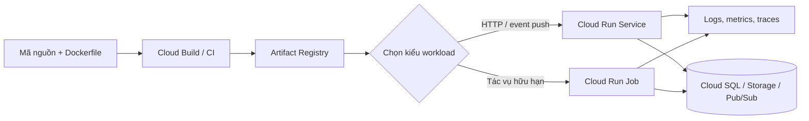

# Cloud Run services, jobs và mô hình thực thi container

> **Chương:** Cloud Run  
> **Module:** CLOUD_PROVIDERS_GCP  
> **Phạm vi module:** Khám phá Google Cloud từ tổ chức project, IAM và VPC đến Compute Engine, GKE, Cloud Run, dịch vụ lưu trữ và cơ sở dữ liệu. Qua các tình huống triển khai, người học biết lựa chọn dịch vụ, bảo vệ tài nguyên, tự động hóa phát hành và theo dõi độ tin cậy cùng chi phí.

Một API nhận HTTP request và một tác vụ xuất báo cáo cuối ngày đều có thể đóng gói thành container. Tuy nhiên, **API cần phục vụ request**, còn **tác vụ cần thực hiện xong rồi kết thúc**. Cloud Run cung cấp hai mô hình phù hợp: **services** và **jobs**, cùng môi trường chạy container được Google Cloud quản lý.

Trong bài này, chúng ta phân biệt hai mô hình qua vòng đời, scaling, timeout, danh tính và chi phí; sau đó xây dựng **một HTTP service có xác thực** và **một job ba task** bằng hai image riêng. Những ví dụ đều dùng project lab, không mặc định mở endpoint công khai.

## Mục tiêu học tập

Sau bài học, bạn có thể:

1. Chọn **Cloud Run service** hay **Cloud Run job** theo loại công việc, đồng thời nhận biết những trường hợp cần worker pool hoặc giải pháp khác.
2. Giải thích **service → revision → instance → request** và **job → execution → task → attempt**.
3. Hiểu concurrency, autoscaling, cold start, request/task timeout, retries và tính nhất thời của instance.
4. Phân biệt IAM của **người deploy**, **runtime service account** và **người gọi service**.
5. Build image, deploy service, tạo và chạy job, xem logs/metrics, dọn tài nguyên bằng `gcloud`.
6. Thiết kế ứng dụng **stateless, idempotent**, lưu dữ liệu bền vững ngoài filesystem tạm thời.

## 1. Cloud Run giải quyết việc gì?

Cloud Run thực thi container trên hạ tầng serverless do Google Cloud quản lý. Đội ứng dụng cung cấp **image/mã và cấu hình tài nguyên**; nền tảng quản lý môi trường thực thi, khởi tạo instance, phân phối request hoặc task, và tích hợp Cloud Logging/Monitoring. Đội ứng dụng vẫn quản lý mã, secrets, IAM, mạng, dữ liệu, chất lượng dịch vụ và chi phí.



**Lưu ý về hệ sinh thái hiện hành:** Cloud Run còn có **worker pools** cho các consumer nền liên tục không cần HTTP endpoint (ví dụ pull từ Kafka/Pub/Sub) và **Cloud Run instances** cho một số workload đơn chạy lâu dài. Chúng là những resource khác, không phải một tùy chọn tự động bật bên trong service/job. Phạm vi bài này tập trung vào **services** và **jobs**.

## 2. Services và jobs: so sánh cốt lõi

| Tiêu chí | Cloud Run service | Cloud Run job |
|---|---|---|
| Mục đích | Phục vụ HTTP/gRPC, webhook, request hoặc event push | Hoàn tất một lượng công việc rồi thoát |
| Điểm vào | HTTPS endpoint ổn định của service | Chạy thủ công, qua API, scheduler hoặc workflow |
| Container cần nghe `PORT`? | **Có**, ingress container phải nghe trên `0.0.0.0:$PORT` | **Không**; chạy chương trình rồi exit |
| Đơn vị phiên bản/chạy | **Revision** và các **instances** | Cấu hình **job**, các **executions**, **tasks** |
| Mở rộng | Tự động theo requests/CPU và cấu hình, hoặc manual scaling được hỗ trợ | `tasks` và `parallelism` của từng execution |
| Hoàn thành | Trả HTTP response đúng thời hạn | Mọi task thành công sau retries cho phép |
| Retry | Caller/Cloud Tasks/Pub/Sub/ứng dụng quyết định theo tích hợp | Có `max-retries` **theo task** |
| Timeout | **Theo request** | **Theo task attempt** |
| Billing điển hình | Request-based hoặc instance-based theo cấu hình | Instance-based trong thời gian task chạy |
| Ví dụ | API đơn hàng, website, webhook | Export CSV, batch resize ảnh, migration được kiểm soát |

**Không lấy HTTP server chạy làm job:** nếu entrypoint của image mở server và không bao giờ thoát, job có thể chỉ dừng khi bị timeout. **Không dùng service** cho một batch vô hạn nếu request cần trả ngay và xử lý dài hạn nên được quản lý bằng job/queue/worker.

## 3. Mô hình thực thi của service

```text
Cloud Run service: order-api (URL ổn định)
  ├── Revision rev-001 (image digest A, config A): 90% traffic
  │     ├── Instance 1: xử lý nhiều requests đồng thời
  │     └── Instance 2
  └── Revision rev-002 (image digest B, config B): 10% traffic
        └── Instance 3
```

**Service** đại diện cho endpoint và chính sách phân phối. **Revision** là bản triển khai cấu hình/image cụ thể; thay đổi cấu hình cần revision mới. **Instance** là một lần chạy container, có thể phục vụ nhiều request cho đến khi bị thay thế hoặc scale-in.

### 3.1. Concurrency và autoscaling

`concurrency` là **số request đồng thời tối đa một instance được cấu hình nhận**. Ví dụ giả định 100 request đang xử lý, concurrency=10 sẽ cần khoảng 10 instances **nếu các điều kiện khác cho phép**; đây không phải công thức bảo đảm bởi autoscaler. CPU, thời gian xử lý, max instances, quota và khả năng khởi động đều ảnh hưởng.

- **Concurrency thấp:** dễ cô lập request tốn bộ nhớ hoặc code chưa an toàn khi chạy song song, nhưng có thể tạo nhiều instance và tăng chi phí.
- **Concurrency cao:** tiết kiệm instance cho workload I/O-bound, nhưng có thể tăng p95/p99 latency nếu CPU/memory/DB pool quá tải.
- **Min instances:** giữ capacity ấm để giảm cold start, đổi lại chi phí nhàn rỗi.
- **Max instances:** giới hạn mở rộng, nhưng khi vượt khả năng phục vụ có thể gây chờ/`429`/`503`; đây **không phải spend cap tuyệt đối**.

Default concurrency có thể khác theo giao diện và số vCPU đối với service mới. Trong lab, **đặt rõ `--concurrency=10`**, không suy đoán default là một số cố định trên mọi môi trường.

### 3.2. Timeout của HTTP request

Service mặc định có **request timeout 5 phút**, có thể đặt tối đa **60 phút** theo cấu hình hỗ trợ. Khi hết hạn, client có thể nhận **HTTP 504**, nhưng instance không nhất thiết dừng ngay; code có thể vẫn xử lý phía sau. Vì vậy thao tác có side effect cần **idempotency key**, cancellation và hạn chế timeout.

Một API gọi database 2 giây thường nên đặt timeout hợp lý, không mặc định nâng lên 60 phút. Với công việc xử lý hàng giờ, cân nhắc job hoặc kiến trúc bất đồng bộ.

### 3.3. Cold start và vòng đời

Khi không có instance ấm, request đầu tiên phải đợi container khởi động: nạp image, runtime, kết nối phụ thuộc, đăng ký phục vụ. Nền tảng có thể tạo hoặc hủy instances; **không bảo đảm một container tồn tại mãi**.

Ứng dụng nên:

- Khởi động nhanh, bind đúng `PORT`, tránh làm migration tốn thời gian ở startup.
- Trả health/readiness có ý nghĩa và xử lý `SIGTERM` theo runtime contract.
- Quản lý connection pool với Cloud SQL/DB theo tổng số instance dự kiến.
- Lưu trạng thái bền vững qua Cloud SQL, Cloud Storage hoặc dịch vụ khác; filesystem writable của container **là tạm thời, dùng bộ nhớ**.

### 3.4. Request-based và instance-based billing

- **Request-based (thường là mặc định):** CPU được cấp chủ yếu trong lúc xử lý request; không dựa vào background thread sau khi đã trả response để hoàn thành việc quan trọng.
- **Instance-based:** CPU được cấp trong toàn bộ vòng đời instance và tính phí phù hợp; có thể dùng cho hoạt động nền ngắn, nhưng **instance service vẫn có thể bị hủy khi idle**.

Nếu cần consumer chạy liên tục không có HTTP request, xem **worker pool**; với batch hữu hạn, **job** thường phù hợp hơn. Quyết định dựa trên SLO, mô hình tải và bảng giá thực tế.

## 4. Mô hình thực thi của job

```text
Job definition: report-batch
  └── Execution: report-batch-abc (được chạy lúc 01:00)
        ├── Task index 0 ── Attempt 1 ── thành công
        ├── Task index 1 ── Attempt 1 lỗi ── Attempt 2 thành công
        └── Task index 2 ── Attempt 1 ── thành công
Execution thành công khi cả ba task hoàn thành thành công.
```

- **Job:** khai báo image, command, environment, service account, số tasks, parallelism, timeout và retries.
- **Execution:** một lần chạy job; chạy lại tạo **execution mới**, không cập nhật execution cũ.
- **Task:** một đơn vị công việc trong execution, mỗi task chạy trong **một container instance**.
- **Attempt:** một lần thử thực thi task; retry tạo lần thử tiếp theo khi task lỗi, trong giới hạn cấu hình.

### 4.1. Tasks, parallelism và phân chia dữ liệu

Giả sử `--tasks=5 --parallelism=2`: execution có năm task, tối đa **hai task chạy đồng thời**. Không có nghĩa Cloud Run tạo năm máy chạy cùng một lúc; nền tảng lên lịch dần tùy capacity.

Runtime cung cấp biến môi trường:

| Biến | Giá trị ví dụ | Ý nghĩa |
|---|---|---|
| `CLOUD_RUN_JOB` | `report-batch` | Tên job |
| `CLOUD_RUN_EXECUTION` | `report-batch-abc` | Tên execution |
| `CLOUD_RUN_TASK_INDEX` | `0`, `1`... | Chỉ số task bắt đầu từ **0** |
| `CLOUD_RUN_TASK_COUNT` | `5` | Tổng số task của execution |
| `CLOUD_RUN_TASK_ATTEMPT` | `0`, `1`... | Số lần thử, giúp quan sát retries |

Ứng dụng phải **tự chia dữ liệu** theo `TASK_INDEX`/`TASK_COUNT`. Ví dụ nếu có 20 tệp đánh số `0..19`, task `i` xử lý những tệp có `file_id % task_count == i`. Với nguồn dữ liệu thay đổi, cần checkpoint/claim công việc đúng cách; phép chia đơn giản không giải quyết được concurrency và ghi trùng vào database.

### 4.2. Retry và timeout

Job mặc định có **3 retries cho mỗi task**, timeout mặc định **10 phút cho một attempt**; có thể chỉnh trong giới hạn sản phẩm (thông thường tới 168 giờ, riêng GPU có giới hạn khác). **Không có timeout tổng riêng cho toàn execution**; execution kết thúc sau khi mọi task hoàn tất hoặc lỗi sau số lần thử cho phép.

Retry là cơ chế phục hồi, không phải bảo đảm **exactly-once**. Nếu task đã ghi một phần kết quả rồi thất bại, attempt tiếp theo có thể lặp lại hành động. Cần khóa idempotency, transaction/upsert, checkpoint và lưu kết quả bên ngoài container. Một chương trình thoát với mã `0` được xem là thành công của task, nhưng **không tự chứng minh dữ liệu nghiệp vụ đúng**.

### 4.3. Jobs chạy khi nào?

Job có thể được khởi chạy trực tiếp bằng `gcloud run jobs execute`, qua API, qua **Cloud Scheduler** theo lịch hoặc **Workflows** trong quy trình có nhiều bước. Tạo resource job **không nhất thiết tự chạy ngay**. Nếu job chạy bằng scheduler, phải bảo vệ **principal gọi execute**, tránh kích hoạt trùng, giữ quyền runtime và theo dõi executions thất bại.

## 5. Chọn đúng mô hình trong bốn tình huống

| Nhu cầu | Lựa chọn nên xem xét | Lý do |
|---|---|---|
| REST API trả kết quả cho client trong vài giây | **Cloud Run service** | Endpoint HTTPS, revision, request autoscaling |
| Xuất báo cáo mỗi đêm, kết thúc trong vài phút | **Cloud Run job** | Execution hữu hạn, retries/task logs và lịch chạy |
| Consumer liên tục pull thông điệp từ Kafka | **Cloud Run worker pool** | Process nền không cần HTTP endpoint |
| Cần Kubernetes primitives/sidecar/scheduling nâng cao | **GKE** | Khả năng điều phối sâu, đổi lại vận hành phức tạp hơn |

**Trường hợp dễ nhầm:** Pub/Sub **push** hoặc Eventarc có thể gọi **service** qua HTTP. Với Pub/Sub **pull consumer** chạy liên tục, cân nhắc worker pool. Với một lô dữ liệu biết trước và cần xử lý xong, dùng job. Đừng bắt client mở HTTP request hàng chục phút chỉ để chờ xử lý batch.

## 6. IAM, networking và dữ liệu: trách nhiệm chung của hai mô hình

### 6.1. Ba danh tính tách biệt

| Principal | Vai trò | Nguyên tắc quyền |
|---|---|---|
| **Deployer / CI** | Tạo/sửa service hoặc job | Quyền Cloud Run phù hợp + `iam.serviceAccounts.actAs` trên runtime SA |
| **Runtime service account** | Code container gọi Cloud Storage, Secret Manager, Cloud SQL... | Chỉ cấp role tối thiểu **trên tài nguyên cần truy cập** |
| **Caller** | Gọi HTTP service hoặc kích hoạt job | `roles/run.invoker` cho HTTP service; quyền thực thi job phù hợp |

Quyền **build/push image** thuộc CI identity; quyền **pull Artifact Registry** thuộc identity được nền tảng sử dụng theo đường triển khai, có thể cần Reader trên repository ở project khác. Không dùng một SA có `roles/editor` cho cả build, deploy và runtime.

**Service công khai hay riêng tư** là hai quyết định khác nhau: **ingress** quyết định đường request có được tiếp nhận từ nguồn mạng không, còn **authentication/IAM** quyết định ai được gọi. Trong bài lab dùng `--no-allow-unauthenticated`; khi muốn public endpoint phải đánh giá rủi ro và chính sách trước.

### 6.2. Ingress, egress, secrets và storage

- Service có URL HTTPS do Cloud Run quản lý; ingress có thể là `all`, `internal` hoặc internal + load balancer theo tính năng hỗ trợ. Job **không có URL HTTP phục vụ request**.
- Khi container cần gọi DB dùng private IP, cấu hình **Direct VPC egress** hoặc Serverless VPC Access connector, DNS/route/firewall phù hợp. Có VPC không tự cấp IAM.
- Dùng **Secret Manager** và runtime identity thay vì nhúng secret vào Dockerfile, env trong source hoặc image layers.
- Writable filesystem của instance có thể tồn tại qua nhiều request trên **cùng instance**, nhưng **không bền vững khi instance mất** và có thể tiêu thụ RAM. File upload, kết quả job và session cần lưu ở dịch vụ phù hợp.
- Bất kỳ container nào cũng có thể bị dừng/khởi chạy lại; xử lý `SIGTERM`, retries và idempotency theo runtime contract.

## 7. Lab — Một service và một job dùng hai image riêng

**Phạm vi:** project sandbox, region và resource thuộc quyền của người học. Những lệnh dưới đây chỉ là **hướng dẫn**, không được thực thi khi viết tài liệu. Bật API, build, lưu image, chạy Cloud Run và Cloud Logging có thể phát sinh phí. Không dùng project production hoặc repository dùng chung.

### 7.1. Chuẩn bị và kiểm kê

Để build bằng Cloud Build và lưu image, cần quyền quản lý API/repository; **build service account thực tế** cần quyền push vào Artifact Registry (thường `roles/artifactregistry.writer` trên repo) và quyền build/log cần thiết. Danh tính build mặc định thay đổi theo cấu hình project: **không tự đoán SA**, không sửa IAM production để làm lab.

```bash
PROJECT_ID="my-cloud-run-sandbox"
REGION="asia-southeast1"
REPO="cloud-run-lab"
SERVICE="hello-service-lab"
JOB="hello-job-lab"
RUNTIME_SA_NAME="cloudrun-lab-runtime"
RUNTIME_SA="$RUNTIME_SA_NAME@$PROJECT_ID.iam.gserviceaccount.com"
BASE_IMAGE="$REGION-docker.pkg.dev/$PROJECT_ID/$REPO"
SERVICE_IMAGE="$BASE_IMAGE/hello-service:v1"
JOB_IMAGE="$BASE_IMAGE/hello-job:v1"

# Chỉ đọc: xác nhận danh tính, project và tài nguyên trùng tên
gcloud auth list --filter="status:ACTIVE"
gcloud projects describe "$PROJECT_ID" --format="table(projectId,name)"
gcloud artifacts repositories list --project="$PROJECT_ID" --location="$REGION"
gcloud run services list --project="$PROJECT_ID" --region="$REGION"
gcloud run jobs list --project="$PROJECT_ID" --region="$REGION"
```

**Chỉ tiếp tục nếu** project đúng, các tên lab chưa bị người khác dùng, Billing/quota phù hợp, Cloud Run/API/Artifact Registry được phép sử dụng và người deploy có quyền `actAs` trên runtime SA lab.

### 7.2. Tạo các tài nguyên dùng riêng cho lab

```bash
# Thao tác ghi: chỉ trong project sandbox được phép thay đổi
gcloud services enable \
  run.googleapis.com \
  cloudbuild.googleapis.com \
  artifactregistry.googleapis.com \
  iam.googleapis.com \
  --project="$PROJECT_ID"

gcloud artifacts repositories create "$REPO" \
  --repository-format=docker \
  --location="$REGION" \
  --project="$PROJECT_ID" \
  --description="Cloud Run service/job learning lab"

gcloud iam service-accounts create "$RUNTIME_SA_NAME" \
  --project="$PROJECT_ID" \
  --display-name="Runtime identity for Cloud Run lab"
```

Runtime SA không cần role đặc quyền khi các chương trình mẫu chỉ in text. Người deploy cần quyền Service Account User trên SA này; người quản trị IAM phải cấp **đúng principal, đúng SA**. Nếu repo/SA đã có từ trước, **không chạy lệnh create** và không xóa khi dọn nếu chúng là tài nguyên dùng chung.

### 7.3. Image A — HTTP service

Tạo thư mục `service/` trên máy lab, gồm hai file:

**`service/app.py`**

```python
from http.server import BaseHTTPRequestHandler, ThreadingHTTPServer
import os

class Handler(BaseHTTPRequestHandler):
    def do_GET(self):
        if self.path not in ("/", "/healthz"):
            self.send_error(404)
            return
        body = b"hello from Cloud Run service\n"
        self.send_response(200)
        self.send_header("Content-Type", "text/plain")
        self.send_header("Content-Length", str(len(body)))
        self.end_headers()
        self.wfile.write(body)

if __name__ == "__main__":
    port = int(os.environ.get("PORT", "8080"))
    ThreadingHTTPServer(("0.0.0.0", port), Handler).serve_forever()
```

**`service/Dockerfile`**

```dockerfile
FROM python:3.12-slim
WORKDIR /app
COPY app.py .
USER 65532:65532
CMD ["python", "-u", "app.py"]
```

Cloud Run service chạy HTTP server. `PORT` do nền tảng cung cấp cho ingress container; process phải nghe trên `0.0.0.0`. Với production, pin base image theo digest, scan dependencies và bổ sung graceful shutdown.

Build và deploy **sau khi build SA có quyền push**:

```bash
# Chạy từ thư mục cha chứa service/ và job/
gcloud builds submit ./service \
  --tag="$SERVICE_IMAGE" \
  --project="$PROJECT_ID"

# Service riêng tư, min 0 và giới hạn quy mô thực hành
gcloud run deploy "$SERVICE" \
  --image="$SERVICE_IMAGE" \
  --project="$PROJECT_ID" --region="$REGION" \
  --service-account="$RUNTIME_SA" \
  --no-allow-unauthenticated \
  --concurrency=10 \
  --timeout=30s \
  --cpu=1 --memory=512Mi \
  --min-instances=0 --max-instances=2

gcloud run services describe "$SERVICE" \
  --project="$PROJECT_ID" --region="$REGION" \
  --format="yaml(metadata.name,status.url,status.latestReadyRevisionName)"
```

**Test service riêng tư:** người gọi phải có quyền Invoker và đường mạng tiếp cận service. Terminal A chạy:

```bash
gcloud run services proxy "$SERVICE" \
  --project="$PROJECT_ID" --region="$REGION" --port=8080
```

Terminal B trên cùng máy:

```bash
curl --fail --silent --show-error http://127.0.0.1:8080/
curl --fail --silent --show-error http://127.0.0.1:8080/healthz
```

**Kết quả mong đợi:** `hello from Cloud Run service`. Proxy gắn identity token của tài khoản đã đăng nhập; nếu `403`, kiểm tra quyền `roles/run.invoker` thay vì bật unauthenticated. Proxy không truy cập được nếu ingress chỉ cho phép một đường mạng mà máy test không thuộc phạm vi.

### 7.4. Image B — Job hoàn thành sau khi in task indexes

Tạo hai file **khác** trong `job/`:

**`job/task.py`**

```python
import os

index = int(os.environ.get("CLOUD_RUN_TASK_INDEX", "0"))
count = int(os.environ.get("CLOUD_RUN_TASK_COUNT", "1"))
execution = os.environ.get("CLOUD_RUN_EXECUTION", "local")

if count <= 0 or not 0 <= index < count:
    raise ValueError("Invalid Cloud Run task partition")

for record in range(index, 12, count):
    print(f"execution={execution} task={index}/{count} record={record}", flush=True)

print(f"task={index} completed", flush=True)
```

**`job/Dockerfile`**

```dockerfile
FROM python:3.12-slim
WORKDIR /app
COPY task.py .
USER 65532:65532
CMD ["python", "-u", "task.py"]
```

Chương trình chỉ **in log và thoát mã 0**. Ví dụ `tasks=3` sẽ phân chia 12 record: task 0 xử lý 0,3,6,9; task 1 xử lý 1,4,7,10; task 2 xử lý 2,5,8,11. Không ghi DB nên có thể chạy lại mà không phá dữ liệu.

```bash
gcloud builds submit ./job \
  --tag="$JOB_IMAGE" \
  --project="$PROJECT_ID"

gcloud run jobs create "$JOB" \
  --image="$JOB_IMAGE" \
  --project="$PROJECT_ID" --region="$REGION" \
  --service-account="$RUNTIME_SA" \
  --tasks=3 --parallelism=2 \
  --max-retries=1 --task-timeout=120s \
  --cpu=1 --memory=512Mi

# Tạo execution mới và chờ hoàn tất
gcloud run jobs execute "$JOB" \
  --project="$PROJECT_ID" --region="$REGION" --wait

# Chỉ đọc: xem executions và cấu hình job
gcloud run jobs executions list \
  --job="$JOB" --project="$PROJECT_ID" --region="$REGION"

gcloud run jobs describe "$JOB" \
  --project="$PROJECT_ID" --region="$REGION"
```

**Kết quả mong đợi:** một execution có 3 tasks hoàn tất; tại một thời điểm tối đa 2 tasks chạy song song theo `parallelism`. Kiểm tra từng task trong **Cloud Run → Jobs → Executions → Logs**, không chỉ nhìn exit code của lệnh tạo job. `--max-retries=1` nghĩa là **tối đa thêm một lần thử** cho mỗi task thất bại, không phải một lần chạy lại toàn execution.

## 8. Theo dõi, phát hành và xử lý lỗi

### 8.1. Những tín hiệu cần quan sát

| Loại workload | Chỉ số/log quan trọng | Câu hỏi cần trả lời |
|---|---|---|
| **Service** | Request count, 4xx/5xx, p95/p99 latency, instance count, CPU/memory, revision | Request thất bại do code, auth, timeout hay thiếu capacity? |
| **Job** | Execution status, task attempts, failures, duration, task index/logs | Task nào lỗi, retry bao nhiêu lần, dữ liệu đã xử lý đến đâu? |
| **Cả hai** | Startup errors, IAM audit, Artifact Registry digest, egress, billing | Image, quyền runtime, network và chi phí có đúng? |

Với service, có thể chia traffic giữa **revisions** để canary hoặc rollback; **image digest và cấu hình runtime** cần được lưu trong release record. Với job, nên phiên bản hóa **job definition/image digest** và thử execution nhỏ trước khi tăng số task; đừng thay cấu hình khi một đợt production đang chạy mà chưa xem tác động lên executions.

### 8.2. Bảng xử lý lỗi ngắn gọn

| Triệu chứng | Nguyên nhân thường gặp | Kiểm tra trước |
|---|---|---|
| Service deploy được nhưng không ready | Không nghe `0.0.0.0:$PORT`, image lỗi, startup quá lâu | Revision logs, container command và cổng |
| `403` khi gọi HTTP | Chưa được cấp Invoker, ID token sai, ingress giới hạn | Caller IAM, token audience, ingress |
| `429`/`503` khi tăng tải | Max instances/concurrency hoặc downstream/quota | Request/instance metrics, scaling config |
| `504` trên service | Request vượt timeout hoặc downstream chậm | Latency, request timeout, tracing; kiểm soát side effects |
| Job tạo xong nhưng không có logs | **Chưa execute** hoặc đang xem nhầm execution | `jobs executions list`, Cloud Run Console |
| Job execution thất bại | Task exit non-zero, timeout, memory, quyền API | Task logs, attempts, error summary |
| Kết quả job bị ghi trùng | Retry, chạy lại execution, checkpoint không đúng | Idempotency key, transaction/claim |
| Không gọi được private DB | Chưa có VPC egress, route/DNS/firewall/IAM | Network và service identity **riêng biệt** |
| Bill tăng bất ngờ | Min instances, concurrency thấp, nhiều tasks, egress/logs | Billing Reports, metrics và limits |

Không “sửa” mọi lỗi bằng cách cấp `roles/editor` hoặc cho phép anonymous request. Đọc đúng **log theo revision/execution**, principal và HTTP status trước khi thay đổi.

## 9. Bài tập thực hành và đáp án gợi ý

### Bài tập 1 — Chọn kiểu resource

Phân loại bốn công việc: **(A)** API kiểm tra đơn hàng; **(B)** tạo báo cáo theo lịch mỗi đêm; **(C)** consumer pull Kafka chạy liên tục; **(D)** xử lý webhook được gửi qua HTTPS.

**Gợi ý:** A và D → **service**; B → **job**; C → **worker pool**. Giải thích bằng cách hỏi *có nhận HTTP request không?* và *có kết thúc sau một lượng công việc hữu hạn không?*

### Bài tập 2 — Phân chia tasks

Một job có `tasks=4`, `parallelism=2` và 20 records đánh số 0–19. Viết tập record thuộc task index 2 theo quy tắc `record % task_count = task_index`. Nếu một task thất bại một lần với `max-retries=1`, nó có tối đa mấy attempts?

**Đáp án:** task 2 xử lý **2, 6, 10, 14, 18**; tối đa **2 attempts**. Hai task có thể chạy đồng thời; không có bảo đảm thứ tự task hoàn tất.

### Bài tập 3 — Đề xuất xử lý lỗi

Một service trả `504` sau 30 giây khi xuất báo cáo CSV. Người dùng bấm lại khiến database ghi hai dòng “đã xuất báo cáo”. Bạn chọn tăng timeout lên tối đa hay chuyển sang mô hình khác?

**Gợi ý:** phân tích công việc và SLO; thường nên chuyển thành **job/queue bất đồng bộ**, trả về mã theo dõi trạng thái, dùng **idempotency key** và lưu kết quả ở Cloud Storage/DB. Chỉ tăng timeout khi request có tính chất phù hợp, không coi timeout là nguyên nhân gốc duy nhất.

### Bài tập 4 — Quan sát và chi phí

Thực hiện trên **lab đã được phê duyệt**: đổi `--concurrency` của service từ 10 xuống 1 (tạo revision mới), thử một tập request nhỏ, xem instance count và latency; với job, đổi số tasks từ 3 lên 4 trong một execution test để quan sát task index. Ghi lại **kết quả thực tế**, không suy diễn chỉ từ cấu hình.

**Tiêu chí đạt:** nêu rõ tên revision/execution, request lỗi/latency, task logs, khoảng thời gian test, số instances/tasks và tác động chi phí. Không tạo load test lớn lên service shared.

## 10. Dọn tài nguyên sau lab

**Chỉ xóa service, job, SA và repository do chính bài lab tạo.** Xóa Cloud Run service/job **không tự xóa image**, và xóa repo có thể ảnh hưởng hệ thống khác dùng chung image.

```bash
# Kiểm kê lần cuối. Kiểm tra lại giá trị biến và chủ sở hữu.
printf 'Project=%s Region=%s Repo=%s Service=%s Job=%s SA=%s\n' \
  "$PROJECT_ID" "$REGION" "$REPO" "$SERVICE" "$JOB" "$RUNTIME_SA"
gcloud run services list --project="$PROJECT_ID" --region="$REGION"
gcloud run jobs list --project="$PROJECT_ID" --region="$REGION"
gcloud artifacts repositories describe "$REPO" \
  --project="$PROJECT_ID" --location="$REGION"
```

Sau khi xác minh **không còn traffic/executions phụ thuộc** và owner đồng ý:

```bash
# CHỈ trên resource đã tạo riêng cho lab
gcloud run services delete "$SERVICE" \
  --project="$PROJECT_ID" --region="$REGION"

gcloud run jobs delete "$JOB" \
  --project="$PROJECT_ID" --region="$REGION"

# CHỈ nếu repository này hoàn toàn thuộc lab, không có image của người khác
gcloud artifacts repositories delete "$REPO" \
  --project="$PROJECT_ID" --location="$REGION"

# CHỈ khi runtime SA không còn được bất kỳ workload nào khác dùng
gcloud iam service-accounts delete "$RUNTIME_SA" \
  --project="$PROJECT_ID"
```

Kiểm tra lại tài nguyên, Cloud Billing, Cloud Logging và các artifact còn phí; dữ liệu Billing Reports có thể cập nhật chậm. **Không xóa Cloud Build service agent, default service account hoặc project** chỉ để kết thúc lab.

## 11. Câu hỏi tự kiểm tra

1. **Service khác job ở đâu?** — Service nhận request qua endpoint; job chạy các tasks hữu hạn rồi thoát.
2. **Revision là gì?** — Phiên bản cấu hình/image của Cloud Run service; một service có thể phân traffic giữa các revisions.
3. **Execution khác task?** — Execution là một lần chạy job; task là đơn vị công việc trong execution, có thể có nhiều attempts.
4. **`parallelism=2` có làm mọi task cùng chạy?** — Không; nhiều nhất hai task đồng thời, còn lại được lên lịch sau.
5. **`max-retries=0` có nghĩa gì?** — Task không được retry khi thất bại.
6. **Job có cần listen `PORT` không?** — Không; entrypoint xử lý công việc và exit. Service ingress container phải listen `PORT`.
7. **Có lưu session/file upload lâu dài trong container không?** — Không; instance/filesystem tạm thời, dùng storage bên ngoài.
8. **Vì sao retry cần idempotency?** — Task hoặc request có thể lặp và tạo side effect trùng nếu không có cơ chế chống trùng.
9. **`min-instances=0` có nghĩa chi phí luôn bằng 0?** — Không; request, CPU/memory, build, storage, egress và logs vẫn có thể phát sinh phí.
10. **`--no-allow-unauthenticated` có thay ingress không?** — Không; ingress và IAM authentication là hai lớp độc lập.

## Ghi nhớ

**Service phục vụ request; job hoàn thành tasks.** Để vận hành an toàn, hãy thiết kế image theo runtime contract, phân biệt revision với execution, cấu hình concurrency/parallelism theo tải thật, coi retries là điều có thể xảy ra và lưu dữ liệu bên ngoài container. Dùng IAM tối thiểu, xác minh logs/metrics, có giới hạn chi phí và dọn đúng resource lab.

## Tài liệu tham khảo chính thức

- [Google Cloud — What is Cloud Run?](https://cloud.google.com/run/docs/overview/what-is-cloud-run)
- [Google Cloud — Cloud Run resource model](https://cloud.google.com/run/docs/resource-model)
- [Google Cloud — Container runtime contract](https://cloud.google.com/run/docs/container-contract)
- [Google Cloud — Deploy services](https://cloud.google.com/run/docs/deploying)
- [Google Cloud — About concurrency](https://cloud.google.com/run/docs/about-concurrency)
- [Google Cloud — Service request timeout](https://cloud.google.com/run/docs/configuring/request-timeout)
- [Google Cloud — Create Cloud Run jobs](https://cloud.google.com/run/docs/create-jobs)
- [Google Cloud — Job retries and checkpoints](https://cloud.google.com/run/docs/jobs-retries)
- [Google Cloud — Cloud Run billing settings](https://cloud.google.com/run/docs/configuring/billing-settings)
- [Google Cloud — Authenticate to Cloud Run services](https://cloud.google.com/run/docs/authenticating/overview)
