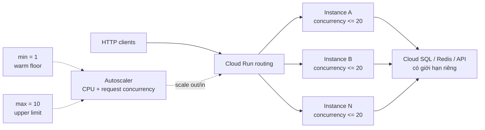

# Concurrency, autoscaling và số instance tối thiểu

Một API Java triển khai trên **Cloud Run** có thể phục vụ vài request mỗi phút và bất ngờ nhận hàng trăm request cùng lúc. Không cần quản lý node như Compute Engine hay GKE, nhưng người vận hành vẫn phải quyết định **một instance xử lý bao nhiêu request đồng thời**, **Cloud Run mở rộng tối đa đến đâu** và **có giữ instance sẵn sàng khi không có traffic hay không**. Ba quyết định này tác động trực tiếp đến độ trễ, tài nguyên CPU/RAM, kết nối cơ sở dữ liệu và hóa đơn.

Bài thuộc chương **Cloud Run** trong module **CLOUD_PROVIDERS_GCP**, nối kiến thức về project/IAM, mạng VPC, Compute Engine, GKE và dịch vụ dữ liệu với thực tế triển khai ứng dụng container trên Google Cloud. Trọng tâm là các **Cloud Run services dùng cơ chế autoscaling mặc định**; Cloud Run jobs, worker pools, Cloud Run instances độc lập và manual scaling là các mô hình khác.

> Tên project, service, container image, thông số tải và đơn giá trong bài là ví dụ. Thao tác deploy/update và load test có thể gây gián đoạn hoặc phát sinh phí; chỉ chạy trên môi trường được phép. Phạm vi số liệu và hành vi được đối chiếu tài liệu Google Cloud tại thời điểm biên soạn; luôn xác minh giới hạn và phiên bản CLI tại thời điểm triển khai thật.

## Mục tiêu học tập

Sau bài học, bạn có thể:

1. Phân biệt **request concurrency**, **số instance đang chạy**, **min/max instances** và **request queueing**.
2. Giải thích Cloud Run autoscale theo CPU, concurrency và nhu cầu nhận request, cùng ảnh hưởng của multi-vCPU.
3. Chọn `concurrency` cho Java HTTP API dựa trên CPU/RAM, thread pool, thời gian xử lý và kết nối database.
4. Giảm cold start bằng **minimum instances** mà không nhầm với HA tuyệt đối hoặc số instance cố định.
5. Phân biệt **service-level** và **revision-level** min/max, đặc biệt khi traffic splitting hoặc có tagged revisions.
6. Cấu hình và xác minh các thông số bằng Console, `gcloud` và Terraform.
7. Đo load test, metrics, chi phí và xử lý 429/5xx, latency tăng hoặc database quá tải.

## 1. Ba thông số, ba câu hỏi khác nhau

| Thông số | Câu hỏi | Ví dụ | Điểm cần nhớ |
| --- | --- | --- | --- |
| **Concurrency** | Mỗi instance nhận tối đa bao nhiêu request đang xử lý đồng thời? | `20` request/instance | **Không phải** số instance |
| **Min instances** | Cloud Run cố giữ bao nhiêu instance ấm để sẵn sàng nhận request? | `1` instance | Giảm cold start, **tăng chi phí idle** |
| **Max instances** | Dịch vụ/revision được mở rộng tối đa bao nhiêu instance? | `10` instances | Hạn chế chi phí và bảo vệ backend, có thể khiến request chờ/lỗi |



Ví dụ đơn giản: 100 request *đến cùng thời điểm* **không có nghĩa** Cloud Run lập tức tạo `100/20 = 5` instances. Autoscaler còn xét CPU, mức sử dụng thực, hàng chờ, thời gian khởi động, quota và ngưỡng mục tiêu. `20` chỉ là **trần nhận request trên mỗi instance**, không phải mức sử dụng mục tiêu hay cam kết số instance tức thì.

## 2. Concurrency: mức song song thực của ứng dụng

**Maximum concurrent requests per instance** quy định giới hạn số HTTP requests đang đồng thời được Cloud Run gửi tới một container instance. Mức hợp lệ có thể lên tới **1.000** tùy cấu hình và giới hạn dịch vụ.

**Không nên dựa vào “mặc định luôn là 80”.** Tài liệu Cloud Run hiện hành nêu:

- Service mới tạo qua **Google Cloud Console** có concurrency mặc định `80`.
- Service mới tạo qua **gcloud CLI/Terraform** có mức mặc định bằng **`80 × số vCPU`**; không tự tính lại mặc định này mỗi khi deploy revision mới.
- Hãy **đặt giá trị tường minh** trong IaC/deploy khi cần kết quả tái lập, và dùng `gcloud run services describe` để đọc cấu hình thực tế.

### Khi nên giảm hoặc tăng concurrency?

| Đặc tính workload | Hướng thử nghiệm | Lý do |
| --- | --- | --- |
| CPU-bound: xử lý ảnh, mã hóa, tính toán nặng | **Thấp** (ví dụ 1–8) | Giảm contention CPU và memory peak |
| Java REST API chủ yếu chờ database/network | **Trung bình** (ví dụ 10–40) | Tận dụng thời gian chờ I/O, nhưng giới hạn connection pool |
| I/O bất đồng bộ, event-loop được benchmark | Có thể **cao hơn** | Có khả năng xử lý nhiều kết nối cùng lúc |
| Xử lý một request cần nhiều RAM | **Thấp** | Ngăn nhiều request cùng cấp phát bộ nhớ làm OOM |
| Workload dựa vào mutable global state không an toàn | Trước mắt `1`; sau đó sửa code | Tránh race, nhưng có thể tăng cold starts và chi phí |

Đây là **giá trị bắt đầu để đo**, không phải quy tắc cố định theo framework. Một Java Spring Boot dùng servlet thread-per-request, JDBC blocking và HikariCP có các điểm nghẽn khác một ứng dụng WebFlux nonblocking.

### Tại sao đặt 1 không phải lúc nào cũng tốt?

`concurrency=1` nghĩa mỗi instance tối đa một request đang xử lý; khi traffic tăng, nền tảng có thể cần nhiều instances hơn, làm tăng thời gian scale-out, số TCP/database connections tổng và chi phí. Chỉ dùng khi application không xử lý an toàn nhiều request hoặc mỗi request chiếm gần hết CPU/RAM.

### Multi-vCPU và hiện tượng CPU hotspot

Cloud Run đánh giá **CPU utilization trung bình trên các vCPU**. Một luồng CPU-bound chiếm 100% một vCPU trong instance 4 vCPU có thể chỉ hiển thị khoảng **25% CPU trung bình**. Autoscaler có thể chưa scale như kỳ vọng theo CPU, dù request đang chờ. Giảm concurrency để tín hiệu lưu lượng thúc đẩy scale-out, hoặc right-size CPU/thread pool và đo lại.

## 3. Autoscaling: Cloud Run dựa trên tín hiệu nào?

Cloud Run services theo cơ chế tự động có thể **scale to zero** nếu `min=0` và không có request/hoạt động buộc giữ instance. Khi traffic tăng, có hai nhóm hành vi:

1. **Metrics-based scaling:** quan sát CPU utilization và request concurrency theo thời gian.
2. **On-demand scaling:** đáp ứng nhu cầu request mới ở thời điểm ngắn hạn; không nên coi công thức trung bình là mô phỏng chính xác mọi burst.

Tài liệu hiện hành mô tả mục tiêu mặc định của metrics-based scaling khoảng **60% CPU** và **60% concurrency**, có hỗ trợ tinh chỉnh mục tiêu trong những cấu hình áp dụng. CPU được tổng hợp trung bình theo vCPU; memory utilization **không phải tín hiệu autoscaling trực tiếp**.

```text
Ví dụ concurrency=20:
Mức mục tiêu khoảng 60% x 20 = 12 request đồng thời/instance

Nếu tổng trung bình đang xử lý ~36 request:
Ước lượng thô theo riêng concurrency: 36 / 12 ≈ 3 instances
```

Đây **chỉ là phép tính hiểu cơ chế**, không bảo đảm đúng 3 instance. Cloud Run lấy khoảng thời gian quan sát, làm tròn, xem CPU, có cơ chế điều chỉnh theo tải/CPU, cooldown, quotas, readiness và giới hạn min/max.

### Autoscaling không bảo đảm thành công mọi request

- **Container chưa sẵn sàng:** mới start phải khởi động runtime, mở port `PORT`, load classes/config và chạy probes.
- **Giới hạn quota/capacity:** không thể tạo thêm instance ngay dù muốn.
- **Max instance chạm trần:** request có thể chờ; tài liệu nêu thời gian chờ tối đa khoảng **`max(3,5 × thời gian startup trung bình, 10 giây)`** theo trường hợp áp dụng, sau đó request có thể thất bại.
- **Upstream nghẽn:** Cloud SQL hoặc API đích không tự scale cùng Cloud Run.
- **Request dài:** vẫn chiếm concurrency slot, ví dụ HTTP streaming hoặc WebSocket trong thời gian kết nối tồn tại.

Vì vậy, cùng một thay đổi `concurrency` có thể giảm số instance nhưng làm p95 latency tệ hơn; phải đo **cả chất lượng người dùng lẫn chi phí**.

## 4. Minimum instances: giảm cold start, không phải cố định VM

Với `min=0`, Cloud Run có thể ngừng tất cả instances khi nhàn rỗi. Request mới sau thời gian không có traffic có thể phải đợi **cold start**: nền tảng cấp container, tải image và khởi tạo ứng dụng.

Với `min=1`, Cloud Run **cố duy trì** một instance warm để nhận request sớm hơn. Đây là mục tiêu **best effort**; instance có thể bị thay/restart do bảo trì, crash, thiếu capacity hoặc quota, nên `min=1` **không bảo đảm** không bao giờ có cold start.

| Mục tiêu | Min gợi ý để thử | Đổi lại |
| --- | --- | --- |
| Dev/test, traffic rất thưa | `0` | Chi phí idle thấp, cold start có thể thấy rõ |
| API production nhỏ, nhạy latency đầu tiên | `1` | Có chi phí giữ instance warm |
| API cần headroom và HA cao hơn | `2–3` sau load test/SLO review | Phí nền cao hơn; vẫn cần kiến trúc sẵn sàng của dependencies |
| Xử lý background liên tục | Không chỉ tăng min | Xem **instance-based billing**, Cloud Tasks/Jobs hoặc worker pools đúng mô hình |

### Service-level và revision-level minimum

**Service-level min** (được Google khuyến nghị cho phần lớn dịch vụ) duy trì tổng min instances được phân bổ cho các revisions **đang nhận traffic**, theo tỷ lệ traffic split. Thay đổi mức này có hiệu lực ở service mà không cần tạo revision mới.

**Revision-level min** gắn với một revision cụ thể. Nếu revision nằm trong traffic split **hoặc có traffic tag**, nó có thể giữ warm instances và **vẫn tính phí ngay cả khi nhận 0% traffic**. Những tagged revisions còn cấu hình revision min là nguyên nhân thường gặp của chi phí không mong muốn sau canary.

Nếu kết hợp min ở service/revision với max ở một trong hai cấp, **max vẫn là giới hạn**, và nhiều min có thể làm tăng số instances phải duy trì; tránh pha trộn nếu không có lý do và không kiểm tra hiệu lực.

### “Min=1” không phải “chỉ chạy một instance”

Min là **sàn**; dưới tải, Cloud Run có thể tạo thêm instances tới max và quota cho phép. Nếu muốn cố định số instance, đó là bài toán **manual scaling**, không nên suy luận từ minimum instances.

## 5. Maximum instances: giới hạn chi phí và áp lực backend

**Max instances** bảo vệ ngân sách và các dependencies hữu hạn (database, legacy APIs, rate-limited vendors). Tuy nhiên, quá thấp có thể làm request đợi lâu hoặc bị lỗi trong peak traffic.

- **Service-level max:** trần được chia sẻ trên các revisions phục vụ traffic; được Google khuyến nghị dùng làm giới hạn phổ thông. Đổi trực tiếp có hiệu lực ở service.
- **Revision-level max:** chỉ áp dụng cho revision cụ thể và theo tài liệu hiện hành chủ yếu còn khả dụng với services đã cấu hình tính năng này trước đó; cấu hình revision mới có thể cần khác tùy trường hợp.
- **Kết hợp service/revision max:** giới hạn hiệu lực là mức **nhỏ hơn** khi cả hai cùng áp dụng.
- **Traffic splitting:** với service-level max, quota instance có thể được **phân bổ theo tỷ lệ traffic** giữa revisions. Một revision nhận 10% traffic có thể chạm trần phần được phân bổ dù tổng service chưa hết.
- **Không xem max là hard stop tuyệt đối từng mili giây:** nền tảng có thể vượt giới hạn trong thời gian rất ngắn ở một số điều kiện khi traffic đột biến.

Ví dụ một service có `max=10`, chia traffic 50/50 cho revision A/B. Mỗi revision có thể chỉ được phân bổ khoảng **5 instances** theo giới hạn service; không giả định mỗi revision đều có 10 instances.

### Bảo vệ Cloud SQL từ số instance

Giả sử Java service có `max=10`, mỗi instance dùng HikariCP `maximumPoolSize=5`:

```text
Kết nối DB tối đa do service này tạo theo mô hình đơn giản:
10 instances × 5 connections/instance = 50 connections
```

Cần dành headroom cho admin, migrations, các service khác và các kết nối ngoài pool. Khi rolling deployment, tagged revisions hoặc vượt max ngắn hạn, số kết nối thực **có thể cao hơn 50**, nên không dùng phép tính này làm bảo đảm. Giới hạn HikariCP và timeout/downstream backpressure vẫn cần thiết.

## 6. Chọn thông số bằng phép tính ban đầu

Với workload ổn định, dùng **Little's Law** để ước lượng số request đang xử lý:

\[
\text{Concurrency trung bình} \approx \text{RPS} \times \text{response time trung bình (giây)}
\]

**Ví dụ minh họa:** 120 request/giây và response time **trung bình** 250 ms:

```text
120 req/s × 0,25 s ≈ 30 request đang xử lý trung bình

Chọn concurrency=20 và mục tiêu minh họa 60%:
~12 request đang xử lý/instance ở mức mục tiêu
30 / 12 ≈ 2,5 -> khoảng 3 instances theo riêng tín hiệu concurrency
```

**Không dùng p95 để thay response time trung bình trong Little's Law.** P95/P99 dùng để đánh giá **SLO**, còn ước lượng tải trung bình dùng **mean**. Việc đặt min/max phải tính **peak RPS**, thời gian scale-out, request duration tail, CPU, RAM, DB capacity và biến động thời gian.

### Quy trình hiệu chỉnh

1. Đo baseline hiện tại: RPS, mean/p95/p99 latency, CPU, memory, số instance, DB pool saturation.
2. Chọn concurrency ban đầu theo thread pool, CPU-bound/I/O-bound và memory per request.
3. Đặt min dựa trên cold-start SLO và mức phí idle chấp nhận được.
4. Đặt max dựa trên quota và ngân sách/connection pool của hệ thống đích.
5. Load test ở staging từ mức nhỏ lên gần peak; thay **một biến mỗi lần**.
6. Đối chiếu error rate, latency tail và billable instance time; cập nhật IaC và rollback plan.

## 7. Triển khai Cloud Run và cấu hình bằng gcloud

### 7.1 Kiểm tra quyền và ngữ cảnh

Ví dụ project `retail-dev-01`, region `asia-southeast1`, service `orders-api`. Người deploy cần quyền cập nhật Cloud Run service và `iam.serviceAccounts.actAs` với service account runtime (vai trò `roles/iam.serviceAccountUser` phù hợp). Image phải ở Artifact Registry và có quyền pull thích hợp.

```bash
PROJECT_ID="retail-dev-01"
REGION="asia-southeast1"
SERVICE="orders-api"
IMAGE="asia-southeast1-docker.pkg.dev/retail-dev-01/apps/orders-api:1.0.0"
SERVICE_ACCOUNT="sa-orders-api@retail-dev-01.iam.gserviceaccount.com"

gcloud auth list
gcloud config get-value project
gcloud run services list --project="$PROJECT_ID" --region="$REGION"
```

Các giá trị trên chỉ là **placeholder định dạng hợp lệ**, không chứng minh image, repository hay service account đã tồn tại.

### 7.2 Deploy mới (thay đổi hạ tầng, có phí)

```bash
gcloud run deploy "$SERVICE" \
  --project="$PROJECT_ID" \
  --region="$REGION" \
  --image="$IMAGE" \
  --service-account="$SERVICE_ACCOUNT" \
  --cpu=1 \
  --memory=512Mi \
  --concurrency=20 \
  --min=1 \
  --max=10 \
  --timeout=60s \
  --no-allow-unauthenticated
```

**Ý nghĩa:** tối đa 20 requests đang xử lý trên mỗi instance; service cố giữ 1 warm instance, tự mở rộng tới max 10 theo policy/quota; chỉ principal có quyền `run.invoker` tương ứng mới gọi API. Không tự bật public endpoint để chạy load test.

### 7.3 Kiểm tra cấu hình sau deploy (chỉ đọc)

```bash
gcloud run services describe "$SERVICE" \
  --project="$PROJECT_ID" --region="$REGION"

gcloud run revisions list \
  --service="$SERVICE" \
  --project="$PROJECT_ID" --region="$REGION"
```

Trong **Cloud Run → Service → Scaling**, kiểm tra ba giá trị. **Concurrency gắn với template của revision**; thay đổi concurrency thường tạo **revision mới**. **Service-level min/max** tác động trực tiếp ở service, không phải lúc nào cũng cần tạo revision.

### 7.4 Thay đổi từng thông số có kiểm soát

```bash
# Đổi concurrency -> phát sinh revision mới; có thể ảnh hưởng traffic rollout.
gcloud run services update "$SERVICE" \
  --project="$PROJECT_ID" --region="$REGION" \
  --concurrency=10

# Đổi giới hạn service-level; không cần tạo revision mới.
gcloud run services update "$SERVICE" \
  --project="$PROJECT_ID" --region="$REGION" \
  --min=2 --max=10

# Nếu không cần instance warm nữa, đưa min về 0.
gcloud run services update "$SERVICE" \
  --project="$PROJECT_ID" --region="$REGION" \
  --min=0
```

Đây là **các phương án thử nghiệm riêng**, không phải một danh sách lệnh phải chạy liên tiếp trên production. Trước mỗi `update`, đọc cấu hình đang dùng và xác nhận traffic split/revisions; sau đó kiểm tra latency, error và chi phí.

### 7.5 Service-level khác revision-level ở CLI

| Cấp | Min | Max | Tác động thường gặp |
| --- | --- | --- | --- |
| **Service-level** | `--min` | `--max` | Quản lý giới hạn chung, được khuyến nghị |
| **Revision-level (cũ/đặc thù)** | `--min-instances` | `--max-instances` | Thuộc tính revision và có thể phát sinh revision mới |
| **Revision request concurrency** | `--concurrency` | Không phải max instances | Giới hạn request đồng thời/instance |

Không nhầm `--max-instances=10` (revision-level) với `--max=10` (service-level) trong automation. Các tham số revision-level có giới hạn về tính khả dụng với service mới theo tài liệu hiện hành; với dự án mới ưu tiên service-level scaling.

## 8. Terraform: lưu các quyết định trong IaC

Với Cloud Run API v2 provider, ví dụ phần cấu hình chính:

```hcl
resource "google_cloud_run_v2_service" "orders_api" {
  name                = "orders-api"
  location            = "asia-southeast1"
  project             = var.project_id
  deletion_protection = true

  scaling {
    min_instance_count = 1
    max_instance_count = 10
  }

  template {
    service_account                 = var.service_account_email
    max_instance_request_concurrency = 20

    containers {
      image = var.image_digest
      resources {
        limits = {
          cpu    = "1"
          memory = "512Mi"
        }
      }
    }
  }
}
```

Đây là **mẫu tối giản**, giả định có provider/variables và một image **pin digest** thật. IAM `run.invoker`, ingress, networking, secret và deployment pipeline phải khai báo theo yêu cầu môi trường. Review `terraform plan` để thấy thay đổi nào tạo revision, thay đổi nào chỉ tác động scaling; không chỉnh trực tiếp Console kéo dài gây configuration drift.

## 9. Java: ứng dụng phải xử lý concurrency an toàn

Cloud Run cho phép 20 concurrent requests **không có nghĩa** ứng dụng Java đã có 20 worker threads hoặc đủ database connections. Với Spring Boot servlet stack, số threads của web server, queue, HikariCP và timeout đều có thể tạo **nút cổ chai nội bộ**.

Ví dụ `application.properties` của một Java service dùng JDBC:

```properties
# Chỉ minh họa cấu hình; đo tải để quyết định giá trị thực tế.
server.tomcat.threads.max=40
server.tomcat.accept-count=50
spring.datasource.hikari.maximum-pool-size=5
spring.datasource.hikari.connection-timeout=3000

# Không bật các actuator endpoints nhạy cảm công khai.
management.endpoints.web.exposure.include=health,info
```

Với `concurrency=20`, tối đa 20 request có thể đồng thời chạy trong một instance nhưng **chỉ 5 request có thể mượn kết nối JDBC cùng lúc** từ pool này. Các request khác có thể đợi pool và vượt timeout. Nếu truy vấn chậm, tăng concurrency từ 20 lên 80 có thể làm p95 xấu hơn, không tự tăng DB throughput.

### Những điểm cần rà soát

- **Thread safety:** tránh mutable singleton state dùng chung giữa requests; không dùng biến static lưu dữ liệu người dùng.
- **Memory:** tổng heap, thread stacks, native memory, response buffers phải nằm trong container memory limit. Memory peak tăng theo concurrency.
- **CPU:** serialization, JSON parse, crypto và image processing cạnh tranh CPU với garbage collection.
- **DB connection pool:** tính tổng theo max instances, canary và các services khác; có timeout, backpressure.
- **Async work:** request-based billing có thể giảm CPU ngoài lúc xử lý requests. Không dựa vào background thread “chạy mãi”; dùng Cloud Tasks/Jobs/worker pools khi phù hợp.
- **Health/startup:** app phải listen trên `0.0.0.0:$PORT`, trả healthy chỉ khi thiết yếu đã sẵn sàng; giảm work không cần thiết trong startup.

## 10. Minimum instances và hai chế độ billing

Cloud Run services có hai cơ chế billing chính:

| Cơ chế | Tính CPU/RAM trong thời gian nào? | Khi min > 0 |
| --- | --- | --- |
| **Request-based billing** (mặc định) | Khi instance bắt đầu, kết thúc và đang phục vụ request | Idle warm instances vẫn bị tính phí ở **idle rate** thấp hơn active rate |
| **Instance-based billing** | Theo **toàn bộ vòng đời instance**, kể cả lúc không xử lý request | Min instances duy trì năng lực CPU cho tác vụ nền nhưng trả phí theo thời gian tồn tại |

Min > 0 **không miễn phí** trong cả hai cơ chế. Ngược lại, `min=0` không đồng nghĩa hóa đơn bằng không nếu vẫn có request, log, egress, database, mạng hay các tài nguyên khác.

### CPU ngoài request và tác vụ nền

Nếu cần thread Java thực thi **sau khi response kết thúc**, instance-based billing có thể phù hợp hơn request-based billing, nhưng instance vẫn có thể bị dừng/restart. Với tác vụ cần retry, deadline hay hoàn thành bảo đảm, dùng **Cloud Tasks**, **Cloud Run Jobs** hoặc mô hình worker phù hợp. `min=1` không biến Cloud Run service thành daemon bền vững.

### Ví dụ so sánh chi phí giả định

Một warm instance được duy trì suốt tháng 30 ngày:

```text
Thời gian dự kiến ≈ 1 instance × 30 ngày × 24 giờ = 720 instance-hours.
```

Đây là **thời gian năng lực duy trì**, **không thể nhân trực tiếp với giá vCPU active** để ra hóa đơn request-based; phải tách thời gian active/idle, CPU/RAM, request, region, free tier và cấu hình billable. Instance-based billing tính theo cơ chế khác. Dùng [Cloud Run pricing](https://cloud.google.com/run/pricing) và [Google Cloud Pricing Calculator](https://cloud.google.com/products/calculator) để ước lượng, rồi đối chiếu Cloud Billing theo SKU.

## 11. Quan sát và load test trước khi thay thông số

Một thay đổi concurrency/min/max chỉ được xem là tốt khi **SLO và chi phí** cùng được đánh giá.

| Tín hiệu | Nguồn | Hỏi điều gì? |
| --- | --- | --- |
| Request count/RPS | Cloud Run Metrics | Traffic có đúng baseline/peak? |
| Request latency p50/p95/p99 | Cloud Monitoring, tracing | Tail latency có tăng do queueing? |
| 429/5xx và request timeout | Request logs | Đang chạm max/capacity hay app lỗi? |
| Container instance count | Cloud Run Metrics | Autoscaler đã scale tới mức nào? |
| CPU utilization per instance | Cloud Monitoring | Có vCPU hotspot hay CPU saturate? |
| Memory utilization / OOM | Metrics + revision logs | Concurrency gây áp lực heap/native memory? |
| Container startup latency | Cloud Run startup metrics/logs | Min=1 có giảm cold starts không? |
| Billable instance time | Cloud Monitoring/Billing | Phí warm floor hay active load đang chi phối? |
| DB connections/wait time | Cloud SQL/Hikari metrics | Cloud Run scale-out có làm cạn DB pool? |

### Load test có kiểm soát

Trong staging, với tool `hey` đã cài và principal có quyền `run.invoker`:

```bash
PROJECT_ID="retail-dev-01"
REGION="asia-southeast1"
SERVICE="orders-api"

URL="$(gcloud run services describe "$SERVICE" \
  --project="$PROJECT_ID" --region="$REGION" \
  --format='value(status.url)')"
TOKEN="$(gcloud auth print-identity-token)"

# Chỉ gọi endpoint /health nếu ứng dụng thực sự có endpoint này.
# Bắt đầu với tải nhỏ, sau đó tăng dần trên staging.
hey -z 30s -c 10 \
  -H "Authorization: Bearer $TOKEN" \
  "$URL/health"

# Không in TOKEN vào log hoặc commit shell history chứa token.
```

**Lưu ý:** một `/health` rẻ gần như không có DB I/O sẽ **không đại diện** cho API nghiệp vụ. Để đánh giá concurrency, cần load test endpoint có workload tương tự production, dữ liệu thử riêng, traffic theo kịch bản, giới hạn RPS/duration và theo dõi chi phí. Kiểm thử `hey` giữ một mức concurrency cố định phía client; không phải lúc nào cũng tái tạo peak arrival rate thực tế.

### Ma trận thí nghiệm nhỏ

| Lần | Concurrency | Min | Max | Cần ghi lại |
| --- | ---: | ---: | ---: | --- |
| Baseline | 20 | 0 | 10 | p95, error, cold start, instance count |
| Warm | 20 | 1 | 10 | p95 sau idle và phí idle |
| Low concurrency | 5 | 1 | 10 | Scale-out, CPU, DB pool, startup |
| High concurrency | 40 | 1 | 10 | Memory, thread wait, p95, chi phí |

Thay **một thông số mỗi lần** và chạy đủ lâu để tính cả scale-up/scale-down. Chia canary traffic hoặc thử trên staging để tránh ảnh hưởng production. Không kết luận “40 tốt nhất” chỉ vì instance count nhỏ nhất nếu p95 hoặc lỗi tăng.

## 12. Tình huống thực tế: API Java tăng 5xx sau giờ cao điểm

### Bối cảnh

API `orders-api` trên Cloud Run gọi Cloud SQL. Cấu hình: **2 vCPU, 512 MiB, concurrency 80, min 0, max 30**, Hikari pool 10 kết nối/instance. Ban ngày traffic tăng từ 20 lên 400 RPS.

**Triệu chứng:** p95 latency tăng mạnh, lỗi timeout mượn DB connection, lúc đầu còn cold starts. Một số instances có CPU trung bình thấp nhưng một thread xử lý JSON/tính toán đã bận, còn database chạm connection limit.

### Điều tra

1. **Tách metrics:** kiểm tra Cloud Run instance count, p95, CPU/memory và DB active connections/pool wait.
2. **Xác minh mức default/concurrency thực:** đọc revision config, không suy từ gcloud defaults.
3. **Xem bản chất request:** CPU hotspot, số request chờ I/O, thời gian DB query và timeouts.
4. **Kiểm tra trần backend:** với 30 instances × 10 connections = tối đa khoảng **300 connections**, chưa kể các services khác, đủ để vượt budget DB.
5. **Đối chiếu tăng trưởng instance:** nếu scale nhanh gây DB exhaustion, nâng max hơn sẽ làm tình hình xấu hơn.

### Thay đổi được thử nghiệm ở staging

- Thử **concurrency 10–20** và benchmark p95/CPU/thread wait; tránh quá nhiều requests tranh cùng pool.
- Giảm/maximize connection pool có kiểm soát và đặt service-level **max** theo DB connection budget; tính headroom cho rolling revisions.
- Thử **min=1** nếu cold start đầu traffic thực sự ảnh hưởng SLO, đo chi phí idle so với lợi ích.
- Tối ưu query/connection reuse, pooling, retry có backoff và circuit breaker; không dùng autoscaling thay việc tối ưu DB.
- Cân nhắc tách CPU-heavy batch khỏi HTTP path sang Cloud Run Jobs/Tasks.

**Kết luận:** Không có bộ số “tốt nhất” cho mọi Java API. Cloud Run có thể scale tốt nhưng vẫn bị giới hạn bởi **ứng dụng và dữ liệu**. Kết quả cuối phải được xác nhận bằng load test với traffic thực tế và error budget.

## 13. Xử lý sự cố nhanh

| Triệu chứng | Điều nên kiểm tra trước | Không nên làm ngay |
| --- | --- | --- |
| Request đầu tiên sau idle chậm | Startup latency, min=0, JVM init, image size | Nâng max mà chưa đo cold start |
| P95 tăng khi traffic tăng | CPU, thread pool, Hikari wait, memory, concurrency | Tăng concurrency để giảm instance count bằng mọi giá |
| Số instance không tăng như kỳ vọng | CPU trung bình đa vCPU, concurrency target, quota, max | Kết luận autoscaler hỏng |
| Request chờ rồi 429/5xx | Max instance, pending queue, app 503, quotas | Bỏ max mà không tính DB capacity |
| Container OOM/restart | Memory peak, heap/native, số requests song song | Chỉ bật min > 0 |
| Cloud SQL “too many connections” | `max × pool size`, canary revisions, connection leak | Tăng max instances |
| Đặt min=1 nhưng vẫn cold start | Instance restart, new revision, burst > warm capacity | Coi min như SLA không cold start |
| Hóa đơn tăng khi vắng traffic | Min warm, billing mode, tagged revision min, log/egress | Tắt Monitoring mà chưa xác định SKU |
| Traffic split 90/10, canary lỗi | Phân bổ service max theo revisions, canary health | Giả định canary được toàn bộ max |
| Deploy thành công nhưng 403 | IAM `run.invoker`, auth token, ingress | Bật unauthenticated để “sửa” |

### Runbook thay đổi an toàn

1. Ghi project, region, service, revision, traffic split và cấu hình min/max/concurrency hiện tại.
2. Đặt mục tiêu rõ: giảm cold start, giữ p95 dưới SLO hay bảo vệ DB/budget.
3. Đo baseline, xem IAM/quotas/billing SKU và ước tính peak.
4. Thử thông số trên staging hoặc canary, chỉ thay một biến trong mỗi vòng thử.
5. Đo p95/p99, 429/5xx, instance count, CPU/memory, DB wait và chi phí.
6. Rollback revision nếu đổi concurrency gây lỗi; hoàn nguyên service-level min/max nếu cấu hình mới không đạt.
7. Cập nhật IaC/runbook, ghi lại kết quả và người phê duyệt.

## 14. Bài tập tự kiểm tra

### Bài 1 — Hiểu đúng ba thông số

Service đặt `concurrency=20`, `min=1`, `max=10`. Khi nhận 150 request cùng thời điểm, Cloud Run chắc chắn dùng đúng 8 instances không?

<details>
<summary>Đáp án</summary>

Không. 20 là giới hạn đồng thời trên mỗi instance, 1 là sàn best effort, 10 là trần theo chính sách. Autoscaling còn xét CPU, request concurrency target, startup/capacity và traffic; không bảo đảm lập tức tạo đúng 8 instances.
</details>

### Bài 2 — Tính Little's Law

Một API nhận 80 RPS và có **response time trung bình** 200 ms. Số request đồng thời trung bình xấp xỉ bao nhiêu?

<details>
<summary>Đáp án</summary>

`80 × 0,2 = 16` request đồng thời. Đây là ước lượng theo điều kiện ổn định, không phải p95 hoặc số instance phải có.
</details>

### Bài 3 — Bảo vệ database

Cloud Run `max=12` và mỗi instance mở tối đa 8 Hikari connections. Backend database chỉ còn budget 80 connections cho service. Có vấn đề gì?

<details>
<summary>Gợi ý đáp án</summary>

`12 × 8 = 96` connections trong mô hình đơn giản, vượt budget 80; rolling deployments có thể tạo thêm áp lực. Giảm pool/max, dùng pooling/proxy phù hợp, dành headroom và đo peak.
</details>

### Bài 4 — Cold start

API chỉ có vài request mỗi giờ, người dùng phàn nàn request đầu chậm. Nên thử thay đổi gì trước: concurrency, min hay max?

<details>
<summary>Gợi ý đáp án</summary>

Kiểm tra startup latency rồi thử `min=1` nếu SLO và budget cho phép; đồng thời tối ưu JVM/image startup. Tăng max không giải quyết trực tiếp cold start sau idle.
</details>

### Bài 5 — Hai chế độ billing

Một service có `min=2` nhưng không có traffic ban đêm. Vì sao vẫn có thể phát sinh phí ở request-based billing?

<details>
<summary>Đáp án</summary>

Hai warm instances vẫn tiêu thụ năng lực dự phòng và bị tính phí idle rate. Với instance-based billing, phí tính theo vòng đời instance, kể cả lúc idle.
</details>

### Bài 6 — Tagged revision

Canary revision nhận 0% traffic nhưng có traffic tag và revision-level `min=1`. Có thể phát sinh phí không?

<details>
<summary>Đáp án</summary>

Có. Revision được tag và revision-level min có thể giữ warm instance ngay cả khi không nhận traffic chính. Kiểm tra cấu hình revision cũ, gỡ tag/min khi hết cần và ưu tiên service-level min.
</details>

### Bài 7 — CPU hotspot

Ứng dụng một luồng CPU-bound trên 4 vCPU có 1 core đầy tải, Cloud Monitoring CPU trung bình ~25%, p95 vẫn tăng. Vì sao và nên thử gì?

<details>
<summary>Gợi ý đáp án</summary>

Autoscaler nhìn CPU trung bình trên 4 vCPU, nên 1 core bận chưa đẩy average lên cao. Xem right-size CPU, tăng hiệu quả parallelism hoặc giảm concurrency để request load thúc đẩy scale-out; đo lại p95 và chi phí.
</details>

### Bài 8 — Phân biệt phạm vi gcloud

`--max 10` khác `--max-instances 10` như thế nào khi cấu hình Cloud Run services?

<details>
<summary>Đáp án</summary>

`--max` đặt **service-level maximum instances**. `--max-instances` là **revision-level maximum** ở các services có tính năng này. Không thay thế tùy ý vì traffic splits, phạm vi cap và khả năng hỗ trợ khác nhau.
</details>

## 15. Checklist trước production

- [ ] Xác định service/revision/region, traffic split và giá trị concurrency đang chạy thực tế.
- [ ] Benchmark concurrency dựa trên CPU, RAM, thread pool, Hikari pool và p95/p99.
- [ ] Không phụ thuộc mặc định CLI/Console; đặt giá trị tường minh khi cần tái lập.
- [ ] Chọn min từ cold-start SLO và ngân sách, hiểu đây là warm floor best effort.
- [ ] Đặt service-level max để bảo vệ chi phí, DB và API đích, có headroom cho burst/rollout.
- [ ] Không lẫn service-level `--min`/`--max` với revision-level `--min-instances`/`--max-instances`.
- [ ] Kiểm tra tagged revisions/traffic split để tránh phí idle và cap bất ngờ.
- [ ] Biết billing là request-based hay instance-based; không chạy tác vụ nền bền vững dựa vào min.
- [ ] Cloud Monitoring có CPU, memory, instance count, request latency/errors, startup và billable time.
- [ ] Có load test staging, canary, rollback, budget alert và kế hoạch dữ liệu/DB connectivity.
- [ ] Cloud Run runtime identity và IAM `run.invoker` được giới hạn đúng; không mở public chỉ để test.
- [ ] Tất cả quyết định đã được ghi vào IaC và runbook vận hành.

## Tài liệu tham khảo chính thức

- [Maximum concurrent requests](https://cloud.google.com/run/docs/about-concurrency): khái niệm concurrency, mặc định CLI/Console, tối ưu CPU.
- [Configure concurrency](https://cloud.google.com/run/docs/configuring/concurrency): Console, `gcloud`, YAML, Terraform.
- [About Cloud Run instance autoscaling](https://cloud.google.com/run/docs/about-instance-autoscaling): CPU/concurrency targets, on-demand scaling, pending requests.
- [Configure minimum instances](https://cloud.google.com/run/docs/configuring/min-instances): service/revision-level minimum, tagged revisions và billing.
- [Configure maximum instances](https://cloud.google.com/run/docs/configuring/max-instances): service/revision caps, traffic splitting.
- [About maximum instance limits](https://cloud.google.com/run/docs/configuring/max-instances-limits): quotas và giới hạn capacity.
- [Billing settings](https://cloud.google.com/run/docs/configuring/billing-settings): request-based và instance-based billing.
- [Cloud Run performance tips](https://cloud.google.com/run/docs/tips/general): startup, concurrency và tối ưu ứng dụng.
- [Monitor Cloud Run services](https://cloud.google.com/run/docs/monitoring): metrics, logs và troubleshooting.
- [Cloud Run pricing](https://cloud.google.com/run/pricing): phí CPU/RAM, request, idle và networking.
- [Google Cloud Pricing Calculator](https://cloud.google.com/products/calculator): so sánh chi phí min/concurrency/CPU.

