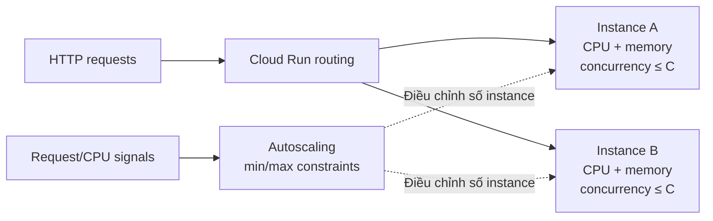
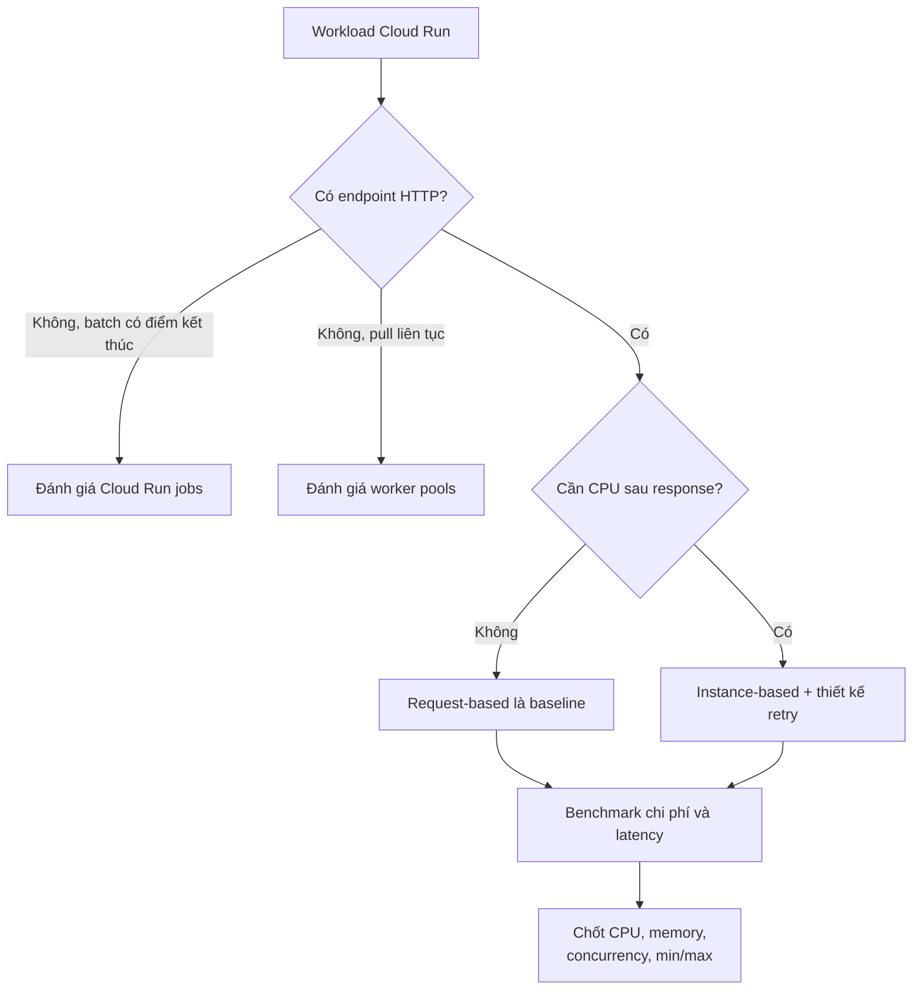

# CPU, memory và lựa chọn cơ chế tính phí Cloud Run

Cloud Run cho phép chạy ứng dụng container mà không phải trực tiếp quản trị máy ảo hay node Kubernetes. Tuy nhiên, chọn sai **CPU, memory, concurrency hoặc billing setting** có thể gây hết bộ nhớ, tăng độ trễ, mở rộng instance không hiệu quả hoặc phát sinh chi phí không cần thiết.

Bài thuộc chương **Cloud Run** của module `CLOUD_PROVIDERS_GCP`, nối tiếp kiến thức về project, IAM, VPC, Compute Engine và GKE. Trọng tâm là **Cloud Run services có autoscaling**, trong đó có hai cách tính phí chính: **request-based billing** và **instance-based billing**. Các ví dụ áp dụng cho REST API, Spring Boot và tác vụ bất đồng bộ, đồng thời gắn với mục tiêu bảo vệ tài nguyên, giám sát độ tin cậy và kiểm soát chi phí.

> Lưu ý: **Cloud Run services**, **jobs**, **worker pools** và loại tài nguyên **Cloud Run instances** có vòng đời, cách tính phí và một số giới hạn khác nhau. Không áp dụng nguyên xi các flag và mức mặc định của services cho loại tài nguyên khác. Giá, quota và tính năng thay đổi theo region và thời điểm; luôn đối chiếu tài liệu Google Cloud trước khi dùng production.

## 1. Mục tiêu học tập

Sau bài này, bạn có thể:

1. Phân biệt **vCPU được cấu hình**, **thời gian CPU được cấp** và **thời gian có thể bị tính phí**.
2. Chọn CPU/memory phù hợp cho workload I/O-bound, CPU-bound hoặc JVM.
3. So sánh **request-based** với **instance-based billing**, hiểu tác động tới tác vụ nền và scale-to-zero.
4. Giải thích mối liên hệ giữa **concurrency, min/max instances, startup CPU boost, latency và chi phí**.
5. Dùng `gcloud` xem/cập nhật cấu hình Cloud Run service, sau đó theo dõi và đánh giá bằng load test.
6. Tính thử vCPU-seconds, GiB-seconds và nhận diện các khoản phí ngoài compute.

## 2. Một request đi qua Cloud Run như thế nào?

Với một Cloud Run service sử dụng autoscaling, request được gửi tới revision đang nhận traffic. Cloud Run có thể định tuyến tới instance hiện có hoặc khởi tạo instance mới nếu cần thêm năng lực.



Ba khái niệm cần tách:

| Khái niệm | Ý nghĩa | Ví dụ |
| --- | --- | --- |
| **CPU limit** | Số vCPU được cấu hình cho **mỗi container instance** (hoặc mỗi container trong cấu hình nhiều container). | `1 vCPU`. |
| **Memory limit** | Lượng bộ nhớ tối đa được cấp cho container, bao gồm nhu cầu của process và sử dụng bộ nhớ liên quan. | `512Mi` hoặc `1Gi`. |
| **Billing setting** | Quyết định khi nào CPU được cấp và khoảng thời gian instance được tính phí theo mô hình tương ứng. | Request-based hoặc instance-based. |

Một instance có `2 vCPU` không tự chạy nhanh gấp đôi instance `1 vCPU` nếu ứng dụng chỉ có một luồng xử lý nặng CPU. Tương tự, cấp memory lớn không bảo đảm request latency giảm nếu bottleneck nằm ở Cloud SQL hoặc API bên ngoài.

## 3. Chọn CPU và memory

### 3.1. CPU: workload cần bao nhiêu năng lực tính toán?

- **CPU-bound:** mã hóa, nén, tính toán, xử lý ảnh, JSON lớn. Nên thử thêm vCPU nếu ứng dụng thật sự tận dụng được xử lý song song.
- **I/O-bound:** API chủ yếu chờ database hoặc external service. Nhiều vCPU chưa chắc giúp giảm latency; ưu tiên tối ưu connection pool, timeouts và concurrency.
- **JVM/Spring Boot:** startup và garbage collection có thể tốn CPU; cần đo cold start, heap, non-heap và số luồng thực tế.

Cloud Run services hỗ trợ các cấu hình CPU như `1`, `2`, `4`, `6`, `8` vCPU và một số cấu hình **fractional CPU** dưới 1 vCPU, với điều kiện cụ thể. Không phải mọi tổ hợp CPU/memory hay execution environment đều hợp lệ.

### 3.2. Quan hệ CPU–memory

Bảng định hướng theo giới hạn Cloud Run **services**:

| vCPU cấu hình | Memory cho phép theo dải công bố | Ghi chú |
| --- | --- | --- |
| `0.08` đến dưới `1` | Bị giới hạn theo CPU; tối đa `512Mi` nếu dưới `0.5 vCPU`, tối đa `1Gi` khi đủ từ `0.5 vCPU` | Có điều kiện fractional CPU bên dưới. |
| `1` | Tối đa `4Gi` | Thường hợp lý để bắt đầu đo một HTTP API. |
| `2` | Tối đa `8Gi` | Cẩn thận ứng dụng chỉ dùng một core. |
| `4` | Từ `2Gi` tới `16Gi` | Đánh giá xử lý đa luồng và chi phí. |
| `6` | Từ `4Gi` tới `24Gi` | Dành cho nhu cầu tài nguyên lớn hơn. |
| `8` | Từ `4Gi` tới `32Gi` | Không phải giới hạn cần tận dụng mặc định. |

**Fractional CPU dưới 1 vCPU** có các ràng buộc quan trọng đối với services: phải dùng **request-based billing**, **maximum concurrency = 1**, **first-generation execution environment**, và memory giới hạn theo mức CPU. Với second-generation, memory tối thiểu thường là `512Mi`; first-generation có thể cho phép thấp hơn theo cấu hình được hỗ trợ. Kiểm tra chi tiết trước khi đặt `--cpu=0.5`.

Các số trong bảng là **giới hạn cấu hình**, không phải một benchmark hiệu năng hay bảo đảm capacity. Organization Policy, tài nguyên đặc biệt và các tính năng mới có thể áp đặt ràng buộc khác.

### 3.3. Memory: không chỉ có heap

Memory dùng bởi container có thể bao gồm:

- Runtime và mã ứng dụng, ví dụ JVM heap, metaspace, stacks, direct buffers.
- Cache trong tiến trình, thư viện native, buffer cho request/response.
- Dữ liệu tạm trong filesystem dựa trên bộ nhớ khi có sử dụng.
- Nhu cầu tăng thêm từ nhiều request xử lý đồng thời.

Nếu vượt memory limit, container instance có thể bị kết thúc và các request đang xử lý thất bại. **Tăng memory limit** chỉ đúng khi ứng dụng cần thêm bộ nhớ thực; memory leak, lưu payload vô hạn hoặc concurrency quá cao cần sửa trong code/cấu hình.

Ước lượng thô để lập kế hoạch:

\[
M_{\text{peak}} \approx M_{\text{nền}} + C_{\text{đồng thời}} \times M_{\text{mỗi request}}
\]

Giả sử ứng dụng dùng 300 MiB nền, mỗi request thêm tối đa 15 MiB và mỗi instance nhận 20 request đồng thời, mô hình đơn giản cho `300 + 20 × 15 = 600 MiB`. Chọn `512Mi` có thể thiếu; `1Gi` là ứng viên thử nghiệm hợp lý nếu CPU/memory constraints cho phép. **Đây chỉ là sizing sơ bộ**: JVM GC, chia sẻ memory, phân bố đỉnh tải và sidecars có thể làm số thực tế khác.

### 3.4. vCPU hotspot

Autoscaling Cloud Run sử dụng tín hiệu CPU trung bình trên tổng CPU được cấp. Với ứng dụng **single-threaded** nhưng buộc chọn `2 vCPU` do cần memory lớn, một core chạy 100% trong khi core còn lại gần 0% có thể khiến mức CPU trung bình nhìn thấy chỉ khoảng 50%. Kết quả là **CPU-based scaling phản ứng kém** dù một luồng đã bị bão hòa.

Cách xử lý: bắt đầu với ít vCPU nhất đáp ứng memory; tối ưu concurrency, tăng xử lý song song nếu phù hợp, và đo p95 latency, throughput, CPU utilization trước khi tăng cấu hình.

## 4. Hai cơ chế tính phí của Cloud Run services

Hai lựa chọn được Google Cloud gọi là **request-based billing** (mặc định) và **instance-based billing**. Tên cũ tương ứng là **CPU only allocated during request processing** và **CPU always allocated**.

| Tiêu chí | **Request-based** | **Instance-based** |
| --- | --- | --- |
| CPU được cấp | Khi xử lý request, giai đoạn startup/shutdown theo vòng đời. | Trong toàn bộ vòng đời instance, kể cả lúc không có request. |
| Compute billing | Theo **thời gian hoạt động có tính phí**; có thành phần phí request. | Theo **toàn bộ vòng đời** instance, kể cả idle; dùng bảng giá riêng. |
| Min instances đang idle | Có **phí idle theo mức giá áp dụng**; không hoàn toàn miễn phí. | Tiếp tục tính phí theo toàn bộ CPU/memory của instance. |
| Tải thưa hoặc tăng giảm đột ngột | Thường là điểm bắt đầu tốt. | Có thể trả thêm cho thời gian idle. |
| Tải đều, duy trì liên tục | Cần so tổng phí và request fees. | Có thể cạnh tranh về giá ở mức sử dụng cao và ổn định. |
| Công việc cần CPU sau HTTP response | Không có bảo đảm CPU tiếp tục được cấp ngoài request. | CPU tiếp tục được cấp khi instance tồn tại. |
| Scale-to-zero | Hỗ trợ nếu min = 0. | **Vẫn có thể** scale-to-zero nếu min = 0; không có nghĩa instance tồn tại vô hạn. |

### 4.1. Request-based billing không đơn giản là “chỉ trả tiền theo số request”

Phí có thể gồm **vCPU-seconds, GiB-seconds, phí request**, cộng startup/shutdown và idle minimum instances theo bảng giá áp dụng. Hai request cùng chạy chồng lên nhau trong một instance thường chia sẻ **một khoảng thời gian tính phí của instance**, chứ không phải cứ cộng riêng toàn bộ thời gian của từng request rồi nhân CPU/memory hai lần.

Khi `min instances = 0` và không có instance hoạt động, **không có phí compute cho instance không tồn tại**; vẫn có thể có phí ở dịch vụ khác như Artifact Registry, Cloud SQL, network và logging. Nếu đặt `min > 0`, request-based vẫn có chi phí giữ instance ấm lúc idle, theo idle rate.

### 4.2. Instance-based billing không đồng nghĩa “máy chạy 24/7”

CPU được cấp ngoài request, nhưng autoscaler vẫn có thể **dừng instance nhàn rỗi**. Nếu service scale về zero, **không còn instance để thực hiện tác vụ nền** cho đến khi request mới kích hoạt một instance. Vì thế:

- Với tác vụ ngắn phải xử lý sau response, instance-based có thể phù hợp hơn request-based, nhưng vẫn phải xử lý shutdown, retry và idempotency.
- Với nhu cầu luôn có CPU khi idle, cân nhắc `min instances > 0`, đồng thời chấp nhận phí duy trì instance.
- Với công việc cần hoàn tất chắc chắn, nên dùng **Cloud Tasks, Cloud Run jobs, Pub/Sub hoặc worker pool** theo mẫu workload thay vì chỉ tạo thread chạy nền và hy vọng instance sống mãi.

**Cloud Run jobs** chạy task đến khi hoàn tất theo mô hình job và dùng **instance-based billing**; worker pools và những loại tài nguyên Cloud Run khác có cơ chế tính phí riêng. Đừng nhầm cài `--no-cpu-throttling` trên **service** với việc tạo Cloud Run job.

### 4.3. Lựa chọn nhanh



## 5. Concurrency, autoscaling và min/max instances

### 5.1. Concurrency là số request đang chạy, không phải RPS

`--concurrency=20` giới hạn **tối đa 20 request đồng thời trên mỗi instance**. Đó **không phải** giới hạn 20 request/giây. Khả năng xử lý theo giây còn phụ thuộc thời gian request và tốc độ ứng dụng.

Một ước lượng capacity minh họa từ định luật Little:

\[
\text{Concurrent requests trung bình} \approx
\text{Requests/giây} \times \text{Thời gian request (giây)}
\]

Ví dụ `100 request/s × 0,2 s = 20` request đồng thời trung bình. Nếu một instance xử lý hiệu quả 10 request đồng thời, trực giác cần ít nhất vài instance. Nhưng công thức này **không phải thuật toán autoscaling**: Cloud Run còn theo dõi CPU, phân bố tải, startup, pending requests và những ràng buộc khác.

**Concurrency cao** có thể tiết kiệm instance-hours/requests overhead nhưng làm tăng memory và latency tail nếu app không hỗ trợ song song. **Concurrency thấp** tạo thêm nhiều instances, có thể cải thiện isolation nhưng tăng phí và số kết nối Cloud SQL.

### 5.2. Min và max instances

- **Service-level min** giữ một số instance ấm, giúp giảm cold starts nhưng tạo chi phí idle.
- **Service-level max** giới hạn quy mô tự động theo chính sách, giúp bảo vệ downstream và quản lý ngân sách.
- Giới hạn **revision-level** có thể khác service-level; với traffic splits, cần kiểm tra cả hai cấp.
- **Max không phải hard cap tuyệt đối cho mọi khoảnh khắc**: Cloud Run có thể tạm vượt giới hạn trong vài tình huống như spike/maintenance hoặc thay thế instance. Cũng không đảm bảo luôn scale tới max vì quota/capacity.

Với service kết nối Cloud SQL, đừng đặt `max=100` nếu mỗi instance có connection pool 50 và DB không thể chịu vài nghìn connections. Cần tính tổng kết nối và margin phù hợp.

### 5.3. Startup CPU boost

**Startup CPU boost** cấp CPU tăng tạm thời khi instance khởi động và thêm một khoảng ngắn sau startup (theo tài liệu hiện hành là **10 giây**). Nó có thể giảm cold-start latency của JVM/Spring Boot hoặc tiến trình nạp thư viện nặng, **nhưng CPU tăng thêm có thể được tính phí**.

Không nên bật/tắt dựa trên suy đoán. Đo:

1. Cold start p50/p95 và thời gian ứng dụng listen cổng HTTP.
2. Thời gian xử lý request đầu tiên.
3. CPU billable time và số lần scale out trong tải thực.
4. Ảnh hưởng khi có sidecars và quota/cấu hình hỗ trợ.

## 6. Mô hình chi phí: tính theo lượng tài nguyên và thời gian

Các đơn vị tính phổ biến là **vCPU-second**, **GiB-second**; request-based còn có **phí request** theo bảng giá. Giá khác nhau theo region, mô hình billing, free tier/discounts và các SKUs.

Gọi \(v\) là vCPU/instance, \(m\) là GiB/instance và \(T\) là **tổng thời gian có thể tính phí của các instance** trong mô hình đang xét:

\[
\text{CPU usage} = v \times T \;\;(\text{vCPU-s})
\]
\[
\text{Memory usage} = m \times T \;\;(\text{GiB-s})
\]

### 6.1. Ví dụ request chồng nhau

Một instance có `1 vCPU` và `512Mi = 0,5 GiB`. Hai HTTP requests cùng chạy trong 2 giây. Giả sử chỉ xét đúng 2 giây phục vụ request, chưa tính startup/shutdown/min idle:

| Hạng mục | Kết quả minh họa |
| --- | ---: |
| Thời gian instance xử lý request | 2 giây, **không phải 4 giây** |
| CPU usage | `1 × 2 = 2 vCPU-s` |
| Memory usage | `0,5 × 2 = 1 GiB-s` |
| Số requests | 2, dùng riêng khi tính request charges |

**Đừng nhân số request với số vCPU rồi coi đó là thời gian CPU tính phí**, vì request đồng thời dùng chung tài nguyên của instance.

### 6.2. So sánh hai mô hình bằng thời gian giả định

Một service có `1 vCPU, 1 GiB`. Trong một khoảng quan sát, cộng thời gian tất cả instances ta có:

- **400 instance-seconds đang xử lý requests**.
- **1.400 instance-seconds tồn tại nhưng không nhận request**, nếu chọn instance-based và các instance thực tế còn sống.

| Mô hình | CPU tính phí trong ví dụ | Memory tính phí trong ví dụ |
| --- | ---: | ---: |
| Request-based, min=0, bỏ qua startup/shutdown | `400 vCPU-s` | `400 GiB-s` |
| Instance-based với vòng đời tổng 1.800 giây | `1.800 vCPU-s` | `1.800 GiB-s` |

**Đây không phải so sánh tiền tệ trực tiếp.** Hai mô hình dùng đơn giá khác nhau; request-based có phí request, instance-based có thể được tối ưu cho tải liên tục; thời gian sống thực của instances còn thay đổi theo autoscaling. Nếu `min > 0`, cần tính **idle min-instance charges** cho request-based. Cần thêm startup CPU boost, network, logging, Artifact Registry và Cloud SQL nếu có.

### 6.3. Quy trình so sánh chi phí đúng

1. Ghi nhận số request, request latency, concurrent requests, startup events và instance count theo khung giờ.
2. So tài nguyên **vCPU, memory, concurrency, min/max** đã cấu hình.
3. Đo **billable instance time** và chi phí theo SKU, không chỉ lấy trung bình CPU%.
4. Sử dụng **Cloud Run pricing calculator** với region, free tier và chiết khấu phù hợp.
5. Load-test hai cấu hình trong môi trường được phép, kiểm tra latency/error rate và chi phí cùng lúc.

Giá theo USD hoặc số free tier tại một thời điểm **không nên chép cứng làm kết luận dài hạn**. Theo dõi Cloud Billing thực tế và bảng giá chính thức.

## 7. Thực hành với gcloud: xem và đổi cấu hình

Giả định đã có một **Cloud Run service** `orders-api-dev` trong project `orders-dev`, region `asia-southeast1`. Bài lab trước tiên **chỉ đọc** cấu hình hiện tại; các lệnh cập nhật sẽ tạo revision mới hoặc thay đổi scaling/billing và có thể phát sinh phí.

### 7.1. Kiểm tra service hiện có

```bash
PROJECT_ID="orders-dev"
REGION="asia-southeast1"
SERVICE="orders-api-dev"

gcloud auth list
gcloud run services list \
  --project="$PROJECT_ID" \
  --region="$REGION"

gcloud run services describe "$SERVICE" \
  --project="$PROJECT_ID" \
  --region="$REGION" \
  --format=yaml
```

Tìm **CPU/memory limits, container concurrency, service/revision scaling, các annotations về billing và startup boost**, cũng như phiên bản image. Nếu service không tồn tại, không tự tạo một bản public không xác thực để hoàn tất bài tập.

### 7.2. Cấu hình thử request-based billing

Với một HTTP API thưa tải, cấu hình khởi đầu hợp lệ là `1 vCPU`, `512Mi`, concurrency `20` và min=0:

```bash
# CẬP NHẬT TÀI NGUYÊN THẬT: chỉ trên service lab được phê duyệt.
gcloud run services update "$SERVICE" \
  --project="$PROJECT_ID" \
  --region="$REGION" \
  --cpu=1 \
  --memory=512Mi \
  --concurrency=20 \
  --cpu-throttling \
  --no-cpu-boost

# Service-level min/max (khác giới hạn cũ ở revision-level).
gcloud run services update "$SERVICE" \
  --project="$PROJECT_ID" \
  --region="$REGION" \
  --min=0 \
  --max=5
```

- `--cpu-throttling`: request-based billing, CPU không được cấp liên tục cho tác vụ nền sau response.
- `--no-cpu-boost`: tắt startup boost để có baseline khi benchmark.
- `--min=0`: cho phép scale-to-zero khi không có traffic.
- `--max=5`: chọn trần service-level để giảm rủi ro quá tải DB/chi phí; không phải hard cap tuyệt đối ở mọi thời điểm.

Không coi cấu hình này là chuẩn cho Spring Boot production: có ứng dụng cần `1Gi` hoặc hơn để tránh OOM; có ứng dụng cần concurrency khác vì thread pool/DB connections.

### 7.3. Đánh giá instance-based billing

Khi workload có tác vụ nền ngắn sau response hoặc tải rất đều, có thể thử:

```bash
# CẬP NHẬT TÀI NGUYÊN THẬT: bật instance-based.
gcloud run services update "$SERVICE" \
  --project="$PROJECT_ID" \
  --region="$REGION" \
  --no-cpu-throttling

# Nếu thật sự cần một instance ấm để chạy giữa các requests:
gcloud run services update "$SERVICE" \
  --project="$PROJECT_ID" \
  --region="$REGION" \
  --min=1
```

**Quan trọng:** nếu không cần CPU chạy liên tục, đừng đặt min=1 chỉ vì sợ cold start. **Min=1 với instance-based tính phí suốt thời gian instance tồn tại**. Instance cũng có thể bị thay hoặc chấm dứt bất ngờ; tác vụ phải có retry/checkpoint thay vì tin tưởng một process vĩnh viễn.

Để quay về baseline của mục 7.2, cập nhật lại `--cpu-throttling` và `--min=0` sau khi đã ghi kết quả benchmark.

### 7.4. YAML annotation để đọc cấu hình

Trong dạng YAML export của Cloud Run service dùng Knative Service API:

```yaml
apiVersion: serving.knative.dev/v1
kind: Service
metadata:
  name: orders-api-dev
spec:
  template:
    metadata:
      annotations:
        run.googleapis.com/cpu-throttling: "false"
        run.googleapis.com/startup-cpu-boost: "true"
    spec:
      containerConcurrency: 20
      containers:
        - image: IMAGE_URI_REPLACE_ME
          resources:
            limits:
              cpu: "1"
              memory: "1Gi"
```

Mẫu trên **chỉ giải thích các trường**, không phải manifest đầy đủ sẵn sàng `replace`. `cpu-throttling: "false"` có nghĩa **instance-based**, còn `"true"` là **request-based**. Đối với service-level min/max, metadata và API field có thể nằm ở lớp khác so với revision. Nên đọc **cấu hình export của chính service**, không tự ghép nhiều dạng API/YAML rồi thay thế production.

## 8. Chọn cấu hình theo tình huống

| Workload | Cấu hình khởi đầu nên thử | Lý do và điều cần kiểm tra |
| --- | --- | --- |
| API nhận request rải rác, xử lý nhanh | `1 vCPU`, `512Mi–1Gi`, request-based, min=0. | Tránh idle compute; theo dõi cold start, p95, OOM. |
| Spring Boot API phải giữ latency thấp | `1–2 vCPU`, memory từ benchmark, min=1 nếu thật sự cần. | Giảm cold start có chi phí; quan sát JVM warm-up, connection pool. |
| API có tải đều, instance gần như luôn hoạt động | So sánh request-based và instance-based bằng billing thực. | Instance-based có thể có lợi tùy đơn giá và phí request; không suy đoán. |
| API CPU-bound xử lý song song | Thử tăng vCPU nếu tận dụng nhiều threads; chỉnh concurrency. | Đo CPU hotspots, RPS, latency và $/request. |
| API single-threaded cần memory lớn | Cẩn trọng khi tăng lên nhiều vCPU. | CPU utilization trung bình dễ che giấu một core bão hòa. |
| Tác vụ bất đồng bộ sau HTTP response | Instance-based + cơ chế retry, hoặc Cloud Tasks. | CPU được cấp ngoài request nhưng instance vẫn có thể bị dừng. |
| Batch có điểm bắt đầu/kết thúc | Cloud Run **jobs**. | Không cần giữ HTTP service sống chỉ để chạy batch. |
| Worker liên tục đọc hàng đợi | Đánh giá **worker pools**. | Mô hình service autoscaling theo request có thể không phù hợp. |

## 9. Giám sát và xử lý sự cố

### 9.1. Dashboard tối thiểu

| Tín hiệu | Câu hỏi cần trả lời |
| --- | --- |
| Request count, response latency p95/p99, 5xx/429 | Người dùng có bị quá tải hay timeout? |
| CPU utilization / allocated CPU | Ứng dụng thực sự dùng CPU hay chỉ chờ I/O? |
| Memory utilization, instance termination/OOM | Limit có đủ cho peak và concurrency hiện tại không? |
| Instance count, concurrency, cold-start latency | Cơ chế scale phù hợp tải và ngân sách không? |
| Billable instance time và Cloud Billing theo SKU | Request-based hay instance-based đang rẻ hơn trong thực tế? |
| Cloud SQL connections, external API latency | Bottleneck có nằm ở downstream không? |

Mỗi lần thử, chỉ thay **một nhóm tham số** rồi kiểm tra cả **latency, lỗi và chi phí**. Đừng kết luận CPU=2 tốt hơn CPU=1 chỉ vì một lần request đơn lẻ nhanh hơn.

### 9.2. Lỗi thường gặp

| Hiện tượng | Nguyên nhân có thể | Cách kiểm tra |
| --- | --- | --- |
| Đổi `--cpu=0.5` không được | Chưa đáp ứng yêu cầu first-gen, request-based, concurrency=1 hoặc memory. | Xem CPU/memory constraints và execution environment. |
| Container OOM | Heap/cache + concurrent request vượt limit. | Cloud Run logs/metrics, profiler, giảm concurrency hoặc tăng memory hợp lệ. |
| CPU cao nhưng scale không như ý | Max instances, quota, multithreading/vCPU hotspot hoặc signal chưa đủ. | Instance count, CPU trung bình, request latency, scaling configuration. |
| Cold starts kéo dài | JVM init nặng, tải dependencies/network, min=0, image/app startup lâu. | Đo startup time, đánh giá startup boost/min instances và tối ưu app. |
| Chi phí tăng khi ít requests | Instance-based hoặc min instances, background CPU, cấu hình dư tài nguyên. | Xem billing setting, min, instance count và billable instance time. |
| Tác vụ nền dừng giữa chừng | Request-based không cấp CPU ngoài request, hoặc instance bị shutdown khi idle. | Dùng queue/job/worker với retry, không tin vào thread nền đơn lẻ. |
| 429 lúc cao điểm | Đã chạm capacity/max instances hoặc requests pending quá lâu. | Xem scaling, latency, quota và downstream bottleneck. |
| Cloud SQL quá nhiều connections | Concurrency/max instances × connection pool quá lớn. | Đặt pool limits, capacity budgets và circuit breakers. |

## 10. Bài tập có đáp án

**Bài 1 — Chọn billing.** Một API nhận vài requests mỗi phút, không có tác vụ nền và không yêu cầu luôn giữ instance ấm. Nên thử chế độ nào?

*Đáp án:* Bắt đầu với **request-based billing, min=0**. Theo dõi cold start và chi phí thực. Không cần trả tiền cho một instance idle nếu SLO vẫn đạt.

**Bài 2 — Background thread.** API trả HTTP 202 rồi tiếp tục chạy thread gửi email trong 90 giây. Tại sao request-based rủi ro? Instance-based có bảo đảm email sẽ gửi xong không?

*Đáp án:* Request-based không bảo đảm cấp CPU liên tục sau khi response kết thúc. Instance-based cấp CPU khi instance còn sống nhưng **không bảo đảm instance tồn tại đến khi hoàn thành**. Dùng **Cloud Tasks hoặc thiết kế queue có retry/idempotency** là an toàn hơn.

**Bài 3 — Sizing memory.** JVM có nền 350 MiB, mỗi request thêm 12 MiB và instance chạy 25 requests đồng thời. Memory peak theo mô hình đơn giản là bao nhiêu?

*Đáp án:* `350 + 25 × 12 = 650 MiB`. `512Mi` có nguy cơ OOM; đánh giá `1Gi` và kiểm thử với GC/heap/native memory thực.

**Bài 4 — CPU hotspot.** Ứng dụng single-threaded đặt 2 vCPU nhưng CPU metric trung bình 50% và request chậm. Vì sao?

*Đáp án:* Một core có thể bị bão hòa 100% còn core khác gần như không dùng. Tuning concurrency, song song hóa workload hoặc chọn 1 vCPU nếu memory cho phép; không chỉ dựa vào CPU trung bình.

**Bài 5 — Tính usage khi request đồng thời.** Một instance 2 vCPU, 1 GiB xử lý 4 requests chồng nhau trong 3 giây. Chỉ xét khoảng phục vụ requests. Tính usage.

*Đáp án:* `2 × 3 = 6 vCPU-s` và `1 × 3 = 3 GiB-s`, **không** nhân thêm 4 lần. Request fees có thể được tính riêng.

**Bài 6 — Min instances.** Vì sao service đặt request-based và min=2 vẫn có thể phát sinh phí trong thời gian không có request?

*Đáp án:* Các **idle minimum instances** vẫn bị tính phí theo mức idle rate phù hợp (CPU và memory). Request-based chỉ miễn compute khi không có billable instance, không phải mọi thời gian idle đều miễn phí.

**Bài 7 — Chọn loại tài nguyên.** Một tác vụ tạo báo cáo lúc 02:00 hằng ngày, chạy 20 phút rồi kết thúc. Có cần giữ Cloud Run service instance-based chạy suốt không?

*Đáp án:* Không. Đánh giá **Cloud Run job** được kích hoạt bởi scheduler/workflow phù hợp; tính phí cho quá trình thực thi theo cơ chế job, tránh giữ HTTP service nhàn rỗi.

## 11. Checklist trước production

- [ ] Xác định tài nguyên là **Cloud Run service**, job, worker pool hay dạng khác; không trộn cấu hình/billing.
- [ ] Có số đo CPU, memory peak, cold start, request latency và concurrency thực.
- [ ] CPU–memory combination hợp lệ; fractional CPU thỏa yêu cầu first-gen/request-based/concurrency=1.
- [ ] Chọn request-based/instance-based theo traffic và background-work requirements, không theo cảm tính.
- [ ] Nếu dùng min instances, đã chấp nhận chi phí idle; nếu min=0, đã chấp nhận cold starts.
- [ ] Max instances có tính đến Cloud SQL/API quota và không được coi là hard cap tuyệt đối.
- [ ] Startup CPU boost được benchmark cả thời gian khởi tạo lẫn chi phí.
- [ ] Tác vụ cần hoàn tất dùng job/queue/worker và có retry/checkpoint.
- [ ] Có alert cho 5xx/429, OOM, cold start, instance count, billable time và budget.
- [ ] Có CI/CD, revision rollout/rollback, quyền IAM hẹp và kiểm thử tải.
- [ ] Đã tính phí CPU, memory, request, storage, networking, logging và managed dependencies theo region.

## 12. Tổng kết

- **CPU và memory** là capacity mỗi container instance; không thể chọn tách biệt hoàn toàn vì có giới hạn kết hợp và khác biệt execution environment.
- **Request-based** phù hợp làm baseline cho nhiều HTTP API có tải gián đoạn; CPU không được duy trì ngoài request, và **min instances có phí idle**.
- **Instance-based** cấp CPU suốt vòng đời instance, hữu ích cho xử lý nền ngắn hoặc tải ổn định, nhưng **không bảo đảm instance tồn tại vĩnh viễn** khi autoscaling.
- **Concurrency, min/max instances và startup boost** liên quan trực tiếp tới latency, scaling, giới hạn downstream và bill.
- **Chọn bằng số đo:** so vCPU-seconds, GiB-seconds, request fees, billable instance time, p95 latency và error rate trong cùng điều kiện.

### Tài liệu Google Cloud tham khảo

- [Cloud Run — Billing settings for services](https://cloud.google.com/run/docs/configuring/billing-settings)
- [Configure CPU limits for Cloud Run services](https://cloud.google.com/run/docs/configuring/services/cpu)
- [Configure memory limits for services](https://cloud.google.com/run/docs/configuring/services/memory-limits)
- [Maximum concurrent requests per instance](https://cloud.google.com/run/docs/configuring/concurrency)
- [Set minimum instances](https://cloud.google.com/run/docs/configuring/min-instances)
- [Set maximum instances](https://cloud.google.com/run/docs/configuring/max-instances)
- [About autoscaling in Cloud Run](https://cloud.google.com/run/docs/about-instance-autoscaling)
- [Cloud Run pricing](https://cloud.google.com/run/pricing)
