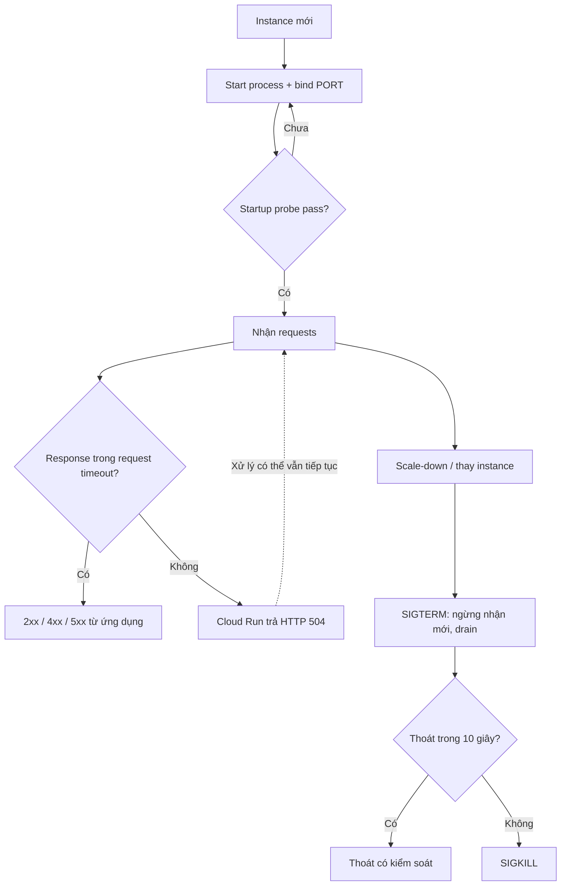
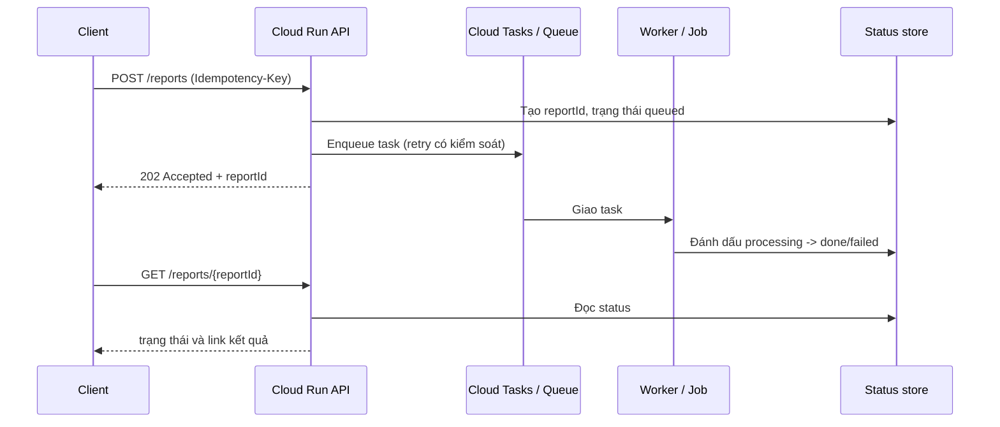

# Request timeout, startup probe và graceful shutdown

Một API chạy trên **Cloud Run** có thể gặp ba tình huống rất khác nhau: request xử lý quá lâu, instance khởi động chưa xong đã có traffic, hoặc container bị dừng trong lúc còn công việc. Cả ba đều ảnh hưởng đến độ tin cậy nhưng **không được xử lý bằng cùng một timeout**.

Bài thuộc chương **Cloud Run** của mô-đun `CLOUD_PROVIDERS_GCP`, trong lộ trình Google Cloud từ project, IAM và VPC đến Compute Engine, GKE, Cloud Run, lưu trữ, cơ sở dữ liệu và vận hành theo SLO/chi phí. Bài tập trung vào cách cấu hình và kiểm chứng **request timeout**, **startup probe** và **graceful shutdown** cho **Cloud Run services** (dịch vụ nhận HTTP requests), không nhầm với task timeout của Cloud Run Jobs.

## 1. Mục tiêu và tình huống thực tế

Sau bài này, bạn có thể:

1. Phân biệt giới hạn thời gian của request, kiểm tra khởi động và thời gian tắt instance.
2. Giải thích tại sao **HTTP 504 không đồng nghĩa container đã bị hủy**.
3. Chọn TCP, HTTP hoặc gRPC startup probe; tránh báo Ready khi chỉ mới mở port.
4. Bắt `SIGTERM`, dừng nhận request mới, cho request đang chạy hoàn thành có giới hạn và thoát trước `SIGKILL`.
5. Triển khai một ứng dụng Go mẫu trên Cloud Run, kiểm tra response, logs và ba vòng đời.
6. Áp dụng deadline, retry, idempotency, observability và phương án xử lý tác vụ dài.

**Tình huống xuyên suốt:** API trả kết quả nhanh ở `/`, khởi tạo dữ liệu giả lập trong 6 giây và có endpoint `/work` xử lý tối đa 20 giây. Ta đặt timeout request **5 giây** để quan sát HTTP 504, thiết lập **HTTP startup probe** để chờ ứng dụng thật sự sẵn sàng, và dùng `SIGTERM` handler để shutdown tối đa **8 giây**, ngắn hơn grace period Cloud Run.

## 2. Ba cơ chế giải quyết ba vấn đề khác nhau

| Cơ chế | Mốc bắt đầu | Hành vi chính | Giá trị hoặc giới hạn cần nhớ |
| --- | --- | --- | --- |
| **Request timeout** | Khi Cloud Run xử lý một HTTP request | Hết hạn: đóng kết nối, trả **HTTP 504**; tiến trình có thể còn chạy | Mặc định **300 s**, tối đa **3600 s** |
| **Startup probe** | Khi một container instance khởi động | Chưa pass thì chưa coi ingress container sẵn sàng; thất bại quá ngưỡng sẽ bị dừng | Default là TCP probe; cấu hình HTTP/gRPC khi cần kiểm tra logic |
| **Graceful shutdown** | Khi Cloud Run quyết định dừng instance | Gửi **SIGTERM**, rồi **SIGKILL** nếu chưa thoát | Khoảng **10 s** để dọn dẹp |



**Lưu ý:** HTTP 504, startup failure và SIGTERM không phải ba giai đoạn bắt buộc của một request. Sơ đồ mô tả các nhánh khác nhau trong vòng đời instance. Một container khỏe có thể phục vụ hàng nghìn request mà không chạm các nhánh lỗi này.

## 3. Request timeout: deadline của kết nối, không phải thời gian sống của tiến trình

Cloud Run services mặc định cho request **5 phút (300 giây)** và cho cấu hình tới **60 phút (3600 giây)**. Nếu backend chưa trả response trước hạn, Cloud Run trả **HTTP 504 Gateway Timeout** và đóng kết nối phía client. **Instance không tự bị kill chỉ vì request timeout**: code có thể tiếp tục chạy, dù client đã bỏ cuộc.

Ví dụ:

```text
Client        Cloud Run           Container
  |  GET /work                  |
  |------------>|  /work         |
  |             |--------------->|
  |     ... sau 5 giây ...       |  xử lý tiếp?
  |<--- 504 -----|               |
  |             |               |  có thể vẫn ghi dữ liệu
```

Hậu quả thực tế: client retry request tạo đơn hàng, còn lần gọi đầu vẫn tiếp tục ghi vào database → **giao dịch trùng** nếu không có idempotency.

### 3.1. Chọn timeout theo SLO và giới hạn upstream

- **API đồng bộ ngắn:** timeout hơi lớn hơn thời gian xử lý hợp lý, nhưng phù hợp client/LB timeout và SLO.
- **Streaming, long-polling, WebSockets:** vẫn chịu request timeout; cần reconnect và quản lý trạng thái.
- **Request dài hơn 15 phút:** Google Cloud khuyến nghị **retry và reconnect-safe behavior**; không dựa vào một TCP connection sống suốt thời gian.
- **Tác vụ lâu hoặc cần làm đúng một lần:** ưu tiên **Cloud Tasks, Cloud Run Jobs, Workflows hoặc worker pools** theo kiểu công việc; trả `202 Accepted` và mã theo dõi khi phù hợp.

Đặt request timeout **3600 s** không giúp startup probe có 3600 s và cũng không kéo grace period SIGTERM từ 10 lên 3600 s.

### 3.2. Deadline ở tầng ứng dụng

Ngoài cấu hình Cloud Run, nên:

1. Đặt deadline nội bộ ngắn hơn request timeout, dành buffer để trả response hoặc rollback.
2. Dùng timeout cho database/HTTP client và **truyền cancellation/deadline** khi framework hỗ trợ.
3. Dùng **Idempotency-Key** cho các thao tác tạo đơn hàng/thanh toán có thể được retry.
4. Tránh xử lý công việc quan trọng sau khi đã trả response; CPU và vòng đời instance có thể thay đổi.
5. Ghi log request ID, elapsed time và lý do hủy; không log token hoặc dữ liệu nhạy cảm.

Không mặc định `context canceled` hoặc connection closed luôn được truyền tới mọi thư viện và background goroutine. Việc cancel phải được kiểm thử theo HTTP framework và downstream dependencies của ứng dụng.

## 4. Startup probe: kiểm tra “có sẵn sàng phục vụ?” chứ không chỉ “đã mở port?”

Cloud Run services có **TCP startup probe mặc định**, với cấu hình điển hình:

```yaml
startupProbe:
  timeoutSeconds: 240
  periodSeconds: 240
  failureThreshold: 1
```

TCP probe chỉ xác minh **mở được kết nối TCP** tới port, không kiểm tra database connection, schema migration, config hoặc việc nạp model đã hoàn tất.

| Probe | Cách pass | Dùng khi |
| --- | --- | --- |
| **TCP** | Kết nối socket thành công | Ứng dụng sẵn sàng ngay khi listener mở |
| **HTTP** | HTTP GET tới path trả **2xx hoặc 3xx** | Muốn kiểm tra khởi tạo ứng dụng |
| **gRPC** | gRPC Health Checking protocol thành công | Ứng dụng gRPC có health service chuẩn |

Khi cấu hình HTTP startup probe, nên trả `503` **trước khi khởi tạo xong**, và `204`/`200` **sau khi thực sự sẵn sàng**. Cloud Run có thể bắt đầu gửi request **ngay sau khi startup probe pass**, trước lần readiness probe đầu tiên, nên startup probe **phải phản ánh khả năng phục vụ thực tế**, không chỉ trả 200 cố định.

Các tham số:

- `initialDelaySeconds`: trì hoãn lần kiểm tra đầu.
- `periodSeconds`: khoảng cách giữa các lần kiểm tra.
- `timeoutSeconds`: thời gian chờ **mỗi lần** kiểm tra, không lớn hơn period.
- `failureThreshold`: số lần thất bại trước khi container bị dừng.

Ngân sách startup probe được tính gần đúng theo `failureThreshold × periodSeconds`, giới hạn cấu hình thông thường **600 s** (với GPU có giới hạn riêng). Đồng thời, **Cloud Run services yêu cầu ingress container bắt đầu lắng nghe request trong vòng 4 phút**; không được coi probe budget lớn hơn là quyền trì hoãn bind port tùy ý.

### 4.1. Startup khác readiness và liveness

- **Startup:** đã khởi tạo xong để nhận request chưa?
- **Readiness:** instance hiện có nên nhận **request mới** không? Readiness probe thất bại có thể ngừng định tuyến request mới mà không kill instance.
- **Liveness:** tiến trình bị treo/hỏng cần restart không? Cloud Run có thể **SIGKILL** container khi liveness thất bại liên tiếp; các request còn chạy có thể nhận **503**.

Không cấu hình liveness thành một truy vấn database nặng, vì dependency tạm lỗi có thể gây restart storm. Với Cloud Run, một startup probe tốt phải bảo đảm instance đủ sẵn sàng nhận traffic ngay khi nó pass.

## 5. Graceful shutdown: xử lý SIGTERM trong giới hạn 10 giây

Khi Cloud Run scale-in, thay revision hoặc dừng instance, nền tảng thường cố cho các request đang chạy hoàn thành và chuyển request mới sang instance khác. Khi bắt đầu shutdown, Cloud Run gửi **SIGTERM** đến các container, cấp một **cửa sổ 10 giây** trước khi gửi **SIGKILL** nếu tiến trình chưa thoát. Trong thời gian đó CPU được cấp và được tính phí.

Trong **first-generation execution environment**, container không xử lý `SIGTERM` có thể bị dừng ngay. Với **second-generation**, Google Cloud cũng khuyến nghị cài signal handler để ứng dụng nhận biết và dọn dẹp. Đừng coi một lần scale-in luôn đợi toàn bộ request dài hoàn tất: trong trường hợp đặc biệt, SIGTERM có thể tới khi request còn chạy.

**Quy trình tối thiểu của handler:**

1. Nhận `SIGTERM` ở **tiến trình chính/PID 1**.
2. Đánh dấu không sẵn sàng và dừng nhận request mới.
3. Cho các request đang xử lý hoàn thành trong **deadline nội bộ ngắn hơn 10 giây**, ví dụ 8 giây.
4. Flush log/buffer có giới hạn, đóng kết nối, dừng background goroutine và thoát.
5. Nếu deadline hết, chấp nhận hủy phần còn lại; **không kéo dài cleanup vô hạn**.

**Không** dùng `sleep 10` bên trong signal handler rồi mới bắt đầu dọn dẹp: toàn bộ ngân sách shutdown chỉ có 10 giây. Một ứng dụng dùng shell làm PID 1 cũng cần `exec` để tín hiệu được chuyển tới tiến trình server đúng cách.

## 6. Ví dụ Go: một service thể hiện cả ba cơ chế

Ví dụ dùng **Go standard library**, không cần thư viện ngoài. Trong một thư mục lab **riêng ngoài repository tài liệu**, tạo `go.mod`, `main.go` và `Dockerfile`.

### 6.1. `go.mod`

```go
module example.com/cloud-run-lifecycle-lab

go 1.26
```

### 6.2. `main.go`

```go
package main

import (
    "context"
    "errors"
    "fmt"
    "log"
    "net/http"
    "os"
    "os/signal"
    "strconv"
    "sync/atomic"
    "syscall"
    "time"
)

func main() {
    port := os.Getenv("PORT")
    if port == "" {
        port = "8080"
    }

    initSeconds := 6
    if raw := os.Getenv("INIT_SECONDS"); raw != "" {
        if n, err := strconv.Atoi(raw); err == nil && n >= 0 && n <= 120 {
            initSeconds = n
        }
    }

    var ready atomic.Bool
    go func() {
        time.Sleep(time.Duration(initSeconds) * time.Second)
        ready.Store(true)
        log.Println("startup complete")
    }()

    mux := http.NewServeMux()
    mux.HandleFunc("/startup", func(w http.ResponseWriter, r *http.Request) {
        if !ready.Load() {
            http.Error(w, "initializing", http.StatusServiceUnavailable)
            return
        }
        w.WriteHeader(http.StatusNoContent)
    })
    mux.HandleFunc("/", func(w http.ResponseWriter, r *http.Request) {
        fmt.Fprintln(w, "cloud-run-lifecycle-demo: ready")
    })
    mux.HandleFunc("/work", func(w http.ResponseWriter, r *http.Request) {
        seconds := 1
        if raw := r.URL.Query().Get("seconds"); raw != "" {
            n, err := strconv.Atoi(raw)
            if err != nil || n < 0 || n > 20 {
                http.Error(w, "seconds must be 0..20", 400)
                return
            }
            seconds = n
        }
        timer := time.NewTimer(time.Duration(seconds) * time.Second)
        defer timer.Stop()

        select {
        case <-timer.C:
            log.Printf("work completed, seconds=%d", seconds)
            fmt.Fprintf(w, "completed after %d seconds\n", seconds)
        case <-r.Context().Done():
            log.Println("request context canceled")
        }
    })

    server := &http.Server{
        Addr:              ":" + port,
        Handler:           mux,
        ReadHeaderTimeout: 5 * time.Second,
    }
    go func() {
        err := server.ListenAndServe()
        if err != nil && !errors.Is(err, http.ErrServerClosed) {
            log.Fatalf("server failed: %v", err)
        }
    }()

    ctx, stop := signal.NotifyContext(
        context.Background(), syscall.SIGTERM, syscall.SIGINT,
    )
    defer stop()
    <-ctx.Done()

    log.Println("SIGTERM/SIGINT: draining requests")
    ready.Store(false)
    shutdownCtx, cancel := context.WithTimeout(
        context.Background(), 8*time.Second,
    )
    defer cancel()
    if err := server.Shutdown(shutdownCtx); err != nil {
        log.Printf("graceful shutdown deadline reached: %v", err)
        _ = server.Close()
    }
    log.Println("server stopped")
}
```

Những điểm cần đọc kỹ:

- `/startup` trả **503 trong 6 giây đầu**, sau đó trả **204**; HTTP startup probe biết ứng dụng đã sẵn sàng.
- `/work?seconds=8` cho phép nhìn thấy tác động của request timeout **5 giây**.
- Khi nhận `SIGTERM`, Go `http.Server.Shutdown` dừng nhận kết nối mới và chờ request đang chạy; timeout nội bộ **8 giây** để còn dư thời gian trước SIGKILL.
- `r.Context().Done()` giúp ứng dụng phản ứng với cancellation **nếu cancellation được lan truyền**. Cloud Run trả 504 không cam kết mọi tác vụ bên trong lập tức bị hủy.
- Đây là service mô phỏng, không tự tạo các giao dịch dữ liệu quan trọng. Với production phải bổ sung auth, tracing, structured logging, idempotency và deadline cho downstream.

### 6.3. `Dockerfile`

```dockerfile
FROM golang:1.26-alpine AS build
WORKDIR /src
COPY go.mod main.go ./
RUN CGO_ENABLED=0 GOOS=linux GOARCH=amd64 \
    go build -trimpath -o /server ./main.go

FROM gcr.io/distroless/static-debian12:nonroot
COPY --from=build /server /server
ENV PORT=8080
EXPOSE 8080
ENTRYPOINT ["/server"]
```

Image cuối chỉ có binary Linux `amd64` và chạy non-root, phù hợp runtime contract Cloud Run. Khi triển khai production, pin base image bằng digest, quét lỗ hổng và đảm bảo builder/toolchain còn được bảo trì. Không nhúng secrets vào Dockerfile.

## 7. Thử tại máy trước khi triển khai

Nếu có Docker, dùng hai terminal. Những lệnh sau **chỉ thay đổi tài nguyên local**:

```bash
docker build -t cloud-run-lifecycle:lab .
docker run --name cr-lifecycle-lab \
  -e INIT_SECONDS=6 \
  -p 8080:8080 \
  cloud-run-lifecycle:lab
```

Terminal khác:

```bash
# Trong 6 giây khởi tạo: 503; sau đó: 204.
curl -i http://127.0.0.1:8080/startup

# Chờ ứng dụng khởi tạo xong rồi chạy:
curl -i http://127.0.0.1:8080/work?seconds=2
```

**Mô phỏng SIGTERM:**

```bash
# Khi container đang chạy (không dùng --rm để còn xem log).
docker stop --time=10 cr-lifecycle-lab
docker logs cr-lifecycle-lab
docker rm cr-lifecycle-lab
```

Mong đợi log `SIGTERM/SIGINT: draining requests` và `server stopped`. Nếu muốn xem xử lý request đang chạy, gọi `/work?seconds=4` rồi dừng container ngay; yêu cầu có thể hoàn tất trong grace period. Với request dài hơn 8 giây, server demo sẽ hủy kết nối khi deadline shutdown hết. Thử nghiệm local **không chứng minh** Cloud Run luôn phân phối tín hiệu và traffic y như Docker.

## 8. Preflight Cloud Run và quyền triển khai

Dùng **project lab riêng có billing**, đủ quyền Cloud Run/Cloud Build/Artifact Registry và Cloud Shell hoặc Google Cloud CLI. Deploy từ `--source` có thể tạo build/image/source staging artifacts tính phí. Không triển khai demo có endpoint sleep lên một URL công khai không giới hạn.

```bash
PROJECT_ID="YOUR_LAB_PROJECT_ID"
REGION="asia-southeast1"
SERVICE="cloudrun-lifecycle-lab"

gcloud --version
gcloud auth list
gcloud projects describe "$PROJECT_ID" \
  --format="yaml(projectId,lifecycleState)"

# Chỉ đọc: kiểm tra service trùng tên trước khi tạo.
gcloud run services list \
  --project="$PROJECT_ID" --region="$REGION"

# Chỉ đọc: APIs đã bật.
gcloud services list \
  --project="$PROJECT_ID" --enabled \
  --format="value(config.name)"
```

Không chạy nếu `PROJECT_ID` còn placeholder, `SERVICE` trùng tài nguyên nhóm khác, thiếu API/permission hoặc project chưa được cấp phép. Người deploy cần role Cloud Run và quyền build, quyền dùng service account theo chính sách; **không tự nâng quyền Editor/Owner** để bỏ qua IAM.

## 9. Deploy mẫu với timeout 5 giây và HTTP startup probe

Sau khi kiểm tra preflight, trong thư mục chứa `Dockerfile`, `go.mod` và `main.go`, chạy **lệnh ghi tạo Cloud Run service và artifacts**:

```bash
gcloud run deploy "$SERVICE" \
  --project="$PROJECT_ID" \
  --region="$REGION" \
  --source=. \
  --port=8080 \
  --timeout=5s \
  --startup-probe="httpGet.path=/startup,httpGet.port=8080,initialDelaySeconds=0,periodSeconds=2,timeoutSeconds=1,failureThreshold=15" \
  --set-env-vars="INIT_SECONDS=6" \
  --concurrency=10 \
  --min-instances=0 \
  --max-instances=2 \
  --no-allow-unauthenticated
```

Ở ví dụ này:

- **Request timeout = 5 s** để thử nghiệm; production chọn theo SLO và upstream timeouts.
- Startup probe GET `/startup` mỗi **2 s**, timeout mỗi lần **1 s**, tối đa **15 lần thất bại**, ngân sách khoảng **30 s**.
- Ứng dụng mở port sớm nhưng startup chỉ pass sau 6 s khi init hoàn tất.
- Service **private**; chỉ principal có quyền Cloud Run Invoker mới gọi được.
- `concurrency=10` và `max-instances=2` giới hạn thử tải, nhưng không tạo trần cứng cho toàn bộ chi phí.

**Kết quả deploy thành công** chưa phải chứng minh startup probe và response đã ổn định. Kiểm tra revision và request thực:

```bash
gcloud run services describe "$SERVICE" \
  --project="$PROJECT_ID" \
  --region="$REGION" \
  --format="yaml(metadata.name,status.url,status.latestReadyRevisionName,spec.template)"

gcloud run revisions list \
  --project="$PROJECT_ID" \
  --region="$REGION" \
  --service="$SERVICE"
```

Nếu tổ chức không cho tạo private service theo mặc định, hoặc deploy bị chặn bởi chính sách build/repo, phối hợp quản trị viên; không bật public ingress hoặc bỏ security policy để “làm cho lab chạy”.

## 10. Kiểm chứng HTTP 200/504 và startup

Người thử nghiệm phải có quyền `roles/run.invoker` tại service lab. Với `gcloud auth` đã đăng nhập hợp lệ:

```bash
RUN_URL="$(gcloud run services describe "$SERVICE" \
  --project="$PROJECT_ID" --region="$REGION" \
  --format='value(status.url)')"

# Request bình thường: nhanh hơn timeout.
curl -i -sS \
  -H "Authorization: Bearer $(gcloud auth print-identity-token)" \
  "$RUN_URL/work?seconds=2"

# Request lâu hơn 5 giây: dự kiến Cloud Run HTTP 504.
curl -i -sS \
  -H "Authorization: Bearer $(gcloud auth print-identity-token)" \
  "$RUN_URL/work?seconds=8"
```

Tùy network/client và cách cancellation lan truyền, handler demo có thể tiếp tục đến 8 s hoặc dừng sớm khi request context bị cancel. **Điều bất biến cần kiểm tra** là client nhận **504 gần timeout 5 s**, còn code không được dựa vào việc timeout tự rollback side effects.

**Không cần gọi `/startup` từ Internet trong đúng 6 giây đầu để chứng minh probe:** Cloud Run sẽ chỉ đưa instance vào trạng thái phục vụ sau khi probe pass; nếu service scale-to-zero rồi cold-start, request có thể được xếp hàng chờ trong thời gian startup. Xem logs để xác nhận `startup complete` và revision readiness thay vì cho rằng client sẽ thấy chuỗi 503.

| Kiểm tra | Kỳ vọng |
| --- | --- |
| `/work?seconds=2` | HTTP 200, body báo hoàn thành |
| `/work?seconds=8` | HTTP 504 gần mốc 5 giây |
| Revision | Ready, container đã pass startup probe |
| Logs | Có startup, request xử lý, có thể có cancellation |
| Policy | Service private, chỉ principal được phép gọi |

### 10.1. Readback cấu hình timeout/probe

```bash
gcloud run services describe "$SERVICE" \
  --project="$PROJECT_ID" --region="$REGION" \
  --format="yaml(spec.template.spec.timeoutSeconds,spec.template.spec.containers,status.latestReadyRevisionName)"
```

Tìm `timeoutSeconds: 5` và `startupProbe` với HTTP path/period/threshold dự định. Thay timeout hoặc probe tạo **revision mới**, cần đọc lại revision và thử smoke test, không chỉ xem thông báo “update thành công”.

## 11. Theo dõi request, startup và shutdown

### 11.1. Cloud Logging

Đọc gần đây bằng bộ lọc theo đúng service:

```bash
gcloud logging read \
  "resource.type=\"cloud_run_revision\" AND resource.labels.service_name=\"$SERVICE\"" \
  --project="$PROJECT_ID" \
  --limit=50 \
  --format="table(timestamp,severity,httpRequest.status,textPayload)"
```

Khi cần lọc HTTP 504:

```bash
gcloud logging read \
  "resource.type=\"cloud_run_revision\" AND resource.labels.service_name=\"$SERVICE\" AND httpRequest.status=504" \
  --project="$PROJECT_ID" \
  --limit=20
```

Trong Cloud Logging, request logs và container logs có thể nằm ở **những entry riêng**, không phải một dòng tổng hợp; cần đối chiếu timestamp, trace/request ID và revision. Startup probe failures hoặc SIGTERM không bảo đảm tạo cùng một message ở mọi runtime — log rõ ràng trong ứng dụng giúp chẩn đoán.

### 11.2. Tín hiệu vận hành

| Tín hiệu | Dùng để làm gì |
| --- | --- |
| Request duration, tỉ lệ 504 | Phát hiện xử lý quá hạn và dependency chậm |
| p50/p95/p99 latency | So với SLO, tránh chỉ nhìn timeout limit |
| Startup latency, instance count | Đo cold starts và hiệu quả startup probe |
| Container start failures/restarts | Phân biệt init lỗi, không bind port, OOM |
| 5xx/503 và liveness failures | Phát hiện app/unhealthy instance và cưỡng bức restart |
| SIGTERM/drain logs | Xác minh ứng dụng thoát đúng hạn |
| CPU/memory/concurrency | Tìm overload, xử lý chậm hoặc OOM |
| Cost by SKU | Quan sát instance time, request, build/image/logging |

Nếu tỉ lệ 504 tăng, **đừng tăng timeout ngay**: kiểm tra query/database, thread pool, downstream deadline, concurrency và traffic burst. Thời gian chờ dài có thể khiến client timeout trước, giữ tài nguyên lâu hơn và che bottleneck.

## 12. Thay đổi cấu hình có kiểm soát

Cloud Run cho phép cập nhật request timeout:

```bash
# CÓ TÁC ĐỘNG: tạo revision mới; chỉ sau khi đã được phê duyệt.
gcloud run services update "$SERVICE" \
  --project="$PROJECT_ID" \
  --region="$REGION" \
  --timeout=30s
```

Để thay startup probe, thay cấu hình probe trên **revision mới** qua Console, `gcloud run deploy --startup-probe` hoặc định nghĩa YAML/Terraform phù hợp. Một probe quá nghiêm ngặt có thể khiến tất cả instance mới khởi động thất bại; triển khai **canary** và thử cold start trước khi chuyển toàn bộ traffic.

### 12.1. Chọn giá trị theo điều kiện thật

| Loại dịch vụ | Hướng cấu hình |
| --- | --- |
| API đọc dữ liệu nhanh | Timeout ngắn phù hợp SLO; dependency deadlines ngắn hơn |
| Java/Spring Boot startup chậm | HTTP startup kiểm tra readiness thật, cân nhắc min instances/startup CPU boost và tối ưu khởi tạo |
| API đồng bộ nặng | Cân nhắc tách tác vụ dài thành async job, trả status/job ID |
| Hệ thống nhiều downstream | Truyền deadline/cancellation, retry có giới hạn, idempotency |
| Ứng dụng có in-flight jobs | Shutdown drain ngắn, job checkpoint/durable queue, không phụ thuộc 10 giây |
| Streaming/WebSocket | Reconnect logic, offset/resume, timeout phù hợp |

Nếu dùng **request-based billing**, CPU ngoài thời điểm đang xử lý request có thể bị giới hạn; đừng dùng một goroutine “fire-and-forget” sau khi HTTP response đã trả làm cách xử lý nghiệp vụ quan trọng. **Instance-based billing** có thể cấp CPU suốt vòng đời instance nhưng không ngăn scale-down hoặc SIGTERM; những công việc cần đảm bảo nên dùng cơ chế queue/job được thiết kế cho chúng.

## 13. Troubleshooting theo triệu chứng

| Triệu chứng | Nguyên nhân thường gặp | Kiểm tra |
| --- | --- | --- |
| HTTP **504** sau 5 s | Request vượt `--timeout`, downstream chậm | Request latency, handler trace, DB timeouts |
| HTTP **503** khi init | Startup probe chưa pass hoặc instance chưa ready | `/startup`, revision logs, probe config |
| TCP probe pass nhưng app lỗi | Listener mở trước khi init xong | Dùng HTTP startup kiểm tra readiness |
| Revision không Ready | Không bind `0.0.0.0:$PORT`, startup lỗi, probe sai path/port | Container logs, PORT, `startupProbe` |
| Instance restart lặp | Liveness check quá nhạy, crash/OOM | Liveness logs, memory limit, health endpoint |
| SIGTERM không thấy trong logs | Server không nhận signal hoặc PID 1 là shell | Docker ENTRYPOINT, signal forwarding |
| Request bị cắt khi scale-down | Cleanup dài hơn 10 s hoặc in-flight work | Shutdown logs, graceful deadline, retries |
| Giao dịch bị tạo hai lần | 504 rồi client retry, lần đầu vẫn ghi dữ liệu | Idempotency key, DB transaction/audit |
| Thêm timeout nhưng p99 vẫn xấu | Nút cổ chai CPU/concurrency/database | CPU, queue wait, tracing, load test |
| Không gọi được private service | Thiếu Invoker/identity token, ingress policy | IAM principal, token, service URL |
| Local Docker hoạt động nhưng Cloud Run không | Build architecture, port, resource/runtime contract | Image, PORT, revision logs |
| Ứng dụng mất dữ liệu sau shutdown | Ghi vào filesystem container, background task chưa bền vững | Cloud Storage/database/queue, flush/commit |

**Phân biệt lỗi:** request timeout thường ra **504**; container bị OOM có thể gây **500**; liveness failures thường dẫn tới instance bị kill và request đang chạy có thể ra **503**. Các mã lỗi còn có thể do ứng dụng hoặc upstream nên luôn đối chiếu logs.

## 14. Ví dụ thiết kế: API tạo báo cáo mất 20 phút

Giả sử `POST /reports` chạy 20 phút. Đặt `--timeout=1800s` là **có thể** về giới hạn, nhưng kết nối client/LB, network failure và retry có thể làm người dùng không biết job thành công hay chưa.

Thiết kế đáng tin cậy hơn:



Điểm cốt lõi: **request đồng bộ ngắn**, job được lưu bền vững, xử lý **idempotent**, có checkpoint/retry và trạng thái độc lập. Cloud Tasks/Jobs cũng có timeout/retry/at-least-once semantics riêng; cần thiết kế không xử lý trùng dữ liệu.

## 15. Bài tập tự luyện

### Bài 1 — Cloud Run timeout có hủy tiến trình không?

Cloud Run service cấu hình `--timeout=10s`; app xử lý một request 15 s. Client nhận 504 sau 10 s. Có thể kết luận database đã rollback?

**Đáp án:** Không. Cloud Run đóng kết nối, container có thể tiếp tục xử lý. Cần deadline/cancellation ứng dụng và giao dịch/idempotency đúng.

### Bài 2 — chọn startup probe

Ứng dụng mở port sau 1 giây nhưng phải tải model thêm 40 giây. TCP probe pass ngay. Làm gì?

**Đáp án:** Dùng **HTTP startup probe** trả 503 tới khi model thực sự ready; đặt probe budget phù hợp và giữ yêu cầu port listener của Cloud Run.

### Bài 3 — hiểu thông số probe

Một HTTP startup probe có `periodSeconds=3` và `failureThreshold=10`, mỗi check timeout 1 s. Ngân sách startup gần đúng?

**Đáp án:** **30 giây** theo tích period × threshold (còn phụ thuộc thời điểm initial delay và cách scheduling). Không nhầm với request timeout.

### Bài 4 — SIGTERM khi còn request

Container nhận SIGTERM nhưng handler đợi 25 giây mới kết thúc. Cloud Run có đợi đủ 25 giây không?

**Đáp án:** Không. Cloud Run dành khoảng **10 giây** trước SIGKILL; cần drain trong ngân sách, retry/checkpoint cho công việc dài.

### Bài 5 — phân biệt startup và liveness

Một startup probe pass nhưng database tạm lỗi làm liveness trả 500. Hậu quả?

**Đáp án:** Liveness probe thất bại liên tục có thể **kill/restart** instance, gây vòng lặp nếu lỗi database chưa được sửa. Health checks phải phân biệt process bị treo với dependency tạm lỗi.

### Bài 6 — dài hơn 15 phút

Một request streaming 25 phút có thể cấu hình timeout 30 phút, vậy có cần reconnect không?

**Đáp án:** Có. Cloud Run khuyến nghị reconnect/retry-safe behavior cho request dài; network/client/LB có thể ngắt trước timeout dịch vụ.

### Bài 7 — request trả 200 nhưng task chưa chạy xong

Endpoint trả 200 rồi chạy background goroutine cập nhật database 2 phút trên instance request-based billing.

**Đáp án:** Không đáng tin: sau response CPU có thể bị giới hạn và instance có thể scale-down. Dùng queue/job có trạng thái, retry và idempotency.

### Bài 8 — private service trả 403

Cloud Run revision Ready, `/startup` pass, nhưng `curl "$RUN_URL/"` từ máy học viên nhận 403.

**Đáp án:** Có thể service dùng `--no-allow-unauthenticated`; kiểm tra Invoker IAM, identity token, audience và ingress. Không sửa startup probe hoặc mở public vì lỗi auth.

## 16. Checklist vận hành

- [ ] Phân biệt **request timeout**, **startup probe** và **SIGTERM shutdown 10 s**.
- [ ] Request timeout phù hợp SLO/client/LB, không chọn 60 phút chỉ vì giới hạn cho phép.
- [ ] Downstream calls có deadline ngắn hơn Cloud Run request timeout và được instrument.
- [ ] Thao tác có retry dùng idempotency key, hạn chế side effects trùng.
- [ ] HTTP startup trả pass **chỉ sau khi ứng dụng sẵn sàng**, port bind `0.0.0.0:$PORT`.
- [ ] Startup probe period/timeout/threshold hợp lệ, vừa ngân sách khởi động và giới hạn sản phẩm.
- [ ] Liveness không phụ thuộc một dịch vụ ngoài dễ lỗi; readiness phản ánh khả năng nhận traffic.
- [ ] Process PID 1 nhận `SIGTERM`; graceful shutdown hoàn tất trong **ít hơn 10 s**.
- [ ] Dữ liệu cần tồn tại bền vững được ghi vào DB/Cloud Storage/queue, không chỉ memory/filesystem container.
- [ ] Đã thử cold start, request vượt timeout, local SIGTERM và log.
- [ ] Có metrics 504/503/5xx, p95/p99, startup latency, instance count, CPU/memory.
- [ ] Service private nếu không có yêu cầu public; quyền Invoker đúng principal.
- [ ] Có runbook về retry, alert, canary/rollback và dọn tài nguyên lab.

## 17. Dọn lab và lưu ý chi phí

Nếu service chỉ do bài lab tạo và không có client nào sử dụng, xác minh trước khi xóa:

```bash
gcloud run services describe "$SERVICE" \
  --project="$PROJECT_ID" --region="$REGION"

gcloud run revisions list \
  --project="$PROJECT_ID" --region="$REGION" \
  --service="$SERVICE"
```

Sau phê duyệt, có thể xóa **đúng service lab**:

```bash
# CÓ TÁC ĐỘNG: xóa service và revisions thuộc service.
gcloud run services delete "$SERVICE" \
  --project="$PROJECT_ID" --region="$REGION"
```

**Không xóa project**, Artifact Registry repository hay Cloud Build staging bucket dùng chung. Source deployment có thể đã tạo image/artifact/logs với retention và phí riêng; phải kiểm tra Billing, Artifact Registry và Cloud Logging của project theo quyền được cấp. Để rollback nhanh, giữ image digest/revision trong giai đoạn kiểm thử cần thiết trước khi cleanup.

**Chi phí liên quan:** Cloud Run CPU/memory theo billing mode và request, instance startup/shutdown, minimum instances nếu cấu hình, Artifact Registry image storage, Cloud Build và log ingestion. Cấu hình request timeout dài/concurrency lớn có thể tăng thời gian giữ tài nguyên; đặt budget alert nhưng không coi alert là trần chi phí.

## 18. Tài liệu Google Cloud chính thức

- [Configure request timeout for Cloud Run services](https://cloud.google.com/run/docs/configuring/request-timeout): mặc định 300 s, tối đa 3600 s, HTTP 504 và request có thể tiếp tục.
- [Configure container health checks](https://cloud.google.com/run/docs/configuring/healthchecks): startup/liveness/readiness; TCP, HTTP, gRPC; probe budget và ví dụ `gcloud`.
- [Container runtime contract](https://cloud.google.com/run/docs/container-contract): port, startup deadline, SIGTERM/SIGKILL, vòng đời container.
- [Handle SIGTERM signals](https://cloud.google.com/run/docs/samples/cloudrun-sigterm-handler): mẫu xử lý tín hiệu shutdown.
- [Configure concurrency](https://cloud.google.com/run/docs/configuring/concurrency): số request đồng thời/instance.
- [Configure instance billing settings](https://cloud.google.com/run/docs/configuring/billing-settings): CPU allocation và công việc ngoài request.
- [Optimize Cloud Run instances](https://cloud.google.com/run/docs/tips/general): startup performance và vận hành.
- [Cloud Run service authentication](https://cloud.google.com/run/docs/authenticating/overview): xác thực gọi private service.
- [Cloud Run pricing](https://cloud.google.com/run/pricing): CPU/memory/request và các thành phần tính phí.

**Kết luận:** request timeout giới hạn thời gian client chờ response, startup probe chặn traffic tới instance chưa sẵn sàng, graceful shutdown giới hạn thời gian ứng dụng dọn dẹp trước khi container bị kill. Một Cloud Run service đáng tin cậy phải cấu hình **đúng cả ba**, dùng deadline/idempotency cho side effects, đưa công việc dài sang hệ thống bền vững và xác minh bằng logs/SLO thay vì chỉ nhìn trạng thái triển khai.
