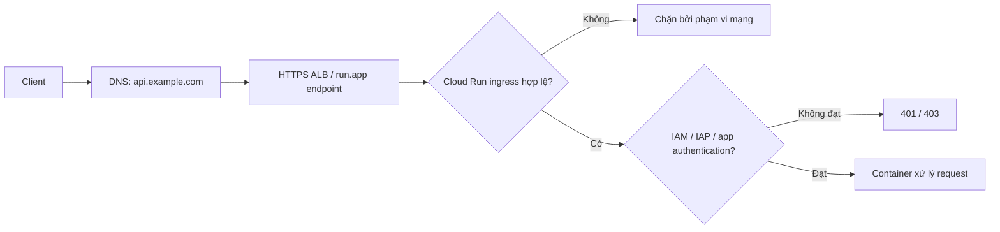
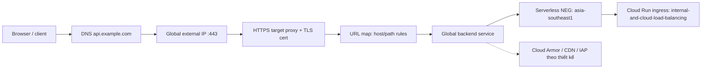

# Ingress, custom domains và kết hợp load balancer

> **Chương:** Cloud Run  
> **Module:** CLOUD_PROVIDERS_GCP  
> **Phạm vi module:** Khám phá Google Cloud từ tổ chức project, IAM và VPC đến Compute Engine, GKE, Cloud Run, dịch vụ lưu trữ và cơ sở dữ liệu. Qua các tình huống triển khai, người học biết lựa chọn dịch vụ, bảo vệ tài nguyên, tự động hóa phát hành và theo dõi độ tin cậy cùng chi phí.

Cloud Run tự cấp một URL HTTPS dạng `*.run.app` cho mỗi service, nhưng doanh nghiệp thường cần `api.example.com`, TLS theo miền riêng, định tuyến `/api/*`, chống tấn công bằng Cloud Armor hoặc giới hạn truy cập từ nội bộ. Những yêu cầu này thuộc **đường request đi vào (ingress)**, **quyền gọi service** và **lớp frontend**, không phải thay đổi Dockerfile.

Bài học đi từ Cloud Run ingress và IAM đến custom domain, **Application Load Balancer (ALB) + serverless network endpoint group (NEG)**. Phần thực hành gồm kiểm kê chỉ đọc, thay ingress trên service sandbox và một bài lab **tùy chọn** tạo HTTPS ALB với miền thật thuộc quyền sở hữu. Không chạy thay đổi mạng, DNS hoặc bật truy cập công khai trên production chỉ để thử lệnh.

## Mục tiêu

Sau bài này, bạn có thể:

1. Phân biệt `all`, `internal`, `internal-and-cloud-load-balancing` và quyền `roles/run.invoker`.
2. So sánh URL `run.app`, **Cloud Run domain mapping**, Firebase Hosting và **global external Application Load Balancer**.
3. Giải thích luồng `client → DNS → ALB → URL map → backend service → serverless NEG → Cloud Run`.
4. Thiết kế HTTPS, custom domain, Cloud Armor, Cloud CDN và IAP mà không để lọt đường truy cập bypass.
5. Kiểm tra DNS/TLS/HTTP status, chẩn đoán lỗi `403`/`404`/`502`/`503` và xây dựng quy trình triển khai an toàn.
6. Dùng Console/`gcloud` triển khai thử nghiệm, xác minh và dọn đúng các tài nguyên do lab tạo.

## 1. Ba lớp quyết định request có đến được ứng dụng không

Một request vào Cloud Run có thể bị chặn ở nhiều tầng:



- **Ingress:** xác định **nguồn/đường mạng nào** được phép truy cập service. Đây là kiểm soát mạng.
- **Authentication/authorization:** kiểm tra **caller là ai** và có được gọi service không. Với Cloud Run có thể dùng IAM Invoker hoặc IAP và cơ chế xác thực ứng dụng tùy kiến trúc.
- **Frontend routing:** URL, tên miền, chứng chỉ TLS, ALB host/path rules, Cloud Armor/CDN. Một đường vào đã được phép qua mạng chưa chắc được phép gọi theo IAM.

**Không đánh đồng:** `--ingress=all` **không tự cấp** `allUsers` quyền gọi; ngược lại, gán `allUsers` Invoker **không mở** một service đang chặn Internet bằng `--ingress=internal`.

## 2. Ba mức ingress trên Cloud Run

| `gcloud --ingress` | Cho phép request đi vào | Tình huống thường dùng |
|---|---|---|
| `all` | Mọi nguồn mạng, gồm Internet truy cập trực tiếp URL `run.app` nếu URL bật; IAM vẫn áp dụng | API public hoặc service có xác thực qua IAM/app |
| `internal` | Những nguồn nội bộ được Cloud Run công nhận: một số đường VPC/Shared VPC, internal ALB, sản phẩm Google Cloud/trong VPC-SC theo điều kiện | Service nội bộ, backend không được nhận Internet trực tiếp |
| `internal-and-cloud-load-balancing` | Các nguồn như `internal` **cộng thêm external Application Load Balancer** | Website/API công khai **chỉ qua ALB** để áp Cloud Armor/CDN/IAP |

**Điểm quan trọng:** “internal” không đơn giản là “IP thuộc `10.0.0.0/8`”. Cloud Run xác định nguồn nội bộ theo các quy tắc product/VPC; request từ on-premises qua VPN/Interconnect hoặc từ các dịch vụ khác có điều kiện đặc biệt. Không lấy một IP private hay DNS private làm bằng chứng request chắc chắn được chấp nhận.

### 2.1. Ví dụ chọn ingress

- API gọi trực tiếp bởi mobile app qua `run.app`, xác thực JWT ở ứng dụng: thường dùng `all` và bảo vệ ở lớp IAM/app phù hợp.
- Web nội bộ chỉ phục vụ qua **internal Application Load Balancer**: `internal`.
- Public web phải luôn đi qua **global external ALB** để áp Cloud Armor: `internal-and-cloud-load-balancing`.

**Ingress là ingress vào Cloud Run**, khác với **egress** của container đến Cloud SQL, private VPC hoặc Internet. Direct VPC egress và NAT không tự thay đổi `--ingress`.

### 2.2. Kiểm kê và thay đổi ingress

Lệnh trong Cloud Shell/Bash; tên service/region chỉ là ví dụ. Phần đọc có thể dùng trên resource được phép xem:

```bash
PROJECT_ID="my-cloudrun-network-lab"
REGION="asia-southeast1"
SERVICE="ingress-demo"

gcloud auth list --filter="status:ACTIVE"
gcloud run services list --project="$PROJECT_ID" --region="$REGION"
gcloud run services describe "$SERVICE" \
  --project="$PROJECT_ID" --region="$REGION" \
  --format="yaml(metadata.name,metadata.annotations,status.url,spec.template)"
gcloud run services get-iam-policy "$SERVICE" \
  --project="$PROJECT_ID" --region="$REGION"
```

**Chỉ trên service sandbox thuộc quyền quản lý**, sau khi lưu trạng thái ban đầu:

```bash
# Chặn request Internet trực tiếp, nhưng cho phép external ALB:
gcloud run services update "$SERVICE" \
  --project="$PROJECT_ID" --region="$REGION" \
  --ingress=internal-and-cloud-load-balancing

# Ví dụ khác dành cho service chỉ có nguồn nội bộ:
# gcloud run services update "$SERVICE" \
#   --project="$PROJECT_ID" --region="$REGION" --ingress=internal
```

Đổi ingress có thể **cắt lưu lượng đang hoạt động ngay**, kể cả trigger/webhook hoặc client được phép qua IAM nhưng đi từ Internet. Khi chưa có ALB, `internal-and-cloud-load-balancing` sẽ chặn đường gọi `run.app` trực tiếp từ máy cá nhân ngoài mạng nội bộ. Đừng dùng trên production trước khi đã có đường thay thế và kế hoạch rollback.

## 3. Default `run.app` URL và khả năng bypass

Service Cloud Run thường có một URL HTTPS mặc định `https://SERVICE-HASH-REGION.a.run.app` (định dạng thực tế do sản phẩm cung cấp, **không tự lắp ghép URL**). Dù đã tạo `api.example.com`, URL này có thể vẫn hoạt động.

Nếu Cloud Run để `ingress=all`, người dùng có thể **đi thẳng đến `run.app`**, bỏ qua ALB và vì thế **bỏ qua Cloud Armor/CDN/IAP đặt ở ALB**. Đây là lỗi thiết kế bảo mật nghiêm trọng khi nhóm tin rằng mọi request đã đi qua WAF.

**Biện pháp:**

1. Với service public chỉ cho phép qua ALB, đặt **`--ingress=internal-and-cloud-load-balancing`**.
2. Cân nhắc **tắt default URL** với `--no-default-url` sau khi chắc chắn mọi tích hợp dùng đường thay thế; đây là lớp bảo vệ bổ sung, không thay kiểm tra ingress.
3. Kiểm thử cả đường `https://api.example.com` **và** đường `run.app` từ máy Internet.
4. Kiểm tra các nguồn **internal** còn được phép vì chế độ này vẫn cho phép những luồng nội bộ hợp lệ.

### 3.1. Cẩn trọng khi tắt `run.app`

```bash
# CHỈ trên lab, SAU khi custom domain / ALB đã hoạt động:
gcloud run services update "$SERVICE" \
  --project="$PROJECT_ID" --region="$REGION" \
  --no-default-url

# Khôi phục default URL nếu phát hiện tích hợp cần URL này:
gcloud run services update "$SERVICE" \
  --project="$PROJECT_ID" --region="$REGION" \
  --default-url
```

Tắt URL mặc định có thể làm hỏng các tích hợp đang gọi bằng `run.app` như **Cloud Scheduler, Cloud Tasks, Pub/Sub push, Eventarc, Workflows**, synthetic monitoring và một số sản phẩm Firebase/Cloud Functions. Trước khi bật, kiểm kê trigger, callback URLs và khả năng dùng alternative domain. Lệnh `--no-default-url` không có nghĩa service không còn thể được truy cập từ những đường ingress khác được cho phép.

## 4. Custom domains: chọn cách nào?

| Cách | Lợi ích | Giới hạn/khuyến nghị |
|---|---|---|
| **Global external Application Load Balancer + serverless NEG** | IP public ổn định; HTTPS/TLS, host/path routing, Cloud Armor, CDN, IAP, nhiều backends | **Khuyến nghị cho production**; nhiều resource và phát sinh phí LB |
| **Cloud Run domain mapping trực tiếp** | Thiết lập miền đơn giản, chứng chỉ Google-managed tự động | **Preview/limited availability**, chưa được khuyến nghị production; giới hạn region, tính năng và latency |
| **Firebase Hosting trước Cloud Run** | Thích hợp frontend web/static + dynamic routes được tích hợp | Cần thiết kế Firebase Hosting, rewrite và cache đúng |
| **Default `run.app`** | Không cần sở hữu domain hay thêm LB | Không có vanity domain, host/path policy của ALB hoặc WAF ALB |

Theo tài liệu Cloud Run hiện hành, **domain mapping trực tiếp còn ở Preview** và không được coi là sẵn sàng production. Nó không hỗ trợ định tuyến riêng `/users`, wildcard certificate hay tự mang chứng chỉ; có giới hạn region và miền. Với ứng dụng quan trọng, nên chọn **global external ALB**.

### 4.1. DNS không thay thế TLS hoặc access control

Một bản ghi **A** trỏ `api.example.com` tới IP của ALB giúp client tìm thấy frontend. Nhưng:

- **DNS:** domain name → địa chỉ; không cấp chứng chỉ, không xác thực caller.
- **TLS certificate:** chứng minh tên miền, mã hóa đường HTTPS; phải có trạng thái/chuỗi tin cậy hợp lệ.
- **Host/path routing:** URL map của ALB quyết định backend dựa vào hostname/path.
- **Cloud Run IAM/app auth/IAP:** quyết định caller có được đi tiếp vào ứng dụng.

Ví dụ nếu `api.example.com` trỏ đúng IP nhưng chứng chỉ chưa ở trạng thái **ACTIVE**, HTTPS vẫn có thể lỗi. Nếu TLS đúng nhưng Cloud Run backend yêu cầu IAM token không được gửi, client vẫn có thể gặp `403`.

## 5. Kiến trúc ALB + serverless NEG



**Các thành phần phải phân biệt:**

1. **Global external IP và forwarding rule:** cửa vào HTTPS công khai.
2. **HTTPS target proxy + chứng chỉ:** xử lý TLS tại frontend.
3. **URL map:** quyết định backend theo host/path; có thể gửi `/api/*` và `/web/*` đến những backend khác nhau.
4. **Backend service:** cấu hình backend, logging và một số policy Cloud Armor/CDN/IAP.
5. **Serverless NEG:** tham chiếu **Cloud Run service hoặc URL mask**; **không phải** danh sách VM IP:port.
6. **Cloud Run service:** xử lý request ứng dụng; ingress phải cho phép nguồn từ ALB, IAM/app auth vẫn còn hiệu lực.

### 5.1. Ràng buộc serverless NEG

- Serverless NEG **phải cùng region** với Cloud Run resource được tham chiếu.
- Với mô hình thông thường, serverless NEG và Cloud Run backend **cùng project**; không tùy tiện tạo NEG ở project trung tâm rồi trỏ tới service project khác.
- NEG serverless **không cần cấu hình endpoint IP/port** của instance và có giới hạn health monitoring riêng so với backend VM/GKE.
- Một backend service có thể dùng nhiều serverless NEGs ở **những region khác nhau** trong kiểu LB hỗ trợ; phân phối vùng và failover phải xem riêng điều kiện sản phẩm.
- Với URL mask, NEG có thể ánh xạ nhiều Cloud Run services theo mẫu hostname/path, nhưng phải kiểm soát schema và tránh route đến dịch vụ không dự kiến.

**Không tự suy luận “ALB có health check xanh”** đối với serverless NEG. Trên các cấu hình không bật **Cloud Run service health** hoặc **outlier detection** được hỗ trợ, LB có thể tiếp tục gửi request tới service lỗi. Dùng SLO, synthetic tests và Cloud Monitoring để theo dõi.

### 5.2. Khi cần internal Application Load Balancer?

Với người dùng chỉ trong VPC hoặc kết nối hybrid, có thể dùng **internal Application Load Balancer** và cấu hình Cloud Run `ingress=internal`. Frontend là private IP; không cần global public IP hay public DNS. Mô hình vẫn cần serverless NEG/host-path routing theo LB type được hỗ trợ, và có thêm yêu cầu về subnet, proxy-only subnet, firewall và region/Shared VPC.

Không lấy nguyên các lệnh global **external** ALB bên dưới cho internal ALB: phạm vi resource và yêu cầu mạng khác nhau.

## 6. IAM, Cloud Armor, Cloud CDN và IAP

### 6.1. LB không tự đăng nhập thay client

Nếu Cloud Run yêu cầu IAM Invoker, external ALB **không mặc định tạo ID token hợp lệ** để gọi service. Đối với **website public** qua ALB, thường sẽ cho phép request **không cần Cloud Run IAM auth** ở backend, nhưng **chỉ** khi:

1. Chủ dịch vụ đã phê duyệt public access.
2. Cloud Run ingress được giới hạn **`internal-and-cloud-load-balancing`** để Internet không đi thẳng qua `run.app`.
3. Auth nghiệp vụ, rate limiting và Cloud Armor có mặt nếu được yêu cầu.

Việc cấp `allUsers` quyền Invoker là **thao tác mở quyền thực sự**; không được dùng để “sửa 403” trên service nội bộ. Với ứng dụng cần xác thực người dùng, dùng **IAP** hoặc xác thực ở tầng ứng dụng phù hợp.

### 6.2. Cloud Armor / WAF

Cloud Armor policy gắn với backend service của LB (hoặc edge policy theo cấu hình hỗ trợ) có thể lọc request, áp rule WAF, rate limiting và những biện pháp kiểm soát phù hợp. Policy ở LB **không che chắn** những đường đi trực tiếp vào `run.app` nếu ingress vẫn là `all`. Cần đo cả số request bị chặn và false positives.

### 6.3. Cloud CDN

Cloud CDN có thể cache response đủ điều kiện ở edge, giảm độ trễ/tải backend. Chỉ bật với response có chính sách cache phù hợp; API mang cookie, token, dữ liệu người dùng hoặc thông tin nhạy cảm cần đánh giá `Cache-Control`, cache key và behavior kỹ càng.

### 6.4. Identity-Aware Proxy (IAP)

Hiện có **hai nơi bật IAP**, chỉ chọn một:

- **Bật IAP trực tiếp trên Cloud Run**: theo tài liệu hiện hành là hướng ưu tiên cho một service, bảo vệ các đường ingress kể cả `run.app` và đường qua LB mà không cần tạo LB chỉ vì nhu cầu IAP.
- **Bật IAP ở backend service của ALB**: phù hợp các tình huống cần quản lý tập trung trên LB, ví dụ một số kiến trúc multi-region. Khi đó **IAP service agent** cần `roles/run.invoker` trên Cloud Run backend.

**Không bật IAP cả trên Cloud Run lẫn ALB.** Ngoài ra, **IAP và Cloud CDN không thể bật đồng thời trên cùng backend service**. Thiết kế dịch vụ public cacheable và dịch vụ private có IAP bằng backend phù hợp, không cố ép vào cùng một backend.

## 7. Lab A — Kiểm tra ingress an toàn

### 7.1. Điều kiện trước khi thực hiện

Giả định có **một service Cloud Run thử nghiệm** do người học sở hữu và quyền phù hợp trên project; nếu chưa có, có thể tạo từ một image mẫu chính thức được quản trị viên cho phép. Bài học không yêu cầu tạo repo hay build ứng dụng mới để tránh lặp với bài triển khai Cloud Run cơ bản.

**Chỉ chạy các lệnh ghi trên project sandbox.** Cloud Run, LB, địa chỉ IP giữ chỗ, DNS, certificates và logs có thể phát sinh phí. Không gán `allUsers` cho service đang có dữ liệu nhạy cảm.

```bash
PROJECT_ID="my-cloudrun-network-lab"
REGION="asia-southeast1"
SERVICE="ingress-demo"

gcloud auth list --filter="status:ACTIVE"
gcloud run services list --project="$PROJECT_ID" --region="$REGION"
gcloud run services describe "$SERVICE" \
  --project="$PROJECT_ID" --region="$REGION" \
  --format="yaml(metadata.name,metadata.annotations,status.url)"
gcloud run services get-iam-policy "$SERVICE" \
  --project="$PROJECT_ID" --region="$REGION"
```

Nếu service không tồn tại, chỉ khi có quyền và ngân sách sandbox, có thể dùng image mẫu `us-docker.pkg.dev/cloudrun/container/hello` theo hướng dẫn quickstart; phải kiểm tra phiên bản/image hỗ trợ tại thời điểm thực hành:

```bash
# Bỏ qua nếu service đã có; thao tác tạo mới có thể tính phí.
gcloud run deploy "$SERVICE" \
  --image=us-docker.pkg.dev/cloudrun/container/hello \
  --project="$PROJECT_ID" --region="$REGION" \
  --ingress=all \
  --no-allow-unauthenticated \
  --max-instances=2
```

Với service yêu cầu xác thực, kiểm tra bằng **gcloud proxy** hoặc ID token của caller được cấp `roles/run.invoker`. Không coi lỗi `403` trên đường `run.app` là lỗi ingress nếu caller chưa được cấp quyền.

### 7.2. Thử thay ingress trên lab

**Trước khi đổi**, ghi lại giá trị `ingress` và IAM. Sau đó:

```bash
# Chỉ trên service lab, sau khi đã ghi lại trạng thái cũ.
gcloud run services update "$SERVICE" \
  --project="$PROJECT_ID" --region="$REGION" \
  --ingress=internal-and-cloud-load-balancing

gcloud run services describe "$SERVICE" \
  --project="$PROJECT_ID" --region="$REGION" \
  --format="yaml(metadata.annotations,status.url)"
```

**Kỳ vọng từ máy Internet ngoài mạng nội bộ:** đường `run.app` trực tiếp không còn truy cập được dù dùng URL chính xác. Nếu chưa cấu hình ALB, service **chưa có đường Internet được phép khác**; đây là hành vi dự kiến.

Để hoàn nguyên khi lab chỉ dừng ở bước này:

```bash
# Chỉ khi ingress ban đầu là 'all'; nếu khác phải khôi phục giá trị thật.
gcloud run services update "$SERVICE" \
  --project="$PROJECT_ID" --region="$REGION" \
  --ingress=all
```

## 8. Lab B — HTTPS custom domain qua external ALB (tùy chọn)

Lab này yêu cầu **một domain/subdomain thật mà bạn có quyền thay DNS**, project riêng và phê duyệt **public HTTPS endpoint**. Nếu thiếu domain hoặc chỉ muốn học khái niệm, hoàn thành **bài tập thiết kế ở mục 11**, **không tự mua domain hoặc sửa DNS production**.

### 8.1. Sơ đồ các resource sẽ tạo

| Resource lab | Tên ví dụ | Phạm vi |
|---|---|---|
| Cloud Run service | `ingress-demo` | Region `asia-southeast1` |
| Serverless NEG | `ingress-demo-neg` | Cùng region/project với Cloud Run |
| Backend service | `ingress-demo-backend` | Global |
| URL map | `ingress-demo-map` | Global |
| Managed SSL certificate | `ingress-demo-cert` | Global, cho `api.example.com` |
| HTTPS target proxy | `ingress-demo-https-proxy` | Global |
| Forwarding rule | `ingress-demo-fr` | Global, port 443 |
| Reserved IP | `ingress-demo-ip` | Global external IPv4 |

**`api.example.com` chỉ là ví dụ, không thuộc quyền người học.** Thay bằng `DOMAIN` thật của riêng bạn, không trỏ DNS domain thật nếu chưa được chủ sở hữu phê duyệt.

### 8.2. Khai báo biến và kiểm kê

```bash
PROJECT_ID="my-cloudrun-network-lab"
REGION="asia-southeast1"
SERVICE="ingress-demo"
DOMAIN="api.example.com"   # THAY bằng domain thật thuộc quyền của bạn
NEG="ingress-demo-neg"
BACKEND="ingress-demo-backend"
URL_MAP="ingress-demo-map"
CERT="ingress-demo-cert"
PROXY="ingress-demo-https-proxy"
FR="ingress-demo-fr"
IP_NAME="ingress-demo-ip"

# Chỉ đọc: xác nhận service và tên các resource trước khi tạo
gcloud run services describe "$SERVICE" \
  --project="$PROJECT_ID" --region="$REGION"
gcloud compute network-endpoint-groups list --project="$PROJECT_ID"
gcloud compute backend-services list --project="$PROJECT_ID"
gcloud compute forwarding-rules list --project="$PROJECT_ID"
gcloud compute addresses list --project="$PROJECT_ID"
```

Trước khi chạy phần tạo resource cần quyền IAM trên Compute/Network/Certificate, API `compute.googleapis.com`/`run.googleapis.com` được bật, quota và budget phù hợp. Các lệnh dùng **project sandbox độc lập**, tuyệt đối không đặt tên trùng với LB/URL map đang nhận traffic.

### 8.3. Tạo NEG, backend service, URL map

```bash
# Thao tác ghi chỉ thực hiện sau khi kiểm kê và được phê duyệt.
gcloud compute network-endpoint-groups create "$NEG" \
  --project="$PROJECT_ID" --region="$REGION" \
  --network-endpoint-type=serverless \
  --cloud-run-service="$SERVICE"

gcloud compute backend-services create "$BACKEND" \
  --project="$PROJECT_ID" --global \
  --load-balancing-scheme=EXTERNAL_MANAGED

gcloud compute backend-services add-backend "$BACKEND" \
  --project="$PROJECT_ID" --global \
  --network-endpoint-group="$NEG" \
  --network-endpoint-group-region="$REGION"

gcloud compute url-maps create "$URL_MAP" \
  --project="$PROJECT_ID" \
  --default-service="$BACKEND"
```

URL map trên mới có **một backend mặc định**. Khi kiến trúc có nhiều Cloud Run services, có thể thêm host rules/path matchers hoặc URL masks theo thiết kế, không giả định `/api/*` và `/web/*` tự phân phối đúng nếu không khai báo.

### 8.4. Địa chỉ public và chứng chỉ HTTPS

```bash
gcloud compute addresses create "$IP_NAME" \
  --project="$PROJECT_ID" --global \
  --ip-version=IPV4 --network-tier=PREMIUM

LB_IP="$(gcloud compute addresses describe "$IP_NAME" \
  --project="$PROJECT_ID" --global --format='value(address)')"
printf 'Global LB IP: %s\n' "$LB_IP"

# Chỉ tạo cho domain do bạn sở hữu và đã được phép sử dụng.
gcloud compute ssl-certificates create "$CERT" \
  --project="$PROJECT_ID" --global \
  --domains="$DOMAIN"

gcloud compute target-https-proxies create "$PROXY" \
  --project="$PROJECT_ID" \
  --url-map="$URL_MAP" \
  --ssl-certificates="$CERT"

gcloud compute forwarding-rules create "$FR" \
  --project="$PROJECT_ID" --global \
  --load-balancing-scheme=EXTERNAL_MANAGED \
  --network-tier=PREMIUM \
  --address="$LB_IP" \
  --target-https-proxy="$PROXY" \
  --ports=443
```

**DNS:** chủ miền tạo bản ghi **A** cho `DOMAIN` trỏ đến `LB_IP` ở DNS provider. Không sửa bản ghi đang phục vụ website production; nếu dùng Cloud DNS, phải chọn đúng managed zone và quyền chủ sở hữu. Với IPv6, cần địa chỉ IPv6/forwarding rule và bản ghi AAAA riêng — không tạo AAAA khi chưa cấu hình frontend IPv6.

Đợi DNS có hiệu lực và Google-managed TLS certificate chuyển sang **ACTIVE**; thời gian có thể kéo dài. Dùng:

```bash
gcloud compute ssl-certificates describe "$CERT" \
  --project="$PROJECT_ID" --global \
  --format="yaml(name,managed,status)"

gcloud compute forwarding-rules describe "$FR" \
  --project="$PROJECT_ID" --global \
  --format="yaml(name,IPAddress,target,ports)"

# Chỉ đọc; chạy trên máy có dig và kết nối Internet
dig +short "$DOMAIN"
```

**Không dùng `curl -k` hoặc chấp nhận chứng chỉ sai để tuyên bố HTTPS đạt chuẩn.** Chỉ kiểm tra kết quả end-to-end khi chứng chỉ hợp lệ cho đúng hostname.

### 8.5. Chọn chính sách public hoặc private

**Phương án public (chỉ khi được phê duyệt):**

1. Giới hạn Cloud Run ingress qua ALB bằng `--ingress=internal-and-cloud-load-balancing`.
2. Nếu ứng dụng cần public và không dùng IAP, cho phép Cloud Run IAM anonymous **có chủ đích**; bảo vệ bằng app auth/Cloud Armor theo nhu cầu.
3. Kiểm tra URL `run.app` không thể được Internet gọi trực tiếp, dù service IAM cho phép `allUsers`.

```bash
# 1) Chỉ mở đường qua ALB (vẫn cho phép các nguồn internal hợp lệ)
gcloud run services update "$SERVICE" \
  --project="$PROJECT_ID" --region="$REGION" \
  --ingress=internal-and-cloud-load-balancing

# 2) CHỈ nếu chủ resource cho phép public anonymous qua ALB:
gcloud run services add-iam-policy-binding "$SERVICE" \
  --project="$PROJECT_ID" --region="$REGION" \
  --member="allUsers" \
  --role="roles/run.invoker"
```

**Phương án private qua IAP:** không cấp `allUsers`; bật IAP **trực tiếp trên Cloud Run hoặc tại LB backend**, không cả hai. Nếu bật tại LB, cấp Cloud Run Invoker cho **IAP service agent** theo tài liệu, và cấp IAP-secured Web App User cho caller được phép. Phương án này cần thêm thiết lập và kiểm thử IAM/IAP riêng, không nằm trong lệnh cấp public ở trên.

### 8.6. Kiểm tra end-to-end

```bash
# Chỉ thử khi DNS đúng, TLS certificate ACTIVE và IAM đã cấu hình.
curl -I "https://$DOMAIN/"

# Nếu DNS chưa cập nhật trên máy kiểm thử nhưng certificate đã ACTIVE,
# có thể ép hostname đến frontend IP để kiểm tra:
curl --resolve "$DOMAIN:443:$LB_IP" -I "https://$DOMAIN/"
```

Đọc kết quả:

- **2xx/3xx:** đã tới frontend và nhận phản hồi hợp lệ, cần xác minh thêm nội dung ứng dụng và logs.
- **403:** kiểm tra Cloud Run Invoker/IAP, Cloud Armor policy, ingress và người gọi.
- **404:** URL map host/path rule hoặc ứng dụng xử lý path sai.
- **502/503:** kiểm tra NEG đúng region, backend service, Cloud Run revision đang ready, giới hạn instance và lỗi load balancer.
- **Lỗi TLS:** kiểm tra A/AAAA records, certificate domain và trạng thái `ACTIVE`.

**Sau khi cấu hình ALB, kiểm tra bypass:** từ máy bên ngoài VPC, thử URL `run.app`; với `internal-and-cloud-load-balancing`, request Internet trực tiếp phải bị từ chối ở tầng ingress. Nếu vẫn trả dữ liệu thành công, cần kiểm tra lại cấu hình/trạng thái resource trước khi cho production traffic.

## 9. Host/path routing, security policy và cache

Giả sử hệ thống có:

```text
https://app.example.com/      -> Cloud Run frontend
https://app.example.com/api/* -> Cloud Run API
https://app.example.com/img/* -> Backend bucket hoặc service ảnh
```

ALB **URL map** dùng host rules/path matchers để chọn backend; mỗi Cloud Run backend thông thường cần **serverless NEG trong cùng region/project** phù hợp. Nếu muốn URL mask động, phải bảo đảm service names/tags được ánh xạ đúng và không vô tình lộ endpoint nội bộ.

**Cloud Armor:** gắn policy vào đúng backend service và kiểm tra request bị chặn qua logging; ingress Cloud Run phải ngăn đi vòng. **Cloud CDN:** chỉ cache những phản hồi được phép chia sẻ, tránh cache nội dung chứa thông tin người dùng. **IAP:** chọn bảo vệ trực tiếp trên Cloud Run hoặc tại LB backend, không hai nơi, không ghép IAP và CDN trên cùng backend.

Nếu cần một điểm vào Internet cho **nhiều region**, global ALB có thể sử dụng serverless NEGs ở nhiều region theo tính năng hỗ trợ. Đừng đồng nhất **nhiều region** với **automatic disaster recovery**: phải kiểm thử phân phối, lỗi ứng dụng, dữ liệu/database replication, DNS và cơ chế health/outlier detection.

## 10. Giám sát và troubleshooting

| Triệu chứng | Lớp cần kiểm tra trước | Cách xử lý |
|---|---|---|
| `dig` không ra đúng IP | DNS zone, record A/AAAA, TTL | So authoritative zone; không chỉnh nhầm record production |
| HTTPS báo certificate mismatch | Certificate domain/SAN, DNS, proxy | Xem managed certificate status và hostname thật |
| `run.app` hoạt động nhưng domain lỗi | ALB forwarding rule, URL map, NEG, TLS | Kiểm tra từng lớp theo sơ đồ |
| Domain chạy nhưng bỏ qua Cloud Armor | Cloud Run `ingress=all`/đường trực tiếp | Dùng `internal-and-cloud-load-balancing`, cân nhắc tắt default URL |
| `403` qua ALB | Invoker IAM/IAP/Cloud Armor; auth header | Xác định lớp nào trả 403 qua logs |
| `404` ở `/api/*` | URL map sai host/path hoặc app route | Đọc host rules/path matchers và request path thực |
| `502`/`503` | NEG/backend sai, revision không ready, giới hạn scale | Xem LB logs, Cloud Run revisions, errors/instance count |
| Direct `run.app` bị chặn khi mới đổi ingress | Đã đặt `internal-and-cloud-load-balancing` mà chưa có ALB | Đây là hành vi dự kiến; hoàn nguyên nếu đang lab |
| IAP vừa bật thì caller bị từ chối | Quyền IAP user hoặc IAP service agent Invoker thiếu | Xác minh IAP location và IAM, không cấp Editor |
| CDN cache sai dữ liệu | Cache-Control/cache key/cookies | Disable cache phản hồi nhạy cảm, test headers |
| Chi phí tăng | Static IP, forwarding rule, LB processing, Cloud Armor/CDN, logs | Kiểm kê resource và Billing Reports |

### Quan sát tối thiểu

- **Cloud Logging:** request logs ở Cloud Run theo service/revision; load balancer logs theo backend/URL; Cloud Armor deny logs.
- **Cloud Monitoring:** 4xx/5xx, p95/p99 latency, request count, instance count, LB errors, CDN cache hit ratio nếu bật.
- **Cloud Audit Logs:** thay đổi ingress, IAM Invoker, SSL cert, URL map, Cloud Armor policy và DNS.
- **Kiểm tra ngoài hệ thống:** thử từ Internet **và** nguồn nội bộ, so với quyền được phép, để chứng minh không có đường bypass.

Một `403` từ Cloud Armor có thể khác `403` do Cloud Run IAM. Đọc thông tin log ở đúng lớp thay vì bỏ toàn bộ kiểm soát truy cập để thử.

## 11. Bài tập và đáp án gợi ý

### Bài tập 1 — Chọn ingress

Một service chỉ dành cho nhân viên qua internal ALB; một service public phải chịu Cloud Armor ở external ALB; một webhook public đi thẳng qua `run.app` và xác thực bằng signed request. Chọn ingress cho từng trường hợp.

**Đáp án:** internal ALB → `internal`; public external ALB → `internal-and-cloud-load-balancing`; webhook trực tiếp → `all`, kèm xác thực/kiểm tra chữ ký ở ứng dụng. Chỉ định ingress không thay IAM.

### Bài tập 2 — Phát hiện bypass

Đội đã triển khai Cloud Armor trên ALB nhưng truy cập `https://SERVICE-...run.app` vẫn thành công từ Internet. Nguyên nhân chính và khắc phục?

**Đáp án:** service có thể còn `ingress=all`; client đang đi vòng ALB. Đổi sang `internal-and-cloud-load-balancing` và cân nhắc `--no-default-url` sau khi kiểm kê các trigger/callback.

### Bài tập 3 — Vẽ kiến trúc domain

Vẽ chuỗi thành phần để phục vụ `https://api.example.com/v1/orders`: DNS A → external IP → HTTPS proxy/certificate → URL map → backend service → serverless NEG → Cloud Run. Nếu có thêm `/static/*`, chọn nơi đặt routing.

**Đáp án:** host/path rules thuộc **URL map**; backend có thể là Cloud Run khác hoặc backend bucket phù hợp. DNS và TLS không tự đưa `/v1/*` vào đúng service.

### Bài tập 4 — Chọn IAP/CDN

Website nhân viên cần đăng nhập qua IAP; trang tài liệu công khai cần CDN; cả hai cùng domain. Có thể bật IAP và CDN trên cùng backend service?

**Đáp án:** **Không**. Tách backend và URL map theo host/path với chính sách đúng; chọn IAP tại Cloud Run **hoặc** LB, không đồng thời. Cân nhắc cache headers cho phần public.

### Bài tập 5 — Test plan

Đề xuất năm phép kiểm tra sau khi đổi sang ALB: **DNS**, **TLS**, **request qua domain**, **`run.app` bypass**, **Cloud Armor/IAP và logs**. Với mỗi test, ghi expected result, thực tế và người chịu trách nhiệm rollback.

**Tiêu chí đạt:** domain hoạt động, chứng chỉ hợp lệ, lớp xác thực/policy đúng, không truy cập trực tiếp từ Internet theo cách đã cấm, không ảnh hưởng trigger nội bộ và có thể hoàn nguyên.

## 12. Cleanup và rollback lab

**Chỉ xóa resource riêng của lab sau khi xác minh owner, không còn traffic, DNS/certificate và phụ thuộc nào cần giữ.** Các tài nguyên LB phụ thuộc lẫn nhau; xóa **từ frontend về backend** để tránh lỗi dependency.

### 12.1. Kiểm kê trước khi xóa

```bash
gcloud compute forwarding-rules describe "$FR" \
  --project="$PROJECT_ID" --global
gcloud compute target-https-proxies describe "$PROXY" \
  --project="$PROJECT_ID"
gcloud compute url-maps describe "$URL_MAP" \
  --project="$PROJECT_ID"
gcloud compute backend-services describe "$BACKEND" \
  --project="$PROJECT_ID" --global
gcloud compute network-endpoint-groups describe "$NEG" \
  --project="$PROJECT_ID" --region="$REGION"
```

Nếu đây là domain thật, **chuyển/xóa DNS record lab** theo quyền chủ miền sau khi đảm bảo không ảnh hưởng production. Không giải phóng IP khi DNS vẫn trỏ traffic quan trọng về đó.

### 12.2. Xóa các thành phần được tạo riêng

```bash
# Chỉ chạy sau khi owner xác nhận có thể gỡ public frontend:
gcloud compute forwarding-rules delete "$FR" \
  --project="$PROJECT_ID" --global

gcloud compute target-https-proxies delete "$PROXY" \
  --project="$PROJECT_ID"

gcloud compute url-maps delete "$URL_MAP" \
  --project="$PROJECT_ID"

gcloud compute backend-services delete "$BACKEND" \
  --project="$PROJECT_ID" --global

gcloud compute network-endpoint-groups delete "$NEG" \
  --project="$PROJECT_ID" --region="$REGION"

gcloud compute ssl-certificates delete "$CERT" \
  --project="$PROJECT_ID" --global

gcloud compute addresses delete "$IP_NAME" \
  --project="$PROJECT_ID" --global
```

Cloud Armor policies, IAP settings, Cloud DNS records hoặc những backend khác nếu được tạo thêm **có vòng đời riêng**. Không xóa policy/cert/repository dùng chung khi nó vẫn phục vụ hệ thống khác.

### 12.3. Hoàn nguyên Cloud Run IAM/ingress

Nếu bạn đã cấp `allUsers` Invoker **chỉ để lab public**, thu hồi sau khi chấm dứt thử nghiệm:

```bash
gcloud run services remove-iam-policy-binding "$SERVICE" \
  --project="$PROJECT_ID" --region="$REGION" \
  --member="allUsers" \
  --role="roles/run.invoker"

# Chỉ khi cấu hình GỐC của service lab là ingress=all:
gcloud run services update "$SERVICE" \
  --project="$PROJECT_ID" --region="$REGION" \
  --ingress=all
```

Nếu service **được tạo riêng trong mục 7.1**, có thể xóa sau khi chủ tài nguyên đồng ý; nếu service có sẵn từ trước thì **giữ lại và chỉ phục hồi cấu hình gốc**, không xóa. Sau cleanup, kiểm tra Billing Reports: giá Cloud Run, load balancing, IP, certificate manager/SSL, Cloud Armor, Cloud CDN, DNS và logs có thể phát sinh phí ngay cả khi lab không tạo nhiều request. Budget alert không tự dừng chi phí.

## 13. Checklist triển khai production

| Cần xác minh | Tiêu chí đạt |
|---|---|
| **Nguồn truy cập** | Chọn chính xác ingress và những client/triggers được phép |
| **Miền và DNS** | Chủ sở hữu domain xác nhận A/AAAA, TTL, kế hoạch cutover |
| **TLS** | Certificate ACTIVE, đúng SAN/domain, quy trình gia hạn |
| **ALB** | NEG đúng project/region, backend/URL map/frontend đúng |
| **IAM & IAP** | Public/private rõ ràng; Invoker/IAP service agent có quyền tối thiểu |
| **Cloud Armor/CDN** | Policy áp đúng backend; không bypass; cache đúng response |
| **Default URL** | `run.app` được kiểm thử; không tắt khi trigger cần URL đó |
| **Health** | Cloud Run revision Ready, synthetic requests, xử lý lỗi backend |
| **Observability** | LB + Cloud Run logs, 4xx/5xx, p95/p99, alerts |
| **Chi phí** | LB/IP/WAF/CDN/logs có budget và owner rõ ràng |
| **Rollback** | Có đường khôi phục ingress, DNS, IAM và phiên bản LB config |
| **Cleanup** | Chỉ dọn resource lab, không xóa shared components |

## Ghi nhớ

**Ingress quyết định đường vào; IAM/IAP quyết định ai được gọi; DNS và ALB quyết định miền, TLS và định tuyến.** Muốn dùng Cloud Armor/CDN/IAP ở external ALB mà không bị đi vòng, Cloud Run backend nên dùng `internal-and-cloud-load-balancing` và cần kiểm tra `run.app` từ Internet. Với custom domain production, **global external Application Load Balancer + serverless NEG** là lựa chọn được khuyến nghị; direct Cloud Run domain mapping còn Preview. Khi triển khai, thử DNS, TLS, routing, auth, health và cleanup như các bước riêng biệt.

## Tài liệu chính thức

- [Cloud Run — Restrict network ingress](https://cloud.google.com/run/docs/securing/ingress)
- [Cloud Run — Map custom domains](https://cloud.google.com/run/docs/mapping-custom-domains)
- [Cloud Load Balancing — Set up global external ALB with serverless NEG](https://cloud.google.com/load-balancing/docs/https/setup-global-ext-https-serverless)
- [Cloud Load Balancing — Serverless NEG concepts and limitations](https://cloud.google.com/load-balancing/docs/negs/serverless-neg-concepts)
- [Cloud Load Balancing — Regional external ALB with Cloud Run](https://cloud.google.com/load-balancing/docs/https/setting-up-reg-ext-https-serverless)
- [Cloud Run — Configure direct IAP](https://cloud.google.com/run/docs/securing/identity-aware-proxy-cloud-run)
- [IAP — Enable IAP for Cloud Run](https://cloud.google.com/iap/docs/enabling-cloud-run)
- [Cloud Armor — Integrate with serverless applications](https://cloud.google.com/armor/docs/integrating-cloud-armor)
- [Cloud Run — Authenticate requests](https://cloud.google.com/run/docs/authenticating/overview)
