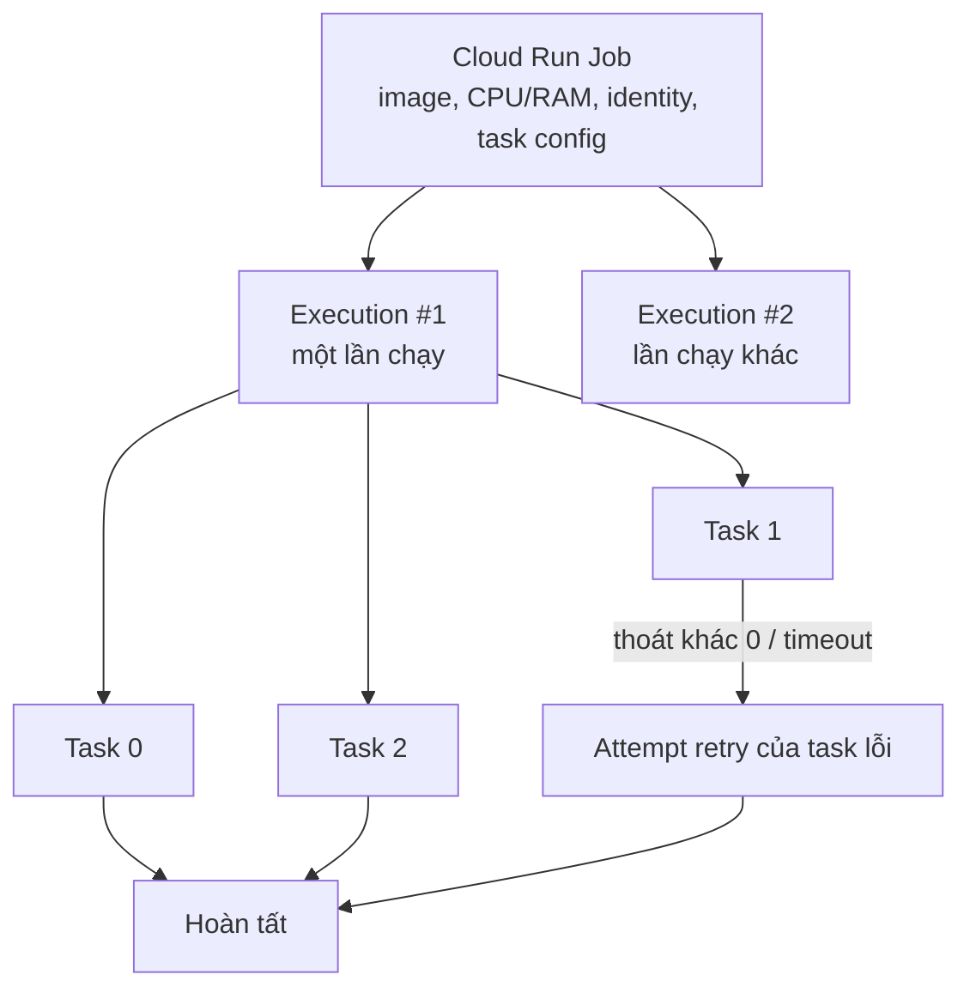
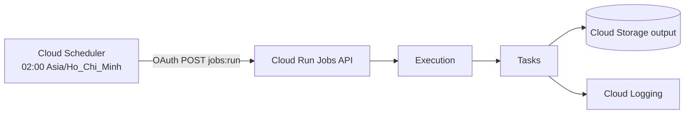

# Thực thi tác vụ nền bằng Cloud Run jobs

## 1. Bài toán và mục tiêu

Ứng dụng bán hàng cần tạo báo cáo cuối ngày, xử lý ảnh hàng loạt, nhập file CSV vào cơ sở dữ liệu và chạy một đợt migration dữ liệu. Những công việc này không cần giữ một HTTP server luôn lắng nghe, nhưng phải **chạy đến khi hoàn tất**, báo kết quả và cho phép thử lại khi có lỗi.

**Cloud Run jobs** chạy container theo mô hình **công việc hữu hạn** (*run-to-completion*). Bạn tạo cấu hình **Job** một lần, sau đó tạo một hoặc nhiều **Execution** khi cần chạy. Mỗi execution gồm một hay nhiều **Tasks**. Task chạy container rồi **thoát**; không phải lắng nghe HTTP port.

Bài thuộc chương **Cloud Run** trong module **CLOUD_PROVIDERS_GCP**: vận dụng tổ chức project, IAM, VPC, Compute Engine/GKE, Cloud Storage và database để triển khai công việc nền an toàn, theo dõi độ tin cậy và chi phí.

Sau bài học, bạn sẽ:

1. Chọn đúng giữa **Cloud Run service**, **Cloud Run job**, **worker pool** và các giải pháp điều phối.
2. Hiểu Job → Execution → Task → Attempt; thiết kế `tasks`, `parallelism`, `max-retries`, `task-timeout`.
3. Viết container chạy một lần, chia việc bằng `CLOUD_RUN_TASK_INDEX` và trả exit code chính xác.
4. Tạo, chạy, quan sát và thay đổi cấu hình job bằng `gcloud`.
5. Kích hoạt theo lịch bằng **Cloud Scheduler** hoặc điều phối bằng **Workflows**.
6. Thiết kế IAM, Secret Manager, VPC egress, retry/idempotency, logs, cảnh báo và ngân sách.

> **Quy ước:** tên project, tài khoản, image, bucket trong ví dụ là giả định. Những lệnh tạo/chạy job có thể phát sinh phí và tác động dữ liệu thật. Chỉ chạy khi có quyền và trong project lab được cho phép. Cú pháp shell nhiều dòng dùng Bash/Cloud Shell.

## 2. Chọn đúng kiểu tài nguyên Cloud Run

| Nhu cầu | Giải pháp nên đánh giá | Lý do |
| --- | --- | --- |
| API/webhook nhận HTTP, phản hồi người dùng | **Cloud Run service** | Phục vụ request, scale theo lưu lượng |
| Xử lý batch hữu hạn, backfill, migration, báo cáo theo lịch | **Cloud Run job** | Không cần HTTP listener; thực thi đến khi các task hoàn thành |
| Consumer queue hoạt động liên tục, poll/stream lâu dài | **Cloud Run worker pool** hoặc GKE | Mô hình tiến trình nền chạy liên tục |
| Nhiều bước có thứ tự, nhánh điều kiện, phối hợp nhiều services/jobs | **Workflows** | Điều phối, retry và theo dõi từng bước |
| Tác vụ rất ngắn khi nhận HTTP/event | Cloud Run service với Pub/Sub push/Eventarc theo cấu hình | Xử lý theo yêu cầu; dùng hàng đợi và retry phù hợp |

**Không** trả HTTP 200 từ Cloud Run service rồi giả định một luồng nền trong process chắc chắn sẽ chạy đến xong. Vòng đời request và CPU của service khác với một execution của job. Khi nghiệp vụ cần **bằng chứng hoàn thành** hoặc chạy lâu, hãy tạo job rồi kích hoạt bằng một hệ thống điều phối phù hợp.

**Job không có URL để người dùng gọi như service.** Muốn khởi chạy job, client được ủy quyền gọi **Cloud Run Jobs API** (hoặc `gcloud run jobs execute`), Cloud Scheduler hay Workflows.

## 3. Vòng đời Job, Execution, Task và Attempt



| Khái niệm | Ý nghĩa | Lưu ý |
| --- | --- | --- |
| **Job** | Cấu hình container và hành vi chạy | Tạo job **chưa có nghĩa đã chạy** |
| **Execution** | Một lần kích hoạt job, lưu trạng thái kết quả | Hai execution của cùng job là hai lượt độc lập |
| **Task** | Phần việc độc lập trong một execution, một container instance cho task | Mỗi task có index riêng |
| **Attempt** | Một lần thử thực thi task | Retry có thể xử lý **lại cùng phần dữ liệu** |

Một execution được coi là **thành công khi tất cả tasks hoàn tất thành công**. Task thất bại hết số retries cho phép khiến execution thất bại. Việc một task thành công **không làm những output của task khác tự động được rollback**: tính toàn vẹn dữ liệu phải thiết kế ở tầng ứng dụng.

### Những giới hạn quan trọng

| Thuộc tính | Giá trị/hành vi cơ bản |
| --- | --- |
| `tasks` | Mặc định **1**; tối đa **10.000 tasks** cho một execution |
| `parallelism` | Số task được chạy đồng thời tối đa; **không vượt quá số tasks** |
| `max-retries` | Mặc định **3 retries** trên **mỗi task**, hỗ trợ 0–10; 3 retries nghĩa tối đa **4 attempts** |
| `task-timeout` | Mặc định **10 phút** cho **mỗi attempt**; có thể tăng tới **168 giờ (7 ngày)** với cấu hình được hỗ trợ |
| GPU job task timeout | Tối đa **12 giờ** theo giới hạn sản phẩm; một số công nghệ GPU dài hạn đang ở Preview |
| Execution timeout | **Không có một timeout độc lập** cho toàn execution; hoàn thành khi tất cả tasks kết thúc |

Task có timeout 2 giờ và 2 retries **không có nghĩa execution luôn kết thúc sau đúng 2 giờ**. Thời gian thực còn phụ thuộc xếp hàng, khởi động, độ song song, retry và downstream. Đặc biệt, task nhiều giờ vẫn có thể gặp lỗi môi trường hoặc kết nối VPC cần khôi phục.

## 4. Chia việc bằng task index và giới hạn song song

Cloud Run tự cấp biến môi trường cho từng task:

- `CLOUD_RUN_JOB`: tên Job.
- `CLOUD_RUN_EXECUTION`: tên execution hiện tại.
- `CLOUD_RUN_TASK_INDEX`: index task từ **0** đến **`CLOUD_RUN_TASK_COUNT - 1`**.
- `CLOUD_RUN_TASK_COUNT`: tổng số tasks.
- `CLOUD_RUN_TASK_ATTEMPT`: số lần thử hiện tại, giúp gắn logs với retry.

Giả sử có **20 bản ghi** và job cấu hình `tasks=4`, `parallelism=2`. Có thể dùng phép chia theo phần dư:

| Task index | IDs được xử lý | Khi chạy |
| --- | --- | --- |
| 0 | 0, 4, 8, 12, 16 | Một trong tối đa 2 tasks đồng thời |
| 1 | 1, 5, 9, 13, 17 | Một trong tối đa 2 tasks đồng thời |
| 2 | 2, 6, 10, 14, 18 | Đợi slot trống |
| 3 | 3, 7, 11, 15, 19 | Đợi slot trống |

**`tasks` ≠ `parallelism`.** Tăng tasks tạo nhiều mảnh việc hơn; tăng parallelism cho nhiều mảnh chạy cùng lúc, có thể giúp nhanh hơn **nếu** database/API/Cloud Storage/quota chịu được.

**Giả định quan trọng:** danh sách đầu vào phải ổn định trong execution. Nếu query dữ liệu vừa thay đổi vừa dùng `OFFSET` để chia mảnh, retry có thể bỏ sót hoặc xử lý lặp bản ghi. Đối với sản xuất, dùng **manifest/input snapshot**, ID range cố định, phân vùng theo hash hoặc cơ chế lease/checkpoint.

## 5. Retry, exit code và tính idempotent

**Exit code 0** biểu thị task hoàn thành thành công. **Exit code khác 0**, timeout hoặc một số lỗi hạ tầng dẫn tới retry theo chính sách. Các lần thử có thể chạy trong container mới: **RAM và filesystem tạm không phải nơi lưu checkpoint lâu dài**.

Ví dụ xử lý xuất báo cáo:

1. Task đọc phân vùng dữ liệu từ một manifest cố định.
2. Ghi output vào một object key xác định theo **business run ID + partition ID**.
3. Nếu retry gặp output đã tồn tại, **kiểm tra checksum/metadata** rồi quyết định thành công hoặc báo conflict.
4. Chỉ báo hoàn tất toàn bộ batch sau khi tất cả partition outputs hợp lệ.

Nếu dùng Cloud Storage Python client, một thao tác tạo object chỉ khi chưa tồn tại có thể dùng `if_generation_match=0`:

```python
# Minh họa logic write-once, không phải ứng dụng hoàn chỉnh
from google.cloud import storage

client = storage.Client()
blob = client.bucket("acme-batch-output-lab").blob(
    "runs/2026-11-19/part-0002.json"
)
blob.upload_from_string(
    '{"count": 25}',
    content_type="application/json",
    if_generation_match=0,   # Chỉ tạo khi chưa có live object
)
```

Nếu object đã tồn tại, thao tác có thể trả **412 Precondition Failed**; ứng dụng **không** nên coi mọi 412 là thành công. Hãy đọc lại object và xác nhận nó chứa đúng kết quả của cùng logical run. Trong database, dùng **transaction, unique constraint, upsert có điều kiện** hoặc bảng checkpoint để tránh nhân đôi tác dụng phụ.

**Phân biệt hai lớp retry:** retry **task trong một execution** và việc Cloud Scheduler/Workflows/client **kích hoạt lại cả job**. Đừng dùng riêng `CLOUD_RUN_EXECUTION` làm idempotency key cho nghiệp vụ chạy theo ngày: mỗi execution có ID mới, nên hai lần kích hoạt trùng lịch vẫn có thể xử lý lại toàn bộ ngày. Dùng **business key** ổn định như `report_date` kết hợp trạng thái xử lý bền vững.

## 6. Lab: viết container chạy một lần rồi thoát

Ví dụ này chỉ in logs để bạn quan sát task partitioning, không cần database hay bucket. Tạo hai file **trên máy lab của người học** (worker STEP 4 không tạo các file này trong repository).

**`main.py`:**

```python
import json
import os
import time

task_index = int(os.environ.get("CLOUD_RUN_TASK_INDEX", "0"))
task_count = int(os.environ.get("CLOUD_RUN_TASK_COUNT", "1"))
attempt = int(os.environ.get("CLOUD_RUN_TASK_ATTEMPT", "0"))
execution = os.environ.get("CLOUD_RUN_EXECUTION", "local")
total_items = int(os.environ.get("TOTAL_ITEMS", "20"))

if not (0 <= task_index < task_count) or total_items < 0:
    raise ValueError("Invalid partition configuration")

for item_id in range(task_index, total_items, task_count):
    print(json.dumps({
        "event": "item_processed",
        "execution": execution,
        "task_index": task_index,
        "attempt": attempt,
        "item_id": item_id,
    }), flush=True)
    time.sleep(0.05)  # Mô phỏng xử lý

print(json.dumps({
    "event": "task_completed",
    "task_index": task_index,
    "attempt": attempt,
}), flush=True)
```

**`Dockerfile`:**

```dockerfile
FROM python:3.12-slim
WORKDIR /app
COPY main.py .
CMD ["python", "main.py"]
```

Chạy thử local với bốn index khác nhau:

```bash
# Bài học sử dụng Docker đã được cài trong môi trường lab
docker build -t partition-job:lab .
docker run --rm \
  -e CLOUD_RUN_TASK_INDEX=2 \
  -e CLOUD_RUN_TASK_COUNT=4 \
  -e TOTAL_ITEMS=20 \
  partition-job:lab
```

**Kỳ vọng:** task index 2 xử lý `2, 6, 10, 14, 18` và thoát **exit code 0**. Bạn không cần viết HTTP server hoặc mở `PORT`. Khi đưa vào production, **pin base image digest**, quét lỗ hổng, dùng non-root nếu khả thi và thêm test/error handling.

## 7. Build image, tạo và chạy Cloud Run job

Giả định:

```text
Project:       acme-batch-lab
Region:        asia-southeast1
Artifact Repo: batch-images (Docker repo đã tồn tại)
Image:         asia-southeast1-docker.pkg.dev/acme-batch-lab/batch-images/partition-job:v1
Job:           partition-demo
Runtime SA:    batch-runner@acme-batch-lab.iam.gserviceaccount.com
```

**Preflight:** Cloud Run API/Cloud Build API/Artifact Registry API đã được bật; repository Docker và service account tồn tại; người triển khai có quyền build/push image, tạo job và quyền `iam.serviceAccounts.actAs` đối với runtime SA. Kiểm tra region, quota, IAM, billing trước khi chạy.

### 7.1. Build và push image

Từ thư mục chứa `Dockerfile` và `main.py`:

```bash
# THAY ĐỔI CLOUD RESOURCES: có thể phát sinh phí build/storage
gcloud builds submit \
  --project=acme-batch-lab \
  --tag=asia-southeast1-docker.pkg.dev/acme-batch-lab/batch-images/partition-job:v1
```

Việc build thành công **không đảm bảo** image được phép triển khai nếu tổ chức có Binary Authorization, admission policies hoặc Artifact Registry IAM bổ sung.

### 7.2. Tạo job nhưng chưa chạy

```bash
# TẠO CẤU HÌNH JOB, chưa tạo execution
gcloud run jobs create partition-demo \
  --project=acme-batch-lab \
  --region=asia-southeast1 \
  --image=asia-southeast1-docker.pkg.dev/acme-batch-lab/batch-images/partition-job:v1 \
  --tasks=4 \
  --parallelism=2 \
  --max-retries=2 \
  --task-timeout=15m \
  --cpu=1 \
  --memory=512Mi \
  --service-account=batch-runner@acme-batch-lab.iam.gserviceaccount.com \
  --set-env-vars=TOTAL_ITEMS=20
```

**Giải thích:** tạo **4 tasks**, cùng lúc tối đa **2**; mỗi task có thể thử lại tối đa **2 lần** sau attempt đầu, timeout **15 phút/attempt**. CPU/RAM cấp cho **mỗi task container instance**, không phải tổng của toàn job.

### 7.3. Đọc cấu hình, rồi execute

```bash
# CHỈ ĐỌC
gcloud run jobs describe partition-demo \
  --project=acme-batch-lab \
  --region=asia-southeast1

# TẠO EXECUTION: phát sinh tính phí khi tasks chạy
gcloud run jobs execute partition-demo \
  --project=acme-batch-lab \
  --region=asia-southeast1 \
  --wait
```

`--wait` khiến CLI **chờ execution hoàn tất**. Nếu không có `--wait`, một lệnh execute trả thành công **chỉ xác nhận execution đã được khởi chạy**, chưa chứng minh mọi task đã thành công.

### 7.4. Ghi đè tham số chỉ cho một execution

```bash
# Ví dụ chạy lại với số tasks khác, không sửa Job gốc
gcloud run jobs execute partition-demo \
  --project=acme-batch-lab \
  --region=asia-southeast1 \
  --tasks=2 \
  --update-env-vars=TOTAL_ITEMS=10 \
  --wait
```

Đây là **execution overrides**, cần quyền `run.jobs.runWithOverrides`; `roles/run.invoker` thông thường chỉ có `run.jobs.run`. Nếu nhiệm vụ tự động chỉ cần chạy đúng cấu hình chuẩn, **không cấp quyền override**.

## 8. Xem executions, tasks và logs

### 8.1. Trạng thái execution

```bash
# CHỈ ĐỌC
gcloud run jobs executions list \
  --job=partition-demo \
  --project=acme-batch-lab \
  --region=asia-southeast1

gcloud run jobs executions describe EXECUTION_NAME \
  --project=acme-batch-lab \
  --region=asia-southeast1

gcloud run jobs executions tasks list \
  --execution=EXECUTION_NAME \
  --project=acme-batch-lab \
  --region=asia-southeast1
```

Trong Console: **Cloud Run → Jobs → chọn job → History/Executions → chọn execution → Tasks/Logs/Metrics**. Kiểm tra bao nhiêu tasks **Succeeded**, **Failed**, số retries và thời gian thực thi; **không nhìn một task thành công rồi kết luận toàn execution thành công**.

### 8.2. Cloud Logging

Job stdout/stderr được chuyển đến **Cloud Logging** theo cấu hình dịch vụ. Truy vấn trong Logs Explorer:

```text
resource.type="cloud_run_job"
resource.labels.job_name="partition-demo"
resource.labels.location="asia-southeast1"
```

Lọc thêm theo execution/task index với **những labels có thực trong entry**. Ví dụ JSON log từ `main.py` có `event`, `execution`, `task_index` và `attempt` để ghép các lần thử. Không nên log request payload, secret, dữ liệu khách hàng hoặc signed URL.

**Log có thể đến trễ và chịu retention.** Muốn đối chiếu kết quả batch, dùng thêm bảng trạng thái/manifest trong Cloud SQL hoặc Cloud Storage; Cloud Logging không phải database kết quả nghiệp vụ.

### 8.3. Monitoring và cảnh báo

Theo dõi ít nhất:

| Tín hiệu | Ý nghĩa |
| --- | --- |
| Execution success/failure | Tỷ lệ job hoàn tất thành công |
| Task duration, retries, exit codes | Phát hiện công việc bị treo, timeout hoặc lỗi tạm thời |
| CPU/RAM và OOM | Right-size cấu hình mỗi task |
| Parallelism đang dùng | Đánh giá giới hạn downstream/quota |
| Business completion marker | Xác định báo cáo/partition **thực sự được xuất bản** |
| Chi phí theo Cloud Billing SKU/labels | Phát hiện run trùng hoặc retries tăng bất thường |

Nên tạo alert khi **execution thất bại**, job theo lịch **không hoàn tất trước deadline**, hoặc output manifest chưa được tạo. Metrics hạ tầng không chứng minh báo cáo chính xác; cần thêm kiểm tra nội dung và đối chiếu tổng số bản ghi.

## 9. Chạy theo lịch bằng Cloud Scheduler

Một job không tự biết khi nào phải chạy. Đối với báo cáo mỗi ngày lúc 02:00 theo giờ Việt Nam, bạn có thể dùng **Cloud Scheduler** gọi **Cloud Run Jobs API**.



### 9.1. Phân quyền và cấu hình

Tạo một Scheduler service account riêng, ví dụ `batch-scheduler@acme-batch-lab.iam.gserviceaccount.com`. Cấp **`roles/run.invoker` trên đúng Cloud Run job** để tài khoản này có `run.jobs.run`; người tạo Scheduler cần quyền Cloud Scheduler và `iam.serviceAccounts.actAs` phù hợp.

Trong Console, vào **Cloud Run → Jobs → chọn job → Triggers → Add Scheduler Trigger**, chọn cron `0 2 * * *`, timezone `Asia/Ho_Chi_Minh` và service account vừa cấu hình.

Hoặc tạo HTTP Scheduler target sau khi quyền đã được cấp:

```bash
# TẠO SCHEDULE: chỉ chạy khi đã cấp IAM đúng
gcloud scheduler jobs create http partition-daily \
  --project=acme-batch-lab \
  --location=asia-southeast1 \
  --schedule="0 2 * * *" \
  --time-zone="Asia/Ho_Chi_Minh" \
  --uri="https://run.googleapis.com/v2/projects/acme-batch-lab/locations/asia-southeast1/jobs/partition-demo:run" \
  --http-method=POST \
  --message-body="{}" \
  --headers="Content-Type=application/json" \
  --oauth-service-account-email=batch-scheduler@acme-batch-lab.iam.gserviceaccount.com
```

**Dùng OAuth, không phải OIDC**, vì đích là Google API `run.googleapis.com`. Cloud Scheduler là tài nguyên quản trị **riêng** và có quota/phí riêng theo sản phẩm.

### 9.2. Không nhầm ACK với hoàn tất

Cloud Scheduler nhận response khi yêu cầu `jobs:run` được chấp nhận, **không chờ tất cả tasks hoàn thành**. Nếu Cloud Scheduler retry request hoặc cùng một lịch bị khởi chạy thủ công, **có thể có nhiều executions xử lý cùng ngày**. Dùng business run ID, cơ chế lock/lease và write-once output để tránh chạy trùng gây thiệt hại.

Một lịch **02:00** không bảo đảm output đã sẵn sàng lúc 02:01. Hãy giám sát deadline hoàn thành ở execution/business level.

## 10. Kích hoạt theo sự kiện và điều phối nhiều bước

Jobs phù hợp xử lý hữu hạn, nhưng **không trực tiếp là HTTP push endpoint** của Pub/Sub. Một kiến trúc phổ biến:

```text
Object mới vào Cloud Storage / Pub/Sub event
           ↓
Eventarc / Pub/Sub → Workflows (hoặc dịch vụ trung gian)
           ↓
Cloud Run Jobs API: jobs.run
           ↓
Execution → Tasks → Output
           ↓
Workflows kiểm tra kết quả / bước tiếp theo
```

**Workflows** giúp chờ execution, retry có điều kiện, xử lý lỗi và điều phối bước tiếp theo; nhưng phải cấu hình IAM, quota, timeout, retry và concurrency riêng. Nếu số sự kiện rất lớn, **khởi tạo một execution cho từng message** có thể tốn chi phí và vượt quota; cân nhắc gom batch, Cloud Tasks/Pub/Sub workers hoặc service theo mô hình phù hợp.

Ví dụ nghiệp vụ: khi upload một file lớn, workflow xác minh metadata → tạo execution job kiểm tra dữ liệu → chờ kết quả → công bố manifest. **Không chạy trực tiếp job từ browser không có xác thực** hoặc phơi quyền `run.jobs.runWithOverrides` cho người dùng.

## 11. IAM, service account và quản lý bí mật

Phân biệt **ai được tạo/chạy job** và **job được đọc/ghi dữ liệu nào**:

| Danh tính | Quyền cần thiết (ví dụ) | Nguyên tắc |
| --- | --- | --- |
| Người/CI tạo job | `roles/run.developer` và `roles/iam.serviceAccountUser` trên runtime SA, cùng quyền build/push khi cần | Không dùng Owner cho mọi pipeline |
| Người hoặc Scheduler gọi job | `roles/run.invoker` hoặc `roles/run.jobsExecutor` trên job | Chỉ cần quyền chạy đúng cấu hình |
| Người cần execution overrides | `roles/run.jobsExecutorWithOverrides` hoặc permission tương đương | Hạn chế vì có thể sửa args/env/tasks |
| Runtime service account | `roles/storage.objectViewer`, `roles/storage.objectCreator`, `roles/cloudsql.client`... **chỉ khi công việc cần** | Không dùng default Editor rộng |
| Runtime đọc Secret Manager | `roles/secretmanager.secretAccessor` trên secret cụ thể | Tránh đưa password vào image, args hoặc log |

**Không nhầm quyền `run.jobs.run` với quyền đọc Cloud Storage.** Scheduler có thể khởi chạy job mà **không cần** quyền đọc/ghi dữ liệu của job. Runtime service account mới là danh tính gọi Google APIs trong container.

### Secret Manager

Ví dụ cấp biến môi trường từ Secret Manager (không đưa giá trị bí mật trực tiếp vào CLI):

```bash
# CẬP NHẬT cấu hình, secret cần tồn tại và runtime SA có quyền truy cập
gcloud run jobs update partition-demo \
  --project=acme-batch-lab \
  --region=asia-southeast1 \
  --set-secrets=DB_PASSWORD=report-db-password:3
```

Với secret môi trường, cân nhắc **pin version số** thay vì `latest` nếu yêu cầu tái lập; với dữ liệu cần tự làm mới và không muốn restart có thể đánh giá **secret volume mounts** theo sản phẩm. Không log secrets, không lưu service-account JSON key trong container image.

### Artifact Registry

Job phải pull được image qua đường được hỗ trợ. Kiểm tra đúng Artifact Registry repository, IAM của thành phần triển khai/service agent liên quan, VPC Service Controls nếu có và Binary Authorization nếu tổ chức enforce. Lỗi pull image thường khác lỗi runtime không đọc được bucket.

## 12. Kết nối VPC, Cloud SQL và dịch vụ dữ liệu

Job **không nhận inbound HTTP traffic** như một Cloud Run service, nhưng task vẫn có thể cần egress để gọi **Cloud SQL private IP**, Redis, API nội bộ, Cloud Storage hoặc internet.

Các lựa chọn tùy cấu hình:

- **Direct VPC egress** để kết nối VPC mà không cần Serverless VPC Access connector trong những trường hợp được hỗ trợ.
- **Serverless VPC Access connector** nếu kiến trúc yêu cầu.
- **Cloud SQL connector/Cloud SQL integrations** và IAM/database credentials phù hợp.
- **Private Google Access/Private Service Connect** hoặc các đường egress đã thiết kế khi cần truy cập Google APIs.

Kiểm tra cả **route, firewall egress, NAT khi cần, DNS, subnet IP capacity và IAM**. Một `403 PERMISSION_DENIED` từ Cloud Storage thường là vấn đề IAM/API, trong khi `connection timed out` tới private database thường cần điều tra network/path/firewall.

**Không gán external IP hoặc mở `0.0.0.0/0` vì job “không kết nối được”.** Dùng Connectivity Tests, VPC Flow Logs/Cloud NAT logs theo quyền và cấu hình hiện có; chỉ thay rule tối thiểu sau khi có bằng chứng.

## 13. Capacity, hiệu năng và chi phí

Mỗi task là một container instance được cấp **vCPU, memory** và tài nguyên bổ trợ; nếu nhiều task chạy song song, lượng sử dụng có thể tăng theo số task đồng thời.

Ví dụ giả định:

```text
tasks         = 20
parallelism   = 4
cpu           = 1 vCPU / task
memory        = 512 MiB / task
max-retries   = 2
task duration = 60 giây mỗi attempt
```

Nếu không retry và các task chạy đều 60 giây, execution cần **khoảng 5 đợt**, tương đương **5 phút elapsed time** sau khi capacity sẵn sàng. Trong thời điểm cao nhất, cấu hình có thể yêu cầu khoảng **4 vCPU và 2 GiB RAM** cho bốn tasks song song. Đây là bài toán năng lực minh họa, **không phải bảo đảm latency hay công thức hóa đơn chính xác**.

Đối với Cloud Run jobs, Cloud Run tính phí theo mô hình **instance-based**, cho thời gian vòng đời container instance với **mức tối thiểu 1 phút**; CPU/memory theo vCPU-second và GiB-second, cộng GPU, networking, logging, Cloud Storage/SQL/Scheduler/Workflows nếu có. Retry và execution trùng đều làm tăng tài nguyên tính phí. Giá thay đổi theo region/SKU/discount, xem [Cloud Run pricing](https://cloud.google.com/run/pricing).

**Cách chọn parallelism:** bắt đầu với mức vừa đủ, đo throughput và **sức chịu của database/API downstream**, sau đó tăng. Một job có 100 tasks và parallelism 100 không chắc nhanh hơn parallelism 10 nếu Cloud SQL chỉ chịu được 20 connections.

**Cloud Run không phải nơi lưu state bền vững.** Filesystem ghi tạm của container có thể mất khi task kết thúc hoặc retry. Ghi output và checkpoint sang Cloud Storage/database, kiểm soát quota và chi phí lưu trữ riêng.

## 14. Troubleshooting: triệu chứng và hướng xử lý

| Triệu chứng | Nguyên nhân thường gặp | Bằng chứng/cách sửa |
| --- | --- | --- |
| `Permission denied` khi execute | Caller thiếu `run.jobs.run` | IAM của job, danh tính thực tế của CI/Scheduler |
| Execution override bị từ chối | Thiếu `run.jobs.runWithOverrides` | Dùng job cấu hình chuẩn hoặc cấp quyền override có kiểm soát |
| Task không khởi chạy | Image/tag không tồn tại, Artifact Registry IAM, region/quota | Job Events, execution status, image digest, API/quota |
| Task thất bại ngay | Command/args sai, thiếu env/secret, process exit khác 0 | Logs theo execution/task/attempt, exit code |
| Retry liên tục | Lỗi bền vững, timeout quá ngắn, dependency unavailable | Phân loại transient/permanent, backoff, idempotency |
| `Task timeout` | Quá thời gian giới hạn mỗi attempt | Duration metric, checkpoint/partition size, tăng timeout có lý do |
| OOMKilled | Memory limit quá thấp hoặc leak | Memory usage, logs, điều chỉnh memory/ứng dụng |
| Tasks xử lý trùng dữ liệu | Retry hoặc nhiều executions cùng business run | Idempotency key/manifest/write-once/transaction |
| Job thành công nhưng thiếu output | Code trả exit 0 trước khi commit dữ liệu | Output validation, manifest, kiểm tra lỗi đã bị nuốt |
| Scheduler báo thành công, job thất bại | Scheduler chỉ xác nhận API start, không chờ completion | Execution status và alert business deadline |
| Lỗi Cloud SQL/private endpoint | VPC egress, DNS, firewall/NAT, IAM/database auth | Phân biệt TCP timeout với 403/permission |
| Chi phí tăng bất thường | Parallelism cao, retry nhiều, chạy trùng, GPU/egress | Executions, Billing SKU/labels, logs và downstream usage |

### Runbook 5 bước

1. Xác nhận **Project/region/job/execution/task index**, thời điểm và input logical run.
2. Đọc **task status, attempt count, exit code, timeout và logs**, không chỉ thông báo lỗi tổng quát.
3. Phân biệt **container lỗi**, **IAM**, **network**, **data conflict** và **quota/capacity**.
4. Sửa thay đổi nhỏ nhất: image/env, role cụ thể, timeout/parallelism hoặc code; có kế hoạch rollback.
5. Thử lại trên **dữ liệu có thể lặp an toàn**, xác minh output/manifest và SLO, ghi lại nguyên nhân.

Với lỗi production cần bảo toàn chứng cứ, **không xóa execution hoặc log trước khi điều tra**.

## 15. Hai tình huống thiết kế thực tế

### 15.1. Báo cáo đơn hàng mỗi ngày

**Luồng:** Cloud Scheduler → Cloud Run job → đọc dữ liệu đã được chốt → xử lý nhiều tasks → ghi file Parquet/CSV → publish manifest.

**Thiết kế:** phân vùng theo `report_date` và shard ID; `parallelism` giới hạn theo Cloud SQL; job SA chỉ có quyền đọc nguồn/ghi bucket đích; output có **write-once precondition**; cảnh báo khi job không hoàn tất trước deadline. Một run trùng lịch phải kiểm tra manifest/bản ghi lock, **không tạo báo cáo nhân đôi**.

### 15.2. Backfill dữ liệu sau thay schema

**Luồng:** Workflow có approval → Cloud Run job nhiều task → mỗi task xử lý một ID range cố định → ghi checkpoint → Workflows xác nhận tất cả partitions và chất lượng dữ liệu.

**Thiết kế:** chạy canary nhỏ, có rollback, giới hạn write concurrency, bảo vệ database, kiểm tra row count/checksum; `max-retries` không được dùng thay cho transaction. Nếu dữ liệu phân vùng rất lớn hoặc công việc liên tục dài ngày, cân nhắc **GKE/Batch/worker pools** theo yêu cầu hạ tầng và công cụ.

## 16. Bài tập củng cố

1. **Lựa chọn sản phẩm:** Xây REST API trả kết quả trong 100 ms, tạo báo cáo 30 phút lúc 02:00 và consumer queue chạy liên tục. Nên chọn gì? **Gợi ý:** service, job, worker pool/GKE tương ứng.
2. **Phân chia task:** Có 18 items, `tasks=3`, `parallelism=2`. Liệt kê IDs mỗi task xử lý theo công thức modulo. **Đáp án:** task 0: 0,3,6,9,12,15; task 1: 1,4,7,10,13,16; task 2: 2,5,8,11,14,17.
3. **Số attempts:** `max-retries=2`, một task thất bại hai lần rồi thành công lần thứ ba. Execution có thể thành công không? **Đáp án:** Có, nếu mọi task khác cũng thành công; tổng 3 attempts cho task đó.
4. **Chọn parallelism:** Job có 200 tasks, Cloud SQL chỉ chịu 10 đồng thời; đặt `parallelism` bao nhiêu để bắt đầu kiểm thử? **Gợi ý:** thấp hơn trần 10 và tính tới traffic của các ứng dụng khác, rồi benchmark.
5. **Retry idempotent:** Scheduler kích hoạt hai executions cùng `report_date`. Tại sao dùng `CLOUD_RUN_EXECUTION` làm output prefix chưa đủ chống xử lý trùng? Hãy đề xuất business key, unique constraint hoặc write-once manifest.
6. **Quyền:** Scheduler cần khởi chạy job, runtime cần ghi Cloud Storage, một nhân viên cần override `tasks`. Ai cần `run.jobs.run`, ai cần `storage.objects.create`, ai cần `run.jobs.runWithOverrides`?
7. **Chẩn đoán:** `gcloud run jobs execute` không có `--wait` trả exit 0, nhưng sau 20 phút thiếu output. Nêu lệnh/trang để xem execution/tasks/logs và các giả thuyết cần kiểm tra.

## 17. Checklist triển khai production

- [ ] Đã xác nhận workload hữu hạn phù hợp **Cloud Run job**, không phải HTTP service hoặc worker chạy liên tục.
- [ ] Chia input thành partitions ổn định; tasks có thể chạy độc lập và **idempotent**.
- [ ] `tasks`, `parallelism`, `task-timeout` và `max-retries` phù hợp quota, SLO và downstream.
- [ ] Task trả **exit code 0 chỉ sau khi công việc được commit và kiểm chứng**.
- [ ] Output/checkpoint nằm trên Cloud Storage/database, không chỉ trong filesystem tạm.
- [ ] Image được pin/versioned, quét bảo mật và triển khai qua quy trình CI/CD có rollback.
- [ ] Runtime SA, người deploy, invoker và override permissions được phân tách.
- [ ] Secrets lấy từ Secret Manager; không in secrets hoặc signed URLs vào logs.
- [ ] VPC/Cloud SQL/Cloud Storage đường kết nối và IAM đã được thử trong lab.
- [ ] Nếu dùng Scheduler/Workflows, có chống duplicate và kiểm tra **completion**, không chỉ API ACK.
- [ ] Dashboard/alerts theo **execution failure, retry, duration, business deadline và output**.
- [ ] Dự toán vCPU/GiB-seconds, retries, concurrency, network, storage, database và orchestration.
- [ ] Có runbook xử lý lỗi, cơ chế backfill và quy trình cleanup giữ logs/bằng chứng cần thiết.

## 18. Tài liệu chính thức

1. [Create Cloud Run jobs](https://cloud.google.com/run/docs/create-jobs).
2. [Execute jobs](https://cloud.google.com/run/docs/execute/jobs).
3. [Manage job executions](https://cloud.google.com/run/docs/managing/job-executions).
4. [Set parallelism](https://cloud.google.com/run/docs/configuring/parallelism).
5. [Set task timeouts](https://cloud.google.com/run/docs/configuring/task-timeout).
6. [Jobs: retries and checkpoints](https://cloud.google.com/run/docs/jobs-retries).
7. [Cloud Run container runtime contract](https://cloud.google.com/run/docs/container-contract).
8. [Execute jobs on a schedule](https://cloud.google.com/run/docs/execute/jobs-on-schedule).
9. [Configure secrets for jobs](https://cloud.google.com/run/docs/configuring/jobs/secrets).
10. [Cloud Run IAM permissions](https://cloud.google.com/run/docs/reference/iam/permissions).
11. [Cloud Run logging](https://cloud.google.com/run/docs/logging).
12. [Cloud Run pricing](https://cloud.google.com/run/pricing).
13. [gcloud run jobs create](https://cloud.google.com/sdk/gcloud/reference/run/jobs/create) và [gcloud run jobs execute](https://cloud.google.com/sdk/gcloud/reference/run/jobs/execute).

**Ghi nhớ:** **Cloud Run jobs** phù hợp tác vụ nền **có điểm kết thúc**, có thể chia mảnh và thử lại. Thành công không chỉ là container chạy được mà còn là **đầu ra đúng, không xử lý trùng, quyền tối thiểu, quan sát được execution và chi phí nằm trong giới hạn**. Hãy chọn `tasks` và `parallelism` theo khả năng xử lý thật, thiết kế idempotency trước khi bật retries và kiểm tra completion thay vì chỉ nhìn lệnh kích hoạt thành công.
