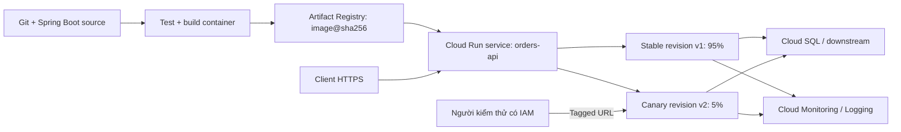
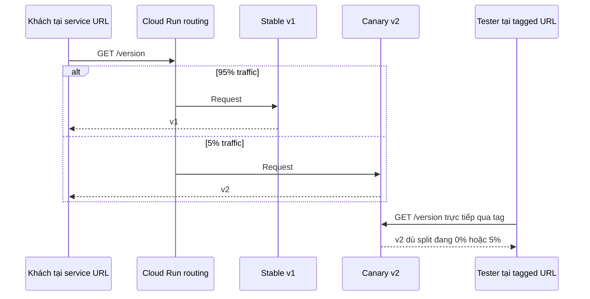
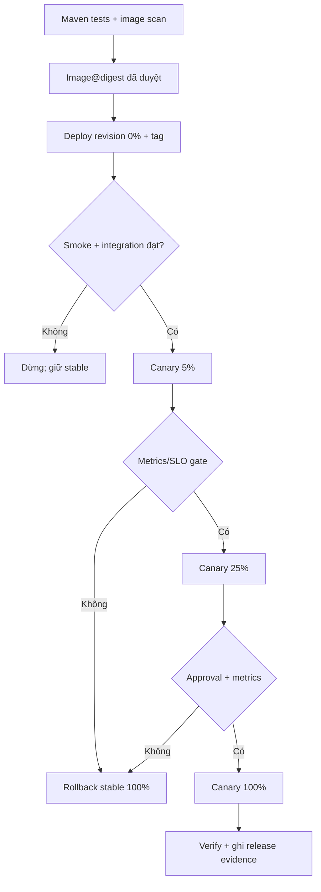

# Thực hành phát hành Spring Boot theo canary trên Cloud Run

Một phiên bản mới của Orders API thay đổi cách tính khuyến mãi. Kiểm thử staging đã đạt, nhưng nếu đưa 100% người dùng sang bản mới ngay, lỗi tương thích với database hoặc timeout có thể ảnh hưởng toàn bộ hệ thống. **Canary deployment** cho phép đưa trước một phần nhỏ lưu lượng thật vào revision mới, quan sát chất lượng, tăng dần tỷ lệ và **quay lại revision ổn định mà không cần build lại image** khi cần.

Bài thực hành thuộc chương **Cloud Run** của module `CLOUD_PROVIDERS_GCP`. Quy trình sử dụng Spring Boot, Artifact Registry, Cloud Run revisions/traffic splitting, Cloud Logging và Cloud Monitoring; đồng thời liên hệ IAM, VPC/Cloud SQL, CI/CD, độ tin cậy và chi phí. Mục tiêu là **phát hành có thể kiểm chứng và rollback**, thay vì chỉ chạy thành công lệnh `gcloud run deploy`.

> Mọi project, revision, domain và chỉ số trong bài là **giả định**. Các lệnh `gcloud services enable`, build/push, deploy và đổi traffic **thay đổi hạ tầng hoặc phát sinh phí**. Chỉ chạy trong sandbox được ủy quyền. Bài dùng ví dụ Linux/Bash; trên Windows PowerShell, thay cú pháp biến môi trường tương ứng.

## 1. Mục tiêu và kết quả cần đạt

Sau bài học, bạn có thể:

1. Đóng gói Spring Boot Java 21 thành container lắng nghe biến `PORT` của Cloud Run.
2. Đẩy image lên Artifact Registry và cố định image **digest** cho từng bản phát hành.
3. Tạo revision mới với `--no-traffic --tag=canary`, thử **tagged URL** trước khi đưa traffic thật.
4. Chia lưu lượng giữa hai revisions theo các bước **95/5 → 75/25 → 0/100** bằng `gcloud`.
5. Đo HTTP 5xx, latency, startup latency, CPU/memory và logs **theo revision**; có ngưỡng go/no-go rõ ràng.
6. Rollback ngay về revision ổn định và kiểm tra tác động dữ liệu/phiên làm việc.
7. Biết các giới hạn của traffic splitting, session affinity, Cloud SQL connection pools, IAM và min instances.

## 2. Kiến trúc và điều kiện tiên quyết



**Mô hình điều phối:** một Cloud Run **service** có URL chính và nhiều **revisions bất biến**. Mỗi revision ghi lại image và cấu hình ở thời điểm tạo; **traffic split** phân phối tỷ lệ yêu cầu tới các revisions được chọn. **Traffic tag** gắn một URL riêng vào revision để thử trực tiếp, ngay cả khi revision nhận **0%** traffic từ URL chính. Chỉ tạo tag không tạo thêm một service độc lập.

| Thành phần | Ví dụ bài học | Quy tắc |
| --- | --- | --- |
| Google Cloud project | `orders-lab` | Billing bật, đủ quota, API và IAM |
| Region | `asia-southeast1` | Cloud Run và registry cùng region để thuận tiện |
| Service | `orders-api` | Một URL chính, nhiều revisions |
| Artifact Registry | `orders-images` | Docker repository private |
| Stable release | `v1`, revision do Cloud Run sinh | Đang nhận 100% trước rollout |
| Canary release | `v2`, tag `canary` | Ban đầu 0%; thử riêng rồi tăng dần |
| Metrics | Request count, 5xx rate, request latency | Phân tách bằng revision name |

Điều kiện chuẩn bị: đã cài `gcloud`, Docker hoặc Cloud Build, Maven wrapper/Java 21, có quyền build/push/deploy và service account riêng cho runtime. Người dùng chạy lệnh cần `roles/run.developer` (hoặc quyền tương đương), `iam.serviceAccounts.actAs` đối với runtime identity; build identity cần quyền đẩy image vào Artifact Registry. **Không dùng account Owner cho toàn bộ pipeline**.

**Quan trọng:** bài thực hành bắt đầu từ **service đã có revision v1 đang phục vụ 100%**. Nếu service mới chưa từng có revision, bạn phải deploy v1 trước; không coi lệnh deploy v2 với `--no-traffic` là bước khởi tạo một bản stable đã tồn tại.

## 3. Tạo ứng dụng Spring Boot quan sát được phiên bản

Một demo tối thiểu nên có `/healthz` và `/version`. Phản hồi `/version` giúp xác minh request thật đang đi tới revision nào; trong production vẫn phải dùng Cloud Run revision labels và Cloud Monitoring để kết luận.

Ví dụ cấu trúc:

```text
orders-api/
  pom.xml
  src/main/java/com/example/orders/OrdersApplication.java
  src/main/resources/application.properties
  Dockerfile
  mvnw, .mvn/     # Maven Wrapper nếu tạo từ Spring Initializr
```

### 3.1. Maven project

Ví dụ `pom.xml` dùng **Spring Boot 3.5.7 để minh họa**, Java 21; khi thực hành thực tế hãy nâng lên bản Spring Boot còn được hỗ trợ và đã qua security review:

```xml
<?xml version="1.0" encoding="UTF-8"?>
<project xmlns="http://maven.apache.org/POM/4.0.0"
         xmlns:xsi="http://www.w3.org/2001/XMLSchema-instance"
         xsi:schemaLocation="http://maven.apache.org/POM/4.0.0
                             https://maven.apache.org/xsd/maven-4.0.0.xsd">
  <modelVersion>4.0.0</modelVersion>
  <groupId>com.example</groupId>
  <artifactId>orders-api</artifactId>
  <version>1.0.0</version>
  <parent>
    <groupId>org.springframework.boot</groupId>
    <artifactId>spring-boot-starter-parent</artifactId>
    <version>3.5.7</version>
    <relativePath/>
  </parent>
  <properties>
    <java.version>21</java.version>
  </properties>
  <dependencies>
    <dependency>
      <groupId>org.springframework.boot</groupId>
      <artifactId>spring-boot-starter-web</artifactId>
    </dependency>
    <dependency>
      <groupId>org.springframework.boot</groupId>
      <artifactId>spring-boot-starter-test</artifactId>
      <scope>test</scope>
    </dependency>
  </dependencies>
  <build>
    <plugins>
      <plugin>
        <groupId>org.springframework.boot</groupId>
        <artifactId>spring-boot-maven-plugin</artifactId>
      </plugin>
    </plugins>
  </build>
</project>
```

### 3.2. Controller và cấu hình

```java
package com.example.orders;

import java.util.Map;
import org.springframework.beans.factory.annotation.Value;
import org.springframework.boot.SpringApplication;
import org.springframework.boot.autoconfigure.SpringBootApplication;
import org.springframework.web.bind.annotation.GetMapping;
import org.springframework.web.bind.annotation.RestController;

@SpringBootApplication
@RestController
public class OrdersApplication {
    @Value("${APP_VERSION:local}")
    private String appVersion;

    @GetMapping("/healthz")
    public Map<String, String> health() {
        return Map.of("status", "ok");
    }

    @GetMapping("/version")
    public Map<String, String> version() {
        return Map.of("version", appVersion);
    }

    public static void main(String[] args) {
        SpringApplication.run(OrdersApplication.class, args);
    }
}
```

Trong `application.properties`:

```properties
server.address=0.0.0.0
server.port=${PORT:8080}
server.shutdown=graceful
spring.lifecycle.timeout-per-shutdown-phase=9s
```

Cloud Run yêu cầu container ingress lắng nghe **0.0.0.0** trên cổng được cung cấp qua `PORT` (mặc định 8080), không chỉ `127.0.0.1`. Cloud Run gửi `SIGTERM` rồi cho khoảng **10 giây** trước `SIGKILL` khi dừng instance; `9s` chỉ là ví dụ budget cho graceful shutdown, không bảo đảm mọi request dài được hoàn tất.

**V2** cần chứa một thay đổi code/nghiệp vụ có kiểm thử thật; `APP_VERSION` chỉ là tín hiệu demo, **không chứng minh** image đã thay đổi. `/healthz` không chứa dữ liệu nhạy cảm và không nên phụ thuộc vào một truy vấn tốn kém; kiểm thử business/database riêng trước khi tăng traffic.

### 3.3. Build và test tại máy phát triển

```bash
# CHỈ CHẠY trong thư mục source demo có Maven Wrapper hoặc dùng "mvn".
./mvnw -B clean verify
./mvnw -B package -DskipTests
```

Lệnh thứ hai chỉ phục vụ đóng gói **sau khi** tests đã qua. Không bỏ tests khỏi pipeline production; ngoài unit tests cần integration tests, dependency scan và xác nhận schema DB tương thích hai versions cùng hoạt động.

## 4. Containerize và phát hành image vào Artifact Registry

Ví dụ Dockerfile đơn giản:

```dockerfile
# Lab: dùng image runtime Java 21 đã được tổ chức duyệt.
# Production nên pin image bằng digest đã scan, không dùng floating tag.
FROM eclipse-temurin:21-jre
WORKDIR /app
COPY target/*.jar /app/orders-api.jar
USER 10001
EXPOSE 8080
ENTRYPOINT ["java", "-jar", "/app/orders-api.jar"]
```

Điều kiện: chỉ có **một** executable Spring Boot JAR khớp `target/*.jar`, file có thể đọc bởi UID 10001 và không cần ghi vào `/app`. Production nên dùng multi-stage build/SBOM, quét CVE trong Artifact Registry và pin base image digest. Không bake password, API key hoặc service account JSON vào image/environment của Git.

### 4.1. Chuẩn bị project và Docker repository

```bash
# LỆNH CÓ THAY ĐỔI HẠ TẦNG / PHÍ.
PROJECT_ID="orders-lab"
REGION="asia-southeast1"
REPO="orders-images"
SERVICE="orders-api"
IMAGE="$REGION-docker.pkg.dev/$PROJECT_ID/$REPO/$SERVICE"

gcloud services enable run.googleapis.com \
  artifactregistry.googleapis.com \
  cloudbuild.googleapis.com \
  --project="$PROJECT_ID"

gcloud artifacts repositories create "$REPO" \
  --repository-format=docker \
  --location="$REGION" \
  --project="$PROJECT_ID" \
  --description="Orders API release images"

# Runtime identity riêng, không dùng mặc định nếu đã có account được duyệt.
gcloud iam service-accounts create orders-runtime \
  --display-name="Orders Cloud Run runtime" \
  --project="$PROJECT_ID"
```

Nếu API/repository/service account **đã tồn tại**, không chạy lại bước tạo; kiểm tra metadata và quyền hiện hữu. Tài khoản kích hoạt Cloud Build và Cloud Build service account có thể cần quyền riêng cho Artifact Registry/storage; theo hướng dẫn IAM của Cloud Build thay vì cấp Editor toàn project. Repo private vẫn cần quyền đọc phù hợp cho Cloud Run service agent trong trường hợp cross-project.

### 4.2. Build hai images có version khác nhau

Tại commit **v1**:

```bash
# THAY ĐỔI / CÓ PHÍ: build và push image từ Dockerfile.
gcloud builds submit . \
  --tag="$IMAGE:v1" \
  --project="$PROJECT_ID"
```

Sau khi merge và kiểm thử thay đổi **v2**, build tiếp:

```bash
gcloud builds submit . \
  --tag="$IMAGE:v2" \
  --project="$PROJECT_ID"

# CHỈ ĐỌC: lấy image digests từ registry.
gcloud artifacts docker images list "$IMAGE" \
  --include-tags \
  --project="$PROJECT_ID"
```

Ghi lại **hai digest thực** dưới dạng `$IMAGE@sha256:...`; không tự bịa digest rồi chạy deploy. Tag `v1`/`v2` có thể bị gắn lại; **digest mới là artifact bất biến** gắn với build, scan và phê duyệt. Nếu dùng Cloud Build ở project có chính sách service accounts mới, hãy đảm bảo runner có quyền push trước khi bắt đầu.

## 5. Baseline v1: revision ổn định nhận 100% traffic

Giả định chưa có service `orders-api`. Sau khi có image **v1 digest** và runtime service account:

```bash
# Thay bằng digest vừa đọc từ Artifact Registry.
IMAGE_V1="$IMAGE@sha256:V1_REAL_DIGEST"
RUNTIME_SA="orders-runtime@$PROJECT_ID.iam.gserviceaccount.com"

# TẠO SERVICE / PHÁT SINH PHÍ. Demo để service private theo IAM.
gcloud run deploy "$SERVICE" \
  --image="$IMAGE_V1" \
  --project="$PROJECT_ID" \
  --region="$REGION" \
  --platform=managed \
  --service-account="$RUNTIME_SA" \
  --no-allow-unauthenticated \
  --port=8080 \
  --cpu=1 \
  --memory=512Mi \
  --concurrency=20 \
  --set-env-vars=APP_VERSION=v1
```

Service mới có một revision nhận 100% traffic theo thiết lập mặc định. Trường hợp service đã tồn tại, **không áp lại lệnh baseline** nếu không có change request vì có thể tạo revision và thay đổi cấu hình đang phục vụ. Kiểm tra read-only:

```bash
gcloud run services describe "$SERVICE" \
  --project="$PROJECT_ID" --region="$REGION" \
  --format="yaml(status.url,status.traffic,status.latestReadyRevisionName)"

gcloud run revisions list \
  --service="$SERVICE" --project="$PROJECT_ID" --region="$REGION"
```

Lưu revision name đang 100% vào biến `STABLE_REV`, chẳng hạn `orders-api-00001-abc` (chỉ là **tên minh họa**, phải thay bằng output thật). Kiểm tra revision `Ready` và smoke test endpoint qua người dùng/tài khoản có `roles/run.invoker`; không mở public chỉ để việc thử nghiệm dễ hơn.

## 6. Deploy v2 với 0% traffic và gắn canary tag

Sau khi `v2` đã qua tests và image digest được duyệt, triển khai vào **cùng Cloud Run service** nhưng chưa gửi traffic từ URL chính:

```bash
IMAGE_V2="$IMAGE@sha256:V2_REAL_DIGEST"

# CÓ THAY ĐỔI / CHI PHÍ: tạo revision mới, không chuyển traffic đang phục vụ.
gcloud run deploy "$SERVICE" \
  --image="$IMAGE_V2" \
  --project="$PROJECT_ID" \
  --region="$REGION" \
  --no-traffic \
  --tag=canary \
  --update-env-vars=APP_VERSION=v2

# CHỈ ĐỌC: xem revisions, split và URL của traffic tag.
gcloud run revisions list \
  --service="$SERVICE" --project="$PROJECT_ID" --region="$REGION"

gcloud run services describe "$SERVICE" \
  --project="$PROJECT_ID" --region="$REGION" \
  --format="yaml(status.url,status.traffic,status.latestReadyRevisionName)"
```

`--no-traffic` giữ revision mới ở **0% của URL service chính**; `--tag=canary` cho phép truy cập trực tiếp vào revision bằng tagged URL trả về trong `status.traffic`. **0% không đồng nghĩa không thể bị gọi**: nếu service công khai thì ai biết tag URL cũng có thể gửi request theo chính sách ingress/IAM của service.

`--update-env-vars` **chỉ cập nhật** `APP_VERSION`, giữ các biến khác; trái lại `--set-env-vars` có thể **xóa các biến đã tồn tại mà không liệt kê lại**. Trước deploy v2 trên production, so sánh image, CPU/memory, concurrency, runtime identity, Cloud SQL/VPC, secrets và service settings. Nếu cấu hình đã bị thay đổi ngoài dự kiến, **dừng phát hành** ngay cả khi v2 đang 0% traffic.

Lưu hai tên revision đúng từ output:

```bash
# Chỉ là placeholders: THAY bằng revision names Cloud Run thực tế.
STABLE_REV="orders-api-00001-abc"
CANARY_REV="orders-api-00002-def"
TAG_URL="https://CANARY_URL_FROM_STATUS_TRAFFIC"
```

### 6.1. Kiểm thử tagged URL của service private

Tagged revision vẫn chịu **IAM Invoker/ingress** của service. Nếu service yêu cầu xác thực, người gọi phải có `roles/run.invoker`; token **audience** thường phải là **URL service chính**, **không phải tagged URL**.

```bash
# CHỈ ĐỌC: lấy URL chính của service.
SERVICE_URL="$(gcloud run services describe "$SERVICE" \
  --project="$PROJECT_ID" --region="$REGION" \
  --format='value(status.url)')"

# Cần quyền impersonate đã được cấp cho tester và Invoker trên service.
TESTER_SA="canary-tester@$PROJECT_ID.iam.gserviceaccount.com"
ID_TOKEN="$(gcloud auth print-identity-token \
  --impersonate-service-account="$TESTER_SA" \
  --audiences="$SERVICE_URL")"

# CHỈ GỌI ENDPOINT: gửi request trực tiếp tới revision 0%.
curl --fail --show-error \
  -H "Authorization: Bearer $ID_TOKEN" \
  "$TAG_URL/version"
```

Ví dụ giả định account `canary-tester` **đã tồn tại**, người chạy có quyền tạo ID token qua impersonation, và tester được cấp `roles/run.invoker` trên service. Nếu thiếu một quyền, **không bỏ IAM** để vượt lỗi: sửa quyền ở đúng principal/resource. Nếu service public có chủ đích, có thể gọi tagged URL bằng curl mà không có ID token; đây không phải cấu hình mặc định của bài.

Checklist thử nghiệm trước traffic thật: `/healthz` HTTP 200, `/version` trả v2, request nghiệp vụ qua toàn bộ dependencies, quyền service account, schema DB, Cloud SQL connections, startup latency, logs không lộ dữ liệu và xác minh **URL chính vẫn trả v1**.

## 7. Chia traffic 95/5 → 75/25 → 0/100

Khi v2 đã được kiểm thử bằng tag, thực hiện **traffic migration trên chính Cloud Run service**. Mỗi lệnh sau thay đổi lưu lượng khách hàng thật: phải có approver, SLO gate và rollback command sẵn.

### 7.1. Giai đoạn 1: canary 5%

```bash
# THAY ĐỔI TRAFFIC: đúng 2 revision names, tổng bằng 100%.
gcloud run services update-traffic "$SERVICE" \
  --project="$PROJECT_ID" --region="$REGION" \
  --to-revisions="$STABLE_REV=95,$CANARY_REV=5"

# CHỈ ĐỌC: xác minh kết quả thực tế, không chỉ exit code.
gcloud run services describe "$SERVICE" \
  --project="$PROJECT_ID" --region="$REGION" \
  --format="yaml(status.traffic)"
```

Đây là **phân phối traffic theo request** của service; không phải 5% số Pods, 5% CPU hay chính xác 5/100 người dùng. Khi load nhỏ, mẫu ngẫu nhiên có thể biến động. **Session affinity có thể ưu tiên giữ người dùng ở cùng revision** và làm tỷ lệ request thực tế lệch đáng kể so với split.

### 7.2. Giai đoạn 2: canary 25%

Chỉ tăng khi đã có **đủ lượng request thực** và các điều kiện gate đạt:

```bash
# THAY ĐỔI TRAFFIC: tăng có kiểm soát.
gcloud run services update-traffic "$SERVICE" \
  --project="$PROJECT_ID" --region="$REGION" \
  --to-revisions="$STABLE_REV=75,$CANARY_REV=25"
```

Ví dụ lịch phát hành: 5% trong 15–30 phút → 25% trong 30 phút → 100%. **Đây không phải thời gian bắt buộc**: nếu service chỉ nhận 10 request/phút, 15 phút chưa đủ bằng chứng. Chọn thời gian theo request volume, traffic peak, đặc điểm downstream, confidence và yêu cầu nghiệp vụ.

### 7.3. Giai đoạn 3: hoàn tất 100% v2

```bash
# THAY ĐỔI TRAFFIC: gửi toàn bộ request từ URL chính sang đúng revision đã duyệt.
gcloud run services update-traffic "$SERVICE" \
  --project="$PROJECT_ID" --region="$REGION" \
  --to-revisions="$CANARY_REV=100"

# CHỈ ĐỌC:
gcloud run services describe "$SERVICE" \
  --project="$PROJECT_ID" --region="$REGION" \
  --format="yaml(status.traffic,status.latestReadyRevisionName)"
```

Dùng **revision name cụ thể** cho production để tránh vô tình cho bản “LATEST” mới khác tự nhận toàn bộ lưu lượng. Lệnh `--to-latest` dành cho trường hợp **cố ý** thiết lập latest revision nhận 100%, kể cả khi có future deploy; đó không phải lựa chọn an toàn mặc định trong canary đã kiểm duyệt.

| Giai đoạn | Stable v1 | Canary v2 | Điều kiện chuyển tiếp |
| --- | ---: | ---: | --- |
| Trước canary | 100% | 0% (tagged test) | V2 ready, smoke/integration tests đạt |
| Canary nhỏ | 95% | 5% | So lỗi, latency và tài nguyên theo revision |
| Canary mở rộng | 75% | 25% | Đủ mẫu, không regression, DB/queue còn headroom |
| Hoàn tất | 0% | 100% | Business metrics/SLO, on-call và rollback sẵn |
| Rollback khi lỗi | 100% | 0% | Stable v1 còn tương thích và healthy |

**Traffic migration không xảy ra tức thời**. Những request đang xử lý có thể hoàn tất trên revision cũ; trong giai đoạn đổi split vẫn có request tới cả hai revisions. Vì vậy không triển khai schema/feature cần “chỉ một version tồn tại” ở lần migration.

### 7.4. Quan sát URL service so với tag URL



Hình trên mô tả tỷ lệ kỳ vọng; không dùng một lần `curl` tới service URL để khẳng định đã đúng 95/5. Kiểm tra cả `status.traffic` và metrics theo revision trong nhiều request.

## 8. Go/no-go dựa trên Cloud Monitoring và Cloud Logging

Cloud Run tích hợp sẵn Cloud Monitoring. Hai built-in metrics quan trọng là `run.googleapis.com/request_count` (có response_code_class) và `run.googleapis.com/request_latencies`. Chọn monitored resource **`cloud_run_revision`**, lọc theo **service name + revision name** để so v1 và v2. Metrics có độ trễ lấy mẫu/hiển thị; đừng tự động tăng traffic mỗi vài giây vì chưa thấy lỗi.

### 8.1. Ma trận canary gate minh họa

| Tín hiệu trong cửa sổ quan sát | Tiêu chí ví dụ | Hành động |
| --- | --- | --- |
| Số request v2 | Tối thiểu **500** request sau warm-up | Thiếu mẫu → giữ tỷ lệ hoặc chạy load test được duyệt |
| HTTP 5xx rate | Không quá **1%**, và không cao bất thường so v1 | Vượt ngưỡng → dừng tăng, rollback nếu rủi ro rõ |
| p95 request latency | Không quá **500 ms** hoặc 20% cao hơn v1 cùng traffic mix | Điều tra cold starts/DB, giữ hoặc rollback |
| Cloud Run startup latency | Không tăng gây timeout/queueing | Kiểm tra init/JVM/memory/min instances |
| Memory, CPU, concurrency | Không OOM/throttling, có headroom | Sửa sizing trước khi mở rộng |
| Business metrics | Không sai đơn hàng, thanh toán hoặc sự kiện lặp | **Rollback ngay**, điều tra dữ liệu |
| Error logs | Không có exception mới/secret leakage | Dừng rollout khi có lỗi nghiêm trọng |

Các ngưỡng là **giả định cho bài tập**, không phải SLO chuẩn của Google. Trong sản xuất, đặt theo SLO/error budget của hệ thống và đặc điểm request; so v1/v2 trên **cùng thời gian và traffic mix**. Khi canary ít request, “0 lỗi” có thể đơn giản là mẫu quá nhỏ.

### 8.2. Lọc logs riêng cho revision

Trong Cloud Logging Logs Explorer:

```text
resource.type="cloud_run_revision"
resource.labels.service_name="orders-api"
resource.labels.revision_name="orders-api-00002-def"
severity>=ERROR
```

Để tập trung request logs có HTTP 5xx:

```text
resource.type="cloud_run_revision"
resource.labels.service_name="orders-api"
resource.labels.revision_name="orders-api-00002-def"
httpRequest.status>=500
```

Lọc bằng `gcloud`:

```bash
# CHỈ ĐỌC: thay đúng revision name đang canary.
gcloud logging read \
  "resource.type=\"cloud_run_revision\" AND resource.labels.revision_name=\"$CANARY_REV\" AND severity>=ERROR" \
  --project="$PROJECT_ID" \
  --freshness=30m \
  --limit=50
```

Trong Cloud Monitoring, xem thêm **Container instance count, startup latency, CPU/memory** và downstream service metrics. `request_count` chỉ tính những requests **đã tới container instance**, không bao gồm mọi lỗi bị chặn trước container (ví dụ IAM deny hoặc một số lỗi hết capacity), nên cần thêm load balancer/request logs và synthetic checks nếu muốn đo end-to-end availability.

**Có thể dùng trace IDs:** Spring Boot/Micrometer Tracing hoặc OpenTelemetry có thể gắn correlation fields và xuất spans tới Cloud Trace. Traces giúp xác định v2 chậm ở JVM, Cloud SQL hay API downstream; không thay việc đánh giá metrics theo revision.

## 9. Rollback và xử lý dữ liệu

Nếu canary v2 gây 5xx hoặc sai nghiệp vụ, rollback bằng **đổi traffic**; không cần build lại v1:

```bash
# THAY ĐỔI TRAFFIC: quay ngay về revision v1 đã lưu trước rollout.
gcloud run services update-traffic "$SERVICE" \
  --project="$PROJECT_ID" --region="$REGION" \
  --to-revisions="$STABLE_REV=100"

# CHỈ ĐỌC: xác nhận v1 nhận 100%.
gcloud run services describe "$SERVICE" \
  --project="$PROJECT_ID" --region="$REGION" \
  --format="yaml(status.traffic)"
```

Sau rollback, vẫn phải:

1. Xác minh request mới đi vào v1 và SLO phục hồi; **in-flight requests** ở v2 có thể còn hoàn tất.
2. Kiểm tra dữ liệu đã ghi bởi v2 (DB schema, messages, external payments, caches) và side effects; traffic rollback **không tự hoàn tác data migration**.
3. Kiểm tra idempotency khi client retry, tránh tạo hai đơn hàng/thanh toán.
4. Giữ lại v2 logs/traces, image digest, change ID và bằng chứng sự cố; chặn promotion lại khi chưa sửa.
5. Chỉ xóa tag `canary` khi không còn cần truy cập trực tiếp v2; tag vẫn tồn tại sau khi set 0% nếu chưa gỡ.

Ví dụ gỡ tag sau khi điều tra:

```bash
# THAY ĐỔI: gỡ URL test trực tiếp, không thay đổi tỷ lệ traffic.
gcloud run services update-traffic "$SERVICE" \
  --project="$PROJECT_ID" --region="$REGION" \
  --remove-tags=canary
```

**Không xóa stable revision hoặc artifact v1 trước khi cửa sổ rollback kết thúc.** Những revisions 0% thường không có request-based compute charges nếu không bị gọi, nhưng tagged URL, **revision-level minimum instances** và một số thiết lập billing có thể khiến chúng vẫn phát sinh phí. Theo dõi cả tag/min instances khi cleanup.

## 10. Những yếu tố có thể làm canary sai lệch

### 10.1. Database schema và phiên bản chạy đồng thời

Canary tạo một khoảng thời gian **v1 và v2 cùng ghi/đọc dữ liệu**. Vì vậy cần *expand–migrate–contract* thay vì đổi schema phá tương thích ngay:

1. **Expand:** thêm cột/bảng/endpoint mới nhưng giữ tương thích v1; deploy schema thay đổi trước.
2. **Migrate:** chuyển dần code và dữ liệu với các thao tác idempotent, quan sát cả hai versions.
3. **Contract:** chỉ xóa cột/format cũ khi chắc chắn không còn revision hoặc consumer phụ thuộc.

Tránh migration không đảo ngược trong cùng bước tăng traffic 5%. Khi rollback Cloud Run, schema database **không tự rollback**; nếu v2 đã ghi dữ liệu theo format mới, v1 phải biết đọc hoặc có kế hoạch xử lý riêng.

### 10.2. Session affinity và state

Cloud Run có tùy chọn **session affinity** để tăng khả năng đưa request tiếp theo của client tới cùng revision/instance. Khi bật affinity, traffic split **không còn là mẫu phân phối độc lập cho từng request**: client lớn có thể làm tỷ lệ thực tế lệch nhiều. Nếu không có nhu cầu, giữ ứng dụng **stateless** và lưu session/cache quan trọng vào storage dùng chung có kiểm soát.

Requests qua WebSocket hoặc streaming thường duy trì kết nối dài; 5% traffic không nhất thiết phản ánh 5% phiên đang hoạt động trong một khoảng ngắn. Đặt timeout, thử graceful shutdown và đo theo metric phù hợp loại request.

### 10.3. Cloud SQL connections và concurrency

Khi v1 và v2 cùng phục vụ, mỗi revision có thể mở **connection pool riêng trên mỗi instance**. Ước lượng worst case trước khi rollout:

```text
Số kết nối tiềm năng
  ≈ số instances v1 × pool_max v1
  + số instances v2 × pool_max v2
  + background/migration/monitoring connections

Ví dụ: (8 × 10) + (4 × 10) + 10 ≈ 130 connections
```

Đó là **giới hạn ước lượng**, không phải số connections chắc chắn mở ngay. Cần cân đối Cloud SQL connection limit, HikariCP pool size, Cloud Run concurrency/max instances, query duration và CPU. Một lỗi `Too many connections` ở canary có thể đến từ tổng hai revisions dù từng revision hoạt động tốt khi chạy một mình.

Nếu workload truy cập VPC/Cloud SQL private IP, xác minh Direct VPC egress hoặc Serverless VPC Access connector, firewall, service identity và secrets. Canary revision có thể được tạo thành công nhưng thất bại khi request thật tới DB.

### 10.4. Cold start, min instances và tài nguyên

- JVM/Spring Boot khởi tạo chậm có thể làm p95 tệ hơn khi canary mới nhận request; warm-up qua **tagged URL** và xem startup latency, nhưng không che giấu trải nghiệm cold start thật.
- Service-level hoặc revision-level **min instances** có thể giảm cold starts nhưng tăng tiền ngay cả lúc không có request; tagged revisions kèm revision-level minimum instances cần được dọn đúng cách.
- **Max instances** ở mức revision có thể khiến tổng instance count tăng khi hai revisions hoạt động đồng thời; điều này ảnh hưởng ngân sách và tải xuống database.
- Cloud Run request-based billing và instance-based billing có cấu trúc chi phí khác nhau; CPU/memory, concurrency, vCPU và request duration là các yếu tố phải theo dõi.

## 11. IAM, bảo mật và quản trị phát hành

| Danh tính | Trách nhiệm | Quyền xem xét |
| --- | --- | --- |
| CI/build identity | Build và push image | Cloud Build execution permissions, Artifact Registry Writer trên repo |
| Deployment operator/CI | Tạo revision, đổi traffic | Cloud Run Developer và `iam.serviceAccounts.actAs` trên runtime SA |
| Cloud Run service agent | Pull image và quản lý runtime theo dịch vụ | Quyền cần thiết, đặc biệt Artifact Registry Reader cross-project |
| Runtime service account | Gọi Cloud SQL, Secret Manager hoặc GCP APIs | Chỉ quyền nghiệp vụ, không cấp Owner |
| Canary tester | Gửi request đến private Cloud Run | `roles/run.invoker` và token ID có audience hợp lệ |
| Security/release approver | Phê duyệt image digest và traffic gates | Quyền review/chỉ sửa traffic theo phân tách nhiệm vụ |

**Tách build, deploy, runtime và test identities**. Image phải được scan; hạn chế ai có thể sửa tag hoặc thay image digest; giữ Secrets trong Secret Manager, không in passwords vào logs. Service private không tự thành public vì có canary tag, nhưng **tag URL mới vẫn chịu ingress và IAM** như URL chính. Nếu hệ thống công khai có chủ đích, còn phải có authentication/authorization nghiệp vụ và rate limiting/WAF phù hợp.

Thêm bảo vệ cho release pipeline: commit SHA, image digest, scan evidence, tests, approver, stable revision, canary revision, traffic changes, timestamps và lý do rollback. Đừng chỉ lưu một tag `v2` vì có thể bị cập nhật.

## 12. Tự động hóa với Cloud Deploy (mở rộng)

Manual `gcloud run services update-traffic` phù hợp lab và sự cố khẩn cấp. Đối với nhiều services/regions, **Cloud Deploy** hỗ trợ chiến lược canary trên **Cloud Run services** với các giai đoạn và phê duyệt; Cloud Run **jobs** không có đường traffic splitting giống service. Không nên vừa cho Cloud Deploy quản lý split vừa chạy script độc lập thay traffic mà không phối hợp trạng thái pipeline.



Sơ đồ là **quy trình tổ chức**, không phải một file cấu hình Cloud Deploy có thể áp dụng trực tiếp. Pipeline production phải có cơ chế **fail closed** khi metrics chưa đủ, approval bị từ chối hoặc scanner lỗi; tách quản lý Cloud Deploy target/Skaffold config khỏi đường rollback thủ công đã được cho phép. Với hạ tầng IaC, phải phân định ai quản lý `traffic` để lần `terraform apply` tiếp theo không tự ghi đè canary split.

## 13. Tình huống: bản v2 gây timeout khi canary 5%

Giả định `orders-api` đã chạy v1 nhiều tuần; build v2 thay đổi query tìm khuyến mãi. Khi tăng canary lên 5%, Cloud Monitoring hiển thị:

| Tín hiệu | Revision v1 | Revision v2 | Nhận định |
| --- | ---: | ---: | --- |
| Request count trong 20 phút | 9.500 | 500 | Canary có lượng mẫu ban đầu |
| HTTP 5xx | 0,2% | 3,0% | V2 không đạt gate 1% |
| p95 latency | 210 ms | 920 ms | Regression rõ ràng |
| Memory | 260 MiB | 290 MiB | Chưa có dấu hiệu OOM |
| Trace tới DB | 80 ms | 700 ms | Nghi vấn SQL/connection pool |

Quy trình xử lý:

1. Dừng tăng traffic ngay ở 5% và thông báo on-call.
2. Lọc Cloud Logging theo `CANARY_REV` để xác nhận `DB_TIMEOUT`; xem Cloud Trace và DB metrics.
3. Thực hiện `--to-revisions="$STABLE_REV=100"` (rollback), kiểm tra traffic state và SLO.
4. Phân tích query/index/pool configuration, sửa v2 trên Git; xây image digest **v3**, không sửa image v2 tại chỗ.
5. Chạy tests rồi triển khai v3 ở 0%, tag smoke, canary lại với gate tương tự.
6. Tổng kết incident: cause, impact, customer-facing metrics, DB side effects, change ID và phòng ngừa.

Đây là **số liệu tình huống giả định**, không phải kết quả benchmark thật. Một dấu hiệu p95 tăng không đủ kết luận “Cloud Run cold start” nếu trace/DB metrics cho thấy bottleneck ở truy vấn.

## 14. Bảng lỗi thường gặp

| Lỗi | Nguyên nhân khả dĩ | Cách kiểm tra/sửa |
| --- | --- | --- |
| Revision v2 không Ready | Spring Boot không bind `0.0.0.0:$PORT`, startup chậm, memory thiếu | Startup logs, container contract, build artifact và timeout |
| `gcloud run deploy` báo permission denied | CI thiếu Run Developer, `actAs` runtime SA hoặc image pull permissions | Xác minh principal từng bước; không cấp Owner đại trà |
| Tag URL trả `401/403` | Service private; caller thiếu Invoker, ID token sai `aud` | Cấp Invoker đúng principal, token audience = **service URL** |
| `/version` qua URL chính vẫn trả v1 | V2 `--no-traffic` hoặc split 0% | Kiểm tra `status.traffic`; thử riêng tag URL |
| Canaries nhận traffic không đúng 5% khi đo ít request | Sampling ngẫu nhiên, session affinity, requests giữ kết nối | Dùng request volume đủ lớn, metrics theo revision |
| Lệnh update-traffic không thấy tác động ngay | Propagation bất đồng bộ và in-flight requests | Đợi, kiểm tra status và SLI, không gửi lệnh ngược vô tội vạ |
| 5xx tăng dù memory/CPU bình thường | DB pool, downstream API hoặc thay đổi logic | Log/trace theo revision, Cloud SQL metrics |
| Lỗi sau rollback dù v1 quay lại | DB schema/data do v2 đã đổi, external side effects | Runbook dữ liệu, expand-contract và idempotency |
| V2 không thấy trong Cloud Monitoring | Revision chưa nhận request, metrics trễ/filters sai | Tag test, filter đúng revision, đợi ingestion |
| Deploy v2 làm mất environment vars | Dùng `--set-env-vars` thay vì update hoặc file cấu hình đầy đủ | So sánh revision configs, khôi phục variables/secrets |
| Chi phí tăng khi v2 0% | Revision-level min instances, tagged test requests, Cloud Build/registry | Xem min instances/billing, gỡ tags không còn dùng |
| Update traffic lỗi “Revision does not exist” | Revision bị xóa hoặc tag còn trỏ tới revision cũ | List revisions, kiểm tra tags, gỡ orphaned tag khi phù hợp |

## 15. Bài tập thực hành

### Bài A — Tạo baseline và giải thích revision

Từ source Spring Boot ở mục 3, chạy tests, build image v1, push Artifact Registry và deploy service private. Ghi lại **image digest**, service URL, revision name và `status.traffic`. Vì sao không dùng tag `latest` làm release identity?

### Bài B — Deploy canary không làm ảnh hưởng production

Tạo thay đổi nhỏ trên v2, build digest mới, deploy bằng `--no-traffic --tag=canary`. Kiểm tra tag URL trả `APP_VERSION=v2`, còn URL chính vẫn trả v1. Nêu các IAM conditions để gọi private tagged URL bằng ID token.

### Bài C — Diễn tập 95/5 → 75/25

Trong sandbox có tải thử được phép, thực hiện chia traffic theo revision names. Theo dõi `run.googleapis.com/request_count` và logs theo revision. Vì sao 10 request không đủ để khẳng định đúng tỷ lệ 5%, và session affinity có thể khiến số liệu lệch ra sao?

### Bài D — Đặt gate SLO

Giả sử v1 có 0,2% lỗi 5xx và p95 200 ms; v2 có 0,9% lỗi và p95 480 ms trên 700 requests. Hãy quyết định có tăng lên 25% không theo gate mục 8; nêu thêm dữ liệu cần xem về business metrics, DB và regression để quyết định thay vì chỉ dựa hai con số.

### Bài E — Rollback khi database không tương thích

V2 ghi thêm một trường mới mà v1 không đọc được. Nếu rollback traffic về v1 ngay, điều gì xảy ra? Thiết kế expand–migrate–contract và các biện pháp giữ idempotency khi cả v1/v2 cùng chạy.

### Bài F — Phân tích chi phí canary

Một stable revision có 8 instances, canary có 4 instances, mỗi instance giữ tối đa 10 DB connections. Ước lượng potential connections; giải thích ảnh hưởng min instances, cold starts, concurrency, tagged test traffic và Cloud SQL quota. Đề xuất cách đo trước khi scale.

### Bài G — Thiết kế pipeline

Vẽ pipeline Git → Maven tests → image scan → deploy 0% → tag smoke → 5% → gate → 25% → gate → 100%. Chỉ ra bước cần phê duyệt của người quản trị, evidence phải lưu và rollback command. Nếu Cloud Deploy quản lý canary, bạn sẽ tránh script traffic split thứ hai ghi đè như thế nào?

### Câu hỏi tự kiểm tra

1. Cloud Run service khác revision và traffic tag như thế nào?
2. `--no-traffic --tag=canary` có làm revision mới không thể truy cập không?
3. Vì sao ID token cho tagged URL thường dùng `aud` là service URL?
4. Vì sao 5% traffic không đồng nghĩa 5% người dùng hoặc Pods?
5. Vì sao nên dùng `--to-revisions=REVISION=100` thay cho `--to-latest` khi muốn pin release?
6. Lý do `--update-env-vars` an toàn hơn `--set-env-vars` trong nhiều quy trình cập nhật là gì?
7. Canary 0% có luôn miễn phí không?
8. Metrics nào giúp phân biệt code regression, cold start và Cloud SQL bottleneck?
9. Khi rollback traffic, dữ liệu và schema database có tự rollback không?
10. Điều gì cần lưu để sau sự cố tái lập được đúng image đã deploy?

## 16. Checklist phát hành và tài liệu chính thức

- [ ] Source commit, tests, image scan, image digest v1/v2 và runtime identity được ghi nhận.
- [ ] Stable revision được xác minh đang có 100% traffic trước khi tạo v2.
- [ ] Canary revision được tạo **0% + tagged URL**, smoke/integration test và quyền truy cập đạt.
- [ ] Logs, metrics, business SLIs và rollback command có sẵn trước khi tăng tỷ lệ.
- [ ] Traffic tăng từng đợt theo **revision names cố định**, đủ mẫu và approval.
- [ ] Hai versions có thể cùng hoạt động trên schema/queues/secrets và Cloud SQL không hết connections.
- [ ] Chuyển 100% khi v2 đạt gate, kiểm tra lại metrics, business flow và traffic state.
- [ ] Gỡ tag/min instances không còn cần, giữ stable artifact trong rollback window và theo dõi chi phí.

Tài liệu Google Cloud và Spring Boot để kiểm tra trước triển khai:

- [Build and deploy Spring Boot to Cloud Run](https://cloud.google.com/run/docs/quickstarts/build-and-deploy/deploy-java-service)
- [Cloud Run container runtime contract](https://cloud.google.com/run/docs/container-contract)
- [Rollbacks, gradual rollouts and traffic migration](https://cloud.google.com/run/docs/rollouts-rollbacks-traffic-migration)
- [Manage Cloud Run revisions](https://cloud.google.com/run/docs/managing/revisions)
- [gcloud run services update-traffic](https://cloud.google.com/sdk/gcloud/reference/run/services/update-traffic)
- [Deploy Cloud Run services](https://cloud.google.com/run/docs/deploying)
- [Cloud Run service-to-service authentication](https://cloud.google.com/run/docs/authenticating/service-to-service)
- [Cloud Run Monitoring](https://cloud.google.com/run/docs/monitoring)
- [Cloud Run session affinity](https://cloud.google.com/run/docs/configuring/session-affinity)
- [Cloud Run minimum instances](https://cloud.google.com/run/docs/configuring/min-instances)
- [Cloud Deploy canary deployments for Cloud Run](https://cloud.google.com/deploy/docs/deployment-strategies/canary/cloud-run)
- [Spring Boot graceful shutdown](https://docs.spring.io/spring-boot/reference/web/graceful-shutdown.html)
- [Cloud Run pricing](https://cloud.google.com/run/pricing)

**Ghi nhớ:** Canary là **quy trình kiểm soát rủi ro**, không chỉ là một tỷ lệ traffic. Build artifact bất biến → deploy 0% + tag → thử và đo → tăng lưu lượng có SLO gate → rollback nếu cần → kiểm tra dữ liệu và bằng chứng phát hành. Thao tác `gcloud` thành công chưa đủ để gọi đợt phát hành là thành công.
