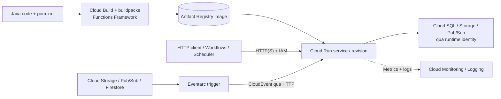
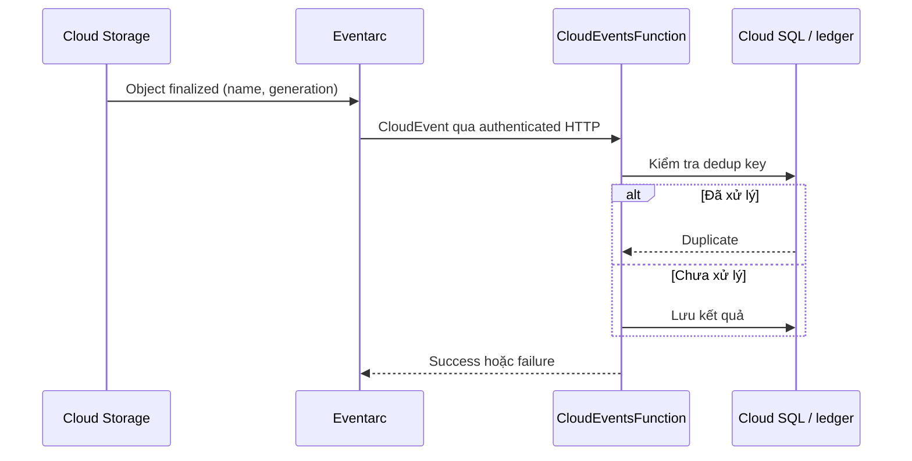
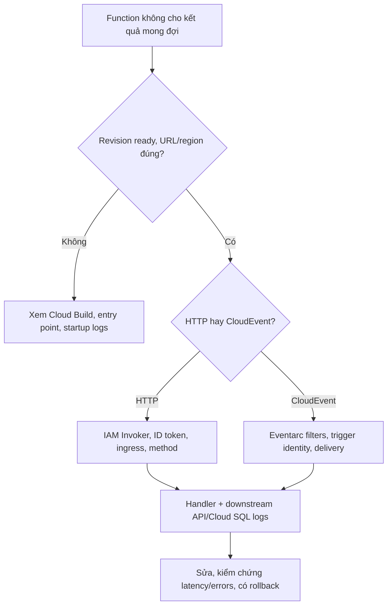

# Cloud Run functions và mô hình hàm được quản lý

## 1. Tại sao cần hàm được quản lý?

Hệ thống bán hàng dùng **Spring Boot** cho REST API chính, nhưng vẫn có nhiều tác vụ nhỏ: nhận webhook thanh toán, kiểm tra file mới upload lên **Cloud Storage**, phản ứng với sự kiện **Pub/Sub** hoặc thực hiện một thao tác tự động theo lịch. Nếu mỗi tác vụ phải chạy một VM hay GKE Deployment riêng, đội Java sẽ tốn thời gian quản lý server, vá lỗi, scale và giám sát.

**Cloud Run functions** cho phép viết một **HTTP handler** hoặc **CloudEvents handler**, triển khai trực tiếp từ mã nguồn và sử dụng hạ tầng Cloud Run được quản lý. Google Cloud build thành container, triển khai revision, cấp instance khi có request và tự điều chỉnh số instance theo cấu hình. Người phát triển tập trung vào **đầu vào, logic, lỗi và kết quả** của hàm.

Trong chương **Cloud Run functions và Eventarc** thuộc mô-đun **CLOUD_PROVIDERS_GCP**, bài này giới thiệu mô hình hàm, Functions Framework cho Java, triển khai, quyền, trigger, độ tin cậy, chi phí và thực hành an toàn. Nội dung kết nối kiến thức project/IAM, Cloud Build, Artifact Registry, Cloud Storage, VPC và theo dõi độ tin cậy.

**Mục tiêu học tập:** phân biệt function/service/job; hiểu source-to-container; viết và triển khai Java HTTP function; nhận biết CloudEvents và Eventarc; áp dụng IAM, idempotency, timeout, concurrency; đọc log, rollback và cleanup.

> **Phạm vi:** các lệnh chỉ dành cho project lab được phê duyệt. Deployment có thể phát sinh phí Cloud Build, Artifact Registry, Cloud Run và Cloud Logging. Không bật public HTTP endpoint hay tạo trigger trên production chỉ để thử.

## 2. Cloud Run functions và tên gọi các thế hệ

Cloud Run functions là tên hiện tại của **Cloud Functions (2nd gen)**. Function mới được triển khai từ source dưới dạng **Cloud Run service**, có URL `run.app`, revision, IAM, autoscaling và các tùy chọn Cloud Run.

| Lựa chọn | Cách quản lý | Khi nào |
| --- | --- | --- |
| **Cloud Run functions qua Cloud Run Admin API** | `gcloud run deploy --source . --function ...`, Cloud Run Console/Terraform | **Khuyến nghị** khi tạo hàm mới |
| **Cloud Run functions qua Cloud Functions v2 API** | `gcloud functions deploy --gen2` hoặc API v2 | Hệ thống cần tương thích quy trình cũ |
| **Cloud Run functions (1st gen)** | Cloud Functions v1, `--no-gen2` | Legacy; ràng buộc về runtime, concurrency và triggers khác |

Hàm tạo qua Cloud Run Admin API **không được quản trị bằng Cloud Functions API**. Hàm v2 tạo qua Cloud Functions API có thể được quản trị qua cả Cloud Run Admin API và Cloud Functions v2 API theo điều kiện hỗ trợ. Một số hàm v2 có thêm URL `cloudfunctions.net`, khác với `run.app` mặc định khi deploy trực tiếp bằng Cloud Run. Trước khi chỉnh một function cũ, xác định **API tạo và quản lý tài nguyên**.

### Chọn mô hình chạy

| Nhu cầu | Dịch vụ gợi ý | Lý do |
| --- | --- | --- |
| Webhook, event handler, API rất nhỏ | **Cloud Run function** | Entry point gọn, triển khai từ source |
| REST API Spring Boot nhiều endpoint, filters, controllers | **Cloud Run service** | Giữ toàn bộ framework và cấu trúc ứng dụng |
| Batch xử lý xong rồi kết thúc | **Cloud Run job** | Mô hình run-to-completion |
| Consumer luôn kết nối tới message broker | **Cloud Run worker pool** hoặc platform tương đương | Phù hợp xử lý background dài hạn |
| Cần Kubernetes scheduling, sidecar/daemon, điều khiển cluster | **GKE** | Kiểm soát tài nguyên Kubernetes |

Cloud Run functions **không đồng nghĩa một request trên một instance**: concurrency có thể lớn hơn 1, nên code Java phải thread-safe.

## 3. Luồng triển khai và các danh tính



Quá trình khi dùng **Cloud Run Admin API**:

1. Gửi mã nguồn tới bước build.
2. **Cloud Build/buildpacks** kết hợp Functions Framework đóng gói thành container.
3. Image được lưu trong **Artifact Registry**, thường ở repository tự động tên `cloud-run-source-deploy` nếu cần.
4. Cloud Run triển khai một **revision**, vận hành instances và cung cấp HTTPS URL.
5. HTTP caller gửi request hoặc **Eventarc** gửi CloudEvent qua trigger phù hợp.

Ba danh tính quan trọng **khác nhau**: **deployer/build identity** biên dịch và đẩy image; **runtime service account** cho phép code Java truy cập API Google Cloud; **trigger service account** có quyền invoke destination khi dùng Eventarc. Không dùng cùng một Project Owner cho tất cả.

## 4. HTTP function và CloudEvents function

| Loại | Entry point Java | Đầu vào và tình huống |
| --- | --- | --- |
| **HTTP function** | `HttpFunction.service(HttpRequest, HttpResponse)` | Webhook, internal endpoint, request/response đồng bộ |
| **CloudEvents function** | `CloudEventsFunction.accept(CloudEvent)` | Sự kiện Cloud Storage, Pub/Sub, Firestore qua Eventarc |

**HTTP function** tự đọc method, headers, body và ghi status/response. URL không mặc nhiên public: khi yêu cầu xác thực, caller cần quyền `roles/run.invoker` và **OIDC ID token** hợp lệ.

**CloudEvents function** nhận sự kiện theo tiêu chuẩn **CloudEvents** với `id`, `source`, `type`, `time` và `data`. Ví dụ `google.cloud.storage.object.v1.finalized` được phát khi Cloud Storage tạo generation mới cho một object. **Eventarc** lọc sự kiện và chuyển nó tới function; đây không phải kiểu máy chủ mới.

**Cảnh báo:** event có thể được gửi trùng hoặc không theo thứ tự mà nghiệp vụ mong muốn. Function phải có **idempotency** và thiết kế retry rõ ràng.

## 5. Lab Java 21: HTTP function đơn giản

Ví dụ trả JSON xác nhận service sẵn sàng, cho phép `GET` và từ chối `POST`. Đây là Java Functions Framework, **không phải Spring Boot controller**.

### 5.1. Cấu trúc project Maven

```text
orders-health/
├── pom.xml
└── src/main/java/dev/example/functions/OrdersHealth.java
```

### 5.2. File `pom.xml` đầy đủ

```xml
<?xml version="1.0" encoding="UTF-8"?>
<project xmlns="http://maven.apache.org/POM/4.0.0"
         xmlns:xsi="http://www.w3.org/2001/XMLSchema-instance"
         xsi:schemaLocation="http://maven.apache.org/POM/4.0.0 https://maven.apache.org/xsd/maven-4.0.0.xsd">
  <modelVersion>4.0.0</modelVersion>
  <groupId>dev.example</groupId>
  <artifactId>orders-health</artifactId>
  <version>1.0.0</version>
  <properties>
    <maven.compiler.release>21</maven.compiler.release>
    <project.build.sourceEncoding>UTF-8</project.build.sourceEncoding>
  </properties>
  <dependencies>
    <dependency>
      <groupId>com.google.cloud.functions</groupId>
      <artifactId>functions-framework-api</artifactId>
      <version>1.1.0</version>
      <scope>provided</scope>
    </dependency>
  </dependencies>
  <build>
    <plugins>
      <plugin>
        <groupId>org.apache.maven.plugins</groupId>
        <artifactId>maven-compiler-plugin</artifactId>
        <version>3.13.0</version>
      </plugin>
      <plugin>
        <groupId>com.google.cloud.functions</groupId>
        <artifactId>function-maven-plugin</artifactId>
        <version>0.11.0</version>
        <configuration>
          <functionTarget>dev.example.functions.OrdersHealth</functionTarget>
        </configuration>
      </plugin>
    </plugins>
  </build>
</project>
```

### 5.3. File `OrdersHealth.java`

```java
package dev.example.functions;

import com.google.cloud.functions.HttpFunction;
import com.google.cloud.functions.HttpRequest;
import com.google.cloud.functions.HttpResponse;
import java.io.IOException;
import java.time.Instant;

public final class OrdersHealth implements HttpFunction {
    @Override
    public void service(HttpRequest request, HttpResponse response)
            throws IOException {
        response.appendHeader("Content-Type", "application/json; charset=utf-8");

        if (!"GET".equals(request.getMethod())) {
            response.setStatusCode(405);
            response.appendHeader("Allow", "GET");
            response.getWriter().write("{\"error\":\"method_not_allowed\"}");
            return;
        }

        response.setStatusCode(200);
        response.getWriter().write(
            "{\"service\":\"orders\",\"status\":\"ok\",\"at\":\""
            + Instant.now() + "\"}");
    }
}
```

Handler không chứa credentials, không phụ thuộc bộ nhớ local và không tạo kết nối DB. Trong ứng dụng thật, hãy xác định authentication, validation và health semantics phù hợp; đừng dùng response `200` tĩnh làm bằng chứng mọi dependency đang khỏe.

### 5.4. Chạy cục bộ

Trên máy lab có JDK 21 và Maven, trong thư mục chứa `pom.xml`:

```bash
mvn -q package
mvn function:run -Drun.functionTarget=dev.example.functions.OrdersHealth
```

Terminal khác:

```bash
curl -i http://localhost:8080/
curl -i -X POST http://localhost:8080/
```

Kỳ vọng `GET=200` với JSON, `POST=405`. Đây là hướng dẫn thực hành cho người học, **không yêu cầu chạy Maven trong repository tài liệu**.

## 6. Deploy Cloud Run function private bằng gcloud

### 6.1. Chuẩn bị project và runtime identity

Cần project có Billing, Cloud SDK cập nhật, quota và IAM deploy source. Bật các API nền tảng; lần triển khai đầu có thể cần cấp quyền cho **build service account** và Google service agents. Các quyền của deployer thường bao gồm **Cloud Run Source Developer**, **Service Usage Consumer** và **Service Account User** trên identity được dùng.

```bash
gcloud config set project PROJECT_ID
gcloud services enable run.googleapis.com \
  cloudbuild.googleapis.com artifactregistry.googleapis.com

# Lab: tạo runtime service account không có quyền dữ liệu nghiệp vụ.
gcloud iam service-accounts create orders-health-runtime \
  --display-name="Orders health function runtime"
```

### 6.2. Deploy từ thư mục source

```bash
gcloud run deploy orders-health-fn \
  --source . \
  --function dev.example.functions.OrdersHealth \
  --base-image java21 \
  --region asia-southeast1 \
  --service-account orders-health-runtime@PROJECT_ID.iam.gserviceaccount.com \
  --no-allow-unauthenticated \
  --memory 512Mi \
  --cpu 1 \
  --concurrency 10 \
  --timeout 60s \
  --max-instances 3
```

- `--function` là **fully qualified class name** của HTTP handler.
- `--base-image java21` chọn Java 21; danh sách runtime/version được hỗ trợ có thể thay đổi.
- `--no-allow-unauthenticated` giữ endpoint **private**; caller cần IAM Invoker.
- `--concurrency 10` cho phép nhiều request đồng thời nên code dùng chung/static state phải thread-safe.
- `--max-instances 3` giúp hạn chế quy mô/chi phí nhưng có thể **bị vượt tạm thời trong một số tình huống tải**; không phải quota chính xác cho database.
- `--timeout 60s` đặt thời hạn request; downstream calls cũng cần timeout riêng.

Cloud Run build source và tạo revision; **xóa service không tự xóa mọi container image/build artifacts** còn lưu ở Artifact Registry.

### 6.3. Xác minh endpoint private

```bash
gcloud run services describe orders-health-fn \
  --region asia-southeast1 \
  --format="value(status.url)"

# Cần quyền roles/run.invoker cho danh tính gcloud hiện tại.
gcloud run services proxy orders-health-fn \
  --region asia-southeast1 \
  --port 8080
```

Terminal khác:

```bash
curl -i http://localhost:8080/
```

**Cloud Run proxy** tự gắn credentials cho môi trường test hợp lệ. Nếu gọi trực tiếp bằng `curl`, cần **OIDC ID token** với audience khớp service URL; access token Google Cloud API không mặc định thay cho ID token khi gọi IAM-authenticated service. **Đừng mở public endpoint chỉ để sửa HTTP 403**.

## 7. Eventarc và mẫu CloudEventsFunction



Một Java CloudEvents handler nhận **metadata sự kiện**, không phải tự động nhận file bytes:

```java
package dev.example.functions;

import com.google.cloud.functions.CloudEventsFunction;
import io.cloudevents.CloudEvent;
import java.util.logging.Logger;

public final class StorageEventHandler implements CloudEventsFunction {
    private static final Logger LOG =
        Logger.getLogger(StorageEventHandler.class.getName());

    @Override
    public void accept(CloudEvent event) {
        LOG.info(() -> "eventId=" + event.getId()
            + " source=" + event.getSource()
            + " type=" + event.getType());
        // Production: validate payload, check idempotency, then process.
        // Không log file content, tokens hoặc dữ liệu cá nhân.
    }
}
```

Triển khai handler thành **service riêng** với entry point `dev.example.functions.StorageEventHandler`, không trỏ vào `OrdersHealth`. Để đón sự kiện Cloud Storage object finalized, Eventarc trigger có mẫu:

```bash
gcloud eventarc triggers create storage-finalized-lab \
  --location asia-southeast1 \
  --destination-run-service storage-event-fn \
  --destination-run-region asia-southeast1 \
  --event-filters="type=google.cloud.storage.object.v1.finalized" \
  --event-filters="bucket=BUCKET_NAME" \
  --service-account=eventarc-invoker@PROJECT_ID.iam.gserviceaccount.com
```

**Đây là lệnh minh họa**, không phải lab end-to-end: phải tạo/triển khai `storage-event-fn` và bucket, bật Eventarc API, thỏa location/source restrictions, cấp quyền **Eventarc Event Receiver**, **Cloud Run Invoker** cho trigger identity và các service agent permissions liên quan (bao gồm quyền Pub/Sub khi nguồn yêu cầu). Với Cloud Storage direct events, bucket và destination cần thuộc **cùng project** theo mô hình hỗ trợ. Trigger có thể cần vài phút để bắt đầu nhận sự kiện.

Mỗi hàm có **kiểu handler xác định**; không giả định một entry point Java đồng thời giải mã mọi HTTP request và mọi CloudEvent. Nguồn, event type và delivery semantics được định nghĩa bởi trigger/Eventarc, không phải do tên Java class.

## 8. Idempotency, retry và tính nhất quán

Delivery Eventarc/Pub/Sub có thể là **at-least-once**: một sự kiện có thể được đưa tới handler hơn một lần. Retry policy phụ thuộc cách tạo trigger và transport; **không giả định tất cả đều retry vô hạn**. Event đến trễ hoặc khác thứ tự cũng phải được xét.

Ví dụ sự kiện xử lý hóa đơn:

```text
Dedup key: CloudEvent (source, id)
hoặc: Cloud Storage (bucket, objectName, generation).

Cloud SQL ledger:
  UNIQUE(event_source, event_id)
  status: RECEIVED -> PROCESSED hoặc FAILED

Khi nhận lại:
  Nếu PROCESSED -> trả thành công, không tạo hóa đơn lần hai.
  Nếu chưa hoàn tất -> retry có giới hạn theo trạng thái và lỗi.
```

Với side effect qua nhiều hệ thống (DB, email, Pub/Sub), dùng **transaction phù hợp, outbox pattern**, checkpoint hoặc compensation. Thiết kế **dead-letter/poison event** nếu transport hỗ trợ. Không trả success khi công việc bền vững chưa hoàn tất chỉ để tắt retry. Thread/future background phải được đợi/xử lý trước khi function trả về; runtime không cam kết chạy công việc đó sau khi request kết thúc.

## 9. Autoscaling, cold start và hiệu năng Java

Cloud Run tự cấp thêm instances khi có tải và có thể **scale to zero**, tùy thiết lập. **Cold start** gồm cấp môi trường, khởi động JVM, class loading/JIT và init SDK/connection pools. Instance được **tái sử dụng nhưng không tồn tại vĩnh viễn**.

| Thiết lập | Lợi ích | Rủi ro |
| --- | --- | --- |
| **Min instances** | Giảm cold starts khi có traffic ít | Phí tài nguyên idle |
| **Max instances** | Giới hạn scale/cost ở mức cấu hình | Không đảm bảo hard cap tuyệt đối |
| **Concurrency** | Tận dụng một instance cho nhiều requests | Thread-safety, heap, contention |
| **CPU/RAM** | Tăng năng lực JVM | Tăng chi phí và quota |
| **Timeout** | Chặn handler treo quá lâu | Request có thể thất bại nếu downstream chậm |
| **Billing mode** | Request-based hoặc instance-based | Tác động chi phí và CPU ngoài request |

Với Java, ưu tiên **giảm init không cần thiết**, tái sử dụng Google Cloud client **thread-safe**, đặt timeout cho mọi downstream call, tránh giữ trạng thái nghiệp vụ trong static fields hoặc local filesystem. Đừng tăng concurrency nếu code dùng mutable state không đồng bộ.

Ví dụ mỗi instance có pool tối đa 10 kết nối Cloud SQL và `max instances=30`: riêng function có thể tạo **300 kết nối**. Chọn max instances, pool và queue theo khả năng DB; tính năng autoscaling không tự bảo vệ DB khỏi quá tải.

## 10. IAM, VPC và an toàn

| Danh tính | Quyền cần thiết | Không nên cấp |
| --- | --- | --- |
| Deployer | Cloud Run source deployment và `iam.serviceAccounts.actAs` đúng phạm vi | Project Owner mặc định |
| Build service account | Build và lưu image vào Artifact Registry | Quyền đọc dữ liệu nghiệp vụ |
| Runtime service account | Quyền Cloud Storage/Pub/Sub/Secret Manager cụ thể | Admin toàn project |
| HTTP caller | `roles/run.invoker` + OIDC ID token nếu private | Public `allUsers` chỉ để qua lỗi 403 |
| Eventarc trigger identity | Event receive + quyền invoke Cloud Run destination | Runtime account quyền rộng |

Với function gọi Cloud SQL hoặc API nội bộ, chọn **VPC egress/Direct VPC egress** hoặc connector khi cần, routes/firewall/IAM đúng. Dùng **Secret Manager** cho secrets, không nhúng JSON key vào mã nguồn, biến môi trường được commit, hoặc logs. Public webhook cần **xác minh chữ ký/HMAC, chống replay, rate limit** và xử lý CORS/ingress theo mô hình bảo mật; HTTPS và URL khó đoán không đủ.

## 11. Quan sát và xử lý sự cố

Theo dõi **request count, HTTP 4xx/5xx, p95/p99 latency, instance count, memory/CPU, cold start**, revision state, Cloud Build logs và Eventarc delivery. Java nên log correlation ID/event ID và lỗi có cấu trúc, nhưng không log tokens hay nội dung file nhạy cảm.

```bash
gcloud run services describe orders-health-fn \
  --region asia-southeast1

gcloud run services logs read orders-health-fn \
  --region asia-southeast1 \
  --limit 50

gcloud run revisions list \
  --service orders-health-fn \
  --region asia-southeast1
```

| Hiện tượng | Khả năng chính | Kiểm tra |
| --- | --- | --- |
| Build lỗi | Maven/runtime, Artifact Registry hoặc quyền build | Cloud Build logs, `pom.xml` |
| Revision không ready | Sai function class, lỗi init hoặc tài nguyên | `--function`, startup/revision logs |
| HTTP 401/403 | Không có ID token/Invoker, sai ingress | IAM, URL/audience, service proxy |
| HTTP 404/405 | Sai URL/method hoặc logic handler | URL và code HTTP |
| HTTP 429/503 | Concurrency/max instances/quotas, backend overload | Metrics, Cloud SQL/other dependency |
| Event không tới | Trigger filter/location, IAM/service agent, propagation | Eventarc triggers, type, bucket, logs |
| Event được xử lý hai lần | Retry/at-least-once | Dedup key và processing state |
| Bill tăng | Min instances, traffic spike, build/logs/storage | Billing Reports, settings, logs |



Không kết luận “function không chạy” chỉ vì chưa có log: xác minh **project/region, Logs Explorer filter, IAM và thời gian trigger propagation**.

## 12. Release, rollback và chi phí

Function triển khai lên **Cloud Run revision**, nên có thể áp dụng CI/CD, smoke test, theo dõi error rate rồi điều chỉnh traffic/rollback theo khả năng Cloud Run. **Rollback code không đảo ngược** đơn hàng hay email đã gửi; idempotency và dữ liệu vẫn phải được bảo vệ.

Một quy trình gọn: **review code → unit test → deploy staging private → test IAM/event → quan sát logs/cost → deploy production theo đợt → giữ revision/digest rollback**. Khi đổi Java runtime, kiểm tra [runtime support](https://cloud.google.com/run/docs/runtimes/java), khả năng cập nhật security base image và các thư viện Java.

Chi phí có thể gồm **Cloud Run CPU/memory/request hoặc instance time**, Cloud Build, Artifact Registry storage, Eventarc/Pub/Sub, Logging, network egress và Cloud SQL/Storage. Scale-to-zero không khiến những tài nguyên khác miễn phí. Billing budget alerts **không tự ngăn hóa đơn**.

**Ví dụ minh họa tải, không phải bảng giá:**

```text
12.000 requests/ngày x 0,25 giây/request = 3.000 request-seconds.
Không mặc định chia số này cho concurrency để ra vCPU-seconds tính phí:
phải dựa vào instance lifetime, CPU allocation và billing mode thực tế.
```

### Cleanup chỉ trên tài nguyên lab

```bash
# Sau khi xác nhận service đúng project và không có consumer:
gcloud run services delete orders-health-fn \
  --region asia-southeast1

# Nếu đã chủ động tạo riêng trigger lab:
gcloud eventarc triggers delete storage-finalized-lab \
  --location asia-southeast1
```

Kiểm tra Artifact Registry images, build artifacts/logs, service accounts, buckets và Billing **riêng biệt**. Không xóa service account/bucket nếu workload khác đang dùng; xóa service không tự làm sạch mọi tài nguyên phụ trợ.

## 13. Bài tập và câu hỏi vận dụng

### Bài A — Chọn mô hình

Với **webhook thanh toán**, **Spring Boot REST API 30 endpoints**, **batch 3 giờ** và **Kafka consumer chạy liên tục**, chọn function/service/job/worker pool hoặc GKE. Giải thích dựa trên entry point, thời gian chạy, scaling và cách nhận việc.

### Bài B — HTTP Java thực hành

Tạo `OrdersHealth` bằng Maven/Functions Framework, kiểm tra `GET=200` và `POST=405` cục bộ. Deploy private với `gcloud run deploy --source . --function ... --base-image java21`; gọi bằng Cloud Run proxy, thu logs/revision, rồi dọn resources của lab. Không bật public access để né IAM.

### Bài C — Xử lý sự kiện không bị trùng

Thiết kế `StorageEventHandler` nhận `google.cloud.storage.object.v1.finalized`, dùng `(bucket,name,generation)` hoặc `(source,id)` làm dedup key lưu Cloud SQL. Trình bày khi sự kiện được giao hai lần và khi DB mất kết nối; đưa ra retry/dead-letter policy phù hợp.

### Bài D — Cloud SQL và autoscaling

Một function có 10 kết nối DB/instance và max 30 instances: tính **300 kết nối tiềm tàng**. Đề xuất concurrency, connection pool, max instances, queuing và monitoring để bảo vệ DB.

### Bài E — Chẩn đoán hai đường vào

Một HTTP function trả 403, một CloudEvents function không nhận event từ Cloud Storage. Viết hai runbook: **IAM Invoker/ID token/ingress** và **Eventarc trigger/filter/location/service account/API**. Nêu cách kiểm chứng mà không mở public endpoint.

### Checklist tự đánh giá

- [ ] Tôi hiểu Cloud Run function được build từ source thành Cloud Run service và khác 1st gen.
- [ ] Tôi phân biệt Cloud Run Admin API với Cloud Functions v2 API.
- [ ] Tôi biết Java HTTP/CloudEvents có entry points và triggers khác nhau.
- [ ] Tôi chạy được local và deploy Java 21 private, biết kiểm tra URL/revision/logs.
- [ ] Tôi hiểu Eventarc delivery, idempotency và retry/timeout.
- [ ] Tôi phân biệt deployer, build, runtime và trigger service accounts.
- [ ] Tôi quản lý concurrency, cold starts, instance limits và Cloud SQL connections.
- [ ] Tôi dự toán costs và có đường rollback, cleanup đúng phạm vi lab.

**Kết luận:** Cloud Run functions giảm gánh nặng vận hành cho **HTTP handlers và event handlers** nhỏ, nhưng độ tin cậy không tự có chỉ nhờ “serverless”. Với Java trên GCP, cần **entry point đúng, IAM đúng danh tính, xử lý sự kiện lặp an toàn, scaling theo hệ thống downstream và quan sát/rollback** có kiểm soát.

## 14. Tài liệu Google Cloud tham khảo

- [Cloud Run functions overview](https://cloud.google.com/run/docs/functions/overview)
- [Compare Cloud Run functions và các thế hệ Cloud Functions](https://cloud.google.com/run/docs/functions/comparison)
- [Write functions: Java HTTP và CloudEvents](https://cloud.google.com/run/docs/write-functions)
- [Java runtimes](https://cloud.google.com/run/docs/runtimes/java)
- [Deploy Cloud Run functions](https://cloud.google.com/run/docs/deploy-functions)
- [Quickstart triển khai bằng gcloud](https://cloud.google.com/run/docs/quickstarts/functions/deploy-functions-gcloud)
- [Java Functions Framework local development](https://cloud.google.com/run/docs/local-dev-functions)
- [Function triggers (HTTP/Eventarc)](https://cloud.google.com/run/docs/function-triggers)
- [Trigger functions from Cloud Storage](https://cloud.google.com/run/docs/tutorials/trigger-functions-storage)
- [Eventarc event delivery và retries](https://cloud.google.com/eventarc/docs/retry-events)
- [Authenticate Cloud Run requests](https://cloud.google.com/run/docs/authenticating/developers)
- [Cloud Run pricing](https://cloud.google.com/run/pricing)
