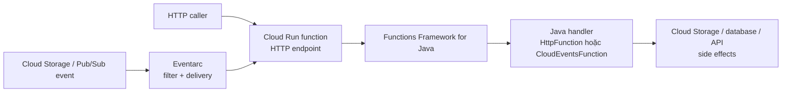
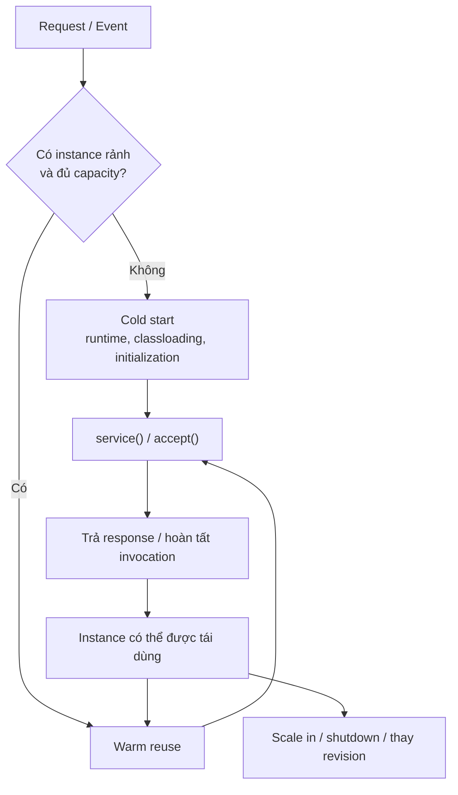

# Functions Framework và vòng đời hàm Java

Một API nhỏ cần trả kết quả HTTP hoặc xử lý sự kiện “object vừa được tải lên Cloud Storage” không nhất thiết phải triển khai cả ứng dụng Spring Boot. Với **Cloud Run functions**, ta có thể viết một **lớp Java làm entry point**, để **Functions Framework** tiếp nhận request hoặc CloudEvent và gọi phương thức xử lý. Tuy vậy, hiểu đúng **khởi tạo, tái sử dụng instance, concurrency, retry và kết thúc invocation** mới giúp hàm đáng tin cậy khi chạy production.

Bài thuộc chương **Cloud Run functions và Eventarc** của module `CLOUD_PROVIDERS_GCP`. Nội dung gắn với IAM, VPC, Cloud Storage, Cloud Run, giám sát và chi phí: viết hàm nhỏ, thử tại máy phát triển, triển khai từ source, rồi thiết kế xử lý sự kiện an toàn mà không nhầm bộ nhớ của một JVM với nơi lưu trạng thái bền vững.

> Ví dụ sử dụng **Java 21**, Maven và giao diện Cloud Run functions triển khai bằng `gcloud run deploy --source --function --base-image java21`. Công cụ `gcloud functions deploy --gen2` vẫn có thể gặp trong dự án dùng Cloud Functions v2 API; hai luồng quản lý có lựa chọn triển khai/trigger và endpoint khác nhau. Hãy theo đúng luồng của project, không trộn các flag một cách tùy tiện.

## 1. Mục tiêu

Sau bài này, bạn có thể:

1. Phân biệt **Functions Framework**, **Cloud Run functions**, **HTTP trigger** và **Eventarc trigger**.
2. Viết và chạy cục bộ hai Java entry points: `HttpFunction` và `CloudEventsFunction`.
3. Giải thích vòng đời **cold start → initialize → invoke → reuse → shutdown**, những giới hạn của state tạm và tác vụ nền.
4. Nhận diện rủi ro **concurrency, duplicate events, out-of-order delivery, retry loops và partial side effects**.
5. Triển khai hàm từ source, cấu hình quyền gọi riêng và gắn Eventarc trigger khi cần.
6. Áp dụng logging, error handling, IAM và chiến lược kiểm thử/giám sát cơ bản.

## 2. Functions Framework làm gì?

**Functions Framework for Java** là thư viện/framework mã nguồn mở định nghĩa interface của hàm và bộ chạy cục bộ. Cloud Run functions dùng framework này để chuyển **HTTP request** hoặc **CloudEvent** thành một lời gọi phương thức Java. **Cloud Run** chịu trách nhiệm chạy hạ tầng container, tạo revision, định tuyến, scaling và quản lý vòng đời instance; **Eventarc** chọn và chuyển sự kiện từ nguồn phù hợp đến đích.



| Thành phần | Trách nhiệm | Không nên nhầm với |
| --- | --- | --- |
| **`HttpFunction`** | Nhận `HttpRequest`, viết `HttpResponse`. | Một web framework đầy đủ với router/DI tự động. |
| **`CloudEventsFunction`** | Nhận `io.cloudevents.CloudEvent`, đọc metadata và payload. | Eventarc tự bảo đảm đúng một lần xử lý. |
| **Functions Framework local invoker** | Chạy handler trên HTTP server để test local. | Môi trường IAM/network/scaling production của Cloud Run. |
| **Cloud Run functions** | Build/deploy source và vận hành hàm như Cloud Run service. | JVM lưu state bền vững hay tác vụ luôn sống. |
| **Eventarc** | Lọc và chuyển event theo trigger/service account được cấu hình. | Transaction manager cho database hoặc object storage. |

**Entry point Java là tên lớp đầy đủ gồm package**, ví dụ `example.HelloHttp`, không phải tên phương thức `service` hay `accept`. Lớp phải triển khai interface đúng kiểu trigger.

## 3. Hai kiểu handler Java

### 3.1. HTTP function

Định nghĩa:

```java
package example;

import com.google.cloud.functions.HttpFunction;
import com.google.cloud.functions.HttpRequest;
import com.google.cloud.functions.HttpResponse;

public class HelloHttp implements HttpFunction {
    @Override
    public void service(HttpRequest request, HttpResponse response)
            throws Exception {
        String name = request.getFirstQueryParameter("name")
                .orElse("world");
        response.getWriter().write(greeting(name));
    }

    static String greeting(String name) {
        return "Hello, " + name + "!";
    }
}
```

Request `GET /?name=An` dự kiến trả `Hello, An!`. Ví dụ cố ý trả **plain text**, không truy cập database. Với API thực, cần validate input, encoding/response headers, authentication, timeout và giới hạn dữ liệu đầu vào. Đừng đưa query parameter chưa kiểm tra vào SQL, HTML hoặc lệnh shell.

Điểm kết thúc invocation HTTP là khi handler trả response/hoàn tất xử lý, không phải khi một thread bất đồng bộ bất kỳ do handler tạo ra đã xử lý xong.

### 3.2. CloudEvent function

Một sự kiện ví dụ là **Cloud Storage object finalized** (`google.cloud.storage.object.v1.finalized`): phát sinh khi object mới được tạo hoặc ghi đè thành một generation mới. Handler nhận **CloudEvent metadata** gồm `id`, `type`, `source`, `subject` và `data` (tùy sự kiện).

```java
package example;

import com.google.cloud.functions.CloudEventsFunction;
import io.cloudevents.CloudEvent;
import java.nio.charset.StandardCharsets;

public class StorageAudit implements CloudEventsFunction {
    @Override
    public void accept(CloudEvent event) {
        String id = event.getId();
        String type = event.getType();
        String source = event.getSource().toString();
        int size = event.getData() == null
                ? 0
                : event.getData().toBytes().length;

        System.out.printf(
                "event_id=%s event_type=%s source=%s data_bytes=%d%n",
                id, type, source, size);
    }
}
```

Đoạn code chỉ ghi **metadata và kích thước payload** để tránh log nội dung object có thể nhạy cảm. Với nghiệp vụ thực, parse `event.getData()` bằng thư viện JSON/schema phù hợp, validate `type` và các trường `bucket`, `name`, `generation` trước khi xử lý. `CloudEvent` không phải object Java tự động biến mọi payload thành POJO của ứng dụng.

Ví dụ CloudEvent được chuyển đến handler có thể có cấu trúc:

```json
{
  "specversion": "1.0",
  "id": "event-123",
  "source": "//storage.googleapis.com/projects/_/buckets/orders-input-dev",
  "type": "google.cloud.storage.object.v1.finalized",
  "subject": "objects/report.csv",
  "data": {
    "bucket": "orders-input-dev",
    "name": "report.csv",
    "generation": "1730000000000000"
  }
}
```

Đây là payload **minh họa**, không phải sự kiện thật. Metadata envelope tuân theo **CloudEvents**, còn `data` có schema của từng nhà cung cấp sự kiện. Eventarc có thể chuyển CloudEvents qua HTTP bằng **binary content mode**; không phải mọi request đều là JSON có cả envelope như ví dụ.

### 3.3. Legacy background functions

Trong các dự án cũ có thể thấy `BackgroundFunction<T>` hoặc `RawBackgroundFunction` với payload/context kiểu legacy. Khi viết Cloud Run functions theo mô hình Eventarc hiện đại, ưu tiên **`CloudEventsFunction`** cho sự kiện. Đừng lấy ví dụ legacy có hai tham số `(data, context)` rồi dùng nguyên cho CloudEvent handler có một tham số.

## 4. Cấu trúc dự án Maven tối giản

Một source directory có thể chứa **nhiều lớp entry point**; khi deploy, bạn chọn lớp tương ứng qua flag `--function`:

```text
java-functions-lab/
├── pom.xml
└── src/
    ├── main/java/example/
    │   ├── HelloHttp.java
    │   └── StorageAudit.java
    └── test/java/example/
        └── HelloHttpTest.java
```

Ví dụ `pom.xml` tự chứa:

```xml
<project xmlns="http://maven.apache.org/POM/4.0.0"
         xmlns:xsi="http://www.w3.org/2001/XMLSchema-instance"
         xsi:schemaLocation="http://maven.apache.org/POM/4.0.0 https://maven.apache.org/xsd/maven-4.0.0.xsd">
  <modelVersion>4.0.0</modelVersion>
  <groupId>example</groupId>
  <artifactId>java-functions-lab</artifactId>
  <version>1.0.0</version>
  <properties>
    <maven.compiler.release>21</maven.compiler.release>
    <project.build.sourceEncoding>UTF-8</project.build.sourceEncoding>
  </properties>
  <dependencies>
    <dependency>
      <groupId>com.google.cloud.functions</groupId>
      <artifactId>functions-framework-api</artifactId>
      <version>1.1.2</version>
      <scope>provided</scope>
    </dependency>
    <dependency>
      <groupId>org.junit.jupiter</groupId>
      <artifactId>junit-jupiter</artifactId>
      <version>5.11.4</version>
      <scope>test</scope>
    </dependency>
  </dependencies>
  <build>
    <plugins>
      <plugin>
        <groupId>org.apache.maven.plugins</groupId>
        <artifactId>maven-compiler-plugin</artifactId>
        <version>3.13.0</version>
      </plugin>
      <plugin>
        <groupId>org.apache.maven.plugins</groupId>
        <artifactId>maven-surefire-plugin</artifactId>
        <version>3.5.2</version>
      </plugin>
      <plugin>
        <groupId>com.google.cloud.functions</groupId>
        <artifactId>function-maven-plugin</artifactId>
        <version>0.11.0</version>
      </plugin>
    </plugins>
  </build>
</project>
```

Dependency `functions-framework-api` cung cấp các interface và CloudEvents types dùng khi biên dịch; `scope=provided` phản ánh framework có mặt trong môi trường Cloud Run functions. **Không thêm Spring Boot Web server hoặc phương thức `main()` chỉ để chạy HTTP handler**. Những phiên bản Maven dependency/plugin trong ví dụ cần được kiểm chứng trong dependency policy của dự án trước khi phát hành; không phải cam kết rằng mọi build platform đều dùng cùng phiên bản.

## 5. Chạy và kiểm thử ở máy phát triển

Yêu cầu: JDK 21, Maven, network tới dependency repository. Các lệnh sau **chạy trong source project do người học tạo**, không chạy trong repository học liệu.

### 5.1. HTTP handler

```bash
# Tại thư mục có pom.xml
mvn test

# Terminal A: khởi động local Functions Framework
mvn function:run -Drun.functionTarget=example.HelloHttp -Drun.port=8080
```

Mở Terminal B:

```bash
curl -i "http://127.0.0.1:8080/?name=An"
curl -i "http://127.0.0.1:8080/"
```

Kỳ vọng lần lượt là `Hello, An!` và `Hello, world!`. Test local giúp bắt lỗi Java classpath, entry point, xử lý input; **không thay thế** kiểm thử IAM/identity, Eventarc trigger và scaling của môi trường cloud.

### 5.2. Event handler

Dừng invoker HTTP, rồi chạy:

```bash
mvn function:run \
  -Drun.functionTarget=example.StorageAudit \
  -Drun.port=8080
```

Trong terminal khác, gửi **CloudEvent dạng binary mode**:

```bash
curl -i -X POST "http://127.0.0.1:8080/" \
  -H "ce-specversion: 1.0" \
  -H "ce-id: lab-001" \
  -H "ce-type: google.cloud.storage.object.v1.finalized" \
  -H "ce-source: //storage.googleapis.com/projects/_/buckets/orders-input-dev" \
  -H "content-type: application/json" \
  --data '{"bucket":"orders-input-dev","name":"report.csv","generation":"1"}'
```

Quan sát terminal invoker; handler dự kiến ghi metadata event và `data_bytes`. Đây là **sự kiện giả lập**, không chứng minh một Eventarc trigger thật đã được cấu hình hoặc có quyền gọi Cloud Run.

### 5.3. Kiểm thử có chủ đích

| Trường hợp | Kỳ vọng |
| --- | --- |
| HTTP thiếu `name` | Fallback về `world`. |
| HTTP gửi chuỗi dài/ký tự đặc biệt | Ứng dụng có validation/giới hạn trước khi trả vào HTML/JSON. |
| CloudEvent thiếu `data` | Handler không ném `NullPointerException`; ghi kích thước 0. |
| CloudEvent sai `type` | Nghiệp vụ thực từ chối hoặc bỏ qua có chủ đích; không thực hiện side effect. |
| Cùng event gửi hai lần | Logic nghiệp vụ không ghi nhận/thu phí/di chuyển dữ liệu hai lần. |
| API downstream tạm thời lỗi | Có retry/backoff được cấu hình theo hệ thống, không retry vô hạn trong một invocation. |

Ví dụ `src/test/java/example/HelloHttpTest.java` kiểm thử logic thuần đã tách khỏi phần HTTP:

```java
package example;

import static org.junit.jupiter.api.Assertions.assertEquals;
import org.junit.jupiter.api.Test;

class HelloHttpTest {
    @Test
    void greetingUsesName() {
        assertEquals("Hello, An!", HelloHttp.greeting("An"));
    }
}
```

Chạy `mvn test` để xác nhận unit test. Nếu cần kiểm tra chính `HttpRequest`/`HttpResponse`, có thể thêm Mockito và test `getWriter()`; với event handler, tạo CloudEvent bằng CloudEvents SDK để kiểm thử metadata/schema. **Không gọi thẳng production APIs trong unit tests**; dùng integration tests có môi trường riêng.

## 6. Vòng đời một Java function instance



### 6.1. Cold start và khởi tạo

Cloud Run có thể tạo instance khi tải tăng hoặc khi chưa có instance sẵn. Java runtime phải khởi động JVM, load classes, tạo handler và khởi tạo các dependencies cần thiết. Cold start có thể bị ảnh hưởng bởi:

- Dung lượng code/dependencies và classloading.
- CPU/memory, khởi tạo SDK client và kết nối network.
- Startup logic đồng bộ, truy cập secret/config hoặc DNS.
- Cấu hình min instances, concurrency và startup CPU boost theo tính năng hỗ trợ.

**Nguyên tắc:** chỉ khởi tạo những thứ cần thiết, đo startup time và tối ưu dependency tree. Nếu một SDK client tạo tốn kém nhưng an toàn với đa luồng, có thể giữ làm static/shared object **trong cùng instance**; nếu ít dùng, cân nhắc lazy initialization an toàn.

### 6.2. Warm reuse: bộ nhớ không phải database

Instance có thể phục vụ nhiều invocations nên một object được cache trong JVM **có thể** được tái sử dụng:

```java
package example;

import java.time.Instant;
import com.google.cloud.functions.HttpFunction;
import com.google.cloud.functions.HttpRequest;
import com.google.cloud.functions.HttpResponse;

public class InstanceInfo implements HttpFunction {
    // Khởi tạo một lần cho JVM/classloader này, nếu instance được tái dùng.
    private static final Instant INSTANCE_STARTED = Instant.now();

    @Override
    public void service(HttpRequest req, HttpResponse res)
            throws Exception {
        res.getWriter().write("instance_started=" + INSTANCE_STARTED);
    }
}
```

Hai requests có thể thấy **cùng timestamp** nếu vào cùng instance, hoặc timestamp khác nhau khi chạy ở nhiều instances. Không có cam kết invocation tiếp theo sẽ đến đúng instance đã giữ cache.

| Trạng thái | Có thể giữ giữa invocations? | Nên đặt ở đâu khi cần bền vững? |
| --- | --- | --- |
| Static cache, SDK client, connection pool | Có thể, **chỉ trong một instance** và cần thread-safe. | Rebuild khi cold start; state nguồn vẫn ở data service. |
| Biến local trong `service()`/`accept()` | Chỉ invocation đó. | Không dùng cho trạng thái liên phiên. |
| File trong `/tmp` | Có thể thấy lại trong một instance nhưng mất khi instance bị thay. | Cloud Storage hoặc storage phù hợp. |
| Trạng thái đơn hàng, idempotency key | Không nên chỉ ở RAM hay `/tmp`. | Firestore, Cloud SQL hoặc store giao dịch phù hợp. |
| Job chạy nền sau khi handler return | Không có bảo đảm hoàn tất. | Cloud Tasks, Pub/Sub, Cloud Run jobs hoặc worker được quản lý. |

### 6.3. Concurrency và thread safety

Cloud Run có thể cho nhiều requests cùng vào một instance tùy cấu hình **concurrency**. Vì vậy shared mutable state, lazy singletons hoặc caches không được đồng bộ có thể gây race:

```java
// KHÔNG dùng làm bộ đếm nghiệp vụ chính xác:
private static int processed = 0;

// Hai luồng có thể đọc cùng giá trị rồi ghi đè lẫn nhau:
// processed++;
```

Ngay cả thay bằng `AtomicInteger` cũng chỉ làm đúng **trong một JVM**, không tổng hợp giữa nhiều instance và không bền khi scale-to-zero. Với tác vụ cần đếm chính xác hoặc chống xử lý trùng, sử dụng một kho lưu trữ có transaction/conditional write và định nghĩa khóa nghiệp vụ rõ ràng.

### 6.4. Kết thúc invocation và shutdown

- **HTTP:** trả response sau khi xử lý thành công hoặc trả lỗi có ý nghĩa. Không gửi HTTP 200 trước khi side effect quan trọng đã hoàn tất nếu điều đó làm mất khả năng retry.
- **CloudEvent:** handler hoàn tất không lỗi thường dẫn đến xác nhận thành công của lần gửi. Nếu ném lỗi, hành vi retry phụ thuộc **Eventarc trigger/transport policy**, không chỉ code Java.
- **Background work:** tránh `new Thread(...).start()` rồi return và hy vọng thread tiếp tục chạy. CPU/lifecycle của instance không bảo đảm công việc ấy hoàn tất.
- **Scale in/redeploy:** instance có thể bị dừng, khởi động lại hoặc thay thế; thiết kế timeout, retry, idempotency và graceful shutdown cho phần tài nguyên mở.

## 7. Triển khai Cloud Run function bằng gcloud

Ví dụ dùng project lab `orders-dev`, region `asia-southeast1`. Người triển khai cần IAM quyền tạo/redeploy Cloud Run, build source, quyền sử dụng runtime service account, Artifact Registry và các API liên quan theo chính sách tổ chức.

### 7.1. Kiểm tra project và APIs

```bash
PROJECT_ID="orders-dev"
REGION="asia-southeast1"
HTTP_SERVICE="hello-java-dev"
EVENT_SERVICE="storage-audit-dev"

gcloud auth list
gcloud config get-value project
gcloud run services list \
  --project="$PROJECT_ID" --region="$REGION"
gcloud services list --enabled --project="$PROJECT_ID"
```

Các thành phần thường cần gồm **Cloud Run Admin API**, **Cloud Build**, **Artifact Registry**; nếu dùng trigger thêm **Eventarc**, nguồn như **Cloud Storage/Pub/Sub** và các service agents tương ứng. Bật APIs hay cấp IAM là thay đổi thật; chỉ thao tác trong project lab có quyền.

### 7.2. Deploy HTTP handler riêng

Tại thư mục chứa `pom.xml` và hai lớp Java:

```bash
# TẠO/THAY ĐỔI Cloud Run service, build image và phát sinh chi phí.
gcloud run deploy "$HTTP_SERVICE" \
  --project="$PROJECT_ID" \
  --region="$REGION" \
  --source . \
  --function example.HelloHttp \
  --base-image java21
```

Lệnh **không thêm `--allow-unauthenticated`**, nhằm tránh vô tình mở quyền invoker công khai. Hãy xác minh IAM/ingress của service sau deploy; cấu hình đã tồn tại có thể được giữ lại theo thao tác cập nhật. Nếu thật sự cần webhook public, phải review authentication, rate limiting và abuse protection trước khi cho phép unauthenticated.

Kiểm tra:

```bash
gcloud run services describe "$HTTP_SERVICE" \
  --project="$PROJECT_ID" --region="$REGION" \
  --format="yaml(status.url,metadata.name)"

# Xem các revision đã tạo
gcloud run revisions list \
  --project="$PROJECT_ID" --region="$REGION" \
  --service="$HTTP_SERVICE"
```

Nếu đã có quyền `roles/run.invoker`, có thể dùng `gcloud run services proxy` hoặc gọi URL kèm **OIDC identity token** do người dùng/ứng dụng được ủy quyền cấp. Không dùng access token OAuth tùy tiện thay cho identity token trong endpoint yêu cầu Cloud Run IAM authentication.

### 7.3. Deploy CloudEvent handler riêng

```bash
# TẠO/THAY ĐỔI service khác nhận CloudEvents qua HTTP khi có trigger.
gcloud run deploy "$EVENT_SERVICE" \
  --project="$PROJECT_ID" \
  --region="$REGION" \
  --source . \
  --function example.StorageAudit \
  --base-image java21
```

Đến đây mới có **Cloud Run function đích**, chưa tự có Eventarc trigger. Một source project chứa nhiều entry points nhưng mỗi lần deploy chọn **một class mục tiêu** cho service đó; các lớp còn lại không tự được công bố thành endpoint riêng.

## 8. Nối Cloud Storage event với Eventarc

Một ví dụ hữu ích: chỉ ghi log khi object trong bucket `orders-input-dev` được hoàn tất upload. Đường đi:

```text
Cloud Storage object finalized
    → Eventarc trigger (type + bucket filters)
    → authenticated Cloud Run function URL
    → Functions Framework
    → StorageAudit.accept(CloudEvent)
```

### 8.1. Điều kiện trước khi tạo trigger

1. Bucket tồn tại và **location** phù hợp với Eventarc trigger theo giới hạn nguồn sự kiện.
2. Các APIs/service agents đã hoạt động; tài khoản tạo trigger có quyền tương ứng.
3. Có **user-managed service account** dành cho trigger (ví dụ `eventarc-delivery@orders-dev.iam.gserviceaccount.com`) được phép **invoke đúng Cloud Run service** (`roles/run.invoker`). Tùy loại nguồn sự kiện, cần thêm quyền **Eventarc Event Receiver** và quyền cho service agent/transport theo tài liệu.
4. Runtime service account của function **tách biệt** với trigger identity; nó chỉ cần quyền Google APIs thực sự được dùng trong handler.
5. Không tạo trigger khi chưa có kế hoạch xử lý **duplicates/retries, poison events, chi phí và vòng lặp sự kiện**.

### 8.2. Tạo trigger (khi đã hoàn tất IAM)

```bash
BUCKET="orders-input-dev"
TRIGGER="orders-storage-finalized-dev"
TRIGGER_SA="eventarc-delivery@$PROJECT_ID.iam.gserviceaccount.com"

# CHỈ ĐỌC: kiểm tra bucket và trigger hiện có.
gcloud storage buckets describe "gs://$BUCKET" \
  --project="$PROJECT_ID"
gcloud eventarc triggers list \
  --project="$PROJECT_ID" --location="$REGION"

# THAY ĐỔI HẠ TẦNG: chỉ chạy khi đã chuẩn bị IAM và region.
gcloud eventarc triggers create "$TRIGGER" \
  --project="$PROJECT_ID" \
  --location="$REGION" \
  --destination-run-service="$EVENT_SERVICE" \
  --destination-run-region="$REGION" \
  --event-filters="type=google.cloud.storage.object.v1.finalized" \
  --event-filters="bucket=$BUCKET" \
  --service-account="$TRIGGER_SA"
```

Đây là **mẫu trực tiếp qua Eventarc Standard/Cloud Storage**, không áp dụng cho mọi loại sự kiện/region theo cùng cú pháp. Cloud Storage bucket phải đáp ứng điều kiện location/project của trigger; lần đầu tạo trigger có thể cần thời gian cấu hình service agent và truyền sự kiện.

### 8.3. Kiểm chứng và cleanup

```bash
gcloud eventarc triggers describe "$TRIGGER" \
  --project="$PROJECT_ID" --location="$REGION"

# Chỉ tạo file thử trong bucket LAB được phép, không dùng dữ liệu production.
printf 'functions-lab\n' > sample-event.txt
gcloud storage cp sample-event.txt "gs://$BUCKET/sample-event.txt"

# Đọc logs của function sau khi sự kiện được chuyển.
gcloud run services logs read "$EVENT_SERVICE" \
  --project="$PROJECT_ID" --region="$REGION" --limit=50
```

Nếu không thấy event, đừng gửi liên tục hàng trăm lần: kiểm tra **trigger ACTIVE, bucket/region/event filters, IAM của trigger identity, logs delivery, thời gian propagation và lỗi 403/5xx** trước.

Khi kết thúc lab:

```bash
# XÓA THẬT: chỉ xóa trigger và object thử do bạn sở hữu.
gcloud eventarc triggers delete "$TRIGGER" \
  --project="$PROJECT_ID" --location="$REGION"
gcloud storage rm "gs://$BUCKET/sample-event.txt"

# Chỉ xóa hai Cloud Run services nếu chúng được tạo riêng cho lab:
# gcloud run services delete "$HTTP_SERVICE" --project="$PROJECT_ID" --region="$REGION"
# gcloud run services delete "$EVENT_SERVICE" --project="$PROJECT_ID" --region="$REGION"
```

Kiểm tra cả Artifact Registry images, Cloud Build artifacts, Logging và các IAM bindings riêng của lab; xóa service không tự bảo đảm mọi khoản phí phụ trợ chấm dứt ngay.

## 9. Retry, idempotency và thứ tự sự kiện

**Event-driven functions không được giả định exactly-once delivery.** Event có thể được chuyển lại khi transport/handler gặp lỗi, và thứ tự giữa các sự kiện không nhất thiết khớp thời gian nghiệp vụ. Chính sách **retry** thuộc về **trigger/transport**; không mặc định mọi cấu hình Eventarc sẽ retry vô hạn. Một số trigger tạo từ Cloud Run console mặc định **chỉ một lần gửi** nếu không bật retry. Xem [hướng dẫn retries chính thức](https://cloud.google.com/run/docs/tips/function-retries).

Ví dụ một sự kiện “object finalized” dẫn tới gửi email hoặc ghi bản ghi kế toán:

| Tình huống | Thiết kế không an toàn | Thiết kế an toàn hơn |
| --- | --- | --- |
| Event được gửi hai lần | Gửi hai email, tạo hai đơn hàng. | Kiểm tra **idempotency key** trong persistent store. |
| Hàm ghi DB xong nhưng ACK thất bại | Retry ghi lần thứ hai. | Conditional insert/transaction, coi duplicate là thành công hợp lệ. |
| Event mới tới trước event cũ | Bản cũ ghi đè trạng thái mới. | So sánh **generation/version** hoặc dữ liệu thứ tự nghiệp vụ trước cập nhật. |
| Payload lỗi vĩnh viễn | Retry mãi, tăng chi phí. | Phân loại permanent/transient, dead-letter/alert và giới hạn retry. |
| Handler ghi output vào cùng bucket nguồn | Tạo thêm event liên tục. | Dùng bucket/prefix đích tách biệt và filter business logic. |

### 9.1. Khóa idempotency

Một lựa chọn khi chống duplicate transport event là khóa `source + id` của CloudEvent; với tác vụ gắn với object generation, có thể cần khóa **bucket + object name + generation** để phản ánh chính xác business event.

```text
handle(event):
    validate type and data schema
    key = bucket + "/" + name + "#" + generation
    if atomic_create_processed_record(key) says "already exists":
        return success
    perform_or_schedule_side_effect_idempotently(key)
    mark_completed_consistently()
```

Đoạn trên là **pseudocode**, chưa phải transaction hoàn chỉnh. Nếu đánh dấu processed trước khi side effect xảy ra rồi tiến trình bị dừng, event có thể bị mất xử lý. Nếu đánh dấu sau side effect mà không có giao thức bảo vệ, retry có thể lặp side effect. Cần dùng **transactional outbox, conditional writes, state machine hoặc queue có ack/retry** theo kiến trúc dữ liệu.

### 9.2. Khi nào báo lỗi?

- **Transient failure** (timeout đến database, rate limit tạm): ném lỗi/cho invocation thất bại nếu trigger đã cấu hình retry phù hợp; cần bounded retries/backoff.
- **Permanent invalid event**: ghi log cảnh báo tối thiểu, đưa vào dead-letter/quarantine nếu cần và tránh lặp vô hạn.
- **Duplicate đã xử lý thành công**: trả thành công, không thực hiện lại side effect.
- **Side effect chưa rõ đã thành công chưa**: tra theo idempotency key trước khi thử lại.

Nếu chỉ `System.out.println` rồi return trong một handler như `StorageAudit`, đó là ví dụ **quan sát event**, không phải workflow xử lý dữ liệu bền vững.

## 10. Bảo mật, hiệu năng và khả năng quan sát

| Lớp | Thực hành nên có |
| --- | --- |
| **Invoker** | HTTP function yêu cầu authenticated invocation khi nội bộ; trigger service account có `roles/run.invoker` tại đúng đích. |
| **Runtime IAM** | Tách runtime SA khỏi build/deployer/trigger SA, chỉ cấp read/write bucket/DB/secret cần thiết. |
| **Secrets** | Dùng Secret Manager/IAM; không ghi credentials trong source, env config công khai hoặc log. |
| **Ingress/network** | Chọn ingress policy và VPC egress phù hợp; không mở public URL khi không cần. |
| **Java lifecycle** | Reuse thread-safe clients, không giữ business state duy nhất trong static/cache/`/tmp`. |
| **Cold start** | Kiểm tra Java runtime, dependency count, min instances/startup boost theo SLO/giá. |
| **Concurrency** | Bảo vệ shared mutable state, pool connection giới hạn, kiểm thử nhiều invocations đồng thời. |
| **Observability** | Log có correlation ID/`event.id`, không log PII hoặc toàn bộ payload; Cloud Logging + Monitoring alerts. |
| **Chi phí** | Tính invocations, vCPU/memory time, Eventarc/Pub/Sub transport, Cloud Build/Artifact Registry, network/DB. |

**Cloud Run function là một Cloud Run service được tạo từ source**, nên những lựa chọn **CPU, memory, concurrency, min/max instances, request-based/instance-based billing và revision rollout** có thể ảnh hưởng hành vi như Cloud Run service khác. Đừng giữ min instances chỉ vì nghĩ sẽ “luôn có một JVM để chạy background job”; instances vẫn có thể bị thay và chi phí idle tăng.

### 10.1. Các dấu hiệu cần theo dõi

- **HTTP:** request count, p95/p99 latency, 4xx/5xx, cold start, instance count.
- **Eventarc:** trigger active, delivery errors, retry attempts/lag và dead-letter nếu có.
- **Java:** heap/GC, memory OOM, classloading/startup time và connection pool.
- **Downstream:** Cloud Storage/Cloud SQL/HTTP errors, idempotency conflicts và số business jobs hoàn tất.
- **Billing:** Cloud Run instance time, Eventarc transport, Logging, network và dịch vụ đích.

Khi function trả HTTP 200 mà nghiệp vụ không hoàn thành, hãy hỏi **đã ACK trước side effect chưa, tác vụ có chạy sau return không, có mất state khi scale in không** — không chỉ xem log “handler invoked”.

## 11. Xử lý sự cố nhanh

| Hiện tượng | Nguyên nhân thường gặp | Hướng xử lý |
| --- | --- | --- |
| Deploy lỗi `ClassNotFoundException` / entry point | Sai package, class hoặc `--function`; lỗi Maven build. | Xem fully-qualified class name, `src/main/java` và dependency scope. |
| HTTP `403` | Chưa có quyền Cloud Run Invoker hoặc authentication sai. | Xác minh identity token, IAM service và ingress policy. |
| Handler local chạy nhưng CloudEvent không đến | Chưa tạo trigger, event filter sai, location không phù hợp hoặc delivery IAM thiếu. | `eventarc triggers describe`, logs trigger/service, bucket metadata. |
| Event xử lý hai lần | Retry/delivery duplicate hoặc side effect chưa idempotent. | Khóa persistent theo event/object generation, conditional writes. |
| Cold start chậm | Nhiều dependency, JVM initialization, external connection khi class load. | Đo startup, lazy/synchronous initialization hợp lý, xem min instances/startup boost. |
| Memory tăng dần | Cache không giới hạn, giữ references hoặc resource leak. | Heap profiling/GC metrics, bounded cache, đóng resources. |
| 429/5xx ở tải cao | Max instances/quota, concurrency cao hoặc downstream saturated. | Load test, xem Cloud Run/DB metrics và quotas. |
| Tác vụ mất sau response | Background thread không được bảo đảm CPU/lifecycle. | Chuyển sang queue/jobs, ack sau khi xử lý bền vững. |

## 12. Bài tập có đáp án

**Bài 1 — Chọn interface.** Một webhook nhận HTTP POST cần phản hồi JSON; một function khác chạy khi object được tạo trong bucket. Dùng interface nào?

*Đáp án:* Webhook dùng **`HttpFunction.service(HttpRequest, HttpResponse)`**; xử lý Cloud Storage Eventarc dùng **`CloudEventsFunction.accept(CloudEvent)`**.

**Bài 2 — Entry point.** Lớp trong package `example` tên `HelloHttp`. Cờ `--function` dùng giá trị gì?

*Đáp án:* `example.HelloHttp`, là **fully-qualified class name**, không phải `HelloHttp.service`.

**Bài 3 — State.** Một biến static đếm được 10 lần invoke, sau khi deploy revision mới lại thành 0. Đây có phải lỗi Cloud Run?

*Đáp án:* Không. Static state chỉ ở JVM/instance hiện tại. Dùng **persistent store** khi cần số đếm chính xác hoặc dữ liệu bền.

**Bài 4 — Concurrency.** Hai requests cùng tăng một `static int`. Tại sao số cuối có thể sai? Dùng `AtomicInteger` có giải quyết toàn hệ thống không?

*Đáp án:* `++` có race giữa threads. `AtomicInteger` chỉ đúng trong một instance, không đồng bộ giữa nhiều JVM và không bền khi instance bị dừng.

**Bài 5 — Duplicate event.** Eventarc gửi cùng `google.cloud.storage.object.v1.finalized` hai lần. Handler tạo hai hóa đơn. Thiết kế lại thế nào?

*Đáp án:* Dùng idempotency key theo object generation/business ID, **conditional write/transaction** để bảo đảm một hiệu ứng nghiệp vụ; duplicate hợp lệ trả thành công.

**Bài 6 — Retry.** Handler ném lỗi vì upstream tạm thời không truy cập được. Có chắc Eventarc tự retry không?

*Đáp án:* Không. Phải xem **retry/transport policy của trigger**, backoff và giới hạn thử. Cần phân loại lỗi transient/permanent và thiết kế dead-letter khi phù hợp.

**Bài 7 — Background thread.** HTTP function trả 200 rồi khởi động một thread mất hai phút để xử lý file. Điều gì có thể xảy ra?

*Đáp án:* Invocation đã kết thúc, CPU/lifecycle không được bảo đảm; thread có thể bị ngắt khi instance idle/scale in. Đưa công việc vào **Cloud Tasks/Pub/Sub/Cloud Run jobs**, xử lý có retry.

**Bài 8 — Quyền trigger.** Eventarc trigger được tạo nhưng Cloud Run logs có 403. Nên gán Owner toàn project cho service account không?

*Đáp án:* Không. Xác minh trigger identity, quyền **`roles/run.invoker` trên đúng service**, Eventarc event receiver/service agent permissions và ingress; cấp least privilege.

## 13. Checklist áp dụng production

- [ ] Phân biệt HTTP và CloudEvent signature; entry point Java đúng package/class.
- [ ] Build/test qua Maven; JDK/runtime và Functions Framework dependency tương thích.
- [ ] Local HTTP/CloudEvent tests có cả input sai, timeout và duplicate event.
- [ ] Runtime service account, trigger identity, deployer permissions được tách và giới hạn.
- [ ] Không log secrets/full payload; có audit, metrics và correlation ID.
- [ ] Không lưu state nghiệp vụ duy nhất trong static/`/tmp`; client caches thread-safe.
- [ ] Side effects dùng idempotency key, transaction/conditional write, retry và dead-letter phù hợp.
- [ ] Không chạy background thread sau invocation nếu công việc phải hoàn tất chắc chắn.
- [ ] Eventarc filter, location, IAM, delivery status và retry policy được kiểm chứng.
- [ ] CPU/memory/concurrency/min/max và cold starts được load test và dự toán phí.
- [ ] Có revision rollback, cleanup triggers và kiểm tra phí Artifact Registry/transport.

## 14. Tổng kết

**Functions Framework for Java** đơn giản hóa cách viết hàm: dùng `HttpFunction` cho HTTP và `CloudEventsFunction` cho sự kiện, chọn lớp Java làm entry point, chạy local bằng Maven và triển khai lên Cloud Run functions. Nhưng **code handler ngắn không đồng nghĩa hệ thống xử lý sự kiện đơn giản**: phải chủ động xử lý lifecycle, thread safety, state, event duplicates, retry và phân quyền.

Nguyên tắc vận hành quan trọng nhất: **một invocation chỉ được coi là hoàn tất sau khi side effect cần thiết đã được ghi nhận an toàn**. Coi instance là có thể bị thay bất kỳ lúc nào; mọi trạng thái quan trọng phải nằm trong hệ thống lưu trữ bền vững và mọi side effect phải có cách xử lý lặp.

### Tài liệu chính thức

- [Write Cloud Run functions](https://cloud.google.com/run/docs/write-functions)
- [Deploy a Cloud Run function](https://cloud.google.com/run/docs/deploy-functions)
- [Java runtime](https://cloud.google.com/run/docs/runtimes/java)
- [Local functions development](https://cloud.google.com/run/docs/local-dev-functions)
- [Functions best practices](https://cloud.google.com/run/docs/tips/functions-best-practices)
- [Cloud Run function triggers](https://cloud.google.com/run/docs/function-triggers)
- [Create triggers with Eventarc](https://cloud.google.com/run/docs/triggering/trigger-with-events)
- [Configure event-driven function retries](https://cloud.google.com/run/docs/tips/function-retries)
- [Functions Framework for Java](https://github.com/GoogleCloudPlatform/functions-framework-java)
