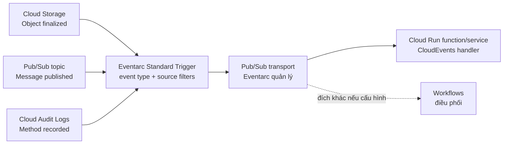
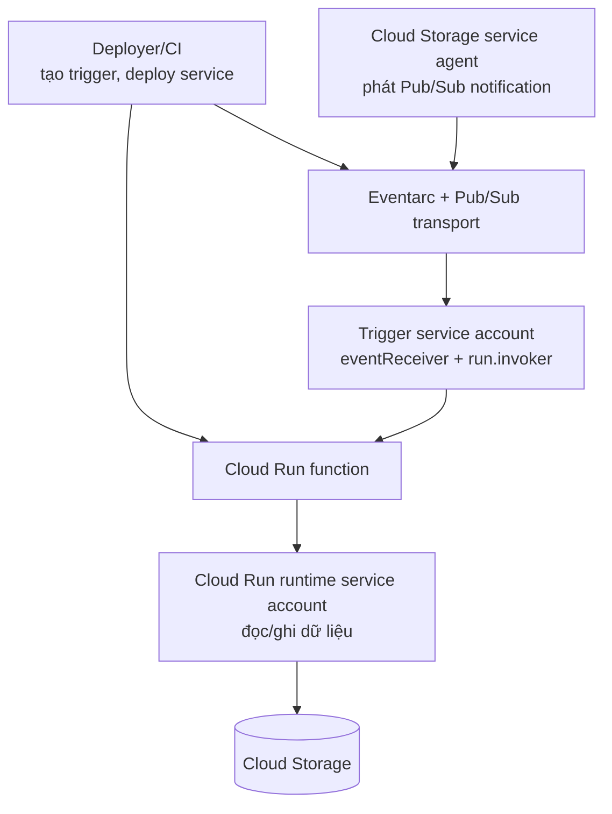
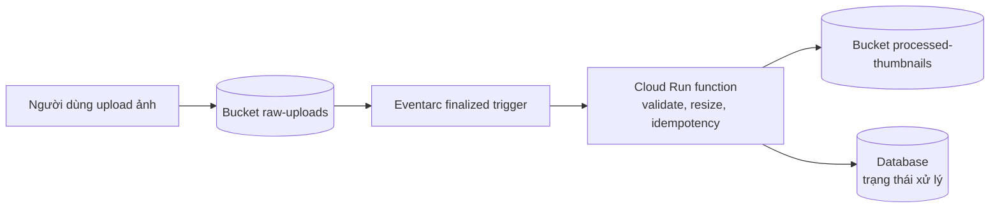

# Eventarc triggers, event providers và CloudEvents

## 1. Vì sao cần Eventarc?

Một ứng dụng thương mại điện tử cần tạo thumbnail khi ảnh sản phẩm được tải lên **Cloud Storage**, cập nhật đơn hàng khi có thông điệp **Pub/Sub**, hoặc phản ứng khi một tài nguyên Google Cloud thay đổi. Nếu các dịch vụ phải kiểm tra liên tục xem dữ liệu đã thay đổi chưa (*polling*), hệ thống lãng phí tài nguyên và khó kiểm soát độ trễ.

**Eventarc** là dịch vụ định tuyến sự kiện của Google Cloud. Trong **Eventarc Standard**, người vận hành tạo **trigger** để chọn một loại sự kiện từ **event provider** rồi chuyển tới **event destination**, chẳng hạn **Cloud Run functions**, Cloud Run services hoặc Workflows. Eventarc truyền sự kiện theo chuẩn **CloudEvents** để consumer đọc được metadata thống nhất, bất kể nguồn phát.

Chủ đề thuộc chương **Cloud Run functions và Eventarc** của module **CLOUD_PROVIDERS_GCP**, kết nối Project/IAM, VPC, Cloud Storage, GKE, Cloud Run, các dịch vụ dữ liệu, tự động hóa phát hành và giám sát độ tin cậy/chi phí.

### Mục tiêu

Sau bài học, bạn có thể:

1. Phân biệt **source/provider, event type, trigger, filter, transport, destination**.
2. Chọn giữa **direct events**, **Pub/Sub events**, **Cloud Audit Logs events** và nguồn bên thứ ba được hỗ trợ.
3. Đọc CloudEvents ở **HTTP binary content mode**: headers `ce-*` và payload theo provider.
4. Triển khai **Cloud Run function** nhận sự kiện Cloud Storage bằng Python và `gcloud`.
5. Cấp đúng IAM cho trigger identity, runtime identity và service agent.
6. Thiết kế handler **idempotent** vì Eventarc Standard giao sự kiện **at least once** và không bảo đảm thứ tự.
7. Theo dõi triggers/logs, xử lý lỗi và kiểm soát chi phí.

> **Lưu ý:** Tên project, bucket, service account và URL dưới đây đều giả định. Lệnh tạo trigger/bucket/Cloud Run có thể phát sinh phí; chỉ chạy trong project lab đã được phê duyệt. Tài liệu tập trung Eventarc **Standard**; Eventarc **Advanced** dùng bus/pipeline và có cấu hình khác.

## 2. Kiến trúc sự kiện và thuật ngữ



| Thành phần | Vai trò | Ví dụ |
| --- | --- | --- |
| **Provider/source** | Dịch vụ phát sinh sự kiện | Cloud Storage, Pub/Sub, BigQuery qua audit |
| **Event type** | Loại biến cố theo schema của nguồn | `google.cloud.storage.object.v1.finalized` |
| **Trigger** | Resource lọc và định tuyến event | Chỉ bắt finalized của bucket A |
| **Filter attributes** | Các trường được provider công bố cho lọc | `type`, `bucket`, `serviceName` |
| **Destination** | Consumer nhận CloudEvent hoặc workflow | Cloud Run function `object-receiver` |
| **CloudEvent** | Metadata chung cùng payload theo loại event | `id`, `source`, `type`, `data` |

Một trigger Standard thường chuyển tới **một destination**. Để fan-out, tạo thêm triggers phù hợp hoặc dùng Pub/Sub/kiến trúc khác có kiểm soát. **Provider không biết trước consumer nào sẽ nhận.** Eventarc không thay thế một database lưu kết quả nghiệp vụ hoặc một workflow nhiều bước.

## 3. Event providers và các tuyến sự kiện

### 3.1. Direct events từ Google Cloud

**Direct events** được provider tích hợp phát mà không cần đi qua một bản ghi Cloud Audit Logs. Các ví dụ:

| Provider | Event type | Ý nghĩa |
| --- | --- | --- |
| Cloud Storage | `google.cloud.storage.object.v1.finalized` | Phiên bản object mới đã tạo xong |
| Cloud Storage | `google.cloud.storage.object.v1.deleted` | Sự kiện xóa object theo semantics của provider |
| Cloud Storage | `google.cloud.storage.object.v1.archived` | Phiên bản live thành noncurrent khi có versioning |
| Cloud Storage | `google.cloud.storage.object.v1.metadataUpdated` | Metadata của object thay đổi |
| Pub/Sub | `google.cloud.pubsub.topic.v1.messagePublished` | Message được publish tới topic |

Event `finalized` chỉ nói rằng **object generation đã hoàn tất tạo**, **không** nói ảnh đã được kiểm tra nội dung, được quét malware hoặc được phê duyệt nghiệp vụ. Khi cả direct và audit-log event đều hỗ trợ cùng tình huống, tài liệu Eventarc khuyến nghị dùng **direct event** nếu phù hợp.

### 3.2. Cloud Audit Logs events

Với nhiều Google Cloud APIs, Eventarc có thể định tuyến khi **audit log entry** được ghi:

```text
type=google.cloud.audit.log.v1.written
serviceName=bigquery.googleapis.com
methodName=google.cloud.bigquery.v2.JobService.InsertJob
```

Payload chứa thông tin **audit log**, ví dụ `protoPayload` với `serviceName`, `methodName`, `resourceName`; nó **không** phải body của một Storage finalized event. Kiểm tra operation được provider hỗ trợ và audit log thực tế; một số **Data Access audit logs** bị tắt mặc định và có chi phí riêng.

### 3.3. Pub/Sub làm cầu nối cho sự kiện nghiệp vụ

Một ứng dụng tự phát `order.created` có thể publish JSON vào topic Pub/Sub; Eventarc trigger dùng:

```text
type=google.cloud.pubsub.topic.v1.messagePublished
transport-topic=projects/PROJECT_ID/topics/orders-events
```

**Điểm khác biệt:** `ce-type` nhận tại Cloud Run vẫn là `google.cloud.pubsub.topic.v1.messagePublished`; `order.created` là **business event type trong message data/attributes**, không tự thay CloudEvents type. Consumer phải decode/validate payload.

### 3.4. Third-party và Eventarc Advanced

Eventarc Standard có các provider bên thứ ba được hỗ trợ, nhiều nguồn còn ở **Preview**. Không mặc định mọi SaaS đều có connector. Khi cần nguồn tùy biến, message buses, pipelines, enrichment hoặc chuyển đổi định dạng phức tạp, đánh giá **Eventarc Advanced** riêng; không dùng cấu hình Advanced như thay thế trực tiếp cho Standard trigger.

## 4. Khám phá event types thay vì đoán

```bash
# CHỈ ĐỌC: các providers ở location dự kiến
gcloud eventarc providers list \
  --project=acme-events-lab \
  --location=asia-southeast1

# CHỈ ĐỌC: types và filteringAttributes bắt buộc
gcloud eventarc providers describe storage.googleapis.com \
  --project=acme-events-lab \
  --location=asia-southeast1

gcloud eventarc locations list --project=acme-events-lab
```

Đọc `eventTypes[].type` và `filteringAttributes` trước khi thiết kế. Một provider có thể không hỗ trợ sự kiện ở location đã chọn. Nếu gặp `Resource was not found`, kiểm tra provider/location; nếu `PERMISSION_DENIED`, xem quyền IAM và Eventarc API.

**Không suy từ tên sản phẩm rằng mọi loại object update, HTTP call hoặc thay đổi database đều có direct event.** Chỉ dùng type được provider công bố.

## 5. CloudEvents: context headers và event data

CloudEvents là một chuẩn mở của **CNCF** giúp mô tả ngữ cảnh sự kiện. **Eventarc Standard** gửi HTTP POST tới Cloud Run destination theo **CloudEvents HTTP binary content mode**:

- Headers có tiền tố `ce-` mô tả context.
- Body chứa **event data** theo schema của provider.
- Header `Content-Type` mô tả định dạng body.

| Context attribute | HTTP header | Mục đích |
| --- | --- | --- |
| `specversion` | `ce-specversion` | Phiên bản đặc tả, thường là `1.0` |
| `id` | `ce-id` | ID event; kết hợp `source` khi deduplicate |
| `source` | `ce-source` | Nguồn tạo event |
| `type` | `ce-type` | Schema/loại sự kiện |
| `time` (tùy chọn) | `ce-time` | Thời điểm sự kiện theo RFC 3339 |
| `subject` (tùy chọn) | `ce-subject` | Chủ thể cụ thể trong nguồn nếu provider phát |
| `datacontenttype` | `Content-Type` | Kiểu dữ liệu body |

### Ví dụ Cloud Storage CloudEvent qua HTTP

```http
POST / HTTP/1.1
Host: example-cloud-run-service.run.app
ce-specversion: 1.0
ce-id: 9876543210
ce-source: //storage.googleapis.com/projects/_/buckets/acme-input-lab-unique-2026
ce-type: google.cloud.storage.object.v1.finalized
ce-subject: objects/uploads/photo.jpg
ce-time: 2026-11-19T02:30:00Z
Content-Type: application/json

{
  "bucket": "acme-input-lab-unique-2026",
  "name": "uploads/photo.jpg",
  "generation": "1760000000000001",
  "metageneration": "1",
  "size": "204800",
  "contentType": "image/jpeg"
}
```

Đây là **mẫu minh họa**, không phải endpoint tồn tại. **Binary mode không đặt toàn bộ `id`, `source`, `type` vào JSON body**. Với Python **Functions Framework**, framework trích headers/body thành object `CloudEvent` để handler đọc.

### Pub/Sub CloudEvent body khác

```json
{
  "message": {
    "data": "eyJvcmRlcklkIjoiMTIzIn0=",
    "messageId": "123456789",
    "publishTime": "2026-11-19T02:30:00Z",
    "attributes": {
      "schema": "orders.v1"
    }
  },
  "subscription": "projects/acme-events-lab/subscriptions/example"
}
```

Trong Pub/Sub, `message.data` là **base64-encoded bytes**, cần decode trước khi parse JSON/Protobuf rồi validate schema và quyền nghiệp vụ. `ce-id` và `message.messageId` có thể liên quan đối với nguồn Pub/Sub, nhưng không giả định đồng nhất trên mọi provider.

**Không coi nội dung event là bằng chứng truy cập được tài nguyên.** Trigger có quyền gọi Cloud Run là một lớp IAM; runtime service account vẫn phải có quyền đọc object hoặc database theo yêu cầu nghiệp vụ.

## 6. Cấu hình trigger và bộ lọc

Một Eventarc Standard trigger khai báo **location**, **event type**, những **filter attributes**, **destination** và **trigger service account**.

```text
type=google.cloud.storage.object.v1.finalized
AND bucket=acme-input-lab-unique-2026
```

Tất cả filters phải khớp (**AND**); `--event-filters` dùng so khớp chính xác, **không hỗ trợ regex/wildcard** thông thường. Một số provider/attribute hỗ trợ **`--event-filters-path-pattern`**, đáng chú ý `resourceName` của tuyến Cloud Audit Logs, nhưng **không tự suy rằng `name=uploads/*.jpg` được hỗ trợ** cho Storage direct event.

Để chỉ xử lý object có prefix `uploads/`:

1. Tạo trigger filter theo `bucket` như provider hỗ trợ.
2. Trong handler, kiểm tra `data.name.startswith("uploads/")`.
3. Bỏ qua các object không thuộc phạm vi và ACK an toàn.
4. Nếu event volume rất lớn, cân nhắc phân tách bucket hoặc kiến trúc lọc phù hợp để giảm overhead.

**Không thể đổi `event-filters type` của trigger đang tồn tại.** Khi chuyển loại sự kiện, tạo trigger mới, thử nghiệm/cutover có kiểm soát, rồi xóa trigger cũ. Hai triggers chồng nhau có thể gây side effects lặp nếu handler chưa idempotent.

## 7. Chọn location đúng

| Source | Eventarc Standard trigger location | Giới hạn quan trọng |
| --- | --- | --- |
| **Cloud Storage direct** | Location **khớp bucket**: region, dual-region hoặc multi-region | Không dùng `global`; bucket/trigger cùng project |
| **Pub/Sub direct** | Single region được hỗ trợ | Không dùng `global` |
| **Cloud Audit Logs** | Single region hoặc `global` | Không dùng dual-/multi-region cho loại này |
| **Cloud Run destination** | Region deploy service/function | Có thể khác location trigger theo điều kiện; kiểm tra residency/latency/egress |

Ví dụ bucket ở `asia-southeast1` không thể gắn trigger Storage finalized với `--location=global` hay `--location=us-central1`. Nếu destination ở region khác, cần xem **latency, yêu cầu dữ liệu và network cost**.

Eventarc Standard dùng **Pub/Sub transport**. Một **Pub/Sub message storage policy** có `enforceInTransit` có thể chặn sự kiện nếu vùng vận chuyển không nằm trong danh sách được phép; cần đặc biệt chú ý với dual-/multi-region buckets. Cloud Storage cũng có giới hạn **Pub/Sub notification configurations trên mỗi bucket**, nên không tăng số triggers vô hạn.

## 8. Các danh tính IAM trong luồng sự kiện



| Danh tính | Quyền thường cần | Điều cần tránh |
| --- | --- | --- |
| **Deployer** | Deploy Cloud Run, tạo Eventarc trigger, `iam.serviceAccounts.actAs` phù hợp | Gán Owner/Editor rộng cho CI |
| **Trigger service account** | `roles/eventarc.eventReceiver` trên project theo nguồn; `roles/run.invoker` trên destination | Cấp quyền đọc toàn bộ dữ liệu nếu không cần |
| **Cloud Storage service agent** | `roles/pubsub.publisher` phục vụ direct Storage events | Nhầm với runtime SA |
| **Runtime service account** | IAM đọc/ghi bucket/database theo logic handler | Dùng chung service account quản trị |

Nếu trigger gửi tới Cloud Run và nhận **HTTP 401/403**, kiểm tra **trigger SA và `roles/run.invoker`** trên đúng service; nếu handler đã được gọi nhưng đọc bucket bị **403**, kiểm tra **runtime SA và IAM Cloud Storage**. Không làm Cloud Run public chỉ để thử vượt lỗi xác thực.

## 9. Lab: Cloud Storage → Eventarc → Cloud Run function

Lab chỉ **ghi log metadata** khi object mới hoàn tất, không chỉnh nội dung file.

### 9.1. Bối cảnh và API

```text
Project:       acme-events-lab
Region:        asia-southeast1
Bucket:        acme-input-lab-unique-2026
Function:      object-receiver
Trigger:       storage-finalized-trigger
Trigger SA:    eventarc-trigger@acme-events-lab.iam.gserviceaccount.com
Runtime SA:    function-runtime@acme-events-lab.iam.gserviceaccount.com
```

Tên bucket cần thay bằng tên **duy nhất toàn cầu** chưa ai dùng. Project phải có Billing, các API và quyền deploy/Storage/Eventarc/IAM. Chuẩn bị trong project lab:

```bash
# THAY ĐỔI: bật các APIs cần thiết
gcloud services enable \
  run.googleapis.com eventarc.googleapis.com \
  eventarcpublishing.googleapis.com pubsub.googleapis.com \
  storage.googleapis.com cloudbuild.googleapis.com \
  artifactregistry.googleapis.com logging.googleapis.com \
  --project=acme-events-lab

# CHỈ ĐỌC trước khi tạo
gcloud auth list
gcloud eventarc providers describe storage.googleapis.com \
  --project=acme-events-lab --location=asia-southeast1
```

### 9.2. Handler Python

Người học tạo hai file **trong thư mục lab cục bộ**.

**`main.py`**

```python
import json
import functions_framework
from cloudevents.http import CloudEvent

@functions_framework.cloud_event
def on_storage_finalized(event: CloudEvent) -> None:
    event_type = event["type"]
    event_id = event["id"]
    source = event["source"]
    data = event.data or {}

    if event_type != "google.cloud.storage.object.v1.finalized":
        print(json.dumps({"result": "ignored", "type": event_type}))
        return

    bucket = data.get("bucket")
    object_name = data.get("name")
    generation = data.get("generation")
    if not bucket or not object_name or not generation:
        raise ValueError("Missing StorageObjectData fields")

    print(json.dumps({
        "event": "storage_finalized",
        "event_id": event_id,
        "source": source,
        "bucket": bucket,
        "name": object_name,
        "generation": generation
    }, ensure_ascii=False), flush=True)
```

**`requirements.txt`**

```text
functions-framework>=3,<4
cloudevents>=1,<2
```

Handler chỉ log. Trong production cần thêm **bucket allowlist**, kiểm tra file size/schema, xử lý idempotency/transaction và không log PII từ tên object. Functions Framework parse CloudEvents context/payload; không cần tự viết HTTP server.

### 9.3. Tạo bucket và hai service accounts

```bash
# THAY ĐỔI tài nguyên, có thể phát sinh phí
gcloud storage buckets create gs://acme-input-lab-unique-2026 \
  --project=acme-events-lab \
  --location=asia-southeast1 \
  --uniform-bucket-level-access \
  --public-access-prevention

gcloud iam service-accounts create eventarc-trigger \
  --project=acme-events-lab \
  --display-name="Eventarc trigger identity"

gcloud iam service-accounts create function-runtime \
  --project=acme-events-lab \
  --display-name="Cloud Run function runtime"
```

Không xóa các resources nếu đã tồn tại và có owner khác. Lab không cần cấp quyền đọc object cho runtime SA vì handler **chỉ xử lý metadata trong event**.

### 9.4. Deploy Cloud Run function từ source

Trong thư mục chứa `main.py`/`requirements.txt`:

```bash
# THAY ĐỔI: build + deploy Cloud Run function
gcloud run deploy object-receiver \
  --project=acme-events-lab \
  --region=asia-southeast1 \
  --source=. \
  --function=on_storage_finalized \
  --base-image=python312 \
  --service-account=function-runtime@acme-events-lab.iam.gserviceaccount.com \
  --no-allow-unauthenticated
```

Cloud Run functions hiện hỗ trợ triển khai qua `gcloud run deploy --source . --function ... --base-image ...`. Các functions trước đây triển khai bằng `gcloud functions deploy --gen2` có bề mặt quản trị/lifecycle riêng; khi sửa workload cũ phải kiểm tra resource gốc. Lệnh deploy trên tạo Cloud Run service **yêu cầu xác thực**, nhưng **chưa tạo Eventarc trigger**.

## 10. Cấp IAM, tạo trigger và kiểm chứng

### 10.1. Quyền nhận event và invoke đích

```bash
# THAY ĐỔI IAM
gcloud projects add-iam-policy-binding acme-events-lab \
  --member="serviceAccount:eventarc-trigger@acme-events-lab.iam.gserviceaccount.com" \
  --role="roles/eventarc.eventReceiver"

gcloud run services add-iam-policy-binding object-receiver \
  --project=acme-events-lab \
  --region=asia-southeast1 \
  --member="serviceAccount:eventarc-trigger@acme-events-lab.iam.gserviceaccount.com" \
  --role="roles/run.invoker"
```

Cloud Storage direct events yêu cầu **Cloud Storage service agent** có quyền Pub/Sub Publisher:

```bash
# Bash/Cloud Shell; lệnh đầu chỉ lấy service-agent email
STORAGE_SA="$(gcloud storage service-agent --project=acme-events-lab)"

# THAY ĐỔI IAM - dùng service-agent email vừa lấy
gcloud projects add-iam-policy-binding acme-events-lab \
  --member="serviceAccount:$STORAGE_SA" \
  --role="roles/pubsub.publisher"
```

Đừng thay `STORAGE_SA` bằng runtime service account hoặc trigger account. Với môi trường thực tế, đánh giá phạm vi nhỏ nhất mà publisher role và nguồn hỗ trợ.

### 10.2. Tạo trigger cho object finalized

```bash
# THAY ĐỔI: tạo Eventarc Standard trigger
gcloud eventarc triggers create storage-finalized-trigger \
  --project=acme-events-lab \
  --location=asia-southeast1 \
  --destination-run-service=object-receiver \
  --destination-run-region=asia-southeast1 \
  --event-filters="type=google.cloud.storage.object.v1.finalized" \
  --event-filters="bucket=acme-input-lab-unique-2026" \
  --service-account="eventarc-trigger@acme-events-lab.iam.gserviceaccount.com"
```

Filter `bucket` nhận **bucket name**, không phải `gs://...` URI. Trigger location phải trùng bucket location. Lần tạo trigger đầu có thể cần thời gian provision Eventarc service agent; sau tạo, trigger có thể cần khoảng **hai phút** để bắt đầu nhận sự kiện.

### 10.3. Kiểm chứng end-to-end

```bash
# CHỈ ĐỌC
gcloud eventarc triggers describe storage-finalized-trigger \
  --project=acme-events-lab --location=asia-southeast1

gcloud eventarc triggers list \
  --project=acme-events-lab --location=asia-southeast1

# THAY ĐỔI: upload một object vào bucket lab
echo "Hello Eventarc" > demo.txt
gcloud storage cp demo.txt \
  gs://acme-input-lab-unique-2026/uploads/demo.txt \
  --project=acme-events-lab

# CHỈ ĐỌC: xem logs của Cloud Run function
gcloud logging read \
  'resource.type="cloud_run_revision" AND resource.labels.service_name="object-receiver"' \
  --project=acme-events-lab \
  --freshness=1h --limit=50 --format=json
```

Đối chiếu log `event="storage_finalized"` với bucket, object name và generation thật. Trigger `ACTIVE` không tự chứng minh **function đã xử lý thành công**: cần xem request logs, stdout/stderr, status và dữ liệu kết quả. Nếu chưa có log ngay, kiểm tra thời gian propagation và logging delay trước khi thay IAM.

## 11. Trigger Pub/Sub và Cloud Audit Logs

Ba loại trigger có cú pháp khác nhau. Không gắn một **Pub/Sub CloudEvent** vào handler chỉ nhận `StorageObjectData` rồi kết luận Eventarc bị lỗi.

### 11.1. Pub/Sub topic đã có

Giả sử topic `orders-events` và Cloud Run service `orders-consumer` (có handler Pub/Sub phù hợp) đã tồn tại:

```bash
# VÍ DỤ THAY ĐỔI: chỉ chạy khi destination có Pub/Sub handler
gcloud eventarc triggers create orders-message-trigger \
  --project=acme-events-lab \
  --location=asia-southeast1 \
  --destination-run-service=orders-consumer \
  --destination-run-region=asia-southeast1 \
  --event-filters="type=google.cloud.pubsub.topic.v1.messagePublished" \
  --transport-topic="projects/acme-events-lab/topics/orders-events" \
  --service-account="eventarc-trigger@acme-events-lab.iam.gserviceaccount.com"
```

Sau đó phát một message thử nghiệm đã được phép:

```bash
gcloud pubsub topics publish orders-events \
  --project=acme-events-lab \
  --message='{"orderId":"order-123","eventType":"order.created"}'
```

Consumer phải đọc `cloud_event.data["message"]["data"]`, **decode base64** rồi mới parse JSON và xác minh `eventType`/schema. **Không dùng trực tiếp handler `on_storage_finalized`** từ lab trước làm Pub/Sub consumer nếu chưa thay code.

### 11.2. Audit Logs event

Ví dụ lọc một loại BigQuery audit operation (với `audit-consumer` giả định đã nhận schema AuditLog):

```bash
# VÍ DỤ THAY ĐỔI, phải xác minh method và audited events hỗ trợ ở region
gcloud eventarc triggers create bq-audit-trigger \
  --project=acme-events-lab \
  --location=asia-southeast1 \
  --destination-run-service=audit-consumer \
  --destination-run-region=asia-southeast1 \
  --event-filters="type=google.cloud.audit.log.v1.written" \
  --event-filters="serviceName=bigquery.googleapis.com" \
  --event-filters="methodName=google.cloud.bigquery.v2.JobService.InsertJob" \
  --service-account="eventarc-trigger@acme-events-lab.iam.gserviceaccount.com"
```

Trước khi tạo, đối chiếu **`gcloud eventarc providers describe ...`**, danh mục audited operations và sự hiện diện của loại audit log cần thiết. `resourceName` có thể dùng để lọc thêm resource nếu provider hỗ trợ. Một audit event có payload `protoPayload`, khác payload của direct Storage event.

### 11.3. Ma trận chọn tuyến

| Tình huống | Type | Filters/transport |
| --- | --- | --- |
| Có object mới | `google.cloud.storage.object.v1.finalized` | `bucket`, location trùng source |
| Có Pub/Sub message | `google.cloud.pubsub.topic.v1.messagePublished` | Topic tồn tại hoặc topic do Eventarc tạo |
| Google API có audit entry | `google.cloud.audit.log.v1.written` | `serviceName`, `methodName`, có thể `resourceName` |
| Third-party source được hỗ trợ | Type đặc thù provider | Theo docs/schema và trạng thái Preview |

## 12. At-least-once delivery, retry và thứ tự

Eventarc Standard dùng **at-least-once delivery**. Consumer có thể nhận **một event nhiều lần**, đặc biệt sau lỗi hoặc timeout. **Không bảo đảm thứ tự event**: hai generations của một object có thể được xử lý khác thứ tự tạo; hai sự kiện không được xem là một transaction.

Theo cơ chế Pub/Sub transport, Eventarc mặc định retry bằng **exponential backoff**, từ khoảng 10 giây đến tối đa 600 giây; thời hạn giữ message mặc định khoảng **24 giờ**. Nếu delivery không thành công trước khi hết retention, message có thể bị loại trừ khi có **dead-letter topic** được cấu hình đúng. Các giá trị này cần đối chiếu tài liệu khi vận hành.

### Một khác biệt cấu hình đáng nhớ

Trigger tạo qua **Eventarc Console/CLI/Terraform** thường bật retries theo mặc định; với quy trình tạo trigger từ **Cloud Run Console**, một số lựa chọn mặc định có thể chỉ thử **một lần**. Đối với Cloud Run destination, `--max-retry-attempts=1` biểu thị chỉ một lần delivery attempt, **không phải “retry thêm một lần”**.

**Không tắt retry để che lỗi** nếu nghiệp vụ yêu cầu xử lý tin cậy. Nếu chọn không retry, phải chấp nhận hoặc chủ động xử lý khả năng mất sự kiện.

### Khi nào ACK?

- Với HTTP Cloud Run destination, handler cần trả **2xx** sau khi công việc/side effect quan trọng đã commit; delivery được coi là thành công.
- Nếu lỗi **tạm thời** (database unavailable, API 429), trả lỗi theo chính sách để có thể retry.
- Nếu payload **sai vĩnh viễn**, lưu vào quarantine/DLQ và xác định quy tắc ACK thay vì retry vô hạn.
- Không trả thành công khi mới nhận event nhưng việc ghi dữ liệu thực đang chạy trong thread nền không được đảm bảo hoàn tất.

**Retry có thể tạo bản sao của side effect.** Xem **Cloud Run request logs** và business state, không chỉ nhìn một `ce-id` xuất hiện nhiều lần rồi kết luận provider sinh event khác nhau.

## 13. Thiết kế idempotent và xử lý generation

### 13.1. Chọn khóa nhận diện

| Loại công việc | Idempotency key nên xét | Lý do |
| --- | --- | --- |
| Retry của cùng CloudEvent | `ce-source + ce-id` | Nhận diện một event qua nhiều delivery attempts |
| Xử lý object generation | `bucket + name + generation` | Hai uploads cùng tên nhưng khác generation là hai phiên bản |
| Pub/Sub handler | Topic + messageId, hoặc business event ID | Chống redelivery/duplicate ở cấp message |
| Thanh toán hoặc phát hành đơn | Business transaction ID | Chống tác dụng phụ lặp kể cả upstream phát hai event khác nhau |

**Đừng dùng set/dictionary trong RAM** làm danh sách events đã xử lý: Cloud Run có thể scale nhiều instances hoặc restart. Dùng Cloud SQL/Firestore/Spanner với **transaction/unique constraint**, hoặc một object/manifest có Cloud Storage **generation precondition** khi phù hợp.

### 13.2. Vòng đời xử lý an toàn

```text
Event finalized(bucket=A, name=uploads/a.jpg, generation=101)
  → Validate provider/type/bucket/schema
  → Claim idempotency key trong storage bền vững
  → Nếu đã DONE: ACK, không làm lại side effect
  → Nếu chưa: thực thi nghiệp vụ và ghi kết quả
  → Commit trạng thái DONE bằng protocol an toàn
  → ACK thành công
```

**Bẫy:** Nếu đã gửi email/ghi database nhưng container chết trước khi lưu trạng thái `DONE`, retry có thể gửi email/ghi lại. Cần dùng API idempotency key, transaction/outbox hoặc unique constraint. Một bảng processed đơn giản **không tạo ra exactly-once end-to-end** khi có nhiều hệ thống bên ngoài.

### 13.3. Kiểm tra Cloud Storage generation

Event cung cấp `bucket`, `name`, `generation`. Nếu handler chỉ đọc object bằng name và không chỉ định generation, khi hai uploads cùng tên xuất hiện nhanh, handler của generation cũ có thể đọc **nội dung phiên bản mới**. Với workflow cần nhất quán:

1. Dùng generation từ event để đọc đúng phiên bản nếu phiên bản còn tồn tại và được phép truy cập.
2. Hoặc kiểm tra live generation hiện tại và bỏ qua event đã cũ theo chính sách nghiệp vụ.
3. Xem Object Versioning/soft delete và quyền IAM; **không mặc định generation cũ còn đọc được** sau khi bị ghi đè.

Thứ tự event không được đảm bảo nên **last event received** không đồng nghĩa **newest object generation**.

## 14. Tình huống: tránh vòng lặp khi tạo thumbnail

Một Cloud Storage finalized event kích hoạt function tạo thumbnail. Nếu function lưu thumbnail trở lại **cùng bucket** đang có trigger, output mới lại kích hoạt function và có thể tạo vòng lặp.



**Phương án thiết kế:**

1. Dùng **hai bucket**: input bucket có trigger, output bucket không được trigger xử lý lại.
2. Nếu dùng cùng bucket, phân biệt `uploads/` và `processed/` và **lọc trong handler**, nhưng event không liên quan vẫn có thể tới function và gây chi phí.
3. Ghi marker/manifest theo generation và có **idempotency key**.
4. Giới hạn Cloud Run max instances/concurrency, thiết lập alert khi event rate tăng đột biến.
5. Kiểm tra file type thực tế, kích thước, decode an toàn và chống nội dung độc hại; **extension `.jpg` không đủ chứng minh file là ảnh an toàn**.

Nếu cần upload hàng loạt với backlog lớn, hãy xem Pub/Sub/Cloud Run Jobs/Workflows để kiểm soát số công việc đồng thời và SLA xử lý.

## 15. Monitoring và troubleshooting

Đối chiếu **ba lớp**: nguồn phát, Eventarc routing/transport và Cloud Run destination.

| Triệu chứng | Nguyên nhân thường gặp | Bằng chứng/hướng xử lý |
| --- | --- | --- |
| Trigger không được tạo | Eventarc API, provider/location hoặc IAM sai | `providers describe`, error response, IAM |
| Trigger ACTIVE nhưng không nhận event | Bucket/type/location không khớp; propagation delay | `triggers describe`, source object, thời điểm trigger sẵn sàng |
| Storage direct không publish | Storage service agent thiếu `pubsub.publisher` | Service-agent identity, Pub/Sub permission |
| Destination trả 401/403 | Trigger SA thiếu `run.invoker` trên đúng service | Cloud Run request logs, IAM, trigger identity |
| Handler chạy nhưng đọc bucket bị 403 | Runtime SA thiếu `storage.objects.get` | Service account của revision, Cloud Storage IAM |
| Audit event không tới | `serviceName`/`methodName` sai; audit operation không có | Eventarc supported events, Audit Logs |
| Pub/Sub parse lỗi | `message.data` còn base64 hoặc schema sai | Decode, validation, content-type |
| Event xử lý nhiều lần | At-least-once/retry hoặc hai triggers chồng nhau | `ce-id`, `source`, business key, idempotency log |
| Xử lý object cũ sai dữ liệu | Ghi đè cùng tên, handler bỏ qua `generation` | Read generation cụ thể hoặc skip stale event |
| Event lỗi lặp đến hết retention | Handler persistent failure, thiếu DLQ/runbook | Cloud Run errors, retry policy và transport |
| Số invocation tăng đột biến | Function ghi output vào cùng bucket, loop | Phân tách output, metrics, max instances |
| Latency cao/chi phí lớn | Cold starts, xử lý nặng, quá nhiều triggers | Cloud Run metrics, Pub/Sub/Logging/Billing |

### Runbook ngắn

1. Ghi **project, trigger, region, source bucket/topic, thời điểm UTC và object generation/message ID**.
2. Xác nhận event source có phát sự kiện, trigger đúng **type/filter/location** và đang ACTIVE.
3. Kiểm tra Eventarc service agent/trigger SA, Cloud Storage service agent và quyền invoke.
4. Đọc Cloud Run request logs, application logs, status codes, event ID và retries.
5. Phân biệt **không định tuyến**, **không gọi được destination**, **handler lỗi**, **nghiệp vụ không commit**.
6. Sửa thay đổi nhỏ nhất, tạo **event lab mới**, xác minh output/idempotency và SLO.

Không mở Cloud Run public, cấp Owner hoặc xóa tùy tiện subscriptions/triggers chỉ để vượt lỗi xác thực. Với debug sâu, xem Eventarc/Cloud Monitoring metrics, Cloud Audit Logs và Pub/Sub transport theo quyền đã được cấp.

## 16. IAM, chi phí và quản trị production

**Eventarc Standard có Pub/Sub transport**, nên hóa đơn end-to-end gồm nhiều phần:

- **Eventarc** tính theo edition, source và kích thước sự kiện theo bảng giá hiện hành.
- **Pub/Sub transport** có phí phù hợp throughput, dữ liệu chuyển/giữ.
- **Cloud Run** tính compute/requests và tài nguyên destination.
- **Cloud Storage**, Cloud Logging, Cloud Build/Artifact Registry, network egress và downstream database.
- **Cloud Audit Logs** có thể có phí Logging, nhất là khi bật Data Access logs.

**Không suy rằng Google-sourced Eventarc event rẻ/miễn một phần thì toàn pipeline miễn phí.** Mỗi event kích hoạt code, logging, image processing, đọc/ghi database và các lần retry; sự kiện trùng hoặc loop có thể làm chi phí tăng mạnh.

### Guardrails

- Giữ Cloud Run destination **authenticated**, cấp `run.invoker` đúng trigger SA.
- Tách runtime SA và trigger SA, chỉ cấp IAM data permissions cần thiết.
- Validate event `type`, `source`, provider payload và business authorization.
- Không log Secret Manager values, signed URLs, PII hoặc toàn bộ payload nhạy cảm.
- Quản lý trigger bằng IaC/CI/CD có review; cutover tránh hai triggers làm cùng một side effect.
- Đặt Cloud Run max instances/concurrency, retry/DLQ/deadline, budget alert và nghiệp vụ reconciliation.
- Không xem Eventarc là hàng đợi lưu sự kiện vô thời hạn; thiết kế replay/recovery độc lập khi dữ liệu quan trọng.

## 17. Bài tập thực hành và kiểm tra

1. **Chọn tuyến:** Upload file đã hoàn tất, publish Pub/Sub message và BigQuery phát audit log cần những `type` nào? **Gợi ý:** `google.cloud.storage.object.v1.finalized`, `google.cloud.pubsub.topic.v1.messagePublished`, `google.cloud.audit.log.v1.written`.
2. **CloudEvents:** Vì sao `ce-id` ở HTTP header nhưng Storage `data.name` ở body? **Đáp án:** Eventarc Standard dùng **CloudEvents binary content mode**.
3. **Location:** Bucket ở `asia-southeast1`, trigger Storage direct đặt `global` có hợp lệ không? **Không**; trigger location phải khớp bucket location.
4. **Filtering:** Có được thêm `--event-filters="name=uploads/*.jpg"` mà không kiểm tra provider không? **Không**; match exact attributes được công bố, lọc prefix ở handler khi cần.
5. **IAM:** Eventarc có eventReceiver nhưng Cloud Run trả 403. Kiểm tra tài khoản và role nào? **Trigger SA + `roles/run.invoker`** trên đúng Cloud Run destination.
6. **Pub/Sub:** Handler nhận `message.data` dạng base64. Hãy nêu bước decode, parse, schema validation và phân biệt business `order.created` với CloudEvents `messagePublished`.
7. **Idempotency:** Upload cùng `images/a.jpg` hai lần tạo hai generations; event generation đầu được gửi lại. Thiết kế key sao cho retry không xử lý trùng nhưng generation mới vẫn được xử lý.
8. **Loop:** Function lưu thumbnail vào cùng bucket kích hoạt finalized. Đề xuất hai cách ngăn loop và một cảnh báo phát hiện invocation rate tăng bất thường.
9. **Điều tra:** Trigger ACTIVE, object đã được upload, nhưng không có output. Liệt kê ít nhất năm bước đọc log/IAM/config trước khi thay đổi quyền hoặc xóa tài nguyên.

### Bài thực hành quan sát chỉ đọc

Trong project được phép:

```bash
gcloud eventarc providers describe storage.googleapis.com \
  --project=PROJECT_ID --location=REGION

gcloud eventarc triggers list \
  --project=PROJECT_ID --location=-

gcloud eventarc triggers describe TRIGGER_NAME \
  --project=PROJECT_ID --location=TRIGGER_LOCATION
```

Ghi lại provider, `type`, filters, location, trigger SA, destination và trạng thái. Chọn một sự kiện có thể phát trong lab để thử end-to-end, sau đó đối chiếu `ce-id`/`ce-source` với Cloud Run logs.

## 18. Checklist trước khi vận hành

- [ ] Xác nhận provider/event types/filters bằng `providers describe` và tài liệu hiện hành.
- [ ] Phân biệt direct event, Pub/Sub và audit-log event; handler có schema đúng.
- [ ] Trigger location hợp lệ; Storage bucket và trigger cùng location/project.
- [ ] Triggers chỉ dùng filters được hỗ trợ; không nhầm exact match với wildcard/prefix.
- [ ] Trigger SA có `eventReceiver` và `run.invoker`; Storage service agent có `pubsub.publisher` khi cần.
- [ ] Runtime SA có quyền dữ liệu tối thiểu; Cloud Run destination không bị mở public tùy tiện.
- [ ] Handler đọc `ce-id`, `ce-source`, `ce-type` và validate payload theo provider.
- [ ] Có **idempotency bền vững** và an toàn transaction/precondition cho side effects.
- [ ] Không giả định exactly-once hay ordering; có retry, DLQ/quarantine và replay strategy.
- [ ] Với Cloud Storage, xem `generation` và tránh xử lý nhầm object live bị ghi đè.
- [ ] Không để output kích hoạt vòng lặp xử lý vô hạn.
- [ ] Dashboard/alert theo HTTP errors, retries, invocation count, duration và business completion.
- [ ] Có quota/max instances, budget, thiết kế downstream capacity và kiểm soát phí.
- [ ] Đã thử duplicate, invalid payload, missing IAM, timeout, sai location và cutover trigger.
- [ ] Có owner, runbook, audit trail, retention và chính sách bảo vệ PII/secrets.

## 19. Tài liệu chính thức

1. [Eventarc Standard overview](https://cloud.google.com/eventarc/standard/docs/overview).
2. [Eventarc providers and destinations](https://cloud.google.com/eventarc/standard/docs/event-providers-targets).
3. [List event providers](https://cloud.google.com/eventarc/docs/list-providers).
4. [Google Eventarc event types](https://cloud.google.com/eventarc/standard/docs/event-types).
5. [CloudEvents HTTP format](https://cloud.google.com/eventarc/docs/cloudevents).
6. [Eventarc Standard event format](https://cloud.google.com/eventarc/standard/docs/event-format).
7. [Retry Eventarc Standard events](https://cloud.google.com/eventarc/docs/retry-events).
8. [Eventarc locations](https://cloud.google.com/eventarc/docs/locations).
9. [Route Cloud Storage direct events to Cloud Run](https://cloud.google.com/eventarc/standard/docs/run/route-trigger-cloud-storage).
10. [Route Pub/Sub events to Cloud Run](https://cloud.google.com/eventarc/standard/docs/run/route-trigger-cloud-pubsub).
11. [Route Audit Log events to Cloud Run](https://cloud.google.com/eventarc/standard/docs/run/route-trigger-cloud-audit-logs).
12. [Trigger Cloud Run functions from Cloud Storage](https://cloud.google.com/run/docs/tutorials/trigger-functions-storage).
13. [Cloud Run function triggers](https://cloud.google.com/run/docs/function-triggers).
14. [Eventarc pricing](https://cloud.google.com/eventarc/pricing).
15. [CloudEvents specification](https://cloudevents.io/).

**Ghi nhớ:** **Provider** tạo sự kiện, **Eventarc trigger** lọc và định tuyến, **CloudEvents** chuẩn hóa metadata, còn **Cloud Run function/service** xử lý nghiệp vụ. Một hệ thống event-driven đáng tin cậy phải đúng **type, filter, location, IAM**, chịu được **at-least-once delivery**, bảo vệ side effects bằng **idempotency**, kiểm tra kết quả thực tế và giám sát **chi phí cùng độ tin cậy**.
