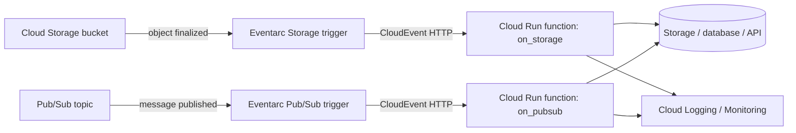

# Kích hoạt hàm từ Cloud Storage và Pub/Sub

> **Chương:** Cloud Run functions và Eventarc  
> **Module:** CLOUD_PROVIDERS_GCP  
> **Phạm vi module:** Khám phá Google Cloud từ tổ chức project, IAM và VPC đến Compute Engine, GKE, Cloud Run, dịch vụ lưu trữ và cơ sở dữ liệu. Qua các tình huống triển khai, người học biết lựa chọn dịch vụ, bảo vệ tài nguyên, tự động hóa phát hành và theo dõi độ tin cậy cùng chi phí.

Một hệ thống thường cần xử lý file **sau khi upload hoàn tất**, hoặc xử lý đơn hàng khi **thông điệp mới** xuất hiện mà không buộc bên gửi chờ kết quả. Kiến trúc **event-driven** phù hợp với cả hai: **Cloud Storage** phát sự kiện object; **Pub/Sub** phát sự kiện message; **Eventarc** định tuyến chúng đến **Cloud Run functions** được triển khai từ mã nguồn.

Bài này dùng **hai hàm Python** nhận CloudEvents: một phản ứng với `google.cloud.storage.object.v1.finalized`, một phản ứng với `google.cloud.pubsub.topic.v1.messagePublished`. Trọng tâm là payload, định danh IAM, cách triển khai Eventarc trigger, retry, idempotency và kiểm chứng end-to-end. Mọi thao tác Cloud trong ví dụ chỉ dành cho **project sandbox** được phép sử dụng.

## Mục tiêu học tập

Sau bài này, bạn có thể:

1. Giải thích luồng **nguồn sự kiện → Eventarc trigger → Cloud Run function** và cấu trúc CloudEvent.
2. Chọn đúng loại event của Cloud Storage/Pub/Sub, phân biệt Pub/Sub **Eventarc CloudEvent** và **HTTP push**.
3. Viết handler Python bằng **Functions Framework**, deploy bằng `gcloud run deploy --source --function`.
4. Cấu hình trigger SA, `roles/eventarc.eventReceiver`, `roles/run.invoker` và Cloud Storage service agent.
5. Thiết kế chống xử lý trùng, retry, dead-letter, kiểm soát bảo mật/chi phí và troubleshooting.
6. Kích hoạt bằng upload file/publish message, xem Cloud Logging và dọn tài nguyên lab an toàn.

## 1. Mô hình luồng sự kiện



| Thành phần | Vai trò |
|---|---|
| **Cloud Storage bucket** | Chứa object, phát sự kiện theo thay đổi được hỗ trợ |
| **Pub/Sub topic** | Nhận message do producer publish, giao đến subscribers/triggers |
| **Eventarc Standard trigger** | Lọc event type + nguồn (bucket/topic), định tuyến đến đích |
| **Cloud Run function** | Hàm xử lý CloudEvent, được build thành image và chạy như Cloud Run service |
| **Trigger service account** | Danh tính Eventarc dùng để **gọi** đích có xác thực |
| **Runtime service account** | Danh tính **mã hàm** dùng khi gọi Google Cloud APIs |

**Trigger không phải chính hàm.** Với Google Cloud CLI hiện hành, thực hiện hai bước rõ ràng: **deploy function trước → tạo Eventarc trigger sau**. Console có thể cho phép chọn trigger trong quá trình tạo function.

### 1.1. Cloud Run functions so với Cloud Functions cũ

Cloud Run functions hiện được triển khai bằng:

```bash
gcloud run deploy FUNCTION_NAME \
  --source . \
  --function ENTRY_POINT \
  --base-image python314 \
  --region REGION
```

Functions Framework và buildpacks chuyển source thành container image, đẩy đến **Artifact Registry** rồi deploy Cloud Run service. Một số project cũ vẫn dùng `gcloud functions deploy --gen2`/Cloud Functions v2 API và endpoint `cloudfunctions.net`; bài này thống nhất **Cloud Run CLI** để không trộn cách quản trị khác nhau.

## 2. CloudEvents: metadata chuẩn, payload khác nhau

CloudEvent có `id`, `source`, `type`, có thể có `subject`/`time` và `data` chứa payload tùy event provider.

| Thuộc tính | Mục đích |
|---|---|
| `id` | ID của event để trace và hỗ trợ deduplication |
| `source` | Nguồn phát event |
| `type` | Loại event; là điều kiện bắt buộc khi lọc bằng Eventarc |
| `subject` | Đối tượng cụ thể nếu được gửi |
| `data` | Metadata object Storage **hoặc** envelope Pub/Sub message |

### 2.1. Cloud Storage object finalized

```text
type = google.cloud.storage.object.v1.finalized
```

Event này thường phát sinh khi **tạo thành công object** hoặc **ghi đè để tạo generation mới**. Payload rút gọn:

```json
{
  "bucket": "events-sample-bucket",
  "name": "incoming/report.csv",
  "generation": "1730000000000000",
  "size": "1240",
  "contentType": "text/csv"
}
```

Khóa `(bucket, name, generation)` phân biệt hai lần ghi đè cùng tên. Nếu chỉ dùng `name`, bạn có thể bỏ sót một phiên bản file hợp lệ. Các sự kiện khác như `google.cloud.storage.object.v1.deleted`, `archived` và `metadataUpdated` có **type riêng**, không được trigger `finalized` tự động xử lý.

### 2.2. Pub/Sub messagePublished

```text
type = google.cloud.pubsub.topic.v1.messagePublished
```

Payload minh họa:

```json
{
  "message": {
    "messageId": "4815162342",
    "data": "SGVsbG8gR0NQ",
    "attributes": {"source": "checkout"},
    "publishTime": "2026-11-19T02:00:00Z"
  },
  "subscription": "projects/demo/subscriptions/eventarc-managed-sub"
}
```

`message.data` chứa **base64**; ví dụ giải mã thành `Hello GCP`. Đây là encoding, **không phải encryption**. Đừng log raw payload nếu có thông tin người dùng, token hay dữ liệu nhạy cảm.

### 2.3. Eventarc khác Pub/Sub push trực tiếp

| Cách kích hoạt | Định dạng handler nhận | Khi cân nhắc |
|---|---|---|
| **Pub/Sub direct push** | HTTP push envelope (`message`/`subscription` trong JSON request) | Luồng chỉ có Pub/Sub, muốn quản lý subscription trực tiếp; Google Cloud thường khuyến nghị vì cấu hình đơn giản |
| **Eventarc Pub/Sub trigger** | **CloudEvent** có `cloud_event.data["message"]` | Muốn thống nhất mô hình Eventarc với Storage và các nguồn khác |

Ví dụ Python trong bài dùng `@functions_framework.cloud_event`, **không** đọc `request.get_json()["message"]` như HTTP push handler. Chọn sai parser sẽ dẫn đến lỗi format dù event đã được giao thành công.

## 3. At-least-once, retry và idempotency

Không mặc định code được gọi **đúng một lần**. Eventarc/Pub/Sub có thể giao lại event, timeout sau khi downstream đã xử lý hoặc gửi nhiều events cho các phiên bản khác nhau.

| Nguồn | Idempotency key tham khảo | Lưu ý |
|---|---|---|
| Storage `finalized` | `bucket + object name + generation` | Hai generations khác nhau là hai công việc riêng |
| Pub/Sub `messagePublished` | `topic + messageId` hoặc `source + event.id` | Một message có thể được giao lại |
| Nghiệp vụ | `orderId + action` | Nhiều messages khác nhau vẫn có thể cùng một side effect cần chống lặp |

**Lưu dấu xử lý trong hệ thống bền vững**, không dùng biến global của function:

```text
1. Đọc event và validate schema/type.
2. Tính khóa chống lặp.
3. Ghi trạng thái xử lý bằng thao tác nguyên tử (transaction/unique key).
4. Nếu đã hoàn tất, return success mà không lặp side effect.
5. Nếu mới, hoàn tất công việc hoặc lưu job/queue bền vững.
6. Đánh dấu done; nếu lỗi có thể retry, không báo success giả.
```

Nếu process crash ở bước 4, bản ghi đang `processing` cần lease/timeout hoặc cơ chế retry an toàn. Có thể dùng Firestore transaction, Cloud SQL unique constraint, idempotency key ở downstream API hay outbox/inbox pattern.

**Retries không phải lúc nào cũng vô hạn:** phải xem cấu hình retry của Eventarc/transport, dead-letter topic, backoff và giới hạn sản phẩm. Không suy luận từ một lỗi 500 rằng message chắc chắn được giao lại. Các event có thể **không đến theo thứ tự nghiệp vụ**, nên dùng generation/version checks.

**Không return rồi xử lý ngầm:** Cloud Run coi invocation hoàn thành khi handler trả; background threads có thể bị dừng/không được cấp CPU theo cấu hình. Hoàn tất side effect bắt buộc trước success hoặc đưa vào queue/job có checkpoint.

## 4. IAM: phân vai để không cấp quá quyền

| Danh tính | Phạm vi quyền cần xét |
|---|---|
| **Người deploy/CI** | Quyền deploy Cloud Run, tạo trigger, tạo source bucket/topic, `iam.serviceAccounts.actAs` trên SA |
| **Cloud Build identity** | Quyền build, lưu source/logs và Artifact Registry push |
| **Eventarc trigger SA** | `roles/eventarc.eventReceiver` đối với direct events; `roles/run.invoker` **trên từng đích** |
| **Cloud Run runtime SA** | Quyền gọi dịch vụ theo nghiệp vụ (Storage Object Viewer, Secret Manager accessor...) |
| **Google-managed agents** | Eventarc agent, Pub/Sub agent, Cloud Storage service agent thực hiện tác vụ nền tảng |

Cloud Storage **direct events** thường cần Cloud Storage **service agent** có `roles/pubsub.publisher` để đưa event đến transport Pub/Sub. Trên một số project cũ, Pub/Sub service agent cần thêm quyền tạo token. **Không tự đoán địa chỉ service agent**, không cấp `roles/editor` để chữa lỗi IAM.

```text
Eventarc trigger SA -- Cloud Run Invoker --> Cloud Run function
Cloud Run runtime SA -- nghiệp vụ --> Bucket / Database / Secret
Cloud Storage service agent -- Pub/Sub Publisher --> Eventarc transport
```

Ingress vào function và IAM là **hai lớp riêng**. Bài lab dùng Cloud Run endpoint có `--ingress=all` nhưng `--no-allow-unauthenticated`: đường HTTP có thể đi tới endpoint, song caller vẫn phải được cấp Invoker. Production nên đánh giá ingress internal và điều kiện hỗ trợ của Eventarc trước khi giới hạn thêm.

## 5. Chuẩn bị project và event sources

> **Cảnh báo:** Cloud Run, Cloud Build, Artifact Registry, Pub/Sub, Storage, Eventarc, Cloud Logging có thể tính phí. Chỉ dùng **project sandbox đã bật Billing, có budget, IAM phù hợp**. Không chạy lệnh tạo/xóa trên project hoặc bucket chung.

### 5.1. Giá trị lab và kiểm kê chỉ đọc

Chạy trong Cloud Shell/Bash hoặc máy có `gcloud`, không chạy trong repository học liệu:

```bash
PROJECT_ID="my-event-functions-lab"
REGION="asia-southeast1"
BUCKET="$PROJECT_ID-functions-events-lab"
TOPIC="orders-lab"
FUNCTION_GCS="storage-events-lab"
FUNCTION_PUBSUB="pubsub-events-lab"
TRIGGER_GCS="storage-finalized-lab"
TRIGGER_PUBSUB="pubsub-published-lab"
TRIGGER_SA_NAME="eventarc-trigger-lab"
RUNTIME_SA_NAME="event-functions-runtime-lab"
TRIGGER_SA="$TRIGGER_SA_NAME@$PROJECT_ID.iam.gserviceaccount.com"
RUNTIME_SA="$RUNTIME_SA_NAME@$PROJECT_ID.iam.gserviceaccount.com"

gcloud auth list --filter="status:ACTIVE"
gcloud projects describe "$PROJECT_ID" \
  --format="table(projectId,name,lifecycleState)"
gcloud run services list --project="$PROJECT_ID" --region="$REGION"
gcloud eventarc triggers list --project="$PROJECT_ID" --location="$REGION"
gcloud pubsub topics list --project="$PROJECT_ID"
gcloud storage buckets list --project="$PROJECT_ID"
gcloud iam service-accounts list --project="$PROJECT_ID"
```

Tên bucket **duy nhất toàn cầu**: nếu đã tồn tại, chọn tên sandbox khác và thay biến xuyên suốt. Không ghi đè service/trigger/topic đã có. Trigger Storage direct cần bucket và trigger **cùng project, location tương thích**; lab dùng bucket **regional** và trigger cùng `asia-southeast1`.

### 5.2. Bật APIs khi được phép

```bash
# Thao tác thay đổi project; chỉ khi đã được chủ project phê duyệt.
gcloud services enable \
  run.googleapis.com \
  eventarc.googleapis.com \
  cloudbuild.googleapis.com \
  artifactregistry.googleapis.com \
  pubsub.googleapis.com \
  storage.googleapis.com \
  iam.googleapis.com \
  --project="$PROJECT_ID"
```

### 5.3. Tạo bucket và Pub/Sub topic lab

```bash
gcloud storage buckets create "gs://$BUCKET" \
  --project="$PROJECT_ID" \
  --location="$REGION" \
  --uniform-bucket-level-access

gcloud pubsub topics create "$TOPIC" \
  --project="$PROJECT_ID"

gcloud storage buckets describe "gs://$BUCKET" \
  --format="yaml(name,location,storageClass)"
gcloud pubsub topics describe "$TOPIC" --project="$PROJECT_ID"
```

Với bucket multi-region/dual-region, hãy kiểm tra **Eventarc locations** thay vì lấy một region tùy ý. Không chọn bucket production để thử nếu nó đã có notification configurations/triggers và có giới hạn quota.

## 6. Hai CloudEvent functions dùng Python

Tạo thư mục mã riêng trong Cloud Shell (ví dụ `functions-lab/`) với hai file. **Không chỉnh file khác của repository học liệu.** Hai entry points được deploy thành **hai Cloud Run services** độc lập để không nhầm payload.

**`requirements.txt`**

```text
functions-framework==3.*
```

**`main.py`**

```python
import base64
import binascii
import hashlib
import logging

import functions_framework


@functions_framework.cloud_event
def on_storage(cloud_event):
    """Log metadata của object finalized, không tải/ghi file trong lab."""
    if cloud_event["type"] != "google.cloud.storage.object.v1.finalized":
        logging.warning("Unexpected event type: %s", cloud_event["type"])
        return

    data = cloud_event.data or {}
    bucket = data.get("bucket")
    name = data.get("name")
    generation = data.get("generation")
    if not all((bucket, name, generation)):
        raise ValueError("Missing Storage object identity")

    key = f"{bucket}/{name}#{generation}"
    logging.info("storage_finalized event_id=%s key=%s", cloud_event["id"], key)
    # Production: atomic dedupe, đọc đúng generation nếu cần,
    # checkpoint và hoàn tất công việc trước khi trả success.


@functions_framework.cloud_event
def on_pubsub(cloud_event):
    """Parse Eventarc CloudEvent từ Pub/Sub, không phải HTTP push JSON."""
    if cloud_event["type"] != "google.cloud.pubsub.topic.v1.messagePublished":
        logging.warning("Unexpected event type: %s", cloud_event["type"])
        return

    data = cloud_event.data or {}
    message = data.get("message") or {}
    message_id = message.get("messageId")
    if not message_id:
        raise ValueError("Missing messageId")

    encoded = message.get("data") or ""
    try:
        payload = base64.b64decode(encoded, validate=True)
    except (ValueError, binascii.Error) as exc:
        raise ValueError("Invalid base64 message data") from exc

    digest = hashlib.sha256(payload).hexdigest()[:16]
    logging.info(
        "pubsub_received event_id=%s message_id=%s bytes=%d digest16=%s",
        cloud_event["id"], message_id, len(payload), digest
    )
    # Không log payload thật vì có thể chứa dữ liệu nhạy cảm.
    # Production: atomic dedupe theo topic/message_id + side effect an toàn.
```

Hàm `on_storage` dùng `bucket/name/generation`; `on_pubsub` decode base64 và log **byte length + digest prefix** thay vì message body. Hai hàm chỉ log, không phát sinh event mới, phù hợp lab chống vòng lặp. Log object path cũng có thể nhạy cảm, cần masking trong production.

### 6.1. Kiểm thử local handler (tùy chọn)

```bash
# Chạy trong thư mục functions-lab/ của người học.
python -m pip install -r requirements.txt

# Terminal A
functions-framework --target=on_pubsub --signature-type=cloudevent --port=8080
```

Terminal B, gửi **CloudEvent binary-mode HTTP** đầy đủ headers:

```bash
curl -i -X POST http://127.0.0.1:8080/ \
  -H "Content-Type: application/json" \
  -H "ce-specversion: 1.0" \
  -H "ce-id: lab-test-001" \
  -H "ce-source: //pubsub.googleapis.com/projects/demo/topics/orders-lab" \
  -H "ce-type: google.cloud.pubsub.topic.v1.messagePublished" \
  -d '{"message":{"messageId":"demo-1","data":"SGVsbG8gR0NQ"}}'
```

Kỳ vọng HTTP success và log có `message_id=demo-1`, `bytes=9`. Test local **không xác minh IAM/Eventarc**; vẫn cần thử end-to-end sau deploy.

## 7. Deploy Cloud Run functions từ source

### 7.1. Tạo danh tính riêng

```bash
# Chỉ tạo khi SA chưa tồn tại và project lab cho phép.
gcloud iam service-accounts create "$TRIGGER_SA_NAME" \
  --project="$PROJECT_ID" \
  --display-name="Eventarc trigger lab"

gcloud iam service-accounts create "$RUNTIME_SA_NAME" \
  --project="$PROJECT_ID" \
  --display-name="Cloud Run function runtime lab"
```

### 7.2. Deploy hai entry points

```bash
# Trong thư mục functions-lab/ có main.py và requirements.txt.
gcloud run deploy "$FUNCTION_GCS" \
  --source . --function on_storage --base-image python314 \
  --region="$REGION" --project="$PROJECT_ID" \
  --service-account="$RUNTIME_SA" \
  --ingress=all --no-allow-unauthenticated --max-instances=2

gcloud run deploy "$FUNCTION_PUBSUB" \
  --source . --function on_pubsub --base-image python314 \
  --region="$REGION" --project="$PROJECT_ID" \
  --service-account="$RUNTIME_SA" \
  --ingress=all --no-allow-unauthenticated --max-instances=2

gcloud run services list --project="$PROJECT_ID" --region="$REGION"
```

`python314` là ví dụ base-image hiện hành trong tài liệu Google Cloud; nếu môi trường không hỗ trợ, chọn **runtime được xác minh theo vùng/chính sách**. Source deploy dùng Cloud Build/Artifact Registry, có thể tạo repository `cloud-run-source-deploy`; **không xóa repository dùng chung** khi cleanup.

Nếu deploy bị `PERMISSION_DENIED`, kiểm tra deployer `actAs` trên runtime SA, Cloud Build identity/permissions, Artifact Registry và organization policies. **Không gán Editor/Owner** cho SA để chữa nhanh. Tới đây hai services có thể đã Ready nhưng **chưa có trigger**.

## 8. Cấp IAM cho Eventarc và Cloud Run

### 8.1. Trigger SA nhận event và gọi hai services

```bash
# Quyền nhận event trong project lab (cần quyền IAM admin thích hợp).
gcloud projects add-iam-policy-binding "$PROJECT_ID" \
  --member="serviceAccount:$TRIGGER_SA" \
  --role="roles/eventarc.eventReceiver"

# Chỉ cấp Invoker trên đúng hai đích, không cấp cả project.
gcloud run services add-iam-policy-binding "$FUNCTION_GCS" \
  --project="$PROJECT_ID" --region="$REGION" \
  --member="serviceAccount:$TRIGGER_SA" \
  --role="roles/run.invoker"

gcloud run services add-iam-policy-binding "$FUNCTION_PUBSUB" \
  --project="$PROJECT_ID" --region="$REGION" \
  --member="serviceAccount:$TRIGGER_SA" \
  --role="roles/run.invoker"
```

### 8.2. Cloud Storage service agent được phép publish events

```bash
STORAGE_AGENT="$(gcloud storage service-agent --project="$PROJECT_ID")"
printf 'Storage service agent: %s\n' "$STORAGE_AGENT"

gcloud projects add-iam-policy-binding "$PROJECT_ID" \
  --member="serviceAccount:$STORAGE_AGENT" \
  --role="roles/pubsub.publisher"
```

**Đây là quyền service agent, không phải quyền đọc bucket của runtime SA.** Nếu handler sau này cần tải file, cấp `roles/storage.objectViewer` trên **bucket cụ thể** cho runtime SA; lab chỉ log nên không cần.

Một số project cũ có thể cần cấu hình Pub/Sub service agent tạo token; Eventarc service agent cũng có thể cần thời gian sau khi bật API. Chỉ thay IAM khi đã đọc lỗi thực tế và đối chiếu tài liệu, không cấp permissions rộng cho agent.

## 9. Tạo trigger Cloud Storage `object.finalized`

Sau khi service sẵn sàng và IAM được cấp, tạo trigger lọc **đúng một bucket và một loại event**:

```bash
gcloud eventarc triggers create "$TRIGGER_GCS" \
  --project="$PROJECT_ID" --location="$REGION" \
  --destination-run-service="$FUNCTION_GCS" \
  --destination-run-region="$REGION" \
  --event-filters="type=google.cloud.storage.object.v1.finalized" \
  --event-filters="bucket=$BUCKET" \
  --service-account="$TRIGGER_SA"

gcloud eventarc triggers describe "$TRIGGER_GCS" \
  --project="$PROJECT_ID" --location="$REGION"
```

**Lưu ý:**

- Bucket và direct Eventarc trigger cần **cùng project** và **location tương thích**; lab dùng cùng region `asia-southeast1`.
- Filter `bucket` phải đúng tên bucket. Đừng coi filter thông thường như regex/glob tự chọn; muốn bỏ qua prefix `tmp/` thì handler có thể tự kiểm tra object name.
- Tạo trigger ACTIVE không có nghĩa sự kiện được giao tức thì; provisioning có thể mất ít phút.
- Direct Cloud Storage event sử dụng Pub/Sub transport; bucket có giới hạn về số notification configurations, vì vậy không tạo hàng loạt triggers trên bucket dùng chung.

## 10. Tạo trigger Pub/Sub cho **topic đã tồn tại**

`--transport-topic` là flag rất quan trọng: nó buộc Eventarc lắng nghe **đúng topic `orders-lab`**. Nếu bỏ flag, Eventarc có thể tạo một transport topic mới; publish vào topic lab cũ sẽ không được trigger mới theo dõi.

```bash
gcloud eventarc triggers create "$TRIGGER_PUBSUB" \
  --project="$PROJECT_ID" --location="$REGION" \
  --destination-run-service="$FUNCTION_PUBSUB" \
  --destination-run-region="$REGION" \
  --event-filters="type=google.cloud.pubsub.topic.v1.messagePublished" \
  --transport-topic="projects/$PROJECT_ID/topics/$TOPIC" \
  --service-account="$TRIGGER_SA"

gcloud eventarc triggers describe "$TRIGGER_PUBSUB" \
  --project="$PROJECT_ID" --location="$REGION" \
  --format="yaml(name,eventFilters,transport,destination,conditions)"
```

Eventarc quản lý subscription transport tương ứng. Không xóa subscription này khi trigger vẫn hoạt động. Retry/dead-letter cần xem theo **Eventarc/PubSub delivery policy** của loại trigger hiện tại, không tự sửa subscription được quản lý mà không có runbook.

### 10.1. Thao tác trên Console

Trong **Cloud Run**, mở function ở đúng project/region, chọn **Triggers → Add trigger → Eventarc** (tên nút có thể thay đổi). Chọn **Cloud Storage** và event finalized + bucket cụ thể, hoặc **Pub/Sub** và event message published + topic cụ thể. Chọn trigger SA, xác minh IAM, nhấn tạo, rồi kiểm tra **Trigger details/conditions**. Cấu hình trong Console cũng không miễn trừ yêu cầu đúng region và service agents.

## 11. Kích hoạt thử và xác minh end-to-end

### 11.1. Upload file để kích hoạt Storage function

```bash
# File test không nhạy cảm; không dùng bucket production.
printf 'event-lab: test upload\n' > event-sample.txt
gcloud storage cp event-sample.txt \
  "gs://$BUCKET/event-sample.txt"

gcloud run services logs read "$FUNCTION_GCS" \
  --project="$PROJECT_ID" --region="$REGION" --limit=50
```

**Kỳ vọng:** log `storage_finalized` có `event_id` và key chứa `BUCKET/event-sample.txt#GENERATION`. Khi ghi đè đúng tên lần nữa, event mới có thể có **generation khác**, không phải duplicate của cùng một event.

### 11.2. Publish message để kích hoạt Pub/Sub function

```bash
gcloud pubsub topics publish "$TOPIC" \
  --project="$PROJECT_ID" \
  --message="Hello GCP"

gcloud run services logs read "$FUNCTION_PUBSUB" \
  --project="$PROJECT_ID" --region="$REGION" --limit=50
```

**Kỳ vọng:** log `pubsub_received` có `message_id` và `bytes=9`; handler không log nội dung message. Nếu chưa thấy, kiểm tra trigger conditions, request logs, quyền IAM và thời gian log propagation trước khi gửi thử lại.

### 11.3. Cần kiểm tra hai lớp, không chỉ trạng thái ACTIVE

| Lớp | Bằng chứng |
|---|---|
| **Eventarc trigger** | Event type, bucket/topic, location, destination, service account, conditions |
| **Cloud Run function** | Revision Ready, request thực sự đến handler, log event ID/message ID, không có lỗi runtime |

Một trigger có thể **ACTIVE nhưng delivery thất bại 403** vì trigger SA thiếu Invoker hoặc ingress không phù hợp. Chỉ coi bài lab đạt khi **upload/publish → function nhận event** được kiểm chứng.

## 12. Troubleshooting có thứ tự

| Triệu chứng | Nguyên nhân thường gặp | Kiểm tra/hướng xử lý |
|---|---|---|
| Trigger Storage không tạo được | Bucket khác project/location hoặc notification quota | Kiểm tra bucket region, Eventarc location và quota |
| Trigger ACTIVE nhưng function không nhận | Filter sai, deployment chưa ready, trigger chưa hoàn tất provisioning | `triggers describe`, điều kiện, event type/bucket/topic |
| Cloud Run trả `401/403` | Trigger SA thiếu Invoker hoặc ingress chặn | Kiểm tra trigger identity, service IAM và ingress; không bật anonymous |
| Lỗi Event Receiver | Trigger SA thiếu role cho direct events | Cấp `roles/eventarc.eventReceiver` đúng project/policy |
| Storage direct event lỗi publish | Cloud Storage service agent thiếu Pub/Sub Publisher | `gcloud storage service-agent` và IAM |
| Pub/Sub publish đúng topic nhưng không thấy event | Trigger trỏ transport topic khác | So `transport.pubsub.topic` với topic publish |
| Python handler lỗi key/type | Nhầm CloudEvent với HTTP push JSON | Kiểm tra `ce-type`/`cloud_event.data`; không dùng parser sai |
| Payload Pub/Sub nhìn như ký tự lạ | `message.data` là base64 | Decode và validate encoding trước xử lý |
| Storage event nhận hai lần | Retry/redelivery hoặc upload thế hệ mới | Dedupe theo `bucket/name/generation` |
| Đọc file nhưng thấy version khác | File đã bị overwrite sau event | Đọc đúng generation/preconditions khi cần |
| Function timeout/OOM | File lớn, downstream chậm hoặc concurrency cao | Streaming, queue/job, retry và resource limits |
| Log không hiển thị | Sai project/region/service, filter hoặc logs đến trễ | Xem cả Eventarc và Cloud Run request/application logs |
| Chi phí tăng bất thường | Event storm, retry loop, invocations và logging | Giới hạn tải, cảnh báo chi phí, xử lý poison events |

**Tách lỗi theo lớp:** không có event delivery → nguồn/trigger/transport; delivery bị 403 → identity/ingress; đã vào handler và 5xx → mã, dữ liệu hoặc dependency. Không cấp Editor cho mọi SA để thử sửa chung.

## 13. Thiết kế production an toàn

### 13.1. Xử lý file không tạo vòng lặp

```text
Upload vào bucket/incoming/
    -> Eventarc finalized
    -> Function validate bucket + name + generation
         -> atomic dedupe
         -> ghi job/queue hoặc xử lý ngắn
    -> Worker/Cloud Run job đọc đúng object generation
         -> xử lý
         -> ghi output sang bucket/processed hoặc database
```

Nếu function ghi output vào **cùng bucket** mà vẫn nghe toàn bộ `finalized`, chính file output có thể **kích hoạt thêm event**, gây vòng lặp. Tách source/output bucket hoặc lọc prefix theo logic có kiểm soát. Không tin file upload chỉ vì nó đến từ bucket: xác minh loại, kích thước, quyền, nội dung và yêu cầu bảo mật trước khi xử lý.

### 13.2. Xử lý đơn hàng an toàn qua Pub/Sub

Message thường chỉ cần mang `orderId` và metadata tối thiểu, không đưa toàn bộ thông tin khách hàng vào payload. Handler:

1. Validate event type, message ID, schema và source.
2. Dùng key nghiệp vụ chống gọi thanh toán/gửi email hai lần.
3. Ghi transaction hoặc enqueue công việc vào hệ thống bền vững.
4. Return success **chỉ sau khi cam kết trạng thái**.
5. Phân biệt lỗi tạm thời (retry theo policy) và message độc/hỏng (quarantine/DLQ + xử lý có chủ ý).

Không đặt kỳ vọng thứ tự toàn cục cho nhiều message. Với quy trình nhạy thứ tự, cần version/sequence checks ở tầng nghiệp vụ.

### 13.3. SLO, cảnh báo và chi phí

| Quan sát | Mục tiêu |
|---|---|
| Eventarc trigger conditions/delivery errors | Phát hiện sai route hoặc IAM |
| Cloud Run request count, error rate, duration, instance count | Phát hiện timeout, crash, saturation |
| Pub/Sub backlog/undelivered messages nếu có transport/subscription được giám sát | Phát hiện tắc nghẽn |
| Processed count và duplicate-suppressed count | Đo kết quả nghiệp vụ thực |
| Retry/DLQ volume | Phát hiện poison messages và lỗi downstream |
| Billing Run/Build/Registry/Storage/PubSub/Eventarc/Logging | Quan sát phí từ event rate, retries, logs, data transfer |

**Budget chỉ cảnh báo, không tự ngăn chi tiêu.** Khi tải lớn, cần kiểm soát max instances, concurrency, quotas, retry policy và điểm ngắt sự cố. Với dữ liệu nhạy cảm, không log payload, secret hoặc token; runtime SA chỉ được truy cập tài nguyên thực sự cần.

## 14. Bài tập có đáp án

### Bài tập 1 — Chọn event

Ứng dụng cần xử lý CSV sau upload thành công và xử lý đơn hàng khi có message được publish. Chọn event type và payload keys phù hợp.

**Đáp án:** Storage `google.cloud.storage.object.v1.finalized` với `bucket/name/generation`; Pub/Sub `google.cloud.pubsub.topic.v1.messagePublished` với `data.message.messageId` và `data.message.data` (base64).

### Bài tập 2 — Xử lý duplicate và overwrite

Hai lần upload `incoming/a.csv` tạo generation `100` và `101`. Event của generation 100 bị gửi lại. Cần xử lý bao nhiêu phiên bản dữ liệu?

**Đáp án:** **Hai** phiên bản (100 và 101); redelivery generation 100 phải được nhận diện duplicate. Dùng transaction/unique key gồm bucket, name và generation.

### Bài tập 3 — Trigger ACTIVE nhưng 403

Runtime SA có quyền `storage.objectViewer`; trigger vẫn báo 403. Vì sao?

**Đáp án:** runtime SA có quyền đọc dữ liệu **khác** trigger SA có quyền gọi Cloud Run. Xác minh `roles/run.invoker` trên destination cấp cho **trigger SA**, ingress và source.

### Bài tập 4 — Sai Pub/Sub topic

Trigger tự tạo topic transport, còn ứng dụng publish vào topic `orders-lab`. Vì sao không thấy function chạy?

**Đáp án:** hai topics độc lập. Chỉ định topic đã có bằng `--transport-topic=projects/PROJECT_ID/topics/orders-lab` khi tạo trigger; kiểm tra `transport.pubsub.topic`.

### Bài tập 5 — Retry sau khi đã gọi API thanh toán

Hàm đã charge thành công nhưng timeout trước khi trả 2xx. Sau retry, thanh toán bị gọi lại. Đề xuất thiết kế và hai metrics.

**Gợi ý:** dùng idempotency key được API thanh toán hỗ trợ và checkpoint bền vững; theo dõi **duplicate-suppressed count**, **retry/DLQ volume** và trạng thái giao dịch. Không để handler trả success trước khi biết trạng thái xử lý.

## 15. Dọn resource lab đúng phạm vi

Chỉ xóa **triggers, Cloud Run functions, topic, bucket và SA riêng** đã tạo trong bài. Nếu một tài nguyên đã tồn tại từ trước, **không xóa**; chỉ hoàn nguyên thay đổi theo owner. Xóa **Eventarc triggers trước** để ngừng luồng mới vào functions.

### 15.1. Kiểm kê

```bash
printf 'Project=%s Region=%s Bucket=%s Topic=%s\n' \
  "$PROJECT_ID" "$REGION" "$BUCKET" "$TOPIC"
gcloud eventarc triggers list --project="$PROJECT_ID" --location="$REGION"
gcloud run services list --project="$PROJECT_ID" --region="$REGION"
gcloud pubsub topics describe "$TOPIC" --project="$PROJECT_ID"
gcloud storage buckets describe "gs://$BUCKET"
```

### 15.2. Xóa triggers và functions lab

```bash
gcloud eventarc triggers delete "$TRIGGER_GCS" \
  --project="$PROJECT_ID" --location="$REGION"
gcloud eventarc triggers delete "$TRIGGER_PUBSUB" \
  --project="$PROJECT_ID" --location="$REGION"

gcloud run services delete "$FUNCTION_GCS" \
  --project="$PROJECT_ID" --region="$REGION"
gcloud run services delete "$FUNCTION_PUBSUB" \
  --project="$PROJECT_ID" --region="$REGION"
```

Chờ xóa trigger hoàn tất, xác minh Eventarc transport subscription không còn hoạt động trước khi xóa topic. Không xóa subscription khác chỉ vì có tên tương tự.

### 15.3. Xóa file test, bucket/topic thuộc riêng lab

```bash
gcloud storage ls "gs://$BUCKET/"

# Chỉ xóa file mẫu của bài này.
gcloud storage rm "gs://$BUCKET/event-sample.txt"

# Bucket phải thật sự rỗng, không có retention/versioned objects cần giữ.
gcloud storage buckets delete "gs://$BUCKET"

# Chỉ xóa topic được tạo cho bài.
gcloud pubsub topics delete "$TOPIC" --project="$PROJECT_ID"
```

Không dùng xóa đệ quy để vượt lỗi bucket có nhiều file hoặc retention đang hoạt động. Nếu file đã có nhiều generations/versioning, kiểm kê từng phiên bản theo quyền và policy, không giả định một lệnh xóa file sẽ xóa mọi version.

### 15.4. Khôi phục IAM/SA và kiểm kê chi phí

```bash
# Chỉ khi binding này do lab tạo và không có resource khác dùng chung.
gcloud projects remove-iam-policy-binding "$PROJECT_ID" \
  --member="serviceAccount:$TRIGGER_SA" \
  --role="roles/eventarc.eventReceiver"

# Chỉ xóa hai SA riêng lab khi không còn phụ thuộc.
gcloud iam service-accounts delete "$TRIGGER_SA" \
  --project="$PROJECT_ID"
gcloud iam service-accounts delete "$RUNTIME_SA" \
  --project="$PROJECT_ID"
```

**Quyền `roles/pubsub.publisher` của Cloud Storage service agent** có thể cần cho triggers khác. Thu hồi binding đó **chỉ khi chắc chắn không còn người sử dụng**; không xóa Google-managed service agents. Artifact Registry repository `cloud-run-source-deploy` có thể được các ứng dụng khác dùng chung nên không xóa toàn repo. Xem Cloud Billing/Logging sau khi dọn; báo cáo chi phí có thể cập nhật trễ.

## 16. Checklist triển khai

| Hạng mục | Tiêu chí |
|---|---|
| **Nguồn** | Đúng bucket/topic/project, region và event type |
| **Parser** | CloudEvent handler, đúng payload, Pub/Sub base64 |
| **Build** | Entry point, Functions Framework, base image/runtime phù hợp |
| **IAM** | Trigger SA eventReceiver + Invoker, Storage service agent Publisher, runtime SA least privilege |
| **Ingress** | Không public anonymous, Eventarc có đường đến function |
| **Idempotency** | Storage gồm generation, Pub/Sub message ID/topic, checkpoint nguyên tử |
| **Lỗi** | Retry policy, backoff, DLQ và poison messages được kiểm chứng |
| **Quan sát** | Event ID, request logs, lỗi và metrics; không log payload nhạy cảm |
| **Chi phí** | Budget, instance limits, giám sát event storm và retries |
| **Cleanup** | Chỉ xóa resource lab, kiểm tra IAM và repository dùng chung |

## Ghi nhớ

**Cloud Storage `object.finalized` và Pub/Sub `messagePublished` đều có thể kích hoạt Cloud Run functions qua Eventarc, nhưng payload khác nhau.** Deploy source trước, cấp IAM đúng danh tính rồi tạo triggers. Để an toàn, thiết kế handler chịu được giao trùng/retry, xử lý side effect có checkpoint và xác minh đầy đủ luồng **nguồn → trigger → function logs**, không chỉ nhìn trigger ACTIVE.

## Tài liệu tham khảo chính thức

- [Cloud Run — Cloud Run functions overview](https://cloud.google.com/run/docs/functions/overview)
- [Cloud Run — Write functions](https://cloud.google.com/run/docs/write-functions)
- [Cloud Run — Deploy functions](https://cloud.google.com/run/docs/deploy-functions)
- [Cloud Run — Function triggers](https://cloud.google.com/run/docs/function-triggers)
- [Cloud Run — Trigger functions from Cloud Storage using Eventarc](https://cloud.google.com/run/docs/tutorials/trigger-functions-storage)
- [Cloud Run — Trigger functions from Pub/Sub using Eventarc](https://cloud.google.com/run/docs/tutorials/pubsub-eventdriven)
- [Cloud Run — Storage triggers](https://cloud.google.com/run/docs/triggering/storage-triggers)
- [Cloud Run — Pub/Sub triggers](https://cloud.google.com/run/docs/triggering/pubsub-triggers)
- [Eventarc Standard — Existing-topic Pub/Sub trigger](https://cloud.google.com/eventarc/standard/docs/run/create-trigger-pub-sub-gcloud)
- [Eventarc Standard — Retry events](https://cloud.google.com/eventarc/standard/docs/retry-events)
