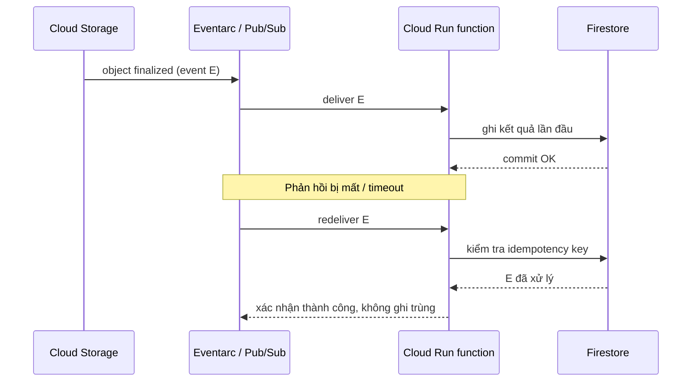
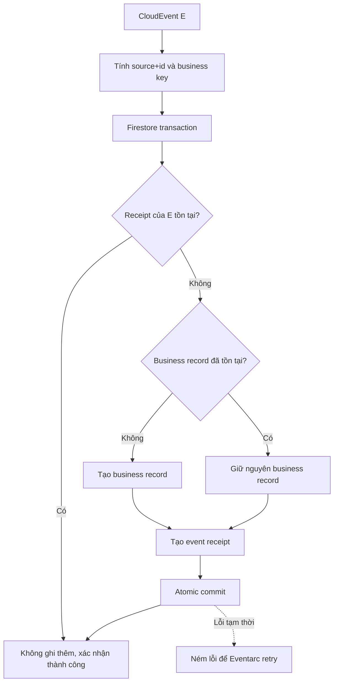
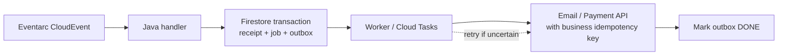

# Retries, duplicate delivery và thiết kế hàm idempotent

Giả sử ứng dụng Java dùng **Cloud Run functions** để tạo bản ghi xử lý ảnh khi Cloud Storage nhận một tệp mới. Hàm đã ghi dữ liệu vào Firestore, nhưng phản hồi thành công không tới được Eventarc. Sự kiện được gửi lại. Nếu hàm tạo thêm bản ghi hoặc gửi hai email cho cùng một ảnh, hệ thống sẽ sai dù cả hai lần chạy đều “thành công”. Trong kiến trúc **event-driven**, xử lý lặp là tình huống bình thường cần thiết kế trước, không chỉ là lỗi hiếm gặp.

Bài thuộc chương **Cloud Run functions và Eventarc** của module **CLOUD_PROVIDERS_GCP**. Từ nền tảng project/IAM, VPC, Compute Engine, GKE, Cloud Run, lưu trữ, cơ sở dữ liệu đến giám sát và chi phí, bài học tập trung vào ba vấn đề: **retry khi thất bại**, **duplicate delivery** và **idempotency của handler Java**. Ví dụ thực hành dùng Eventarc Standard, sự kiện Cloud Storage finalized và Firestore. Với Eventarc Advanced hoặc trigger/transport khác, cần đối chiếu chính sách retry riêng.

> Project, bucket, hàm, địa chỉ service account và số liệu trong bài chỉ là minh họa. Deploy, sửa subscription, tạo log hoặc thử gây lỗi có thể phát sinh phí và tác động dữ liệu. Chỉ chạy trong môi trường được ủy quyền. Không ghi payload nhạy cảm hay token vào log.

## Mục tiêu

Sau bài học, bạn có thể:

1. Giải thích **at-least-once delivery**, retry, acknowledgment, duplicate và giới hạn của “exactly once”.
2. Kiểm tra chính sách retry của Eventarc Standard, phân biệt tùy chọn **một lần giao** với **giao lại khi lỗi**.
3. Chọn **idempotency key** từ `CloudEvent.source + CloudEvent.id`, hoặc từ định danh nghiệp vụ (ví dụ bucket/name/generation).
4. Dùng **Firestore transaction** để chống ghi trùng khi hai invocations chạy đồng thời.
5. Phân loại lỗi tạm thời/lỗi vĩnh viễn, tránh vòng lặp retry vô hạn, kết hợp dead-letter topic và replay có kiểm soát.
6. Giải thích vì sao **ghi trạng thái trước/sau external side effect** không tự đảm bảo chỉ gửi email hoặc thu tiền một lần.
7. Viết, triển khai, kiểm thử và giám sát một Cloud Run function Java theo cách có thể retry.

## 1. Vì sao sự kiện có thể đến nhiều lần?

**Eventarc Standard** sử dụng cơ chế giao sự kiện **at-least-once**: khi destination không xác nhận thành công, tầng vận chuyển dựa trên **Pub/Sub** có thể giao lại. Ngay cả khi ứng dụng đã xử lý thành công, phản hồi/ack thất lạc hoặc hết deadline cũng có thể khiến hệ thống giao sự kiện thêm một lần.



Ba khái niệm thường bị nhầm:

| Khái niệm | Ý nghĩa | Không có nghĩa |
| --- | --- | --- |
| **Delivery attempt** | Một lần hạ tầng gửi sự kiện tới destination | Mỗi lần phải là sự kiện mới |
| **Duplicate event** | Cùng định danh sự kiện được giao lại | Hệ thống nguồn đã tạo một object khác |
| **Idempotent handler** | Gọi lặp với cùng sự kiện không tạo thêm tác dụng nghiệp vụ không mong muốn | Handler chỉ chạy đúng một lần |

**Thứ tự giao không được mặc định đảm bảo.** Hai lần cập nhật cùng một object có thể tạo hai sự kiện khác nhau, đến theo thứ tự không trùng thời gian phát sinh. Không dùng “sự kiện vừa đến” làm bằng chứng đây là phiên bản dữ liệu mới nhất.

### “Exactly-once Pub/Sub” có giải quyết được không?

Pub/Sub hỗ trợ tính năng **exactly-once delivery đối với pull subscriptions** được cấu hình phù hợp, **không hỗ trợ đối với push subscriptions**. Eventarc Standard chuyển event tới Cloud Run destination qua cơ chế push; vì vậy **không dựa vào Pub/Sub exactly-once để bỏ kiểm tra trùng**. Kể cả một pipeline có cơ chế giao một lần, việc đã giao không đồng nghĩa **external side effects** (email, thanh toán, database khác) chỉ thực thi một lần.

## 2. Chính sách retry và acknowledgment của Eventarc

Một Eventarc trigger sử dụng transport Pub/Sub; một số đặc điểm mặc định khi **retry được bật**:

| Tham số | Giá trị mặc định theo tài liệu Eventarc Standard | Điều cần nhớ |
| --- | --- | --- |
| Delivery | At-least-once | Có thể redeliver |
| Backoff tối thiểu | **10 giây** | Tăng dần khi thất bại |
| Backoff tối đa | **600 giây** | Không phải khoảng cố định cho mọi lần |
| Message retention của transport | **24 giờ** | Sự kiện hết hạn có thể bị loại bỏ nếu không có DLQ |
| Thời hạn ack của subscription khi mới tạo | **10 giây** theo tài liệu trigger Cloud Run | Hàm chạy lâu có thể bị giao trùng; có thể cân nhắc tối đa 600 giây |

**Cực kỳ quan trọng:** retry có thể được **tắt ở trigger** cho Cloud Run services/functions:

- Tạo trigger trong **Cloud Run Console**: cấu hình mặc định có thể là **một lần giao, không retry**, trừ khi bật **Enable retry on failure**.
- Tạo trigger bằng **gcloud, Terraform hoặc Eventarc Console**: thường **bật retry** theo mặc định.
- Với CLI, `--max-retry-attempts=1` là cấu hình **một lần giao** (không retry); bỏ cờ này khi tạo trigger nghĩa là dùng retry mặc định.

Vì vậy không viết “Eventarc luôn thử lại” hoặc “Cloud Run functions luôn không retry”. **Đọc cấu hình trigger và subscription thực tế** trước khi dựa vào hành vi đó. Trong production, thường nên bật retry **sau khi handler đã idempotent và có kênh xử lý sự kiện lỗi kéo dài**.

### Khi nào được xem là thành công?

Với Eventarc đẩy CloudEvent đến Cloud Run qua HTTP, **response thành công** xác nhận lần giao; response lỗi, timeout hoặc không ack đúng hạn có thể dẫn tới retry theo cấu hình. Cloud Run functions che bớt phần HTTP: khi handler Java hoàn tất không ném exception, runtime có thể trả success; exception/timeout dẫn đến failure.

- **Không trả thành công trước khi commit dữ liệu bắt buộc.**
- **Không nuốt exception tạm thời** rồi trả success: sự kiện có thể bị xem là đã xử lý.
- Đối với **lỗi vĩnh viễn** (payload hỏng, rule nghiệp vụ từ chối), phải có chính sách quarantine/DLQ/audit để không retry vô ích.
- Đừng giả định HTTP **4xx chắc chắn ngừng retry**: chính sách quyết định theo acknowledgment thành công hay thất bại, không chỉ “4xx là client lỗi”.

## 3. Nhận dạng trùng: event key và business key

Eventarc sử dụng **CloudEvents** với metadata như:

```json
{
  "specversion": "1.0",
  "type": "google.cloud.storage.object.v1.finalized",
  "source": "//storage.googleapis.com/projects/_/buckets/retail-uploads",
  "id": "123456789012345",
  "subject": "objects/inbox/photo.jpg",
  "data": {
    "bucket": "retail-uploads",
    "name": "inbox/photo.jpg",
    "generation": "1740000000000000"
  }
}
```

Đây là **ví dụ event được diễn giải dưới dạng JSON**; Eventarc giao đến HTTP destination bằng CloudEvents binary binding, các metadata thường nằm trong headers `ce-id`, `ce-source`, `ce-type` và dữ liệu nằm trong body. Trong Java Functions Framework, `CloudEvent` đã cung cấp các thuộc tính này.

| Cần chống trùng | Khóa đề xuất | Lý do |
| --- | --- | --- |
| **Cùng CloudEvent được giao lại** | `source + id` | Theo CloudEvents, cặp này định danh event |
| **Cùng phiên bản object Storage** | `bucket + name + generation` | Mỗi object generation chỉ cần xử lý nghiệp vụ một lần |
| **Cùng Pub/Sub message** | Topic/source + message ID | Retry cùng message không được thực hiện lại logic |
| **Cùng lệnh thanh toán** | `orderId + paymentOperationId` do nghiệp vụ tạo | Một yêu cầu được publish hai lần có thể có hai event IDs khác nhau |

**Không dùng chỉ `filename` hoặc `timestamp` làm khóa**: file có thể được ghi đè nhiều thế hệ, timestamp có thể trùng, message cùng nội dung có thể là hai nghiệp vụ hợp lệ. Để lưu làm document ID Firestore, có thể hash SHA-256 khóa đầy đủ; tránh đưa PII/path nhạy cảm thẳng vào document ID.

### Hai mức idempotency

1. **Delivery-level dedup:** cùng `source + id` được nhận lại → bỏ qua.
2. **Business-level dedup:** dù hai sự kiện có ID khác nhau, nếu chúng cùng đại diện **một thao tác nghiệp vụ**, chỉ thực hiện một lần.

Ví dụ user gửi lại cùng yêu cầu “trừ tiền đơn A” tạo hai Pub/Sub messages khác ID: event-level dedup **không đủ**. Cần idempotency key do hệ thống nghiệp vụ cấp và được downstream xác nhận.

## 4. Thiết kế trạng thái xử lý an toàn

**Sai lầm 1 — kiểm tra rồi ghi không nguyên tử:**

```text
IF eventId chưa có trong database:
    gửi email
    INSERT eventId
```

Hai invocations song song đều có thể thấy “chưa có” và cùng gửi email. Sau khi gửi email mà crash trước INSERT, lần retry cũng gửi lại.

**Sai lầm 2 — đánh dấu DONE trước khi làm việc:**

```text
INSERT eventId = DONE
gọi payment API
```

Nếu crash ngay sau INSERT, lần retry thấy DONE và bỏ qua dù tiền chưa được thu.

### Mẫu an toàn cho một datastore

Nếu **mọi thay đổi cần thiết đều trong cùng một Firestore transaction**, ta có thể kiểm tra khóa và ghi trạng thái trong **một commit nguyên tử**:



**Tính nguyên tử chỉ bao phủ dữ liệu trong Firestore transaction.** Firestore có thể chạy **lại transaction callback** khi cạnh tranh đồng thời, nên không gửi email, gọi HTTP API, publish message hay tính phí thẻ **bên trong callback**. Đối với side effects bên ngoài, dùng **transactional outbox + worker** và idempotency key ở hệ thống nhận.

### Gợi ý mô hình dữ liệu

| Firestore collection | Document ID | Nội dung |
| --- | --- | --- |
| `event_receipts` | SHA-256(`source + id`) | `businessKey`, `receivedAt` |
| `object_jobs` | SHA-256(`bucket + name + generation`) | `bucket`, `name`, `generation`, `status=PENDING` |

Tất cả documents được tạo trong một transaction. Nếu event được redeliver, receipt đã tồn tại. Nếu **sự kiện thứ hai** đại diện cùng object generation nhưng event ID khác, business record đã tồn tại, không tạo job thứ hai. Giữ receipts **ít nhất lâu bằng thời gian có thể replay/redeliver** cộng phần dự phòng vận hành; xóa receipts quá sớm có thể làm việc cũ chạy lại.

## 5. Ví dụ Java 21: chống ghi trùng bằng Firestore transaction

Bài thực hành dùng sự kiện **`google.cloud.storage.object.v1.finalized`**, Cloud Run functions Java 21 và Firestore Native mode. Chức năng của handler là **ghi một job PENDING đúng một lần cho mỗi generation**, chưa gửi email hay xử lý ảnh thực tế; worker downstream sẽ lấy job để xử lý có kiểm soát.

**Tiền đề:** project đã bật các API cần thiết, có Firestore database, Cloud Storage bucket và runtime service account có quyền IAM đọc/ghi dữ liệu Firestore phù hợp (ví dụ `roles/datastore.user` ở scope được phê duyệt). **Java server client bypass Firestore Security Rules**; không giả định IAM tự giới hạn một collection cụ thể. Phân quyền nghiệp vụ theo collection/document cần được thực thi ở ứng dụng và kiến trúc dữ liệu. Dùng **Application Default Credentials (ADC)** qua attached service account, không dùng JSON key.

### 5.1 Maven dependencies

```xml
<!-- Trích phần liên quan trong pom.xml của ứng dụng Java 21. -->
<dependencyManagement>
  <dependencies>
    <dependency>
      <groupId>com.google.cloud</groupId>
      <artifactId>libraries-bom</artifactId>
      <version>26.90.0</version>
      <type>pom</type>
      <scope>import</scope>
    </dependency>
  </dependencies>
</dependencyManagement>

<dependencies>
  <dependency>
    <groupId>com.google.cloud.functions</groupId>
    <artifactId>functions-framework-api</artifactId>
    <version>1.1.0</version>
    <scope>provided</scope>
  </dependency>
  <dependency>
    <groupId>com.google.cloud</groupId>
    <artifactId>google-cloud-firestore</artifactId>
  </dependency>
  <dependency>
    <groupId>com.google.cloud</groupId>
    <artifactId>google-cloudevent-types</artifactId>
    <version>0.14.0</version>
  </dependency>
</dependencies>
```

Đây là **đoạn Maven để ghép vào `pom.xml` hợp lệ**, chưa gồm `groupId`, `artifactId`, compiler plugin và phần build còn lại. Pin BOM và kiểm thử khi nâng versions; trong dự án thật cần unit/integration tests, build reproducibility và dependency scanning.

### 5.2 Handler Java

Tệp `src/main/java/functions/IdempotentStorageHandler.java`:

```java
package functions;

import com.google.cloud.firestore.DocumentReference;
import com.google.cloud.firestore.DocumentSnapshot;
import com.google.cloud.firestore.FieldValue;
import com.google.cloud.firestore.Firestore;
import com.google.cloud.firestore.FirestoreOptions;
import com.google.cloud.functions.CloudEventsFunction;
import com.google.events.cloud.storage.v1.StorageObjectData;
import com.google.protobuf.util.JsonFormat;
import io.cloudevents.CloudEvent;
import java.nio.charset.StandardCharsets;
import java.security.MessageDigest;
import java.security.NoSuchAlgorithmException;
import java.util.HexFormat;
import java.util.Map;
import java.util.logging.Logger;

public final class IdempotentStorageHandler implements CloudEventsFunction {
  private static final Logger LOG =
      Logger.getLogger(IdempotentStorageHandler.class.getName());
  private static final Firestore DB =
      FirestoreOptions.getDefaultInstance().getService();

  @Override
  public void accept(CloudEvent event) throws Exception {
    // Chỉ xử lý loại event đã thiết kế; event khác coi là bỏ qua hợp lệ.
    if (!"google.cloud.storage.object.v1.finalized".equals(event.getType())) {
      return;
    }
    if (event.getSource() == null || event.getId() == null
        || event.getData() == null) {
      throw new IllegalArgumentException("Missing required CloudEvent fields");
    }

    StorageObjectData.Builder builder = StorageObjectData.newBuilder();
    JsonFormat.parser().ignoringUnknownFields().merge(
        new String(event.getData().toBytes(), StandardCharsets.UTF_8),
        builder);
    StorageObjectData object = builder.build();

    String bucket = object.getBucket();
    String name = object.getName();
    String generation = Long.toString(object.getGeneration());
    if (bucket.isBlank() || name.isBlank() || object.getGeneration() <= 0) {
      throw new IllegalArgumentException("Invalid storage event data");
    }

    String receiptKey = sha256(event.getSource() + "\n" + event.getId());
    String businessKey = sha256(bucket + "\n" + name + "\n" + generation);

    DocumentReference receipt =
        DB.collection("event_receipts").document(receiptKey);
    DocumentReference job =
        DB.collection("object_jobs").document(businessKey);

    boolean firstDelivery = DB.runTransaction(tx -> {
      // Firestore yêu cầu đọc tất cả documents TRƯỚC khi ghi.
      DocumentSnapshot existingReceipt = tx.get(receipt).get();
      DocumentSnapshot existingJob = tx.get(job).get();
      if (existingReceipt.exists()) {
        return false;
      }
      if (!existingJob.exists()) {
        tx.create(job, Map.of(
            "bucket", bucket,
            "objectName", name,
            "generation", generation,
            "status", "PENDING",
            "createdAt", FieldValue.serverTimestamp()));
      }
      tx.create(receipt, Map.of(
          "businessKey", businessKey,
          "receivedAt", FieldValue.serverTimestamp()));
      return true;
    }).get();

    // Không log object name/payload nếu có thể chứa thông tin nhạy cảm.
    LOG.info("eventReceipt=" + receiptKey
        + " acceptedNewDelivery=" + firstDelivery);
    // Trả bình thường CHỈ sau khi transaction đã commit thành công.
  }

  private static String sha256(String value) {
    try {
      byte[] digest = MessageDigest.getInstance("SHA-256")
          .digest(value.getBytes(StandardCharsets.UTF_8));
      return HexFormat.of().formatHex(digest);
    } catch (NoSuchAlgorithmException e) {
      throw new IllegalStateException(e);
    }
  }
}
```

**Vì sao cách này chịu được cạnh tranh?** `tx.get` và `tx.create` được Firestore quản lý trong transaction; nếu hai invocations cùng đọc receipt chưa có, chỉ một commit thắng hoặc transaction bị retry/failed, không tạo hai receipts có cùng ID. Nếu transaction thất bại sau giới hạn retries nội bộ, exception được truyền ra handler; **Eventarc retry** chỉ xảy ra nếu trigger được bật retry và sự kiện chưa hết retention.

**Giới hạn quan trọng:** ví dụ chỉ đảm bảo tạo **Firestore job record tối đa một lần cho business key**. Nó không chứng minh worker xử lý ảnh đúng một lần; không tải ngay object data (có thể bị ghi đè hoặc xóa trước khi xử lý). Worker cần đọc **đúng object generation** hoặc chấp nhận tình huống object không còn, có lease/retry và thiết kế idempotent tiếp.

## 6. Deploy function và cấu hình Eventarc retry

### 6.1 Chuẩn bị và xác minh

```bash
PROJECT_ID="retail-dev-01"
REGION="asia-southeast1"
FUNCTION="ingest-storage-event"
TRIGGER="storage-finalized-trigger"
BUCKET="retail-dev-upload-unique"
RUNTIME_SA="sa-ingest@retail-dev-01.iam.gserviceaccount.com"
TRIGGER_SA="sa-eventarc@retail-dev-01.iam.gserviceaccount.com"

gcloud auth list
gcloud config get-value project
gcloud eventarc triggers list --project="$PROJECT_ID" --location="$REGION"
```

Bucket, Firestore database và hai service accounts phải **tồn tại**. Chỉ cấp tối thiểu: runtime SA có quyền Firestore cần thiết; **trigger SA có `roles/eventarc.eventReceiver` và quyền gọi đích `roles/run.invoker`** ở scope phù hợp. Cloud Storage service agent/Pub/Sub transport có thể cần quyền publish và một số IAM/service agents theo tài liệu setup; tránh dùng default SA có quyền Editor rộng.

### 6.2 Deploy từ thư mục chứa `pom.xml`

```bash
# THAY ĐỔI tài nguyên, dùng project lab.
gcloud run deploy "$FUNCTION" \
  --project="$PROJECT_ID" \
  --region="$REGION" \
  --source=. \
  --function=functions.IdempotentStorageHandler \
  --base-image=java21 \
  --service-account="$RUNTIME_SA" \
  --no-allow-unauthenticated
```

Lệnh này triển khai **Cloud Run function** thành một Cloud Run service, **chưa tạo Eventarc trigger**. Không dùng `--allow-unauthenticated` chỉ để sửa lỗi giao sự kiện; cần cấp quyền invoker đúng cho trigger identity.

### 6.3 Tạo Eventarc trigger — bật retry theo mặc định CLI

```bash
# THAY ĐỔI hạ tầng: nhận event GCS finalized cho bucket chỉ định.
gcloud eventarc triggers create "$TRIGGER" \
  --project="$PROJECT_ID" \
  --location="$REGION" \
  --destination-run-service="$FUNCTION" \
  --destination-run-region="$REGION" \
  --event-filters="type=google.cloud.storage.object.v1.finalized" \
  --event-filters="bucket=$BUCKET" \
  --service-account="$TRIGGER_SA"
```

Trong ví dụ CLI, **không đặt `--max-retry-attempts=1`**, nên dùng retry behavior tiêu chuẩn. Trigger có thể cần vài phút để bắt đầu nhận sự kiện sau khi tạo; đừng đánh giá “không hoạt động” ngay khi lệnh tạo trả thành công. Source bucket và trigger region phải hỗ trợ location tương ứng.

Để thử **một lần giao, không retry** trong lab, có thể tạo trigger khác hoặc cập nhật trigger hiện có bằng `--max-retry-attempts=1`:

```bash
# CHỈ LÀM TRONG LAB; có thể khiến event lỗi không được giao lại.
gcloud eventarc triggers update "$TRIGGER" \
  --project="$PROJECT_ID" --location="$REGION" \
  --max-retry-attempts=1

# Khôi phục khả năng retry mặc định sau khi handler đã an toàn.
gcloud eventarc triggers update "$TRIGGER" \
  --project="$PROJECT_ID" --location="$REGION" \
  --clear-max-retry-attempts
```

Hai lệnh trên là **hai trạng thái cấu hình đối lập**, không phải các bước luôn cần chạy liên tiếp. Theo thực tế triển khai, đổi policy phải được review vì nó ảnh hưởng cách xử lý lỗi và khả năng mất sự kiện.

### 6.4 Xem trigger và subscription

```bash
gcloud eventarc triggers describe "$TRIGGER" \
  --project="$PROJECT_ID" --location="$REGION"

# Chỉ xem subscription do Eventarc quản lý, không xóa nhầm.
SUBSCRIPTION="$(gcloud eventarc triggers describe "$TRIGGER" \
  --project="$PROJECT_ID" --location="$REGION" \
  --format='value(transport.pubsub.subscription)')"
echo "$SUBSCRIPTION"
gcloud pubsub subscriptions describe "$SUBSCRIPTION" --project="$PROJECT_ID"
```

**Không tạo lại subscription Eventarc bằng tay** để “sửa” một lỗi handler. Thay đổi retention, retry backoff, dead-letter hay ack deadline thuộc **subscription gắn với trigger**, phải hiểu hậu quả và IAM/service-agent. Ví dụ chỉnh backoff có phê duyệt:

```bash
# THAY ĐỔI chính sách retry của subscription đang được Eventarc dùng.
gcloud pubsub subscriptions update "$SUBSCRIPTION" \
  --project="$PROJECT_ID" \
  --min-retry-delay=10s \
  --max-retry-delay=600s
```

Với functions xử lý lâu, `ackDeadlineSeconds` của subscription có thể quá ngắn và gây duplicate deliveries; tài liệu hướng dẫn cân nhắc điều chỉnh tối đa **600 giây**. Đặt ack deadline phù hợp thực tế, không xem nó là cách loại bỏ mọi duplicate:

```bash
# CHỈ SAU KHI XÁC MINH function timeout và chính sách subscription.
gcloud pubsub subscriptions update "$SUBSCRIPTION" \
  --project="$PROJECT_ID" \
  --ack-deadline=600
```

## 7. Phân loại lỗi và tránh retry storm

| Tình huống | Có nên retry? | Cách xử lý |
| --- | --- | --- |
| Firestore tạm thời unavailable/`UNAVAILABLE` | **Có** | Ném exception; backoff và theo dõi |
| Quota/`RESOURCE_EXHAUSTED` | Có giới hạn | Backoff, giảm concurrency/throughput, sửa capacity |
| Cloud Run instance timeout/restart | Có, nếu handler idempotent | Tối ưu duration, ack deadline, downstream timeout |
| Payload thiếu trường bắt buộc | Không thể tự hết lỗi | Quarantine/DLQ, alert; đừng âm thầm ack nếu dữ liệu cần xử lý |
| IAM `PERMISSION_DENIED` vì cấp sai quyền | Retry không tự sửa IAM | Sửa phân quyền, DLQ khi retention cạn |
| Business rule từ chối file độc hại | Không | Ghi trạng thái REJECTED có kiểm toán, xác nhận thành công |
| External payment API trả timeout | Chưa rõ giao dịch đã thành công chưa | Truy vấn trạng thái bằng idempotency key, không thu tiền mù |

**Poison message** là event lỗi vĩnh viễn khiến handler thất bại lặp lại. Nếu chỉ retry tới hết retention, nó có thể bị **loại bỏ**. Dùng **dead-letter topic (DLQ)** trên Pub/Sub subscription gắn với Eventarc để giữ sự kiện không xử lý được sau số lần thử được cấu hình; thiết kế consumer DLQ và quy trình replay riêng. DLQ cũng có retention/IAM/cost và giới hạn thực tế, không phải lưu vĩnh viễn mặc định.

### Circuit breaker và backoff trong code

Eventarc/Pub/Sub có **delivery-level backoff**, còn HTTP/DB clients có thể có **client-level retry**. Nếu cả hai cùng thử liên tục, số yêu cầu tới downstream tăng theo cấp số nhân. Đặt:

- Timeout và retry budget cho mỗi downstream call.
- Exponential backoff kèm jitter, chỉ với lỗi tạm thời.
- Concurrency/max instances phù hợp giới hạn database/API.
- Dead-letter + alert khi quá số lần thử; không dùng infinite loops.
- Idempotency key xuyên suốt mọi mức gọi lại.

## 8. Transactional outbox cho external side effects

Ví dụ muốn gửi một email khi ảnh được xử lý xong:

1. Handler nhận Eventarc event và trong **Firestore transaction** tạo `object_jobs` và `outbox` record mang business key.
2. Worker đọc outbox, **claim** bằng lease/transaction để tránh nhiều worker cùng xử lý.
3. Worker gửi email bằng **idempotency key** nếu provider hỗ trợ; hoặc dùng chiến lược reconcile và chấp nhận/giảm thiểu duplicate nếu không.
4. Chỉ đánh dấu outbox `SENT` sau khi xác minh provider đã nhận và kết quả nghiệp vụ; retry dựa trên trạng thái.
5. Nếu worker crash sau khi provider gửi thành công nhưng trước khi lưu `SENT`, provider có thể nhận lại yêu cầu — **chỉ provider idempotency** hoặc cơ chế nghiệp vụ tương đương mới ngăn gửi trùng tuyệt đối.



Cloud Tasks hỗ trợ retry và task naming dùng để giảm một số trường hợp enqueue trùng, nhưng **không tự biến external API thành exactly once**. Với thanh toán, đặt cùng idempotency key ở payment provider và có đối soát ledger. Với file output, dùng **generation preconditions** của Cloud Storage để không ghi đè bản đã tạo.

## 9. Kiểm thử duplicate và failure injection

Không chỉ chạy một lần “happy path”. Bảng sau dùng cùng `source/id`, cùng object generation hoặc retry sau lỗi để chứng minh tính đúng đắn:

| Test | Thao tác | Kỳ vọng |
| --- | --- | --- |
| T1 | Giao event E lần đầu | Có một `event_receipts` và một `object_jobs` |
| T2 | Giao lại **đúng** E | Không có thêm business job |
| T3 | Hai invocations của E song song | Tối đa một job sau Firestore transaction |
| T4 | Event mới ID khác, cùng bucket/name/generation | Receipt mới nhưng **không** tạo job thứ hai |
| T5 | Cùng object name, **generation khác** | Job mới hợp lệ |
| T6 | Firestore unavailable trước commit | Handler lỗi, retry được bật thì thử lại; không có partial commit |
| T7 | Firestore commit xong, phản hồi mất | Lần retry thấy receipt, không ghi thêm |
| T8 | Payload thiếu `bucket` hoặc `generation` | Lỗi có kiểm soát, cảnh báo/DLQ; không tạo job rác |
| T9 | Worker gửi email thành công rồi crash | Gửi lại dùng idempotency key, tránh duplicate ở provider |
| T10 | Event không thể xử lý tới hết retention | Đã có DLQ/điều tra/replay; không mất âm thầm |

### Tạo một event thật trong lab

```bash
# Có thể phát sinh phí; bucket đã được trigger theo dõi.
printf 'hello idempotency\n' > sample.txt
gcloud storage cp sample.txt "gs://$BUCKET/inbox/sample.txt"

# Đọc Cloud Run logs và các Firestore documents được tạo.
gcloud run services logs read "$FUNCTION" \
  --project="$PROJECT_ID" --region="$REGION" --limit=30
```

Nếu upload lại cùng object name, Cloud Storage có thể tạo **generation mới** — đó **không phải** bản sao của cùng event. Để kiểm tra retry cùng `source/id`, dùng **Functions Framework/local test harness** với cùng CloudEvent hoặc mô phỏng delivery bằng test code trong môi trường lab được phép. Không giả mạo request tới service production.

### Những assertions nên tự động hóa

```text
assert(receiptsCount(source,id) == 1)
assert(jobsCount(bucket,name,generation) == 1)
assert(secondDeliveryDoesNotMutateJob())
assert(newGenerationCreatesNewJob())
assert(failedCommitDoesNotAckWhenRetriesEnabled())
```

Đây là **pseudocode assertions**, không phải test suite có thể chạy trực tiếp. Với integration test, dùng project/Firestore database tách biệt, dữ liệu định danh riêng và dọn theo đúng quyền.

## 10. Giám sát, bảo mật và chi phí

| Tín hiệu | Nơi xem | Cách sử dụng |
| --- | --- | --- |
| Delivery failures/retries | Eventarc trigger, Pub/Sub subscription metrics | Cảnh báo retry tăng bất thường |
| Push responses `2xx`/`4xx`/`5xx` | `subscription/push_request_count` theo response code | Phân biệt handler lỗi và ack |
| Oldest unacked message age | Pub/Sub Monitoring | Phát hiện backlog/retention risk |
| DLQ message count | Pub/Sub dead-letter subscription | Điều tra poison messages và replay |
| Function exceptions/timeouts | Cloud Run logs/metrics | Phân loại transient/permanent |
| Receipt vs business job counts | Firestore/application metrics | Nhận biết duplicate suppression |
| Outbox pending/failed age | Application dashboard | Phát hiện external side effect mắc kẹt |
| Cloud Run instances/concurrency | Cloud Monitoring | Quản lý áp lực Firestore/downstream |

**Log có cấu trúc** nên ghi `eventId`, `source` hoặc hash, `businessKey` hash, trạng thái `acceptedNewDelivery`, retry/failure class và trace ID. Tránh log payload, object path chứa PII, auth headers hoặc nội dung document. Các quyền quản trị trigger, sửa Pub/Sub subscription, xem DLQ và ghi Firestore phải cấp **least privilege**, tách runtime SA với trigger invocation SA.

### Chi phí retry

Một lỗi kéo dài có thể phát sinh:

- Eventarc/Pub/Sub delivery và lưu messages/DLQ.
- Số lần gọi Cloud Run, CPU/RAM và cold starts.
- Firestore reads/transactions, log ingestion và Monitoring.
- External API charges cho các lần thử lại.

**Ví dụ minh họa:** 10.000 events/ngày, 2% bị giao lại một lần → ít nhất khoảng **200 deliveries thêm/ngày** nếu giả định mọi event khác chỉ giao một lần. Không suy ra chi phí tiền cụ thể nếu chưa biết region, thời gian chạy, retention và mức retry thực. Dùng Cloud Billing budgets/alerts và dashboard retry rates.

## 11. Case study: hóa đơn bị tạo hai lần

Ứng dụng bán hàng dùng Pub/Sub để phát `InvoiceRequested(orderId)` khi đơn được thanh toán. Một Cloud Run function tạo PDF và gửi email. Khi email provider timeout, handler throw exception và Eventarc giao lại. Nếu mỗi lần nhận event đều tạo invoice mới và gửi email, khách có thể nhận hai hóa đơn.

**Thiết kế sửa:**

1. Dùng **`invoiceId = orderId`** (hoặc một ID nghiệp vụ ổn định) để tạo invoice row bằng transaction có điều kiện; không phụ thuộc chỉ vào Pub/Sub event ID.
2. PDF được lưu dưới object name/digest được kiểm soát; ghi có `ifGenerationMatch=0` nếu yêu cầu “chỉ tạo mới”.
3. Ghi outbox `send-invoice/{invoiceId}` trong cùng transaction với trạng thái invoice.
4. Worker gửi email với idempotency key ổn định nếu provider hỗ trợ.
5. Theo dõi DLQ, backoff và outbox stalled; khi replay vẫn dùng **cùng invoiceId**.

**Bài học:** idempotency ở tầng message chưa đủ; phải định nghĩa **ranh giới nghiệp vụ** của “một lần”. Nếu provider email không hỗ trợ idempotency, cần cơ chế phát hiện/đối soát và chấp nhận giới hạn không thể đảm bảo exactly-once side effects chỉ từ handler.

## 12. Bài tập tự kiểm tra

### Bài 1 — Chọn event key

Hai lần giao có cùng `source` và `id`. Chúng có nên tạo hai Firestore jobs?

<details>
<summary>Đáp án</summary>

Không. Đây là duplicate delivery theo CloudEvents, nên receipt key `source + id` phải chặn xử lý lặp.
</details>

### Bài 2 — Hai IDs khác nhau

Một user bấm “Thanh toán” hai lần và hệ thống publish hai messages khác ID cùng `orderId`. Event-level dedup đủ chưa?

<details>
<summary>Đáp án</summary>

Chưa. Cần business idempotency key như `orderId + paymentOperationId`, truyền xuyên suốt tới hệ thống thanh toán.
</details>

### Bài 3 — Crash trước khi ghi receipt

Handler gọi email API thành công rồi crash trước khi lưu receipt. Khi retry, điều gì có thể xảy ra?

<details>
<summary>Đáp án</summary>

Email có thể được gửi lần hai. Ghi receipt sau side effect không bảo đảm exactly once; nên dùng outbox và idempotency tại provider.
</details>

### Bài 4 — Transaction callback

Tại sao không nên đặt `sendPayment()` trong callback của Firestore `runTransaction`?

<details>
<summary>Đáp án</summary>

Firestore có thể chạy callback nhiều lần khi xảy ra cạnh tranh; payment API nằm ngoài transaction và không được rollback cùng Firestore.
</details>

### Bài 5 — Retry policy mặc định

Tạo Eventarc trigger trong Cloud Run Console khác gì tạo bằng `gcloud` về retry mặc định?

<details>
<summary>Đáp án</summary>

Cloud Run Console mặc định có thể dùng **một delivery attempt**; gcloud/Eventarc Console/Terraform thường bật retry khi không cấu hình `--max-retry-attempts=1`. Phải đọc trigger/subscription thực tế.
</details>

### Bài 6 — Retry mãi?

Handler nhận payload thiếu `bucket` và luôn ném lỗi. Chỉ bật retry trong 24 giờ có phải cách tốt?

<details>
<summary>Đáp án</summary>

Không. Đây có thể là poison event, cần quarantine/DLQ, alert và sửa nguồn dữ liệu; retry vô hạn tăng phí và có thể hết retention rồi mất thông điệp.
</details>

### Bài 7 — Object generation

Tệp `inbox/a.jpg` được upload, rồi bị ghi đè tạo generation mới. Có nên bỏ qua event thứ hai chỉ vì cùng filename?

<details>
<summary>Đáp án</summary>

Không. `bucket + name + generation` khác nhau nghĩa là hai phiên bản object khác nhau. Business rule mới quyết định có xử lý cả hai hay chỉ latest.
</details>

### Bài 8 — Pub/Sub exactly-once

Một kiến trúc Eventarc Standard đẩy events vào Cloud Run function có thể bật Pub/Sub exactly-once trên push subscription để bỏ dedup code không?

<details>
<summary>Đáp án</summary>

Không. Pub/Sub exactly-once delivery chỉ hỗ trợ pull subscriptions. Push delivery và external side effects vẫn cần idempotent handler và cơ chế nghiệp vụ phù hợp.
</details>

## 13. Checklist production

- [ ] Đã đọc cấu hình **retry enabled/disabled** của đúng Eventarc trigger và Pub/Sub subscription.
- [ ] Handler trả success **chỉ sau khi commit** mọi trạng thái bắt buộc.
- [ ] Có receipt key từ `source+id` và business key ổn định, không dùng timestamp/filename đơn lẻ.
- [ ] Chặn duplicate bằng **atomic create/transaction**, không phải check-then-write.
- [ ] Không gọi external API trong Firestore transaction callback.
- [ ] External side effects dùng **outbox + downstream idempotency/reconciliation**.
- [ ] Có phân loại transient/permanent failure, backoff/timeout/retry budget.
- [ ] Có DLQ, retention, quyền IAM tối thiểu, alert và quy trình replay không tạo trùng.
- [ ] Kiểm tra ack deadline phù hợp thời gian xử lý, không dựa vào tăng deadline để bỏ idempotency.
- [ ] Test duplicate song song, mất ack sau commit, poison event, version change và stale replay.
- [ ] Theo dõi push response codes, retry count, backlog age, DLQ, Cloud Run errors và Firestore contention.
- [ ] Dữ liệu logs không chứa PII/token; có budget cho retry traffic/DB/logs.
- [ ] Có runbook tắt/bật retry, rollback deployment, dọn test artifacts và audit thay đổi trigger.

## Tài liệu tham khảo chính thức

- [Eventarc Standard — Retry events](https://cloud.google.com/eventarc/docs/retry-events): at-least-once, backoff, retention, DLQ và idempotency.
- [Configure event-driven function retries](https://cloud.google.com/run/docs/tips/function-retries): retries tại trigger/subscription, không phải chỉ trong code.
- [Create triggers with Eventarc](https://cloud.google.com/run/docs/triggering/trigger-with-events): Cloud Run functions, retry defaults và ack deadline.
- [Eventarc CloudEvents event format](https://cloud.google.com/eventarc/docs/event-format): metadata `id`, `source`, HTTP transport.
- [CloudEvents JSON event format](https://cloud.google.com/eventarc/docs/cloudevents-json): Cloud Storage finalized payload.
- [Cloud Run functions best practices](https://cloud.google.com/run/docs/tips/functions-best-practices): idempotency, errors và background activity.
- [Write Cloud Run functions](https://cloud.google.com/run/docs/write-functions): Java Functions Framework và `CloudEventsFunction`.
- [Cloud Storage CloudEvent Java sample](https://cloud.google.com/functions/docs/samples/functions-cloudevent-storage): giải mã `StorageObjectData`.
- [Firestore transactions](https://cloud.google.com/firestore/docs/manage-data/transactions): atomic writes và transaction retry.
- [Pub/Sub exactly-once delivery](https://cloud.google.com/pubsub/docs/exactly-once-delivery): giới hạn pull subscriptions.
- [Google Cloud Java libraries BOM](https://cloud.google.com/java/docs/bom): dependency compatibility.
- [Eventarc troubleshooting](https://cloud.google.com/eventarc/standard/docs/run/troubleshoot): retry spikes, Pub/Sub metrics và lỗi target.
- [Cloud Run pricing](https://cloud.google.com/run/pricing) và [Pub/Sub pricing](https://cloud.google.com/pubsub/pricing): dự toán vận hành sự kiện.

