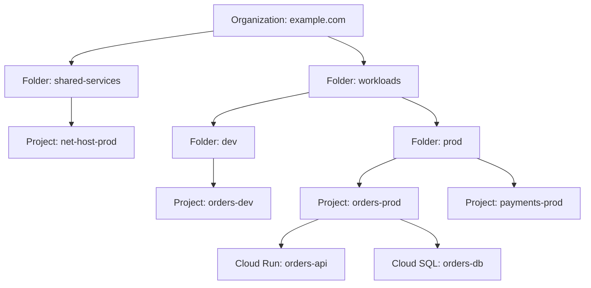

# Resource hierarchy và sự kế thừa cấu hình trong Google Cloud

Trong Google Cloud, **resource hierarchy** (cây phân cấp tài nguyên) xác định tài nguyên thuộc đơn vị quản lý nào, ai có thể quản trị chúng và những chính sách nào tác động tới chúng. Đây là nền tảng để thiết kế môi trường nhiều dự án: quản lý IAM, bảo vệ dữ liệu, chuẩn hóa triển khai và kiểm soát phạm vi hoạt động của các nhóm.

Bài học thuộc chương **Hệ thống tài nguyên và vị trí** của module `CLOUD_PROVIDERS_GCP`. Trong hành trình tìm hiểu Google Cloud từ project, IAM, VPC đến Compute Engine, GKE, Cloud Run, lưu trữ, cơ sở dữ liệu, phát hành tự động và giám sát chi phí, việc hiểu cây phân cấp giúp bạn quyết định **đặt tài nguyên ở đâu, cấp quyền tại cấp nào và quy định nào được áp dụng xuống cấp dưới**.

## 1. Mục tiêu học tập

Sau bài này, bạn có thể:

- Phân biệt **Organization**, **Folder**, **Project** và tài nguyên dịch vụ; đọc được quan hệ cha–con giữa chúng.
- Giải thích cách **IAM allow policy**, **IAM deny policy**, **Organization Policy** và **tag** ảnh hưởng tới tài nguyên cấp dưới.
- Phân biệt thứ **được kế thừa** với cấu hình phải **thiết lập riêng** như VPC, billing, API và vị trí triển khai.
- Chọn cấp áp dụng chính sách phù hợp cho các môi trường `dev`, `staging`, `prod` và kiểm tra hiệu lực khi có sự cố quyền truy cập.

## 2. Cây phân cấp tài nguyên gồm những gì?

Một cách hình dung phổ biến là:



| Cấp | Vai trò | Đặc điểm cần nhớ |
| --- | --- | --- |
| **Organization** | Cấp quản trị cao nhất của một tổ chức sử dụng Google Cloud. | Thường gắn với miền doanh nghiệp thông qua Google Workspace hoặc Cloud Identity. Không phải mọi tài khoản cá nhân đều có Organization. |
| **Folder** | Gom nhóm các folder con và project theo phòng ban, sản phẩm hoặc môi trường. | Là cấp **tùy chọn**. Có thể lồng nhiều cấp, giúp phân quyền và áp chính sách theo nhóm dự án. |
| **Project** | Phạm vi cơ bản để tạo và quản lý phần lớn tài nguyên Google Cloud. | Mỗi project có `project ID` duy nhất, `project number`; có IAM policy riêng, các API được bật, hạn mức liên quan và liên kết billing. |
| **Service resource** | Tài nguyên do một dịch vụ quản lý, ví dụ VM, bucket, cụm GKE hoặc Cloud Run service. | Thuộc một project; tùy dịch vụ, còn có cấu trúc con và phạm vi vùng/zone riêng. |

Trong cây này, mỗi **folder** hoặc **project** có một cha trực tiếp tại một thời điểm. Project có thể nằm trong Organization hoặc Folder; Folder có thể nằm trong Organization hoặc Folder khác. Một project không đồng thời thuộc hai folder. Tài nguyên dịch vụ thuộc project cụ thể, không được đặt trực tiếp vào folder.

Các loại định danh dễ nhầm lẫn:

- **Organization ID** và **Folder ID** thường là số, dùng để tham chiếu các nút quản trị.
- **Project ID** là chuỗi duy nhất, ví dụ `orders-prod-123`; **project number** là số do Google Cloud cấp. Tên hiển thị của project có thể trùng nhưng project ID thì không.
- Tên của VM, bucket hoặc Cloud Run service thuộc phạm vi định danh riêng của từng dịch vụ; không thay thế project ID.

**Điểm cốt lõi:** cây phân cấp thể hiện **quan hệ sở hữu và quản trị**. Nó không tự tạo mạng kết nối giữa các project và không cho biết tài nguyên nằm ở region hoặc zone nào.

## 3. Sự kế thừa cấu hình nghĩa là gì?

Giả sử một policy được gắn tại Folder `prod`, bên dưới có hai project `orders-prod` và `payments-prod`. Với những **loại policy hỗ trợ kế thừa**, cả hai project đều chịu ảnh hưởng của policy đó. Khi tạo project thứ ba trong Folder `prod`, project mới cũng thuộc phạm vi chính sách tương ứng.

```text
Organization
└── Folder: workloads
    └── Folder: prod   ← chính sách đặt tại đây
        ├── Project: orders-prod   ← trong phạm vi tác động
        └── Project: payments-prod ← trong phạm vi tác động

Folder: dev và các project nằm ở nhánh khác không thuộc phạm vi này.
```

Tuy nhiên, **không phải mọi thiết lập đều kế thừa**. Mỗi cơ chế có quy tắc riêng về nơi gắn policy, cách đánh giá và khả năng ghi đè/đặt ngoại lệ. Không thể suy luận rằng một giá trị cấu hình trên Organization luôn được sao chép nguyên vẹn xuống tất cả project.

| Cơ chế | Có ảnh hưởng xuống cấp dưới? | Cần phân biệt |
| --- | --- | --- |
| **IAM allow policy** | **Có.** Các quyền được cấp tại nút cha có thể áp dụng cho tài nguyên con theo phạm vi và điều kiện của binding. | Binding ở project **bổ sung** quyền; thông thường không xóa quyền đã được cấp từ cha. |
| **IAM deny policy** | **Có.** Quy tắc từ chối tại nút cha có thể chặn quyền đối với tài nguyên con. | Quy tắc deny phù hợp thường chặn một quyền dù principal có allow binding tương ứng, trừ trường hợp ngoại lệ được cấu hình. |
| **Organization Policy** | **Có**, theo quy tắc của từng constraint. | Đây là **ràng buộc cấu hình/hành vi**, không phải cách cấp quyền IAM. Cách kết hợp chính sách cha–con phụ thuộc loại constraint và cấu hình kế thừa. |
| **Resource Manager tags** | **Có thể kế thừa** theo cây phân cấp; effective tags có thể được dùng trong điều kiện chính sách tương thích. | Tag khác **label**; cần kiểm tra tag hiệu lực và cách xử lý khi có tag cùng key ở cấp con. |
| **Labels** | **Không tự kế thừa.** | Muốn các project/tài nguyên có label thống nhất phải gắn bằng quy trình tạo tài nguyên hoặc công cụ tự động hóa. |
| **VPC, subnet, firewall, API bật, billing link** | **Không tự tạo hoặc kế thừa theo Folder.** | Shared VPC và các mô hình dùng chung tài nguyên đòi hỏi cấu hình riêng. |
| **Region, zone, quota, ngân sách** | **Không được suy ra chỉ từ cây phân cấp.** | Vị trí do loại tài nguyên và cấu hình khi triển khai quyết định; quota và kiểm soát chi phí có phạm vi riêng. |

Các phần tiếp theo giải thích ba cơ chế thường quyết định hành vi thực tế: **IAM allow**, **IAM deny** và **Organization Policy**.

## 4. Kế thừa IAM allow: quyền có thể được cấp từ tổ tiên

IAM (Identity and Access Management) trả lời câu hỏi: **principal nào** (người dùng, nhóm, service account, v.v.) được thực hiện **những quyền nào** trên **phạm vi tài nguyên nào**. Một allow policy chứa các binding giữa principal và IAM role, đôi khi kèm IAM Condition.

Ví dụ thiết kế quyền:

| Nơi gắn binding | Principal | Role minh họa | Tác động dự kiến |
| --- | --- | --- | --- |
| Organization `example.com` | `group:cloud-inventory@example.com` | `roles/browser` | Có thể duyệt metadata của các tài nguyên tổ chức thuộc phạm vi role; không đồng nghĩa đọc mọi dữ liệu ứng dụng. |
| Folder `prod` | `group:prod-readers@example.com` | `roles/viewer` | Có quyền xem các tài nguyên được role hỗ trợ trong `orders-prod`, `payments-prod` và các project con khác của `prod`. |
| Project `orders-prod` | `group:orders-release@example.com` | `roles/run.developer` | Có quyền phát triển/quản lý tài nguyên Cloud Run được role cho phép trong `orders-prod`; không tự có quyền tương tự tại `payments-prod`. |

Khi đánh giá một yêu cầu tại `orders-prod`, Google Cloud có thể xem các allow binding áp dụng từ **Organization → Folder tổ tiên → Project → tài nguyên đích**, tùy tài nguyên có hỗ trợ policy ở cấp nào. Ví dụ, một người thuộc `prod-readers@example.com` vẫn có quyền từ binding tại Folder `prod` ngay cả khi không thấy binding đó trong IAM policy **gắn trực tiếp** với project.

### 4.1 Quyền từ cha không biến mất khi project cấp quyền riêng

Giả sử Folder `prod` cấp `roles/viewer` cho nhóm A. Project `orders-prod` cấp thêm `roles/run.developer` cho nhóm B. Đây là **hai nguồn quyền cùng có thể tác động** đến project. Nếu muốn nhóm A không còn đọc project này, chỉ xóa binding tại project sẽ không giải quyết quyền được cấp từ Folder.

Điều này dẫn đến hai nguyên tắc thiết kế:

1. **Cấp quyền ở cấp thấp nhất đáp ứng nhu cầu.** Quyền triển khai riêng cho ứng dụng `orders` thường nên đặt ở project `orders-prod`, tránh mở rộng tới mọi project sản xuất.
2. **Chỉ cấp quyền tại Folder/Organization khi thật sự muốn toàn nhánh nhận quyền.** Một binding quyền rộng ở cấp cao có phạm vi ảnh hưởng lớn, kể cả với các project được thêm vào sau này.

### 4.2 Có role nhưng vẫn có thể bị từ chối

IAM allow không phải yếu tố duy nhất quyết định truy cập. Kết quả còn tùy thuộc:

- **IAM Conditions:** binding chỉ có hiệu lực khi điều kiện thỏa mãn, ví dụ giới hạn theo thời gian hoặc thuộc tính tài nguyên được hỗ trợ.
- **IAM deny policies:** một quy tắc deny áp dụng có thể ngăn quyền dù đã có allow tương ứng.
- **Principal Access Boundary** (nếu được cấu hình): có thể giới hạn tập tài nguyên principal được phép truy cập.
- **Organization Policy hoặc điều kiện dịch vụ:** yêu cầu tạo tài nguyên có thể không hợp lệ dù principal được IAM cấp quyền gọi API.

Ví dụ thực tế, `roles/run.developer` không tự bảo đảm một người có thể triển khai Cloud Run service dùng một service account cụ thể; thao tác đó thường cần thêm quyền `iam.serviceAccounts.actAs` (thường thông qua `roles/iam.serviceAccountUser` trên service account phù hợp).

## 5. IAM deny: giới hạn quyền từ cấp cha

Trong mô hình nhiều nhóm, đôi khi bạn phải bảo vệ một hành động ngay cả khi ai đó vô tình cấp role quá rộng. **IAM deny policy** dùng để từ chối các permission được cơ chế IAM Deny hỗ trợ, dựa trên principal, permission và điều kiện/ngoại lệ tương ứng.

Ví dụ về ý tưởng chính sách: tại Organization, từ chối một permission nhạy cảm đối với một nhóm principal nhất định, đồng thời cấu hình các ngoại lệ thực sự cần thiết. Quy tắc deny có phạm vi áp dụng đến các project bên dưới và có thể tác động dù một project cấp `roles/editor` hoặc một role khác chứa permission đó.

Đừng nhầm **IAM deny** với việc “không có allow”. Nếu không có allow phù hợp thì thao tác đã không được cấp; deny là một **quy tắc từ chối tường minh** có thể chặn quyền được cấp bởi một binding khác. Deny cũng không thay thế Organization Policy, bởi hai cơ chế kiểm tra những loại quy tắc khác nhau.

## 6. Organization Policy: ràng buộc cách tài nguyên được cấu hình

**Organization Policy Service** cho phép quản trị viên đặt các **constraint** để kiểm soát hành vi trên tài nguyên và dịch vụ. Policy có thể đặt tại Organization, Folder hoặc Project, sau đó tạo nên **effective policy** tại tài nguyên đang xét theo quy tắc của constraint.

Hai ví dụ minh họa:

| Constraint | Ý nghĩa khi được cấu hình phù hợp | Tình huống |
| --- | --- | --- |
| `constraints/gcp.resourceLocations` | Giới hạn vị trí được phép dùng đối với **những loại tài nguyên/dịch vụ có hỗ trợ constraint**. | Doanh nghiệp chỉ cho tạo tài nguyên thuộc phạm vi kiểm soát ở các location đã được phê duyệt. |
| `constraints/iam.disableServiceAccountKeyCreation` | Hạn chế việc tạo khóa service account do người dùng quản lý. | Giảm nguy cơ khóa dài hạn bị lưu hoặc phát tán ngoài hệ thống. |

Giả sử Organization áp ràng buộc vùng tài nguyên, còn Folder `prod` có những chính sách riêng cho môi trường sản xuất. Khi tạo Cloud SQL instance trong `orders-prod`, phải xem **effective organization policy tại project và mức hỗ trợ constraint của Cloud SQL**. Quyền IAM cho phép tạo instance không có nghĩa là mọi region hoặc cấu hình đều hợp lệ.

**Lưu ý về kế thừa:** list constraint và boolean constraint có cách đánh giá riêng; việc một policy cấp con bổ sung, thay thế, hoặc kết hợp với policy cấp cha phụ thuộc loại constraint và thiết lập cụ thể. Không nên phán đoán từ một policy đơn lẻ rằng project có thể tự ý nới quy định từ Organization. Hãy kiểm tra **effective policy**, các ngoại lệ được phê duyệt và tài liệu của constraint.

### 6.1 Khi nào dùng IAM, khi nào dùng Organization Policy?

- Câu hỏi **“Ai được phép tạo VM?”**: bắt đầu từ IAM permission/role và các deny rule áp dụng.
- Câu hỏi **“VM được phép có external IP hay không?”**: xem Organization Policy hoặc cơ chế bảo mật dịch vụ tương ứng.
- Câu hỏi **“Ai được thay đổi quy định external IP?”**: quay lại IAM để xem quyền quản lý Organization Policy.

Người quản trị tốt thường dùng **IAM để phân quyền thao tác** và **Organization Policy để đặt rào chắn cấu hình**. Hai lớp này bổ sung cho nhau.

## 7. Tags, labels và việc chọn phạm vi chính sách

**Tags** của Resource Manager là cặp key/value được quản lý tập trung, có thể gắn vào các nút trong resource hierarchy. Tag phù hợp có thể được kế thừa xuống tài nguyên con và được tham chiếu trong một số chính sách có hỗ trợ điều kiện. Ví dụ `environment=prod` gắn tại Folder `prod` giúp biểu diễn ngữ cảnh môi trường nhất quán trên nhánh này.

**Labels** là metadata phục vụ tìm kiếm, phân nhóm, báo cáo hoặc phân tích chi phí tùy dịch vụ. Label `cost-center=commerce` trên một project hay VM **không tự lan truyền** xuống các tài nguyên khác chỉ vì có cùng tổ tiên. Khi cần label nhất quán, hãy thiết lập trong Terraform, mẫu triển khai hoặc pipeline tạo tài nguyên.

Không nên xây quyết định phân quyền dựa vào tên folder hay label mà cho rằng chúng được IAM tự hiểu như quy tắc. Quyền chỉ có hiệu lực qua binding/policy tương ứng; tag chỉ tác động đến chính sách nếu cơ chế đó thật sự hỗ trợ và đã được cấu hình để sử dụng tag.

## 8. Resource hierarchy khác với vị trí địa lý

Folder và Project biểu diễn **vị trí trong tổ chức**; region và zone biểu diễn **vị trí vận hành của tài nguyên**.

Ví dụ cùng một project `orders-prod` có thể có:

| Tài nguyên | Vị trí minh họa | Ý nghĩa |
| --- | --- | --- |
| VM Compute Engine | Zone `asia-southeast1-a` | VM là tài nguyên zonal trong một zone cụ thể. |
| Cloud Run service | Region `asia-southeast1` | Service được triển khai theo vùng của Cloud Run. |
| Cloud Storage bucket | Location được chọn khi tạo bucket | Bucket có thể có phạm vi region, dual-region hoặc multi-region theo cấu hình hỗ trợ. |
| IAM policy tại project | Không phải đối tượng chọn zone | Chính sách quản trị tác động theo resource hierarchy, không phải do đặt cùng region. |

Một project nằm dưới Folder `prod` **không mặc nhiên** khiến các dịch vụ chạy ở cùng region; cũng không đồng nghĩa project đó chỉ triển khai được một region. Nếu doanh nghiệp có yêu cầu lưu trú dữ liệu, cần cấu hình và kiểm tra constraint về location, lựa chọn region của từng dịch vụ, khả năng sao chép dữ liệu và các giới hạn thực tế của dịch vụ đó.

Tương tự, hai project cùng một Folder **không tự chia sẻ VPC**. Shared VPC cần mô hình host project/service project và cấu hình kết nối, quyền truy cập thích hợp; VPC network, subnet và firewall không xuất hiện ở project con chỉ vì folder cha chứa một project mạng.

## 9. Thiết kế mẫu cho doanh nghiệp có nhiều môi trường

Giả sử công ty triển khai hệ thống bán hàng với ứng dụng `orders` và `payments`. Có thể tổ chức:

```text
Organization: example.com
├── Folder: shared-services
│   └── Project: net-host-prod
└── Folder: workloads
    ├── Folder: dev
    │   ├── Project: orders-dev
    │   └── Project: payments-dev
    └── Folder: prod
        ├── Project: orders-prod
        └── Project: payments-prod
```

Quy tắc quản trị gợi ý:

1. **Organization:** quản trị danh tính, giám sát bảo mật chung và các ràng buộc nền tảng cần áp dụng rộng. Tránh cấp role quyền cao cho nhóm lớn.
2. **Folder `workloads`:** thiết lập những quyền hoặc guardrail dùng chung cho ứng dụng. Không cần lặp cùng một binding trên từng project nếu thực sự muốn toàn nhánh thừa hưởng.
3. **Folder `prod`:** đặt yêu cầu kiểm soát chặt hơn và nhóm có quyền giám sát môi trường sản xuất. Điều kiện chi tiết vẫn tùy cơ chế chính sách.
4. **Project `orders-prod`:** cấp quyền deploy chỉ cho nhóm phát hành `orders`, bật API cần dùng, quản lý service account, VPC binding, quota và tài nguyên ứng dụng.
5. **Project `payments-prod`:** cấp quyền triển khai độc lập với `orders-prod`; cùng Folder không có nghĩa hai nhóm được truy cập chéo.

### 9.1 Hai sự cố minh họa

**Sự cố A — Nhân viên vẫn xem được tài nguyên dù đã bỏ role ở project.** Nhóm `prod-readers` có `roles/viewer` tại Folder `prod`. Quản trị viên xóa một binding ở `orders-prod` nhưng người dùng thuộc nhóm vẫn xem được tài nguyên. Nguyên nhân là **allow binding ở tổ tiên** vẫn áp dụng. Cách xử lý: kiểm tra toàn bộ đường dẫn tổ tiên và thay đổi binding tại đúng cấp theo chính sách phân quyền đã thống nhất.

**Sự cố B — Có quyền tạo tài nguyên nhưng API báo vi phạm chính sách.** Nhóm deploy có role IAM phù hợp tại project, nhưng yêu cầu tạo tài nguyên ở một location không được Organization Policy cho phép đối với dịch vụ đó. Nguyên nhân là **được IAM cho phép** không đồng nghĩa **cấu hình hợp lệ theo organization policy**. Cách xử lý: xem effective constraint, chọn location được phép hoặc thực hiện quy trình xin ngoại lệ phù hợp.

## 10. Thực hành đọc cây phân cấp và truy tìm quyền

Các lệnh sau chỉ **đọc thông tin**, không tạo hoặc sửa tài nguyên. Thay `PROJECT_ID`, `ORG_ID` và `FOLDER_ID` bằng giá trị thật; cần đăng nhập `gcloud` với tài khoản có quyền xem metadata/policy tương ứng. Một số lệnh có thể báo thiếu quyền dù tài nguyên vẫn tồn tại.

```bash
# Project thuộc cha nào?
gcloud projects describe PROJECT_ID --format="yaml(projectId,projectNumber,parent)"

# Xem danh sách tổ tiên của project
gcloud projects get-ancestors PROJECT_ID

# Các Folder trực tiếp dưới một Organization
gcloud resource-manager folders list --organization=ORG_ID

# Xem IAM allow policy gắn TRỰC TIẾP tại từng cấp
gcloud organizations get-iam-policy ORG_ID
gcloud resource-manager folders get-iam-policy FOLDER_ID
gcloud projects get-iam-policy PROJECT_ID

# Ví dụ xem organization policy có hiệu lực ở project
gcloud org-policies describe gcp.resourceLocations --project=PROJECT_ID --effective
```

**Cách đọc kết quả:**

1. Xác định đường dẫn **Organization → các Folder → Project → tài nguyên**.
2. Với câu hỏi về quyền truy cập, xem **IAM allow binding ở từng tổ tiên**, các condition, IAM deny policy, Principal Access Boundary (nếu có) và chính sách của tài nguyên đích.
3. Với câu hỏi về hành vi/cấu hình bị chặn, kiểm tra **effective Organization Policy** và xem constraint có áp dụng cho dịch vụ, loại tài nguyên, vị trí đang thao tác hay không.
4. Đối chiếu thêm cấu hình **riêng của dịch vụ**: service account, mạng, API được bật, quota, billing và location.

`gcloud projects get-iam-policy` trả về policy gắn tại **project**, không phải danh sách tổng hợp mọi binding kế thừa từ folder/organization. Vì vậy, một binding không có trong đầu ra project **chưa đủ** để khẳng định principal không có quyền. Tương tự, kết quả `gcloud org-policies describe ... --effective` thể hiện chính sách constraint được yêu cầu tại phạm vi đó, không phải toàn bộ policy của Google Cloud.

### Bài tập nhỏ

Cho tình huống:

- Folder `prod` có hai project `orders-prod` và `payments-prod`.
- Nhóm `readers` được gán `roles/viewer` tại Folder `prod`.
- Nhóm `release-orders` được gán `roles/run.developer` chỉ tại `orders-prod`.
- Organization có constraint về vị trí đối với những dịch vụ hỗ trợ.

Hãy trả lời:

1. Nhóm `readers` có được hưởng quyền xem ở cả hai project không?
2. Nhóm `release-orders` có tự động quản lý Cloud Run ở `payments-prod` không?
3. Người có role cho phép tạo tài nguyên tại `orders-prod` có thể bỏ qua constraint vị trí tại Organization không?
4. Nếu chuyển một workload Cloud Run từ `asia-southeast1` sang region khác, cây Folder/Project có tự thay đổi không?

**Đáp án và giải thích:** (1) Có, trong giới hạn permission mà `roles/viewer` hỗ trợ và các policy khác không chặn; binding cấp Folder áp dụng xuống hai project. (2) Không, binding cấp project không truyền sang project anh em. (3) Không thể suy ra như vậy; IAM và organization policy được đánh giá theo các quy tắc riêng. (4) Không; vị trí triển khai và vị trí trong cây quản trị là hai trục khác nhau.

## 11. Ghi nhớ khi đưa vào dự án thực tế

- **Organization → Folder → Project → Resource** là trục quản trị. Folder tùy chọn; Project là nơi quản lý phần lớn tài nguyên dịch vụ.
- **IAM allow** có thể được thừa hưởng từ cấp cha; thêm binding tại project không xóa binding từ Folder hoặc Organization.
- **IAM deny, Principal Access Boundary và Organization Policy** có thể làm một yêu cầu thất bại dù có allow binding; phải xác định đúng lớp kiểm soát.
- **Effective Organization Policy** phụ thuộc constraint và quy tắc kế thừa; đừng suy đoán chỉ từ một policy đơn lẻ.
- **Labels, VPC, API, billing, quotas và location** có cơ chế riêng; đừng xem chúng là cấu hình tự động sao chép theo Folder.
- Thiết kế đúng phạm vi ngay từ đầu sẽ giúp phát hành Cloud Run/GKE, phân quyền vận hành Compute Engine, bảo vệ dữ liệu và quan sát chi phí dễ kiểm soát hơn khi số lượng project tăng lên.

### Tài liệu Google Cloud để tra cứu thêm

- [Resource hierarchy](https://cloud.google.com/resource-manager/docs/cloud-platform-resource-hierarchy)
- [Access control for resource hierarchy](https://cloud.google.com/iam/docs/resource-hierarchy-access-control)
- [Organization Policy Service](https://cloud.google.com/resource-manager/docs/organization-policy/overview)
- [Tags overview](https://cloud.google.com/resource-manager/docs/tags/tags-overview)
