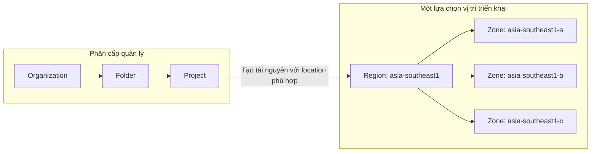
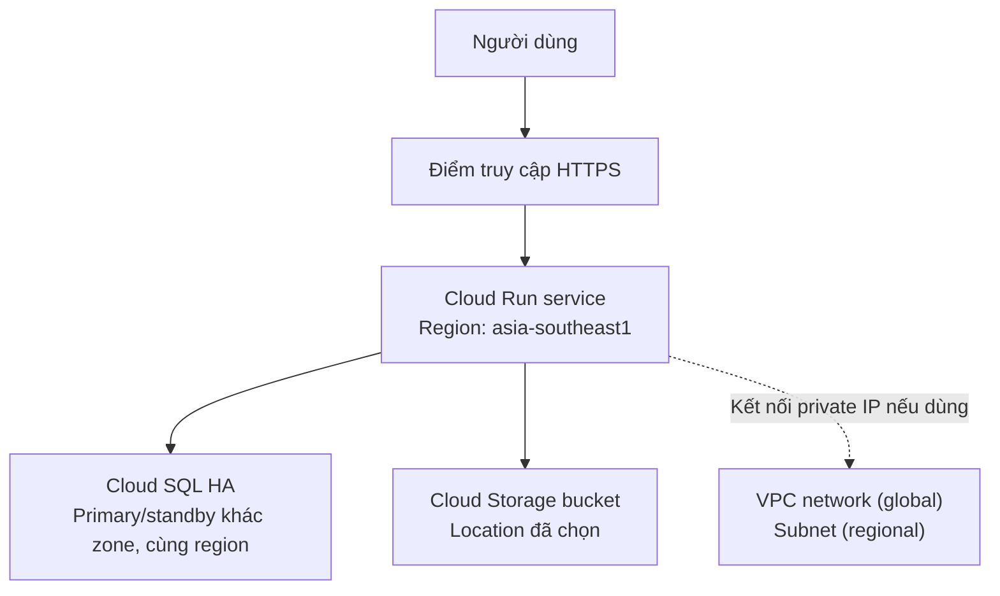

# Region, zone và phạm vi tài nguyên GCP

Khi triển khai ứng dụng trên Google Cloud, chọn **project** để xác định ai sở hữu và quản lý tài nguyên; chọn **region** hoặc **zone** để xác định tài nguyên chạy hay dữ liệu được lưu ở đâu. Hai lựa chọn này ảnh hưởng trực tiếp đến độ trễ, khả năng chịu lỗi, chi phí truyền dữ liệu và yêu cầu lưu trữ dữ liệu theo khu vực.

Bài học thuộc mô-đun `CLOUD_PROVIDERS_GCP`, nơi người học đi từ tổ chức project, IAM, VPC đến Compute Engine, GKE, Cloud Run, lưu trữ, cơ sở dữ liệu, tự động hóa phát hành và giám sát độ tin cậy cùng chi phí. Hiểu đúng vị trí và phạm vi tài nguyên là nền tảng để kết nối các dịch vụ đó thành một kiến trúc vận hành được.

## 1. Mục tiêu học tập

Sau bài học, bạn có thể:

1. Phân biệt **resource hierarchy** (organization, folder, project) với **resource location** (region, zone).
2. Giải thích region, zone, global, regional, zonal, multi-region và dual-region trong ngữ cảnh GCP.
3. Xác định phạm vi thường gặp của VM, disk, VPC, subnet, GKE, Cloud Run, Cloud SQL, Cloud Storage và BigQuery.
4. Chọn region và cách phân bố qua các zone theo độ trễ, tính sẵn sàng, yêu cầu dữ liệu và chi phí.
5. Nhận diện giới hạn của triển khai đa zone khi xảy ra sự cố toàn region, từ đó lập phương án khôi phục liên vùng.
6. Đọc tên tài nguyên, lệnh `gcloud` và thông báo lỗi để tìm ra vấn đề về vị trí triển khai.

## 2. Hai chiều độc lập: quyền quản lý và vị trí vật lý

Trong hệ thống phân cấp tài nguyên của Google Cloud, **organization** có thể chứa **folder**, folder có thể chứa folder hoặc **project**, và project là ranh giới quản lý phổ biến của nhiều tài nguyên. IAM cho phép gắn quyền ở các cấp phù hợp; chính sách có thể được kế thừa xuống tài nguyên con.

**Region và zone không phải là cấp con của project trong cây organization → folder → project.** Chúng là thuộc tính vị trí hoặc phạm vi dùng khi tạo và quản lý từng loại tài nguyên. Cùng một project có thể có VM ở Singapore, bucket ở châu Âu và dịch vụ ở Hoa Kỳ, nếu chính sách tổ chức và hỗ trợ dịch vụ cho phép.



Cần phân biệt hai câu hỏi:

- **Ai được quản lý tài nguyên này?** Trả lời bằng project, folder, organization, IAM và các chính sách quản trị.
- **Tài nguyên chạy hoặc dữ liệu nằm ở đâu?** Trả lời bằng region, zone hoặc location mà dịch vụ cung cấp.

Chọn region không tự tạo ranh giới IAM; cấp quyền vào một project cũng không tự chọn region. Chính sách tổ chức, chẳng hạn ràng buộc về vị trí tài nguyên, có thể hạn chế lựa chọn location đối với **những dịch vụ hỗ trợ ràng buộc đó**.

## 3. Region và zone là gì?

### 3.1. Region: khu vực địa lý

**Region** là một khu vực địa lý triển khai hạ tầng Google Cloud, thường bao gồm nhiều zone. Một số ví dụ:

| Region | Khu vực minh họa | Ví dụ zone |
| --- | --- | --- |
| `asia-southeast1` | Singapore | `asia-southeast1-a`, `asia-southeast1-b`, `asia-southeast1-c` |
| `asia-east1` | Đài Loan | `asia-east1-a`, `asia-east1-b`, `asia-east1-c` |
| `us-central1` | Iowa, Hoa Kỳ | `us-central1-a`, `us-central1-b`, `us-central1-c` |
| `europe-west1` | Bỉ | `europe-west1-b`, `europe-west1-c`, `europe-west1-d` |

Các giá trị trong bảng dùng để đọc quy tắc đặt tên; **danh sách region/zone và danh mục dịch vụ hỗ trợ có thể thay đổi**. Hãy tra danh sách thực tế của từng dịch vụ trước khi thiết kế hoặc triển khai.

Region là điểm khởi đầu quan trọng khi cân nhắc độ trễ tới người dùng, vị trí cơ sở dữ liệu, yêu cầu lưu trú dữ liệu, khả năng hỗ trợ dịch vụ và giá thành. Hai dịch vụ cùng region thường thuận lợi cho độ trễ và chi phí kết nối hơn so với đặt ở hai region xa nhau, nhưng cần kiểm tra cơ chế kết nối và bảng giá cụ thể.

### 3.2. Zone: miền lỗi bên trong một region

**Zone** là một khu vực triển khai hạ tầng riêng biệt trong cùng region, được thiết kế để giảm khả năng một sự cố hạ tầng cục bộ ảnh hưởng đồng thời đến mọi zone. Các zone trong một region có kết nối mạng tốc độ cao, độ trễ thấp.

Ví dụ tên `asia-southeast1-b` gồm:

- `asia-southeast1`: tên region.
- `b`: định danh zone bên trong region đó.

Đừng diễn giải chữ `a`, `b`, `c` là thứ hạng về hiệu năng, giá hoặc mức độ an toàn. Mỗi region có tập zone được hỗ trợ riêng; không được giả định tất cả region đều dùng cùng số lượng hoặc cùng hậu tố zone.

**Tách zone giúp giảm rủi ro sự cố một zone, nhưng không loại trừ sự cố đồng thời.** Nhiều zone vẫn phụ thuộc vào cùng phạm vi địa lý của region; vì vậy cần nhiều region nếu yêu cầu chịu được sự cố toàn region.

### 3.3. Global, regional, zonal và các kiểu location dữ liệu

| Khái niệm | Ý nghĩa | Ví dụ điển hình | Điều cần nhớ |
| --- | --- | --- | --- |
| **Global** | Tài nguyên được định nghĩa ở phạm vi toàn cục của dịch vụ, không yêu cầu chọn một zone hay region đơn lẻ | VPC network, một số loại load balancer, địa chỉ IP global | Global là **phạm vi quản lý/định tuyến**, không đồng nghĩa mọi thành phần hay dữ liệu đều được nhân bản toàn cầu |
| **Regional** | Gắn với một region | VPC subnet, Cloud Run service, regional managed instance group | Có thể dùng nhiều zone trong cùng region, tùy dịch vụ và cấu hình |
| **Zonal** | Gắn với một zone | Compute Engine VM, zonal Persistent Disk | Sự cố zone có thể làm tài nguyên không khả dụng |
| **Multi-region** | Nhóm region địa lý được dịch vụ xác định | Một số location của Cloud Storage và BigQuery | Hành vi sao chép, độ bền, độ trễ và cách dự phòng **phụ thuộc từng dịch vụ** |
| **Dual-region** | Một location dữ liệu dùng hai region được hỗ trợ | Cloud Storage dual-region bucket | Không tự thay thế thiết kế dự phòng cho tầng ứng dụng |
| **Cross-region** | Tương tác hoặc sao chép giữa hai region | Ứng dụng ở hai region, database replica liên vùng | Cần tính đến trễ mạng, phí truyền dữ liệu và độ trễ sao chép |

Từ **location** trong giao diện hoặc API có thể biểu diễn region, zone, multi-region hay một loại vị trí khác do dịch vụ định nghĩa. Vì vậy phải đọc tài liệu **của đúng sản phẩm** thay vì suy luận chỉ từ từ `location`.

## 4. Phạm vi của các tài nguyên GCP thường gặp

Không phải mọi sản phẩm Google Cloud đều dùng chung một quy tắc vị trí. Bảng sau là điểm xuất phát để thiết kế; phạm vi chính xác có thể thay đổi theo biến thể sản phẩm và cấu hình.

| Tài nguyên hoặc dịch vụ | Phạm vi thường gặp | Hệ quả khi triển khai |
| --- | --- | --- |
| **Organization, folder, project, IAM policy** | Phạm vi logic/quản trị, không gắn với một zone | Một project quản lý tài nguyên ở nhiều vị trí; IAM áp dụng theo cấp tài nguyên |
| **VPC network** | Global trong project | Mạng VPC có thể chứa subnet ở nhiều region |
| **VPC subnet** | Regional | Một subnet dùng được cho tài nguyên ở các zone khác nhau **trong cùng region**; không dùng subnet đó để tạo VM ở region khác |
| **Compute Engine VM** | Zonal | Khi tạo/tra cứu VM thường phải chỉ rõ zone |
| **Persistent Disk thường** | Zonal | Disk gắn với zone; VM và disk phải tương thích vị trí |
| **Regional Persistent Disk** | Regional, sao chép giữa hai zone trong region | Cải thiện khả năng chịu lỗi zone, nhưng cần quy trình chuyển tải/failover phù hợp |
| **Managed instance group (MIG)** | Zonal hoặc regional tùy loại | Regional MIG có thể phân tán VM qua nhiều zone |
| **GKE Standard cluster** | Zonal hoặc regional tùy cấu hình | Cluster regional có control plane phân bố trong region; node vẫn chạy tại các zone |
| **Cloud Run service** | Regional | Chọn region cho dịch vụ; muốn chịu lỗi toàn region thường cần dịch vụ ở region khác và định tuyến phù hợp |
| **Cloud SQL instance** | Chọn region, có vị trí zone cho máy chính; HA có standby ở zone khác trong region | HA nội vùng giúp xử lý một số lỗi zone; không mặc nhiên là DR liên region |
| **Cloud Storage bucket** | Regional, dual-region hoặc multi-region tùy location | Vị trí lưu object và hành vi dự phòng theo lựa chọn location; tên bucket có phạm vi duy nhất toàn cục |
| **BigQuery dataset** | Regional hoặc multi-regional location | Job và dữ liệu liên quan cần thỏa quy tắc location của BigQuery |
| **Artifact Registry repository** | Region hoặc multi-region được hỗ trợ | Nên đặt gần nơi build/deploy để hạn chế độ trễ và luồng truyền dữ liệu |
| **Cloud Load Balancing** | Có loại global và loại regional | Phải chọn đúng sản phẩm/load balancer; không phải mọi load balancer đều global |

### 4.1. Cặp VPC – subnet – VM

Đây là một trong những quan hệ dễ nhầm nhất:

- **VPC network** có phạm vi global trong project, nên một VPC có thể có subnet thuộc nhiều region.
- **Subnet** có phạm vi regional: ví dụ `app-subnet` tại `asia-southeast1` có thể phục vụ VM ở `asia-southeast1-a` và `asia-southeast1-b`.
- **VM** có phạm vi zonal: VM tại `asia-east1-a` không thể dùng trực tiếp subnet đặt tại `asia-southeast1`.
- VPC global giúp tổ chức và kết nối mạng giữa các region theo các quy tắc tương ứng. Nó **không tự sao chép** đĩa, database hoặc trạng thái ứng dụng giữa các region.

Tên đường dẫn tài nguyên trong Compute Engine phản ánh phạm vi này:

```text
projects/PROJECT_ID/global/networks/app-vpc
projects/PROJECT_ID/regions/asia-southeast1/subnetworks/app-subnet
projects/PROJECT_ID/zones/asia-southeast1-a/instances/app-vm
```

Phần `global`, `regions/REGION` hay `zones/ZONE` là dấu hiệu mạnh về phạm vi **của API đó**. Không áp một mẫu đường dẫn Compute Engine cho tất cả API Google Cloud.

### 4.2. Cặp VM – disk và giới hạn di chuyển

VM ở zone `asia-southeast1-a` thường dùng boot disk cùng zone. Khi chỉ có một bản zonal disk, chuyển VM sang zone `asia-southeast1-b` không đơn giản là đổi tên zone trong cấu hình: phải chọn cơ chế sao chép/khôi phục dữ liệu, tạo lại tài nguyên phù hợp và kiểm tra tính nhất quán.

Regional Persistent Disk có thể giữ bản sao đồng bộ ở hai zone trong một region theo cấu hình được hỗ trợ. Tuy nhiên **có bản sao đĩa không đồng nghĩa ứng dụng tự chuyển sang VM khác**: vẫn phải tổ chức máy thay thế, gắn/khôi phục disk, định tuyến lưu lượng và kiểm thử quy trình.

### 4.3. GKE, Cloud Run và dịch vụ được quản lý

Với GKE, cần tách **vị trí control plane** khỏi **vị trí node chạy workload**. Cluster Standard regional đem lại khả năng sẵn sàng cao hơn cho control plane trong một region; cấu hình node pool, số replica và quy tắc phân bố pod mới quyết định mức chịu lỗi thực tế của ứng dụng.

Với Cloud Run, người dùng chọn **region** thay vì tự chọn zone cho từng instance. Google Cloud quản lý hạ tầng chạy dịch vụ trong region; chọn Cloud Run không tự bảo vệ trước sự cố toàn region. Khi cần liên vùng, phải triển khai nhiều region, xử lý trạng thái/dữ liệu và thiết lập định tuyến.

Với Cloud SQL, cấu hình HA có standby khác zone trong **cùng region**. Replica giữa các region phục vụ mục tiêu khác và có đặc điểm sao chép/failover riêng; cần thiết kế, theo dõi độ trễ replica và kiểm thử khôi phục.

### 4.4. Dữ liệu: vị trí bucket và dataset

Cloud Storage có nhiều lựa chọn location. Bucket **regional** không giống bucket **dual-region** hay **multi-region**; sự khác biệt là nơi lưu và mức dự phòng do sản phẩm cung cấp. Bucket có tên duy nhất toàn cục không có nghĩa dữ liệu của bucket được lưu khắp thế giới.

BigQuery cũng có location cho dataset. Một dataset ở location `US` (multi-region) không được tự hiểu là tương đương dataset ở một region cụ thể tại Hoa Kỳ. Các truy vấn, thao tác sao chép và dịch vụ liên quan phải đáp ứng quy tắc location tương ứng. Đặc biệt, **multi-region của hệ thống lưu trữ không tự biến toàn bộ ứng dụng thành kiến trúc active-active đa region**.

## 5. Zone failure và region failure: khác nhau thế nào?

Hai loại sự cố yêu cầu hai mức kiến trúc khác nhau.

| Tình huống | Triển khai chỉ một zone | Triển khai nhiều zone trong một region | Triển khai qua nhiều region |
| --- | --- | --- | --- |
| Một VM bị lỗi | Có thể gián đoạn cho đến khi VM/instance được thay thế | Có thể tiếp tục phục vụ nếu còn instance khỏe, cân bằng tải và thiết lập tự phục hồi phù hợp | Có thể tiếp tục nếu hệ thống được phân bổ và định tuyến đúng |
| Một zone gặp sự cố | Rủi ro gián đoạn cao | Có khả năng duy trì dịch vụ nếu tất cả tầng trọng yếu đã có dự phòng qua zone | Có thể duy trì nếu còn region/zone khỏe và phụ thuộc còn hoạt động |
| Cả region gặp sự cố | Không có nơi chạy khác | Vẫn có nguy cơ gián đoạn vì tất cả zone cùng region | Có thể chuyển sang region khác nếu đã chuẩn bị tài nguyên, dữ liệu, định tuyến và quy trình failover |

Tính sẵn sàng đầu cuối phụ thuộc **mắt xích yếu nhất**. Hai replica API ở hai zone nhưng chỉ một database single-zone vẫn có điểm lỗi chung. Tương tự, có replica database mà không có cách chuyển lưu lượng thì người dùng vẫn không truy cập được ứng dụng.

### Ba mức thiết kế điển hình

**Mức A – một zone, cho lab và môi trường thử nghiệm:** một VM, một đĩa zonal, một zone. Cấu hình đơn giản nhưng chịu lỗi kém. Phù hợp khi có thể chấp nhận gián đoạn và làm lại tài nguyên.

**Mức B – nhiều zone cùng region, cho ứng dụng cần HA nội vùng:** phân tán VM qua regional MIG hoặc node/pod qua nhiều zone, đặt tầng truy cập trước nhóm instance khỏe; chọn giải pháp dữ liệu có khả năng chịu lỗi zone. Mọi tầng phải có kiểm tra sức khỏe, capacity dự phòng và quy trình khôi phục.

**Mức C – nhiều region, cho nhu cầu DR toàn region:** dựng ứng dụng tại region phụ, lựa chọn sao chép dữ liệu liên vùng, định tuyến chuyển hướng, đồng bộ cấu hình/bí mật cần thiết và thực hành failover. Kiểu active-passive hoặc active-active cần chọn theo đặc tính ghi dữ liệu và mức độ chấp nhận trễ/chi phí.

Hai chỉ số giúp thiết kế DR:

- **RTO (Recovery Time Objective):** thời gian gián đoạn tối đa mà doanh nghiệp chấp nhận sau sự cố.
- **RPO (Recovery Point Objective):** lượng dữ liệu tối đa có thể mất, đo theo khoảng thời gian trước sự cố.

Sao chép bất đồng bộ giữa các region có thể phát sinh độ trễ, nên không thể mặc định RPO bằng 0. Sao chép dữ liệu, bản sao cấu hình và thủ tục failover đều cần được kiểm chứng qua diễn tập, thay vì chỉ suy ra từ tên sản phẩm.

## 6. Chọn region và zone theo các tiêu chí nào?

Một quy trình lựa chọn thực tế nên xét theo thứ tự:

1. **Ràng buộc pháp lý và dữ liệu.** Xác định những loại dữ liệu nào phải lưu ở đâu, ai được truy cập, lưu trữ log/backup ở đâu và chính sách tổ chức áp dụng cho sản phẩm nào. Không suy luận bảo đảm lưu trú dữ liệu chỉ từ region của ứng dụng.
2. **Sự hỗ trợ của dịch vụ.** Kiểm tra Compute Engine machine type, GPU, GKE, Cloud Run, Cloud SQL engine/tier, dịch vụ AI hoặc các tính năng cụ thể có sẵn tại region/zone dự kiến hay không.
3. **Độ trễ với người dùng và giữa các tầng.** Đặt app gần người dùng, đồng thời cân nhắc app–database, app–object storage và các API phụ thuộc. Đừng tối ưu độ trễ trình duyệt bằng cách đặt database ở region quá xa ứng dụng.
4. **Mục tiêu chịu lỗi.** Chọn ít nhất nhiều zone cho các tầng cần HA nội vùng; bổ sung region thứ hai khi cần chịu lỗi toàn region. Kiểm tra mọi tầng và luồng dữ liệu.
5. **Chi phí và quota.** So sánh giá theo region, egress liên vùng, lưu trữ/replication, load balancing, quota và mức dự phòng khi tăng tải.
6. **Khả năng vận hành.** Đánh giá mức độ dễ tự động hóa, khả năng quan sát, sao lưu, khôi phục và kiến thức của đội vận hành.

Không có một region “tốt nhất” cho tất cả hệ thống. Ứng dụng có người dùng chủ yếu ở Việt Nam **có thể** xem xét `asia-southeast1` như một ứng viên về độ trễ, nhưng quyết định cuối cùng cần dựa vào phép đo thực tế, danh mục dịch vụ, chi phí và yêu cầu tuân thủ.

### Các phụ thuộc về vị trí phải kiểm tra

| Nếu bạn chọn... | Cần xác nhận thêm... |
| --- | --- |
| VM ở zone A | Subnet có cùng region; loại máy, accelerator và dung lượng đĩa hỗ trợ zone A |
| Regional MIG trải nhiều zone | Template, vùng hoạt động, vùng dự phòng, số instance tối thiểu và phân bố thực tế |
| GKE regional cluster | Node pool nằm ở zone nào; workload có đủ replica, anti-affinity/topology spread và PDB phù hợp |
| Cloud Run ở region A | Database, Artifact Registry, secret, VPC egress và các điểm phụ thuộc được truy cập hợp lệ, đủ nhanh |
| Cloud SQL HA | Cấu hình HA, zone chính/phụ, cơ chế backup và chiến lược DR toàn region nếu cần |
| Cloud Storage dual/multi-region | Location được hỗ trợ, chi phí, đặc tính sao chép, RPO/RTO được công bố cho tính năng cụ thể |
| BigQuery dataset tại một location | Vị trí job, dataset khác, external data source và chi phí chuyển dữ liệu |

**Quota và năng lực cấp phát** không phải lúc nào cũng có phạm vi giống tài nguyên. Có quota theo project, theo region hoặc theo cách dịch vụ quy định. Dù quota còn, zone vẫn có thể thiếu capacity cho một loại máy tại thời điểm cấp phát.

## 7. Tình huống thực tế: ứng dụng web phục vụ người dùng Việt Nam

Giả sử một đội triển khai hệ thống đặt lịch với API chạy trên Cloud Run, dữ liệu giao dịch trong Cloud SQL và ảnh được lưu trên Cloud Storage. Đội cần tối ưu trải nghiệm người dùng và tránh gián đoạn khi một zone xảy ra sự cố.

**Thiết kế ban đầu có kiểm soát:**

- Chọn một region thỏa yêu cầu về độ trễ, vị trí dữ liệu và khả năng hỗ trợ cả Cloud Run lẫn Cloud SQL; giả sử `asia-southeast1` được chấp nhận sau khi kiểm tra.
- Triển khai Cloud Run service tại `asia-southeast1`. Nếu cần kết nối IP riêng đến database thì thiết kế đường truy cập VPC phù hợp.
- Chọn Cloud SQL HA trong cùng region, với cơ chế primary/standby khác zone theo sản phẩm hỗ trợ. Bật backup, giám sát và kiểm thử phục hồi dữ liệu.
- Đặt Cloud Storage bucket trong location phù hợp với chính sách dữ liệu; nếu chọn regional location, đánh giá rõ nhu cầu dự phòng liên vùng cho object.
- Giám sát health check, lỗi ứng dụng, độ trễ truy vấn, quota và chi phí truyền dữ liệu.



Thiết kế này có khả năng chống một số lỗi hạ tầng trong region nhờ dịch vụ được quản lý và HA của database. Tuy nhiên **không bảo đảm chịu lỗi toàn region**. Nếu yêu cầu kinh doanh tăng lên, đội cần một thiết kế DR bổ sung: triển khai API ở region dự phòng, lập kế hoạch database replica/khôi phục liên vùng, đồng bộ dữ liệu object theo nhu cầu, cấu hình chuyển lưu lượng và đo RTO/RPO qua diễn tập.

Một ví dụ khác: nếu app chạy trên Compute Engine, có thể thay Cloud Run bằng **regional MIG** phân bố qua ít nhất hai zone và đặt load balancer phù hợp ở phía trước. Các thành phần stateful vẫn cần phương án HA/DR riêng.

## 8. Xem vị trí tài nguyên bằng gcloud

Các lệnh sau minh họa thao tác **chỉ đọc**. Cần cài Google Cloud CLI, đăng nhập, chọn project phù hợp và có quyền xem tài nguyên. Tên `demo-vm`, `demo-api` và `TEN_BUCKET` là chỗ giữ chỗ; thay bằng tài nguyên hiện có trước khi chạy.

### 8.1. Xem region và zone

```bash
# Liệt kê các region của Compute Engine
gcloud compute regions list

# Chỉ xem region Singapore
gcloud compute regions list --filter="name=asia-southeast1"

# Xem zone có tên bắt đầu bằng asia-southeast1-
gcloud compute zones list --filter="name~^asia-southeast1-"
```

Các lệnh này mô tả region/zone trên Compute Engine. **Không thể suy ra mọi dịch vụ GCP đều có mặt ở đó.** Muốn triển khai GKE, Cloud Run hoặc cơ sở dữ liệu, tiếp tục tra danh sách locations hỗ trợ của chính dịch vụ.

### 8.2. Xác định phạm vi một số tài nguyên

```bash
# VM: cần zone
gcloud compute instances describe demo-vm \
  --zone=asia-southeast1-a

# Subnet: xem danh sách và region được trả về
gcloud compute networks subnets list

# Cloud Run: cần region
gcloud run services describe demo-api \
  --region=asia-southeast1

# Cloud Storage: xem vị trí khai báo của bucket
gcloud storage buckets describe gs://TEN_BUCKET
```

Dấu `\` cuối dòng trong ví dụ Bash có nghĩa nối dòng; trên PowerShell hoặc CMD hãy viết lệnh trên một dòng hoặc dùng cú pháp nối dòng tương ứng của shell. Khi mô tả tài nguyên, quan sát các trường `zone`, `region`, `location` hoặc `locationType` **nếu dịch vụ cung cấp**.

### 8.3. Đọc lỗi vị trí thường gặp

- **Resource not found:** có thể bạn đang tìm đúng tên VM nhưng sai `--zone` hoặc sai project.
- **Subnetwork is in a different region:** VM hoặc tài nguyên dùng subnet khác region; chọn subnet cùng region hoặc đổi vị trí triển khai.
- **Machine type/feature unavailable in zone:** kiểm tra zone khác trong cùng region hoặc region khác hỗ trợ loại máy/tính năng.
- **Location constraint violated:** ràng buộc tổ chức ngăn tạo loại tài nguyên tại location đó; cần xem policy áp dụng và lựa chọn location hợp lệ.
- **Quota exceeded / insufficient capacity:** xác định quota của dịch vụ và phạm vi quota, đồng thời kiểm tra capacity và phương án thay thế.

Không tự khắc phục lỗi bằng cách chuyển dữ liệu hoặc hạ tầng sang region khác khi chưa kiểm tra yêu cầu dữ liệu, đường truyền và ảnh hưởng đến hệ thống phụ thuộc.

## 9. Những nhầm lẫn dễ gây lỗi thiết kế

| Nhầm lẫn | Cách hiểu đúng |
| --- | --- |
| “Project thuộc region Singapore.” | Project là phạm vi quản lý; từng tài nguyên trong project có thể có vị trí riêng. |
| “VPC là global nên subnet cũng global.” | VPC global nhưng subnet là regional. |
| “Ba VM trong cùng zone là HA.” | Nhiều VM cùng zone vẫn có chung rủi ro sự cố zone. |
| “GKE regional thì pod tự trải đều qua zone.” | Phải xem cấu hình node pool, số pod replica và chính sách phân bố workload. |
| “Cloud Run regional nên luôn chịu lỗi toàn region.” | Managed regional service vẫn có rủi ro khi cả region gián đoạn. |
| “Regional disk tự làm ứng dụng failover.” | Disk replication và khởi chạy/chuyển lưu lượng ứng dụng là hai công việc khác nhau. |
| “Multi-region bucket làm cả hệ thống đa region.” | Chỉ mô tả chiến lược vị trí/dự phòng của dữ liệu trong dịch vụ lưu trữ. |
| “Tên bucket là global nên dữ liệu ở mọi region.” | Tính duy nhất của tên không quyết định location của dữ liệu. |
| “Đặt app và database hai region thì chắc chắn an toàn hơn.” | Cần đánh giá đồng bộ, tính nhất quán, độ trễ, network egress và quy trình chuyển đổi. |
| “Chọn zone b luôn tốt hơn zone a.” | Hậu tố zone không thể hiện thứ hạng chất lượng hoặc mức giá. |

## 10. Bài tập áp dụng và đáp án định hướng

**Bài tập 1 – đọc đường dẫn API.** Cho ba tài nguyên:

```text
projects/p1/global/networks/prod-vpc
projects/p1/regions/asia-southeast1/subnetworks/prod-subnet
projects/p1/zones/asia-southeast1-b/instances/api-01
```

Hãy xác định phạm vi của từng tài nguyên và kiểm tra VM có thể dùng subnet trên không.

*Đáp án định hướng:* VPC global, subnet regional tại `asia-southeast1`, VM zonal tại `asia-southeast1-b`. VM có thể dùng subnet đó về mặt **vị trí** vì VM nằm trong zone thuộc cùng region; vẫn phải đáp ứng các cấu hình mạng, quyền và giới hạn khác.

**Bài tập 2 – lỗi một zone.** Nhóm có hai VM ứng dụng ở `asia-southeast1-a`, một database single-zone cũng ở zone này. Nếu zone ngừng hoạt động, có thể kỳ vọng dịch vụ tiếp tục phục vụ không?

*Đáp án định hướng:* Không. Cả hai VM và database đều có chung điểm lỗi theo zone. Cần phân bố tầng ứng dụng qua nhiều zone và thiết kế HA cho database, sau đó kiểm tra health check, điều phối lưu lượng và failover.

**Bài tập 3 – lỗi toàn region.** Một regional GKE cluster và Cloud SQL HA đều đặt tại `asia-southeast1`. Hệ thống có đủ khả năng chịu lỗi toàn region chưa?

*Đáp án định hướng:* Chưa. Các thành phần được bảo vệ tốt hơn trước lỗi zone, nhưng vẫn cùng region. Muốn DR cần thêm region dự phòng, chiến lược dữ liệu và bài thử chuyển đổi.

**Bài tập 4 – quyết định location cho dữ liệu.** Đội ứng dụng đặt Cloud Run tại `asia-southeast1` nhưng muốn lưu giao dịch ở location `EU` để đáp ứng một yêu cầu dữ liệu chưa được xác minh. Cần hỏi và kiểm tra gì trước khi triển khai?

*Đáp án định hướng:* Làm rõ yêu cầu lưu trú/xử lý dữ liệu, sự phù hợp của sản phẩm database, đường truyền Singapore–châu Âu, độ trễ truy vấn, phí egress, backup và log, chính sách location và khả năng tách thành phần ứng dụng theo vị trí. Không suy luận một mình từ mã region.

## 11. Checklist trước khi bấm Deploy

- [ ] Biết rõ **project** sở hữu tài nguyên và quyền IAM/chính sách tổ chức liên quan.
- [ ] Phân loại từng thành phần thành **global, regional, zonal** hoặc location dữ liệu đặc thù.
- [ ] Xác nhận region/zone hỗ trợ dịch vụ, loại máy, phiên bản và tính năng cần dùng.
- [ ] Kiểm tra mọi cặp phụ thuộc: VM–subnet, VM–disk, app–database, GKE–node pool, service–artifact.
- [ ] Ghi lại điểm lỗi chung của các tài nguyên cùng zone và cùng region.
- [ ] Đối chiếu thiết kế với RTO/RPO và chuẩn bị backup, replication, failover khi cần.
- [ ] Ước lượng độ trễ và phí mạng giữa các region, các zone và các dịch vụ.
- [ ] Có cách quan sát lỗi, kiểm tra health và diễn tập khôi phục trước khi đưa vào sản xuất.

## 12. Tài liệu để tra cứu khi áp dụng

Các trang chính thức sau giúp kiểm tra danh sách vị trí và hành vi **hiện hành** cho từng dịch vụ:

- [Google Cloud locations](https://cloud.google.com/about/locations): danh sách vùng hạ tầng và dịch vụ.
- [Compute Engine regions and zones](https://cloud.google.com/compute/docs/regions-zones): khái niệm region/zone và phạm vi Compute Engine.
- [VPC networks](https://cloud.google.com/vpc/docs/vpc): phạm vi VPC network và subnet.
- [Cloud Storage bucket locations](https://cloud.google.com/storage/docs/locations): lựa chọn regional, dual-region, multi-region.
- [GKE regional clusters](https://cloud.google.com/kubernetes-engine/docs/concepts/regional-clusters): vị trí control plane và thiết kế cluster regional.

Khi gặp một tên tài nguyên hoặc location chưa quen thuộc, hãy xác định **dịch vụ**, **phạm vi API**, **vị trí triển khai**, rồi mới đánh giá **chịu lỗi, độ trễ, tuân thủ và chi phí**. Cách đọc theo bốn bước này giúp tránh phần lớn lỗi cấu hình region/zone trong các hệ thống GCP thực tế.
