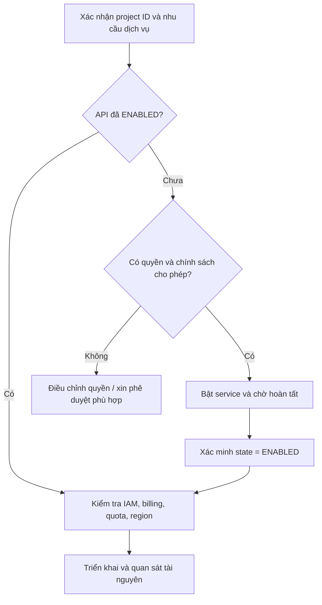

# Service Usage và bật API trong project

Khi bắt đầu sử dụng Google Cloud, một project đã được tạo **chưa có nghĩa mọi dịch vụ đều sẵn sàng nhận yêu cầu**. Trước khi tạo tài nguyên của một số dịch vụ, người quản trị hoặc quy trình triển khai cần **bật API tương ứng cho project**. Ví dụ, để triển khai Cloud Run, project cần bật **Cloud Run Admin API** (`run.googleapis.com`); để dùng Google Kubernetes Engine (GKE), cần bật **Kubernetes Engine API** (`container.googleapis.com`).

Google Cloud cung cấp **Service Usage** để kiểm tra và quản lý trạng thái các API/dịch vụ được bật trong từng project. Đây là một bước nền trong tổ chức project, thiết lập IAM, triển khai Compute Engine, VPC, GKE, Cloud Run, lưu trữ và cơ sở dữ liệu, cũng như tự động hóa CI/CD. Bài học giải thích cách bật API có kiểm soát, xác minh trạng thái và xử lý các lỗi thường gặp.

## Mục tiêu học tập

Sau bài này, bạn có thể:

1. Giải thích `Service Usage` quản lý điều gì và vì sao API cần được bật theo **project**.
2. Phân biệt **bật API**, **cấp quyền IAM**, **xác thực**, **liên kết billing account** và **tạo tài nguyên**.
3. Tìm tên dịch vụ chính xác, kiểm tra và bật API qua Google Cloud console và `gcloud`.
4. Chuẩn bị quyền tối thiểu cho người quản trị, service account và pipeline triển khai.
5. Chẩn đoán lỗi API chưa bật, thiếu quyền, chính sách tổ chức, billing hoặc quota.
6. Quản lý tập API cần thiết bằng cấu hình hạ tầng, tránh thay đổi ngoài ý muốn giữa development và production.

## 1. Service Usage là gì?

**Service Usage API** (`serviceusage.googleapis.com`) là giao diện quản lý các dịch vụ/API Google Cloud mà một **consumer project** có thể sử dụng. Một trong những chức năng quan trọng nhất là xem và thay đổi trạng thái dịch vụ:

- **`ENABLED`:** Dịch vụ đã được bật cho project. Các yêu cầu vẫn phải vượt qua xác thực, IAM, quota, billing và các quy tắc của dịch vụ.
- **`DISABLED`:** Dịch vụ chưa được bật hoặc đã bị tắt trong project. Các thao tác cần API đó có thể bị từ chối.

Google Cloud thường hiển thị nút **Enable API** trên trang API Library của project, hoặc cung cấp lệnh `gcloud services enable`. Hai cách này đều phục vụ mục tiêu bật một **dịch vụ cho project đang là bên sử dụng**.

Ví dụ, một nhóm có hai project:

```text
Organization: company.example
└── Folder: Retail
    ├── Project: retail-app-dev-01
    │   ├── run.googleapis.com              ENABLED
    │   ├── artifactregistry.googleapis.com ENABLED
    │   └── container.googleapis.com        DISABLED
    └── Project: retail-app-prod-01
        ├── run.googleapis.com              ENABLED
        ├── artifactregistry.googleapis.com ENABLED
        └── container.googleapis.com        ENABLED
```

Các giá trị là ví dụ, **không phản ánh trạng thái thực tế** của những project có cùng tên. Việc bật Kubernetes Engine API ở production **không tự bật API đó ở development**. Một project có thể có danh sách API được bật riêng, mặc dù hai project thuộc cùng folder hoặc organization.

### Bật API khác gì sử dụng API?

| Việc thực hiện | Trả lời câu hỏi | Ví dụ |
| --- | --- | --- |
| **Bật API** | Project này được phép sử dụng dịch vụ chưa? | Bật `run.googleapis.com` |
| **Xác thực** | Ai đang gửi yêu cầu? | Người dùng đã đăng nhập `gcloud`; workload dùng service account |
| **Phân quyền IAM** | Danh tính đó có được làm thao tác này trên tài nguyên không? | Cấp vai trò phù hợp để triển khai Cloud Run |
| **Billing** | Tài nguyên tính phí được thanh toán qua đâu? | Project được liên kết với một billing account đang hoạt động |
| **Quota** | Mức sử dụng còn trong giới hạn không? | Số yêu cầu API hoặc giới hạn tài nguyên |
| **Tạo tài nguyên** | Đã tồn tại dịch vụ, máy ảo hay cơ sở dữ liệu chưa? | Deploy một Cloud Run service sau khi bật API |

**Bật API không cấp quyền IAM**, không tự tạo một VM/GKE cluster/Cloud SQL instance và không chứng minh tài khoản có thể thực hiện mọi phương thức API. Ngược lại, dù một tài khoản có vai trò IAM phù hợp, lệnh có thể vẫn thất bại nếu API chưa bật.

## 2. Project, tên API và danh tính tiêu thụ

Khi đọc tài liệu hoặc thông báo lỗi, cần tách biệt ba tên gọi:

1. **Project ID**, chẳng hạn `retail-app-dev-01`, xác định project đang dùng dịch vụ. Project number là số hệ thống cấp và thường xuất hiện trong thông báo lỗi hoặc định danh Service Usage.
2. **Tên sản phẩm**, chẳng hạn **Cloud Run** hoặc **Compute Engine**, thường thấy trên giao diện và tài liệu.
3. **Tên API/service**, chẳng hạn `run.googleapis.com` hoặc `compute.googleapis.com`, là tên truyền cho lệnh bật dịch vụ.

Một số API hay gặp trong phạm vi học Google Cloud:

| Nhu cầu | API/service thường cần | Ý nghĩa |
| --- | --- | --- |
| Quản lý bật/tắt dịch vụ | `serviceusage.googleapis.com` | Service Usage API |
| Tạo VM, quản lý VPC và nhiều tài nguyên mạng Compute Engine | `compute.googleapis.com` | Compute Engine API |
| Tạo và quản lý GKE cluster | `container.googleapis.com` | Kubernetes Engine API |
| Quản lý Cloud Run service | `run.googleapis.com` | Cloud Run Admin API |
| Lưu và quản lý container image trong Artifact Registry | `artifactregistry.googleapis.com` | Artifact Registry API |
| Xây dựng container bằng Cloud Build | `cloudbuild.googleapis.com` | Cloud Build API |
| Quản lý Cloud SQL instance qua API | `sqladmin.googleapis.com` | Cloud SQL Admin API |
| Quản lý Cloud Storage qua JSON API | `storage.googleapis.com` | Cloud Storage API |

Đây là **bảng ánh xạ tham khảo**, không phải danh sách API bắt buộc cho mọi hệ thống. Một hành động cụ thể có thể kéo theo dịch vụ phụ thuộc hoặc cần API bổ sung. Một số sản phẩm có khả năng đề nghị hoặc tự động bật API liên quan khi được cấu hình qua console.

**Lưu ý:** Tên `run.googleapis.com` dùng để quản lý việc bật Cloud Run Admin API; nó **không phải URL HTTP công khai của ứng dụng Cloud Run** sau khi triển khai. URL ứng dụng được cấp riêng cho từng service hoặc qua custom domain.

## 3. Những điều kiện trước khi bật API

Trước khi mở API Library hoặc chạy `gcloud services enable`, hãy xác nhận:

**Đúng project:** Chọn project theo môi trường `dev`, `stg` hoặc `prod`. Đọc project ID trên console hoặc truyền `--project` tường minh trong CLI. Không chỉ dựa vào project name vì tên hiển thị có thể trùng nhau.

**Đúng danh tính và quyền:** Danh tính thực hiện cần quyền `serviceusage.services.enable` trên project. Vai trò IAM dựng sẵn **Service Usage Admin** (`roles/serviceusage.serviceUsageAdmin`) cung cấp quyền quản lý trạng thái dịch vụ. Nên cấp quyền ở phạm vi project phù hợp và theo nguyên tắc đặc quyền tối thiểu.

**Chính sách tổ chức:** Organization Policy hoặc các giới hạn quản trị có thể cấm một dịch vụ, loại tài nguyên hoặc cách sử dụng cụ thể. Việc có vai trò IAM chưa chắc vượt qua được các chính sách này.

**Billing và quota:** Chỉ riêng việc bật API thường **không đồng nghĩa với phát sinh phí sử dụng tài nguyên**, nhưng các thao tác tiếp theo có thể yêu cầu project liên kết billing account đang hoạt động và có quota phù hợp. Điều kiện cụ thể tùy dịch vụ.

**API phụ thuộc:** Ví dụ, triển khai Cloud Run từ container image lưu tại Artifact Registry cần quản lý Cloud Run và Artifact Registry; quy trình build từ source có thể cần thêm Cloud Build. Không nên bật một tập API quá rộng chỉ vì thấy chúng có sẵn.

### Phân quyền liên quan Service Usage

| Tác vụ | Quyền hoặc vai trò cần xem xét | Lưu ý |
| --- | --- | --- |
| Xem API đang bật | `serviceusage.services.list`, `serviceusage.services.get` | Có thể cấp vai trò chỉ đọc phù hợp |
| Bật API | `serviceusage.services.enable` | `roles/serviceusage.serviceUsageAdmin` là vai trò dựng sẵn thường dùng |
| Tắt API | `serviceusage.services.disable` | Là thao tác thay đổi ảnh hưởng đến workload đang dùng |
| Triển khai Cloud Run | Quyền của Cloud Run và các quyền liên quan tới service account, image | Quyền Service Usage Admin **không tự cấp** quyền triển khai |
| Gọi API nghiệp vụ | Quyền của API/dịch vụ tương ứng | Có thể kèm OAuth scope, quota project hay chính sách của dịch vụ |

Người quản trị có thể tách **vai trò người bật API** và **vai trò người triển khai ứng dụng**. Pipeline CI/CD không nhất thiết phải có quyền bật/tắt API nếu project đã được chuẩn bị bởi một pipeline quản trị hạ tầng.

## 4. Bật API qua Google Cloud console

Ví dụ muốn bật Cloud Run Admin API trong project development:

1. Mở [Google Cloud console](https://console.cloud.google.com/) và **chọn project đích**. Xác nhận project ID, không chỉ tên hiển thị.
2. Vào **APIs & Services → Library**.
3. Tìm **Cloud Run Admin API** hoặc `run.googleapis.com`, mở trang API tương ứng.
4. Chọn **Enable** nếu API chưa được bật. Nếu giao diện đang hiển thị **Manage**, API có thể đã bật; mở trang quản lý để kiểm tra chi tiết.
5. Mở **APIs & Services → Enabled APIs & services** để đối chiếu danh sách đã bật.

Đường dẫn và nhãn giao diện có thể thay đổi theo phiên bản console. Nếu không thấy nút Enable hoặc bị từ chối, kiểm tra project đang chọn, quyền IAM và chính sách tổ chức.

**Thực hành an toàn:** Ghi lại project ID, API/service name và mục đích sử dụng trong yêu cầu thay đổi. Với production, bật những API thực sự cần cho kiến trúc đã được phê duyệt.

## 5. Bật và kiểm tra bằng Google Cloud CLI

Giả sử `gcloud` đã được cài đặt và danh tính đã đăng nhập. Các lệnh sau dùng **Bash**; thay project ID ví dụ bằng project được phép thao tác.

### Bước 1: Kiểm tra project và danh tính

```bash
PROJECT_ID="retail-app-dev-01"

# Xem tài khoản nào đang được gcloud sử dụng.
gcloud auth list

# Xem project mặc định; không giả định đó là project đang cần.
gcloud config get-value project

# Xác minh ID, number và tên hiển thị của project mục tiêu.
gcloud projects describe "$PROJECT_ID" \
  --format="table(projectId,projectNumber,name)"
```

Tham số `--project="$PROJECT_ID"` trong các lệnh tiếp theo giúp xác định phạm vi trực tiếp, ngay cả khi cấu hình mặc định trên máy đang chọn project khác.

### Bước 2: Liệt kê API có sẵn và đã bật

```bash
# Những API/dịch vụ đã được bật cho project.
gcloud services list \
  --enabled \
  --project="$PROJECT_ID"

# In tên service để lưu hoặc so sánh với danh sách yêu cầu.
gcloud services list \
  --enabled \
  --project="$PROJECT_ID" \
  --format="value(config.name)"

# Xem các dịch vụ có thể bật cho project.
gcloud services list \
  --available \
  --project="$PROJECT_ID"

# Xem thông tin của một API cụ thể.
gcloud services describe run.googleapis.com \
  --project="$PROJECT_ID"
```

Kết quả `--available` là **danh sách ứng viên dịch vụ**, không đồng nghĩa tất cả dịch vụ đó đang bật hoặc có thể sử dụng mà không có điều kiện bổ sung.

### Bước 3: Bật đúng API cần thiết

Tình huống: nhóm muốn deploy container image từ Artifact Registry lên Cloud Run.

```bash
gcloud services enable \
  run.googleapis.com \
  artifactregistry.googleapis.com \
  --project="$PROJECT_ID"
```

Nếu ứng dụng được **build từ mã nguồn bằng Cloud Build**, có thể cần bật thêm:

```bash
gcloud services enable cloudbuild.googleapis.com \
  --project="$PROJECT_ID"
```

Một lệnh `gcloud services enable` có thể nhận **nhiều tên API**, nhưng chỉ thay đổi project đã chỉ định. Có thể yêu cầu đợi ngắn để trạng thái bật được áp dụng trong các hệ thống liên quan; không nên suy ra ngay một lỗi thoáng qua là cấu hình thất bại vĩnh viễn.

### Bước 4: Xác nhận trạng thái sau khi bật

```bash
# Xem trạng thái cụ thể của hai dịch vụ đã cấu hình.
gcloud services describe run.googleapis.com \
  --project="$PROJECT_ID" \
  --format="yaml(config.name,state)"

gcloud services describe artifactregistry.googleapis.com \
  --project="$PROJECT_ID" \
  --format="yaml(config.name,state)"
```

Trạng thái mong đợi là `ENABLED`. Tuy nhiên, trạng thái này chỉ chứng minh API đã bật; việc triển khai tiếp theo còn phụ thuộc IAM, image, region, quota, billing và cấu hình ứng dụng.

### Khi nào dùng Service Usage API trực tiếp?

Console và `gcloud` phù hợp với thao tác quản trị thông thường. Với cổng quản trị hoặc hệ thống cấp phát project, có thể gọi **Service Usage REST API** để liệt kê dịch vụ, lấy trạng thái và gửi yêu cầu bật API.

Mẫu resource của Service Usage có dạng:

```text
projects/PROJECT_NUMBER/services/SERVICE_NAME

# Ví dụ minh họa:
projects/123456789012/services/run.googleapis.com
```

Phương thức bật API của Service Usage là một thao tác có thể trả về **long-running operation**; công cụ tích hợp nên theo dõi trạng thái hoàn thành và kiểm tra lại dịch vụ thay vì chỉ coi việc gửi yêu cầu thành công là mọi thứ đã sẵn sàng. Khi gọi REST API cần token hợp lệ và quyền quản trị dịch vụ tương ứng.

## 6. Tự động hóa trong Infrastructure as Code

Để cấp phát nhiều project nhất quán, một nhóm có thể khai báo API cần bật như một phần của Terraform. Ví dụ tối giản với Google provider:

```hcl
variable "project_id" {
  type = string
}

resource "google_project_service" "cloud_run" {
  project            = var.project_id
  service            = "run.googleapis.com"
  disable_on_destroy = false
}

resource "google_project_service" "artifact_registry" {
  project            = var.project_id
  service            = "artifactregistry.googleapis.com"
  disable_on_destroy = false
}
```

Trong ví dụ, `disable_on_destroy = false` được chọn để khi tài nguyên Terraform bị bỏ khỏi cấu hình hoặc bị destroy, Terraform **không tự tắt API đang có workload phụ thuộc**. Cấu hình thực tế cần có provider đã thiết lập, danh tính có quyền và quy trình review thay đổi.

Nếu toàn bộ vòng đời project được quản lý bằng IaC, có thể dùng mô hình chuẩn hóa:

```text
Tạo project và liên kết billing (khi cần)
    ↓
Áp IAM / chính sách tổ chức
    ↓
Bật danh sách API đã được phê duyệt
    ↓
Tạo VPC, Artifact Registry và tài nguyên ứng dụng
    ↓
Triển khai workload
    ↓
Kiểm tra logging, quota, độ tin cậy và chi phí
```

Tách bước chuẩn bị project và API khỏi bước phát hành ứng dụng giúp giảm quyền của pipeline deploy. Đồng thời, lưu danh sách API dưới quản lý phiên bản giúp phát hiện thay đổi thủ công ngoài ý muốn.

## 7. Vòng đời API: bật, sử dụng và tắt

Có thể xem việc chuẩn bị dịch vụ theo luồng:



Một API có thể được bật do người quản trị thao tác, do công cụ triển khai hoặc do luồng cấu hình sản phẩm yêu cầu. Dù bật theo cách nào, nên giữ danh sách API được quản lý nhất quán để dễ kiểm toán.

**Tắt API** không tương đương “xóa một nút khỏi console”. Đây là thay đổi có thể làm các client và workload đang sử dụng dịch vụ không thể tiếp tục gọi API; có trường hợp còn bị chặn vì dịch vụ phụ thuộc. Một số tài nguyên đã tạo và dữ liệu liên quan có hành vi khác nhau khi API bị tắt. Trước khi tắt, cần xem tài nguyên còn dùng dịch vụ không, quan hệ phụ thuộc, chính sách duy trì dữ liệu, phương án khôi phục và ảnh hưởng đến môi trường production.

Trong dự án thực tế, **không tắt API chỉ vì hiện không thấy lời gọi gần đây**: một job theo lịch hoặc quy trình khôi phục thảm họa có thể chỉ chạy thỉnh thoảng.

## 8. Service Usage liên hệ với IAM, billing và quota

### IAM: bật API không làm người dùng có thêm quyền tài nguyên

Ví dụ, người có `roles/serviceusage.serviceUsageAdmin` có thể bật Cloud Run Admin API nhưng **chưa chắc** có quyền deploy Cloud Run service. Việc deploy thường cần các quyền Cloud Run tương ứng, quyền sử dụng service account chạy ứng dụng và quyền truy cập image nếu được yêu cầu. Tương tự, bật Compute Engine API không cấp quyền tạo VM.

Ngược lại, một service account triển khai có quyền dịch vụ nhưng project chưa bật API cũng có thể bị từ chối. Cần kiểm tra **cả trạng thái API và IAM** trước khi thay đổi vai trò.

### Billing: bật dịch vụ không phải hóa đơn

Việc nhìn thấy `ENABLED` trong Service Usage không chứng minh billing account đang hoạt động, cũng không chứng minh hạ tầng hoàn toàn miễn phí. Chi phí phụ thuộc loại tài nguyên, mức tiêu thụ, cấu hình và chính sách giá. Khi xây dựng Cloud Run, GKE, Compute Engine hoặc Cloud SQL, cần xác định project và billing account phù hợp, đặt ngân sách/cảnh báo nếu cần và theo dõi chi phí ở cấp project.

### Quota: giới hạn trước khi tăng quy mô

Một API đã bật có thể vẫn bị từ chối vì vượt quota hoặc giới hạn tài nguyên theo project, region, dịch vụ hoặc phương thức. Quota không phải quyền IAM và không được giải quyết đơn giản bằng cách bật lại API.

Trong vận hành, cần xem bảng quota của dịch vụ cụ thể, điều chỉnh lưu lượng/batching/backoff phù hợp và làm quy trình yêu cầu tăng quota khi được hỗ trợ. Không nên tự động retry vô hạn một lỗi quota.

### Service agent: danh tính do dịch vụ quản lý

Một số dịch vụ Google Cloud tạo **service agent** hoặc service account do Google quản lý khi được bật hay sử dụng. Chúng có thể mang project number trong email hoặc định danh và được gán quyền phục vụ hoạt động nội bộ. Thời điểm tạo, tên và quyền tùy dịch vụ; không nên đoán rồi tự tạo hoặc xóa IAM binding của chúng khi chưa hiểu tài liệu dịch vụ.

## 9. Khắc phục sự cố khi bật hoặc sử dụng API

| Triệu chứng | Nguyên nhân nên kiểm tra | Hướng xử lý |
| --- | --- | --- |
| `API has not been used ... or it is disabled`; `SERVICE_DISABLED` | API chưa bật cho **project được nhắc trong lỗi** | Xác minh project ID/number, xem `gcloud services describe`, bật đúng API nếu được phép |
| `PERMISSION_DENIED` khi `gcloud services enable` | Danh tính thiếu quyền `serviceusage.services.enable` | Kiểm tra `gcloud auth list`; cấp vai trò quản trị Service Usage đúng phạm vi |
| API `ENABLED` nhưng deploy vẫn báo 403 | Thiếu quyền gọi API hoặc tài nguyên đích; có thể sai service account | Đọc chi tiết phương thức/tài nguyên bị từ chối và IAM liên quan |
| Không thể bật dù đã có quyền IAM | Chính sách tổ chức, dịch vụ chưa khả dụng hoặc ràng buộc khác | Kiểm tra policy hiệu lực và thông báo lỗi cụ thể |
| `BILLING_DISABLED`, yêu cầu bật thanh toán | Project chưa liên kết billing account đang hoạt động cho tác vụ cần thanh toán | Kiểm tra billing status và quyền quản lý billing |
| `RESOURCE_EXHAUSTED` hoặc `QUOTA_EXCEEDED` | Giới hạn API/tài nguyên đã đạt | Kiểm tra quota theo dịch vụ, project, region; giảm tải hoặc yêu cầu quota |
| Đã enable nhưng hệ thống còn báo chưa bật ngay lập tức | Trạng thái đang lan truyền hoặc công cụ chọn project khác | Đọc lại state; xác nhận project/region và kiểm tra lại có kiểm soát |
| Console hiển thị API đã bật nhưng CLI không thấy | Console và CLI đang chọn project khác nhau | So sánh project ID thực tế và dùng `--project` tường minh |

Một quy trình chẩn đoán nhanh, **không làm thay đổi project**:

```bash
PROJECT_ID="retail-app-dev-01"
API_NAME="run.googleapis.com"

# 1. Xem danh tính và project mặc định.
gcloud auth list
gcloud config get-value project

# 2. Xem project ID và project number của project cần kiểm tra.
gcloud projects describe "$PROJECT_ID" \
  --format="table(projectId,projectNumber,name)"

# 3. Kiểm tra dịch vụ.
gcloud services describe "$API_NAME" \
  --project="$PROJECT_ID" \
  --format="yaml(config.name,state)"
```

Nếu lệnh chẩn đoán cũng thất bại, ghi lại **error code**, project được đề cập, API name, danh tính đang dùng và thời điểm xảy ra lỗi. Một thông báo 403 có thể đại diện cho nhiều nguyên nhân, nên không tự động kết luận cứ lỗi 403 là thiếu IAM.

## 10. Tình huống thực tế: triển khai Cloud Run từ CI/CD

Một nhóm xây dựng ứng dụng bán hàng có:

- Project development: `retail-app-dev-01`.
- Project production: `retail-app-prod-01`.
- Pipeline build container image và phát hành lên Cloud Run.
- Yêu cầu tách quyền dev/prod, theo dõi độ tin cậy và chi phí.

Trong lần triển khai đầu tiên lên dev, pipeline báo không gọi được Cloud Run Admin API. Nhóm cần xử lý theo thứ tự:

**Bước 1 — Xác định đích.** Đọc project ID từ cấu hình pipeline, đồng thời kiểm tra project number xuất hiện trong thông báo lỗi. Không bật API cho production khi lỗi xảy ra ở dev.

**Bước 2 — Khai báo API tối thiểu.** Với luồng phát hành từ image đã build, thường cần `run.googleapis.com` và `artifactregistry.googleapis.com`. Nếu pipeline sử dụng Cloud Build, đưa `cloudbuild.googleapis.com` vào cấu hình tương ứng. Kiểm tra tài liệu triển khai hiện hành để xác định các phụ thuộc khác.

**Bước 3 — Chuẩn bị quyền.** Pipeline chuẩn bị hạ tầng có quyền bật API phù hợp; pipeline triển khai ứng dụng có quyền Cloud Run, quyền dùng service account và quyền image cần thiết. Không trao quyền quản trị Service Usage rộng hơn nhu cầu.

**Bước 4 — Bật và kiểm chứng.** Chạy lệnh `gcloud services enable` với `--project=retail-app-dev-01` và kiểm tra `state: ENABLED`. Sau đó mới chạy bước tạo Artifact Registry repository hoặc deploy Cloud Run.

**Bước 5 — Xác thực trạng thái ứng dụng.** Kiểm tra revision, endpoint, logs, lỗi 4xx/5xx, độ trễ, quota và mức sử dụng tài nguyên. API `ENABLED` chỉ là điều kiện đầu vào, không phải tiêu chí để tuyên bố ứng dụng đã phát hành thành công.

**Bước 6 — Giữ kiểm soát môi trường.** Khi chuyển sang production, sử dụng danh sách API đã phê duyệt và thay project ID một cách tường minh. Ghi lại cấu hình trong IaC, kiểm soát thay đổi và theo dõi chi phí theo project.

Ví dụ thứ tự tối thiểu trong một pipeline:

```text
[1] Chọn project dev/prod và xác thực danh tính
       ↓
[2] Kiểm tra API, IAM, billing và policy
       ↓
[3] Bật các API đã duyệt (pipeline hạ tầng)
       ↓
[4] Build/push image; triển khai Cloud Run (pipeline ứng dụng)
       ↓
[5] Health check, logging, metrics, đánh giá chi phí
```

## 11. Câu hỏi tự kiểm tra

**Câu 1.** Bật `compute.googleapis.com` có tự cấp quyền tạo VM cho tài khoản đang đăng nhập không?

<details>
<summary>Đáp án</summary>

Không. Trạng thái bật API và quyền IAM là hai điều kiện độc lập. Danh tính còn phải có quyền Compute Engine tương ứng, và project phải đáp ứng điều kiện billing/quota/chính sách.
</details>

**Câu 2.** Hai project `retail-app-dev-01` và `retail-app-prod-01` cùng thuộc một folder. Khi bật `run.googleapis.com` ở dev, API có tự bật ở production không?

<details>
<summary>Đáp án</summary>

Không. Trạng thái dịch vụ được quản lý theo consumer project. Cần bật và xác minh riêng trong production nếu môi trường này cần dùng API.
</details>

**Câu 3.** Một lệnh deploy thất bại với lỗi 403. Vì sao chưa thể kết luận ngay rằng API chưa bật?

<details>
<summary>Đáp án</summary>

403 còn có thể do IAM, policy hoặc điều kiện khác. Cần đọc nội dung lỗi, kiểm tra project ID/number, trạng thái API và danh tính thực thi rồi mới chọn hướng khắc phục.
</details>

**Câu 4.** Khi Terraform xóa resource `google_project_service` khỏi state, vì sao nhiều nhóm chọn `disable_on_destroy = false`?

<details>
<summary>Đáp án</summary>

Để tránh vô tình tắt API mà workload đang sử dụng khi thay đổi vòng đời quản lý Terraform. Việc tắt API phải có đánh giá tác động và quy trình riêng.
</details>

**Câu 5.** Một pipeline triển khai Cloud Run từ image đã có trong Artifact Registry. Liệu chỉ cần bật `run.googleapis.com` là đủ cho mọi thao tác?

<details>
<summary>Đáp án</summary>

Không thể khẳng định. Cần xem Artifact Registry API, quyền IAM đối với image và service account, region, billing, quota và phụ thuộc theo cách triển khai. Nếu build từ source qua Cloud Build, còn có thể cần Cloud Build API.
</details>

## 12. Checklist áp dụng cho project mới

- [ ] Xác nhận **project ID và project number**, môi trường và owner.
- [ ] Xác định danh sách API cần cho kiến trúc (compute/network, container/serverless, storage/database, build/deploy).
- [ ] Kiểm tra vai trò Service Usage, quyền IAM triển khai, chính sách tổ chức và yêu cầu billing.
- [ ] Bật API bằng console, `gcloud` hoặc IaC trên **đúng project**.
- [ ] Đọc lại trạng thái `ENABLED` và xác minh các phụ thuộc của dịch vụ.
- [ ] Triển khai tài nguyên với quyền tối thiểu; kiểm tra ứng dụng, logs, metrics và quota.
- [ ] Ghi lại danh sách API và project trong nguồn cấu hình, review thay đổi trên production.
- [ ] Theo dõi chi phí thực tế; đánh giá kỹ trước khi tắt API có workload phụ thuộc.

## Tài liệu tham khảo chính thức

- [Service Usage — Overview](https://cloud.google.com/service-usage/docs/overview): khái niệm quản lý API và dịch vụ theo project.
- [Service Usage — Enabling and disabling services](https://cloud.google.com/service-usage/docs/enable-disable): trạng thái và vòng đời enable/disable.
- [Service Usage — Access control](https://cloud.google.com/service-usage/docs/access-control): quyền và vai trò IAM.
- [Google Cloud CLI — gcloud services](https://cloud.google.com/sdk/gcloud/reference/services): liệt kê, mô tả và bật API.
- [Service Usage REST API](https://cloud.google.com/service-usage/docs/reference/rest): tên resource, phương thức và long-running operation.
- [Google Cloud — Quotas and system limits](https://cloud.google.com/docs/quotas): các loại quota và cách giám sát.
- [Cloud Billing documentation](https://cloud.google.com/billing/docs): quản lý billing account, project và chi phí.
- [Cloud Run documentation](https://cloud.google.com/run/docs): quy trình triển khai Cloud Run và các điều kiện của dịch vụ.

