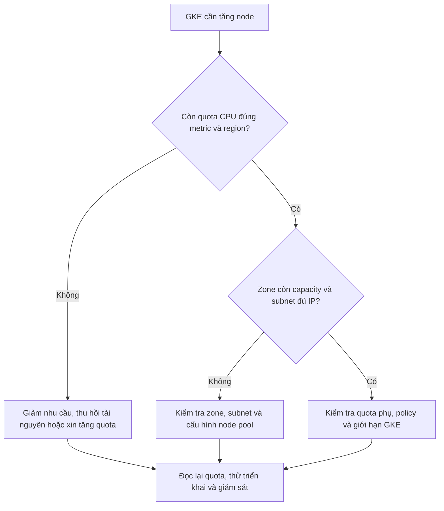

# Quotas, giới hạn hệ thống và yêu cầu tăng hạn mức trên Google Cloud

Khi triển khai hệ thống trên Google Cloud, có quyền tạo tài nguyên và đủ ngân sách vẫn chưa chắc có thể tạo thêm máy ảo, tăng số node GKE hoặc gọi API không giới hạn. Dịch vụ Google Cloud sử dụng **quota** (hạn mức sử dụng) và **system limit** (giới hạn hệ thống) để bảo vệ nền tảng, phân bổ năng lực phục vụ và kiểm soát mức tiêu thụ tài nguyên.

Trong chương **Hệ thống tài nguyên và vị trí** của module `CLOUD_PROVIDERS_GCP`, bài này giúp bạn hiểu hạn mức trong bối cảnh quản lý **Organization, Folder, Project, IAM, VPC** và triển khai Compute Engine, GKE, Cloud Run, lưu trữ, cơ sở dữ liệu. Từ đó, bạn có thể lựa chọn dịch vụ phù hợp, bảo vệ tài nguyên, tự động hóa phát hành và giám sát độ tin cậy cùng chi phí. Giá trị quota thực tế phụ thuộc dịch vụ, project, vị trí và thời điểm; các con số giả định trong bài chỉ minh họa cách tính.

## 1. Mục tiêu học tập

Sau bài này, bạn có thể:

- Phân biệt **quota**, **system limit**, **capacity** thực tế và các ngưỡng do người vận hành tự đặt.
- Xác định quota áp dụng cho **service, project, region/zone, loại tài nguyên hoặc khoảng thời gian** nào.
- Đọc `usage`, `limit`, phân tích lỗi vượt hạn mức và ước lượng headroom cho triển khai.
- Chuẩn bị và thực hiện quy trình **yêu cầu tăng quota** cho metric được phép điều chỉnh.
- Thiết kế giám sát, cảnh báo và phương án xử lý quota cho Compute Engine, GKE, Cloud Run, Cloud Storage và Cloud SQL.

## 2. Quota, system limit, capacity khác nhau thế nào?

| Khái niệm | Ý nghĩa | Điều chỉnh được không? | Ví dụ |
| --- | --- | --- | --- |
| **Quota** | Ngưỡng tiêu thụ tài nguyên hoặc tốc độ thao tác được cấp cho một consumer theo phạm vi xác định. | **Có thể** yêu cầu tăng với những quota cho phép; kết quả cần được phê duyệt hoặc đáp ứng điều kiện. | Số vCPU thuộc một họ máy trong một region, số API requests trong một khoảng thời gian. |
| **System limit** | Giới hạn cố định do khả năng hỗ trợ hoặc thiết kế của dịch vụ. | **Thông thường không** tăng bằng yêu cầu quota. | Kích thước tối đa của một đối tượng hoặc giới hạn cấu trúc do dịch vụ công bố. |
| **Capacity / availability** | Lượng tài nguyên hạ tầng đang sẵn có tại location và thời điểm triển khai. | Tăng quota **không bảo đảm** có capacity. | Project có quota GPU nhưng zone đích tạm thời hết GPU phù hợp. |
| **Giới hạn do người dùng cấu hình** | Mức trần chủ động nhằm điều tiết ứng dụng, trong giới hạn dịch vụ. | Có thể sửa cấu hình nếu quota, policy và service limit cho phép. | `max instances` hoặc concurrency của Cloud Run, kích thước node pool GKE. |

Ngoài ra còn có **giới hạn chính sách**. IAM kiểm soát *ai được làm gì*; Organization Policy có thể cấm một cấu hình hoặc vị trí triển khai. Một lệnh tạo VM bị từ chối có thể do thiếu quyền, vi phạm chính sách, hết quota, thiếu capacity hoặc chạm system limit. Chúng là các nguyên nhân khác nhau và cần cách xử lý khác nhau.

**Ví dụ:** Project được cấp quota vCPU còn dư và một tài khoản có quyền tạo VM. VM vẫn có thể không được tạo nếu yêu cầu dùng loại máy không còn sẵn trong zone hoặc cấu hình vi phạm chính sách tổ chức.

## 3. Hai dạng quota phổ biến

### 3.1. Allocation quota: tổng tài nguyên được cấp phát

**Allocation quota** giới hạn số lượng tài nguyên được sử dụng hoặc cấp phát đồng thời. Những quota này thường có thể xem theo:

- **Usage:** mức đang dùng.
- **Limit:** mức tối đa hiện được cấp cho metric tại scope tương ứng.
- **Headroom:** khoảng còn lại trước khi đạt hạn mức.

Đối với một metric cộng được, ta có thể ước lượng:

```text
headroom          = limit - usage
usage dự kiến     = usage hiện tại + lượng tài nguyên bổ sung
triển khai hợp lệ nếu usage dự kiến ≤ limit
```

Ví dụ một quota CPU theo region có `limit = 24 vCPU` và `usage = 12 vCPU`. Một node pool muốn tạo thêm 5 VM, mỗi VM có 4 vCPU:

```text
Nhu cầu thêm = 5 × 4      = 20 vCPU
Usage mới    = 12 + 20    = 32 vCPU
Phần thiếu   = 32 - 24    =  8 vCPU
```

Nếu tất cả VM tiêu thụ đúng quota metric này, nhóm cần quota ít nhất **32 vCPU**, và nên dự trù thêm headroom để rolling update hoặc mở rộng đột biến. Đây là **số giả định**, không phải quota CPU mặc định của Google Cloud.

Trong thực tế, một yêu cầu có thể đồng thời chịu nhiều quota. Còn dư CPU không bảo đảm còn quota GPU, persistent disk, địa chỉ IP hoặc những giới hạn khác.

### 3.2. Rate quota: tần suất API và thao tác

**Rate quota** giới hạn tốc độ gọi API hoặc thao tác trong một khoảng thời gian, ví dụ requests/phút. Một job đồng bộ chạy rất nhanh có thể vượt quota dù cuối cùng tạo ra rất ít tài nguyên.

Giả sử một API giả định cho phép `600 requests/minute`. Job gửi 1.000 request trong 10 giây có nguy cơ bị chặn trong cửa sổ đo của dịch vụ. Hướng xử lý thường là **giảm concurrency, thêm queue, gom batch, rate limiting và retry với exponential backoff kèm jitter**; đồng thời có thể xem xét tăng quota nếu được hỗ trợ và thực sự cần.

Một số dịch vụ còn đặt giới hạn về số thao tác đồng thời hoặc ngưỡng riêng cho từng loại lệnh. Không phải mọi giới hạn được mô tả bằng từ “limit” đều là quota có thể tăng.

## 4. Quota gắn với resource hierarchy và location ra sao?

Cây quản trị Google Cloud thường là:

```text
Organization
└── Folder: workloads
    ├── Folder: dev
    │   └── Project: orders-dev
    └── Folder: prod
        ├── Project: orders-prod
        └── Project: payments-prod
```

**Quota không tự kế thừa theo Folder như quyền IAM allow.** Mỗi metric có scope riêng do dịch vụ xác định. Các project cùng Folder không tự động có chung một quota pool và một project còn quota không thể mặc nhiên cho project khác dùng số dư.

| Scope có thể gặp | Diễn giải | Lưu ý |
| --- | --- | --- |
| **Per project** | Mức sử dụng được tính trong một project. | Nhiều ứng dụng trong cùng project có thể cùng tiêu thụ metric đó. |
| **Per project + region** | Mỗi region có usage/limit riêng cho metric. | Tăng quota ở `asia-southeast1` không mặc nhiên tăng ở `us-central1`. |
| **Per project + zone/location** | Chỉ áp dụng trong zone hoặc location mà metric quy định. | Capacity thực tế cũng thường khác nhau theo zone. |
| **Per loại tài nguyên** | CPU family, loại GPU, API method hoặc dimension cụ thể. | Phải kiểm tra đúng metric đang bị chạm. |
| **Phạm vi consumer khác** | Một số dịch vụ có giới hạn theo user, tổ chức, billing hoặc các phạm vi đặc thù. | Không thể suy luận mọi quota đều độc lập tuyệt đối giữa project. |

Giả sử `orders-prod` còn 16 vCPU quota ở `asia-southeast1` nhưng `payments-prod` đã chạm quota CPU của chính nó. Việc hai project cùng thuộc Folder `prod` **không tạo quyền dùng chung quota đó**. Chỉ có thể chia sẻ hoặc quản lý quota chung nếu dịch vụ cung cấp cơ chế tương ứng và đã cấu hình rõ ràng.

### 4.1. Region và zone là hai trục cần kiểm tra

- **Quota region:** giới hạn tài nguyên theo region, ví dụ quota một loại vCPU trong `asia-southeast1`.
- **Capacity zone:** khả năng cấp phát loại máy/GPU tại `asia-southeast1-a`, `asia-southeast1-b` hoặc zone khác.
- **Organization Policy:** có thể giới hạn location đối với các loại tài nguyên được constraint hỗ trợ.
- **Dữ liệu và chi phí:** thay region có thể ảnh hưởng độ trễ, lưu trú dữ liệu, luồng dữ liệu giữa vùng và giá.

Do đó, còn quota region **không bảo đảm** tạo được VM tại một zone cụ thể. Mở rộng sang region khác phải được kiểm tra về kỹ thuật, tuân thủ và chi phí.

### 4.2. Năm câu hỏi trước khi tính quota

1. **Dịch vụ nào, metric nào?** CPU, GPU, bucket, IP, API request hay instance?
2. **Consumer nào?** Project ID nào, hoặc phạm vi khác do metric quy định?
3. **Location nào?** Global, region hay zone?
4. **Đơn vị và chu kỳ là gì?** vCPU, request/phút, số instance, GiB?
5. **Có thể điều chỉnh không?** Nếu không, đây có thể là system limit hoặc hạn mức đặc thù cần thiết kế lại.

## 5. Quota và giới hạn thường gặp ở các dịch vụ

### 5.1. Compute Engine

Những mục thường phải kiểm tra khi lập kế hoạch tạo VM:

- **Quota vCPU theo region, họ/loại máy:** một quota CPU tổng không nhất thiết thay thế quota riêng của machine family đang dùng.
- **GPU theo loại và region:** được cấp quota GPU chưa đồng nghĩa zone đích đang có GPU.
- **Persistent disks và địa chỉ IP:** tài nguyên đi kèm có quota hoặc giới hạn riêng.
- **Tốc độ thao tác Compute Engine API:** script tạo/xóa VM hàng loạt có thể bị rate limit.

Khi yêu cầu tăng quota cho VM hoặc GPU, phải xác định đúng tên metric, project và region. Nếu lỗi là **resource availability** tại zone, tăng quota có thể không giải quyết được.

### 5.2. Google Kubernetes Engine (GKE)

GKE chịu những giới hạn của **dịch vụ GKE** và các tài nguyên phía dưới như Compute Engine VM/CPU/GPU, disk, địa chỉ IP. Các tình huống:

- Cluster autoscaler không tạo thêm node vì quota vCPU đã hết.
- Node pool không thêm node được vì zone thiếu capacity hoặc subnet thiếu IP cho node/Pod.
- Cụm chạm giới hạn node, Pod, cluster hoặc thao tác điều khiển theo cấu hình được hỗ trợ.
- Công cụ điều hành gửi quá nhiều request nên bị throttling.

**Ví dụ:** GKE cần thêm 10 node nhưng scale thất bại. Hãy đọc sự kiện autoscaler, quota Compute Engine tại region, capacity zone, IP trong subnet, giới hạn node pool và lỗi GKE cụ thể. Không tăng quota GKE theo phỏng đoán nếu lỗi cho biết quota CPU thuộc Compute Engine.

### 5.3. Cloud Run

Cloud Run có quota/giới hạn ở cấp dịch vụ, project và region, đồng thời người triển khai có thể đặt **max instances**, **concurrency**, **CPU**, **memory** cho service/revision.

Hai nguyên nhân cần phân biệt:

- Service đặt `max instances` thấp: đây là **giới hạn cấu hình** của workload.
- Quota Cloud Run hoặc giới hạn tài nguyên khác đã đạt trần: sửa `max instances` chưa chắc giải quyết được.

Ví dụ giả định một revision cấu hình tối đa 20 instance và concurrency 50/instance, mức đồng thời lý thuyết tương ứng là `20 × 50 = 1.000` yêu cầu đang xử lý. Đây **không phải** cam kết xử lý 1.000 request/giây; hiệu năng còn phụ thuộc thời gian xử lý, CPU, autoscaling, database và giới hạn dịch vụ.

Nếu Cloud Run tăng số instance nhưng Cloud SQL hết số kết nối, hệ thống có thể nghẽn ở database trước khi chạm quota Cloud Run. Capacity planning phải bao quát cả chuỗi phụ thuộc.

### 5.4. Cloud Storage

Cloud Storage có quota về thao tác điều khiển, giới hạn hiệu năng và **system limits** đối với bucket/object. Không thể tăng kích thước tối đa của một object chỉ bằng cách mở yêu cầu quota nếu đó là giới hạn hệ thống cố định.

Khi khởi tạo hàng loạt bucket hoặc gửi rất nhiều metadata requests, cần đọc hạn mức **đúng loại thao tác** và khả năng điều tiết request. Thiết kế key/object và nhịp tải phù hợp quan trọng hơn chỉ nhìn vào tổng dung lượng lưu trữ.

### 5.5. Cloud SQL và database

Cloud SQL chịu quota và system limit của dịch vụ, nhưng còn có **giới hạn kết nối**, CPU, bộ nhớ, storage và khả năng xử lý của database engine/instance.

Một ứng dụng Cloud Run scale ra nhiều instance có thể làm số kết nối Cloud SQL tăng mạnh dù quota số Cloud SQL instance còn dư. Hãy dùng connection pooling, giới hạn kết nối, tối ưu truy vấn và cân đối quy mô database. Với dữ liệu lớn, còn cần xét backup, HA, region và chi phí.

## 6. Xem quota trong Google Cloud Console và bằng CLI

Trong **Google Cloud Console**, chọn đúng project, mở **IAM & Admin → Quotas & System Limits**, rồi lọc theo service, metric và dimension/location. Tên hoặc vị trí menu có thể thay đổi theo giao diện. Tài liệu của từng dịch vụ giúp xác nhận quota nào điều chỉnh được và giới hạn nào là cố định.

| Trường | Cách đọc |
| --- | --- |
| **Service / Quota metric** | Tên hạn mức cụ thể; không nhầm CPU, GPU, số thao tác API hay quota khác gần tên. |
| **Limit** | Ngưỡng đang được cấp, không nhất thiết là giá trị tối đa dịch vụ có thể hỗ trợ. |
| **Usage** | Mức sử dụng theo đơn vị và chu kỳ đang đo; số liệu giám sát có thể có độ trễ. |
| **Region / location / dimensions** | Scope chính xác của quota; quan trọng nếu nhiều region hoặc loại tài nguyên. |
| **Adjustability** | Metric có thể yêu cầu tăng, có cần xét duyệt và điều kiện nào? |
| **Peak trend** | Có vượt hạn mức trong giờ cao điểm, batch, scale hoặc rolling update không? |

Một số lệnh `gcloud` **chỉ đọc** để xem quota Compute Engine:

```bash
# Quota Compute Engine ở cấp project
gcloud compute project-info describe \
  --project=PROJECT_ID \
  --format="yaml(quotas)"

# Quota Compute Engine ở region ví dụ
gcloud compute regions describe asia-southeast1 \
  --project=PROJECT_ID \
  --format="yaml(quotas)"
```

Thay `PROJECT_ID` bằng project ID thực tế và bảo đảm tài khoản đủ quyền đọc. Những lệnh trên **không** tổng hợp quota của Cloud Run, GKE, Storage hoặc Cloud SQL. Đối với các dịch vụ đó, hãy xem Cloud Quotas, giao diện của service và Cloud Monitoring khi metric quota được hỗ trợ.

**Điểm cần nhớ:** quota có thể tăng/giảm theo thay đổi quản trị hoặc theo điều kiện tài khoản. Nên kiểm tra giá trị thực tế trước một đợt phát hành lớn, thay vì dựa vào quota mặc định đọc từ tài liệu cũ.

## 7. Đọc lỗi để xác định nguyên nhân

Lỗi quota có thể xuất hiện với các thông báo `RESOURCE_EXHAUSTED`, `quotaExceeded`, `rateLimitExceeded`, HTTP `429` hoặc đôi khi HTTP `403` tùy API. Tuy nhiên, **status code một mình không đủ** kết luận lỗi quota: 429 cũng có thể đến từ throttling hoặc quá tải nhất thời.

Các bước điều tra:

1. Ghi **service**, **project**, thao tác, thời gian, **metric/limit** và **location** trong error detail nếu có.
2. Phân biệt thao tác tạo thêm tài nguyên (**allocation**) với gửi request nhanh (**rate**).
3. Kiểm tra usage/limit đúng metric và các quota phụ thuộc.
4. Nếu quota còn dư, điều tra capacity zone, system limit, IAM, Organization Policy, subnet/IP và giới hạn cấu hình ứng dụng.
5. Chọn biện pháp xử lý, quan sát hệ thống và cập nhật runbook.

| Tín hiệu | Nguyên nhân thường gặp | Xử lý phù hợp |
| --- | --- | --- |
| Allocation usage sát limit | Không còn đủ quota cho tài nguyên mới. | Thu hồi tài nguyên không dùng, giảm nhu cầu, yêu cầu tăng quota. |
| API trả 429 trong đợt batch | Rate quota, throttling hoặc quá tải tạm thời. | Giới hạn tốc độ, queue, retry với **exponential backoff + jitter**, tôn trọng `Retry-After` nếu có. |
| VM/GPU không tạo được nhưng quota còn | Thiếu capacity hoặc điều kiện cấu hình khác. | Xem loại VM/GPU, zone, policy và phương án region/zone được phép. |
| Có IAM role nhưng request thất bại | Organization Policy, deny, quota hoặc lỗi dịch vụ. | Đọc error detail, xem effective policy và đúng scope. |
| Cloud Run không tăng instance | `max instances`, quota, autoscaling hoặc bottleneck backend. | Xem service config, metrics, quota, database và giới hạn kèm theo. |

Không nên **retry vô hạn** khi allocation quota đã hết hoặc system limit cố định, bởi cùng yêu cầu sẽ thất bại cho tới khi nguyên nhân thay đổi. Với lỗi rate, dùng backoff có jitter và giới hạn số lần thử để tránh làm trầm trọng tình trạng quá tải.

## 8. Quy trình yêu cầu tăng quota

Chỉ những quota **được phép điều chỉnh** mới có thể tăng qua quy trình quản lý quota. Yêu cầu có thể được chấp nhận nhanh, cần xét duyệt thêm hoặc bị từ chối; mức mới không phải lúc nào cũng có hiệu lực tức thì. **Tăng quota không tự động cấp thêm VM hay GPU**, và không bảo đảm capacity tại zone.

### Bước 1 — Chuẩn bị số liệu nhu cầu

Ghi lại:

- **Project ID**, service, quota metric/dimension và region/zone.
- **Limit hiện tại**, **usage hiện tại**, peak usage gần đây.
- **Mức limit mới đề xuất**, giải thích cách tính từ quy mô VM/node/instance/requests và tốc độ tăng trưởng.
- Nhu cầu dự phòng cho **rolling update, failover, autoscaling, batch**.
- Thời gian cần sử dụng, lý do kỹ thuật và tác động khi không tăng.

Nếu một triển khai tiêu thụ nhiều loại tài nguyên, cần kiểm tra cả những metric quota liên quan để tránh tăng một hạn mức nhưng vẫn bị chặn bởi hạn mức khác.

### Bước 2 — Kiểm tra loại hạn mức

Mở **Quotas & System Limits** hoặc tài liệu dịch vụ để xác định metric có hỗ trợ điều chỉnh hay không. Nếu là **system limit** cố định, cân nhắc điều chỉnh kiến trúc, chia nhỏ workload, đổi cách sử dụng hoặc dịch vụ thay thế.

### Bước 3 — Gửi yêu cầu trong Console

Lọc đúng **service → metric → dimension/location** và dùng thao tác **Edit Quotas / Request increase** khi được cung cấp. Nhập mức mong muốn và thông tin bổ sung được yêu cầu. Tài khoản thực hiện cần **IAM permission phù hợp cho quản lý quota**; quyền chỉ xem thông tin thường không đủ để gửi thay đổi.

Tùy metric, Google Cloud có thể yêu cầu xét duyệt, thông tin tài khoản thanh toán, lịch sử sử dụng hoặc làm rõ lý do kinh doanh. Không nên mặc định rằng thay Folder, thêm project hoặc chuyển billing account sẽ khiến quota tự tăng.

### Bước 4 — Theo dõi kết quả và kiểm tra lại

Theo dõi trạng thái yêu cầu, phản hồi và thời điểm hiệu lực. Khi được chấp nhận, **đọc lại limit đúng metric, project và region**. Chỉ lên lịch triển khai sau khi kiểm tra thêm capacity và quota liên quan.

### Bước 5 — Cập nhật vận hành

Cập nhật sơ đồ năng lực, cảnh báo, runbook, kế hoạch scale và **dự báo chi phí**. Quota cao hơn tạo khả năng tiêu thụ nhiều tài nguyên hơn, do đó cần giữ IAM và kiểm soát chi phí tương xứng.

## 9. Tình huống thực hành: GKE mở rộng trước cao điểm

Đội vận hành hệ thống đặt hàng chuẩn bị tăng node pool:

| Tham số | Giá trị giả định |
| --- | --- |
| Project | `orders-prod` |
| Region | `asia-southeast1` |
| Metric | CPU của họ máy mà node pool dùng, tính theo region |
| Current usage | 12 vCPU |
| Current limit | 24 vCPU |
| Kế hoạch | Thêm 5 node × 4 vCPU = 20 vCPU |
| Usage dự kiến | 32 vCPU |

Nhóm cần thêm ít nhất **8 vCPU** quota để đạt 32 vCPU. Vì rolling update có thể cần tạo máy mới trước khi hủy máy cũ, nhóm cân nhắc đề xuất **40 vCPU** sau khi kiểm tra tải dự kiến. Các số trên chỉ là ví dụ; quota thực tế phải dựa vào metric, máy và usage cụ thể.



Trước đợt scale, đội vận hành phải xác nhận quota CPU đã tăng, quota disk/IP/GPU tương ứng còn đủ, zone có capacity, subnet còn địa chỉ và chính sách tổ chức cho phép cấu hình này. Sau khi scale, kiểm tra node readiness, Pod scheduling, hiệu năng và chi phí.

### So sánh: CI/CD chạm rate quota

Một pipeline phát hành gửi hàng nghìn request điều khiển tài nguyên trong thời gian ngắn nhưng số máy cuối cùng không nhiều. Đây có thể là **rate quota**. Biện pháp đầu tiên là giảm số tác vụ đồng thời, phân lô, thêm queue và retry đúng cách. Yêu cầu tăng quota chỉ có ý nghĩa nếu metric được hỗ trợ và nhu cầu phát hành đã được đo rõ.

## 10. Thiết kế và giám sát để phòng ngừa

### 10.1. Dự trù năng lực trước phát hành

Kế hoạch capacity nên đi từ **tải dự kiến** đến **tài nguyên cần dùng**, rồi ánh xạ sang **quota metric cụ thể**:

1. Ước lượng tải trung bình, peak, tăng trưởng, batch và failover.
2. Quy đổi sang CPU, GPU, node, disk, IP, Cloud Run instances, kết nối cơ sở dữ liệu và API requests.
3. Xác định đúng service, project, region/zone, loại tài nguyên và đơn vị/chu kỳ quota.
4. Tính headroom cho rolling update và autoscaling; rà soát cả system limits.

**Ví dụ:** Nếu ứng dụng đang dùng 20 vCPU và rolling update tạm tạo thêm phiên bản mới trước khi xóa máy cũ, một quota limit đúng 20 vCPU sẽ có thể không đủ dù tải bình thường chưa tăng.

### 10.2. Theo dõi usage và cảnh báo

Trong **Cloud Monitoring**, sử dụng quota usage/limit metrics khi dịch vụ hỗ trợ, bổ sung dashboard và alert về quota errors, độ trễ, autoscaler và trạng thái backend.

Một quy ước vận hành **tham khảo** cho allocation quota là:

- Usage đạt **70%**: xem tốc độ tăng và dự kiến kỳ phát hành tiếp theo.
- Usage đạt **85%**: ưu tiên đánh giá yêu cầu tăng quota hoặc tối ưu tài nguyên.
- Gần hoặc chạm hạn mức: xử lý theo runbook và kiểm tra ảnh hưởng tới dịch vụ.

Đây **không** phải mốc bắt buộc do Google Cloud đặt; workload có đỉnh tải nhanh hoặc yêu cầu sẵn sàng cao cần cảnh báo sớm hơn. Với rate quota, đo các **đỉnh request trong cửa sổ thời gian phù hợp**: average thấp vẫn có thể che khuất peak gây từ chối.

### 10.3. Quota và kiểm soát chi phí

Quota giới hạn mức sử dụng một số tài nguyên hoặc thao tác, trong khi **Cloud Billing budget** dùng để theo dõi/cảnh báo chi phí và hỗ trợ quản lý ngân sách. Budget thông thường **không chặn chi tiêu cứng**; quota cũng **không tương đương trần chi phí** vì một số tài nguyên có thể phát sinh phí trước khi quota bị chạm. Khi quota tăng, phải kiểm tra lại quyền tạo tài nguyên, cảnh báo billing và dự báo chi phí.

### 10.4. Runbook khi gần hết quota

1. Thu thập project, metric, location, đơn vị, usage/limit và mã lỗi.
2. Đối chiếu với peak, autoscaling, batch, failover và lịch triển khai sắp tới.
3. Dọn tài nguyên chắc chắn không còn dùng hoặc giảm burst an toàn.
4. Kiểm tra khả năng điều chỉnh metric; chuẩn bị yêu cầu tăng có số liệu.
5. Xác nhận quota mới thực sự có hiệu lực, kiểm tra các quota phụ và capacity.
6. Quan sát sau triển khai: hiệu năng, lỗi, quota và chi phí.

## 11. Bài tập tự kiểm tra

**Câu 1.** Folder `prod` có `orders-prod` và `payments-prod`. Project orders còn 16 vCPU quota dư trong `asia-southeast1`, còn payments đã hết quota CPU. Nhóm payments có thể mặc nhiên dùng số dư của orders không?

**Câu 2.** Quota GPU tại region còn nhưng VM GPU không tạo được ở zone đã chọn. Nguyên nhân nào cần xét trước khi tiếp tục xin tăng quota?

**Câu 3.** Pipeline gọi API quá nhanh trong 30 giây và gặp nhiều lỗi HTTP 429. Nêu ba hành động xử lý đầu tiên.

**Câu 4.** Cloud Run service đặt `max instances = 5` nhưng quota project cho phép nhiều hơn. Chỉ gửi yêu cầu tăng quota có giải quyết được giới hạn hiện tại không?

**Câu 5.** Yêu cầu tăng quota CPU đã được phê duyệt. GKE có chắc chắn scale node ở zone đích thành công không?

**Đáp án giải thích:**

1. **Không.** Quota theo project/metric không tự chia sẻ giữa project cùng Folder.
2. Kiểm tra **capacity zone**, loại GPU, cấu hình máy và các ràng buộc vị trí/chính sách; quota và capacity là hai điều kiện khác nhau.
3. **Giới hạn tốc độ/concurrency**, bổ sung queue hoặc batch, retry bằng **exponential backoff kèm jitter** và tôn trọng thời gian chờ trả về nếu có.
4. **Không.** Cần xem cấu hình `max instances` của chính service, quota thực tế, autoscaling và giới hạn backend.
5. **Không.** Vẫn có thể thiếu capacity, IP, disk quota, quota khác hoặc bị giới hạn bởi policy/cấu hình GKE.

## 12. Ghi nhớ

- **Quota** thường gắn với một metric/scope và có thể điều chỉnh nếu được hỗ trợ; **system limit** là giới hạn kỹ thuật thường không tăng theo yêu cầu.
- Một triển khai chịu **nhiều quota** cùng lúc. Luôn kiểm tra đúng **project, service, region/zone, loại tài nguyên và đơn vị**.
- Cùng Folder không có nghĩa cùng quota pool; **resource hierarchy** quản trị tài nguyên, còn quota có scope riêng.
- **Quota không bằng capacity**: có quota GPU/VM không bảo đảm zone có tài nguyên thật.
- Với **allocation quota**, dự trù headroom; với **rate quota**, điều tiết request và áp dụng backoff phù hợp.
- Gửi yêu cầu tăng quota với **số liệu usage, peak và nhu cầu dự kiến**, sau đó kiểm tra quota mới đã có hiệu lực.
- Theo dõi quota cùng IAM, Organization Policy, autoscaling, vận hành database và chi phí để tránh chẩn đoán sai.

### Tài liệu tham khảo Google Cloud

- [Quotas and system limits](https://cloud.google.com/docs/quotas/overview)
- [View and manage quotas](https://cloud.google.com/docs/quotas/view-manage)
- [Compute Engine resource usage quotas](https://cloud.google.com/compute/resource-usage)
- [Cloud Run quotas and limits](https://cloud.google.com/run/quotas)
- [Google Kubernetes Engine quotas and limits](https://cloud.google.com/kubernetes-engine/quotas)
