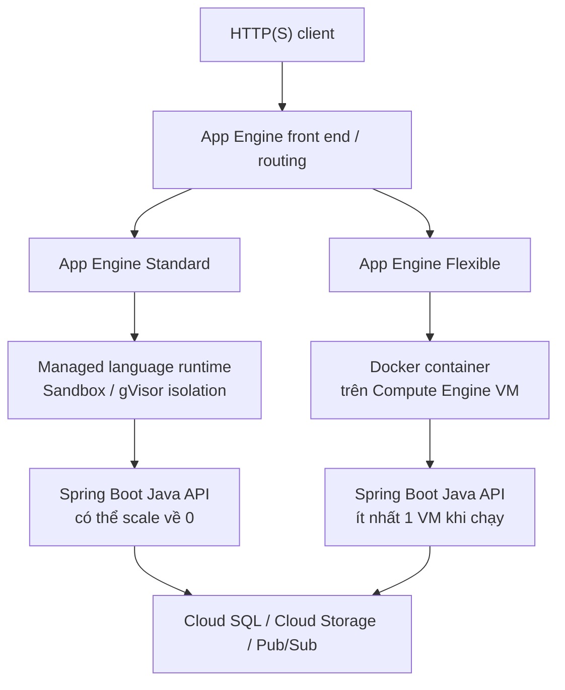
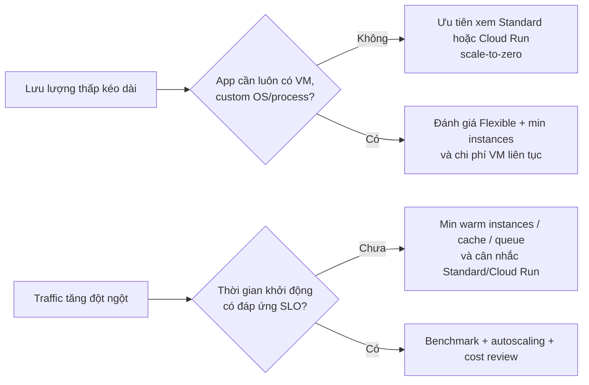
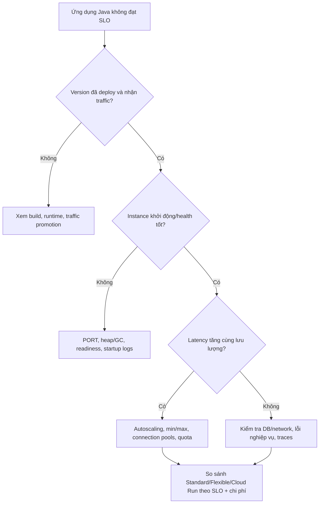

# Lựa chọn App Engine Standard và Flexible

## 1. Bài toán: triển khai Java trên App Engine theo đúng nhu cầu

Một nhóm phát triển có hai ứng dụng **Java/Spring Boot**. API tra cứu sản phẩm nhận ít request vào ban đêm nhưng đôi khi tăng đột biến khi khuyến mãi; nhóm muốn giảm vận hành và chi phí nhàn rỗi. Một ứng dụng xử lý tài liệu kế thừa lại cần công cụ native, bộ nhớ lớn, kết nối mạng riêng và chạy nhiều tác vụ nền. Cả hai có thể triển khai trên **Google App Engine**, nhưng chọn môi trường sai sẽ dẫn đến cold start, giới hạn runtime hoặc hóa đơn không phù hợp.

App Engine là dịch vụ **Platform as a Service (PaaS)**: người phát triển đưa mã ứng dụng và cấu hình triển khai, còn Google Cloud cung cấp hạ tầng chạy, cân bằng tải, phiên bản và cơ chế mở rộng. Có hai môi trường **Standard** và **Flexible**; chúng chia sẻ mô hình **application → service → version → instance**, nhưng khác nhau về runtime, VM, scaling, thời gian khởi động, tùy chỉnh hệ thống và cách tính phí.

Bài học nằm trong chương **App Engine** thuộc mô-đun **CLOUD_PROVIDERS_GCP**, hướng tới việc biết lựa chọn dịch vụ, bảo vệ tài nguyên, tự động hóa phát hành và kiểm soát độ tin cậy/chi phí cho Java workloads. Nội dung đi từ bảng so sánh đến một ví dụ Spring Boot dùng hai `app.yaml` thay thế nhau, rồi thực hành lựa chọn, kiểm thử và dọn tài nguyên.

**Sau bài học bạn có thể:**

1. Phân biệt kiến trúc, sandbox, runtime, network, filesystem và scaling của hai môi trường.
2. Giải thích vì sao **Standard có thể scale to zero**, còn **Flexible phải giữ ít nhất một instance**.
3. Đọc và xây dựng `app.yaml` cho **Java 21** ở cả Standard và Flexible.
4. Triển khai/quan sát một service Java, quản trị version/traffic, xử lý cold start và health checks.
5. Tính sơ bộ ảnh hưởng của thời gian hoạt động, tài nguyên dự phòng, network và dịch vụ phụ trợ lên chi phí.
6. Chọn **Cloud Run** thay vì App Engine khi yêu cầu sản phẩm mới phù hợp hơn.

> **Cảnh báo lab:** App Engine application gắn với **một region không thể đổi** sau khi tạo và **mỗi Google Cloud project chỉ chứa một App Engine application**. Đừng chạy `gcloud app create` trong project production để thử nghiệm. Flexible sử dụng VM luôn chạy và **không có free tier riêng**, kể cả khi chưa có request.

## 2. Bản chất hai môi trường



**Standard:** ứng dụng chạy trong **sandbox** với runtime ngôn ngữ do App Engine cung cấp. Hệ thống có thể tạo instance nhanh, xử lý lưu lượng ngắn hạn và giảm về **0 instance** khi không có request theo loại scaling/cấu hình. Quyền sửa runtime/OS bị giới hạn; môi trường thích hợp cho ứng dụng web stateless.

**Flexible:** ứng dụng chạy trong **Docker container trên Compute Engine VMs**, có nhiều khả năng tùy chỉnh runtime, thư viện native, process nền, SSH debug và tài nguyên CPU/RAM. Việc tạo VM khởi động chậm hơn và service có **ít nhất một instance**, nên hợp với tải ổn định hoặc ứng dụng cần tự kiểm soát môi trường chạy nhiều hơn.

**Cả hai** đều hỗ trợ triển khai theo service/version, Cloud Logging/Monitoring, gọi Cloud APIs, HTTPS, IAM và kết nối dịch vụ khác theo cấu hình. Tuy nhiên, Flexible không phải dịch vụ bare-metal, không mặc nhiên cho phép sửa hạ tầng Google Cloud bên ngoài container và các VM vẫn chịu vòng đời bảo trì của App Engine.

## 3. Bảng so sánh để ra quyết định

| Tiêu chí | **Standard** | **Flexible** |
| --- | --- | --- |
| Nền tảng chạy | Runtime quản lý, sandbox | Docker container trên Compute Engine VM |
| Ngôn ngữ | Các runtime được App Engine hỗ trợ | Runtime được hỗ trợ hoặc **custom runtime/Dockerfile** |
| Java hiện hành | `java17`, `java21`, `java25` theo lịch hỗ trợ | `runtime: java` và `runtime_config` cho Java version/OS tương thích; custom khi cần |
| Khởi động instance | Thường **vài giây**, phụ thuộc Java app | Thường **vài phút** do VM/container |
| Scaling | **Automatic**, **Basic**, **Manual** | **Automatic**, **Manual** |
| Scale về 0 | **Có** với cấu hình phù hợp | **Không**: min ít nhất 1 VM cho service active |
| Request timeout | Theo runtime và scaling type | Tối đa **60 phút** |
| Disk cục bộ | Chủ yếu `/tmp`, tạm thời | Có quyền ghi vào filesystem tạm của VM/container |
| Background threads/processes | Thread có **hạn chế**; không phù hợp process nền độc lập | Cho phép process/thread nền trong giới hạn tài nguyên |
| SSH vào instance | Không | Có khả năng SSH/debug theo quyền |
| Tùy chỉnh OS/runtime | Không đổi base runtime qua Dockerfile | Tùy chỉnh bằng Dockerfile và cấu hình VM |
| WebSocket | Không | Có |
| Mạng | Gọi Google Cloud APIs, **Direct VPC egress/Serverless VPC Access** theo hỗ trợ | VM có đường kết nối VPC/Compute Engine network |
| Cơ chế tính tiền chính | **Instance-hours** theo instance class, có quota miễn phí trong điều kiện áp dụng | **vCPU, RAM, persistent disk** và tài nguyên liên quan; không có free tier |
| Bài toán phù hợp | Web/API stateless tải biến động | Native dependency, custom image, long-lived process hoặc tải đều |

**Không chọn Flexible chỉ vì dự án dùng Spring Boot**: Java runtime hiện đại của Standard hỗ trợ executable JAR, Spring Boot và nhiều thư viện phổ biến. Ngược lại, một thư viện native cũng **không tự động** loại Standard; phải kiểm chứng có chạy được trong sandbox và có cần tùy chỉnh OS/runtime hay không.

Về sản phẩm mới, tài liệu Google Cloud hiện **khuyến nghị đánh giá Cloud Run làm lựa chọn mặc định hiện đại** trước khi chọn App Engine, đặc biệt khi cần container độc lập và quản trị linh hoạt. So sánh Standard/Flexible vẫn rất quan trọng cho ứng dụng App Engine hiện có hoặc nơi yêu cầu vận hành đặc thù.

## 4. Runtime Java, sandbox và filesystem

### 4.1. Java runtime không phải một lựa chọn vĩnh viễn

App Engine Standard khai báo phiên bản bằng `runtime: java21` hoặc `runtime: java25`. Flexible dùng `runtime: java`, `env: flex`, và đặt `runtime_config.runtime_version` cùng `operating_system` tương thích. Theo lịch hỗ trợ cuối năm 2026, Java **17, 21 và 25** là các nhánh hiện hành trên cả hai; Java 25 đã GA. **Java 8/11 legacy** có quy định hết hỗ trợ/deprecation riêng, không nên tạo dịch vụ mới phụ thuộc vào các runtime đó.

Khi nâng phiên bản, kiểm tra: **Servlet `javax.*` → `jakarta.*`**, Spring Boot compatibility, TLS/crypto providers, Java agent, thư viện native và **App Engine bundled services**. Các app dùng API legacy hoặc WAR theo mô hình Java cũ có thể cần chuyển sang executable JAR và thay dependency, không đơn giản chỉ đổi một dòng `runtime`.

### 4.2. Filesystem không phải nơi lưu dữ liệu bền

- **Standard:** ghi file tạm ở `/tmp` theo hạn chế runtime; dữ liệu không được chia sẻ giữa instances và không được bảo đảm khi restart.
- **Flexible:** có filesystem ghi được trong VM/container, nhưng vẫn **ephemeral** khi instance được recreate, deploy hoặc VM bảo trì.
- **Cả hai:** file upload, hóa đơn, ảnh và tài liệu lâu dài nên lưu trong **Cloud Storage**; dữ liệu giao dịch trong **Cloud SQL/Firestore**; secret trong **Secret Manager**.

Một Spring Boot app ghi đơn hàng vào `/tmp/orders.json` sẽ mất dữ liệu khi instance đổi bất kể đang chạy Standard hay Flexible. Việc Flexible hỗ trợ disk ghi được **không biến nó thành database bền vững**.

### 4.3. Network và các phụ thuộc

Standard có thể gọi Google Cloud APIs và dùng đường **VPC egress được hỗ trợ**, kể cả Direct VPC egress trong môi trường/version tương thích; không đúng nếu nói Standard “không truy cập private resources”. Flexible có quyền lựa chọn cấu hình mạng ở mức VM/VPC nhiều hơn. Với cả hai, truy cập **private Cloud SQL, Redis, APIs nội bộ** vẫn đòi hỏi routes, firewall, connection/auth, quota, IAM và kiểm tra latency.

## 5. Scaling, cold start và thời gian xử lý

### 5.1. Standard có ba kiểu scaling

| Kiểu | Cơ chế | Khi nào |
| --- | --- | --- |
| **Automatic** | Tự tăng/giảm instances theo request latency/CPU/throughput và cấu hình | REST/API có lưu lượng biến động |
| **Basic** | Khởi tạo instance khi có request, tắt khi không còn hoạt động | Tải không thường xuyên; cần cân nhắc thời gian khởi động |
| **Manual** | Giữ số instance được chỉ định | Phải luôn có instance phục vụ hoặc yêu cầu vận hành đặc biệt |

Với automatic và ít traffic, Standard có thể **scale to zero**. Min instances lớn hơn 0 hoặc manual scaling có thể giữ instance hoạt động và **phát sinh phí nhàn rỗi**. Với các ứng dụng Standard mới từ **tháng 3/2025**, `max_instances` mặc định của automatic scaling được đặt **20**; nên khai báo giới hạn tường minh khi ngân sách/quota quan trọng.

### 5.2. Flexible có automatic hoặc manual

Flexible dùng hạ tầng VM; automatic scaling có các tham số như `min_num_instances`, `max_num_instances`, `cool_down_period_sec`, CPU target. **Min tối thiểu 1**, mặc định thường **2** để giảm latency; khi scale, cần tính thời gian tạo VM. Mỗi active version có thể tiếp tục dùng instance và tính phí dù chưa nhận traffic.



**Cold start Java** gồm khởi tạo JVM, class loading, Spring context, kết nối dữ liệu và JIT. Standard bắt đầu nhanh hơn về **hạ tầng** không có nghĩa API Spring Boot khởi động tức thì. Flexible thường chậm hơn, nên giữ capacity dự phòng khi spike cần SLA.

**Timeout:** Flexible có maximum request timeout **60 phút**; Standard phụ thuộc runtime và scaling type, không lấy “60 phút” áp dụng chung. Tác vụ kéo dài nên chuyển sang **Cloud Tasks/Pub/Sub + worker**, **Cloud Run jobs**, hoặc hệ thống batch phù hợp, thay vì giữ HTTP request chờ rất lâu.

## 6. Thiết kế Java Spring Boot dùng chung cho hai môi trường

Một ứng dụng **Java 21** có `GET /` và `GET /healthz` để so sánh mà không phụ thuộc database. Nó lắng nghe biến môi trường `PORT` và không dùng disk bền. Đây là ví dụ tự chứa để người học triển khai vào **một môi trường mỗi lần**.

### 6.1. Cấu trúc thư mục

```text
appengine-choice-lab/
├── pom.xml
└── src/main/
    ├── java/dev/example/choice/ChoiceApplication.java
    ├── resources/application.properties
    └── appengine/app.yaml  # Dùng bản Standard HOẶC Flexible
```

### 6.2. Maven `pom.xml`

```xml
<?xml version="1.0" encoding="UTF-8"?>
<project xmlns="http://maven.apache.org/POM/4.0.0"
         xmlns:xsi="http://www.w3.org/2001/XMLSchema-instance"
         xsi:schemaLocation="http://maven.apache.org/POM/4.0.0 https://maven.apache.org/xsd/maven-4.0.0.xsd">
  <modelVersion>4.0.0</modelVersion>
  <parent>
    <groupId>org.springframework.boot</groupId>
    <artifactId>spring-boot-starter-parent</artifactId>
    <version>3.5.5</version>
    <relativePath/>
  </parent>
  <groupId>dev.example</groupId>
  <artifactId>appengine-choice-lab</artifactId>
  <version>0.0.1-SNAPSHOT</version>
  <properties>
    <java.version>21</java.version>
  </properties>
  <dependencies>
    <dependency>
      <groupId>org.springframework.boot</groupId>
      <artifactId>spring-boot-starter-web</artifactId>
    </dependency>
  </dependencies>
  <build>
    <plugins>
      <plugin>
        <groupId>org.springframework.boot</groupId>
        <artifactId>spring-boot-maven-plugin</artifactId>
      </plugin>
      <plugin>
        <groupId>com.google.cloud.tools</groupId>
        <artifactId>appengine-maven-plugin</artifactId>
        <version>2.8.7</version>
      </plugin>
    </plugins>
  </build>
</project>
```

Phiên bản dependency chỉ để ví dụ hoạt động với Java 21; trước production phải cập nhật lên **bản đang được hỗ trợ và đã kiểm tra bảo mật**. Runtime App Engine nhận **executable JAR**, không tự cấp một Spring Boot framework riêng cho ứng dụng.

### 6.3. `ChoiceApplication.java`

```java
package dev.example.choice;

import java.time.Instant;
import java.util.Map;
import org.springframework.boot.SpringApplication;
import org.springframework.boot.autoconfigure.SpringBootApplication;
import org.springframework.web.bind.annotation.GetMapping;
import org.springframework.web.bind.annotation.RestController;

@SpringBootApplication
@RestController
public class ChoiceApplication {
    public static void main(String[] args) {
        SpringApplication.run(ChoiceApplication.class, args);
    }

    @GetMapping("/")
    public Map<String, String> hello() {
        return Map.of(
            "service", "appengine-choice",
            "status", "ok",
            "at", Instant.now().toString());
    }

    @GetMapping("/healthz")
    public Map<String, String> health() {
        return Map.of("status", "ok");
    }
}
```

### 6.4. `application.properties`

```properties
# Port do App Engine cung cấp, 8080 để chạy local.
server.port=${PORT:8080}
server.address=0.0.0.0
```

**Cần bind đúng port:** App Engine cung cấp biến `PORT`; không hard-code `localhost` hoặc một port luôn cố định. Trong Standard Java thế hệ mới, runtime có thể sử dụng port khác 8080 để tận dụng đầy đủ proxy; dùng biến `PORT` là cách đúng.

### 6.5. Test trên máy phát triển

```bash
java -version
mvn -q clean package
java -jar target/appengine-choice-lab-0.0.1-SNAPSHOT.jar

# Trong terminal khác:
curl -i http://localhost:8080/
curl -i http://localhost:8080/healthz
```

Kỳ vọng cả hai trả HTTP 200, `/` có timestamp UTC. Đoạn mã là web app nhỏ để so sánh hai runtime, không phải triển khai bài học trên môi trường Google Cloud thật.

## 7. `app.yaml` cho App Engine Standard

Đặt nội dung sau vào `src/main/appengine/app.yaml` khi chọn **Standard**:

```yaml
runtime: java21
service: default
instance_class: F4_1G

automatic_scaling:
  min_instances: 0
  max_instances: 3
  target_cpu_utilization: 0.65
```

| Dòng | Tác dụng |
| --- | --- |
| `runtime: java21` | Chọn runtime Java 21 được quản lý |
| `instance_class: F4_1G` | Lớp CPU/RAM đủ để thử Spring Boot; không phải giá trị rẻ nhất |
| `min_instances: 0` | Có thể giảm về 0 khi nhàn rỗi, chấp nhận cold start |
| `max_instances: 3` | Đặt giới hạn autoscaling/chi phí dự kiến; số idle instances thực tế có thể tạm vượt giới hạn trong một số trường hợp |
| `target_cpu_utilization: 0.65` | Tín hiệu CPU mục tiêu; không phải SLA latency |

Không cần `env: standard`; môi trường Standard là mặc định khi khai báo `runtime: java21`. File này **không có** phần `resources.cpu/memory_gb/disk_size_gb` như Flexible; tài nguyên Standard được chọn bằng **instance class**.

**Quan trọng:** đây là chính sách **automatic scaling**. Nếu chuyển sang `manual_scaling`, việc giữ số instance cố định khiến ứng dụng không scale về 0 như lab ban đầu.

## 8. `app.yaml` cho App Engine Flexible

Nếu muốn thử Flexible, **thay toàn bộ** `src/main/appengine/app.yaml` bằng bản này trong **project lab đã được phê duyệt**:

```yaml
runtime: java
env: flex
service: default

runtime_config:
  operating_system: "ubuntu22"
  runtime_version: "21"

resources:
  cpu: 1
  memory_gb: 2.3
  disk_size_gb: 10

automatic_scaling:
  min_num_instances: 1
  max_num_instances: 2
  cool_down_period_sec: 120
  cpu_utilization:
    target_utilization: 0.6

liveness_check:
  path: "/healthz"
  check_interval_sec: 30
  timeout_sec: 4
  failure_threshold: 4

readiness_check:
  path: "/healthz"
  check_interval_sec: 5
  timeout_sec: 4
  failure_threshold: 2
  app_start_timeout_sec: 300
```

**Những khác biệt không được bỏ qua:**

- `runtime: java` + `env: flex` là cấu trúc của Flexible, **không** viết `runtime: java21` như Standard.
- `runtime_config` pin **Java 21 + Ubuntu 22**, tránh runtime thay đổi ngầm theo mặc định mới. Phiên bản OS/runtime phải tương thích theo lịch hỗ trợ.
- `resources` cấp 1 vCPU, 2,3 GB RAM cho app và 10 GB disk theo ràng buộc Flexible; **vẫn tính phí** khi không có traffic.
- `min_num_instances: 1` là mức tối thiểu; Flexible thường mặc định 2 nếu không cấu hình. `max_num_instances` phụ thuộc quota và không thay thế kiểm soát downstream.
- `liveness_check` lỗi liên tục có thể khiến instance **restart**; `readiness_check` lỗi thì instance **không nhận request**. Không làm endpoint health kiểm tra DB quá nặng để tránh vòng lặp restart hàng loạt.
- `cool_down_period_sec` là thời gian bỏ qua số đo CPU của instance đang khởi tạo khi tính autoscaling, **không phải khóa mọi lần scale-out**.

Flexible có thể dùng **custom runtime bằng Dockerfile**, nhưng không cần Dockerfile khi chọn Java runtime được App Engine hỗ trợ. Khi phần mềm cần binary/OS packages đặc biệt, đánh giá custom runtime và trách nhiệm vá image trước khi chọn.

## 9. Triển khai, quan sát, traffic và rollback

### 9.1. Điều kiện trước deploy

1. Dùng **project thử nghiệm** có Billing, quota và region App Engine được hỗ trợ. `gcloud app describe` để biết application đã tồn tại và region.
2. Nếu chưa có App Engine application, `gcloud app create` sẽ yêu cầu chọn region **không thể đổi sau đó**. Không thực hiện trên project đang dùng để triển khai hệ thống khác.
3. Bật đúng **App Engine Admin API**, **Cloud Build** và các dịch vụ phụ thuộc theo hướng dẫn; deployer cần IAM tối thiểu như `roles/appengine.deployer`, quyền build và `iam.serviceAccounts.actAs` khi sử dụng runtime service account.
4. Đọc kỹ `app.yaml`: **chỉ deploy một trong hai biến thể**, không dùng lab Flexible với project đang chạy Standard production. Với Spring Boot, test `GET /healthz` local trước.

```bash
gcloud config set project PROJECT_ID
gcloud app describe

# Chỉ dùng trên project LAB chưa có App Engine app,
# sau khi đã xác minh location và được cho phép tạo:
# gcloud app create
```

### 9.2. Deploy qua Maven plugin

Khi `pom.xml` và `src/main/appengine/app.yaml` của môi trường bạn chọn đã sẵn sàng:

```bash
# Tại thư mục dự án Maven lab, không chạy trong repo bài học:
mvn clean package
mvn appengine:deploy -Dapp.deploy.projectId=PROJECT_ID

# Với lần deploy phiên bản kế tiếp, tránh tự chuyển traffic ngay:
# mvn appengine:deploy -Dapp.deploy.projectId=PROJECT_ID -Dapp.deploy.promote=false

gcloud app services list
gcloud app versions list --service=default
gcloud app browse --service=default
```

Maven plugin đóng gói executable JAR và tạo thư mục staging phù hợp. Tham số `-Dapp.deploy.projectId` bảo đảm xác định đúng project khi `pom.xml` không khai báo project ID. Có thể dùng `gcloud app deploy` với artifact/cấu hình đã staging hoặc **source Maven buildpacks** theo quy trình đang dùng; **không mặc định** chạy `gcloud app deploy` từ một thư mục bất kỳ sẽ tìm thấy đúng `src/main/appengine/app.yaml`.

**Không bật deploy tự động lên traffic production khi chưa smoke test.** Với App Engine, deploy một version mới có thể thay tỷ lệ traffic nếu không cấu hình `--no-promote` hoặc điều khiển tương đương trong pipeline. Bảo đảm biết version/service nào đang phục vụ người dùng.

### 9.3. Các lệnh kiểm tra chỉ đọc

```bash
gcloud app services list
gcloud app versions list --service=default
gcloud app instances list --service=default
gcloud app logs tail --service=default
```

Theo dõi request rate, 4xx/5xx, p95 latency, instance count, Java heap/GC, startup logs, Cloud SQL connections và VM health riêng cho Flexible. Một `GET /healthz` trả 200 **không chứng minh** ứng dụng đáp ứng SLO hoặc database đang xử lý được lưu lượng thật.

### 9.4. Phân phối traffic và rollback

App Engine tổ chức **application → services → versions**. Có thể triển khai một version mới để kiểm thử trước khi chuyển traffic và dùng traffic splitting/canary; ví dụ cú pháp định hướng:

```bash
# Xem tên phiên bản trước khi thao tác:
gcloud app versions list --service=default

# CHỈ khi đã xác nhận version nhận traffic và được duyệt:
gcloud app services set-traffic default \
  --splits NEW_VERSION=0.10,OLD_VERSION=0.90
```

Nếu lỗi, chuyển traffic về version ổn định bằng một thay đổi đã được phê duyệt. **Rollback code không phục hồi transaction hoặc dữ liệu đã ghi sai**; cần migration schema tương thích tiến/lùi, idempotency và có backup.

Flexible có thể giữ các VM cho nhiều active versions, làm phí tăng trong thời gian canary; sau rollout phải xem **version nào còn instance và đang tính phí**.

## 10. Security và độ tin cậy cho Java

| Mối quan tâm | Thực hành đúng |
| --- | --- |
| **IAM deploy** | Phân quyền deployer, build identity và runtime service account; không mặc định Owner |
| **Secrets** | Secret Manager, tránh commit mật khẩu trong `app.yaml` hoặc Git |
| **HTTPS / auth** | Dùng HTTPS, xác thực/ủy quyền ở app hoặc Identity-Aware Proxy theo yêu cầu |
| **Network** | Chỉ mở đường egress cần thiết tới Cloud SQL/Redis; firewall và VPC theo môi trường |
| **Dữ liệu** | Cloud Storage/Cloud SQL/Firestore; không dùng filesystem của instance làm nguồn dữ liệu chính |
| **Scaling** | Giới hạn pool HikariCP, max instances và concurrency theo khả năng downstream |
| **Thực thi nền** | Standard hạn chế background processes; tác vụ dài tách thành Cloud Tasks/Pub/Sub/Cloud Run jobs |
| **Health** | Flexible tách readiness và liveness, tránh restart chỉ vì dependency trục trặc ngắn |
| **Incident response** | Giữ previous version, logs/metrics, có quy trình rollback/canary và RTO/RPO |

**Một điểm đặc thù Flexible:** các VM của môi trường này có vòng đời do App Engine quản lý, trong đó có bảo trì và restart định kỳ. Không lưu session hoặc file quan trọng trên VM. Nếu ứng dụng cần kiểm soát sâu vòng đời VM, Kubernetes scheduling hoặc privileged node agent, hãy đánh giá **Compute Engine/GKE** thay vì ép Flexible đáp ứng.

## 11. Chi phí: vì sao min instances quyết định hóa đơn?

**Standard** tính phí theo **instance class và instance-hours** (cộng các dịch vụ phụ trợ) và có mức **free quota** trong điều kiện áp dụng. Với automatic scaling/min=0, ứng dụng ít traffic có thể không duy trì instance. **Flexible** tính theo **VM vCPU, memory, persistent disk** cùng phí liên quan, với **ít nhất một instance đang hoạt động**, không có free tier riêng và thời gian tạo VM lâu hơn.

**Ví dụ số học giả định, không phải bảng giá Google Cloud:**

```text
Standard:
  2 instance × 3 giờ phục vụ/ngày = 6 instance-hours/ngày.
  Nếu không có request và min_instances=0, có thể giảm về 0.

Flexible:
  1 VM tối thiểu × 24 giờ/ngày = 24 VM-hours/ngày
  + phần vCPU/RAM/disk/egress tính theo biểu giá thực tế.
  Nếu min_num_instances=2 => ít nhất khoảng 48 VM-hours/ngày.
```

Đây là ví dụ về **thời gian cấp tài nguyên**, không khẳng định giá trực tiếp tỷ lệ 1:1 giữa Standard instance và Flexible VM. Tỷ lệ chi phí thật còn tùy region, instance class, vCPU/RAM/disk, request pattern, concurrency, logging, Cloud SQL, network egress, discounts và thời gian deployment/health checks. Dùng [App Engine pricing](https://cloud.google.com/appengine/pricing) và Cloud Billing Reports; **budget alert không tự dừng billing**.

**Chọn theo tổng chi phí vận hành:** Flexible có thể hiệu quả khi ứng dụng cần runtime phức tạp/tải liên tục; Standard thường tốt hơn nếu workload web ngắn, nhàn rỗi nhiều và không cần tùy chỉnh hệ thống. Với dự án mới, so sánh **Cloud Run** (container serverless và scaling linh hoạt) trước khi chốt.

## 12. Xử lý lỗi theo triệu chứng

| Triệu chứng | Gợi ý nguyên nhân | Bước kiểm tra |
| --- | --- | --- |
| Java build thành công nhưng deploy lỗi | `app.yaml` sai runtime/env, build service account hoặc staging | App Engine deploy logs, Cloud Build, CLI project |
| `404` sau deploy | Sai service/version/URL hoặc chưa promote traffic | `services list`, `versions list`, traffic splits |
| `502`/`503` hoặc instance unhealthy | App không listen trên `PORT`, init lỗi, OOM, health check thất bại | Java logs, port config, heap, Flexible readiness/liveness |
| Standard cold start gây p95 latency cao | Min instances 0, Spring context khởi tạo chậm | Startup time, warmup, min instances và chi phí |
| Flexible hóa đơn cao khi không có request | Ít nhất một VM chạy; version cũ còn active | Instance count, versions/traffic, Billing |
| Không cài được binary/library | Sandbox/runtime hạn chế hoặc image thiếu package | Runtime support, custom image trên Flexible |
| Ghi file thành công nhưng sau restart mất | Local filesystem chỉ tạm | Cloud Storage/Cloud SQL, không dùng disk local làm state |
| Không truy cập private Cloud SQL | Chưa cấu hình egress/VPC/firewall/IAM | Routes, VPC connector/Direct VPC, DB auth |
| Response chậm dù CPU thấp | Cloud SQL/pool hoặc downstream chậm | HikariCP, latency tracing, connection limits |
| Java cũ không deploy lại | Runtime end-of-support/deprecation | Nâng Java, `javax`/`jakarta`, legacy bundled services |



## 13. Dọn lab đúng phạm vi

Xóa hoặc stop **version không còn phục vụ** trong project lab mới là bước dọn, không phải xóa toàn bộ Google Cloud project. Không xóa default version đang nhận production traffic hoặc xóa disk/database riêng của workload khác.

```bash
# Xem versions và traffic trước khi quyết định:
gcloud app versions list --service=default
gcloud app services list

# Chỉ với version LAB đã ngừng nhận traffic,
# và sau khi xác nhận không có consumer:
# gcloud app versions delete OLD_LAB_VERSION --service=default
```

Nếu đã chạy Flexible, kiểm tra **active versions/VMs** để không tiếp tục tính phí nhàn rỗi. **App Engine application không có bước xóa độc lập đơn giản để làm lại region**; disable app có thể dừng phục vụ, nhưng tài nguyên/dữ liệu và chi phí của các dịch vụ khác vẫn cần quản lý. Trước khi xóa project lab, xác nhận không còn tài nguyên chung, dữ liệu cần giữ hoặc quyền sở hữu khác.

## 14. Bài tập và checklist tự đánh giá

### Bài A — Chọn môi trường theo tải

Một API có **2 giờ cao điểm/ngày**, ban đêm rất ít traffic, dùng Spring Boot thuần và Cloud SQL. Chọn Standard, Flexible hoặc Cloud Run; phân tích **cold start, cost idle, network/DB capacity**. Lặp lại với ứng dụng Java có tiến trình nền, thư viện native và ổn định 24/7.

### Bài B — Đọc và so sánh `app.yaml`

Từ hai ví dụ mục 7–8, xác định: runtime declaration, instance class vs vCPU/RAM, `max_instances` vs `max_num_instances`, target CPU, health checks và khả năng scale to zero. Giải thích vì sao **không thể dùng nguyên file Standard để triển khai Flexible**.

### Bài C — Local Spring Boot và deploy an toàn

Tạo Maven project Java 21, chạy `mvn clean package` và kiểm tra `/healthz` local. Trong **project test có App Engine application đúng region**, chọn **một** file `app.yaml`, chạy `mvn appengine:deploy`, đọc logs/versions và lập kế hoạch rollback. Không cần deploy thật nếu chưa có Billing/quyền.

### Bài D — Chi phí, tính sẵn sàng và data safety

Đặt Standard `min_instances=0,max_instances=3` và Flexible `min_num_instances=1,max_num_instances=2`. Tính **instance-hours/VM-hours sơ bộ** cho một ngày không có traffic, sau đó giải thích vì sao không thể suy luôn số tiền từ hai kết quả này. Nếu Java app ghi hóa đơn xuống local disk, phân tích nguy cơ ở cả hai.

### Bài E — Sự cố triển khai

Sau khi triển khai Flexible, `/healthz` trả 503 và VM bị restart nhiều lần. Viết runbook kiểm tra **startup, biến PORT, readiness/liveness, memory, Cloud Build logs**; đề xuất cách tránh restart loop. Nếu cùng ứng dụng ở Standard gặp cold start, bạn đo và xử lý khác gì?

### Checklist

- [ ] Tôi hiểu Standard là managed sandbox, Flexible là container chạy trên Compute Engine VM.
- [ ] Tôi giải thích được scaling Standard (automatic/basic/manual) và Flexible (automatic/manual).
- [ ] Tôi biết **Standard có thể scale về 0**, Flexible có **min >=1 VM** và không có free tier.
- [ ] Tôi biết Standard `runtime: java21` khác Flexible `runtime: java` + `env: flex`.
- [ ] Tôi biết Java 17/21/25 support và kiểm tra lịch deprecation trước mỗi lần nâng runtime.
- [ ] Tôi cấu hình được `PORT`, Spring Boot JAR, runtime identity, `app.yaml` và health checks.
- [ ] Tôi không lưu state trên local disk và tính Cloud SQL connection pool theo số instances.
- [ ] Tôi có thể quản lý App Engine service/version, traffic split và rollback.
- [ ] Tôi biết App Engine location của project không đổi sau khi tạo.
- [ ] Tôi so sánh được chi phí với Cloud Run và có kế hoạch dọn active versions.

**Kết luận:** chọn **Standard** khi ưu tiên runtime quản lý, mở rộng nhanh và khả năng không phải trả phí compute khi ít traffic; chọn **Flexible** khi cần container/VM tùy chỉnh, tiến trình nền, thư viện đặc thù và chấp nhận thời gian khởi động/chi phí luôn chạy. Với mọi lựa chọn, Java workload chỉ bền vững khi **stateless, có IAM/VPC đúng, health checks/rollback, đo SLO và budget thực tế**. Trước dự án mới, nên **đánh giá Cloud Run** như một phương án phù hợp hơn thay vì mặc định dùng App Engine.

## 15. Nguồn chính thức để tra cứu

- [App Engine: Choose an environment](https://cloud.google.com/appengine/docs/the-appengine-environments)
- [App Engine Java overview](https://cloud.google.com/appengine/docs/java)
- [App Engine Standard overview](https://cloud.google.com/appengine/docs/standard/overview)
- [App Engine Flexible overview](https://cloud.google.com/appengine/docs/flexible/overview)
- [App Engine Standard Java runtime](https://cloud.google.com/appengine/docs/standard/java-gen2/runtime)
- [App Engine Flexible Java runtime](https://cloud.google.com/appengine/docs/flexible/java/runtime)
- [Standard Java app.yaml configuration](https://cloud.google.com/appengine/docs/standard/java-gen2/configuring-your-app-with-app-yaml)
- [Standard app.yaml reference/scaling](https://cloud.google.com/appengine/docs/standard/reference/app-yaml)
- [Flexible app.yaml reference/resources/health checks](https://cloud.google.com/appengine/docs/flexible/reference/app-yaml)
- [Runtime support schedule — Standard](https://cloud.google.com/appengine/docs/standard/lifecycle/support-schedule)
- [Runtime support schedule — Flexible](https://cloud.google.com/appengine/docs/flexible/lifecycle/support-schedule)
- [Set up App Engine application and region](https://cloud.google.com/appengine/docs/standard/managing-projects-apps-billing)
- [Java Maven deployment](https://cloud.google.com/appengine/docs/standard/java-gen2/using-maven)
- [App Engine pricing](https://cloud.google.com/appengine/pricing)
