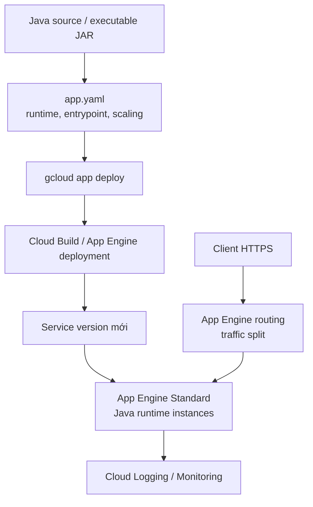

# Java runtime và cấu hình app.yaml

Khi triển khai một ứng dụng Java lên **Google App Engine**, chỉ có file JAR chạy được trên máy lập trình là chưa đủ. App Engine còn cần biết **phiên bản Java**, **lệnh khởi động**, **cổng HTTP**, **service/version**, **quy tắc routing** và **cách tự động mở rộng**. Với App Engine Standard, phần lớn những lựa chọn đó nằm trong file **`app.yaml`**.

Bài thuộc chương **App Engine** của mô-đun `CLOUD_PROVIDERS_GCP`, kết nối kiến thức về project, IAM, Compute Engine, Cloud Run, lưu trữ, cơ sở dữ liệu, triển khai tự động và giám sát chi phí. Ta sẽ cấu hình một **Java 21 HTTP service tối giản**, triển khai phiên bản thử nghiệm bằng `gcloud app deploy --no-promote`, kiểm chứng kết quả và tìm hiểu cách nâng cấp/rollback mà không vô tình thay đổi traffic production.

## 1. Mục tiêu học tập

Sau bài học, bạn có thể:

1. Phân biệt **App Engine Standard Java** với Flexible và các Java runtime cũ.
2. Chọn `runtime: java21` hoặc một runtime đang được hỗ trợ; hiểu tác động của nâng major version.
3. Giải thích các khóa `runtime`, `service`, `entrypoint`, `instance_class`, `automatic_scaling`, `env_variables` và `handlers`.
4. Tạo một executable JAR lắng nghe địa chỉ phù hợp, đọc **`PORT` do nền tảng cung cấp**.
5. Triển khai một **service version** riêng; xem logs, thử version URL và chỉ chuyển traffic khi được phê duyệt.
6. Tránh lỗi YAML, JAR không có Main-Class, startup chậm, sai port, quá nhiều instances và thiếu IAM.
7. Lập kế hoạch sử dụng Secret Manager, service account, Cloud Logging, rollback và dọn versions không cần thiết.

**Phạm vi:** bài tập trung vào **App Engine Standard, Java thế hệ thứ hai**. Các ví dụ dùng project lab đã tạo ứng dụng App Engine; không tự tạo project, chọn lại region hoặc sửa service production. Yêu cầu viết **tự chứa, đúng chuyên môn, cô đọng** được thực hiện bằng một ví dụ xuyên suốt thay vì lặp nhiều dự án mẫu.

## 2. App Engine Java hoạt động ở lớp nào?

App Engine là nền tảng **PaaS**: bạn triển khai source/artifact, còn nền tảng vận hành instances, routing và scaling theo cấu hình. Một ứng dụng App Engine có thể có nhiều **services**; mỗi service lại có nhiều **versions** để rollout và chia traffic.



| Khái niệm | Ý nghĩa | Ví dụ |
| --- | --- | --- |
| **App Engine application** | Tài nguyên cấp project, có location được chọn khi tạo | Một application trong project lab |
| **Service** | Thành phần ứng dụng triển khai độc lập | `default` hoặc `catalog-api` |
| **Version** | Bản triển khai của service, có cấu hình/runtime riêng | `java21-lab-v1` |
| **Instance** | Môi trường thực thi service version | Có thể scale-out/in tự động |
| **`app.yaml`** | Deployment descriptor cho một service version | Runtime, scaling, routing |
| **Entrypoint** | Lệnh khởi động process phục vụ HTTP | `java -jar app.jar` |

Một **version mới** không tự nhiên có nghĩa mọi người dùng đã nhận nó: traffic được định tuyến theo cấu hình của service. Ngược lại, một bản deploy **không dùng `--no-promote`** có thể được chuyển traffic ngay tùy lựa chọn mặc định của CLI. Luôn kiểm tra phạm vi trước khi chạy lệnh ghi.

### 2.1. Standard hay Flexible?

| Tiêu chí | Standard Java | Flexible |
| --- | --- | --- |
| Runtime | `java17`, `java21`, `java25` và các bản được lịch hỗ trợ cho phép | Mô hình runtime/container và cấu hình khác |
| File cấu hình | `app.yaml` chuẩn Standard | `app.yaml` riêng cho Flexible, có `env: flex` |
| Scaling | Automatic, basic, manual theo Standard | Automatic/manual với **các tên khóa khác** |
| Hạ tầng | Nền tảng kiểm soát runtime và vòng đời instances | Mức tùy biến môi trường/VM cao hơn |
| Ví dụ bài này | **Có** | Không |

**Không sao chép cấu hình Flexible** như `automatic_scaling.min_num_instances` hay `cpu_utilization.target_utilization` sang Standard: tên trường có thể khác dù cùng ý tưởng về autoscaling.

## 3. Chọn Java runtime và hiểu vòng đời hỗ trợ

Các runtime Java Standard hiện đại dùng tên **`javaMAJOR`** trong `app.yaml`.

| Runtime ID | Tình trạng theo lịch hỗ trợ Google Cloud | Khi chọn |
| --- | --- | --- |
| **`java25`** | Java mới nhất được hỗ trợ tại thời điểm biên soạn (2026) | Dự án mới đã thử Java 25 và framework phù hợp |
| **`java21`** | LTS phổ biến, còn được hỗ trợ | Ví dụ chính trong bài vì dễ áp dụng với framework hiện đại |
| **`java17`** | Được hỗ trợ nhưng có end-of-support sớm hơn | Ứng dụng có ràng buộc dependency |
| **`java11` / `java8`** | Runtime cũ đã qua mốc hỗ trợ/deprecation; có giới hạn deploy | Cần kế hoạch nâng cấp, không chọn cho dự án mới |

Tra cứu **[Runtime support schedule](https://cloud.google.com/appengine/docs/standard/lifecycle/support-schedule)** trước khi ấn định version: theo lịch hiện tại, Java 17 hỗ trợ đến **10/2027**, Java 21 đến **09/2031**, Java 25 đến **10/2031**; các mốc có thể thay đổi theo thông báo của Google Cloud. `java25` đã GA từ cuối năm 2025, và Java 8 bị deprecated cho triển khai mới từ đầu 2026.

### 3.1. Runtime được nâng cấp như thế nào?

`runtime: java21` chọn **major version 21**. Nền tảng có thể cập nhật **patch release** Java 21 và base runtime, nhưng **không tự chuyển major từ 21 sang 25** chỉ vì Java 25 mới hơn.

Trước khi đổi major:

- Xác nhận framework, SDK, dependencies và bytecode tương thích.
- Kiểm tra `javax.servlet.*` so với `jakarta.servlet.*` nếu còn tích hợp legacy bundled services.
- Kiểm tra JVM flags, thư viện native/JNI và memory usage.
- Dựng **version mới** trong staging, kiểm thử smoke/integration/load, rồi mới chuyển traffic.

**Java 8 first-generation** và `appengine-web.xml` có những cơ chế lịch sử riêng. Không áp nguyên xi các setting Java 8 (hoặc WAR phụ thuộc legacy bundled services) vào `app.yaml` Java 21/25. Với ứng dụng dùng legacy APIs, đọc hướng dẫn migration/compatibility trước.

## 4. app.yaml là cấu hình của từng service version

Một file `app.yaml` tối giản có thể chỉ chứa:

```yaml
runtime: java21
```

App Engine có thể suy ra các giá trị khác, như service mặc định, automatic scaling và **instance class F1**. Nếu muốn kiểm soát hành vi triển khai, khai báo tường minh:

```yaml
runtime: java21
service: default
entrypoint: java -jar app.jar
instance_class: F2

env_variables:
  APP_ENV: "lab"
  GREETING: "Xin chao App Engine"

automatic_scaling:
  min_instances: 0
  max_instances: 2
  target_cpu_utilization: 0.65
  max_concurrent_requests: 20

handlers:
  - url: /.*
    secure: always
    script: auto
```

Đây là **mẫu App Engine Standard**. `service: default` phù hợp cho ứng dụng App Engine lab mới; nếu project đã có service `default` đang phục vụ production, **không triển khai vào đó**. Có thể dùng `service: java-lab` **sau khi** ứng dụng đã có default service và bạn được phép tạo service mới.

| Khóa | Giải thích | Điểm dễ sai |
| --- | --- | --- |
| `runtime` | Java major do App Engine quản lý | Viết `java21`, không viết `21` hoặc `java-21` |
| `service` | Service đích | Service đầu tiên phải là `default`; tránh ghi đè service dùng chung |
| `entrypoint` | Command thực thi khi instance khởi động | JAR phải hiện diện trong gói deploy; tiến trình phải nghe `PORT` |
| `instance_class` | Kích thước tài nguyên instance | F1 mặc định; F2 có chi phí và memory khác |
| `env_variables` | Biến môi trường **runtime** | Không chứa secrets; không ghi đè biến hệ thống |
| `automatic_scaling` | Giới hạn và ngưỡng scale theo tải | Không dùng cú pháp Flexible hoặc coi max là trần hóa đơn |
| `handlers` | Routing URL, static/dynamic và yêu cầu HTTPS | **Thứ tự handlers quan trọng**; wildcard đặt sau |

**YAML rất nhạy thụt lề:** dùng spaces, không dùng tabs. Bỏ dấu nháy cho chuỗi `"true"`, `"01"` hoặc giá trị có dấu `:` có thể khiến parser hiểu khác mong muốn. Kiểm tra file sau mỗi thay đổi.

## 5. Entrypoint và cổng PORT

Trên App Engine Standard Java, runtime có thể tìm executable **uber JAR** và khởi động tự động. Tuy nhiên, với nhiều artifact hoặc command đặc biệt, nên khai báo `entrypoint` để tránh mơ hồ:

```yaml
runtime: java21
entrypoint: java -jar app.jar
```

Theo hợp đồng runtime, ứng dụng phải khởi chạy **HTTP server** lắng nghe tại port được nền tảng cấp qua biến **`PORT`**. App Engine động gán biến này, vì vậy **không đặt `PORT` trong `env_variables`**; với local dev mới dùng fallback `8080`.

Ví dụ Java:

```java
String portValue = System.getenv().getOrDefault("PORT", "8080");
int port = Integer.parseInt(portValue);
HttpServer server = HttpServer.create(
    new InetSocketAddress("0.0.0.0", port), 0);
server.start();
```

Nếu app bind `127.0.0.1:8080`, truy cập nội bộ của nền tảng có thể không tới được process. Nếu command chạy rồi thoát ngay, version sẽ không có server để nhận request.

### 5.1. JAR, Maven và buildpacks

- **Executable JAR:** có `Main-Class` trong `META-INF/MANIFEST.MF` hoặc dùng framework tạo bootable JAR.
- **Custom entrypoint:** file JAR nguồn được dùng trong entrypoint phải nằm trong **root của thư mục deploy cùng `app.yaml`** trong ví dụ này.
- **Maven source project:** GKE/Cloud Run không liên quan ở đây; App Engine hỗ trợ build source bằng buildpacks, ví dụ `gcloud app deploy pom.xml` khi project và plugin/cấu hình hợp lệ.
- **Maven App Engine plugin:** thường đặt `app.yaml` tại `src/main/appengine/app.yaml`, plugin tạo staging directory chứa artifacts.
- **Không phải mọi WAR đều chạy trực tiếp:** với Jakarta/Spring Boot, ưu tiên executable JAR; legacy bundled-services WAR dùng quy trình tương thích riêng.

Trong production, thêm JVM sizing theo instance class, đo heap/native memory và GC. Không copy tùy tiện `-Xmx` rất lớn vào F1/F2: memory thực tế còn phải dành cho JVM overhead, HTTP threads và native buffers.

## 6. Các chế độ scaling và instance class

| Scaling mode | Cách hoạt động | Instance class thường dùng |
| --- | --- | --- |
| **Automatic** | Nền tảng thay đổi số instance theo CPU/latency/throughput và giới hạn | `F1`, `F2`, `F4`, `F4_1G` |
| **Basic** | Khởi động khi có request, dừng sau khoảng idle | `B1`, `B2`, `B4`, `B4_1G`, `B8` |
| **Manual** | Duy trì số instance đã cấu hình | Các lớp `B*` tương thích |

Chỉ chọn **một scaling mode** trong file. Ví dụ chính dùng `automatic_scaling` để không duy trì instances cố định khi không có tải; **min_instances=0** có thể làm cold start lâu hơn.

### 6.1. Automatic scaling

```yaml
instance_class: F2
automatic_scaling:
  min_instances: 0
  max_instances: 2
  target_cpu_utilization: 0.65
  max_concurrent_requests: 20
```

- `min_instances: 0`: phù hợp lab dùng thỉnh thoảng; không bảo đảm không phát sinh phí.
- `max_instances: 2`: giới hạn target scale ở mức nhỏ, nhưng có tình huống nền tảng tạm vượt giới hạn và dịch vụ vẫn chịu các chi phí khác.
- `target_cpu_utilization`: mục tiêu CPU để scheduler tính capacity.
- `max_concurrent_requests`: giới hạn request đồng thời trên một instance trước khi scheduler mở rộng. Với F2 trở lên, có thể thử giá trị lớn hơn mặc định, nhưng phải đo p95/p99 và heap.

**Đánh đổi:** ít instance giảm chi phí nhưng có thể tăng latency/queueing, cold start hoặc lỗi khi traffic đột biến. Đừng chọn `max_instances=2` cho production nếu peak load và throughput chưa được thử.

### 6.2. Basic và manual scaling

Hai ví dụ **thay thế**, không thêm vào cùng file:

```yaml
# Chỉ ví dụ cho một service cần basic scaling.
instance_class: B2
basic_scaling:
  max_instances: 2
  idle_timeout: 10m
```

```yaml
# Chỉ ví dụ cho một service cần manual scaling.
instance_class: B2
manual_scaling:
  instances: 2
```

Với manual scaling, instances duy trì liên tục nên chi phí có thể tăng dù không có request. Với basic scaling, chuẩn bị xử lý cold start và idle shutdown. Các class B khác F về tài nguyên và pricing; không so sánh chỉ bằng tên số.

## 7. Routing HTTP, static assets và HTTPS

`handlers` là danh sách xử lý URL **theo thứ tự**. Một mẫu có static assets:

```yaml
handlers:
  - url: /assets
    static_dir: assets
    secure: always

  - url: /.*
    script: auto
    secure: always
```

Yêu cầu `/assets/...` sẽ được App Engine phục vụ từ directory `assets` (khi được đưa vào deploy package); các URL khác qua Java app. Nếu đặt `/.*` ở đầu, nó có thể “nuốt” request dành cho static handler.

Những điểm cần nhớ:

- `script: auto` chuyển request động tới runtime HTTP server.
- `secure: always` yêu cầu HTTPS trên các route tương ứng; có thể cấu hình cách redirect HTTP theo chính sách.
- Static files có cơ chế cache; với CSS/JS gắn hash tên file có thể dùng TTL dài, còn HTML/config nhạy cảm nên cẩn trọng.
- Nếu không khai báo `handlers`, App Engine có giá trị mặc định phù hợp cho ứng dụng đơn giản; không phải lúc nào cũng cần wildcard thủ công.
- Không coi `secure: always` là **authorization**. Ứng dụng vẫn phải xác thực/ủy quyền, hoặc dùng IAP/cơ chế bảo vệ phù hợp; HTTPS chỉ bảo vệ kênh truyền.

Một `app.yaml` có thể có các field khác như `default_expiration`, `inbound_services` hay network/VPC settings. Chỉ thêm khi workload thực sự cần để giữ cấu hình dễ hiểu.

## 8. Environment variables, IAM và secrets

Ví dụ:

```yaml
env_variables:
  APP_ENV: "staging"
  FEATURE_FLAG: "false"
  DB_HOST: "db.internal"
```

Biến môi trường cấu hình **runtime** của service version. Những biến bắt đầu bằng `GAE` được dành cho nền tảng; `PORT` cũng là biến hệ thống không được tự khai báo. Mỗi lần deploy version mới, các giá trị `env_variables` có thể khác version cũ.

**Không đặt secret** như password, API key, private key vào `app.yaml` rồi commit Git. Dùng **Secret Manager** và Google Cloud client libraries để đọc secret khi ứng dụng cần, cấp `roles/secretmanager.secretAccessor` tại đúng secret cho runtime service account và xử lý lỗi/rotation.

Để ứng dụng gọi Cloud Storage/Cloud SQL hoặc API khác:

1. Xác định runtime service account của version (mặc định hoặc custom).
2. Cấp quyền **nhỏ nhất** trên bucket/DB/secret tương ứng.
3. Ưu tiên Application Default Credentials trong môi trường chạy, không tải JSON key về.
4. Theo dõi Audit Logs và sửa role quá rộng, đặc biệt những project cũ có default SA được cấp Editor.
5. Bảo đảm networking/VPC connectivity phù hợp; quyền IAM đúng không làm database tự reachable.

`gcloud app deploy --service-account=SA_EMAIL` cho phép chọn runtime identity theo version nếu account và IAM policy cho phép. Người deploy cần quyền deploy và `iam.serviceAccounts.actAs`. Không cấp Editor toàn project chỉ để vượt một lỗi deploy.

## 9. Lab: chuẩn bị project App Engine và Java 21

Bài lab chạy trên **project riêng có billing**, đã có App Engine application và service mặc định được phép thử. **Location App Engine được chọn khi tạo application và không thể đổi về sau**; không tự chạy tạo application nếu chưa được chủ project phê duyệt. Tạo application là quyết định hạ tầng, không phải thao tác “dọn được ngay” sau lab.

### 9.1. Kiểm tra project và application (chỉ đọc)

```bash
PROJECT_ID="YOUR_LAB_PROJECT_ID"
SERVICE="default"
VERSION="java21-lab-v1"

gcloud --version
gcloud auth list
java -version
javac -version
jar --version

gcloud projects describe "$PROJECT_ID" \
  --format="yaml(projectId,lifecycleState)"

gcloud app describe \
  --project="$PROJECT_ID"

gcloud app services list \
  --project="$PROJECT_ID"

gcloud app versions list \
  --project="$PROJECT_ID" \
  --service="$SERVICE"
```

Nếu `gcloud app describe` báo **application chưa tồn tại**, dừng phần deploy và phối hợp quản trị viên chọn location thích hợp theo region, data residency, chi phí và policy. Nếu service `default` đang phục vụ ứng dụng khác, chuyển sang **project lab khác** hoặc một service lab riêng đã được cho phép; không đổi service production.

### 9.2. Yêu cầu quyền và API

- Cloud SDK đã xác thực và chọn đúng project.
- Java **JDK 21** có `javac` và `jar` trên máy lab.
- Người triển khai có quyền tạo App Engine version, Cloud Build và sử dụng staging resources.
- Cloud Build service account thực tế có quyền theo yêu cầu deploy; default build SA có thể khác nhau theo project.
- Artifact Registry/Cloud Build/App Engine APIs đã được bật theo cấu hình tổ chức.
- Budget/alerts được thiết lập; việc deploy/version build có thể phát sinh chi phí.

Không tự chạy `gcloud services enable` trên project production. Khi IAM báo lỗi, đọc principal thực và permission bị thiếu, phối hợp admin cấp tại scope phù hợp.

## 10. Viết Java HTTP service tối giản

Để ví dụ **tự chứa** và không lệ thuộc Maven/Spring Boot, ta dùng `jdk.httpserver.HttpServer` có sẵn trong JDK. Trong **thư mục lab mới trên máy người học** (không phải repository bài học), tạo:

```text
java-appengine-lab/
  app.yaml
  src/
    App.java
  build/
    classes/        # sinh bởi javac
  app.jar            # sinh bởi jar
```

### 10.1. File `src/App.java`

```java
import com.sun.net.httpserver.HttpExchange;
import com.sun.net.httpserver.HttpServer;
import java.io.IOException;
import java.net.InetSocketAddress;
import java.nio.charset.StandardCharsets;
import java.util.concurrent.Executors;

public final class App {
    public static void main(String[] args) throws IOException {
        String rawPort = System.getenv().getOrDefault("PORT", "8080");
        int port = Integer.parseInt(rawPort);

        HttpServer server = HttpServer.create(
            new InetSocketAddress("0.0.0.0", port), 0);
        server.createContext("/healthz",
            exchange -> respond(exchange, 200, "ok"));
        server.createContext("/",
            exchange -> {
                String environment =
                    System.getenv().getOrDefault("APP_ENV", "local");
                String body = "App Engine Java 21; env=" + environment;
                respond(exchange, 200, body);
            });
        server.setExecutor(Executors.newFixedThreadPool(4));

        Runtime.getRuntime().addShutdownHook(
            new Thread(() -> server.stop(0)));
        server.start();
        System.out.println("Listening on port " + port);
    }

    private static void respond(
        HttpExchange exchange, int status, String value)
        throws IOException {
        byte[] body = value.getBytes(StandardCharsets.UTF_8);
        exchange.getResponseHeaders().set(
            "Content-Type", "text/plain; charset=utf-8");
        exchange.getResponseHeaders().set(
            "Cache-Control", "no-store");
        exchange.sendResponseHeaders(status, body.length);
        try (var stream = exchange.getResponseBody()) {
            stream.write(body);
        }
    }
}
```

Đây là **ứng dụng lab**, không phải HTTP server production: chưa có auth, structured logs, graceful shutdown deadline hay database. Nó đủ để chứng minh rằng `app.yaml` khởi chạy Java executable JAR và chuyển traffic tới server trên `PORT`. Với ứng dụng thật, dùng Spring Boot, Micronaut, Quarkus hoặc framework đã được kiểm thử.

### 10.2. Biên dịch và đóng JAR

Trong root của thư mục lab:

```bash
mkdir -p build/classes

javac --release 21 \
  -d build/classes \
  src/App.java

jar --create \
  --file app.jar \
  --main-class App \
  -C build/classes .

# Kiểm tra Main-Class và nội dung JAR.
jar --list --file app.jar
unzip -p app.jar META-INF/MANIFEST.MF
```

`--main-class App` tạo manifest Main-Class; vì không dùng external library nên JAR tự chứa mã của ví dụ. Với dự án có dependency, cần executable fat/uber JAR hoặc packaging kèm classpath phù hợp.

### 10.3. Chạy local và test

Terminal thứ nhất:

```bash
APP_ENV=local java -jar app.jar
```

Terminal thứ hai:

```bash
curl -i http://127.0.0.1:8080/
curl -i http://127.0.0.1:8080/healthz
```

Kỳ vọng `HTTP 200`, nội dung `App Engine Java 21; env=local` và `ok`. Nếu port 8080 đã dùng, chạy `PORT=18080 APP_ENV=local java -jar app.jar` và đổi URL curl tương ứng.

**Không deploy** nếu lệnh `java -jar app.jar` chưa khởi động được, manifest lỗi hoặc HTTP server không lắng nghe.

## 11. Tạo app.yaml và phân tích từng lựa chọn

Trong root thư mục lab, đặt file `app.yaml` cạnh `app.jar`:

```yaml
runtime: java21
service: default
entrypoint: java -jar app.jar
instance_class: F2

automatic_scaling:
  min_instances: 0
  max_instances: 2
  target_cpu_utilization: 0.65
  max_concurrent_requests: 20

env_variables:
  APP_ENV: "appengine-lab"

handlers:
  - url: /.*
    secure: always
    script: auto
```

**Tại sao chọn như vậy?** `java21` phù hợp JAR build bằng `--release 21`. `entrypoint` trỏ đúng file `app.jar` ở root deploy. `F2` đủ dư địa hơn F1 cho JVM trong lab, nhưng cần theo dõi chi phí. `max_instances=2` giảm mức scale ngoài dự kiến. `APP_ENV` là cấu hình không nhạy cảm. Handler yêu cầu HTTPS và chuyển request động tới Java.

Tự kiểm tra trước deploy:

1. `app.yaml` và `app.jar` nằm trong **cùng thư mục deploy**.
2. File JAR có `Main-Class: App`.
3. `runtime` khớp JDK build; không dùng `java8` hoặc runtime đã deprecated.
4. Không khai báo `PORT`, `GAE_SERVICE` hay khóa hệ thống trong `env_variables`.
5. Không có secrets, mật khẩu, private keys trong YAML.
6. `service`/`VERSION` trỏ đúng **project lab**, không trùng phiên bản nhóm khác.
7. Xem cấu hình bỏ qua upload (`.gcloudignore` nếu có) để bảo đảm `app.jar` được đóng gói.

## 12. Triển khai App Engine version mà chưa chuyển traffic

### 12.1. Deploy có kiểm soát

Từ root chứa `app.yaml` và `app.jar`, sau khi xác minh quyền project:

```bash
gcloud app deploy app.yaml \
  --project="$PROJECT_ID" \
  --version="$VERSION" \
  --no-promote
```

Đây là thao tác **ghi trên Google Cloud**, dùng Cloud Build/deployment infrastructure và có thể phát sinh chi phí. `--no-promote` yêu cầu **không tự chuyển toàn bộ traffic** sang version mới theo lệnh deploy. Nếu service chưa có version phục vụ, việc định tuyến ban đầu có thể khác trường hợp đang có live version; **phải kiểm tra traffic thực tế sau deploy**, không suy từ flag.

**Đặc biệt:** trên App Engine Standard tự động mở rộng, đừng giả định `--stop-previous-version` tắt được các version cũ ngay. Quản trị versions/traffic là một bước riêng.

### 12.2. Readback service, version và URL

```bash
gcloud app services list \
  --project="$PROJECT_ID"

gcloud app versions list \
  --project="$PROJECT_ID" \
  --service="$SERVICE"

gcloud app versions describe "$VERSION" \
  --project="$PROJECT_ID" \
  --service="$SERVICE"

# Mở URL của version để kiểm tra khi môi trường cho phép.
gcloud app browse \
  --project="$PROJECT_ID" \
  --service="$SERVICE" \
  --version="$VERSION" \
  --no-launch-browser
```

Cần xác minh **version, Java runtime, scaling settings, status và traffic allocation** trong output. Với service có traffic thực, URL mặc định của app có thể **không** trỏ tới version lab vì bạn đã dùng `--no-promote`. Tránh suy “deployment lỗi” chỉ vì URL mặc định vẫn phục vụ version cũ.

**Bài học về địa chỉ URL:** App Engine tạo URL có cấu trúc gắn version/service/project/region ID; không tự ghép URL dựa trên giả định region ID là tên region đầy đủ. Dùng output `browse`/Console thực tế để lấy URL.

## 13. Kiểm thử, chuyển traffic và rollback

### 13.1. Smoke test version mới

Khi version URL truy cập được:

```bash
# Thay URL thật lấy từ App Engine / Cloud Console.
VERSION_URL="https://YOUR_REAL_VERSION_URL"

curl -fsS "$VERSION_URL/"
curl -fsS "$VERSION_URL/healthz"
```

Kiểm tra response `App Engine Java 21; env=appengine-lab` và `ok`. Nếu URL version bị chính sách IAP/auth bảo vệ, dùng phương thức xác thực được quản trị viên cung cấp, **không tắt bảo mật** chỉ để chạy curl.

Ghi lại thời gian phản hồi, logs, startup latency, error rate và số instance trong lúc thử. Với ứng dụng thật phải có integration tests với Cloud SQL/Cloud Storage và credentials thích hợp.

### 13.2. Chuyển traffic sau khi duyệt

Nếu **service thuộc lab**, version đã pass kiểm thử và người chịu trách nhiệm đồng ý, mới chuyển traffic:

```bash
# CÓ TÁC ĐỘNG TỚI NGƯỜI DÙNG: 100% traffic sang version lab.
gcloud app services set-traffic "$SERVICE" \
  --project="$PROJECT_ID" \
  --splits="$VERSION=1"
```

Trong production nên ưu tiên chia tỷ lệ từng phần (canary) theo version names thực, giám sát lỗi/p95/p99 và tăng traffic dần. Đảm bảo đủ capacity cho hai versions khi chạy song song.

**Rollback:** chuyển traffic về **version tốt đã lưu tên**; không rebuild source cũ rồi giả định artifact giống y hệt.

```bash
# CÓ TÁC ĐỘNG: thay KNOWN_GOOD_VERSION bằng version đang giữ.
KNOWN_GOOD_VERSION="YOUR_VERIFIED_PREVIOUS_VERSION"

gcloud app services set-traffic "$SERVICE" \
  --project="$PROJECT_ID" \
  --splits="$KNOWN_GOOD_VERSION=1"
```

Đừng dùng lệnh rollback khi `KNOWN_GOOD_VERSION` còn placeholder hoặc version đã bị xóa. **Traffic rollback không rollback database migration**; phải lên kế hoạch schema compatibility/data rollback riêng.

## 14. Logs, metrics và troubleshooting

### 14.1. Xem logs

```bash
gcloud app logs tail \
  --project="$PROJECT_ID" \
  --service="$SERVICE"
```

Hoặc Cloud Logging, lọc theo App Engine service/version. Theo dõi **HTTP 5xx, p95/p99 latency, instance count, startup time, CPU/memory và chi phí**. Với lỗi startup, xem build logs và application logs riêng; không suy rằng deploy thành công đồng nghĩa service khỏe.

### 14.2. Lỗi thường gặp

| Triệu chứng | Nguyên nhân khả dĩ | Cách xử lý |
| --- | --- | --- |
| `runtime: java21` bị từ chối | CLI/API cũ, project policy hoặc runtime không còn hỗ trợ | Kiểm tra runtime schedule, cập nhật SDK, policy |
| `Could not find or load main class` | JAR thiếu Main-Class/classpath hoặc entrypoint sai | `jar --list`, manifest, chạy local |
| Service không trả HTTP | Server không bind `PORT` hoặc bind loopback | Đọc biến `PORT`, bind `0.0.0.0` |
| Deploy không thấy `app.jar` | File ngoài root hoặc bị ignore upload | Kiểm tra thư mục deploy, `.gcloudignore` |
| Deploy build fail | Build service account thiếu quyền, Java compile lỗi | Cloud Build logs, IAM, `javac --release` |
| Sai config scaling | Trộn Standard/Flexible keys, sai YAML indent | Đối chiếu App Engine Standard `app.yaml` reference |
| Không còn instance khi idle | Automatic scaling min=0 | Cold-start bình thường; điều chỉnh khi SLO yêu cầu |
| Chi phí cao dù ít request | min instances, class F2, version cũ vẫn còn, build/logging | App Engine instances/versions, Billing |
| Default URL vẫn chạy version cũ | `--no-promote` hoặc traffic split | `versions list`, service traffic configuration |
| Version URL trả 403 | IAP/auth/identity/routing | Kiểm tra policy thay vì mở public vô điều kiện |
| `service` mới deploy lỗi | Chưa có `default` service trong App Engine app | Deploy default service trước |
| Java 8/11 code không chạy Java 25 | Servlet namespace, legacy APIs, flags hoặc dependencies | Migration guide, test JDK/framework |
| Một version hoạt động, một version lỗi | Env vars, service account, instance class khác | So sánh config per version và logs |
| Không đọc được Cloud Storage | Runtime SA thiếu IAM hoặc network/config sai | Kiểm tra principal và quyền bucket |

### 14.3. Checklist chẩn đoán có thứ tự

1. Xác nhận đúng project, App Engine app, service và version.
2. Xem Cloud Build/deploy operation có thành công không.
3. Kiểm tra `runtime`, `entrypoint`, file JAR và `PORT`.
4. Đọc version status và logs startup; kiểm tra HTTP endpoint.
5. Kiểm tra IAM, secrets, networking và external services.
6. Kiểm tra scaling/instance class/quota, p95/p99, 5xx.
7. Nếu rollout lỗi: ngừng tăng traffic và chuyển lại version tốt đã xác minh.

## 15. Bảo mật, vòng đời và chi phí

### 15.1. Security defaults không thay thế application security

- Dùng `secure: always` cho URL handlers, nhưng vẫn cần **authentication/authorization** ở tầng app hoặc IAP tùy mô hình.
- Không đưa credentials vào `app.yaml` hoặc JAR.
- Service account chỉ có IAM cần thiết; tách deployer và runtime identity.
- Vá dependency, JDK và JVM flags; kiểm thử version mới trước khi promote.
- Audit quyền deploy, thay đổi traffic và secret access.
- Không lưu dữ liệu nghiệp vụ quan trọng trên local filesystem instance; dùng Cloud Storage/Cloud SQL/Firestore phù hợp.

### 15.2. Chi phí cần theo dõi

| Thành phần | Yếu tố tăng phí |
| --- | --- |
| Instance class | F2/F4 có CPU/RAM và đơn giá khác F1 |
| Autoscaling | min_instances, concurrency, tải và cold start |
| Versions song song | Version không nhận traffic vẫn có thể có tài nguyên theo scaling mode |
| Build/deploy | Cloud Build, staging artifacts và operations |
| Network | Egress, VPC connector/Direct VPC, Cloud SQL |
| Logging/Monitoring | Ingestion, retention và dashboard |
| Dữ liệu | Cloud Storage, Firestore/Datastore, Cloud SQL ngoài phí App Engine |

**Budget alerts không tự chặn chi tiêu.** `max_instances` chỉ kiểm soát một phần hành vi scale; cần theo dõi Billing theo SKU/location và xác minh các resources còn lại sau khi dọn lab.

## 16. Bài tập tự luyện

### Bài 1 — runtime

Một dự án mới khai báo `runtime: java11` vì source biên dịch bằng JDK 11. Có nên giữ nguyên?

**Đáp án:** Không nên dùng runtime đã qua lịch hỗ trợ cho triển khai mới. Đánh giá chuyển source/dependency lên **Java 21 hoặc 25**, sửa `app.yaml`, build và test. Compiler target và runtime phải tương thích.

### Bài 2 — ứng dụng không phản hồi

`app.jar` chạy local tại `127.0.0.1:8080` nhưng khi deploy lên App Engine, requests timeout.

**Đáp án:** Server phải đọc `PORT` và bind địa chỉ phù hợp (thường `0.0.0.0`); kiểm tra logs/entrypoint/JAR trước khi thay instance class.

### Bài 3 — cú pháp scaling

Một kỹ sư copy từ App Engine Flexible:

```yaml
automatic_scaling:
  min_num_instances: 1
  max_num_instances: 4
```

**Đáp án:** Sai cú pháp **Standard**. Dùng `min_instances`/`max_instances` theo tài liệu Standard, sau đó xem chi phí min instances và khả năng đáp ứng peak.

### Bài 4 — no-promote

Team chạy `gcloud app deploy app.yaml --no-promote` nhưng URL mặc định vẫn trả bản cũ.

**Đáp án:** Đúng với ý định không promote. Kiểm tra version-specific URL và traffic allocation; chuyển traffic chỉ sau khi test và có approval.

### Bài 5 — env_variables và secrets

Một developer muốn đặt `PAYMENT_API_KEY: "secret-value"` trong `app.yaml` để đơn giản hóa deploy.

**Đáp án:** Không nên. Dùng Secret Manager/identity runtime với IAM hạn chế; không commit secret trong config/source.

### Bài 6 — static handler

`handlers` có wildcard `/.*` trước `/assets`; CSS không được App Engine static handler phục vụ như mong đợi.

**Đáp án:** Handler được xét theo thứ tự. Đặt `/assets` trước wildcard; xác minh thư mục được upload.

### Bài 7 — chọn scaling

Ứng dụng hiếm khi có request, chấp nhận cold start và muốn giảm baseline cost. Nên chọn min=0 hay manual 2 instances?

**Đáp án:** Với trường hợp này, cân nhắc **automatic scaling, min_instances=0**. Manual 2 instances duy trì tài nguyên và phí ngay cả khi idle; quyết định cuối dựa trên latency SLO.

### Bài 8 — rollback

Sau khi chuyển 100% traffic tới version mới, lỗi 500 tăng. Có thể sửa bằng cách đổi `runtime` của version đang chạy từ Java 21 xuống Java 17 không?

**Đáp án:** Không chỉnh runtime của version đã deploy như một hotfix tại chỗ. Chuyển traffic về **known-good version** đã kiểm thử, điều tra nguyên nhân, build và deploy **version mới** với runtime được hỗ trợ rồi kiểm thử trước rollout.

## 17. Checklist và dọn lab có kiểm soát

**Trước deploy**

- [ ] Project lab đã có App Engine application và location được phê duyệt.
- [ ] Chọn Standard `java21`/`java25` theo runtime schedule và framework compatibility.
- [ ] `app.yaml` đúng YAML, service rõ ràng, entrypoint trỏ executable JAR.
- [ ] App đọc `PORT`, bind đúng interface; đã smoke test local.
- [ ] `automatic_scaling`/`instance_class` tương thích, giới hạn chi phí lab.
- [ ] Không để secrets trong env_variables; runtime SA có IAM tối thiểu.
- [ ] Dùng `--no-promote` và version ID mới khi cần test trước traffic.
- [ ] Có known-good version, backup và phương án rollback.

**Sau deploy**

- [ ] Version tồn tại, status đúng; URL riêng trả HTTP 200.
- [ ] Service traffic và versions được kiểm tra, không có promote ngoài chủ đích.
- [ ] Cloud Logging/Monitoring không báo lỗi startup, 5xx hoặc memory.
- [ ] P95/P99 và chi phí phù hợp với SLO/budget.
- [ ] Release record ghi runtime, JAR version, app.yaml revision, service và version ID.

**Dọn lab:** chỉ xóa **version do lab tạo** khi đã xác minh **không nhận traffic** và không cần rollback:

```bash
# Chỉ đọc trước khi dọn.
gcloud app versions list \
  --project="$PROJECT_ID" --service="$SERVICE"

# CÓ TÁC ĐỘNG: chỉ với version LAB không nhận traffic,
# sau khi đã xác minh không có tài nguyên/ứng dụng nào phụ thuộc.
gcloud app versions delete "$VERSION" \
  --project="$PROJECT_ID" --service="$SERVICE"
```

**Không xóa service `default` đang có traffic, không xóa App Engine application/project**, không xóa staging buckets hoặc artifacts dùng chung. App Engine application không phải tài nguyên có thể xóa/rời location tùy ý sau lab. Kiểm tra Cloud Build logs, artifacts và Billing vì một lần xóa version không xóa mọi phí liên quan.

## 18. Tài liệu Google Cloud chính thức

- [App Engine Standard Java runtime](https://cloud.google.com/appengine/docs/standard/java-gen2/runtime): chọn Java major, executable JAR, `entrypoint` và `PORT`.
- [Java runtime support schedule](https://cloud.google.com/appengine/docs/standard/lifecycle/support-schedule): Java 17/21/25 và vòng đời hỗ trợ.
- [Defining Java runtime settings](https://cloud.google.com/appengine/docs/standard/java-gen2/configuring-your-app-with-app-yaml): vị trí/cách dùng `app.yaml`.
- [App Engine Standard app.yaml reference](https://cloud.google.com/appengine/docs/standard/reference/app-yaml): runtime, handlers, scaling, env và instance class.
- [Manage App Engine instances](https://cloud.google.com/appengine/docs/standard/how-instances-are-managed): automatic/basic/manual scaling.
- [Java web service quickstart](https://cloud.google.com/appengine/docs/standard/java-gen2/building-app/writing-web-service): app layout, Maven/Java HTTP service.
- [Migrate Java runtime](https://cloud.google.com/appengine/docs/standard/java-gen2/upgrade-java-runtime): nâng Java major và tương thích legacy.
- [gcloud app deploy](https://cloud.google.com/sdk/gcloud/reference/app/deploy): `--version`, `--no-promote`, `--service-account`.
- [Traffic splitting](https://cloud.google.com/appengine/docs/standard/splitting-traffic): quản lý rollout/canary và rollback.
- [Cloud Logging on App Engine](https://cloud.google.com/appengine/docs/standard/writing-application-logs): chẩn đoán service/version.
- [App Engine pricing](https://cloud.google.com/appengine/pricing): instance classes, instance hours và các thành phần phí.

**Kết luận:** trên App Engine Standard, `runtime` chọn nền tảng Java, `entrypoint` khởi động HTTP server đúng `PORT`, còn `app.yaml` kiểm soát service, scaling, env và routing. Quy trình tốt không dừng ở `gcloud app deploy`: hãy **kiểm thử version riêng, quan sát logs/SLO và chỉ promote sau phê duyệt**, đồng thời giữ đường rollback và kiểm soát IAM/chi phí.
