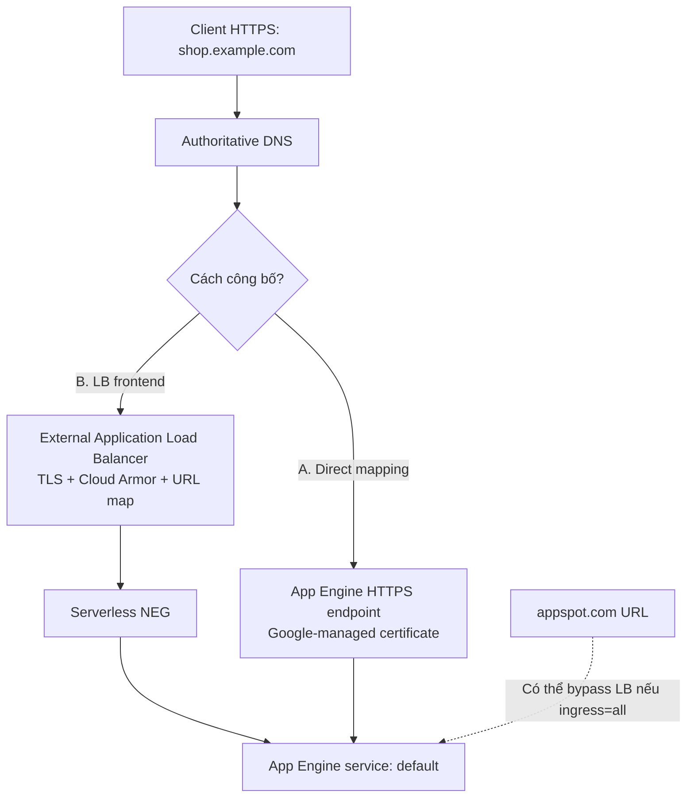
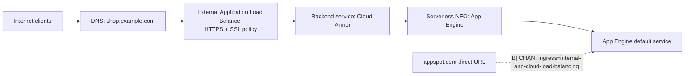

# Custom domains, HTTPS và bảo vệ ứng dụng App Engine

Ứng dụng Orders chạy trên Google App Engine tại một URL mặc định dạng `https://PROJECT_ID.REGION_ID.r.appspot.com`. Doanh nghiệp muốn khách truy cập qua `https://shop.example.com`, mã hóa HTTPS, hạn chế trang quản trị và chặn lưu lượng độc hại. **Đổi tên miền không đồng nghĩa ứng dụng đã an toàn**: DNS có thể trỏ sai, chứng chỉ chưa sẵn sàng hoặc URL `appspot.com` vẫn cho phép bỏ qua lớp bảo vệ được đặt ở Load Balancer.

Bài học thuộc chương **App Engine**, module `CLOUD_PROVIDERS_GCP`. Nội dung liên kết quản trị project/IAM, VPC, Load Balancing, Cloud Armor, Cloud Logging và chi phí. Chúng ta triển khai theo hai phương án: **domain mapping trực tiếp tới App Engine** cho ứng dụng đơn giản, hoặc **external Application Load Balancer + serverless NEG** khi cần WAF, IP frontend riêng và nhiều quy tắc định tuyến.

> Ví dụ sử dụng tên miền `example.com`, project `orders-lab` và service `default`, tất cả đều minh họa. Lệnh tạo mapping, sửa DNS, thay ingress/firewall hoặc TLS **có thể làm gián đoạn dịch vụ**; chỉ chạy với project và domain thực sự được phép quản trị.

## 1. Mục tiêu

Sau bài này, bạn có thể:

1. Giải thích App Engine default hostname, custom domain mapping, DNS và service routing.
2. Xác minh quyền sở hữu tên miền, tạo mapping và cấu hình bản ghi A/AAAA/CNAME theo giá trị Google trả về.
3. Kiểm tra Google-managed SSL, TLS 1.2+, redirect HTTP→HTTPS, HSTS và giới hạn wildcard.
4. Phân biệt App Engine **ingress settings**, **App Engine firewall**, Cloud Armor và Identity-Aware Proxy (IAP).
5. Chọn domain trực tiếp hay HTTPS Load Balancer với serverless NEG mà không để lộ đường bypass.
6. Kiểm thử DNS/TLS, giám sát lỗi và lập kế hoạch cutover/rollback, IAM, retention và chi phí.

## 2. Hai kiến trúc công bố ứng dụng



| Phương án | Ưu điểm | Khi không đủ |
| --- | --- | --- |
| **A. App Engine custom domain trực tiếp** | Dễ cấu hình; DNS records từ App Engine; mặc định tự cấp và gia hạn managed SSL | Cần WAF Cloud Armor, IP riêng hoặc tính năng SSL policy/URL map nâng cao |
| **B. External Application Load Balancer + serverless NEG** | Một frontend IP, chứng chỉ/SSL policy trên LB, Cloud Armor, URL routing và tích hợp dịch vụ khác | Tăng số tài nguyên/cấu hình và chi phí; phải chặn đường vòng tới App Engine |

Với phương án B, **map DNS/tên miền tới load balancer và quản lý chứng chỉ trên load balancer**, không cấu hình hai bộ domain mapping/certificate như thể chúng cùng phục vụ một frontend. Google khuyến nghị cách này khi dùng serverless NEG. Một App Engine app thuộc **một region đã chọn khi tạo**, nên LB không tự đem chính app đó thành hệ thống đa region. <https://cloud.google.com/appengine/docs/standard/securing-custom-domains-with-ssl>

### 2.1. Đường mặc định không tự biến mất

App Engine có URL `appspot.com` mặc định (mẫu cụ thể thay đổi theo tuổi app và service/version). Custom mapping thêm hostname công khai; **không tự tắt default hostname, không tự giới hạn ingress và không tự bật IAP**. Tên miền con trùng service/version cũng có thể ảnh hưởng routing theo quy tắc App Engine, nên cần rà soát `dispatch.yaml`, dịch vụ và domain mappings trước khi mở wildcard.

## 3. Domain mapping trực tiếp: từ quyền sở hữu tới DNS

### 3.1. Điều kiện cần

- App Engine application đã tồn tại và có service/revision đang phục vụ; domain do tổ chức quản lý.
- Người thực hiện có **App Engine Admin** (ví dụ `roles/appengine.appAdmin`) hoặc custom role đủ quyền domain mapping, cùng quyền quản lý DNS của zone tương ứng.
- Quyền sở hữu domain đã được **Search Console/Google verification** xác nhận; xác minh domain gốc `example.com` ngay cả khi chỉ muốn mapping `www.example.com`.
- Có kế hoạch ghi lại TTL, DNS records cũ và thời gian rollback trước cutover.

**Quyền DNS và IAM Google Cloud là hai loại riêng.** Người có quyền `roles/dns.admin` trên Cloud DNS zone chưa chắc có quyền tạo App Engine mapping; người là App Engine Admin chưa chắc sửa được DNS ở registrar bên ngoài.

### 3.2. Các bước trong Google Cloud Console

1. Mở **App Engine → Settings → Custom Domains → Add a custom domain** tại đúng project.
2. Chọn domain đã verified hoặc thực hiện **Verify a new domain** bằng Search Console theo hướng dẫn.
3. Chọn hostname cần công bố, ví dụ `www.example.com` và tùy chọn `example.com`; xác nhận mapping.
4. Ghi chính xác các **DNS resource records** App Engine trả về.
5. Đặt bản ghi ở DNS provider, chờ resolver nhìn thấy; sau đó xác minh **SSL security = Google-managed** và thử HTTPS.

Không đoán IP của Google hoặc lấy bản ghi của project khác. Các App Engine custom domain mappings dùng **shared IP pool**; muốn một IP frontend chỉ dành cho domain nên dùng Load Balancer.

### 3.3. Lệnh gcloud (chỉ với domain được phép)

```bash
PROJECT_ID="orders-lab"
DOMAIN="www.example.com"

# CHỈ ĐỌC: kiểm tra project và mapping hiện tại.
gcloud app describe --project="$PROJECT_ID"
gcloud app domain-mappings list --project="$PROJECT_ID"

# THAY ĐỔI: tạo mapping với SSL certificate tự quản lý bởi Google.
# Yêu cầu domain ownership đã được verify.
gcloud app domain-mappings create "$DOMAIN" \
  --certificate-management=AUTOMATIC \
  --project="$PROJECT_ID"

# CHỈ ĐỌC: xem resourceRecords, sslSettings và ID mapping.
gcloud app domain-mappings describe "$DOMAIN" \
  --project="$PROJECT_ID" \
  --format="yaml(id,resourceRecords,sslSettings)"
```

Nếu domain đã mapped, đừng tạo lại bằng script mù quáng; xác minh project/hostname và trạng thái mapping hiện có. Với domain đã ánh xạ tới app khác, cần kế hoạch chuyển quyền và ảnh hưởng DNS/certificate.

## 4. Cập nhật DNS đúng loại bản ghi

App Engine trả về `resourceRecords` gồm `type` và `rrdata`; DNS admin phải điền **nguyên giá trị trả về** tại provider.

| Hostname | Loại thường gặp | Cách xử lý |
| --- | --- | --- |
| `example.com` (apex/root) | `A` và/hoặc `AAAA` | Tạo đúng các records App Engine cung cấp cho zone apex |
| `www.example.com` | `CNAME` | Trỏ tới **rrdata DNS name** được Google cấp, không sao chép IP mẫu |
| DNS verification | `TXT` hoặc cơ chế xác minh theo provider | Giữ record cần thiết cho ownership và certificate |

Trong Console, root record có thể hiển thị với tên `@` tại registrar; trong **Cloud DNS** thường dùng tên root đầy đủ của zone, không mặc định nhập ký tự `@`. Một CNAME không được tồn tại cùng A/AAAA/MX/TXT của **cùng hostname** theo quy tắc DNS; giải quyết xung đột trước khi cutover.

### 4.1. Kiểm tra propagation (chỉ đọc)

```bash
# Các lệnh này không thay đổi DNS; yêu cầu công cụ dig/curl cài sẵn.
dig +short CNAME www.example.com
dig +short A example.com
dig +short AAAA example.com
dig +short TXT example.com

# Kiểm tra hostname khi chứng chỉ đã active.
curl --head --show-error https://www.example.com/
```

Nếu dùng proxy/CDN bên thứ ba, hãy kiểm tra cấu hình DNS proxy, CAA, redirect HTTPS và domain validation. Một số CDN có thể chặn request xác minh/chứng chỉ khiến Google-managed SSL không phát hành hoặc không gia hạn. **Bản ghi DNS hoạt động không có nghĩa TLS đã sẵn sàng**; thông tin cache/TTL có thể khiến resolver khác nhau nhìn thấy giá trị cũ trong nhiều giờ.

### 4.2. Mapping không phải redirect giữa apex và www

Mapping cả `example.com` và `www.example.com` **không tự áp chính sách canonical hostname**. Nếu SEO/session yêu cầu một hostname chính, bổ sung redirect 301/308 có kiểm soát ở ứng dụng hoặc LB, giữ đúng Host, path và query, không tạo redirect loop. Với request chứa cookie/session, thiết kế thuộc tính cookie `Secure`/`HttpOnly`/`SameSite` và domain scope cẩn thận.

## 5. HTTPS và quản lý certificate

### 5.1. Google-managed SSL mặc định

Với App Engine direct domain mapping, Google cấp, quản lý gia hạn và thu hồi chứng chỉ khi xóa mapping; CA có thể là Google Trust Services hoặc Let's Encrypt. Sau khi domain verified và DNS hiển thị đúng, chứng chỉ thường xuất hiện trong vài phút, nhưng DNS propagation có thể mất tới khoảng **24 giờ**. Kiểm tra trong **App Engine → Settings → Custom Domains** hoặc Admin API management status.

| Chế độ | Ai quản lý cert/khóa | Khi chọn |
| --- | --- | --- |
| Google-managed (direct App Engine) | Google tự cấp/gia hạn | Hostname riêng cụ thể, không cần wildcard managed SSL |
| Self-managed (direct App Engine) | Team tự mua/tạo, upload và gia hạn RSA cert/key đúng định dạng | Có yêu cầu certificate đặc biệt, SAN/wildcard và chấp nhận công việc rotation |
| Google-managed tại external LB | Certificate Manager/LB frontend | Kiến trúc dùng Cloud Armor, SSL policy, IP frontend riêng |

**Giới hạn quan trọng:** App Engine có thể map wildcard subdomains nhưng **managed SSL certificates không hỗ trợ wildcard mappings**. Nếu cần `*.example.com` qua App Engine trực tiếp, xem yêu cầu self-managed wildcard certificate hoặc thiết kế frontend LB phù hợp. Không ký upload private key vào Git, CI logs hay artifact công khai.

### 5.2. Kiểm tra chứng chỉ và TLS handshake

```bash
# CHỈ ĐỌC: kiểm tra thông tin cert đã được cấp.
openssl s_client \
  -connect www.example.com:443 \
  -servername www.example.com \
  -verify_return_error </dev/null

# Chỉ đọc HTTP headers. Kết quả mong muốn là HTTPS hợp lệ.
curl -I https://www.example.com/
curl -I http://www.example.com/
```

Kiểm tra `SAN` có hostname, chain tin cậy, ngày hết hạn và TLS phiên bản cho phép. `curl -I http://...` cần trả mã redirect theo thiết kế (thường 301/302), **không được trả dữ liệu nhạy cảm bằng HTTP**. Không dùng `curl -k` rồi tuyên bố TLS đã hợp lệ.

### 5.3. TLS 1.2+ và SSL policies

App Engine mới mặc định chỉ cho phép TLS 1.2 trở lên; hỗ trợ TLS 1.1 trở xuống đã bị deprecated. Có thể thiết lập tối thiểu cho application qua:

```bash
# THAY ĐỔI CHÍNH SÁCH TLS CHO APP; kiểm tra client compatibility trước.
gcloud app update \
  --project=orders-lab \
  --ssl-policy=TLS_VERSION_1_2
```

Với custom domain trực tiếp, một số client dùng TLS quá cũ có thể **thiết lập handshake nhưng nhận HTTP 400**; vì vậy chỉ chạy SSL handshake test chưa đủ để xác nhận request cũ thực sự được chấp nhận. Nếu cần kiểm soát cipher suites hoặc handshake rejection chặt chẽ, dùng external Application Load Balancer với **SSL policy** thích hợp.

### 5.4. Redirect HTTP → HTTPS và HSTS

Với App Engine **standard** và runtime/handler hỗ trợ, ví dụ đoạn `app.yaml` (Python 3.13):

```yaml
runtime: python313

handlers:
- url: /.*
  secure: always
  redirect_http_response_code: 301
  script: auto
```

Đây là ví dụ **cấu hình handler**, không phải một app hoàn chỉnh; cần có ứng dụng Python và dependencies được triển khai phù hợp. Với Flexible hoặc framework khác, kiểm tra cơ chế redirect tương ứng tại app/LB, **không sao chép blindly** config standard. `secure: always` yêu cầu HTTP request được redirect sang HTTPS nhưng không tự thêm HSTS.

Sau khi đã xác minh mọi hostname cần thiết đều chạy HTTPS, có thể trả HTTP response header:

```http
Strict-Transport-Security: max-age=15552000
X-Content-Type-Options: nosniff
Referrer-Policy: strict-origin-when-cross-origin
```

Giá trị `max-age=15552000` tương đương khoảng 180 ngày. Chỉ thêm `includeSubDomains` nếu **mọi subdomain** đều có HTTPS hoạt động; HSTS dài hạn hoặc preload sai có thể khiến domain phụ không còn truy cập được. CSP, cookie Secure/HttpOnly/SameSite, CSRF và CORS phải được thiết kế theo nghiệp vụ, không chỉ vì đã bật TLS.

## 6. Bảo vệ ứng dụng theo nhiều lớp

| Lớp | Kiểm soát | Không thay thế |
| --- | --- | --- |
| Domain ownership và DNS | Verified ownership, quản lý registrar/DNS, tránh record cũ | IAM bảo vệ dữ liệu trong ứng dụng |
| TLS và HTTPS redirect | Mã hóa, certificate hợp lệ, HSTS | Xác thực người dùng |
| **App Engine ingress setting** | Ai được kết nối từ Internet, VPC hoặc external LB | Authorization của endpoint |
| **App Engine firewall** | Allow/deny theo IP/CIDR của request đến app | WAF chống SQLi/XSS, Identity-Aware Proxy |
| **Cloud Armor** | WAF, rate limiting và threat protection trên LB backend | App Engine ingress controls và IAM |
| **Identity-Aware Proxy (IAP)** | Kiểm tra người dùng/nhóm được truy cập web app | Quyền nghiệp vụ bên trong Orders |
| Application | Authentication, authorization, CSRF, input validation, secrets | Firewall và certificate renewal |
| Operations | Logging, Monitoring, audit, backup và release rollback | Các biện pháp bảo vệ ở runtime |

Phải xác định một **đường vào được duyệt** rồi bảo vệ cả những đường vào còn lại. Tránh chỉ cấu hình bảo mật cho `shop.example.com` trong khi `appspot.com` hoặc hostname dự phòng có chính sách yếu hơn.

## 7. Ingress settings: chặn truy cập vòng qua App Engine

App Engine có **ingress settings theo service**, áp dụng cho cả hostname mặc định `appspot.com` và custom domains:

| Giá trị `--ingress` | Nguồn được chấp nhận | Sử dụng |
| --- | --- | --- |
| `all` (mặc định) | Truy cập trực tiếp từ Internet và các nguồn khác | Direct custom domain public, **không phù hợp nếu cần bắt buộc qua LB/WAF** |
| `internal-only` | Các nguồn Google Cloud/VPC được coi là internal theo điều kiện App Engine | Service nội bộ, không công bố public |
| `internal-and-cloud-load-balancing` | Internal sources và external Application Load Balancer | Bắt buộc client Internet đi qua LB (và Cloud Armor) |

**Đừng nhầm private ingress với private IP riêng của ứng dụng.** App Engine vẫn có URL theo mô hình của sản phẩm; ingress kiểm soát nguồn request được nhận. Khi dùng Shared VPC, phân loại “internal” phụ thuộc app ở host project hay service project; không mặc định mọi subnet trong organization đều được coi là internal.

### 7.1. Lệnh kiểm tra và thay đổi

```bash
PROJECT_ID="orders-lab"
SERVICE="default"

# CHỈ ĐỌC: kiểm tra trước khi thay chính sách.
gcloud app services describe "$SERVICE" \
  --project="$PROJECT_ID"

# THAY ĐỔI - CHỈ CHẠY KHI LB ĐÃ HOẠT ĐỘNG:
# Chặn client Internet truy cập thẳng appspot.com và direct custom mapping.
gcloud app services update "$SERVICE" \
  --ingress=internal-and-cloud-load-balancing \
  --project="$PROJECT_ID"

# CHỈ ĐỌC: xác minh thay đổi được ghi nhận.
gcloud app services describe "$SERVICE" \
  --project="$PROJECT_ID"
```

**Thứ tự an toàn:** tạo/kiểm tra external LB trước → xác nhận DNS/HTTPS/Cloud Armor → đổi ingress → **thử URL chính qua LB vẫn thành công và direct `appspot.com` từ Internet bị chặn**. Nếu dùng **direct App Engine domain mapping**, đặt `internal-and-cloud-load-balancing` có thể làm khách truy cập trực tiếp vào custom domain **không còn vào được ứng dụng**. Chỉ sử dụng khi thật sự đã chuyển đường vào sang LB.

## 8. App Engine firewall: allow/deny theo IP

App Engine firewall áp dụng cho **ingress request** đến toàn bộ application, gồm cả custom domains, default URLs và lưu lượng từ LB. Nó **khác VPC firewall** (Compute Engine firewall rules), vốn không phải một cách trực tiếp để giới hạn HTTP vào App Engine endpoint.

- Rules có **priority**, số càng nhỏ càng ưu tiên; rule `default` được xét cuối. Các IP/CIDR chỉ bị ảnh hưởng nếu match rule.
- Mặc định `default=allow`. Có thể chuyển sang deny-by-default nhưng cần rà soát client, Cloud Tasks, Scheduler và các truy cập nội bộ.
- Một số request nội bộ của App Engine Standard có ngoại lệ; ví dụ request từ Cloud Tasks có thể cần allow riêng theo tài liệu khi dùng default deny.
- Thay firewall **không xóa dữ liệu đã cache** ở trình duyệt/CDN; nội dung riêng tư cần header cache phù hợp.

### 8.1. Chặn dải IP mẫu

```bash
# CHỈ ĐỌC:
gcloud app firewall-rules list --project=orders-lab

# THAY ĐỔI: CIDR 203.0.113.0/24 là dải dùng cho tài liệu,
# KHÔNG đại diện một dải IP độc hại ngoài đời.
gcloud app firewall-rules create 1000 \
  --project=orders-lab \
  --source-range=203.0.113.0/24 \
  --action=DENY \
  --description="Demo blocked range - sandbox only"

# CHỈ ĐỌC: kiểm tra kết quả và thứ tự ưu tiên.
gcloud app firewall-rules list --project=orders-lab
```

Ví dụ **rủi ro cao** (chỉ làm sau khi đã tạo allow rules phù hợp và thử từ nhiều nguồn):

```bash
# CÓ THỂ CHẶN TOÀN BỘ TRUY CẬP NGOÀI Ý MUỐN:
# KHÔNG chạy trên production nếu chưa có runbook và rollback.
gcloud app firewall-rules update default \
  --project=orders-lab \
  --action=DENY
```

Khi App Engine nằm sau external LB với `ingress=internal-and-cloud-load-balancing`, tài liệu khuyến nghị **giữ default App Engine firewall = allow và dùng Cloud Armor ở LB**. Không dùng firewall deny-by-default một cách máy móc trong kiến trúc serverless NEG vì có thể tự chặn cả requests hợp lệ đến từ LB hoặc services nội bộ.

## 9. Khi cần Cloud Armor: dùng Load Balancer và serverless NEG

Cloud Armor **không phải một switch trực tiếp trên App Engine custom domain mapping**. Để áp WAF/rate limiting ở frontend, thiết kế:



Tạo **serverless NEG** cùng project và region với App Engine application; nó tham chiếu app, service hoặc version, hoặc dùng URL mask khi có nhiều services. Ví dụ câu lệnh **chưa tạo load balancer hoàn chỉnh**:

```bash
# THAY ĐỔI / PHÁT SINH PHÍ khi kết hợp LB.
# Thay REGION bằng region thực sự của App Engine app.
gcloud compute network-endpoint-groups create orders-ae-neg \
  --project=orders-lab \
  --region=APP_ENGINE_REGION \
  --network-endpoint-type=serverless \
  --app-engine-service=default
```

Sau đó platform team cấu hình global external Application Load Balancer: frontend static IP + certificate, URL map, backend service trỏ serverless NEG, Cloud Armor security policy và logging. Cuối cùng **DNS trỏ tới LB IP** và đặt ingress của App Engine thành `internal-and-cloud-load-balancing`.

**Các giới hạn cần hiểu:**

1. Serverless NEG cho App Engine **không hỗ trợ health check** kiểu backend VM/GKE. Giám sát bằng request metrics, synthetic probes, errors; không tạo health check rule tùy ý rồi kỳ vọng có hiệu lực.
2. Serverless NEG và App Engine backend phải cùng project/region theo quy tắc hỗ trợ; App Engine chỉ có một region mỗi project, **không tự có multi-region load balancing**.
3. App Engine firewall được đánh giá sau khi request đi qua serverless NEG; ingress control vẫn cần thiết để chặn default URL bypass WAF.
4. Nếu dùng IAP với LB, kiểm tra policy identity cùng OAuth client và **chỉ một IAP policy trên request path**; không bật IAP trùng cả App Engine lẫn backend service.
5. LB, static IP, SSL policy, Certificate Manager, Cloud Armor, request processing và logs có thể phát sinh chi phí riêng.

Trong một số tình huống **truy cập nội bộ VPC vẫn có thể đến App Engine** khi dùng ingress `internal-and-cloud-load-balancing`, mà không qua external LB/WAF. Vì vậy không thay authorization trong ứng dụng bằng giả định “mọi request đều đã qua Cloud Armor”.

## 10. IAP, IAM và authentication nghiệp vụ

**Identity-Aware Proxy (IAP)** bảo vệ web app bằng authentication/authorization theo Google identity, ví dụ trang vận hành chỉ cho nhóm nhân viên. IAP có thể cấu hình trực tiếp cho App Engine hoặc ở external LB backend theo kiến trúc; **chọn một điểm kiểm soát IAP trên cùng request path**.

- IAP user cần vai trò `roles/iap.httpsResourceAccessor` tại resource thích hợp.
- Cần cấu hình OAuth consent/client đúng tổ chức; project ngoài organization hoặc muốn người dùng bên ngoài có thể cần **custom OAuth client**.
- IAM để deploy/quản trị App Engine **không tự cấp quyền truy cập qua IAP**, kể cả người có Project Owner.
- IAP kiểm tra ai được vào ứng dụng; **ứng dụng vẫn phải kiểm tra quyền đọc đơn hàng, role admin và tenant ownership**.

Với ứng dụng public, có thể giữ website không qua IAP nhưng bảo vệ `admin.example.com` bằng dịch vụ hoặc frontend riêng và xác thực mạnh. Đừng để cùng admin endpoint có URL khác không được bảo vệ. Nếu bật IAP trên external LB, xem khả năng tương thích với Cloud CDN; không bật hai tính năng xung đột trên cùng backend.

### 10.1. Nguyên tắc IAM

| Principal | Quyền theo nhiệm vụ | Phạm vi |
| --- | --- | --- |
| Platform operator | Quản trị App Engine domain mapping/ingress | `roles/appengine.appAdmin` hoặc custom role hẹp |
| DNS operator | Sửa zone/records tại DNS provider | Chỉ zone đã được ủy quyền |
| Security operator | App Engine firewall / LB Cloud Armor rules | Chia quyền và review thay đổi trước enforce |
| Certificate owner | Tạo/duy trì TLS certificates khi self-managed/LB | Không phát private key qua CI logs/repository |
| IAP users | Truy cập dịch vụ đã bảo vệ | `roles/iap.httpsResourceAccessor` có điều kiện khi phù hợp |
| Runtime service account | Gọi Cloud SQL, Secret Manager và APIs cần thiết | Quyền tối thiểu, không cấp Owner/Editor mặc định |

Không sử dụng **App Engine Admin** như quyền mặc định của mọi developer. Tách nhiệm vụ deploy, sửa DNS, thay ingress, thay IAP/firewall và phê duyệt SSL policy; bật Cloud Audit Logs và theo dõi thay đổi bảo mật.

## 11. Kiểm thử end-to-end trước khi công bố

Kiểm tra từ **mạng ngoài**, **trong VPC** và một principal không được phép. Test `curl` chỉ là phép thử kỹ thuật; ứng dụng production còn cần xác minh phiên đăng nhập, cookie và luồng nghiệp vụ.

| Bước | Điều cần xác minh | Bằng chứng |
| --- | --- | --- |
| Domain ownership | Search Console xác minh đúng domain gốc | Mapping được phép tạo, domain không bị chiếm dụng |
| DNS | A/AAAA/CNAME đúng `resourceRecords` hoặc LB IP | `dig` từ nhiều resolvers, TTL và zone đúng |
| TLS | SAN khớp hostname, chain đáng tin, certificate active | `openssl s_client`, `curl -I https://...` |
| HTTP redirect | HTTP chuyển qua HTTPS, không redirect loop | `curl -I http://...`, status/Location |
| Direct App Engine (phương án A) | Custom domain HTTPS hoạt động | Smoke test application routes |
| LB + NEG (phương án B) | Domain qua LB thành công; Cloud Armor hoạt động | LB request logs, test rule có kiểm soát |
| Chống bypass (B) | Internet truy cập trực tiếp `appspot.com` bị chặn | Test từ nguồn bên ngoài, kiểm tra ingress |
| Auth | Tài khoản IAP/app hợp lệ được vào; unauthorized bị từ chối | Smoke tests có/không credential |
| Cache và dữ liệu | Không cache thông tin riêng tư trên CDN/proxy/browser | `Cache-Control: private, no-store` khi phù hợp |
| Observability | Có HTTP errors, latency, cert/SSL alerts và audit | Cloud Logging/Monitoring/Security dashboards |

Ví dụ test access **không thay đổi cấu hình**:

```bash
# Kiểm tra redirect và headers.
curl --head --show-error http://www.example.com/
curl --head --show-error https://www.example.com/

# Chọn địa chỉ IP từ DNS/LB thật nếu cần test trước khi cutover.
# --resolve vẫn xác thực đúng hostname/SNI với HTTPS.
curl --head --show-error \
  --resolve www.example.com:443:FRONTEND_IP \
  https://www.example.com/
```

**Không dùng `--insecure` / `-k`** để bỏ qua TLS validation trong phép nghiệm thu. Nếu app dùng session, một HEAD request `curl -I` có thể được ứng dụng xử lý khác GET; bổ sung GET/POST hợp lệ và kiểm tra status tương ứng.

## 12. Chuyển domain từ App Engine trực tiếp sang Load Balancer

Đây là thay đổi frontend có thể ảnh hưởng DNS/certificate. Lập kế hoạch tránh “đổi DNS trước rồi mới phát hiện LB chưa có cert”:

1. **Inventory:** ghi DNS hiện tại, App Engine mappings/cert statuses, service ingress, firewall, IAM/IAP, cookie domain và các endpoint cần giữ.
2. **Chuẩn bị LB:** tạo serverless NEG đúng project/region, backend, frontend HTTPS với certificate/SSL policy phù hợp, Cloud Armor rules ban đầu có thể thử chế độ preview theo yêu cầu.
3. **Kiểm thử LB trước DNS:** dùng hostname thử hoặc `curl --resolve` tới IP LB, test WAF/IAP, redirects, backend routing, request logs và authentication.
4. **Chuyển DNS:** hạ TTL từ trước theo kế hoạch, cập nhật A/AAAA/CNAME trỏ tới LB theo tài liệu; theo dõi cert provisioning và lỗi.
5. **Đóng đường bypass:** đổi ingress của tất cả App Engine services liên quan thành `internal-and-cloud-load-balancing`; test `appspot.com` từ Internet bị chặn, LB domain còn truy cập bình thường.
6. **Giám sát:** xem HTTP 4xx/5xx, request volume, latency, redirects, TLS warnings, login success, Cloud Armor false positives và chi phí.
7. **Cleanup:** sau cửa sổ rollback, bỏ mappings/cert/DNS records không dùng nhưng không xóa certificate/IP còn phục vụ. Giữ tài liệu owner và cấu hình IaC cập nhật.

**Khả năng gián đoạn:** Google-managed certificate của LB có thể cần DNS trỏ tới LB trước khi hoàn tất provisioning; thời gian cấp có thể không bằng không. Nếu cần chuyển không downtime, đánh giá trước phương án **certificate được xác minh bằng DNS**, imported certificate hoặc chuyển một hostname ít quan trọng trước theo tính năng của LB, và thử nghiệm chính xác quy trình trước cutover.

### 12.1. Rollback cần khôi phục cả đường truy cập

Nếu LB mới trả lỗi:

- Khôi phục DNS về records đã lưu từ trước, tính đến caching/TTL.
- Nếu trở lại **direct App Engine mapping**, đổi lại ingress `all` **chỉ khi** doanh nghiệp chấp nhận direct public exposure và đã áp các lớp bảo vệ thay thế; không mở public vô điều kiện.
- Bảo đảm App Engine direct certificate/mapping vẫn tồn tại và hoạt động; nếu đã xóa thì không thể giả định rollback tức thời.
- Nếu lỗi chỉ ở Cloud Armor/WAF, có thể rollback security policy theo quy trình an toàn thay vì thay DNS toàn site.
- Xem session cookies, redirect chain và cache ảnh hưởng người dùng; ghi nhận chính xác thời điểm recovery.

Rollback **không phải chỉ khôi phục DNS**: ingress, certificate, IAP và firewall phải tương thích với đường lưu lượng được chọn.

## 13. Giám sát, độ tin cậy và chi phí

**Cloud Monitoring** và **Cloud Logging** nên theo dõi request count, p95/p99 latency, 4xx/5xx, instance utilization, errors và deployment events. Khi có LB, thêm LB request logs, certificate status, Cloud Armor security policy decisions, TLS errors và backend response codes.

| Nguy cơ | Tín hiệu cần theo dõi | Hành động |
| --- | --- | --- |
| Certificate lỗi/không gia hạn | Managed SSL status, expiry, HTTPS synthetic checks | Rà ownership/DNS/CAA/CDN proxy, certificate scope |
| DNS sai/cutover dở dang | Tỷ lệ request theo IP/frontend, resolver answers, 404/502 | Kiểm tra RRSet, TTL, domain mapping hoặc URL map |
| HTTP không redirect | Synthetic HTTP→HTTPS test, HSTS header | Sửa handler/LB redirect và cache behavior |
| Cloud Armor false positive | Allowed/denied request trends, application success ratio | Điều chỉnh WAF rule bằng approval, không tắt toàn bộ WAF |
| Default URL bypass | Synthetic test vào `appspot.com` từ Internet | Đổi ingress đúng service, kiểm tra mọi service/version path |
| Traffic bất thường | Request rate, bot/error spikes, IP ranges | Rate limits, WAF hoặc firewall dựa trên bằng chứng |
| Phí tăng | App Engine instances, LB/frontend, Armor, Logs, CDN/egress | Xem Cloud Billing theo SKU/project và policy retention |

Trực tiếp mapping domain thường đơn giản và ít hạng mục frontend hơn. Khi thêm Load Balancer + Cloud Armor, bạn phải tính **forwarding rules, data processing, IP, certificate management, Cloud Armor, logging và egress**, ngoài phí instance App Engine. Với bản thân App Engine, chọn Standard/Flexible, autoscaling, idle instances và version count cũng ảnh hưởng ngân sách.

Đừng xóa toàn bộ error logs để tiết kiệm. Dùng log sampling có chủ đích, tránh log token/PII, đặt retention theo yêu cầu và giữ dấu vết thay đổi DNS/SSL/firewall/ingress để audit.

## 14. Case study: Orders website public, admin riêng tư

Một nhóm có App Engine service `default` phục vụ website và `admin` dành cho nhân viên. Yêu cầu:

- Người mua truy cập `https://shop.example.com` qua HTTPS và được WAF/rate limiting bảo vệ.
- Nhân viên truy cập `https://admin.example.com` sau đăng nhập và được phân quyền.
- Không có lối vào admin bằng `admin-dot-PROJECT_ID.REGION_ID.r.appspot.com` vượt quyền truy cập.
- Hệ thống có runbook khi SSL hết hạn hoặc một đợt DNS cutover thất bại.

### 14.1. Phương án đề xuất

| Thành phần | Thiết kế | Kiểm chứng |
| --- | --- | --- |
| Public website | Global external Application Load Balancer, serverless NEG trỏ `default`, Cloud Armor | HTTPS, WAF decisions, synthetic GET, auth nội dung riêng |
| Admin | IAP bảo vệ service/route admin theo kiến trúc đã chọn, phân quyền nghiệp vụ | Người không có vai trò bị từ chối qua **mọi URL** |
| Default hostname | App Engine `ingress=internal-and-cloud-load-balancing` với services công bố qua LB | Internet không truy cập vòng qua LB |
| Certificate | Cert được quản lý trên LB (nếu dùng LB), SNI/SAN cho mỗi hostname | Auto renewal, TLS 1.2+ và cảnh báo |
| DNS | Public A/AAAA hoặc CNAME đúng địa chỉ/tên đích được cấp | dig + curl --resolve, TTL rollback |
| Audit | Cloud Logging, Cloud Audit Logs, Cloud Armor logs | Có owner và thông báo khi config thay đổi |

Với IAP, nếu cả `default` và `admin` đi qua chung LB, phải thiết kế đúng OAuth client và chỉ **một IAP policy trên mỗi request path**. Nếu không thể phân tách chính sách như mong muốn, dùng frontend/backend/service riêng, và kiểm tra rủi ro session/cookie. Một hostname `admin.example.com` không tự khiến service admin private; **Ingress/IAP/app auth mới là lớp bắt buộc**.

### 14.2. Sự cố giả định: website chạy nhưng bảo vệ bị bypass

Người dùng bình thường vào `shop.example.com` bị Cloud Armor chặn rule rate limiting, nhưng vẫn vào được trang đó qua `PROJECT_ID.REGION_ID.r.appspot.com`. Nguyên nhân chính: frontend LB được bảo vệ nhưng App Engine vẫn để `ingress=all`.

Cách xử lý: (1) xác nhận LB/proxy frontend đang hoạt động; (2) đổi ingress đúng service sang `internal-and-cloud-load-balancing`; (3) kiểm tra default URL bị từ chối từ Internet và site qua LB vẫn được phục vụ; (4) kiểm tra các App Engine services khác, logging và chính sách IAP; (5) cập nhật policy/IaC để ngăn tái diễn.

**Không chữa bypass bằng cách xóa DNS của URL `appspot.com`**: hostname đó do Google quản lý và hành vi nhận request do ingress policy của ứng dụng quyết định.

## 15. Bảng chẩn đoán nhanh

| Triệu chứng | Khả năng thường gặp | Kiểm tra trước tiên |
| --- | --- | --- |
| `gcloud app domain-mappings create` bị từ chối | Domain chưa verified, IAM thiếu, mapping xung đột | Search Console, App Engine Admin role, mapping list |
| DNS resolvers trả giá trị khác nhau | TTL/cache, record ở sai zone, root CNAME không hợp lệ | `dig` tới authoritative resolver và `resourceRecords` |
| `ERR_CERT_COMMON_NAME_INVALID` | SAN không khớp host, cert chưa active, DNS chỉ sai frontend | SSL status, SNI hostname, cert SAN và rrdata |
| Managed cert `FAILED_RETRYING_NOT_VISIBLE` | Domain/DNS record chưa visible hoặc CDN chặn validation | DNS/CAA, Cloudflare proxy/redirect và certificate status |
| Wildcard mapping HTTP được nhưng HTTPS lỗi | Managed SSL không hỗ trợ wildcard | Dùng hostname cụ thể, self-managed cert hoặc LB phù hợp |
| HTTP vẫn trả `200` | Handler thiếu `secure: always` hoặc LB redirect chưa bật | `curl -I http://...`, app.yaml/routing |
| External domain trả `403` sau đổi ingress | Đổi sang LB-only nhưng DNS vẫn trỏ App Engine direct | Kiểm tra sơ đồ traffic, ingress và LB readiness |
| Từ Internet vẫn vào `appspot.com` | Service ingress còn `all` | `gcloud app services describe` từng service |
| App Engine firewall chặn cả lưu lượng hợp lệ | default deny hoặc source/priority sai | Rules list, client source, exceptions và rollback |
| LB/WAF không chặn URL mặc định | LB bypass vì ingress cấu hình sai | Ingress setting, synthetic default-host test |
| IAP trả `403` | Người dùng chưa được gán role, sai OAuth/IAP policy | IAP access policy, identity và resource scope |
| IAP trả `502` sau bật | Thiếu/không hợp lệ OAuth client configuration | IAP OAuth client, organization membership |
| TLS test tưởng hỗ trợ TLS 1.1 | Chỉ đo handshake trên custom domain | Thử request HTTP sau handshake, xem App Engine minimum TLS policy |
| 502 từ LB dù app logs bình thường | NEG/backend service/URL map sai, app lỗi chỉ ở đường LB | LB request logs, NEG region/project, target service |

## 16. Bài tập thực hành

### Bài A — Chọn kiến trúc

Một landing page public cần HTTPS nhưng không có WAF đặc biệt; một Orders API cần Cloud Armor rate limiting và static IP riêng. Chọn **direct domain mapping** hoặc **LB + serverless NEG** cho từng hệ thống. Nêu certificate, DNS, ingress và các khoản phí khác nhau.

### Bài B — Mapping và DNS

Giả sử nhóm sở hữu `example.com`, muốn công bố `www.example.com`. Viết thứ tự kiểm tra ownership, tạo mapping bằng `gcloud`, xem `resourceRecords`, cấu hình CNAME rồi nghiệm thu HTTPS. Vì sao không nên sao chép A records của một project khác?

### Bài C — Wildcard và certificate

Nhóm muốn map `*.example.com` và cho tất cả subdomains dùng HTTPS tự động. Giải thích giới hạn của **App Engine managed SSL**, lựa chọn self-managed wildcard hoặc frontend LB và cách quản lý certificate renewal. Có nên bật HSTS `includeSubDomains` ngay không?

### Bài D — HTTP, TLS và HSTS

Thiết kế kiểm thử `http://shop.example.com` và `https://shop.example.com`. Dùng `curl`/`openssl` xác minh redirect, SAN và TLS 1.2+. Hãy phân biệt `secure: always` với HSTS; giải thích vì sao kiểm tra handshake TLS 1.1 trên custom domain có thể gây hiểu nhầm.

### Bài E — Firewall và ingress

App có direct domain public và một URL `appspot.com`. Team đổi ingress sang `internal-and-cloud-load-balancing` mà chưa tạo LB. Điều gì xảy ra với khách Internet? Viết bước khôi phục, rồi đề xuất triển khai LB an toàn. Khi nào mới cân nhắc App Engine firewall default deny?

### Bài F — Bảo vệ admin bằng IAP

Trang `admin.example.com` chỉ dành cho nhân viên. Liệt kê OAuth/IAP/IAM setup, tài khoản kiểm thử hợp lệ và không hợp lệ, kiểm tra URL mặc định và authorization ở API. Vì sao Project Owner không mặc nhiên có quyền vào ứng dụng IAP?

### Bài G — Chống bypass và rollback

Cloud Armor chặn 1.000 request đáng ngờ/phút qua `shop.example.com` nhưng người dùng vẫn vào được `appspot.com`. Viết runbook khắc phục theo trình tự **không làm gián đoạn toàn site**; bổ sung alert để phát hiện ingress bị đổi lại thành `all`. Nếu phải rollback DNS về direct mapping, còn phải kiểm tra những settings nào?

### Câu hỏi tự kiểm tra

1. Custom domain mapping có tự xóa URL `appspot.com` hay không?
2. Vì sao phải verify domain trước khi App Engine cấp managed certificate?
3. Vì sao không hard-code IP lấy từ bài hướng dẫn vào DNS production?
4. Managed SSL có hỗ trợ wildcard domain mappings trên App Engine không?
5. TLS certificate hợp lệ có đồng nghĩa admin endpoint được xác thực không?
6. `secure: always`, HSTS và SSL policy khác nhau ở đâu?
7. Ingress `all`, `internal-only` và `internal-and-cloud-load-balancing` khác nhau thế nào?
8. App Engine firewall có giống VPC firewall của Compute Engine không?
9. Tại sao cần ingress controls ngay cả khi đã bật Cloud Armor ở LB?
10. IAP có thay thế role-based authorization của ứng dụng Orders không?

## 17. Checklist và tài liệu chính thức

- [ ] Domain owner, DNS editor, App Engine admin và người duyệt thay đổi được xác định.
- [ ] Kiến trúc chọn **direct mapping hoặc LB frontend** rõ ràng; không cấu hình DNS/cert đan xen.
- [ ] Domain verified, A/AAAA/CNAME đúng giá trị thực, SSL certificate active.
- [ ] HTTPS, HTTP redirect, HSTS/cookies/cipher policy đã được test.
- [ ] Ingress ở từng service khớp kiến trúc, không có đường bypass ngoài dự kiến.
- [ ] Firewall, Cloud Armor, IAP và authorization nghiệp vụ được kiểm thử với principal hợp lệ/không hợp lệ.
- [ ] Có metrics/logs/alerts, DNS rollback records và plan thu hồi certificate/IP cũ.
- [ ] Ghi nhận owner, quota/billing và kiểm thử lại sau mỗi thay đổi ingress/TLS/DNS.

Tài liệu Google Cloud:

- [Mapping custom domains — App Engine](https://cloud.google.com/appengine/docs/standard/mapping-custom-domains)
- [Securing custom domains with SSL](https://cloud.google.com/appengine/docs/standard/securing-custom-domains-with-ssl)
- [gcloud app domain-mappings](https://cloud.google.com/sdk/gcloud/reference/app/domain-mappings)
- [App Engine standard app.yaml reference](https://cloud.google.com/appengine/docs/standard/reference/app-yaml)
- [Minimum TLS for App Engine](https://cloud.google.com/appengine/docs/standard/secure-minimum-tls)
- [Ingress settings](https://cloud.google.com/appengine/docs/standard/ingress-settings)
- [Understanding App Engine firewalls](https://cloud.google.com/appengine/docs/standard/understanding-firewalls)
- [Creating App Engine firewall rules](https://cloud.google.com/appengine/docs/standard/creating-firewalls)
- [Enable IAP for App Engine](https://cloud.google.com/iap/docs/enabling-app-engine)
- [Serverless NEGs overview](https://cloud.google.com/load-balancing/docs/negs/serverless-neg-concepts)
- [Global external Application Load Balancer with serverless backend](https://cloud.google.com/load-balancing/docs/https/setup-global-ext-https-serverless)
- [App Engine pricing](https://cloud.google.com/appengine/pricing)

**Ghi nhớ:** Domain verification → DNS records đúng → HTTPS certificate/redirect → ingress phù hợp → firewall/WAF/IAP và app authorization → kiểm thử từ Internet lẫn VPC → giám sát và rollback. Với Load Balancer, **bảo vệ frontend nhưng bỏ quên App Engine default URL là một sai sót kiến trúc**; hãy luôn kiểm tra đường bypass trước khi phát hành.
