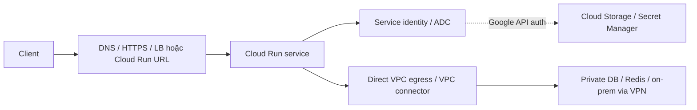
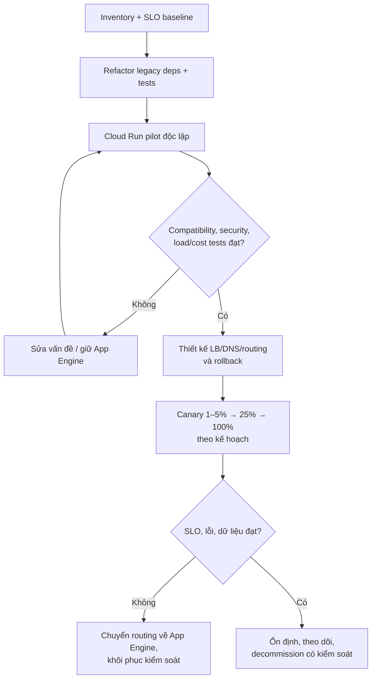

# Đánh giá chuyển ứng dụng App Engine sang Cloud Run

Một ứng dụng đang chạy ổn định trên **App Engine** không nhất thiết phải chuyển ngay sang **Cloud Run**. Nhưng nếu đội phát triển muốn chủ động đóng gói container, điều chỉnh CPU/memory/concurrency, thống nhất CI/CD cho nhiều dịch vụ hoặc giảm phụ thuộc runtime và API cũ, Cloud Run là một đích hiện đại hóa đáng đánh giá. Quyết định đúng không chỉ là “triển khai lại mã nguồn”: cần xem **runtime, các dịch vụ phụ thuộc, giao thức HTTP, bảo mật, mạng, dữ liệu, khả năng rollback và tổng chi phí**.

Bài thuộc chương **App Engine** của module `CLOUD_PROVIDERS_GCP`. Người học vận dụng kiến thức project/IAM, VPC, Compute Engine, Cloud Run, lưu trữ và cơ sở dữ liệu để lựa chọn dịch vụ, bảo vệ tài nguyên, tự động hóa phát hành, theo dõi độ tin cậy và kiểm soát chi phí. Mục tiêu là hoàn thành **bản đánh giá có thể ra quyết định** và một kế hoạch migration thử nghiệm an toàn, không mặc định mọi ứng dụng đều nên chuyển.

> **Phạm vi:** App Engine **standard** và **flexible** có kiến trúc khác nhau. Công cụ `gcloud beta app migrate-to-run` trong hướng dẫn Google Cloud đang ở giai đoạn **Preview/Pre-GA**; cần kiểm tra điều kiện tương thích và khả năng sử dụng thực tế. Đặc biệt, cách chuyển ứng dụng **standard second-generation không dùng legacy bundled services** không áp dụng nguyên xi cho **first-generation hoặc ứng dụng còn gọi bundled APIs**. Các lệnh thay đổi hạ tầng phải được phê duyệt trước khi chạy.

## 1. Mục tiêu học tập

Sau bài này, bạn có thể:

1. So sánh App Engine standard/flexible với Cloud Run theo **mô hình triển khai, runtime, scale, mạng và tính phí**.
2. Phân loại ứng dụng thành **chuyển tương đối dễ, cần refactor trước, hoặc nên giữ lại tạm thời**.
3. Lập bảng kiểm kê `app.yaml`, services/versions, handlers, dependencies, IAM, cron, queues, dữ liệu và domain.
4. Xác định cách thay thế **legacy bundled services**, cùng những khác biệt về container, filesystem, HTTP port và request lifecycle.
5. Kiểm tra tương thích bằng công cụ Preview khi đủ điều kiện và triển khai **Cloud Run song song để thử**.
6. Xây dựng kế hoạch **shadow test, canary, cutover, rollback** có tiêu chí định lượng.
7. Dự toán rủi ro và chi phí dựa trên tải thực tế, không chỉ so đơn giá một instance.

## 2. So sánh hai nền tảng trước khi quyết định

| Tiêu chí | App Engine standard | App Engine flexible | Cloud Run services |
| --- | --- | --- | --- |
| Triển khai | Source và cấu hình `app.yaml` theo runtime được hỗ trợ. | Ứng dụng/container trên hạ tầng Compute Engine do dịch vụ quản lý. | Container image hoặc build từ source qua buildpacks; mỗi lần phát hành tạo revision. |
| Runtime | Có giới hạn và các đặc điểm môi trường standard; first-gen và second-gen khác nhau. | Môi trường linh hoạt hơn, gắn với VM và container. | Container contract: process lắng nghe `PORT` trên `0.0.0.0`, image phù hợp. |
| Đơn vị phát hành | **Service / version / instance**. | **Service / version / instance**. | **Service / revision / instance**. |
| Mở rộng | Theo scaling config của App Engine. | Tùy cơ chế autoscaling/manual scaling của flex. | Autoscaling theo requests, concurrency, CPU và các tham số min/max; có các chế độ scaling được hỗ trợ. |
| Tài nguyên | Instance classes và cấu hình theo environment. | VM capacity/config theo môi trường flexible. | CPU/memory/concurrency và billing setting theo mỗi service/revision. |
| Tác vụ nền | Phụ thuộc environment và lifecycle, Task Queues/cron hoặc dịch vụ khác. | Có thể dùng process trong môi trường flex nhưng vẫn phải xử lý vòng đời. | Chọn queue/Cloud Run jobs/worker theo kiểu tác vụ; không mặc định CPU sau HTTP response. |
| Legacy App Engine bundled APIs | Có thể hỗ trợ theo runtime/tính năng. | Không có tương đương trực tiếp toàn bộ. | **Không hỗ trợ App Engine legacy bundled services**. |
| Networking | Cơ chế VPC/connector/firewall/URL của App Engine. | Mạng VM/VPC và hạ tầng linh hoạt. | Ingress riêng và Direct VPC egress/Serverless VPC Access theo cấu hình. |
| Truy cập HTTP | URL App Engine và cơ chế routing/dispatch, default access theo cấu hình. | Tương tự ở mô hình App Engine. | `run.app` URL, IAM invoker và ingress policy; công cụ migration có thể tạo private service. |
| Quan sát/chi phí | Logs, instances/instance-hours và các SKU App Engine. | VM/resource billing tương ứng và phụ trợ. | vCPU-seconds, GiB-seconds, request charges tùy billing model, network và phụ trợ. |

**Không có lựa chọn thắng mọi tiêu chí.** Một App Engine service ít thay đổi, phù hợp runtime hiện tại, có SLO ổn định và tổng phí hợp lý có thể tiếp tục vận hành. Ngược lại, ứng dụng cần container portability, thử nhiều framework hoặc tách workload thành các dịch vụ HTTP và jobs có thể hưởng lợi từ Cloud Run.

### 2.1. Ba tình huống ra quyết định

- **A — Ứng dụng standard thế hệ mới, không dùng bundled APIs:** ứng viên tốt để pilot. Có thể thử công cụ chuyển đổi Preview và so kết quả với triển khai Cloud Run thủ công.
- **B — Ứng dụng Java 8/Python 2 hoặc dùng Memcache/Task Queue/Users API kiểu cũ:** **refactor dependencies và runtime trước**, không coi việc chuyển platform là bước duy nhất. Các runtime first-generation legacy đã đến giai đoạn deprecation; cần kiểm tra lịch hỗ trợ và khả năng deploy hiện hành.
- **C — Ứng dụng flex có Dockerfile/HTTP server tương thích và dữ liệu ở dịch vụ bên ngoài:** có thể pilot tương đối trực tiếp, nhưng phải kiểm tra VM/network, process lifecycle, tài nguyên, domain và cron/queue khác biệt.

## 3. Bản kiểm kê trước migration

Đừng bắt đầu bằng cách xóa `app.yaml`. Trước tiên tạo inventory cho **từng App Engine service/version**, xác định những tính năng nào được chuyển và những gì sẽ được thay.

| Hạng mục | Cần thu thập | Câu hỏi quyết định |
| --- | --- | --- |
| **Runtime** | Language/version, standard hay flex, dependencies, custom libraries. | Runtime có được Cloud Run image/buildpacks hỗ trợ không? |
| **Services/versions** | Service name, version hiện nhận traffic, traffic split, cron/dispatch. | Cần bao nhiêu Cloud Run services/revisions? |
| **HTTP contract** | Routes, methods, request timeout, upload, streaming, WebSocket, auth. | Container có thể chạy theo Cloud Run contract không? |
| **Scaling** | App Engine instance class, min/max, basic/automatic/manual scaling, peak traffic. | Chọn Cloud Run concurrency và capacity thế nào? |
| **State** | Files tạm, RAM cache, session, cookies, dữ liệu trong DB/Storage. | Có dữ liệu nào lệ thuộc một App Engine instance không? |
| **Legacy APIs** | Datastore/NDB, Memcache, Task Queues, Blobstore, Users, Mail, Images… | Thay bằng Client Libraries/dịch vụ nào? |
| **Network** | VPC connector, Cloud SQL private IP, egress, firewall, DNS, IP allowlist. | Cloud Run kết nối được dependency trong VPC không? |
| **Identity** | App Engine SA, custom SA, invoker/auth, secrets và audit. | Cloud Run runtime SA và caller IAM cần quyền nào? |
| **Operations** | Cron, task backlog, logs, monitoring alerts, CI/CD, on-call. | Phải chuyển lịch/job/alert trước hay sau cutover? |
| **Chi phí** | Billing theo SKU, instance usage, network, Cloud SQL, log volume. | Total cost sau chuyển tăng hay giảm trong tải thực? |

### 3.1. Lệnh thu thập hiện trạng (chỉ đọc)

```bash
PROJECT_ID="shop-dev"
SERVICE="default"

gcloud app describe --project="$PROJECT_ID"
gcloud app services list --project="$PROJECT_ID"
gcloud app versions list \
  --project="$PROJECT_ID" \
  --service="$SERVICE"

# Khi đã có quyền đọc Cloud Run, kiểm tra tài nguyên đích.
gcloud run services list --project="$PROJECT_ID"
```

Những lệnh này **không chỉnh App Engine**. Cần bổ sung thông tin từ `app.yaml`, cấu hình triển khai, Git/CI và các owner ứng dụng; không suy ra từ một danh sách service rằng cron, task queues và dữ liệu đã sẵn sàng chuyển.

### 3.2. Ví dụ đánh giá `app.yaml`

```yaml
runtime: java17
service: orders-api
instance_class: F2
automatic_scaling:
  min_instances: 1
  max_instances: 10
  target_cpu_utilization: 0.65
env_variables:
  FEATURE_FLAG: "true"
```

Đây là cấu hình minh họa cho **App Engine standard**; các thuộc tính hợp lệ phụ thuộc runtime và environment. Khi chuyển sang Cloud Run:

- `service` ánh xạ thành Cloud Run **service** theo tên được chọn, nhưng **version** trở thành **revision** và traffic split được quản lý bằng cơ chế mới.
- `instance_class` **không** đổi cơ học thành CPU/memory. Cần benchmark RSS, CPU utilization, concurrency và latency.
- `automatic_scaling` cần phân tích lại `min/max`, request concurrency, CPU signal và downstream limits.
- `env_variables` có thể chuyển, **ngoại trừ secrets** cần đưa vào Secret Manager; không copy credentials dạng rõ chữ.
- `app.yaml` không phải định dạng deploy chuẩn bắt buộc của Cloud Run; có thể dùng gcloud flags, service YAML, Terraform hoặc GitOps.

## 4. Các khác biệt ứng dụng có thể khiến migration thất bại

### 4.1. Cloud Run container contract

Cloud Run service yêu cầu ingress container:

1. Khởi động và **lắng nghe trên `0.0.0.0`**, tại cổng được truyền qua biến môi trường `PORT` (mặc định thường là 8080).
2. Trả response trước **request timeout** cấu hình; xử lý timeout và kết thúc request có chủ đích.
3. Chịu được **cold starts, scale out và instance bị thay**; không dựa vào instance IP/hostname ổn định.
4. Coi filesystem ghi được là **tạm thời**, thường dùng bộ nhớ instance và mất khi instance dừng.
5. Quản lý SIGTERM/graceful shutdown; không giả định một thread chạy mãi sau HTTP response.

Ví dụ Spring Boot nhỏ có thể đặt `server.port=8080`, đồng thời khi triển khai thật cần bảo đảm binding/port trùng với Cloud Run `PORT`. Với ứng dụng chọn port tùy ý, hãy đọc `PORT` trong code/startup script; **không bind vào `127.0.0.1`**.

Ví dụ Dockerfile dành cho một executable JAR đã build:

```dockerfile
FROM eclipse-temurin:21-jre
WORKDIR /app
COPY target/app.jar /app/app.jar
USER 10001
EXPOSE 8080
ENTRYPOINT ["java", "-jar", "/app/app.jar"]
```

Dockerfile chỉ là **mẫu packaging**, không phải bản chuyển đổi tự động từ App Engine. Ứng dụng cần nghe cổng 8080 và build JAR tương thích. Trong production, pin base image theo digest, quét lỗ hổng và giới hạn quyền container.

### 4.2. Filesystem, session và state

Một số ứng dụng App Engine dùng filesystem tạm, cache RAM, sticky session hay file do người dùng upload. Sau migration, tuyệt đối không coi thư mục trong container là nơi lưu dữ liệu bền:

| Trạng thái | Cách xử lý gợi ý |
| --- | --- |
| Upload, ảnh, báo cáo cần lưu lâu | **Cloud Storage**; kiểm soát object IAM, retention, generation. |
| Session giữa nhiều instances | Signed session token hoặc session store phù hợp; tránh RAM duy nhất trong một instance. |
| Cache chia sẻ | **Memorystore** hoặc cache/data store được thiết kế đúng; cân nhắc network/chi phí. |
| Dữ liệu giao dịch | **Cloud SQL/Firestore** theo workload; backup và migrations độc lập. |
| File tạm phục vụ một request | Được phép khi trong memory/disk limit; cleanup và đo memory. |
| Công việc kéo dài sau response | **Cloud Tasks, Pub/Sub, Cloud Run jobs** hoặc mô hình worker phù hợp. |

### 4.3. Legacy bundled services: blocker thường gặp

Ứng dụng App Engine standard cũ có thể gọi các **legacy bundled services**, trong khi Cloud Run **không hỗ trợ trực tiếp** các API đó. Cần thay thế ở lớp mã ứng dụng:

| App Engine capability | Hướng thay thế phổ biến | Lưu ý |
| --- | --- | --- |
| **Datastore/NDB** | Cloud Client Libraries cho Firestore in Datastore mode/Datastore; migration NDB thích hợp với ngôn ngữ. | Kiểm tra transactions, indexes, namespaces, entity semantics và client behavior. |
| **Task Queue push** | **Cloud Tasks** HTTP target → Cloud Run. | IAM OIDC, retry, queue rate limits, idempotency. |
| **Task Queue pull** | **Pub/Sub** hoặc queue/worker được thiết kế lại. | ACK deadline, delivery semantics, concurrency và ordering. |
| **Memcache** | Memorystore hoặc cache ứng dụng phù hợp. | Không mặc định cùng semantics/đơn giá; phải thiết kế invalidation. |
| **Blobstore** | Cloud Storage qua Client Libraries. | URL, signed access, object metadata và lifecycle. |
| **URL Fetch** | Thư viện HTTP thông thường. | Proxy/egress, DNS, timeout, certificate và retries. |
| **Users/Mail/Images/Search** | Identity Platform/OIDC, SMTP/API provider, image processing, search service thích hợp. | Không có ánh xạ 1–1 cho mọi tính năng; phân tích chức năng cụ thể. |
| **App Identity** | Runtime service account + Application Default Credentials, OIDC khi thích hợp. | Gán IAM hẹp, tránh key JSON dài hạn. |

**Ưu tiên thứ tự:** thay API legacy → xác minh dữ liệu/ứng dụng vẫn hoạt động trên App Engine (nếu khả thi) → thử Cloud Run. Khi cùng lúc thay runtime, database, framework và routing, quá nhiều biến thay đổi khiến rollback khó và không xác định được nguyên nhân lỗi.

### 4.4. Cron, background tasks và dispatch

- **`cron.yaml`:** đánh giá **Cloud Scheduler** gửi HTTP có **OIDC authentication** tới Cloud Run hoặc kích hoạt workflow/job phù hợp.
- **`queue.yaml` / Task Queues:** chuyển sang Cloud Tasks/Pub/Sub theo loại push/pull và bảo toàn retry/backoff, deduplication, dead-letter.
- **`dispatch.yaml`:** chuyển thành route ở Application Load Balancer, API gateway hoặc cấu trúc service/domain phù hợp; không copy đường dẫn một cách cơ học.
- **Warmup/custom error pages/handlers static:** cần thiết kế lại theo Cloud Run container lifecycle, application routing, CDN/Cloud Storage hoặc Load Balancer.

Hãy xác định **người gọi mới là ai** và principal nào có quyền `roles/run.invoker`. Thay lịch cron bằng Scheduler không được đi kèm việc mở mọi endpoint nội bộ thành public để gọi cho tiện.

## 5. Mạng, IAM và giao diện người dùng sau khi chuyển

### 5.1. Truy cập private resources

App Engine và Cloud Run có thể tiếp cận một số dịch vụ Google Cloud qua Client Libraries mà không cần thêm VPC connector. Nhưng khi ứng dụng gọi **private IP Cloud SQL, Redis/Memorystore, service trên VPC hoặc on-premises**, phải thiết kế **Direct VPC egress** hoặc **Serverless VPC Access connector** theo khả năng và topology:



Kiểm tra routing, firewall, egress mode, DNS, private ranges, connection pool và **chi phí VPC egress/NAT/network**. Không bật VPC connector mặc định cho mọi lưu lượng nếu ứng dụng không cần; không cấu hình Cloud SQL private endpoint bằng thông số chỉ đúng ở App Engine.

### 5.2. Tách identity và quyền

| Principal | Cần quyền gì? | Tránh |
| --- | --- | --- |
| **Build/deploy principal** | Build image và deploy Cloud Run đúng project/service. | Dùng quyền Owner rộng cho CI. |
| **Cloud Run runtime service account** | Chỉ Cloud SQL/Storage/Secret Manager/Tasks thực sự cần. | Mặc định có quyền edit toàn project. |
| **Caller** (người dùng, Scheduler, Tasks, Eventarc) | Quyền invoke hoặc xác thực ứng dụng theo mục đích. | Mở public toàn bộ để “hết 403”. |
| **Network/platform admin** | VPC route, egress, LB, DNS, TLS và firewall. | Thay firewall không kiểm chứng đường traffic. |

App Engine default service account và Cloud Run runtime service account **không mặc nhiên giống nhau**. Khi chuyển, xác minh principal thực của ADC, IAM DB/API, Secret Manager và **Cloud Audit Logs** trước khi cutover.

### 5.3. URL, custom domain, cookies và authentication

Một endpoint đang ở `*.appspot.com` không tự biến thành `*.run.app` với đầy đủ tính năng tương đương. Cần kiểm tra:

1. **Custom domain/DNS** và TLS certificates; domain mapping có thể chọn cấu trúc LB theo use case.
2. **HTTPS redirects, Host header, X-Forwarded-* headers**, CORS/CSRF và URL tuyệt đối do ứng dụng tạo.
3. **Cookie domain/path, SameSite, Secure flags**, login callback/OAuth redirect URIs.
4. **App Engine routing** theo service/version/path so với Cloud Run service/revision và backend routing.
5. **Session affinity** khi có, nhưng không coi sticky routing là nơi lưu session bền vững.
6. **Public/private ingress** cùng IAM invoker/IAP/app authentication theo thiết kế mới.

Cloud Run mới có thể được tạo ở trạng thái **yêu cầu xác thực**; thử mở URL trong browser rồi gặp `403` không nhất thiết là deploy thất bại. Kiểm tra IAM/ingress và dùng proxy/identity token của người được cấp quyền để test.

## 6. Đánh giá hiệu năng và chi phí

### 6.1. Chọn sizing bằng dữ liệu

Không thể đổi `instance_class: F2` thành `cpu=1, memory=512Mi` rồi khẳng định tương đương. Cần lấy **load profile** của ứng dụng:

- Request rate theo giờ, p50/p95/p99 latency, kích thước payload và tỷ lệ 4xx/5xx.
- CPU/memory peak, cold start/warmup và thời gian giữ kết nối.
- Tỷ lệ request I/O-bound/CPU-bound, số luồng, concurrency có thể chịu.
- Connection pool, Cloud SQL quota, outbound requests và API rate limits.
- SLO availability, RTO/RPO và mục tiêu startup latency.

Cloud Run có **CPU/memory per instance, concurrency, min/max instances, CPU allocation/billing settings**. Chọn `concurrency=1` có thể đơn giản nhưng tạo nhiều instances/kết nối DB; chọn concurrency rất cao có thể tăng p99 latency và memory.

### 6.2. Dự toán tổng chi phí, không chỉ giá compute

| Nhóm | App Engine hiện tại | Cloud Run sau chuyển |
| --- | --- | --- |
| Compute | Instance class/hours hoặc VM resources theo environment. | vCPU-seconds, GiB-seconds, request charges và min-instance idle theo billing mode. |
| Build/artifact | Quy trình build hiện tại. | Cloud Build/buildpacks, Artifact Registry image storage. |
| Network | Egress, connector, private connectivity. | Egress, Direct VPC/connector, NAT và cross-region nếu có. |
| Edge | Custom domain/HTTPS/routing hiện tại. | Cloud Load Balancing/CDN/IAP/Cloud Armor nếu đưa vào kiến trúc. |
| Background | Cron/Task Queue và quotas. | Cloud Scheduler/Tasks/Pub/Sub/jobs. |
| Data | Datastore/Cloud SQL/Storage/Memcache. | Cloud SQL/Firestore/Storage/Memorystore và migration overhead. |
| Observability | Logging/Monitoring hiện tại. | Cloud Run logs/metrics, traces và retention. |

**Ví dụ tính định hướng:** một API nhận 50.000 request/ngày, mỗi request trung bình 200 ms, nếu chỉ có **một instance bận liên tục cho các request không chồng nhau**, tổng thời gian phục vụ là `50.000 × 0,2 = 10.000 giây/ngày`. Nhưng billing thật còn phụ thuộc **requests chồng nhau trên instances**, startup/shutdown, min idle, CPU/memory, region và cấu hình tính phí. Không nhân “số request × thời gian” làm hóa đơn Cloud Run nếu concurrency khác 1.

Chạy benchmark song song trên cùng dataset/traffic profile, so `$/1.000 requests` cùng **p95 latency, error rate và cold start**. Nếu giảm chi phí nhưng làm tăng lỗi hoặc mất bảo đảm bảo mật, migration chưa đạt.

## 7. Quy trình đánh giá và chạy thử migration

### 7.1. Giai đoạn 0 — Xác định tiêu chí chấp nhận

Ví dụ cho service `orders-api`:

| Tiêu chí | Điều kiện chấp nhận minh họa |
| --- | --- |
| Chức năng | 100% luồng API chính và batch/cron liên quan được kiểm tra. |
| SLO | HTTP 5xx không tăng đáng kể; p95 latency không vượt ngưỡng nhóm thống nhất. |
| Dữ liệu | Kết quả đối soát DB nhất quán; không tạo duplicate side effects. |
| Bảo mật | Không public endpoint ngoài thiết kế; IAM runtime least privilege. |
| Chi phí | Tổng chi phí dự kiến/đo thực tế nằm trong ngân sách đã duyệt. |
| Rollback | Đội có thể chuyển traffic về App Engine khi lỗi, không gây mất dữ liệu. |

Ngưỡng cụ thể phải được **product owner và SRE/ops thống nhất theo SLO hiện có**. Một câu “chạy được trên Cloud Run” không đủ làm tiêu chí cutover.

### 7.2. Giai đoạn 1 — Kiểm tra tương thích không deploy

Nếu ứng dụng thuộc phạm vi hỗ trợ của **Migration Hub/CLI Preview**, trong thư mục có `app.yaml`:

```bash
# CHỈ KIỂM TRA: có thể yêu cầu gcloud beta bản hiện hành.
gcloud beta app migrate-to-run --dry-run
```

Công cụ có thể nêu **unsupported config** như runtime first-generation, `app_engine_apis: true`, basic scaling, warmup handlers hoặc các giá trị tài nguyên ngoài giới hạn Cloud Run. **Dry-run không thay thế kiểm thử ứng dụng**, và báo tương thích không có nghĩa mọi dependency hoặc đường truy cập dữ liệu đã được di chuyển.

Nếu cần xem manifest được chuyển đổi trước khi deploy, Preview có chế độ `--export-only`. Việc export tạo file cấu hình Cloud Run trong môi trường người học; phải review trước khi áp và **không coi tự sinh YAML là production-ready**.

### 7.3. Giai đoạn 2 — Chọn một trong hai đường thử

**Nhánh A: dùng Migration Hub/CLI Preview khi tương thích**

- Với standard **second-generation không dùng bundled services**, công cụ có thể dựa trên `app.yaml`/source để build và deploy một Cloud Run service riêng, hoặc theo hướng dẫn có thể dùng image từ version hiện hành.
- Với flexible, công cụ Preview có hướng chuyển từ cấu hình/source khi phù hợp.
- **App Engine gốc vẫn nhận traffic**, Cloud Run mới được thử độc lập. Không có chuyển traffic tự động chỉ vì có một service Cloud Run mới.

```bash
# CÓ TÁC ĐỘNG: build và deploy bản sao Cloud Run từ cấu hình đang chọn.
# Chỉ chạy khi preflight và quyền thực hiện đã được phê duyệt.
gcloud beta app migrate-to-run
```

**Nhánh B: chuyển thủ công khi cần refactor hoặc kiểm soát rõ hơn**

1. Loại bỏ dependencies legacy/điều chỉnh runtime, thêm tests.
2. Build container image hoặc source build trên Cloud Run.
3. Cấu hình ingress, service identity, environment variables/secrets, CPU/memory/concurrency và egress.
4. Triển khai một **Cloud Run service độc lập**, không chạm routing của App Engine gốc.

```bash
PROJECT_ID="shop-dev"
REGION="asia-southeast1"
NEW_SERVICE="orders-api-pilot"
RUNTIME_SA="orders-run@$PROJECT_ID.iam.gserviceaccount.com"

# THAY ĐỔI HẠ TẦNG: tạo/deploy Cloud Run service từ source đã chuyển đổi.
# Runtime SA, APIs, Cloud Build và IAM phải được chuẩn bị trước.
gcloud run deploy "$NEW_SERVICE" \
  --project="$PROJECT_ID" \
  --region="$REGION" \
  --source . \
  --service-account="$RUNTIME_SA" \
  --no-allow-unauthenticated
```

Ví dụ này không tạo VPC egress, DB connector hay secrets tự động. Nếu ứng dụng cần private DB/Redis, phải cấu hình trước và xác minh với loại Cloud SQL/network thực tế. **Chọn source deployment không xóa nhu cầu build/test Docker container contract.**

### 7.4. Giai đoạn 3 — Kiểm thử độc lập

Sau khi deploy:

```bash
# Chỉ đọc trạng thái:
gcloud run services describe "$NEW_SERVICE" \
  --project="$PROJECT_ID" --region="$REGION"

gcloud run revisions list \
  --project="$PROJECT_ID" --region="$REGION" \
  --service="$NEW_SERVICE"

# Proxy xác thực để test service private từ máy được cấp quyền:
gcloud run services proxy "$NEW_SERVICE" \
  --project="$PROJECT_ID" --region="$REGION"
```

Trong terminal khác, thử `curl -i http://127.0.0.1:8080/health` với endpoint health **thực tế** của ứng dụng. Lệnh proxy giữ phiên chạy; kết thúc bằng Ctrl+C. Nếu URL `/health` không tồn tại, thay bằng route được định nghĩa trong service, không coi HTTP 404 là lỗi Cloud Run.

Kiểm thử tối thiểu:

1. API contract, auth, headers, cookie, CORS, file upload và redirect.
2. Access Cloud SQL/Firestore/Storage/Secret Manager dưới đúng **runtime SA**.
3. Cron/task queues với idempotency; tránh chạy hai producer cùng tạo side effect.
4. Load test bao gồm cold starts, latency p95/p99, retries và lỗi 429/5xx.
5. Logs, traces, monitoring/alerts, quotas, VPC egress và billing.

**Shadow traffic:** nếu sao chép request thật để so sánh, phải xử lý dữ liệu cá nhân và **tránh side effects trên production DB**. Có thể phát lại log đã khử nhạy cảm vào môi trường tách biệt; không mù quáng nhân đôi các request ghi đơn hàng hoặc thanh toán.

### 7.5. Giai đoạn 4 — Cutover từng bước



**Phân biệt hai loại traffic split:**

- **Cloud Run revision split** chỉ phân chia traffic **giữa các revisions của cùng một Cloud Run service**. Ví dụ `gcloud run services update-traffic` giúp rollout/rollback phiên bản Cloud Run sau này.
- **App Engine → Cloud Run split** là chuyển traffic **giữa hai nền tảng**. Cần thiết kế frontend/routing thích hợp, chẳng hạn **Application Load Balancer với serverless NEGs** cho backends tương ứng khi hỗ trợ, hoặc một kế hoạch DNS cutover. **Không thể** dùng `update-traffic` của riêng Cloud Run để trực tiếp chia 5% request từ App Engine sang Cloud Run.

Khi dùng DNS cutover, phải tính TTL, cache của client, certificate, cookies và việc người dùng có thể tiếp tục vào đích cũ trong một khoảng thời gian. Đối với dịch vụ stateful hoặc có side effects, cần biết lúc nào còn **hai tập traffic đồng thời** và liệu hai ứng dụng cùng đọc/ghi database có an toàn không.

### 7.6. Giai đoạn 5 — Rollback, ổn định và dừng nền tảng cũ

Một rollback vận hành được phải chỉ rõ:

- **Ai** có quyền đổi DNS/LB/routing và ai chấp thuận rollback.
- **Tín hiệu kích hoạt:** 5xx, p95 latency, business transactions, lỗi DB, chi phí/traffic bất thường.
- **Thao tác đưa traffic về App Engine** và thời gian quan sát.
- **Data compatibility:** DB migrations/schema có còn phù hợp với App Engine version cũ không?
- **Queue/cron ownership:** một job/event không được xử lý trùng hoặc mất khi chuyển ngược.
- **Thời điểm giữ lại / tắt App Engine services và phiên bản cũ**, sau khi hoàn thành retention/backup và kiểm tra billing.

Không xóa App Engine application, service/version hoặc data store ngay sau khi 100% traffic đến Cloud Run. Cần giai đoạn ổn định đủ dài, quyền truy cập để rollback và xác nhận những tài nguyên cũ không còn được cron, task queue hoặc client bên ngoài sử dụng.

## 8. Ba case study để quyết định

### Case A — Spring Boot HTTP API đơn giản

**Hiện trạng:** App Engine standard Java thế hệ mới, dùng Cloud SQL qua Client Libraries, một service, không có bundled APIs; tải dao động.

**Nhận định:** ứng viên **pilot tốt**. Cần kiểm tra Spring Boot lắng nghe `PORT`, concurrency/connection pool, Cloud SQL identity/egress, scaling, cost và auth. Triển khai Cloud Run private độc lập, load test rồi mới chuyển domain.

### Case B — Python legacy dùng NDB và Task Queue

**Hiện trạng:** first-generation Python, thao tác NDB, gửi background jobs qua Task Queue push và dùng Users API.

**Nhận định:** **chưa đủ điều kiện lift-and-shift**. Nên tách migration runtime/bundled dependencies (Datastore client, Cloud Tasks, OIDC/Identity Platform), bảo toàn idempotency, xác nhận data schema và queue replay trước khi chạy thử Cloud Run. Chuyển HTTP frontend mà quên Task Queue tạo rủi ro mất nghiệp vụ.

### Case C — App Engine flexible xử lý ảnh dài

**Hiện trạng:** container flex cần xử lý một file lớn trong vài phút và viết file tạm nhiều GB, có khả năng load cao.

**Nhận định:** cần đánh giá **request timeout, memory filesystem, CPU, instance concurrency và chi phí**, không chỉ đường HTTP. Có thể tách API thành Cloud Run service nhận job, xử lý dài bằng **Cloud Run jobs/Cloud Tasks** với payload ở Cloud Storage; không giả định một filesystem tạm tồn tại sau instance.

## 9. Lỗi đánh giá thường gặp

| Dấu hiệu | Vì sao nguy hiểm | Điều chỉnh |
| --- | --- | --- |
| “`app.yaml` tương thích nên app chắc chắn chạy đúng” | Còn IAM, DB, networking, session, background jobs. | Integration/load/security tests. |
| “Giữ nguyên App Engine instance class tương đương CPU/memory” | Hai môi trường có resource model khác nhau. | Benchmark và sizing Cloud Run độc lập. |
| “Deploy Cloud Run xong là App Engine traffic đã chuyển” | Hai backend độc lập, routing chưa đổi. | Thiết kế frontend/cutover riêng. |
| “Mở `--allow-unauthenticated` để hết 403” | Có thể công bố endpoint nhạy cảm. | Đúng caller IAM/OIDC và ingress policy. |
| “Cloud Run có URL mới nên OAuth/cookie sẽ tự đúng” | Callback/domain và session policy khác. | Kiểm thử auth/redirect/cookie end-to-end. |
| “Tác vụ chạy sau HTTP 200 chắc sẽ hoàn tất” | Instance có thể ngừng hoặc CPU bị hạn chế. | Queue/job có retries và idempotency. |
| “Chuyển trong ngày và xóa App Engine ngay” | Không còn đường rollback, còn cron/queue/clients cũ. | Giai đoạn ổn định và decommission theo checklist. |
| “Cloud Run chắc rẻ hơn vì scale-to-zero” | Min instances, compute, egress, logging, LB và DB có phí. | So tổng bill theo traffic thực, SLO tương đương. |

## 10. Bài tập vận dụng (kèm đáp án)

**Bài 1 — Có nên chuyển ngay?** Một App Engine service đang ổn định, chạy runtime được hỗ trợ, ít thay đổi, không có nhu cầu container và chi phí chấp nhận được. Có bắt buộc migrate?

*Đáp án:* **Không bắt buộc** chỉ vì Cloud Run là sản phẩm mới hơn. Đánh giá tuổi đời runtime, roadmap, kỹ năng vận hành, tổng chi phí và rủi ro; có thể giữ lại trong khi chuẩn bị một pilot.

**Bài 2 — Legacy blocker.** Ứng dụng còn dùng App Engine Task Queue push và Memcache legacy. Liệu chạy `gcloud beta app migrate-to-run` là đủ?

*Đáp án:* **Không.** Cloud Run không hỗ trợ bundled APIs; chuyển push queue sang Cloud Tasks (gồm IAM/retry/idempotency), cân nhắc Memorystore/cache khác, sửa code và kiểm thử trước khi deploy.

**Bài 3 — Không thấy ứng dụng sau deploy.** Cloud Run service mới trả `403` khi truy cập browser. Có chắc ứng dụng crash?

*Đáp án:* Không. Cloud Run có thể yêu cầu authentication. Kiểm tra ingress/IAM, dùng `gcloud run services proxy` hoặc identity token của caller được cấp `roles/run.invoker`; xem logs/health để phân biệt 403 với lỗi app.

**Bài 4 — Traffic split.** Đội vận hành muốn chuyển 10% request từ App Engine sang Cloud Run. Lệnh `gcloud run services update-traffic` có làm được không?

*Đáp án:* Không trực tiếp. Lệnh đó chia traffic **giữa Cloud Run revisions** của một service; chuyển traffic **giữa hai nền tảng** cần LB/routing/DNS plan có hỗ trợ và kiểm tra cookies, state, rollback.

**Bài 5 — Cloud SQL connections.** App Engine dùng 10 instances × pool 10. Trên Cloud Run, team đặt max 100 instances × pool 20. Rủi ro?

*Đáp án:* Lý thuyết có thể lên đến **2.000 connections**, vượt DB capacity. Giới hạn max/pool, đo concurrency thực, dùng connection management và scale guardrails theo tài nguyên DB.

**Bài 6 — Dữ liệu tạm.** Ứng dụng ghi báo cáo vào `/tmp` rồi trả URL để người dùng tải vào ngày mai. Khi sang Cloud Run, điều gì sai?

*Đáp án:* Container filesystem **không bền qua instance lifecycle**. Lưu report vào Cloud Storage, trả URL/identifier có kiểm soát, áp IAM/signed URL/retention thích hợp.

**Bài 7 — Rollback.** Sau canary 25%, phát hiện schema DB đã bị đổi khiến App Engine version cũ không đọc được. Có thể chỉ chuyển DNS về App Engine không?

*Đáp án:* Không an toàn. **Rollback code/traffic không rollback schema/data**. Cần expand-and-contract migrations, backward compatibility, backup và kế hoạch dữ liệu trước cutover.

**Bài 8 — Công cụ Preview.** Một App Engine standard first-generation Java 8 có `app_engine_apis: true`. Kết quả dry-run nên được hiểu thế nào?

*Đáp án:* Đây là **blocker cần nâng runtime và thay bundled APIs**. Công cụ chuyển đổi Preview không phải đường “một lệnh” cho trường hợp đó; lên kế hoạch migration runtime/dependencies trước.

## 11. Checklist ra quyết định và migration

- [ ] Có owner ứng dụng, SLO, số đo baseline và mục tiêu kinh doanh rõ ràng.
- [ ] Phân loại standard/flexible, runtime generation và phụ thuộc bundled APIs.
- [ ] Kiểm kê services/versions/traffic, `app.yaml`, cron/queues, static handlers và custom domains.
- [ ] Đã xác định hệ thống dữ liệu, session, file tạm, background tasks và phương án lưu trữ bền.
- [ ] Kiểm tra container contract: `PORT`, `0.0.0.0`, timeout, graceful shutdown, cold starts.
- [ ] Runtime SA, caller IAM, auth callbacks, ingress policy và secrets được thiết kế lại.
- [ ] VPC egress, private DB/Redis, DNS, network costs và connection pools đã thử.
- [ ] Chạy compatibility dry-run khi thuộc phạm vi công cụ hỗ trợ; không coi kết quả là QA đầy đủ.
- [ ] Cloud Run pilot triển khai **song song**, chưa tác động App Engine production routing.
- [ ] Contract/integration/load/security tests và idempotency đạt ngưỡng chấp nhận.
- [ ] Dự toán compute, requests, build, registry, LB, egress, DB, cron/queue, logs.
- [ ] Kế hoạch cutover App Engine → Cloud Run có LB/DNS/traffic strategy và rollback.
- [ ] Đã thử rollback traffic **và** tính tương thích schema/data/queue.
- [ ] Chỉ decommission App Engine sau giai đoạn ổn định, kiểm tra cron/clients cũ và billing.

## 12. Tổng kết

**Chuyển từ App Engine sang Cloud Run là quyết định kiến trúc, không chỉ là thay lệnh deploy.** Một lộ trình an toàn đi theo thứ tự:

1. **Đánh giá hiện trạng:** environment, runtime, bundled APIs, services, state, mạng, IAM và chi phí.
2. **Loại bỏ blocker:** cập nhật runtime, thay API legacy và làm ứng dụng hoạt động được với container contract.
3. **Triển khai pilot song song:** dùng công cụ Preview nếu đủ điều kiện hoặc container/source deployment được kiểm soát.
4. **Kiểm thử định lượng:** chức năng, auth, DB, cron, latency, errors, cost và khả năng khôi phục.
5. **Cutover có rollback:** thiết kế LB/DNS cho hai nền tảng; tránh chạy trùng side effects và giữ data compatibility.
6. **Ổn định rồi mới dừng App Engine:** xác nhận không còn phụ thuộc và theo dõi tổng phí sau chuyển.

Tiêu chí thành công là **dịch vụ đáp ứng SLO, bảo mật và yêu cầu vận hành với tổng chi phí chấp nhận được**, không phải chỉ thấy một URL `run.app` trả HTTP 200.

### Tài liệu Google Cloud tham khảo

- [App Engine và Cloud Run — so sánh](https://cloud.google.com/appengine/migration-center/run/compare-gae-with-run)
- [Migrating from App Engine to Cloud Run](https://cloud.google.com/run/docs/migrate/from-app-engine-to-cloud-run)
- [Standard environment → Cloud Run (Preview)](https://cloud.google.com/appengine/migration-center/run/migrate-app-engine-standard-to-run)
- [Flexible environment → Cloud Run (Preview)](https://cloud.google.com/appengine/migration-center/run/migrate-app-engine-flexible-to-run)
- [Migrate off legacy bundled services](https://cloud.google.com/appengine/migration-center/standard/services/migrating-services)
- [Migrate to second-generation runtimes](https://cloud.google.com/appengine/migration-center/standard/migrate-to-second-gen/overview)
- [Cloud Run container runtime contract](https://cloud.google.com/run/docs/container-contract)
- [Cloud Run revisions, rollouts and traffic migration](https://cloud.google.com/run/docs/rollouts-rollbacks-traffic-migration)
- [Cloud Run service IAM and authentication](https://cloud.google.com/run/docs/authenticating/overview)
- [Cloud Run pricing](https://cloud.google.com/run/pricing)
