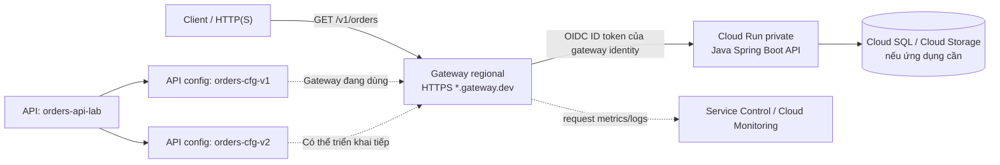
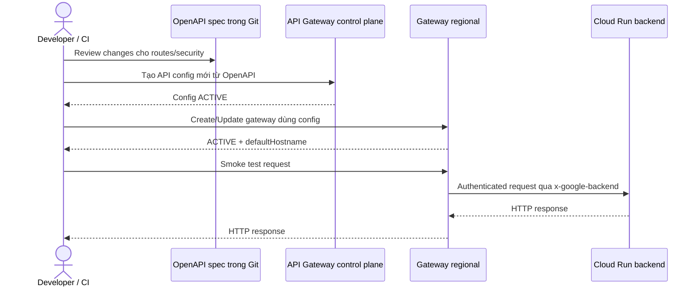
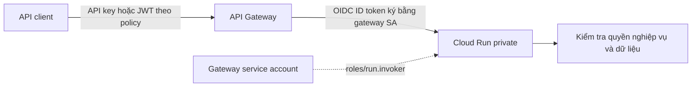
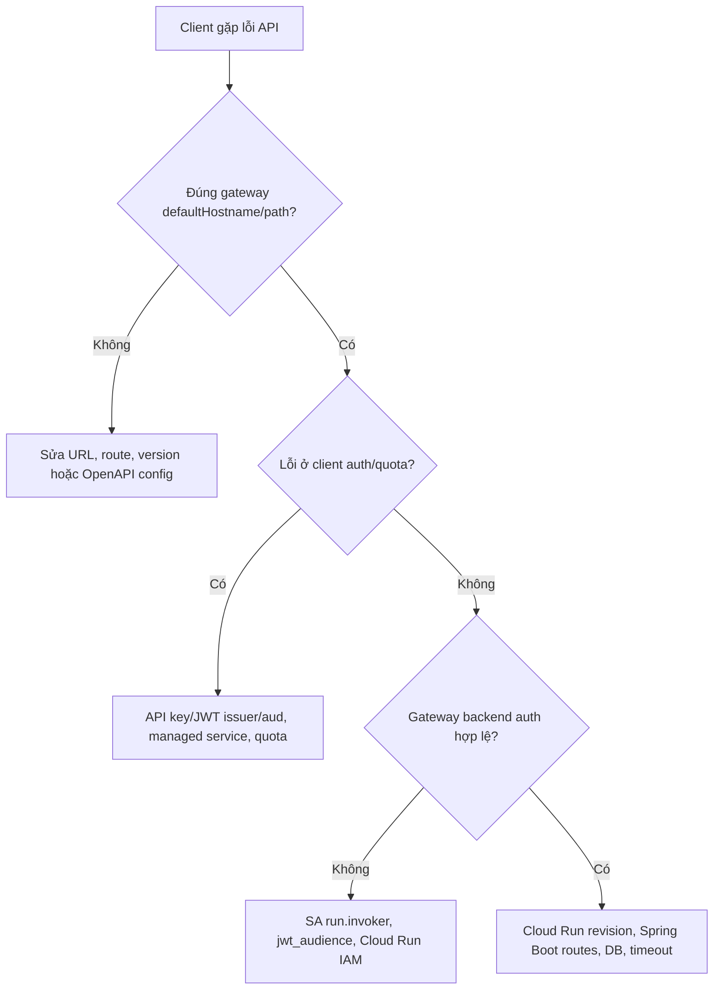

# API Gateway configs, deployments và backends

## 1. Bài toán và mục tiêu

Một nhóm phát triển **Spring Boot** chạy API quản lý đơn hàng trên **Cloud Run**. Thay vì cung cấp trực tiếp URL backend cho mọi khách hàng, nhóm cần một điểm vào ổn định, quy định các đường dẫn được công bố, xác thực client, giới hạn lưu lượng và theo dõi lỗi. Khi phát hành `/v1/orders` phiên bản mới, nhóm muốn đổi cấu hình API mà **không vô tình mở backend công khai** hoặc gián đoạn các request đang phục vụ.

**Google Cloud API Gateway** là dịch vụ gateway được quản lý, đứng giữa client và backend để tiếp nhận HTTPS, áp dụng các cấu hình API được hỗ trợ và chuyển request tới Cloud Run, Cloud Run functions, App Engine hoặc HTTP/gRPC backend phù hợp. Trong chương **API Gateway và Apigee** của mô-đun **CLOUD_PROVIDERS_GCP**, bài này đi sâu vào **API → API config → Gateway deployment → Backend**, cùng quy trình thay đổi cấu hình, IAM và rollback.

**Kết quả học tập:**

1. Phân biệt **API**, **OpenAPI definition**, **API config**, **gateway** và **backend**.
2. Giải thích tại sao phải tạo **config ID mới** khi sửa routes/security/backend.
3. Viết OpenAPI 2.0 dùng `x-google-backend` để định tuyến tới một Java Cloud Run service private.
4. Tạo, mô tả, cập nhật và rollback gateway bằng `gcloud` mà không chỉnh/xóa nhầm config đang dùng.
5. Hiểu hai lớp bảo mật **client → gateway** và **gateway → backend**, khác biệt giữa API key, JWT và IAM Invoker.
6. Quan sát 4xx/5xx, latency, quota, chi phí, xử lý lỗi định tuyến và dọn tài nguyên lab.

> **Giới hạn an toàn:** Các lệnh minh họa tạo Cloud Run service, gateway, API config và Artifact Registry build artifacts có thể phát sinh chi phí. Lab dùng **backend private, dữ liệu giả**, nhưng **gateway mặc định có HTTPS endpoint công khai** nếu chưa cấu hình xác thực client. Không đưa dữ liệu thật hoặc bật gateway này trên project production.

## 2. Kiến trúc và các tài nguyên



| Thành phần | Phạm vi | Trách nhiệm |
| --- | --- | --- |
| **API** | Tài nguyên logic trong project | Nhóm các configs của một API; gắn managed service |
| **OpenAPI definition** | Tệp YAML/JSON do nhóm quản lý trong Git | Khai báo routes, HTTP methods, security, backend mappings |
| **API config** | Tài nguyên của **API**, thường nằm tại `locations/global` | Bản cấu hình sinh từ definition, gần như **bất biến** |
| **Gateway** | Tài nguyên tại **region hỗ trợ** | Triển khai **một API config** và công bố hostname HTTPS |
| **Backend** | Cloud Run, functions, App Engine, gRPC/HTTP service | Xử lý nghiệp vụ; vẫn phải xác thực và tự bảo vệ dữ liệu |
| **Gateway service account** | IAM identity gắn với API config | Nhận quyền gọi backend private, không đại diện người dùng cuối |

**Một API có thể có nhiều configs, và một config có thể được nhiều gateways triển khai.** Gateway chỉ trỏ tới một config tại một thời điểm. Những gateway khác region **không tự cập nhật đồng thời** khi bạn đổi một gateway.

### 2.1. Những hiểu lầm phổ biến

- **API config không phải backend deployment:** sửa OpenAPI không cập nhật container Java; deploy Java mới không tự sửa routes trong gateway.
- **Gateway không phải VPC firewall:** Cloud Run backend có thể private bằng IAM, nhưng điều đó không làm gateway tự yêu cầu JWT ở phía client.
- **API Gateway không phải Apigee:** API Gateway phù hợp gateway được quản lý cho yêu cầu tương đối đơn giản; **Apigee** dành cho quản trị API phức tạp hơn như products, developer portals, nhiều policies và analytics chuyên sâu.
- **Gateway không tự sao chép backend:** nhiều gateways không khiến Cloud SQL hoặc state của Java được replicate.

## 3. Một API config được tạo và triển khai như thế nào?



### 3.1. API configs gần như bất biến

Sau khi tạo `orders-cfg-v1`, bạn **không thể sửa nội dung OpenAPI, đường dẫn, backend hoặc security** ngay trong config đó. API Gateway chỉ cho cập nhật một số metadata như **display name và labels**. Để thay đổi hành vi:

1. Sửa OpenAPI trong Git, review/diff.
2. Tạo **`orders-cfg-v2`** dưới **cùng API**.
3. Chờ config ở trạng thái `ACTIVE`.
4. Update gateway để trỏ sang config mới.
5. Smoke test, theo dõi và **quay về config v1** khi cần rollback.

Đây là lý do **config ID phải versioned** và cần giữ một config cuối cùng còn hoạt động để phục hồi. Không xóa config đang được gateway tham chiếu.

### 3.2. Deployment không tức thời trên toàn hệ thống

API Gateway hỗ trợ cập nhật không cần ngừng gateway, nhưng **trong giai đoạn chuyển đổi, một số request có thể vẫn đi theo config cũ**. Khi API được phục vụ ở nhiều regions/gateways, bạn phải **update từng gateway**; không có transaction toàn cục đổi tất cả cùng một thời điểm.

Thực hành tốt là giữ backend tương thích với **cả v1 và v2** trong lúc rollout, triển khai backend trước nếu cần, rồi thay config và cuối cùng dọn các routes/versions cũ theo change window.

## 4. OpenAPI định nghĩa routes và backend

Tài liệu API Gateway hiện hỗ trợ **OpenAPI 2.0, 3.0.x và 3.1.x**, ngoài cấu hình gRPC được hỗ trợ. Bài dùng **OpenAPI 2.0** để minh họa cú pháp `x-google-backend` và `gcloud` phổ biến. Nếu chuyển sang OpenAPI 3.x, các backend được khai báo bằng **`x-google-api-management.backends`** và tham chiếu khác; **không copy nguyên extension của OpenAPI 2.0**.

### 4.1. Cấu trúc cốt lõi

```yaml
swagger: "2.0"
info:
  title: orders-api-lab
  version: "1.0.0"
schemes:
  - https
produces:
  - application/json
x-google-backend:
  address: https://CLOUD_RUN_SERVICE_URL
  jwt_audience: https://CLOUD_RUN_SERVICE_URL
  path_translation: APPEND_PATH_TO_ADDRESS
paths:
  /v1/orders:
    get:
      operationId: listOrders
      summary: Danh sách đơn hàng minh họa
      parameters:
        - name: limit
          in: query
          required: false
          type: integer
      responses:
        "200":
          description: Danh sách đơn hàng
          schema:
            type: object
  /v1/healthz:
    get:
      operationId: health
      responses:
        "200":
          description: Backend sẵn sàng
```

Thay **cả hai** `https://CLOUD_RUN_SERVICE_URL` bằng **URL gốc thật của Cloud Run**, ví dụ `https://orders-backend-lab-abc123-uc.a.run.app`; **không lặp `https://`** nếu chèn URL có sẵn scheme. `host` là trường **tùy chọn** trong API Gateway; nếu khai báo thì dùng **gateway hostname**, **không** đặt Cloud Run backend hostname vào `host`.

- `paths` và `operationId` mô tả API công bố.
- `x-google-backend.address` cho biết backend nhận request; thay đổi nó **đòi hỏi config mới**.
- `path_translation: APPEND_PATH_TO_ADDRESS` bảo toàn đường dẫn, ví dụ request `/v1/orders` được chuyển tới `BACKEND_URL/v1/orders`.
- `jwt_audience` là audience của **ID token gateway → Cloud Run**, không phải `aud` trong JWT của client.

**OpenAPI schema không thay business validation của Spring Boot:** các khai báo kiểu dữ liệu và `required` trong spec **không đảm bảo gateway kiểm tra toàn bộ request fields**. Backend vẫn phải validate body/query, authorize và bảo vệ SQL injection, deserialization, rate abuse.

### 4.2. `path_translation` là nguồn lỗi 404 hay gặp

| Vị trí `x-google-backend` | Mặc định | Hiệu ứng |
| --- | --- | --- |
| **Top-level OpenAPI** | `APPEND_PATH_TO_ADDRESS` | Nối request path vào backend base URL |
| **Operation-level** | `CONSTANT_ADDRESS` | Gọi URL cố định; path parameters có thể thành query parameters |

Ví dụ nếu `address` là `https://service.run.app` và request `/v1/orders/123`, `APPEND_PATH_TO_ADDRESS` gọi `https://service.run.app/v1/orders/123`. Nếu chọn `CONSTANT_ADDRESS`, backend nhận **địa chỉ cố định** và các path params tương ứng có thể được chuyển thành query params. **Khai báo tường minh** để tránh đổi URL âm thầm khi di chuyển extension từ top-level xuống operation-level.

### 4.3. Định tuyến tới nhiều backends

Có thể khai báo `x-google-backend` ở từng operation để `/v1/orders` tới Cloud Run **orders**, `/v1/payments` tới Cloud Run **payments**. Khi đó cần kiểm tra **từng backend address, audience, timeout và IAM**; service account gắn với config chỉ nên có quyền invoke các backend thật sự cần.

## 5. Hai chiều xác thực phải tách biệt



| Đường | Cơ chế | Bảo vệ cái gì? |
| --- | --- | --- |
| **Client → Gateway** | API key, JWT issuer/JWKS/audience, quota theo policy | Client nào được gọi endpoint và tiêu thụ quota |
| **Gateway → Backend** | Gateway service account + **OIDC ID token**, Cloud Run IAM Invoker | Backend chỉ chấp nhận các caller đã được IAM cho phép |
| **Trong Java backend** | Spring Security, nghiệp vụ, input validation | Khách hàng chỉ xem/sửa dữ liệu của chính họ |

**API key không phải xác thực người dùng đủ mạnh cho API nhạy cảm.** Key chủ yếu nhận diện project/ứng dụng cho quota/billing và có nguy cơ lộ nếu bị nhúng vào client/browser hoặc URL. Với dữ liệu người dùng, cần **JWT/OIDC** đã xác minh chữ ký, issuer, audience và claims, rồi **authorization** ở backend.

Nếu API Gateway thêm ID token vào header `Authorization` để xác thực backend, token gốc của client có thể được chuyển sang `X-Forwarded-Authorization`. **Không tin mù quáng header này** nếu backend có con đường được gọi trực tiếp hoặc không kiểm chứng nguồn; sử dụng cơ chế định danh/ủy quyền phù hợp và kiểm tra cấu hình header hiện hành.

### 5.1. Ví dụ khai báo API key (không bật trong lab cơ bản)

Thêm vào **OpenAPI 2.0** trước khi tạo **config mới**:

```yaml
securityDefinitions:
  api_key:
    type: apiKey
    name: key
    in: query
security:
  - api_key: []
```

Sau đó cần **enable managed service** của API, tạo API key trong project được phép và **giới hạn API/application restrictions**. Khi client gọi, gửi `?key=API_KEY` qua HTTPS; **không đưa key vào Git, logs hoặc tài liệu công khai**. Có thể dùng API key cùng JWT theo tính năng được hỗ trợ, nhưng không dùng **key đơn độc** cho API chứa dữ liệu nhạy cảm.

## 6. Lab: triển khai Java Cloud Run backend riêng tư

Lab dùng **region `us-central1`** vì đây là một trong các region API Gateway hỗ trợ theo tài liệu hiện hành. **Cloud Run và Gateway không bắt buộc cùng region**, nhưng chọn cùng region đơn giản hơn cho bài học và giảm khả năng phát sinh egress giữa regions. Nếu tổ chức yêu cầu lưu dữ liệu tại nơi khác, **kiểm tra region gateway được hỗ trợ trước**, không tự chuyển tài nguyên production sang vùng của ví dụ.

### 6.1. Ứng dụng Spring Boot mẫu

Tạo dự án Maven **riêng trong môi trường lab**:

```text
orders-gateway-lab/
├── pom.xml
└── src/main/java/dev/example/gateway/OrdersApplication.java
```

File `pom.xml`:

```xml
<?xml version="1.0" encoding="UTF-8"?>
<project xmlns="http://maven.apache.org/POM/4.0.0"
         xmlns:xsi="http://www.w3.org/2001/XMLSchema-instance"
         xsi:schemaLocation="http://maven.apache.org/POM/4.0.0 https://maven.apache.org/xsd/maven-4.0.0.xsd">
  <modelVersion>4.0.0</modelVersion>
  <parent>
    <groupId>org.springframework.boot</groupId>
    <artifactId>spring-boot-starter-parent</artifactId>
    <version>3.5.5</version>
    <relativePath/>
  </parent>
  <groupId>dev.example</groupId>
  <artifactId>orders-gateway-lab</artifactId>
  <version>1.0.0</version>
  <properties>
    <java.version>21</java.version>
  </properties>
  <dependencies>
    <dependency>
      <groupId>org.springframework.boot</groupId>
      <artifactId>spring-boot-starter-web</artifactId>
    </dependency>
  </dependencies>
  <build>
    <plugins>
      <plugin>
        <groupId>org.springframework.boot</groupId>
        <artifactId>spring-boot-maven-plugin</artifactId>
      </plugin>
    </plugins>
  </build>
</project>
```

File `OrdersApplication.java`:

```java
package dev.example.gateway;

import java.util.List;
import java.util.Map;
import org.springframework.boot.SpringApplication;
import org.springframework.boot.autoconfigure.SpringBootApplication;
import org.springframework.web.bind.annotation.GetMapping;
import org.springframework.web.bind.annotation.RequestParam;
import org.springframework.web.bind.annotation.RestController;

@SpringBootApplication
@RestController
public class OrdersApplication {
    public static void main(String[] args) {
        SpringApplication.run(OrdersApplication.class, args);
    }

    @GetMapping("/v1/orders")
    public Map<String, Object> orders(
            @RequestParam(defaultValue = "10") int limit) {
        int safeLimit = Math.min(Math.max(limit, 1), 2);
        var samples = List.of(
                Map.of("id", "lab-001", "status", "PAID"),
                Map.of("id", "lab-002", "status", "CREATED"));
        return Map.of("items", samples.subList(0, safeLimit));
    }

    @GetMapping("/v1/healthz")
    public Map<String, String> health() {
        return Map.of("status", "ok");
    }
}
```

Chạy local bằng JDK 21 và Maven:

```bash
mvn -q clean package
java -jar target/orders-gateway-lab-1.0.0.jar

# Terminal khác:
curl -i "http://localhost:8080/v1/orders?limit=1"
curl -i http://localhost:8080/v1/healthz
```

Đây là dữ liệu giả, **không có xác thực nghiệp vụ**. API production cần Spring Security, JWT authorization, rate control và database/transactions tùy nhu cầu. Không đưa backend lab vào hệ thống thực chỉ vì đã có API Gateway.

### 6.2. Triển khai backend private

Cần Google Cloud project test có Billing, IAM deploy Cloud Run từ source và quyền build/push image. Tạo **runtime service account riêng**, không cấp quyền dữ liệu nghiệp vụ cho ví dụ trả JSON. Từ thư mục dự án Maven:

```bash
gcloud config set project PROJECT_ID
gcloud services enable run.googleapis.com \
  cloudbuild.googleapis.com artifactregistry.googleapis.com \
  apigateway.googleapis.com servicemanagement.googleapis.com \
  servicecontrol.googleapis.com

gcloud iam service-accounts create orders-backend-runtime-lab \
  --display-name="Java lab Cloud Run runtime"

gcloud run deploy orders-backend-lab \
  --source . \
  --region us-central1 \
  --service-account="orders-backend-runtime-lab@PROJECT_ID.iam.gserviceaccount.com" \
  --max-instances=2 \
  --concurrency=10 \
  --no-allow-unauthenticated

# Đọc URL thật, không tự ghép hostname:
gcloud run services describe orders-backend-lab \
  --region us-central1 \
  --format="value(status.url)"
```

Người deploy cần quyền **`iam.serviceAccounts.actAs`** trên runtime service account; build identity cần quyền tạo/push artifact theo chính sách. `--max-instances=2` giới hạn quy mô dự kiến của backend lab nhưng không phải ngân sách cứng. Cloud Run backend phải **yêu cầu IAM authentication**. Để xác minh, unauthenticated request trực tiếp tới backend thường bị từ chối:

```bash
curl -i https://ACTUAL_CLOUD_RUN_URL/v1/orders
```

Thay `https://ACTUAL_CLOUD_RUN_URL` bằng URL trả về, không chèn hai lần `https://`. Các lệnh tạo cloud resources **không được thực thi trong quá trình viết bài**.

## 7. Lab: tạo API config và gateway

### 7.1. Tạo gateway service account và cấp quyền backend

Service account này dùng để **gateway gọi Cloud Run**, không phải runtime service account của Java:

```bash
gcloud iam service-accounts create gateway-invoker-lab \
  --display-name="API Gateway backend invoker"

gcloud run services add-iam-policy-binding orders-backend-lab \
  --region us-central1 \
  --member="serviceAccount:gateway-invoker-lab@PROJECT_ID.iam.gserviceaccount.com" \
  --role="roles/run.invoker"
```

Người tạo API config cần quyền quản trị tài nguyên API Gateway và quyền **`iam.serviceAccounts.actAs`** (thường qua `roles/iam.serviceAccountUser`) trên service account này. Chỉ cấp role trong phạm vi phù hợp, tránh Project Owner. Nếu IAM không đúng, xử lý lỗi quyền **trước khi mở Cloud Run public**.

### 7.2. Lưu OpenAPI spec và tạo config v1

Lưu YAML mục 4 vào `openapi2.yaml`, thay `CLOUD_RUN_SERVICE_URL` bằng URL backend thật (cả `address` lẫn `jwt_audience`). Sau đó:

```bash
gcloud api-gateway api-configs create orders-cfg-v1 \
  --api=orders-api-lab \
  --openapi-spec=openapi2.yaml \
  --backend-auth-service-account="gateway-invoker-lab@PROJECT_ID.iam.gserviceaccount.com" \
  --project=PROJECT_ID

gcloud api-gateway api-configs describe orders-cfg-v1 \
  --api=orders-api-lab \
  --project=PROJECT_ID

gcloud api-gateway api-configs list \
  --api=orders-api-lab --project=PROJECT_ID
```

Nếu API `orders-api-lab` chưa tồn tại, lệnh create config **có thể tạo API tương ứng**. Tạo config là thao tác bất đồng bộ có thể mất nhiều phút; đợi `state: ACTIVE` trước khi dùng. **Không tạo đồng thời nhiều API configs dưới cùng API** khi config trước đang ở trạng thái chưa hoàn tất.

### 7.3. Enable managed service của API

Sau khi có API, xem trường `managedService`, ví dụ:

```bash
gcloud api-gateway apis describe orders-api-lab \
  --project=PROJECT_ID

# Thay bằng giá trị managedService đọc ở dòng trên:
gcloud services enable MANAGED_SERVICE_NAME \
  --project=PROJECT_ID
```

Đây là bước quan trọng để sử dụng **Service Control, API keys, quotas và quản lý API** tương ứng. Managed service name **không đơn giản luôn bằng API_ID**; lấy từ metadata thay vì đoán hoặc dùng một tên mẫu trong project khác.

### 7.4. Tạo gateway regional và lấy hostname

```bash
gcloud api-gateway gateways create orders-gw-lab \
  --api=orders-api-lab \
  --api-config=orders-cfg-v1 \
  --location=us-central1 \
  --project=PROJECT_ID

gcloud api-gateway gateways describe orders-gw-lab \
  --location=us-central1 \
  --project=PROJECT_ID
```

Khi `state: ACTIVE`, gateway có `defaultHostname`, thường dạng:

```text
orders-gw-lab-HASH.uc.gateway.dev
```

Không hard-code hostname hoặc suy từ tên project vì hostname được Google Cloud cấp. URL để gọi là `https://DEFAULT_HOSTNAME/v1/orders`.

### 7.5. Kiểm thử hai đường đi

```bash
# Thay DEFAULT_HOSTNAME bằng defaultHostname từ gateway describe:
curl -i "https://DEFAULT_HOSTNAME/v1/orders?limit=1"
curl -i "https://DEFAULT_HOSTNAME/v1/healthz"

# Backend vẫn phải từ chối request trực tiếp không có token:
curl -i "https://ACTUAL_CLOUD_RUN_URL/v1/orders"
```

Kết quả mong đợi: **gateway → backend** trả JSON đơn hàng demo; **direct unauthenticated call → backend** bị từ chối. Vì OpenAPI lab **chưa có policy xác thực client**, bất kỳ ai biết gateway URL có thể gửi request hợp lệ và làm phát sinh chi phí. **Không đưa dữ liệu nhạy cảm vào lab, giới hạn thời gian thử và dọn resource ngay khi hoàn tất.**

## 8. Cập nhật config và rollback

Giả sử cần thêm route `GET /v1/orders/{id}` hoặc thay backend revision:

1. Cập nhật Spring Boot backend, deploy revision mới và xác minh đường mới trực tiếp theo cơ chế được cấp quyền.
2. Tạo OpenAPI mới `openapi2-v2.yaml`, bao gồm routes cũ và route mới. Nếu đổi sang Cloud Run revision tag URL, đặt **`jwt_audience` là service root URL**, không phải tag-specific URL.
3. Tạo API config **`orders-cfg-v2`**; không ghi đè v1.
4. Update gateway sang v2, theo dõi trạng thái và request errors.
5. Khi có lỗi, update gateway trở lại **`orders-cfg-v1`**; giữ cả hai backend behaviors tương thích trong giai đoạn chuyển.

```bash
gcloud api-gateway api-configs create orders-cfg-v2 \
  --api=orders-api-lab \
  --openapi-spec=openapi2-v2.yaml \
  --backend-auth-service-account="gateway-invoker-lab@PROJECT_ID.iam.gserviceaccount.com" \
  --project=PROJECT_ID

# Sau khi config v2 ở trạng thái ACTIVE:
gcloud api-gateway gateways update orders-gw-lab \
  --api=orders-api-lab \
  --api-config=orders-cfg-v2 \
  --location=us-central1 \
  --project=PROJECT_ID

gcloud api-gateway gateways describe orders-gw-lab \
  --location=us-central1 --project=PROJECT_ID

# Rollback nếu cần:
gcloud api-gateway gateways update orders-gw-lab \
  --api=orders-api-lab \
  --api-config=orders-cfg-v1 \
  --location=us-central1 \
  --project=PROJECT_ID
```

**Config mới cần tồn tại thật**: `openapi2-v2.yaml` chỉ là tên file minh họa cho phần mở rộng, không có sẵn trong lab cơ bản. Không chạy phần v2 khi chưa chuẩn bị file hợp lệ. **Gateway update không phải canary 10%/90% traffic splitting theo tỷ lệ**; nếu cần progressive delivery, xem xét gateway riêng, load balancing hoặc chiến lược rollout backend thích hợp.

**Quotas trong API Gateway áp dụng ở mức API** theo cấu hình Service Management, không phải cô lập hoàn toàn theo từng config. Khi đổi tên hoặc xóa quota metric giữa các configs còn active, gateway cũ có thể phát sinh lỗi. Giữ compatibility và kiểm tra quota definitions trước khi rollout đa region.

## 9. Backends: Cloud Run, functions, App Engine và gRPC

| Backend | Đường cấu hình | Lưu ý |
| --- | --- | --- |
| **Cloud Run service** | `x-google-backend.address` trỏ tới `https://...run.app` | Backend IAM private + gateway SA `run.invoker`, audience đúng |
| **Cloud Run functions** | URL function/service được hỗ trợ | Xác định thế hệ/API và quyền invoke phù hợp |
| **App Engine** | `https://PROJECT_ID.appspot.com` hoặc service URL hợp lệ | Nếu IAP bảo vệ, cấp quyền theo IAP và chọn audience/backend mode đúng |
| **gRPC** | Service definition/config và gRPC backend được hỗ trợ | Khác OpenAPI REST; chú ý protocol, deadline, metadata |
| **Nhiều HTTP backends** | Extensions ở các operations | Mỗi backend phải được IAM/network/timeout kiểm chứng riêng |

### 9.1. Backend URL và ID token

Nếu `address` là một **tagged Cloud Run URL** như `https://blue---SERVICE_HOSTNAME/...`, `jwt_audience` nên đặt thành **URL gốc của Cloud Run service** theo tài liệu, không mặc định dùng tag-specific URL làm audience. Sai audience là nguyên nhân hay gặp của lỗi 401/403 dù service account đã có `run.invoker`.

### 9.2. Deadline, request path và networking

`x-google-backend` có các tùy chọn như `deadline`, `protocol`, `disable_auth` và `path_translation` tùy phiên bản OpenAPI. **Không dùng `disable_auth: true`** khi backend yêu cầu IAM token; nó tắt cơ chế gateway tự cung cấp token backend. Backend HTTP(S) phải có **đường kết nối từ gateway theo loại backend hỗ trợ**, không giả định một private IP trong VPC sẽ được API Gateway gọi trực tiếp chỉ vì cùng project.

Gateway có giới hạn request/response và timeout theo sản phẩm; ứng dụng Java vẫn cần timeout, retries có backoff/idempotency và circuit-breaker tương thích với SLO. **Nâng deadline không khắc phục** Cloud SQL quá tải hoặc process Java bị treo.

## 10. API Gateway khác Apigee và Cloud Load Balancing

| Tiêu chí | API Gateway | Apigee | Cloud Load Balancing |
| --- | --- | --- | --- |
| Mục tiêu | Công bố/quản lý API theo OpenAPI/gRPC và IAM/JWT/key/quota | **Full API management** cho đối tác/doanh nghiệp: policies, products, developer portal, analytics | Phân phối HTTP(S)/TCP traffic, health và backend balancing |
| Đơn vị quản lý | API, configs, regional gateways | API proxies, environments, products, developer apps | Forwarding rules, proxies, URL maps, backend services |
| Chọn khi | Java API nhỏ-vừa cần gateway được quản lý | Doanh nghiệp cần chuyển đổi policy, nhiều đối tác, governance nâng cao | Routing/HA, CDN/WAF/LB chủ đạo; không đủ yêu cầu API-product management |

API Gateway không thay **Cloud Armor**, IAM của backend, Cloud SQL HA hoặc xác thực nghiệp vụ. Khi cần custom domain, load balancing đa region hoặc mức bảo vệ edge cụ thể, xem các mô hình **load balancing for API Gateway** được hỗ trợ thay vì tự coi một gateway regional đã đạt yêu cầu HA toàn cầu.

## 11. IAM, CI/CD và kiểm soát thay đổi

Một pipeline Java production nên phân tách:

- **API/backend developer:** sửa code Spring Boot, OpenAPI trong Git; không tự có quyền xóa gateway production.
- **Build/deployer:** build/test, deploy Cloud Run bằng service account quyền tối thiểu.
- **API config operator:** tạo config mới, cần quyền API Gateway/Service Management và `iam.serviceAccounts.actAs` trên gateway SA.
- **Gateway SA:** chỉ có `roles/run.invoker` trên các Cloud Run backends cần gọi.
- **Client identity:** JWT/OIDC hoặc API key đã được giới hạn theo chính sách; không dùng API key để xác thực chủ thể nhạy cảm.
- **Auditor:** xem logs, configs, gateway updates và IAM changes, không cần quyền modify.

Lưu **OpenAPI source, config ID, gateway ID/region, backend URL/revision, service account và change ticket** trong release record. Khuyến khích **Terraform/IaC** để quản lý API, configs và gateways trong cùng pipeline, nhưng nhớ rằng **đổi OpenAPI có thể tạo config mới**; IaC plan phải được review trước khi replace/delete tài nguyên đang chạy.

**Triển khai an toàn:** test backend mới → create config mới → verify ACTIVE → update gateway → smoke test → quan sát error rate/latency → cho phép rollback. Đối với nhiều gateways/regions, thao tác theo từng đợt thay vì update đồng loạt.

## 12. Giám sát, lỗi và runbook

### 12.1. Bộ lệnh quan sát

```bash
gcloud api-gateway apis list --project=PROJECT_ID
gcloud api-gateway api-configs list \
  --api=orders-api-lab --project=PROJECT_ID
gcloud api-gateway gateways list --project=PROJECT_ID
gcloud api-gateway gateways describe orders-gw-lab \
  --location=us-central1 --project=PROJECT_ID

gcloud run services describe orders-backend-lab \
  --region=us-central1 --project=PROJECT_ID
gcloud run services logs read orders-backend-lab \
  --region=us-central1 --project=PROJECT_ID --limit=50
```

Trong **Cloud Monitoring/Logs Explorer**, xem API Gateway request count/status, latency, quota errors và Cloud Run backend request logs, revision errors, instance count, CPU/memory, Java GC/HikariCP nếu có. Theo dõi **p95/p99 latency và tỷ lệ 5xx** cho toàn hành trình, không chỉ trạng thái `ACTIVE` của gateway.

| Triệu chứng | Tầng có thể lỗi | Kiểm tra |
| --- | --- | --- |
| `api-configs create` thất bại | OpenAPI validation, IAM/actAs, API/service enable | Spec syntax, `x-google-backend`, service account, Cloud services |
| Gateway `CREATING` lâu | Config chưa `ACTIVE` hoặc propagation | Resource describe/operations; không tạo bản khác liên tục |
| HTTP 404 qua Gateway | Sai `paths`, `path_translation` hoặc URL backend | So gateway URL với Spring Boot mapping |
| HTTP 401/403 tại gateway | Thiếu API key/JWT, issuer, audience hoặc quota policy | Kiểm tra client security policy của OpenAPI |
| HTTP 403 từ backend | Gateway SA thiếu `run.invoker`, audience sai, backend IAM | Cloud Run IAM, `jwt_audience`, `address` |
| HTTP 502/503 | Backend lỗi, cold start, unavailable, networking | Cloud Run revision/health logs, runtime exception |
| HTTP 504 | Deadline/timeout của gateway hoặc downstream | `deadline`, Cloud Run timeout, DB/network traces |
| Config v2 có routes mới nhưng gateway dùng routes cũ | Chưa update gateway hoặc đang propagation | `gateway describe.apiConfig`, thời gian rollout |
| Quota lỗi sau rollout v2 | Quota metrics thay đổi ở mức API khi gateway cũ còn hoạt động | So v1/v2 quotas/limits |
| Client bypass gateway gọi backend | Backend vô tình cho unauthenticated hoặc IAM rộng | Cloud Run IAM/ingress, direct URL behavior |
| Hóa đơn không giảm | Gateway/backends/build image/logs còn tồn tại | Resources, Billing SKUs, cleanup |



**Chẩn đoán bằng log và trạng thái thực tế**, đừng mở public Cloud Run hoặc cấp Owner chỉ để né 403. Nếu nghi lỗi do config mới, rollback gateway sang config cũ đã thử thành công; **không xóa config v2 trước khi hoàn tất điều tra**.

## 13. Chi phí, quota và cleanup an toàn

Chi phí có thể gồm **API Gateway API calls**, Cloud Run CPU/RAM/requests, Cloud Build/Artifact Registry storage, Cloud Logging và **network egress**. API key/quota giúp nhận diện/giới hạn một số kiểu sử dụng, nhưng **không phải giới hạn cứng tổng chi phí**. Đặt Billing budgets và alerts; alert không tự tắt mọi request.

Ví dụ định lượng **giả định**, không phải đơn giá Google Cloud:

```text
500.000 requests/ngày × 30 ngày = 15.000.000 gateway calls/tháng.
Backend xử lý 95% request thành công, nghĩa là:
14.250.000 successful responses và 750.000 requests còn lại không thành công.

Chi phí không chỉ phụ thuộc số success: request lỗi vẫn có thể
tiêu thụ gateway/backend resources tùy loại lỗi và biểu giá.
```

**Dọn theo thứ tự phụ thuộc.** Lệnh dưới đây chỉ dành cho các IDs của lab, **không phải project thật**. Nếu đã triển khai config v2, hãy xác định config nào đang được gateway tham chiếu và xóa mọi config lab **sau khi xóa gateway**:

```bash
# 1. Xóa gateway lab (ngừng endpoint và traffic qua gateway).
gcloud api-gateway gateways delete orders-gw-lab \
  --location=us-central1 --project=PROJECT_ID

# 2. Xóa config không còn được gateway nào tham chiếu.
gcloud api-gateway api-configs delete orders-cfg-v1 \
  --api=orders-api-lab --project=PROJECT_ID

# 3. Chỉ sau khi toàn bộ configs của API đã xóa.
gcloud api-gateway apis delete orders-api-lab --project=PROJECT_ID

# 4. Xóa Cloud Run backend lab sau khi không còn consumer.
gcloud run services delete orders-backend-lab \
  --region=us-central1 --project=PROJECT_ID
```

Nếu đã tạo `orders-cfg-v2`, phải xóa riêng **sau khi gateway đã được xóa**. Kiểm tra các **service accounts lab, IAM bindings, Cloud Build artifacts, Artifact Registry images, API keys** và các tài nguyên tự tạo khác trước khi dọn; **không xóa service account dùng chung**. Cloud Run xóa service **không tự xóa mọi build image**. Sau cleanup đối chiếu Billing/metrics vì chi phí có thể hiện trễ.

## 14. Bài tập vận dụng

### Bài A — Tính bất biến của API config

`orders-cfg-v1` định tuyến `/v1/orders` tới Java backend A. Nhóm sửa OpenAPI để thêm `/v1/payments` và đổi backend sang B. Hãy mô tả **thứ tự tạo config, IAM, update gateway, smoke test và rollback**, giải thích vì sao không sửa trực tiếp v1.

### Bài B — Path translation

Client gọi `GET /v1/orders/123`; backend có handler `@GetMapping("/v1/orders/{id}")`. So sánh kết quả khi đặt `x-google-backend` ở top-level với `APPEND_PATH_TO_ADDRESS` và ở operation-level mặc định `CONSTANT_ADDRESS`. Hãy sửa OpenAPI để backend nhận đúng path.

### Bài C — Hai lớp bảo mật

Gateway endpoint trả HTTP 200 nhưng gọi thẳng Cloud Run URL trả 403. Giải thích **vì sao đây có thể là cấu hình đúng**. Sau đó giả định gateway dùng API key cho dữ liệu khách hàng: điều gì còn thiếu để bảo vệ dữ liệu và phân quyền xem đơn hàng?

### Bài D — Lab Java + config v2

Trên project test, deploy API Spring Boot mẫu private, tạo gateway SA có `run.invoker`, upload OpenAPI 2.0 `orders-cfg-v1`, tạo gateway và gọi qua `defaultHostname`. Mở rộng endpoint `/v1/orders/{id}`, tạo `orders-cfg-v2`, update/rollback và xác minh HTTP response; **không dùng dữ liệu thật**.

### Bài E — Độ tin cậy và FinOps

Ba gateways ở các regions triển khai cùng một API config. Backend ở một region bị lỗi; thiết kế cách theo dõi 5xx, routing/failover, phân phối deployment updates và dữ liệu Cloud SQL. Tính số calls/tháng với 500.000 requests/ngày và đưa ra cách kiểm soát quota, logs/egress và chi phí.

### Checklist

- [ ] Tôi phân biệt API, OpenAPI definition, API config, gateway regional và backend.
- [ ] Tôi biết API config không sửa được routes/security; cần config ID mới.
- [ ] Tôi biết API Gateway hiện hỗ trợ OpenAPI 2.0 và 3.x nhưng extension backend khác nhau.
- [ ] Tôi chọn đúng `x-google-backend`, `path_translation` và `jwt_audience`.
- [ ] Tôi tách client API key/JWT khỏi gateway SA → Cloud Run IAM.
- [ ] Tôi triển khai được backend Java private và kiểm tra gateway hostname thật.
- [ ] Tôi dùng `ACTIVE` và `gateway describe.apiConfig` để theo dõi rollout.
- [ ] Tôi hiểu update không đồng bộ tức thì và nhiều gateways cần update riêng.
- [ ] Tôi có rollback config, backend version, release inventory và quota compatibility.
- [ ] Tôi quản lý IAM least privilege, SLO, logs, quotas và billing.
- [ ] Tôi dọn gateway → config → API → backend đúng thứ tự và đúng phạm vi lab.

**Kết luận:** API Gateway cung cấp lớp **công bố và quản trị API** tách khỏi code Java backend. Quy trình đúng là **versioned OpenAPI config, regional gateway deployment, backend được IAM bảo vệ, xác thực client ở phía trước, update/rollback có kiểm chứng**. Khi nhiều APIs/đối tác hoặc chính sách trở nên phức tạp, hãy đánh giá **Apigee**; khi mục tiêu chính là cân bằng tải, CDN hay WAF, đánh giá **Cloud Load Balancing** cùng các lớp bảo mật cần thiết.

## 15. Tài liệu Google Cloud tham khảo

- [API Gateway deployment model](https://cloud.google.com/api-gateway/docs/deployment-model)
- [OpenAPI overview — 2.0 và 3.x](https://cloud.google.com/api-gateway/docs/openapi-overview)
- [OpenAPI 2.0 extensions — x-google-backend](https://cloud.google.com/api-gateway/docs/oasv2-extensions)
- [Pass data and configure backend path translation](https://cloud.google.com/api-gateway/docs/passing-data)
- [Create an API config](https://cloud.google.com/api-gateway/docs/creating-api-config)
- [Deploy/update a gateway](https://cloud.google.com/api-gateway/docs/deploying-api)
- [Getting started: API Gateway + Cloud Run](https://cloud.google.com/api-gateway/docs/get-started-cloud-run)
- [Configure environment and service account](https://cloud.google.com/api-gateway/docs/configure-dev-env)
- [Secure backend services with IAM](https://cloud.google.com/api-gateway/docs/securing-backend-services)
- [Use API keys](https://cloud.google.com/api-gateway/docs/authenticate-api-keys)
- [JWT authentication](https://cloud.google.com/api-gateway/docs/authenticating-users-jwt)
- [Monitor/troubleshoot API Gateway](https://cloud.google.com/api-gateway/docs/troubleshoot)
- [API Gateway release notes](https://cloud.google.com/api-gateway/docs/release-notes)
- [API Gateway pricing](https://cloud.google.com/api-gateway/pricing)
