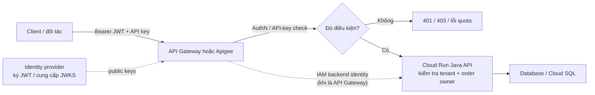

# Xác thực JWT và kiểm soát API keys

Một ứng dụng Java triển khai trên Cloud Run cung cấp API đơn hàng cho website và đối tác. Người dùng phải **đăng nhập** trước khi xem đơn hàng; từng ứng dụng đối tác cần được **nhận diện, giới hạn và có thể thu hồi quyền gọi API**. Đưa API thẳng ra Internet rồi kiểm tra một chuỗi `apiKey` trong code không đáp ứng đủ hai yêu cầu này. **API Gateway** hoặc **Apigee** cung cấp lớp kiểm soát tại cổng vào: kiểm tra JWT, kiểm tra API key và định tuyến đến backend; ứng dụng vẫn phải phân quyền trên từng đơn hàng.

Bài thuộc chương **API Gateway và Apigee** của module **CLOUD_PROVIDERS_GCP**. Bài nối kiến thức tổ chức project, IAM, VPC, Cloud Run, dịch vụ dữ liệu, bảo mật, phát hành tự động và theo dõi chi phí với thiết kế bảo vệ API. Mục tiêu là hiểu hai loại credential, cấu hình đúng trên Google Cloud và biết những kiểm tra **không được giao phó hoàn toàn cho gateway**.

> Tên project, domain, API, issuer, client ID và khóa trong bài là **giả định hoặc placeholder**. Không sao chép token/key thật vào mã nguồn, lệnh shell được ghi lịch sử, ảnh chụp màn hình hay log. Thao tác tạo API config, sửa IAM, đổi key và deploy gateway có thể phát sinh phí hoặc làm gián đoạn lưu lượng; chỉ thực hiện trên môi trường được phép.

## Mục tiêu học tập

Sau bài học, bạn có thể:

1. Phân biệt **JWT access/ID token**, **API key**, **IAM service account** và quyền của người dùng cuối.
2. Kiểm tra các thành phần JWT: chữ ký, `iss`, `aud`, `exp`, `nbf`, `iat`, `sub`, `kid`; hiểu vai trò **JWKS** và rotation.
3. Cấu hình API Gateway yêu cầu **JWT và API key đồng thời** bằng OpenAPI, phân biệt phép **AND/OR** trong `security`.
4. Tạo, giới hạn phạm vi, giám sát, xoay vòng và thu hồi Google Cloud API keys, không dùng key làm chứng cứ định danh người dùng.
5. Giải thích sự khác biệt giữa **JWT của client** và **ID token do API Gateway dùng để gọi Cloud Run backend**.
6. Dùng **Apigee VerifyJWT** và **VerifyAPIKey**, liên hệ developer app, API product, quota và các policy phân quyền bổ sung.
7. Kiểm thử các ca thiếu/sai/hết hạn credential, sai audience, cross-tenant và mất khóa; xây runbook ứng phó.

## 1. JWT và API key giải quyết hai việc khác nhau

| Thành phần | Trả lời câu hỏi | Hình thức | Không thay thế được |
| --- | --- | --- | --- |
| **JWT** do IdP phát hành | “Người dùng/service principal là ai, token dành cho API nào, còn hiệu lực không?” | `Authorization: Bearer JWT` | Quyền xem **đơn hàng cụ thể** |
| **API key** của API Gateway | “Ứng dụng/project nào đang tiêu thụ API để nhận diện, quota và theo dõi?” | `x-api-key` header hoặc `key` query | Xác thực danh tính người dùng |
| **API key** của Apigee | “Developer app đã đăng ký API product này và key còn được chấp thuận không?” | Header, query hoặc biến được policy chọn | Đăng nhập người dùng, JWT |
| **IAM service account** của Gateway | “Gateway có quyền gọi backend riêng tư không?” | Google-signed ID token cho backend | Quyền của client đối với dữ liệu |
| **Backend authorization** | “Principal này có quyền xem `orderId=123` không?” | Logic/DB/ACL của Java app | Không thể suy từ key hoặc chữ ký JWT đơn thuần |

**Phân biệt hai sản phẩm:** Google Cloud API Gateway dùng **API Keys trong APIs & Services → Credentials**, thường nhận diện **consumer project**. Apigee dùng **consumer key gắn với developer app và API product**. Chúng không phải hai cách gọi cùng một kho khóa.



**Defense in depth:** gateway từ chối token sai; backend **không bao giờ** dùng chỉ `x-api-key` hay `sub` để kết luận user được đọc dữ liệu của tenant khác. Với browser/client app không giữ được bí mật dài hạn, API key có thể bị sao chép; cần JWT/authorization, rate limiting và các kiểm soát chống lạm dụng khác.

## 2. Hiểu JWT trước khi cấu hình gateway

JWT ký theo chuẩn JWS thường có ba phần nối bằng dấu chấm:

```text
BASE64URL(header).BASE64URL(payload).BASE64URL(signature)
```

Payload minh họa:

```json
{
  "iss": "https://accounts.google.com",
  "sub": "user-opaque-id",
  "aud": "CLIENT_ID.apps.googleusercontent.com",
  "iat": 1795000000,
  "exp": 1795003600
}
```

Số thời gian, client ID và subject chỉ minh họa. **Base64URL là mã hóa biểu diễn, không phải mã hóa bí mật**: người nhận token có thể đọc payload. Không đưa mật khẩu, khóa riêng hoặc PII không cần thiết vào JWT.

Ví dụ trên mô phỏng **Google ID token**; không giả định ID token luôn có `scope` như OAuth access token. Quyền `orders.read` cần được cấp và kiểm tra bằng cơ chế authorization thực sự.

### Các trường cần kiểm tra

| Trường | Kiểm tra |
| --- | --- |
| Header `alg` | Chỉ cho thuật toán được tin cậy, ví dụ **RS256**; không chấp nhận `none` hoặc tự ý đổi RS256 sang HS256 |
| Header `kid` | Chọn đúng khóa công khai từ **JWKS**, không dùng `kid` để tải khóa từ URL tùy ý do client cung cấp |
| `iss` | Khớp **issuer** được cho phép, gồm cả chi tiết slash nếu nhà cung cấp yêu cầu |
| `aud` | Token dành cho **API/client ID mong đợi**, không dùng token phát cho ứng dụng khác |
| `exp`, `nbf`, `iat` | Chống token hết hạn/chưa hiệu lực; đồng bộ thời gian và dùng clock skew hợp lý |
| `sub` | Principal đã được xác thực; dùng với issuer làm định danh bền vững thay vì email có thể đổi |
| `scope` / `roles` / tenant | Kiểm tra quyền theo policy nghiệp vụ; chữ ký đúng **không tự có nghĩa** claim này được cấp đúng quyền |

**JWKS** (JSON Web Key Set) công bố các public keys và `kid` để gateway kiểm tra chữ ký. Khi Identity Provider xoay khóa, nên giữ **khoảng giao thoa khóa cũ/mới** và giám sát lỗi 401: API Gateway cache JWKS khoảng **5 phút**; Apigee khi lấy JWKS từ URL cũng cache khoảng **300 giây** theo tài liệu. Xóa khóa cũ quá sớm có thể khiến JWT chưa hết hạn bị từ chối.

### Đừng nhầm ID token và access token

- **ID token** chứng minh một quá trình đăng nhập, có audience thường là OAuth client ID; chỉ dùng làm bearer JWT cho API khi mô hình IdP/gateway định nghĩa rõ audience và trust boundary.
- **Access token** đại diện quyền gọi resource server; có thể là JWT hoặc opaque token. Không coi mọi OAuth access token là JWT tự kiểm tra được bằng JWKS.
- **Google-signed ID token** để API Gateway gọi **Cloud Run private backend** phục vụ một mục tiêu khác với JWT mà **client gửi vào gateway**.

Nếu ứng dụng cần kiểm tra revocation, claims cấp quyền cập nhật tức thì hoặc opaque access tokens, phải dùng cơ chế tương ứng của IdP (introspection/authorization server/application), không chỉ xác minh chữ ký JWT cũ.

## 3. API Gateway: yêu cầu JWT + API key bằng OpenAPI

API Gateway hỗ trợ xác thực JWT do IdP tin cậy ký và xác minh API key. Ví dụ sau dùng **OpenAPI 2.0** để minh họa rõ **AND** của hai security schemes.

Giả định:

```text
Project: retail-dev-01
API ID: orders-api
Gateway ID: orders-gw
Region: asia-southeast1
Backend: https://orders-api-EXAMPLE.run.app
JWT issuer: https://accounts.google.com
JWT audience: CLIENT_ID.apps.googleusercontent.com
Client API key: mỗi ứng dụng dùng một key riêng
```

### 3.1 Một OpenAPI spec mẫu

Lưu nội dung vào `openapi-orders.yaml` trong **thư mục làm việc do dự án quản lý**; URL backend, audience và các ID phải được thay bằng giá trị thực trước khi deploy:

```yaml
swagger: "2.0"
info:
  title: "Orders API Dev"
  version: "1.0.0"
schemes:
  - https
produces:
  - application/json

securityDefinitions:
  google_jwt:
    type: oauth2
    authorizationUrl: ""
    flow: implicit
    x-google-issuer: "https://accounts.google.com"
    x-google-jwks_uri: "https://www.googleapis.com/oauth2/v3/certs"
    x-google-audiences: "CLIENT_ID.apps.googleusercontent.com"
  consumer_key:
    type: apiKey
    name: x-api-key
    in: header

# CÙNG MỘT phần tử security => JWT AND API key.
security:
  - google_jwt: []
    consumer_key: []

paths:
  /v1/orders/{orderId}:
    get:
      operationId: getOrder
      parameters:
        - name: orderId
          in: path
          required: true
          type: string
      x-google-backend:
        address: "https://orders-api-EXAMPLE.run.app"
        path_translation: APPEND_PATH_TO_ADDRESS
      responses:
        "200":
          description: "Order returned if backend authorizes caller"
          schema:
            type: object
        "401":
          description: "Missing or invalid authentication"
        "403":
          description: "Caller is not authorized"
```

**Cách đọc `security`:**

```yaml
# AND: cùng một object -> phải đạt cả hai.
security:
  - google_jwt: []
    consumer_key: []

# OR: hai objects tách biệt -> một trong hai là đủ theo cú pháp OAS.
# KHÔNG dùng cách dưới cho API chứa dữ liệu nhạy cảm.
# API Gateway cũng KHÔNG hỗ trợ phép OR có API key như kỳ vọng.
# security:
#   - google_jwt: []
#   - consumer_key: []
```

Theo giới hạn OpenAPI của API Gateway, **JWT AND API key** được hỗ trợ; **JWT OR API key** không được hỗ trợ theo cách mô tả ở trên. Đồng thời, các **OAuth scopes khai báo trong OpenAPI không được API Gateway thực thi như authorization nghiệp vụ**. Nếu phải giới hạn `orders.read`, Java backend hoặc một lớp authorization khác cần kiểm tra thực sự.

Nếu đặt `security` cả cấp API lẫn cấp operation, **cấu hình operation ghi đè cấp API**. Trước khi release, rà soát từng endpoint: một `security: []` hoặc security scheme bị thiếu có thể tạo lỗ hổng. Phần `paths`/`responses` của OpenAPI chủ yếu mô tả contract; API Gateway không biến nó thành validation đầy đủ của dữ liệu nghiệp vụ.

### 3.2 OpenAPI 3.x dùng tên trường khác

Nếu dự án đang dùng OpenAPI 3.x, JWT được định nghĩa dưới `components.securitySchemes` với `x-google-auth`, ví dụ:

```yaml
components:
  securitySchemes:
    google_jwt:
      type: oauth2
      flows:
        implicit:
          authorizationUrl: ""
          scopes: {}
      x-google-auth:
        issuer: "https://accounts.google.com"
        jwksUri: "https://www.googleapis.com/oauth2/v3/certs"
        audiences:
          - "CLIENT_ID.apps.googleusercontent.com"
        jwtLocations:
          - header: Authorization
            valuePrefix: "Bearer "
    consumer_key:
      type: apiKey
      name: x-api-key
      in: header
security:
  - google_jwt: []
    consumer_key: []
```

Đây chỉ là **đoạn security** cần đặt trong tài liệu OpenAPI 3.x đầy đủ. API Gateway 3.x còn có cấu trúc `x-google-api-management.backends` và tham chiếu `x-google-backend` phù hợp; không trộn nguyên cú pháp backend của OpenAPI 2.0 với OpenAPI 3.x. Dùng tài liệu chính thức và xác minh `gcloud api-gateway api-configs create` nhận spec trước khi chuyển traffic.

## 4. Triển khai API config và bảo vệ Cloud Run backend

### 4.1 Chuẩn bị danh tính

Để API Gateway gọi Cloud Run private backend, cấu hình **gateway backend service account** và gán `roles/run.invoker` trên **đúng Cloud Run service**. Ví dụ (người quản trị có quyền IAM phù hợp thực hiện):

```bash
PROJECT_ID="retail-dev-01"
REGION="asia-southeast1"
BACKEND_SERVICE="orders-api"
BACKEND_SA="sa-orders-gateway@retail-dev-01.iam.gserviceaccount.com"

# Kiểm tra ngữ cảnh trước khi thay đổi:
gcloud auth list
gcloud config get-value project

# THAY ĐỔI IAM, chỉ thực hiện khi SA/service tồn tại và được phê duyệt.
gcloud run services add-iam-policy-binding "$BACKEND_SERVICE" \
  --project="$PROJECT_ID" --region="$REGION" \
  --member="serviceAccount:$BACKEND_SA" \
  --role="roles/run.invoker"
```

Không gán `allUsers` làm Invoker chỉ để bỏ lỗi 403. Người deploy cần quyền để tạo API config/gateway và sử dụng service account, nhưng những quyền quản trị này **không được truyền cho client**.

### 4.2 Tạo API config mới (không ghi đè config cũ)

```bash
API_ID="orders-api"
CONFIG_ID="orders-auth-v2"
GATEWAY_ID="orders-gw"

# THAY ĐỔI Google Cloud API Gateway và có thể phát sinh phí.
gcloud api-gateway api-configs create "$CONFIG_ID" \
  --api="$API_ID" \
  --openapi-spec="openapi-orders.yaml" \
  --backend-auth-service-account="$BACKEND_SA" \
  --project="$PROJECT_ID"

# Triển khai config mới vào gateway hiện có.
gcloud api-gateway gateways update "$GATEWAY_ID" \
  --api="$API_ID" \
  --api-config="$CONFIG_ID" \
  --location="$REGION" \
  --project="$PROJECT_ID"
```

API/Gateway phải **được tạo từ trước**; `api-configs create` không tự tạo API hay gateway. Để rollback, giữ config trước đó và chuyển gateway lại sau khi đã kiểm thử. Với production, dùng IaC và change approval; không upload file YAML chứa secret.

### 4.3 Xem trạng thái và managed service

```bash
# Chỉ đọc.
gcloud api-gateway apis describe "$API_ID" \
  --project="$PROJECT_ID"
gcloud api-gateway api-configs describe "$CONFIG_ID" \
  --api="$API_ID" --project="$PROJECT_ID"
gcloud api-gateway gateways describe "$GATEWAY_ID" \
  --location="$REGION" --project="$PROJECT_ID"
```

Xác minh `API config` đang gắn vào gateway, hostname/region, backend URL, JWT issuer/audience/JWKS và **managed service name** của API. Nếu Java backend được deploy thành Cloud Run service riêng tư, Gateway phải được IAM cho phép gọi; xác thực JWT của **caller** và IAM tới **backend** là **hai bước khác nhau**.

### Header được chuyển đến backend

Với `x-google-backend` và backend auth, API Gateway có thể **thay `Authorization` gốc** bằng Google-signed ID token để xác thực với Cloud Run. Kết quả xác thực người dùng được gửi trong header **`X-Apigateway-Api-Userinfo`**, chứa JWT payload được base64url encode. Backend không nên nhầm ID token gọi Cloud Run với JWT client ban đầu.

**Không tin mù quáng một header do Internet gửi**: chỉ tin claims sau khi đã chặn truy cập trực tiếp đến backend bằng IAM/gateway trust boundary đúng, và vẫn kiểm tra quyền theo dữ liệu. Header userinfo là **payload**, không phải bằng chứng chữ ký độc lập để một backend công khai chấp nhận từ mọi client.

## 5. Kiểm soát API keys trên Google Cloud API Gateway

Khóa của API Gateway được tạo trong **APIs & Services → Credentials** của project tiêu thụ API. Key giúp xác định **consumer project** và hỗ trợ quota, theo dõi, tính phí theo mô hình dịch vụ. **Một key không thể thay user authentication** cho API hóa đơn/đơn hàng.

### 5.1 Vòng đời key

1. **Tạo riêng theo ứng dụng/môi trường**: ví dụ partner A staging và partner A production dùng hai keys khác nhau.
2. **Enable managed service API** trong consumer project. Tên được lấy từ thuộc tính `Managed Service` của API, thường có hậu tố `.apigateway.<project>.cloud.goog`; tên **không phải** gateway hostname.
3. **API restrictions:** restrict key tới đúng managed service API. Các API keys production không nên để unrestricted.
4. **Application restrictions:** giới hạn theo website/referrer, IP server, Android/iOS app theo loại client thực tế. Đừng coi referrer là bằng chứng danh tính người dùng.
5. **Lưu giữ:** backend dùng Secret Manager hoặc secret store có kiểm soát; client browser/mobile không có chỗ cất bí mật vĩnh viễn.
6. **Rotation:** cấp key mới → cập nhật consumer → quan sát hoạt động → thu hồi/xóa key cũ → xác minh không còn request hợp lệ dùng key cũ.
7. **Ứng phó lộ lọt:** hạn chế/thu hồi ngay, điều tra usage/quota/billing và kiểm tra chính sách JWT, không chỉ đổi tên biến môi trường.

Nếu consumer project khác API owner project, đội quản trị phải cấp quyền sử dụng/enable managed service đúng nơi; không giả định key từ bất kỳ project nào cũng được Gateway chấp nhận.

### 5.2 API key trong request

Với cấu hình `consumer_key` ở trên:

```http
GET /v1/orders/123 HTTP/1.1
Host: GATEWAY_HOST
Authorization: Bearer CLIENT_JWT
x-api-key: CONSUMER_API_KEY
```

**Ưu tiên header** hơn query string vì `?key=...` dễ xuất hiện trong browser history, reverse proxy logs và analytics. Dù ở header, key vẫn có thể bị lộ trong logs, crash reports hoặc client package; cần **HTTPS/TLS**, redact và rotation.

### 5.3 Key không phải user identity

Một đối tác có thể dùng **một API key** cho nhiều nhân viên. Nếu `GET /orders/123` chỉ dựa vào key, backend không phân biệt ai là người yêu cầu. Mô hình an toàn hơn:

- Key nhận diện **application/project** để quota/usage.
- JWT nhận diện **user/service principal**.
- Backend ánh xạ `(issuer, subject)` với user và tenant, kiểm tra người đó có quyền đọc `orderId=123` không.

Nếu cần tính quota theo từng người dùng, không suy rằng API Gateway sẽ tự phân quota chính xác theo `sub`; có thể cần quy tắc ứng dụng hoặc nền tảng API management phù hợp.

## 6. Apigee: VerifyJWT và VerifyAPIKey

**Apigee** tập trung vào quản trị và phát hành API qua proxy, API products, developer apps, analytics và policy chain. Với cùng một request có JWT + key, bạn có thể gắn **hai policies** vào `ProxyEndpoint` request flow.

### 6.1 VerifyJWT

Ví dụ policy `VJWT-Orders` xác minh Google-signed ID token đã định nghĩa đúng audience:

```xml
<VerifyJWT name="VJWT-Orders" continueOnError="false" enabled="true">
  <Algorithm>RS256</Algorithm>
  <PublicKey>
    <JWKS uri="https://www.googleapis.com/oauth2/v3/certs"/>
  </PublicKey>
  <Issuer>https://accounts.google.com</Issuer>
  <Audience>CLIENT_ID.apps.googleusercontent.com</Audience>
</VerifyJWT>
```

Không đặt `<Source>` khi client gửi `Authorization: Bearer ...`, vì VerifyJWT mặc định đọc header này và bỏ tiền tố `Bearer`. Apigee kiểm tra chữ ký, expiration/not-before theo policy, issuer/audience đã cấu hình rồi đưa claims hợp lệ vào **flow variables** cho bước tiếp theo.

**Lưu ý:** Chỉ chọn `RS256` khi IdP thực sự phát hành JWT bằng RS256 với `kid` phù hợp JWKS. Với issuer khác, thay issuer/JWKS/audience theo metadata nhà cung cấp; không để client tự quyết định JWKS URI hoặc accepted algorithm.

### 6.2 VerifyAPIKey

Với **Apigee developer app** đã được cấp khóa và API product:

```xml
<VerifyAPIKey name="VAK-Orders" continueOnError="false" enabled="true">
  <APIKey ref="request.header.x-apikey"/>
</VerifyAPIKey>
```

Client gửi `x-apikey: APIGEE_CONSUMER_KEY` (đây là tên header **của ví dụ Apigee**, khác `x-api-key` của spec API Gateway ở mục 3). Policy kiểm tra key hợp lệ/chưa thu hồi và ứng dụng được chấp thuận sử dụng **API product tương ứng**, bao gồm các resource đã được công bố.

Apigee cung cấp flow variables liên quan app/developer sau khi verify thành công, ví dụ prefix `verifyapikey.VAK-Orders`. **Không coi biến/claim này đã phân quyền theo ownerId của dữ liệu**. Nếu cần kiểm tra `tenantId`, resource path và scopes/roles, áp dụng policy/logic authorization riêng sau verification.

### 6.3 Gắn policies vào request flow

Trích đoạn trong `ProxyEndpoint`:

```xml
<PreFlow name="PreFlow">
  <Request>
    <Step>
      <Name>VAK-Orders</Name>
    </Step>
    <Step>
      <Name>VJWT-Orders</Name>
    </Step>
  </Request>
  <Response/>
</PreFlow>
```

**Đây là đoạn bên trong proxy bundle, không phải một ProxyEndpoint XML hoàn chỉnh.** Cả hai policies phải tồn tại và được attach đúng flow; lỗi ở bất kỳ policy nào chặn request khi `continueOnError="false"`. Sau đó có thể dùng **Quota, SpikeArrest, OAuthV2, AssignMessage, FaultRules** và authorization policy tùy API product/SLA. Đừng bật `continueOnError="true"` trên auth policies rồi quên kiểm tra kết quả.

### Khi chọn API Gateway hay Apigee?

| Nhu cầu | API Gateway | Apigee |
| --- | --- | --- |
| Chặn JWT sai, key sai trước Cloud Run | Phù hợp, cấu hình qua OpenAPI | Phù hợp, policy chain |
| API key per Google Cloud consumer project | Tích hợp API Keys/managed service | Cơ chế developer apps/products riêng |
| API product, developer onboarding, app approvals | Hạn chế hơn | Mô hình quản trị trung tâm |
| Policies phong phú, phân tích theo developer app | Giới hạn theo tính năng sản phẩm | Mạnh hơn nhưng cần quản trị Apigee và chi phí tương ứng |
| Mô hình đơn giản, ít API | Thường dễ bắt đầu | Cân nhắc độ phức tạp và giá |

Đừng quyết định chỉ theo JWT: **cả hai đều xác minh được**, lựa chọn còn phụ thuộc lifecycle API, consumer onboarding, analytics, proxy policies, network topology và ngân sách.

## 7. Quyền truy cập backend Java: JWT hợp lệ vẫn có thể bị từ chối

Giả sử JWT hợp lệ có `sub=user-a`, nhưng endpoint là `/v1/orders/order-b` thuộc tenant B. Gateway có thể xác nhận **người dùng đã đăng nhập**; backend phải kiểm tra **quyền xem đơn hàng**.

Pseudocode controller:

```java
// Chỉ là ví dụ logic: Identity phải đến từ trust boundary đã được xác minh.
Order getOrder(VerifiedPrincipal principal, String orderId) {
    Order order = repository.findById(orderId)
        .orElseThrow(NotFoundException::new);
    if (!order.tenantId().equals(principal.tenantId())
        || !authorization.canRead(principal, order)) {
        // Chọn 403/404 theo chính sách tránh lộ thông tin tồn tại.
        throw new ForbiddenException();
    }
    return order;
}
```

**Không lấy `principal.tenantId` từ query string do caller gửi**. Một token có `roles=["admin"]` cũng không tự là admin của mọi tenant: quyền phải được gắn với issuer, subject, phạm vi và chính sách hiện hành. Nếu dùng Java backend tại Cloud Run, xác thực việc gọi đến từ Gateway SA qua IAM, nhận diện client từ JWT đã được gateway xác minh; hạn chế direct invocation ngoài luồng.

### Phân biệt authentication và authorization

- **401** thường chỉ thiếu/không hợp lệ JWT hoặc identity không được xác thực.
- **403** thường chỉ principal đã xác thực nhưng không có quyền; API key restrictions, managed service hoặc backend IAM cũng có thể gây lỗi tương ứng.
- **429** thường liên quan quota/rate limits; **5xx** có thể đến từ backend, JWKS/provider outage hoặc gateway nếu không định tuyến được.

**Mã lỗi cụ thể phụ thuộc sản phẩm/policy**: đọc Cloud Logging, Apigee analytics và response headers thực tế trước khi kết luận; không dùng mã 403 làm lý do cấp `roles/editor` cho service account.

## 8. Kiểm thử end-to-end trên môi trường lab

### Chuẩn bị

Có một Gateway đã triển khai đúng spec, backend Cloud Run đã được bảo vệ, consumer managed service được enable và key được restrict. Client đã có **JWT được IdP cấp hợp lệ với `aud` khớp** và một API key thực sự được phép. **Không tạo JWT giả bằng cách chỉ base64-encode JSON**: signature phải hợp lệ.

Trên máy thử nghiệm đáng tin cậy:

```bash
# Giá trị thật lấy từ môi trường đã được cấp phép; đừng paste vào log.
GATEWAY_URL="https://GATEWAY_HOST"
JWT="REPLACE_WITH_VALID_IDP_TOKEN"
API_KEY="REPLACE_WITH_RESTRICTED_CONSUMER_KEY"

# Ca thành công khi principal được quyền đọc order.
curl -sS -i \
  -H "Authorization: Bearer $JWT" \
  -H "x-api-key: $API_KEY" \
  "$GATEWAY_URL/v1/orders/123"
```

**Đây là lệnh mẫu, không chạy được khi placeholder chưa thay.** Việc đặt token literal trong shell history vẫn có rủi ro; có thể dùng secret injection an toàn trong CI/test harness, không echo token và không bật `curl -v` khi không cần.

### Ma trận kiểm thử âm tính

| Test | JWT | API key | Kỳ vọng |
| --- | --- | --- | --- |
| T1 | Hợp lệ | Hợp lệ/restricted | Gateway cho qua; backend vẫn kiểm tra quyền order |
| T2 | Thiếu | Hợp lệ | Từ chối trước backend |
| T3 | Hết hạn hoặc sai chữ ký | Hợp lệ | Từ chối JWT |
| T4 | Sai `aud` hoặc `iss` | Hợp lệ | Từ chối JWT |
| T5 | Hợp lệ | Thiếu | Từ chối key |
| T6 | Hợp lệ | Bị revoke hoặc không cho API này | Từ chối key |
| T7 | Hợp lệ | Hợp lệ nhưng vi phạm application restriction | Từ chối theo restriction |
| T8 | Hợp lệ của tenant A | Hợp lệ | `orderId` thuộc tenant B: backend từ chối |
| T9 | Hợp lệ | Hợp lệ | Gọi trực tiếp Cloud Run backend **không có quyền**: bị IAM từ chối |
| T10 | Hợp lệ | Hợp lệ | Vượt quota: nhận lỗi quota thích hợp và ghi metric |

Không dùng access token không rõ nguồn để thử “đi xuyên auth”. Với các ca lỗi, ghi **status, request ID, policy name và thời gian**, không ghi JWT/API key. Đảm bảo test T8 chỉ chạy bằng dữ liệu giả định và có quyền kiểm thử cross-tenant.

### Kiểm thử xoay khóa JWKS

Trong staging với IdP thử nghiệm: phát token ký bằng `kid=A`, thêm public key `kid=B`, phát token mới bằng B, đợi cache đồng bộ rồi mới gỡ A sau khi token A hết hạn. Theo dõi 401 do `kid` không khớp. Không làm “key rotation” bằng cách xóa khóa cũ ngay trong production.

## 9. Monitoring, vận hành khóa và xử lý sự cố

| Triệu chứng | Nguyên nhân cần kiểm tra | Hành động |
| --- | --- | --- |
| 401 sau login | `iss`, `aud`, `exp`, `kid`, JWKS/clock skew | Đọc JWT metadata đã kiểm duyệt; xác minh issuer/audience |
| 401 sau IdP rotate key | Gateway/Apigee JWKS cache chưa làm mới | Kiểm tra JWKS và thời gian giao thoa khóa |
| JWT hợp lệ nhưng trả 403 | API key, product/restriction, backend IAM hoặc quyền dữ liệu | Phân biệt bằng logs và thử từng lớp |
| Key từ consumer project bị từ chối | Managed service chưa enable/không đúng API | Xác minh service enablement và API restrictions |
| 403 khi Gateway gọi Cloud Run | Gateway SA thiếu `roles/run.invoker`/backend audience sai | Kiểm tra Cloud Run IAM và backend config |
| Key dùng bất thường ở địa chỉ lạ | Key lộ hoặc restriction yếu | Disable/restrict/rotate, audit usage và chi phí |
| Key đã thu hồi vẫn có vài request | Cache/propagation/đang có request in-flight | Kiểm tra cơ chế cache, không cam kết thu hồi tức thì |
| User A đọc được order B | **BOLA/IDOR** trong backend | Chặn luồng, sửa authorization và điều tra sự cố |
| 429 tăng mạnh | Quota/API product throttling hoặc traffic spike | Giảm burst/retry, kiểm tra usage; không xóa mọi quota |
| 5xx sau đổi gateway config | Backend URL, JWT audience đến backend, routing/timeout | So sánh config cũ/mới, rollback có kiểm soát |

### Logs và chỉ số tối thiểu

- Phân tách **gateway 401/403**, **backend 403**, **429**, **5xx** và p95 latency.
- Theo dõi API key/project hoặc developer app **định danh dạng hash/ID**, tránh log secret thực.
- Cảnh báo JWT verification failures tăng đột ngột sau rotation/deploy, và key usage tăng đột biến.
- Ghi **`source principal` và `tenantId` đã xác minh** trong audit ứng dụng; không ghi nguyên token hay payload.
- Lưu policy/spec theo Git/IaC, dùng change approval và canary/rollback.

### Playbook lộ API key

1. Hạn chế hoặc disable key bị nghi ngờ; nếu vẫn phải duy trì traffic, cấp key mới và cutover nhanh.
2. Kiểm tra API restriction/application restriction, dự án tiêu thụ, usage và billing bất thường.
3. Điều tra nơi lộ: Git, CI logs, client bundle, query logs, crash reports hoặc tài khoản người dùng.
4. Cập nhật key ở secret store/client hợp lệ, xác minh hoạt động rồi thu hồi key cũ.
5. Rà soát JWT/authorization vì chỉ đổi key **không sửa** lỗ hổng API cho phép xem dữ liệu chéo tenant.

## 10. Tình huống: đối tác A dùng key của đối tác B

API đơn hàng có hai doanh nghiệp sử dụng: đối tác A và B. Cả hai có API key riêng, nhưng kỹ sư B vô tình chép key vào môi trường A. Người dùng A vẫn gửi JWT hợp lệ và API Gateway cho request đi tiếp, vì key B còn hợp lệ và được phép gọi API.

**Điều gì thiếu?** API key ở API Gateway nhận diện **consumer project**, không tự chứng minh JWT user thuộc cùng tổ chức sở hữu key. Nếu business yêu cầu ràng buộc client/user/tenant, phải có một **binding do server kiểm soát**, ví dụ ánh xạ client ID/app registration của IdP tới tenant cho phép, hoặc dùng Apigee developer app attributes/product và policy tương ứng kết hợp backend authorization.

Thiết kế sửa:

1. Định nghĩa mỗi client app có `clientId`, `tenantId`, API key riêng và policy quota.
2. Gateway xác minh JWT + key; backend hoặc policy đáng tin kiểm tra **client–tenant binding**.
3. Backend kiểm tra quyền của user đối với từng `orderId`.
4. Bật audit theo application ID, tenant ID, principal và request ID (không ghi key/token).
5. Thử user A với key B, user B với key A và cùng tenant nhưng không sở hữu đơn hàng.

**Kết luận:** “Có cả JWT lẫn API key” là điều kiện cần của một số kiến trúc, **không tự bảo đảm** chúng thuộc cùng tenant. Đây là trách nhiệm authorization thiết kế riêng.

## 11. Bài tập và đáp án

### Bài 1 — JWT hay API key?

Một website có 500 người dùng chung một API key. Vì sao API key không thể thay JWT để biết ai đang xem hóa đơn?

<details>
<summary>Đáp án</summary>

Key nhận diện ứng dụng/consumer project; nó không định danh từng user. Cần authentication của user (JWT/session) và kiểm tra owner/tenant trên hóa đơn.
</details>

### Bài 2 — Khóa vẫn đúng nhưng token sai

JWT có chữ ký hợp lệ nhưng `aud` thuộc ứng dụng khác. Gateway nên cho qua không?

<details>
<summary>Đáp án</summary>

Không. Audience bảo đảm token được phát cho đúng recipient; cấu hình gateway phải so `aud` với audience được cho phép.
</details>

### Bài 3 — AND và OR

Muốn yêu cầu cả JWT và key trong OpenAPI, nên viết hai objects riêng trong mảng `security` hay một object chứa cả hai schemes?

<details>
<summary>Đáp án</summary>

**Một object** với hai schemes tạo quan hệ **AND**. Hai objects tách biệt diễn đạt OR theo OpenAPI và không phải cấu hình được hỗ trợ mong muốn cho API key trên API Gateway.
</details>

### Bài 4 — Backend Cloud Run

Client JWT hợp lệ nhưng API Gateway gọi Cloud Run bị 403. Cần mở `allUsers` không?

<details>
<summary>Đáp án</summary>

Không. Xác minh backend-auth service account của API config, quyền `roles/run.invoker` trên đúng Cloud Run service, expected audience và routing.
</details>

### Bài 5 — Key bị lộ

Một API key xuất hiện trong URL được browser lưu lịch sử. Hãy nêu ba biện pháp ưu tiên.

<details>
<summary>Gợi ý đáp án</summary>

Thu hồi/xoay key, đổi sang header `x-api-key`, thêm API + application restrictions, kiểm tra log/usage/billing và dùng JWT cho người dùng; không log key mới.
</details>

### Bài 6 — Apigee policy

Đã gắn `VerifyAPIKey` nhưng chưa gắn `VerifyJWT`. Có thể khẳng định user đã đăng nhập không?

<details>
<summary>Đáp án</summary>

Không. VerifyAPIKey kiểm tra app/key/API product, không tự kiểm tra JWT user. Cần VerifyJWT hoặc OAuthV2/IdP authentication phù hợp, rồi authorization nghiệp vụ.
</details>

### Bài 7 — JWKS rotation

IdP thêm khóa mới `kid=B`, dùng B để ký token rồi xóa A ngay. Vì sao có thể tăng 401?

<details>
<summary>Đáp án</summary>

Gateway/Apigee cache JWKS trong vài phút và vẫn có token hợp lệ ký bằng A. Duy trì khoảng giao thoa khóa, chờ cache refresh và token cũ hết hiệu lực trước khi thu hồi A.
</details>

### Bài 8 — Cross-tenant

User A có JWT hợp lệ và API key hợp lệ nhưng cố đọc `orderId` của tenant B. Ai phải từ chối?

<details>
<summary>Đáp án</summary>

**Backend authorization hoặc policy có ngữ cảnh nghiệp vụ đáng tin** phải từ chối. Xác minh JWT và key không tự chứng minh user A sở hữu đơn hàng B.
</details>

## 12. Checklist triển khai production

- [ ] Phân biệt token user/service, API key consumer và Gateway backend IAM identity.
- [ ] Chỉ chấp nhận issuer/JWKS/algorithm/audience đã phê duyệt, kiểm tra expiry và key rotation.
- [ ] Đã rà soát mọi `security` ở OpenAPI: JWT **AND** key nếu bắt buộc; không để endpoint vô tình public.
- [ ] API key có **API restrictions** và **application restrictions** phù hợp; mỗi app/môi trường có key riêng.
- [ ] Không đưa key vào URL, repository, browser bundle, client logs hoặc monitoring payload.
- [ ] Gateway backend SA có `roles/run.invoker` đúng scope, Cloud Run không mở `allUsers` ngoài ý định.
- [ ] Backend chỉ tin claims qua trust boundary được kiểm soát; kiểm tra tenant/owner/resource permissions.
- [ ] Với Apigee, VerifyJWT và VerifyAPIKey gắn đúng request flow, API product/app approval hợp lệ.
- [ ] Có quota/rate limits, retry policies và kiểm soát lạm dụng; key không thay thế người dùng.
- [ ] Đã test JWT thiếu/sai/hết hạn, key thiếu/revoked, audience sai, backend IAM sai, cross-tenant.
- [ ] Có audit logs và alert cho 401/403/429/5xx, p95, key leakage và JWKS rotation.
- [ ] Có quy trình rotate/revoke key, rollback API config/policy, phân quyền thay đổi qua IaC.
- [ ] Đã tính phí API Gateway/Apigee, backend requests, logging, network và quota theo usage thực.

## Tài liệu tham khảo chính thức

- [API Gateway — Using JWT to authenticate users](https://cloud.google.com/api-gateway/docs/authenticating-users-jwt): `x-google-issuer`, `x-google-jwks_uri`, audience và header backend.
- [API Gateway — Use API keys](https://cloud.google.com/api-gateway/docs/authenticate-api-keys): managed service, key restrictions và xác minh API key.
- [API Gateway — OpenAPI 2.0 limitations](https://cloud.google.com/api-gateway/docs/openapi-limitations): AND/OR security requirements và OAuth scopes.
- [API Gateway — Securing backend services](https://cloud.google.com/api-gateway/docs/securing-backend-services): backend service account và Cloud Run IAM.
- [API Gateway — OpenAPI 2.0 extensions](https://cloud.google.com/api-gateway/docs/oasv2-extensions): `x-google-backend`, identity token, headers.
- [Google Cloud — API key best practices](https://cloud.google.com/docs/authentication/api-keys-best-practices): hạn chế, lưu trữ, rotation và ứng phó key lộ.
- [Apigee — VerifyJWT policy](https://cloud.google.com/apigee/docs/api-platform/reference/policies/verify-jwt-policy): chữ ký, JWKS, issuer/audience và claims.
- [Apigee — VerifyAPIKey policy](https://cloud.google.com/apigee/docs/api-platform/reference/policies/verify-api-key-policy): developer app, API product và policy.
- [Apigee — API products](https://cloud.google.com/apigee/docs/api-platform/publish/what-is-an-api-product): phân phối API và quyền theo product.
- [JWT (RFC 7519)](https://www.rfc-editor.org/rfc/rfc7519) và [JWK (RFC 7517)](https://www.rfc-editor.org/rfc/rfc7517): định dạng token và khóa công khai.
- [API Gateway pricing](https://cloud.google.com/api-gateway/pricing) và [Apigee pricing](https://cloud.google.com/apigee/pricing): dự toán theo dịch vụ.

