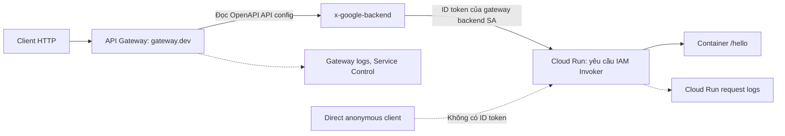

# Gọi Cloud Run backend được bảo vệ qua API Gateway

> **Chương:** API Gateway và Apigee  
> **Module:** CLOUD_PROVIDERS_GCP  
> **Phạm vi module:** Khám phá Google Cloud từ tổ chức project, IAM và VPC đến Compute Engine, GKE, Cloud Run, dịch vụ lưu trữ và cơ sở dữ liệu. Qua các tình huống triển khai, người học biết lựa chọn dịch vụ, bảo vệ tài nguyên, tự động hóa phát hành và theo dõi độ tin cậy cùng chi phí.

Một API HTTP chạy trên **Cloud Run** thường cần phục vụ nhiều client nhưng không được để client gọi trực tiếp backend bằng danh tính ẩn danh. **API Gateway** cung cấp URL vào chung, nhận request theo hợp đồng **OpenAPI**, áp chính sách API được hỗ trợ và **xác thực với Cloud Run thay mặt gateway** bằng service account riêng.

Bài này xây dựng kiến trúc **client → API Gateway → Cloud Run có IAM bảo vệ**, chỉ ra ba lớp bảo mật dễ bị nhầm: xác thực **client tại gateway**, xác thực **gateway khi gọi backend**, và **ingress network** của Cloud Run. Phần thực hành sử dụng một backend Python đơn giản và một OpenAPI 2.0 config, có kiểm thử đường trực tiếp bị từ chối và đường qua gateway thành công.

## Mục tiêu học tập

Sau bài học, bạn có thể:

1. Phân biệt **API**, **API config**, **gateway** và **Cloud Run service** trong kiến trúc Google Cloud.
2. Giải thích `x-google-backend`, `address`, `jwt_audience`, `path_translation` và luồng Google-signed **ID token**.
3. Cấp `roles/run.invoker` **trên đúng backend** cho service account gắn với API config.
4. Hiểu vì sao Cloud Run `--no-allow-unauthenticated` không đồng nghĩa đã bảo vệ client truy cập **gateway URL**.
5. Deploy backend, tạo API config/gateway, thử đường gọi thành công và thất bại bằng `gcloud`/`curl`.
6. Chẩn đoán 401/403/404/502/503, theo dõi Cloud Logging và kiểm soát chi phí/cleanup.

## 1. Kiến trúc và các thành phần



| Thành phần | Mục đích | Phạm vi |
|---|---|---|
| **API** | Nhóm các API configs và managed service của API | API Gateway project, quản lý toàn cục |
| **API config** | Bản OpenAPI, đường dẫn, backend routing, auth/quota policy, backend SA | Thuộc API; tạo config mới khi đổi spec |
| **Gateway** | Endpoint HTTPS công khai dạng `*.gateway.dev` và triển khai một API config | Resource có **location** được hỗ trợ |
| **Cloud Run backend** | Ứng dụng HTTP thực sự thực thi nghiệp vụ | Region, URL `*.run.app` và IAM |
| **Backend auth service account** | Danh tính gateway dùng để tạo ID token gọi Cloud Run | SA do nhóm tạo và chỉ định tại API config |

**Không nhầm gateway với load balancer.** API Gateway giải quyết API contract, xác thực/kiểm soát API theo cấu hình; Application Load Balancer phục vụ routing/network/TLS/load balancing và tích hợp Cloud Armor/CDN. **Apigee** là nền tảng quản lý vòng đời API rộng hơn, có proxies, policies, analytics và developer products. Bài này tập trung vào **API Gateway** vì yêu cầu là gọi một Cloud Run backend có bảo vệ IAM.

### 1.1. Hai URL, hai chính sách truy cập

```text
https://my-gateway-xyz.gateway.dev/hello     → URL dành cho client
https://hello-backend-xyz.a.run.app/hello     → URL Cloud Run backend
```

Hai URL trên **chỉ là minh họa**, không tự ghép hostname. URL thực lấy từ `gcloud api-gateway gateways describe` và `gcloud run services describe`.

Nếu Cloud Run từ chối caller ẩn danh, client thông thường không gọi được URL backend trực tiếp. Tuy nhiên, **gateway URL có thể vẫn được gọi công khai** nếu OpenAPI không yêu cầu API key/JWT. Đây là điểm quan trọng nhất của mô hình: **backend được IAM bảo vệ không tự động biến gateway thành private API**.

## 2. Xác thực client khác xác thực gateway → backend

| Lớp | Câu hỏi | Kiểm soát chính |
|---|---|---|
| **Client → Gateway** | Client nào được phép gọi `/hello`? | OpenAPI security: API key, JWT issuer/audience, hạn mức/quota phù hợp |
| **Gateway → Cloud Run** | Gateway có quyền invoke backend không? | Backend SA của API config + Google-signed ID token + Cloud Run `roles/run.invoker` |
| **Cloud Run ingress** | Request có tới được endpoint theo nguồn/đường mạng không? | `all`, `internal`, `internal-and-cloud-load-balancing` và kiến trúc networking |
| **App authorization** | Client được truy cập đối tượng/đơn hàng cụ thể nào? | Kiểm tra quyền nghiệp vụ trong app hoặc dịch vụ quản lý API phù hợp |

### 2.1. Service account phải đặt đúng vai trò

Đối với lab có bốn danh tính:

- **Deployer:** có quyền tạo Cloud Run, API Gateway, IAM bindings và **`iam.serviceAccounts.actAs`** trên SA được tham chiếu.
- **Cloud Build identity:** build source, ghi artifacts/logs khi triển khai container bằng `--source`.
- **Gateway backend SA:** được đặt bằng `--backend-auth-service-account=...` ở bước tạo API config và **chỉ cần Cloud Run Invoker** trên service đích trong lab.
- **Cloud Run runtime SA:** danh tính **mã ứng dụng** khi gọi Cloud Storage, Cloud SQL, Secret Manager...; không phải danh tính dùng để gateway invoke backend.

Không dùng một SA có `roles/editor`/Owner cho tất cả bước. **Google-managed API Gateway service agent** cũng không phải địa chỉ SA do bạn tự điền vào `--backend-auth-service-account`; API Gateway sử dụng **SA được khai báo trong API config** để xác thực với backend.

### 2.2. Cloud Run IAM: cho gateway, không cho `allUsers`

```bash
gcloud run services add-iam-policy-binding "$RUN_SERVICE" \
  --project="$PROJECT_ID" \
  --region="$RUN_REGION" \
  --member="serviceAccount:$GATEWAY_SA" \
  --role="roles/run.invoker"
```

Binding nên được cấp **tại service**, không phải toàn project. Không thêm `allUsers` khi mục tiêu là backend chỉ nhận caller có quyền. Nếu triển khai cùng image sang môi trường khác, dùng SA và binding khác theo **least privilege**.

### 2.3. Vì sao lab để Cloud Run `ingress=all`?

`--ingress=all` cho phép **đường mạng** của API Gateway trực tiếp tới `run.app`; `--no-allow-unauthenticated` yêu cầu **IAM identity hợp lệ**. API Gateway **không mặc nhiên được Cloud Run xem là nguồn internal** hay là một external Application Load Balancer. Đặt `internal` hoặc `internal-and-cloud-load-balancing` khi chưa có đường vào tương thích có thể gây `403` dù gateway SA đã có Invoker.

Điều này tạo ra khác biệt:

- **Bảo vệ danh tính:** caller trực tiếp ẩn danh bị từ chối; gateway SA được phép.
- **Cô lập mạng tuyệt đối:** **chưa đạt** chỉ với `ingress=all`; những principal **khác** có Invoker trên service vẫn có thể gọi trực tiếp khi có ID token hợp lệ.

Nếu kiến trúc đòi **không có bất kỳ đường gọi trực tiếp nào**, cần thiết kế bổ sung mạng/perimeter, front door tương thích và xác minh sản phẩm; không tuyên bố backend là “network-private” chỉ vì đã bật IAM.

## 3. OpenAPI cấu hình backend authentication

API Gateway đọc tài liệu OpenAPI có các Google extensions để biết endpoint backend và cách xử lý request.

### 3.1. Các trường quan trọng

| Trường | Ý nghĩa | Rủi ro khi sai |
|---|---|---|
| `x-google-backend.address` | URL HTTPS của Cloud Run backend | 404/502 hoặc gọi nhầm service |
| `jwt_audience` (OpenAPI 2.0) | Audience của ID token gateway gửi đến Cloud Run | Cloud Run từ chối token không khớp audience |
| `path_translation` | Cách chuyển `/hello` của client tới đường dẫn backend | App nhận route/query không đúng |
| `deadline` | Thời hạn gateway chờ backend | Timeout dù backend có thể tiếp tục chạy |
| `x-google-allow: configured` | Chỉ cho các method/path được khai báo đi qua | Tránh vô tình cho qua route chưa cấu hình |
| `securityDefinitions` / `security` | Chính sách xác thực **client tại gateway** | Nếu bỏ trống, client có thể gọi gateway công khai |

API Gateway **mặc định tạo ID token** khi backend có `address` và không đặt `disable_auth: true`. Với Cloud Run, đặt `jwt_audience` rõ ràng bằng **URL gốc của Cloud Run service** để tránh sai audience khi chuyển sang URL theo tag/revision hoặc backend address chứa đường dẫn.

### 3.2. `APPEND_PATH_TO_ADDRESS` so với `CONSTANT_ADDRESS`

```text
Gateway: GET /hello
Backend base URL: https://SERVICE-...run.app

APPEND_PATH_TO_ADDRESS:
  → https://SERVICE-...run.app/hello

CONSTANT_ADDRESS:
  → https://SERVICE-...run.app
     (tham số path có thể chuyển thành query nếu phù hợp)
```

Với HTTP API có nhiều routes, `APPEND_PATH_TO_ADDRESS` thường dễ hiểu hơn. **Ở cấp root**, `x-google-backend` mặc định dùng `APPEND_PATH_TO_ADDRESS`; **ở cấp operation**, mặc định có thể là `CONSTANT_ADDRESS`. Bài lab luôn khai báo `path_translation: APPEND_PATH_TO_ADDRESS` để không phụ thuộc vị trí extension.

### 3.3. Token và `Authorization` headers

Khi gateway xác thực với backend, nó có thể **ghi đè `Authorization`** bằng ID token của **gateway backend SA**, đồng thời chuyển token client ban đầu sang `X-Forwarded-Authorization`. Nếu API config kiểm tra JWT của client, có thể xem claims đã được xác minh trong header do API Gateway cung cấp, ví dụ `X-Apigateway-Api-Userinfo` theo tài liệu tương ứng.

**Không coi `X-Forwarded-Authorization` hoặc userinfo header tự nó là bằng chứng đáng tin** nếu ứng dụng còn đường gọi trực tiếp từ bên ngoài: app phải bảo đảm request chỉ đến từ gateway đã xác thực hoặc có lớp kiểm tra nguồn/identity phù hợp. Nếu cần phân quyền người dùng, hãy xác thực JWT/claims và quyền nghiệp vụ đúng mô hình; **ID token của gateway không đại diện cho end user**.

## 4. Chuẩn bị lab an toàn

> **Lưu ý chi phí và quyền:** Tạo Cloud Run, Cloud Build, Artifact Registry, API Gateway và gọi APIs có thể phát sinh phí. Chỉ làm trong **project sandbox** được phép và có Billing/budget. Bài viết không tạo tài nguyên Google Cloud khi được soạn.

### 4.1. Giá trị minh họa

| Biến | Giá trị mẫu | Mục đích |
|---|---|---|
| `PROJECT_ID` | `my-api-gateway-lab` | Project sandbox |
| `RUN_REGION` | `asia-northeast1` | Region Cloud Run |
| `GATEWAY_REGION` | `asia-northeast1` | **Region có hỗ trợ API Gateway** |
| `RUN_SERVICE` | `private-api-lab` | Backend Cloud Run |
| `RUN_SA` | `run-runtime-lab@PROJECT_ID.iam.gserviceaccount.com` | Runtime identity |
| `GATEWAY_SA` | `gateway-backend-lab@PROJECT_ID.iam.gserviceaccount.com` | ID token identity khi gateway gọi backend |
| `API_ID` | `private-api-lab` | API Gateway API |
| `CONFIG_ID` | `private-config-v1` | API config đầu tiên |
| `GATEWAY_ID` | `private-gateway-lab` | Gateway có HTTPS hostname |

**Không dùng `asia-southeast1` cho API Gateway trong ví dụ này** chỉ vì Cloud Run hỗ trợ region đó; danh sách region giữa hai sản phẩm có thể khác. Tài liệu Google Cloud liệt kê `asia-northeast1` cho gateway. Khi làm thật, đối chiếu danh sách region được hỗ trợ và yêu cầu tổ chức trước khi chọn vị trí backend/frontend.

### 4.2. Khai báo biến và kiểm kê chỉ đọc

```bash
PROJECT_ID="my-api-gateway-lab"
RUN_REGION="asia-northeast1"
GATEWAY_REGION="asia-northeast1"
RUN_SERVICE="private-api-lab"
RUN_SA_NAME="run-runtime-lab"
GATEWAY_SA_NAME="gateway-backend-lab"
RUN_SA="$RUN_SA_NAME@$PROJECT_ID.iam.gserviceaccount.com"
GATEWAY_SA="$GATEWAY_SA_NAME@$PROJECT_ID.iam.gserviceaccount.com"
API_ID="private-api-lab"
CONFIG_ID="private-config-v1"
GATEWAY_ID="private-gateway-lab"

gcloud auth list --filter="status:ACTIVE"
gcloud projects describe "$PROJECT_ID" \
  --format="table(projectId,name,lifecycleState)"

# Kiểm tra mọi tên trước khi tạo; không overwrite tài nguyên của người khác.
gcloud run services list --project="$PROJECT_ID" --region="$RUN_REGION"
gcloud api-gateway apis list --project="$PROJECT_ID"
gcloud api-gateway gateways list --project="$PROJECT_ID" --location="$GATEWAY_REGION"
gcloud iam service-accounts list --project="$PROJECT_ID"
```

Nếu thiếu quyền đọc, sai project hoặc đã có resource cùng tên, **dừng thao tác tạo** và xác nhận chủ sở hữu. Không tự gán role Admin/Owner để vượt kiểm soát.

### 4.3. Bật APIs khi được phép

```bash
# CHỈ trong project sandbox được quản trị viên cho phép.
gcloud services enable \
  apigateway.googleapis.com \
  servicemanagement.googleapis.com \
  servicecontrol.googleapis.com \
  run.googleapis.com \
  cloudbuild.googleapis.com \
  artifactregistry.googleapis.com \
  iam.googleapis.com \
  --project="$PROJECT_ID"
```

Để deploy source, build identity phải có quyền build/push cần thiết, có thể phải chỉ định service account theo chính sách. Deployer cần IAM thích hợp để quản lý Cloud Run, API Gateway và `iam.serviceAccounts.actAs` trên hai SA tùy bước. API Gateway service agent do Google quản lý cần giữ những quyền mặc định mà sản phẩm yêu cầu.

## 5. Tạo Cloud Run backend chỉ cho phép caller có IAM

### 5.1. Ứng dụng HTTP nhỏ

Trong thư mục sandbox của người học, tạo `backend/app.py` và `backend/Dockerfile`. Không tạo các file này trong thư mục nội dung khóa học.

**`backend/app.py`**

```python
import json
import os
from http.server import BaseHTTPRequestHandler, ThreadingHTTPServer


class Handler(BaseHTTPRequestHandler):
    def do_GET(self):
        if self.path not in ("/hello", "/healthz"):
            self.send_error(404, "Unknown route")
            return

        body = json.dumps({
            "message": "hello through API Gateway",
            "path": self.path,
        }).encode("utf-8")
        self.send_response(200)
        self.send_header("Content-Type", "application/json; charset=utf-8")
        self.send_header("Content-Length", str(len(body)))
        self.end_headers()
        self.wfile.write(body)


if __name__ == "__main__":
    port = int(os.environ.get("PORT", "8080"))
    ThreadingHTTPServer(("0.0.0.0", port), Handler).serve_forever()
```

**`backend/Dockerfile`**

```dockerfile
FROM python:3.12-slim
WORKDIR /app
COPY app.py .
ENV PYTHONDONTWRITEBYTECODE=1 PYTHONUNBUFFERED=1
USER 65532:65532
CMD ["python", "app.py"]
```

Ứng dụng đọc `PORT`, lắng nghe `0.0.0.0` và trả JSON tại `/hello`. Đây là bài lab; production cần pin base-image digest, dependency scanning, test, timeout và graceful shutdown.

### 5.2. Runtime SA và deploy

```bash
# Chỉ tạo SA dành riêng cho lab, không cần cấp role Editor.
gcloud iam service-accounts create "$RUN_SA_NAME" \
  --project="$PROJECT_ID" \
  --display-name="Private API lab runtime"

# Chạy trong thư mục backend/ có app.py và Dockerfile.
gcloud run deploy "$RUN_SERVICE" \
  --source . \
  --project="$PROJECT_ID" --region="$RUN_REGION" \
  --service-account="$RUN_SA" \
  --ingress=all \
  --no-allow-unauthenticated \
  --max-instances=2 \
  --memory=512Mi --cpu=1

# Lấy URL backend THỰC, không tự lắp ghép hostname.
BACKEND_URL="$(gcloud run services describe "$RUN_SERVICE" \
  --project="$PROJECT_ID" --region="$RUN_REGION" \
  --format='value(status.url)')"
printf 'Cloud Run backend: %s\n' "$BACKEND_URL"

gcloud run services get-iam-policy "$RUN_SERVICE" \
  --project="$PROJECT_ID" --region="$RUN_REGION"
```

**Kỳ vọng:** service Ready, không có binding `allUsers` cho `roles/run.invoker`. `--ingress=all` **chỉ** là lựa chọn đường mạng cho lab; IAM vẫn chặn anonymous. Runtime SA không cần quyền truy cập Google Cloud API nào vì code chỉ trả JSON.

### 5.3. Negative test: gọi Cloud Run trực tiếp không token

```bash
# Đường trực tiếp từ máy chưa có ID token: thường bị Cloud Run từ chối.
curl -i "$BACKEND_URL/hello"
```

Kỳ vọng **không có JSON nghiệp vụ 200** khi gọi **không** cung cấp token. Cloud Run có thể trả `401` hoặc `403` tùy trường hợp; kiểm tra IAM và request context. Nếu thấy 200, phải xác minh `allUsers`/Invoker IAM check/OrgPolicy và cấu hình thực tế trước khi đi tiếp.

## 6. Tạo gateway backend service account

```bash
gcloud iam service-accounts create "$GATEWAY_SA_NAME" \
  --project="$PROJECT_ID" \
  --display-name="API Gateway backend auth lab"

# Cho gateway SA invoke ĐÚNG service đích.
gcloud run services add-iam-policy-binding "$RUN_SERVICE" \
  --project="$PROJECT_ID" --region="$RUN_REGION" \
  --member="serviceAccount:$GATEWAY_SA" \
  --role="roles/run.invoker"

# Kiểm tra IAM đã được áp.
gcloud run services get-iam-policy "$RUN_SERVICE" \
  --project="$PROJECT_ID" --region="$RUN_REGION"
```

Người **tạo API config** phải có quyền sử dụng SA này (`iam.serviceAccounts.actAs`/Service Account User) theo quy định của tổ chức. Đừng cấp token creator/admin cho tất cả user vì API Gateway không chạy được; chỉ xử lý từng lỗi permission theo docs.

**Thực tế:** mặc dù gateway nhận request không xác thực trong cấu hình OpenAPI cơ bản ở bước sau, nó sử dụng **gateway backend SA** để gọi Cloud Run. Đó là xác thực **service-to-service**, không xác thực người dùng cuối.

## 7. Tạo OpenAPI 2.0 config đúng backend URL và audience

### 7.1. Tạo `openapi-run.yaml` trong thư mục lab

Dùng **Bash** để điền URL thật từ `gcloud`; lưu ý `BACKEND_URL` phải là URL gốc của service, không có `/hello` ở cuối:

```bash
# Kiểm tra biến trước khi tạo cấu hình, không in token/secret.
printf 'API=%s Backend=%s\n' "$API_ID" "$BACKEND_URL"

cat > openapi-run.yaml <<YAML
swagger: "2.0"
info:
  title: $API_ID
  description: Protected Cloud Run backend via API Gateway
  version: "1.0.0"
schemes:
  - https
produces:
  - application/json
x-google-allow: configured
x-google-backend:
  address: $BACKEND_URL
  jwt_audience: $BACKEND_URL
  path_translation: APPEND_PATH_TO_ADDRESS
  deadline: 30.0
paths:
  /hello:
    get:
      summary: Read a sample greeting
      operationId: hello
      responses:
        "200":
          description: A successful response
          schema:
            type: object
YAML
```

`x-google-backend.address` là **địa chỉ backend**, không phải địa chỉ `gateway.dev`; `jwt_audience` là audience mà Cloud Run kiểm tra. Tên API ở `info.title` nên nhất quán với `API_ID` để tránh nhầm khi đăng ký managed service và áp API key restrictions.

**Security boundary của lab:** OpenAPI trên **chưa yêu cầu API key/JWT ở client**. Gateway sẽ nhận request không xác thực nếu endpoint đã hoạt động. Chúng ta dùng cấu hình này để **chứng minh Cloud Run backend riêng tư về IAM**, không được dùng làm mẫu mở API dữ liệu thật ra Internet. Mục 9 hướng dẫn thêm lớp bảo vệ client.

### 7.2. Tạo API config

```bash
gcloud api-gateway api-configs create "$CONFIG_ID" \
  --api="$API_ID" \
  --openapi-spec="openapi-run.yaml" \
  --backend-auth-service-account="$GATEWAY_SA" \
  --project="$PROJECT_ID"

gcloud api-gateway api-configs describe "$CONFIG_ID" \
  --api="$API_ID" --project="$PROJECT_ID" \
  --format="yaml(name,state,gatewayConfig)"
```

`--backend-auth-service-account` gắn SA với **API config** để gateway lấy ID token cho backend. Nếu lỗi `FAILED_PRECONDITION` hoặc permission:

- Kiểm tra SA tồn tại và chưa disabled.
- Kiểm tra người tạo config có `actAs` và các IAM roles tương ứng.
- Kiểm tra `roles/run.invoker` trên **Cloud Run backend**.
- Kiểm tra API Gateway/Service Management/Service Control đã bật.
- Không đặt `disable_auth: true` khi muốn xác thực gateway → backend.

API config có thời gian propagate; **không tạo nhiều configs đồng thời cho cùng API** chỉ vì một thao tác đang chạy. Khi cần đổi spec, tạo **config ID mới** rồi cập nhật gateway.

### 7.3. Bật managed service của API

API Gateway tạo một **managed service name** riêng cho API, không nên đoán tên theo `API_ID` và `PROJECT_ID`:

```bash
gcloud api-gateway apis describe "$API_ID" \
  --project="$PROJECT_ID" \
  --format="yaml(name,managedService)"

MANAGED_SERVICE="$(gcloud api-gateway apis describe "$API_ID" \
  --project="$PROJECT_ID" \
  --format='value(managedService)')"
printf 'Managed service: %s\n' "$MANAGED_SERVICE"

# Chỉ bật giá trị KHÔNG rỗng, đúng API của lab.
if [ -n "$MANAGED_SERVICE" ]; then
  gcloud services enable "$MANAGED_SERVICE" --project="$PROJECT_ID"
else
  echo "Managed service chưa sẵn sàng; dừng và kiểm tra API." >&2
fi
```

Managed service cần được bật để sử dụng các tính năng kiểm soát API như API keys. Nếu thông tin chưa xuất hiện, đừng tự lắp ghép chuỗi `*.apigateway.*.cloud.goog`; đọc lại API details hoặc Console khi API/config đã hoàn tất.

## 8. Tạo gateway và thử luồng end-to-end

### 8.1. Deploy gateway

```bash
# Gateway đặt tại region mà API Gateway hỗ trợ.
gcloud api-gateway gateways create "$GATEWAY_ID" \
  --api="$API_ID" \
  --api-config="$CONFIG_ID" \
  --location="$GATEWAY_REGION" \
  --project="$PROJECT_ID"

gcloud api-gateway gateways describe "$GATEWAY_ID" \
  --location="$GATEWAY_REGION" \
  --project="$PROJECT_ID" \
  --format="yaml(name,state,defaultHostname,apiConfig)"

GATEWAY_HOST="$(gcloud api-gateway gateways describe "$GATEWAY_ID" \
  --location="$GATEWAY_REGION" \
  --project="$PROJECT_ID" \
  --format='value(defaultHostname)')"
GATEWAY_URL="https://$GATEWAY_HOST"
printf 'Gateway URL: %s\n' "$GATEWAY_URL"
```

Gateway có URL HTTPS quản lý sẵn; DNS/certificate không cần tự tạo khi dùng hostname mặc định. Chỉ thử khi gateway **ACTIVE**, API config sẵn sàng và managed service đã bật.

### 8.2. So sánh ba request

```bash
# (1) Gọi trực tiếp backend không token: phải bị chặn bởi Cloud Run IAM.
curl -i "$BACKEND_URL/hello"

# (2) Gọi qua API Gateway /hello: gateway dùng SA riêng gọi backend.
curl -i "$GATEWAY_URL/hello"

# (3) Gọi một route KHÔNG khai báo trong OpenAPI:
curl -i "$GATEWAY_URL/not-listed"
```

| Test | Kết quả mong đợi trong lab | Ý nghĩa |
|---|---|---|
| Backend direct /hello | `401/403` hoặc bị từ chối, **không** trả 200 nghiệp vụ | Cloud Run chặn anonymous |
| Gateway /hello | `200` cùng JSON `hello through API Gateway` | Gateway có ID token, Cloud Run chấp nhận Invoker |
| Gateway /not-listed | Bị từ chối, thường `404` | `x-google-allow: configured` chỉ cho routes đã khai báo |

**Nếu API Gateway /hello trả 200 mà bạn chưa bật auth client**, điều này **không phải lỗi IAM**: backend vẫn được bảo vệ khỏi anonymous direct caller, nhưng **gateway URL có tính public**. Không triển khai dữ liệu thật trước khi xử lý xác thực client, quota/rate limiting và các chính sách bảo vệ thích hợp.

### 8.3. Kiểm tra backend chỉ có Invoker đúng principal

```bash
gcloud run services get-iam-policy "$RUN_SERVICE" \
  --project="$PROJECT_ID" --region="$RUN_REGION"

gcloud api-gateway api-configs describe "$CONFIG_ID" \
  --api="$API_ID" --project="$PROJECT_ID" \
  --format="yaml(state,gatewayConfig)"
```

Xác minh gateway backend SA chính xác, không có `allUsers` trong Cloud Run IAM và không dùng một default SA quá quyền. Nếu user khác đã có `roles/run.invoker`, họ có thể gọi trực tiếp bằng token hợp lệ — cần xét theo mô hình tổ chức, không tuyên bố “chỉ duy nhất gateway có quyền” khi chưa kiểm kê IAM đầy đủ.

## 9. Thêm xác thực ở lớp client → gateway

### 9.1. API key không phải nhận diện mạnh của người dùng

API key có thể giúp nhận diện **project/ứng dụng tiêu thụ API** và hỗ trợ quota, nhưng là một giá trị có thể sao chép; **không coi API key một mình là bảo mật đủ cho dữ liệu nhạy cảm**. Với dữ liệu/đặc quyền người dùng, dùng JWT/OIDC với issuer, JWKS, audience và scope/claims phù hợp; backend vẫn phải kiểm tra **authorization nghiệp vụ**.

| Bảo vệ | Ví dụ | Chống rủi ro nào? |
|---|---|---|
| Gateway API key | Google Cloud API key được restriction theo managed service | Nhận diện project tiêu thụ, hạn chế key không hợp lệ |
| Gateway JWT/OIDC | Kiểm issuer/JWKS/audience trong OpenAPI | Xác minh caller ở API edge |
| Gateway → Cloud Run IAM | Google-signed ID token của gateway SA | Không cho anonymous gọi trực tiếp backend |
| Application authorization | Kiểm quyền truy cập đơn hàng theo principal | Ngăn người dùng hợp lệ xem dữ liệu của người khác |
| Quotas/Monitoring | Quotas, rate controls theo tính năng và alerting | Phát hiện/giới hạn lạm dụng trong ngưỡng thiết kế |

### 9.2. Ví dụ yêu cầu API key trong OpenAPI 2.0

Đối với bài tập riêng, thêm hai đoạn sau vào **OpenAPI mới**:

```yaml
# Ở cấp root (cùng cấp với paths):
securityDefinitions:
  api_key:
    type: apiKey
    name: key
    in: query
security:
  - api_key: []
```

Sau khi tạo **API key được hạn chế theo managed API** ở Console và quản lý key theo chính sách secrets, client gọi:

```bash
# Giá trị key phải được nhập an toàn, KHÔNG commit vào Git hoặc log.
# Ví dụ kiểm thử; query key có thể xuất hiện trong URL logs/history.
curl -i --get "$GATEWAY_URL/hello" \
  --data-urlencode "key=$API_KEY"
```

**Không sửa config cũ tại chỗ**. Tạo `openapi-run-key.yaml` từ bản có API key, rồi:

```bash
NEW_CONFIG_ID="private-config-key-v2"
gcloud api-gateway api-configs create "$NEW_CONFIG_ID" \
  --api="$API_ID" \
  --openapi-spec="openapi-run-key.yaml" \
  --backend-auth-service-account="$GATEWAY_SA" \
  --project="$PROJECT_ID"

gcloud api-gateway gateways update "$GATEWAY_ID" \
  --api="$API_ID" \
  --api-config="$NEW_CONFIG_ID" \
  --location="$GATEWAY_REGION" \
  --project="$PROJECT_ID"
```

Chỉ thực hiện sau khi chuẩn bị đầy đủ client key/giới hạn, kiểm thử với staging và có phương án rollback config. Nếu muốn **JWT**, bổ sung `securityDefinitions` tương ứng issuer, JWKS URI, audiences và `security`; API key không tự biến thành JWT.

## 10. Cập nhật backend, audience và API config an toàn

### 10.1. Đổi revision/tag có thể làm sai audience

Nếu OpenAPI trỏ một URL Cloud Run **theo tag** hoặc có đường dẫn đặc biệt, `x-google-backend.address` có thể khác **service URL** được Cloud Run chấp nhận làm audience. Khi đó cần:

```yaml
x-google-backend:
  address: https://TAG---SERVICE_HOSTNAME/hello
  jwt_audience: https://SERVICE_HOSTNAME
  path_translation: CONSTANT_ADDRESS
```

Chỉ dùng ví dụ này khi đúng cơ chế URL theo tag; `SERVICE_HOSTNAME` là placeholder cần lấy từ service thực. Nếu không chắc, **luôn dùng URL service gốc** và `jwt_audience` cùng URL đó như trong lab.

### 10.2. Quy trình thay đổi

1. Build/test Cloud Run revision; xác minh service IAM không bị mở anonymous.
2. Chuẩn bị OpenAPI config **mới** có backend address, jwt audience, routes và client auth đúng.
3. Tạo API config, kiểm tra trạng thái, **update gateway** đến config mới.
4. Chạy smoke tests trực tiếp/qua gateway, kiểm tra request logs, 4xx/5xx và SLO.
5. Khi có lỗi, update gateway trở lại config cũ còn tồn tại; xem thêm rollback của Cloud Run revision nếu backend đã đổi.

**Rollback API config không tự rollback database hoặc Cloud Run revision.** Bảo đảm tính tương thích schema và side effects giữa các phiên bản.

## 11. Observability và troubleshooting theo tầng

### 11.1. Xem Logs Explorer

Trong **Cloud Logging → Logs Explorer**, lọc API Gateway theo resource:

```text
resource.type="apigateway.googleapis.com/Gateway"
resource.labels.gateway_id="private-gateway-lab"
resource.labels.location="asia-northeast1"
```

Nếu log có `jsonPayload.responseDetails="via_upstream"` thì lỗi xuất phát từ **backend**; giá trị khác thường chỉ lỗi từ gateway hoặc các lớp trước backend. Xem kèm Cloud Run request logs/revision logs để xác minh HTTP 401/403 đến từ đâu. Không log token, API key hoặc payload nhạy cảm.

### 11.2. Bảng xử lý lỗi

| Triệu chứng | Nguyên nhân có thể | Hành động |
|---|---|---|
| Tạo API config lỗi SA | Gateway backend SA không tồn tại, bị disable hoặc thiếu `actAs` | Xác định đúng SA, permission và API service agent |
| Gateway tạo không được | Region không hỗ trợ, API config chưa ACTIVE, quota | Xem danh sách regions, config state và operations |
| Backend direct trả 200 không token | IAM bị mở `allUsers` hoặc Invoker check tắt | Đọc Cloud Run IAM và chính sách trước khi tiếp tục |
| Gateway trả 401/403 | Backend SA thiếu Invoker, sai `jwt_audience`; hoặc gateway client auth từ chối | Đọc gateway responseDetails, Cloud Run logs và OpenAPI |
| Cloud Run `ingress=internal` | Gateway trực tiếp có thể không được nhận là internal | Xem ingress/network design; không dùng flag như bản sao của IAM |
| Gateway /hello trả 404 | Route/path_translation sai, backend app route không tồn tại | So OpenAPI path với handler và forwarded URL |
| Gateway trả 502/503 | Backend crash/not ready, timeout, networking hoặc API config propagation | Xem service health, gateway logs và Cloud Run logs |
| API key đúng nhưng bị từ chối | Managed service chưa enable, key bị restriction sai | Kiểm tra API title, managed service, key restrictions |
| Endpoint gateway trả 200 cho mọi client | Chưa cấu hình `security` ở OpenAPI | Thêm auth client theo đúng độ nhạy dữ liệu |
| API latency tăng | Cold start Cloud Run, gateway overhead, backend DB chậm | So p95 gateway vs Cloud Run, min instances và traces |
| Bill tăng | Calls, transfer, Cloud Run instances, build/storage/logs | Kiểm kê Billing Reports, quotas và gateway/API usage |

**Không cấp `roles/editor` hoặc `allUsers` để chữa mọi 403**. Nếu gateway từ chối API key/JWT ở frontend thì cần sửa client auth; nếu gateway gọi backend thiếu Invoker, sửa đúng **gateway backend SA**.

## 12. Chi phí, bảo mật và lựa chọn Apigee

### 12.1. Những khoản chi phí cần dự trù

| Thành phần | Dạng chi phí |
|---|---|
| API Gateway/Service Control | Số lượt gọi API và data transfer theo bảng giá/khu vực |
| Cloud Run | CPU, memory, requests/instance billing, min instances và egress |
| Cloud Build/Artifact Registry | Build minutes, image storage và transfer |
| Cloud Logging/Monitoring | Ingest/log retention và metrics theo cấu hình |
| API key/quota/traffic control | Vận hành quản lý credentials và chính sách tiêu thụ API |

**Budget alert không tự chặn chi phí**; thử trong sandbox với ít requests và dọn gateway/backend sau khi hoàn thành. Khi gateway và backend ở hai region khác nhau, xem độ trễ và data transfer phát sinh.

### 12.2. Khi nào API Gateway là đủ?

**API Gateway** thích hợp khi cần một mặt tiền HTTPS được quản lý, OpenAPI contract, xác thực gateway–backend, API keys/JWT cơ bản, quota/giám sát theo tính năng.

**Apigee** phù hợp hơn khi tổ chức cần **API products, developer portal, lifecycle governance, advanced policies, mediation/transformation, analytics/monetization** và quản trị API đa backend. Không chuyển sang Apigee chỉ để sửa một binding Invoker sai; cũng không cố dùng API Gateway như nền tảng API product management hoàn chỉnh nếu yêu cầu quá rộng.

## 13. Bài tập thực hành và đáp án gợi ý

### Bài tập 1 — Hai đường gọi

Backend Cloud Run có `--ingress=all --no-allow-unauthenticated`, chỉ gateway SA có Invoker. Client gửi `GET /hello` không token trực tiếp tới `run.app` và qua `gateway.dev` (OpenAPI chưa cấu hình client auth). Kết quả?

**Đáp án:** trực tiếp bị từ chối; qua gateway **có thể trả 200** vì gateway gắn ID token của SA đã có Invoker. Gateway public ở lớp client nếu không có security policy.

### Bài tập 2 — Audience sai

OpenAPI `address` trỏ URL revision tag, nhưng `jwt_audience` bằng URL tag thay vì Cloud Run service URL. Gateway bị 401. Sửa gì?

**Đáp án:** đặt `jwt_audience` thành URL service mà Cloud Run chấp nhận; dùng explicit audience và kiểm tra service IAM. Không dùng `disable_auth: true`.

### Bài tập 3 — Authorization bị thay

Ứng dụng muốn đọc bearer JWT gốc của client để phân quyền. Sau khi qua gateway, `Authorization` chứa ID token của gateway SA. Token client ở đâu?

**Đáp án:** gateway có thể chuyển original bearer sang `X-Forwarded-Authorization`; nếu đã cấu hình JWT validation thì dùng claims đã xác minh trong userinfo header phù hợp. Không tin header tự khai nếu client có thể gọi backend trực tiếp.

### Bài tập 4 — Route sai

Gateway có `/hello`, backend handler chỉ hỗ trợ `/hello`. Nếu đặt `x-google-backend` ở operation với mặc định `CONSTANT_ADDRESS` và URL base không có path, chuyện gì xảy ra?

**Đáp án:** backend có thể nhận `/` thay vì `/hello`, dẫn tới 404. Khai báo `path_translation: APPEND_PATH_TO_ADDRESS` hoặc định tuyến URL cụ thể phù hợp.

### Bài tập 5 — Thiết kế bảo vệ production

Một API trả thông tin đơn hàng riêng của từng người. Có đủ an toàn nếu chỉ bật Cloud Run IAM và cấp gateway SA Invoker? Đề xuất thêm hai kiểm soát.

**Gợi ý:** chưa đủ; gateway có thể public. Cần JWT/OIDC xác thực client ở gateway, **authorization theo user/order** trong app và giám sát/quota; API key một mình không thay JWT.

## 14. Cleanup: theo quan hệ phụ thuộc

Chỉ xóa tài nguyên **do lab này tạo** sau khi đã kiểm tra chủ sở hữu, không còn traffic thật, không có API config khác dùng chung và không có consumer cần endpoint. Thứ tự cơ bản: **gateway → API configs → API → quyền/SA → Cloud Run service**.

### 14.1. Kiểm kê trước xóa

```bash
gcloud api-gateway gateways list \
  --project="$PROJECT_ID" --location="$GATEWAY_REGION"
gcloud api-gateway api-configs list \
  --api="$API_ID" --project="$PROJECT_ID"
gcloud api-gateway apis describe "$API_ID" \
  --project="$PROJECT_ID"
gcloud run services describe "$RUN_SERVICE" \
  --project="$PROJECT_ID" --region="$RUN_REGION"
```

### 14.2. Xóa resource Gateway thuộc riêng lab

```bash
# CHỈ khi gateway không còn phục vụ bất kỳ client nào.
gcloud api-gateway gateways delete "$GATEWAY_ID" \
  --project="$PROJECT_ID" --location="$GATEWAY_REGION"

# Xóa MỌI config chỉ do bài lab tạo, sau khi gateway đã không sử dụng.
gcloud api-gateway api-configs delete "$CONFIG_ID" \
  --api="$API_ID" --project="$PROJECT_ID"

# Nếu bài tập API key đã tạo version thứ hai và version đó thuộc lab:
# gcloud api-gateway api-configs delete "$NEW_CONFIG_ID" \
#   --api="$API_ID" --project="$PROJECT_ID"

# Chỉ xóa API khi không còn gateways/configs khác dùng chung.
gcloud api-gateway apis delete "$API_ID" --project="$PROJECT_ID"
```

Nếu bạn đã tạo **managed service** và API key chỉ cho bài này, dọn/thu hồi chúng theo hướng dẫn Service Usage/API Keys của tổ chức; **không disable một managed service đang được client khác sử dụng**. Xóa gateway không tự xóa API key khỏi Credential Manager.

### 14.3. Gỡ IAM và xóa backend

```bash
# Chỉ gỡ binding đã cấp riêng cho bài.
gcloud run services remove-iam-policy-binding "$RUN_SERVICE" \
  --project="$PROJECT_ID" --region="$RUN_REGION" \
  --member="serviceAccount:$GATEWAY_SA" \
  --role="roles/run.invoker"

# Chỉ xóa service nếu nó được tạo riêng bởi bài lab, không dùng chung.
gcloud run services delete "$RUN_SERVICE" \
  --project="$PROJECT_ID" --region="$RUN_REGION"

# Chỉ xóa SA riêng lab, không phải Google-managed service agent.
gcloud iam service-accounts delete "$GATEWAY_SA" \
  --project="$PROJECT_ID"
gcloud iam service-accounts delete "$RUN_SA" \
  --project="$PROJECT_ID"
```

Repository `cloud-run-source-deploy`/image build có thể dùng chung và không nhất thiết bị xóa cùng service. Kiểm kê Cloud Build artifacts, Artifact Registry, Cloud Logging, Service Control/Billing và API key còn tồn tại; phí có thể cập nhật trễ.

## 15. Checklist trước production

| Kiểm tra | Tiêu chí đạt |
|---|---|
| **API contract** | OpenAPI path/method, backend address, path translation chính xác |
| **Backend identity** | API config dùng đúng gateway SA, audience đúng service URL |
| **Backend IAM** | Cloud Run không cho `allUsers`; Invoker cấp đúng SA/resource |
| **Ingress** | Đường từ gateway tới Cloud Run tương thích; không nhầm IAM với cô lập mạng |
| **Client auth** | API key/JWT/OIDC theo mức nhạy cảm; authorization nghiệp vụ trong app |
| **SA permissions** | Deployer, build, gateway và runtime identities tách biệt |
| **Version/rollout** | API config mới có plan rollback, backend version tương thích |
| **Quan sát** | Gateway + Cloud Run logs, 401/403/5xx, p95, SLO và alerts |
| **Chi phí** | Giá Gateway/Service Control, Run, egress, image/logging có budget |
| **Cleanup** | Không xóa API/config/SA/key dùng chung |

## Ghi nhớ

**API Gateway gọi Cloud Run backend được IAM bảo vệ bằng ID token của SA gắn với API config.** Cấp `roles/run.invoker` cho SA này trên service, dùng `x-google-backend` với đúng `address`/`jwt_audience`/`path_translation`. Cloud Run `--no-allow-unauthenticated` ngăn anonymous gọi **backend trực tiếp** nhưng không tự bảo vệ **gateway URL** trước client. Production cần client authentication, authorization nghiệp vụ, logging, quota và kiểm tra ingress/mạng theo kiến trúc thực.

## Tài liệu tham khảo chính thức

- [API Gateway — Getting started with Cloud Run](https://cloud.google.com/api-gateway/docs/get-started-cloud-run)
- [API Gateway — Secure backend services](https://cloud.google.com/api-gateway/docs/securing-backend-services)
- [API Gateway — Create an API config](https://cloud.google.com/api-gateway/docs/creating-api-config)
- [API Gateway — Deploy an API to a gateway](https://cloud.google.com/api-gateway/docs/deploying-api)
- [API Gateway — OpenAPI 2.0 extensions](https://cloud.google.com/api-gateway/docs/oasv2-extensions)
- [API Gateway — Backend path translation](https://cloud.google.com/api-gateway/docs/passing-data)
- [API Gateway — Use API keys](https://cloud.google.com/api-gateway/docs/authenticate-api-keys)
- [API Gateway — Authenticate users with JWT](https://cloud.google.com/api-gateway/docs/authenticating-users-jwt)
- [API Gateway — Troubleshoot](https://cloud.google.com/api-gateway/docs/troubleshoot)
- [Cloud Run — Restrict ingress](https://cloud.google.com/run/docs/securing/ingress)
- [Cloud Run — Service-to-service authentication](https://cloud.google.com/run/docs/authenticating/service-to-service)
- [Apigee — What is Apigee?](https://cloud.google.com/apigee/docs/api-platform/get-started/what-apigee)
