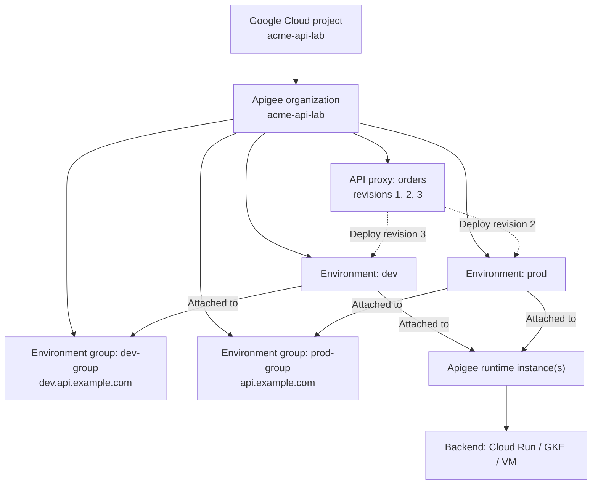
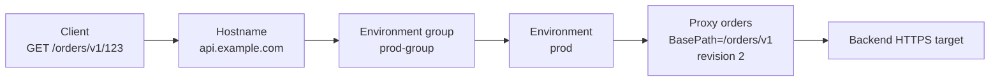
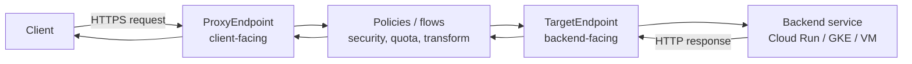
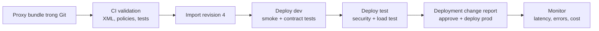

# Apigee organizations, environments và API proxies

## 1. Bài toán và mục tiêu

Một công ty có ba backend: **Cloud Run** phục vụ đơn hàng, **GKE** phục vụ tồn kho và một ứng dụng cũ trên **Compute Engine**. Khách hàng bên ngoài cần gọi API ổn định tại `https://api.example.com`, trong khi mỗi backend có địa chỉ và cơ chế phát hành khác nhau. Đội nền tảng cũng cần xác thực ứng dụng gọi API, giới hạn lưu lượng, quan sát lỗi và tách môi trường phát triển khỏi production.

**Apigee** là nền tảng quản lý API của Google Cloud, đặt một lớp **API proxy** trước các backend. Proxy cung cấp một giao diện ổn định cho ứng dụng khách và cho phép áp dụng các chính sách bảo mật, traffic management, transformation, routing và analytics mà không phải cài mọi chức năng đó vào từng backend.

Bài học thuộc chương **API Gateway và Apigee** của module **CLOUD_PROVIDERS_GCP**, liên hệ kiến thức project, IAM, VPC, Compute Engine, GKE, Cloud Run, storage/database, CI/CD, độ tin cậy và chi phí. Nội dung tập trung ba khái niệm **organization, environment, API proxy**, đồng thời giải thích **environment group**, thành phần bắt buộc để định tuyến qua hostname trong Apigee.

### Sau bài học, bạn có thể

1. Phân biệt **Apigee organization** với **Google Cloud organization** và **Google Cloud project**.
2. Giải thích **environment**, **environment group**, hostname, API proxy, base path và backend target.
3. Trình bày cấu trúc **ProxyEndpoint, TargetEndpoint, flows, policies và RouteRule**.
4. Hiểu vì sao proxy phải được **deploy một revision** vào environment đã được cấu hình định tuyến.
5. Tạo một reverse proxy thử nghiệm từ giao diện Apigee, gọi qua hostname và kiểm tra kết quả.
6. Dùng **Apigee management API** để đọc organizations/environments/proxies/deployments.
7. Thiết kế phát hành dev/test/prod, IAM, xác thực, observability và tối ưu chi phí.

> **Quy ước:** `acme-api-lab`, `api.example.com`, `dev.api.example.com` và tên proxies trong bài là **giả định**. Apigee là dịch vụ trả phí và việc provision môi trường/runtime có thể phát sinh chi phí ngay cả trước khi có API traffic. Chỉ thực hành thay đổi trong **Apigee organization lab đã được cấp quyền**, không tự provision mới nếu chưa có ngân sách và phê duyệt.

## 2. Bản đồ tài nguyên: organization → environment → deployment



Các mũi tên từ proxy tới environment biểu thị **deployment**, không phải ownership hierarchy. API proxy được **định nghĩa trong organization**; environment là nơi một **revision** của proxy được triển khai. Environment groups quản lý hostname; instances cung cấp runtime capacity.

| Thành phần | Trách nhiệm | Ví dụ |
| --- | --- | --- |
| **Apigee organization** | Phạm vi cao nhất chứa proxies, environments, groups, API products và tài nguyên quản trị | `acme-api-lab` |
| **Environment** | Ngữ cảnh runtime triển khai revision và resources scoped theo environment | `dev`, `prod` |
| **Environment group** | Gắn một hoặc nhiều hostnames với một hoặc nhiều environments để định tuyến inbound | `prod-group` |
| **Runtime instance** | Năng lực thực thi Apigee ở region được hỗ trợ, nơi environment được attach | Instance trong vùng phù hợp |
| **API proxy** | Định nghĩa giao diện trước backend, policies, routes và targets | `orders` |
| **Revision** | Phiên bản cấu hình proxy được đánh số | `orders` revision `3` |
| **Deployment** | Liên kết một proxy revision với một environment đang phục vụ traffic | `orders` rev 2 ở `prod` |

**Điểm cốt lõi:** Tạo proxy không đồng nghĩa proxy đã phục vụ request. Cần **deploy**; environment phải được gắn với **runtime instance** và ít nhất một **environment group có hostname** để proxy có thể được gọi qua mạng.

## 3. Apigee organization không phải Google Cloud organization

Một **Apigee organization** thuộc về đúng **một Google Cloud project**; một project có thể có **tối đa một** Apigee organization. Hai đối tượng chia sẻ **tên định danh tương ứng với Project ID**, nhưng **không phải một loại tài nguyên**. Một Google Cloud organization (tầng Resource Manager trên folders/projects) có thể chứa nhiều projects, trong đó có nhiều Apigee organizations.

```text
Google Cloud organization: acme.example
  ├── Folder: platform
  │   ├── Project: acme-api-lab    → Apigee organization: acme-api-lab
  │   └── Project: acme-api-prod   → Apigee organization: acme-api-prod
  └── Project: acme-analytics     → Không bắt buộc có Apigee organization
```

### Organization chứa gì?

- **API proxies và revisions**: code/chính sách định tuyến cho APIs.
- **Environments, environment groups**, runtime instances/attachments.
- **API products, developers, developer apps**: quản lý cách ứng dụng đối tác dùng và được cấp quyền truy cập APIs.
- Một số cấu hình, analytics và key-value maps theo phạm vi tổ chức hoặc environment.

**Organization là phạm vi quản trị, không phải một “endpoint” HTTP.** Client không gửi request tới organization name để gọi backend. Hostname do **environment group** khai báo mới là phần domain của URL phục vụ API.

### Các điểm quản trị

1. Apigee organization có thể ở loại **evaluation** hoặc **paid** (subscription/pay-as-you-go), với limits và quyền sử dụng khác nhau.
2. Tên organization **không đổi được sau khi tạo**; không xây automation dựa vào khả năng rename.
3. Apigee được tích hợp Google Cloud IAM, nhưng các vai trò **Apigee** khác quyền truy cập **Cloud Run/GKE/Cloud SQL**. Có quyền sửa proxy không tự cấp quyền quản lý backend.
4. Khi thiết kế nhiều orgs để cô lập production, phải đánh giá chi phí, analytics, CI/CD, developer apps và quản trị nhiều projects; không mặc định một org cho mọi môi trường hoặc ngược lại.

## 4. Environments, environment groups và hostnames

**Environment** là nơi proxy revision được deploy. **Environment group** chứa **hostnames** và một tập environments; Apigee dùng hostname cùng **base path** để tìm proxy khi request đến.

### Ví dụ phân tách dev/prod

| Environment group | Hostname | Thành viên | Proxy revision |
| --- | --- | --- | --- |
| `dev-group` | `dev.api.example.com` | `dev` | `orders` rev 3 |
| `prod-group` | `api.example.com` | `prod` | `orders` rev 2 |

Khách hàng gửi:

```text
https://api.example.com/orders/v1/123
        |_____________| |________| |_|
           hostname      basepath  resource path
```

Request được định tuyến như sau:



**Đừng nhầm:** `prod` và `prod-group` **không xuất hiện mặc định trong URL**; người dùng thường chỉ thấy hostname + base path + resource path. Nếu tạo tên environment `catalog-prod`, điều đó không tự tạo URL `/catalog-prod`.

### Quy tắc định tuyến quan trọng

- Một environment phải thuộc **ít nhất một environment group** để các proxies được deploy vào đó có thể được gọi qua hostname của group.
- Một environment có thể thuộc **nhiều environment groups**; proxy khi đó có thể xuất hiện qua nhiều hostnames.
- Một environment group có thể gồm **nhiều environments** và **nhiều hostnames**; mỗi hostname sẽ phục vụ những proxies thuộc các environments thành viên theo base path.
- Hostnames trong cùng Apigee organization phải **duy nhất giữa các groups** và **không hỗ trợ wildcard hostname**.
- **Base paths phải tránh trùng/đè lên nhau** trong phạm vi cùng hostname/group; một lần deploy có thể thay đổi routing của proxy khác nếu basepath overlap.

Ví dụ hai proxies có basepaths `/orders` và `/orders/v1` trên cùng hostname có thể khiến request được route tới proxy cụ thể hơn. Thay đổi basepath hoặc xóa deployment có thể **chuyển hướng traffic sang proxy khác**. Luôn xem **deployment change report** trước khi thay proxy lên group dùng chung.

### Environment group không phải load balancer riêng của từng environment

Một group có thể gồm nhiều environments để tổng hợp namespace routing; **hostname không gắn độc quyền với một environment**. Nếu yêu cầu bắt buộc host A chỉ gọi proxy của environment A, hãy tạo group riêng chỉ chứa environment A và quản lý hostname tương ứng.

### Môi trường cũng cần runtime instance

Với Apigee paid/provisioned, tạo environment chưa đủ: phải **attach environment vào runtime instance**, sau đó **attach environment vào environment group**. Trong mô hình **pay-as-you-go**, attach environment vào instance có thể bắt đầu tính phí **trước khi có traffic**. Environment types (Base, Intermediate, Comprehensive) có tính năng và giá khác nhau theo plan; subscription có quy tắc riêng.

## 5. API proxy là gì và nó xử lý request ra sao?

**API proxy** là lớp trung gian giữa client và backend. Client thấy **proxy URL** ổn định; backend có thể đổi từ GKE sang Cloud Run mà client không nhất thiết phải đổi contract, miễn proxy routing/transformation duy trì được API behavior.



| Phần trong proxy bundle | Chức năng |
| --- | --- |
| **ProxyEndpoint** | Nhận request từ client, định nghĩa `BasePath`, flows và routes |
| **TargetEndpoint** | Cấu hình cách gọi backend, ví dụ `HTTPTargetConnection` |
| **RouteRule** | Chọn TargetEndpoint hoặc URL dựa trên điều kiện |
| **Policies** | Verify API Key, OAuth/JWT, quota, SpikeArrest, header/response transformations... |
| **Flows** | Các bước điều kiện và thứ tự xử lý trong request/response pipeline |
| **Shared flows / flow hooks** | Tái sử dụng chính sách chung trên nhiều proxies khi plan hỗ trợ |
| **Resources** | JavaScript và các tệp hỗ trợ runtime theo loại proxy |

**Proxy không nhất thiết luôn chuyển tiếp tới backend**: có thể trả dữ liệu trực tiếp bằng policies/scripts hoặc dùng các integration targets khi hỗ trợ. Nhưng với reverse proxy thường gặp, **ProxyEndpoint → TargetEndpoint → backend** là đường đi chuẩn.

### Flow request/response

1. Request đến hostname/basepath được Apigee chọn vào **ProxyEndpoint**.
2. Proxy request pipeline chạy **PreFlow → conditional Flows → PostFlow**; security/traffic policies có thể từ chối ngay tại proxy.
3. `RouteRule` lựa chọn **TargetEndpoint**.
4. Target request pipeline chạy; Apigee gửi request tới backend.
5. Backend trả response; target response pipeline và proxy response pipeline có thể thêm/bớt headers hoặc chuyển định dạng.
6. Client nhận response cuối; Apigee ghi analytics theo chế độ sản phẩm.

**Đừng gắn mọi policy vào cả request và response một cách máy móc.** VerifyAPIKey thường ở proxy request PreFlow để từ chối sớm; response transformation đặt nơi phù hợp. Ghi và chạy các policies trong thứ tự được kiểm soát, tránh để không xác thực mà đã gọi backend.

## 6. Cấu trúc cấu hình XML của API proxy

Một API proxy bundle truyền thống có cấu trúc gần như:

```text
apiproxy/
  orders.xml
  proxies/
    default.xml
  targets/
    default.xml
  policies/
    Verify-Api-Key.xml
  resources/
    jsc/
      (optional scripts)
```

**Đây là sơ đồ bundle minh họa**, không phải ZIP sẵn sàng import. Tệp root, policies và resources phải tuân schema Apigee; có thể tạo proxy qua UI rồi export revision để xem cấu trúc thực.

### 6.1. ProxyEndpoint khai báo basepath và RouteRule

`apiproxy/proxies/default.xml`:

```xml
<ProxyEndpoint name="default">
  <PreFlow name="PreFlow">
    <Request/>
    <Response/>
  </PreFlow>
  <Flows/>
  <PostFlow name="PostFlow">
    <Request/>
    <Response/>
  </PostFlow>
  <HTTPProxyConnection>
    <BasePath>/orders/v1</BasePath>
  </HTTPProxyConnection>
  <RouteRule name="default">
    <TargetEndpoint>default</TargetEndpoint>
  </RouteRule>
</ProxyEndpoint>
```

### 6.2. TargetEndpoint khai báo backend

`apiproxy/targets/default.xml`:

```xml
<TargetEndpoint name="default">
  <PreFlow name="PreFlow">
    <Request/>
    <Response/>
  </PreFlow>
  <Flows/>
  <PostFlow name="PostFlow">
    <Request/>
    <Response/>
  </PostFlow>
  <HTTPTargetConnection>
    <URL>https://mocktarget.apigee.net</URL>
  </HTTPTargetConnection>
</TargetEndpoint>
```

Apigee mock target được tài liệu Google Cloud dùng để thực hành, nhưng **không** dùng làm backend sản xuất hoặc giả định nó luôn sẵn sàng. Khi target là Cloud Run **yêu cầu xác thực**, cấu hình URL **chưa đủ**: cần identity/token và `roles/run.invoker` cho principal phù hợp. Khi target nằm trong VPC/private network, còn cần kiến trúc kết nối mạng hỗ trợ.

### 6.3. Một policy mẫu: VerifyAPIKey

`apiproxy/policies/Verify-Api-Key.xml`:

```xml
<VerifyAPIKey name="Verify-Api-Key">
  <APIKey ref="request.header.x-api-key"/>
</VerifyAPIKey>
```

Để policy có hiệu lực, thêm `Step` vào **ProxyEndpoint request PreFlow**:

```xml
<PreFlow name="PreFlow">
  <Request>
    <Step><Name>Verify-Api-Key</Name></Step>
  </Request>
  <Response/>
</PreFlow>
```

**Không đủ** để gọi proxy chỉ vì đã khai báo `x-api-key`: phải tạo **API product**, **developer app** và phê duyệt consumer key tương ứng; kiểm tra product bao phủ proxy/resource path. Không chép API key thật vào docs, source code hoặc logs. API key xác định **client application**, không tự xác thực một người dùng cuối như OAuth/OIDC; tùy API, có thể cần JWT/OAuthV2 policies.

### 6.4. Apigee proxy loại Standard và Extensible

Ở các mô hình tính phí/tính năng Apigee hiện hành, proxy có thể được phân loại **Standard** (chỉ standard policies, giới hạn tính năng) hoặc **Extensible** (có extensible policy/flow hooks). Phân loại ảnh hưởng **entitlements, việc đưa proxy vào API products và chi phí** tùy plan. **Không giả định mọi policy đều có ở mọi environment type**; kiểm tra entitlement thực tế trước khi dùng Quota, VerifyAPIKey hoặc flow hooks ở production.

## 7. Revision, deployment và vòng đời thay đổi

Định nghĩa proxy được lưu thành các **revisions** bất biến sau khi deploy. Mỗi khi sửa cấu hình, tạo **revision mới**; không sửa một revision đã deploy rồi đẩy lại cùng số revision.

```text
orders revision 1  → dev (trước đây)
orders revision 2  → prod (đang chạy)
orders revision 3  → dev  (đang kiểm thử)
```

Một proxy có thể được deploy tới **nhiều environments** với **các revisions khác nhau**. Một lần đổi revision ở dev **không tự cập nhật prod**.

### Hành vi thay revision

- Khi deploy revision mới có cùng basepath vào environment đang có revision cũ, Apigee có cơ chế triển khai trước rồi bỏ revision cũ để giảm downtime khi **deployment thành công**.
- Đừng coi deploy mới là “rollback tự động hoàn hảo” nếu gặp lỗi. Theo tài liệu, khi deployment mới lỗi trong một số tình huống, có thể cần **deploy lại revision trước**.
- Thay basepath hoặc route trong **environment group dùng chung** có thể ảnh hưởng proxy khác, dù backend vẫn khỏe.
- Việc deploy có độ trễ để **runtime Message Processors** đồng bộ; trả về từ API quản trị chưa chứng minh mọi runtime pod đã sẵn sàng ngay.
- Có thể dùng **deployment change report** để cảnh báo khi basepath mới làm thay đổi hoặc che route hiện hữu.

**Rollback có kiểm soát:** giữ revision từng chạy ổn định, đọc deployment status, xem kết quả canary/analytics, rồi deploy lại revision đã xác nhận. **Undeploy hoàn toàn** khác rollback: nó làm environment **không còn revision phục vụ** cho proxy đó.

## 8. Kiểm kê chỉ đọc bằng Apigee Management API

Giả sử bạn có một organization đã provision. Dùng OAuth access token từ gcloud CLI **chỉ trong phiên shell hợp lệ**, không paste token vào ticket hoặc commit.

```bash
# Bash / Cloud Shell - các request sau CHỈ ĐỌC
ORG="acme-api-lab"
TOKEN="$(gcloud auth print-access-token)"

# Chi tiết organization
curl -sS -H "Authorization: Bearer $TOKEN" \
  "https://apigee.googleapis.com/v1/organizations/$ORG"

# Danh sách environments
curl -sS -H "Authorization: Bearer $TOKEN" \
  "https://apigee.googleapis.com/v1/organizations/$ORG/environments"

# Danh sách environment groups
curl -sS -H "Authorization: Bearer $TOKEN" \
  "https://apigee.googleapis.com/v1/organizations/$ORG/envgroups"

# Danh sách proxies và revisions (theo khả năng API)
curl -sS -H "Authorization: Bearer $TOKEN" \
  "https://apigee.googleapis.com/v1/organizations/$ORG/apis?includeRevisions=true"

# Những proxy deployments trong organization
curl -sS -H "Authorization: Bearer $TOKEN" \
  "https://apigee.googleapis.com/v1/organizations/$ORG/deployments"
```

`gcloud auth print-access-token` in OAuth **access token**, không phải API key. Tài khoản cần đủ quyền Apigee **get/list**; nếu 403, xem chính xác quyền thiếu thay vì dùng tài khoản Owner để đọc cho nhanh.

API trả data JSON **không thay thế kiểm tra trạng thái từng revision**: muốn biết proxy đã fully deployed, đọc deployment status cụ thể hoặc quan sát giao diện Apigee. Với organization dùng **Apigee Spaces**, việc list proxies có thể bị giới hạn theo Space/IAM; không suy ra tổ chức không có proxy khi danh sách của bạn rỗng.

## 9. Lab trên giao diện: tạo reverse proxy không đụng backend production

**Điều kiện tiên quyết:** có Apigee organization và runtime **đã provision**, environment `dev` đang attach vào instance và environment group `dev-group` với hostname `dev.api.example.com` được DNS/TLS cấu hình đúng. Không tự tạo thêm Apigee instance cho bài lab nếu chưa có phê duyệt ngân sách.

1. Vào **Google Cloud Console → Apigee → Proxy development → API proxies** và chọn đúng project/org.
2. Chọn **Create**, template **Reverse proxy**.
3. Nhập **Proxy name** `orders-demo` và **Base Path** `/orders-demo` (kiểm tra không xung đột basepaths hiện có).
4. Nhập target demo `https://mocktarget.apigee.net` theo tutorial Apigee, để nguyên những mục không cần chỉnh.
5. Tạo proxy, kiểm tra **revision 1** được tạo.
6. Chọn **Deploy** → revision 1 → environment **dev** → review service account nếu có → Deploy.
7. Kiểm tra trạng thái deployment, không giả định active tức thì.
8. Khi hostname đã được cấu hình và proxy đã sẵn sàng, thử request:

```bash
# CHỈ ĐỌC HTTP từ phía client, với hostname lab đã được định tuyến thật
curl -i "https://dev.api.example.com/orders-demo"
```

**Không bắt buộc response đúng 200 cho mọi target/path**: phản hồi thực phụ thuộc backend demo, target path và cấu hình TLS/DNS. Nếu response là 404/5xx, hãy phân tích hostname, basepath, revision, target status và policies trước khi sửa.

**Lưu ý bảo mật:** Proxy demo chưa gắn VerifyAPIKey/OAuth không nên được coi là an toàn để công khai API dữ liệu thật. Dùng mock target và tên miền lab, sau đó thêm chính sách bảo vệ phù hợp rồi kiểm thử.

## 10. Quản lý deployments bằng REST API

Sau khi tạo `orders-demo` revision 1 trong UI, nhóm platform có thể dùng Apigee Management API để xem trạng thái trước và sau deployment.

### 10.1. Xem metadata và deployments hiện tại

```bash
# CHỈ ĐỌC, dùng ORG và TOKEN trong phần 8
API="orders-demo"
ENV="dev"
REV="1"

curl -sS -H "Authorization: Bearer $TOKEN" \
  "https://apigee.googleapis.com/v1/organizations/$ORG/apis/$API"

curl -sS -H "Authorization: Bearer $TOKEN" \
  "https://apigee.googleapis.com/v1/organizations/$ORG/apis/$API/deployments"

curl -sS -H "Authorization: Bearer $TOKEN" \
  "https://apigee.googleapis.com/v1/organizations/$ORG/environments/$ENV/apis/$API/revisions/$REV/deployments"
```

**Lệnh chỉ đọc không tạo proxy hoặc triển khai revision.** Nếu resource `orders-demo`/`dev` không tồn tại trong org, response có thể là 404; không nên dùng response body trống làm bằng chứng deployment thành công.

### 10.2. Tạo deployment change report trước khi thay đổi

```bash
# POST nhưng dùng để TẠO BÁO CÁO thay đổi; không deploy revision
curl -sS -X POST \
  -H "Authorization: Bearer $TOKEN" \
  "https://apigee.googleapis.com/v1/organizations/$ORG/environments/$ENV/apis/$API/revisions/$REV/deployments:generateDeployChangeReport"
```

Report có thể cảnh báo **basepath của proxy mới bị che hoặc thay đổi traffic routing** do proxy khác trong environment group. Đây là bước đặc biệt quan trọng khi group chứa **nhiều environments cùng chia hostname**.

### 10.3. Deploy revision qua API

```bash
# THAY ĐỔI PRODUCTION TRAFFIC nếu ENV là production!
# Chỉ dùng trên environment lab, sau khi review report và phê duyệt
curl -sS -X POST \
  -H "Authorization: Bearer $TOKEN" \
  "https://apigee.googleapis.com/v1/organizations/$ORG/environments/$ENV/apis/$API/revisions/$REV/deployments"
```

Nếu **một revision khác đang được deploy** trên cùng basepath, API có thể yêu cầu thêm `?override=true`. Điều này **không** có nghĩa bỏ qua validation hay cam kết rollback tự động. Không thêm `override=true` vô điều kiện trong CI: xác minh revision cũ, môi trường và kế hoạch canary/rollback trước.

Ví dụ với revision mới `REV=2` đã được kiểm thử:

```bash
# MINH HỌA thao tác thay revision; không chạy trên production tùy tiện
curl -sS -X POST \
  -H "Authorization: Bearer $TOKEN" \
  "https://apigee.googleapis.com/v1/organizations/$ORG/environments/$ENV/apis/$API/revisions/$REV/deployments?override=true"
```

Sau POST, **đọc deployment status** và gọi API với hostname thật. Quá trình propagate xuống runtime có thể mất thời gian; HTTP management API trả thành công **không đồng nghĩa tất cả Message Processors đã đồng bộ**.

## 11. Phân biệt tài nguyên theo phạm vi

Không phải mọi cấu hình đều được sở hữu bởi proxy hoặc environment giống nhau.

| Phạm vi | Ví dụ tài nguyên | Hệ quả vận hành |
| --- | --- | --- |
| **Organization** | API proxy definitions/revisions, API products, developers/apps, một số KVM/config | Có thể tái dùng quản trị trên nhiều environments |
| **Environment** | Deployments, environment-scoped KVM/caches/target servers, một số config/security resources | Dev và prod có thể khác endpoints, secret references, target configuration |
| **Environment group** | Hostnames, environment attachments, routing qua hostname/basepath | Một thay đổi group có thể ảnh hưởng nhiều environments |
| **Runtime instance** | Khả năng xử lý runtime tại region và environment attachment | Availability, network topology và billable capacity |
| **Proxy bundle** | ProxyEndpoint, TargetEndpoint, policies, flows và resources | Revision được triển khai phải đúng target/env config |

### Không hard-code secrets hoặc địa chỉ production trong bundle thử nghiệm

Đặt URL backend, certificate references hoặc các giá trị môi trường qua cơ chế cấu hình **được Apigee hỗ trợ**, ví dụ **Target Servers, Key Value Maps (KVM)** và secrets/configuration phù hợp. Tách quyền đọc biến nhạy cảm và sử dụng **encrypted KVM** hoặc giải pháp bảo vệ secrets được hỗ trợ khi cần. Không coi plain KVM là nơi lưu password an toàn mà không cấu hình bảo vệ.

Ví dụ một proxy `orders` có thể dùng:

```text
Environment dev:
  Target Server orders-backend → HTTPS endpoint thử nghiệm

Environment prod:
  Target Server orders-backend → HTTPS endpoint production

API proxy:
  TargetEndpoint tham chiếu orders-backend
```

Như vậy cùng logic proxy có thể triển khai ở nhiều environments nhưng route tới backend khác. **Cần kiểm tra chính xác resource scope và bảo đảm Target Server được cấu hình đủ trước deployment**.

## 12. Bảo mật: IAM quản trị, API key, OAuth và backend auth

Apigee nằm giữa client và backend, nên có **ba lớp quyền riêng**:

1. **Quản trị Apigee:** ai được tạo/sửa proxies, environments, groups và deployments (Google Cloud IAM/Apigee permissions).
2. **Client authentication/authorization:** client app hoặc người dùng được gọi endpoint nào (API keys, OAuth/JWT và policies).
3. **Apigee → backend authentication:** proxy có quyền gọi Cloud Run/GKE/VM/database hay không (token/mTLS/network và IAM backend).

| Cơ chế | Mục đích | Không thay thế |
| --- | --- | --- |
| **VerifyAPIKey** | Xác thực consumer key, kiểm tra liên kết API product/app | Xác thực end-user hoặc mọi authorization nghiệp vụ |
| **OAuthV2 / JWT policies** | Xác minh token, claims, scopes/audience theo cấu hình | Phân quyền chi tiết trong database |
| **Quota / SpikeArrest** | Quản lý mức sử dụng và các đợt tăng tải | Cloud Armor, chống DDoS tổng thể hoặc autoscaling backend |
| **Threat protection policies** | Kiểm tra payload/schema, chống một số mẫu tấn công | Input validation ở backend và kiểm soát dữ liệu |
| **TLS/mTLS** | Bảo vệ kênh, có thể xác thực hai đầu theo kiến trúc | IAM/GCP API permissions |
| **IAM Apigee** | Phân quyền người deploy và quản trị | API key của khách hàng |

### Quyền CI/CD

Đội phát triển có thể có quyền **tạo/import revisions** nhưng **không** có quyền deploy vào production; SRE hoặc release pipeline được duyệt đảm nhận production deploy. Phân biệt roles Apigee Admin, API Creator, environment-specific roles và custom roles theo nhu cầu. **Không cấp Organization Admin cho mọi developer** chỉ vì cần xem logs.

### Xác thực backend

Khi TargetEndpoint chỉ tới một **Cloud Run service private**, URL HTTPS chưa đủ. Proxy runtime/deployment phải dùng cơ chế lấy **Google identity token phù hợp audience** và service account có `roles/run.invoker`; hoặc một đường xác thực khác được thiết kế. Với backend GKE/Compute Engine trong VPC, cần thêm **network connectivity, DNS, firewall, load balancer/private ingress**. Khi target trả **403**, kiểm tra **backend IAM và token** trước khi thay toàn bộ API policy.

### API product và developer app

Một **API proxy** là định nghĩa lớp xử lý HTTP. **API product** mô tả nhóm API/resources được phép sử dụng và điều kiện truy cập; **developer app** được đăng ký với products để có credentials. Không nhầm:

```text
API proxy   = /orders/v1 → backend + policies
API product = Cho phép app truy cập /orders/v1/...
Developer app = Ứng dụng có consumer key/secret được gắn product
```

**Lưu ý tính năng:** Với phân loại Standard/Extensible của Apigee hiện hành, không phải mọi proxy type đều được phép tham gia API product. Luôn xem entitlement của plan trước khi triển khai VerifyAPIKey trên một loại proxy.

## 13. Kết nối backend Cloud Run, GKE và hệ thống hybrid

| Backend | Đường kết nối cần đánh giá | Lỗi hay gặp |
| --- | --- | --- |
| Cloud Run service public | HTTPS, TLS, header forwarding, rate/concurrency | Backend 5xx, latency/cold starts |
| Cloud Run service authenticated | HTTPS + identity token/SA/`run.invoker` | 401/403 do thiếu/sai audience |
| GKE service | Ingress/Gateway/internal load balancer và đường mạng Apigee → VPC | DNS, firewall, health check, Service không có endpoints |
| Compute Engine VM | HTTPS load balancer, route, firewall và backend health | VM đổi IP, 502/503 |
| On-premises | Hybrid connectivity (VPN/Interconnect/PSC theo thiết kế) | MTU, DNS split-horizon, timeout, chứng chỉ |

**Địa chỉ backend không quyết định URL public.** Client gọi hostname/basepath của environment group; Apigee quyết định TargetEndpoint. Điều này cho phép thay backend mà giữ contract, nhưng **không tự che được breaking changes ở dữ liệu, auth hoặc API response** nếu không có transformations/versioning phù hợp.

Với Apigee X (Google-managed) và Apigee hybrid, kiến trúc control plane/runtime/network có khác biệt. Không áp hướng dẫn firewall hoặc private connectivity của một mô hình sang mô hình kia khi chưa xem network architecture chính thức.

## 14. Analytics, Debug và phân biệt proxy lỗi với target lỗi

Apigee có analytics ở mức **organization/environment/proxy** cùng các báo cáo hiệu năng, lỗi và traffic. Các chỉ số hữu ích:

- **Requests và response codes** theo proxy, environment, hostname.
- **Proxy processing latency** và **target response latency**.
- **4xx/5xx** và phân tách **proxy errors / target errors**.
- **API product/developer app usage** theo chức năng đã cấp.
- **Quota/throttling events** và tác động lên backend.

Trong **Google Cloud Console → Apigee → Analytics**, chọn đúng environment/time range. Đối với lỗi, **Error Code Analysis** phân biệt lỗi phát sinh tại proxy với lỗi backend. Một target có thể trả 500 nhưng proxy xử lý/fallback và trả 200; khi đó thống kê target error và client-facing error **có thể khác**.

### Debug session

Trong **Apigee → Proxy development → API proxies → chọn proxy → Debug**, tạo debug session trong environment thử nghiệm rồi gửi request. Debug cho thấy **thứ tự policies, flow variables, RouteRule, TargetEndpoint và faults** để xác định request bị từ chối tại đâu.

**Bảo mật Debug:** Có thể chứa headers, API keys, JWTs, PII hoặc payload. Hạn chế role, bật masking và chỉ dùng dữ liệu kiểm thử phù hợp; không sao chép toàn bộ trace production vào chat/ticket công khai. Debug có giới hạn thời lượng/số request và không phải kho audit bền vững.

**Độ trễ analytics:** dữ liệu báo cáo có thể cập nhật chậm (tài liệu nêu có thể tới khoảng 10 phút). Khi xử lý sự cố gần real-time, đối chiếu **backend logs, load-balancer metrics và API request traces**.

## 15. Mẫu phát hành dev → test → prod

Một quy trình tối giản:



1. Giữ cấu hình proxy trong **Git**, không dựa chỉ vào thay đổi thủ công trong UI.
2. CI kiểm tra XML/policy references, route/basepath, credentials và tính tương thích của client.
3. **Import revision mới** vào organization, deploy tới `dev`; chạy integration/smoke tests.
4. Đánh giá API product/keys, OAuth/JWT, quota policies và backend contracts ở `test`.
5. Tạo **deployment change report** cho `prod`, review basepath collisions và quota/entitlements.
6. Deploy revision đã xác minh vào `prod`; theo dõi thống kê, SLO, 4xx/5xx và khả năng rollback.
7. Nếu lỗi, **deploy lại revision tốt đã biết**, không xóa toàn bộ proxy chỉ vì deployment mới chưa đáp ứng SLO.

**Không dùng môi trường dev/prod chung hostname trừ khi hiểu rõ environment group routing.** Việc gắn thêm environment vào group production có thể làm những proxies mới của environment đó được gọi qua hostname production.

### Kiểm soát thay đổi proxy revision

Nếu đang chạy `orders` rev 3 trên prod và chuẩn bị rev 4:

```text
Trước deploy:
  Host: api.example.com
  BasePath: /orders/v1
  Active revision: 3

Sau khi rev 4 được deploy thành công:
  Host: api.example.com
  BasePath: /orders/v1
  Active revision: 4

Rollback:
  Deploy lại revision 3 sau kiểm tra tương thích
```

Đừng hiểu việc deploy rev 4 là tạo URL mới `/orders/v4`: **revision number** là phiên bản cấu hình proxy, không phải API version path. API version như `/v1` hay `/v2` do nhóm thiết kế contract quyết định.

## 16. Troubleshooting theo triệu chứng

| Triệu chứng | Nguyên nhân có thể | Bằng chứng và cách xử lý |
| --- | --- | --- |
| Proxy mới tạo không gọi được | Chưa deploy revision | Đọc deployments, chọn environment |
| Deploy thành công nhưng hostname 404 | Environment chưa attach envgroup/runtime, DNS/TLS hoặc basepath sai | Kiểm tra group members/hostnames, runtime attachments |
| 404 chỉ một resource path | Proxy basepath đúng nhưng route/backend resource không có | Debug ProxyEndpoint, target path |
| Một proxy “chiếm” traffic của proxy khác | Basepath conflict/overlap trong group | Deployment change report, revisions, path routing |
| Request bị 401/403 ngay tại proxy | VerifyAPIKey/OAuth/JWT lỗi, app/product không hợp lệ | Debug policy execution, key/product status |
| Proxy qua được nhưng backend 401/403 | Token/IAM backend, audience, service account | Target response/debug, backend logs |
| Proxy trả 429 | Quota/SpikeArrest hoặc backend throttling | Policy fault, request analytics, quota config |
| Proxy 502/503/504 | Backend unavailable, timeout, network/SSL hoặc policy fault | Target status, VPC/LB/DNS, debug, logs |
| Deploy revision mới lỗi | Bundle không hợp lệ, missing resource, entitlement hoặc routing conflict | Deploy status, validation logs, revert revision |
| Analytics chưa có dữ liệu | Độ trễ ingestion, chọn sai time range/env/hostname | Chờ hợp lý, kiểm tra request logs/Debug |
| Không truy cập private GKE/VM | VPC connectivity, firewall, route, DNS | Connectivity test, runtime network architecture |
| Chi phí tăng dù ít traffic | Environment attach trả phí, proxy deployments, entitlement khác nhau | Billing SKU, environment/instance attachments |

### Runbook 6 bước

1. Xác nhận **org/project, hostname, environment group, environment, proxy name/basepath, revision**.
2. Đọc **deployment status** và environment/group membership; xem DNS/TLS và ingress.
3. Dùng **Debug** để xác định lỗi ở ProxyEndpoint policy, RouteRule, TargetEndpoint hay backend.
4. Đối chiếu **client HTTP status, target status, analytics** và backend logs.
5. Sửa **một lỗi nhỏ có rollback**; nếu ảnh hưởng production, ưu tiên revert revision tốt đã được kiểm chứng.
6. Kiểm chứng bằng request thật, error rate/p95 latency, API product behavior và chi phí.

Không mở public backend, vô hiệu hóa mọi policies hoặc cấp quyền Owner để “thử nhanh” trước khi biết nguyên nhân.

## 17. Tình huống thiết kế

### 17.1. Cùng hostname, nhiều backend

Tổ chức muốn `https://api.example.com` phục vụ:

| API | Apigee basepath | Backend |
| --- | --- | --- |
| Orders | `/orders/v1` | Cloud Run |
| Inventory | `/inventory/v1` | GKE |
| Legacy billing | `/billing/v1` | Compute Engine |

Tạo ba proxies, deploy vào các environments thuộc **cùng prod-group**, kiểm tra basepaths không chồng lấn. Mỗi proxy áp policy phù hợp nhưng có thể tái sử dụng những shared flows hỗ trợ. Đội SRE theo dõi proxy và target errors riêng để biết vấn đề ở Apigee hay ở backend.

**Cần kiểm chứng:** Cấu hình hostnames/TLS, Cloud Run invoker identity, connectivity từ runtime tới GKE/VM, request latency và chi phí per proxy deployment.

### 17.2. Partner API, dev và prod tách biệt

Một đối tác thử API trên `https://partner-dev.example.com`, production dùng `https://partner.example.com`:

1. Hai environment groups có hostnames riêng.
2. `partner-dev` chứa backend sandbox và test credentials; `partner-prod` chứa backend production.
3. API products/developer apps hoặc credential management phải bảo đảm **test key không mặc định có quyền prod**.
4. Promotion revision đi qua kiểm thử contract, API key/JWT, rate limits và review basepath.
5. Giám sát logs/analytics theo environment và partner/app, giữ privacy theo policy.

**Không coi URL hostname khác nhau là ranh giới bảo mật đầy đủ.** IAM, API products, tokens, backend data isolation và rate limits vẫn phải được cấu hình rõ.

## 18. Bài tập và tự kiểm tra

1. **Phân biệt tổ chức:** Google Cloud organization có 20 projects; ba projects được provision Apigee. Có bao nhiêu Apigee organizations? **Gợi ý:** tối đa ba tương ứng ba project; không đồng nhất với Cloud Resource Manager organization.
2. **Giải URL:** Với `https://api.example.com/orders/v1/123`, xác định hostname, basepath và resource path. **Đáp án:** `api.example.com`, `/orders/v1` và `/123`.
3. **Điều kiện gọi được:** Đã tạo proxy và deploy rev 1 vào `dev`, nhưng `dev` chưa thuộc envgroup. Vì sao request không tới? **Đáp án:** chưa có định tuyến theo hostname; cần attach vào group phù hợp và runtime instance.
4. **Định tuyến nhiều environments:** `prod-group` chứa `catalog-prod` và `orders-prod`. Hai proxies cùng basepath `/v1`. Nêu rủi ro và cách sửa. **Gợi ý:** xung đột routing; đặt basepaths duy nhất hoặc tách hostnames/groups.
5. **Revision:** Dev chạy revision 5, prod chạy revision 3. Thay revision trong dev có tác động trực tiếp tới prod không? **Không**, trừ các shared/group config hoặc thay đổi backend ngoài proxy.
6. **API key:** Chỉ thêm VerifyAPIKey XML nhưng chưa tạo API product/developer app. Client có key tùy ý gọi được không? **Không**; cần cấu hình đầy đủ identity/product/approval.
7. **Backend 403:** Debug cho thấy ProxyEndpoint đã chạy hết policies nhưng TargetEndpoint nhận 403 từ Cloud Run. Nêu ba thứ cần kiểm tra. **Gợi ý:** identity token, audience và `roles/run.invoker`/backend IAM.
8. **Deployment change report:** Một revision đổi basepath `/orders` thành `/orders/v1` trong group chia chung hostname. Vì sao phải review report? **Gợi ý:** basepath matching và traffic có thể chuyển sang proxy khác.
9. **Chi phí:** Không có request trong tuần nhưng hóa đơn Apigee vẫn tăng. Kiểm tra gì? **Gợi ý:** environment attachments/instances, deployment counts/plan, enabled features, Billing SKU và kỳ tính phí.
10. **Bài thực hành chỉ đọc:** Dùng REST API mục 8 để lập bảng `environment → envgroup → hostname → proxy revision` cho một org được phép xem; xác định một proxy chưa deploy hoặc một group chưa có hostname. Không thay đổi IAM hay production trong bài này.

## 19. Checklist triển khai production

- [ ] Phân biệt Apigee organization và Google Cloud project/organization; xác nhận org/plan đã provision.
- [ ] Mỗi environment attach đúng **runtime instance** và **environment group** có hostname/TLS/DNS phù hợp.
- [ ] Kiểm tra hostnames duy nhất giữa groups, không dùng wildcard và kiểm soát basepath overlap.
- [ ] API proxy có ProxyEndpoint, TargetEndpoint/RouteRule và flow policies rõ ràng.
- [ ] Revisions được version-control; không sửa cấu hình runtime thủ công ngoài quy trình CI/CD.
- [ ] Có deployment change report, kiểm thử và rollback khi chuyển revision.
- [ ] Dev/test/prod có backend config/credential isolation thực tế, không chỉ khác hostname.
- [ ] IAM phân tách developer/deployer/prod release; không dùng Owner cho mọi CI.
- [ ] API key/OAuth/JWT/Quota được kiểm tra với entitlements; product/app registration đầy đủ khi cần.
- [ ] Apigee → backend có TLS, authentication, network connectivity và quyền phù hợp.
- [ ] Có Apigee Analytics, Debug masking, backend logs, request IDs, SLO và cảnh báo chi phí.
- [ ] Đã kiểm tra behavior khi backend không khả dụng, deploy rollback, routing conflict và policy faults.
- [ ] Dự toán môi trường được attach, API calls, proxy deployments, network/Logging và plan.
- [ ] Có owner/runbook, audit changes, bảo vệ secrets/PII và lịch review policies.

## 20. Tài liệu Google Cloud chính thức

1. [Understanding Apigee organizations](https://cloud.google.com/apigee/docs/api-platform/fundamentals/organization-structure).
2. [About environments and environment groups](https://cloud.google.com/apigee/docs/api-platform/fundamentals/environments-overview).
3. [Working with environments](https://cloud.google.com/apigee/docs/api-platform/fundamentals/environments-working-with).
4. [Working with environment groups](https://cloud.google.com/apigee/docs/api-platform/fundamentals/environmentgroups-working-with).
5. [Understanding APIs and API proxies](https://cloud.google.com/apigee/docs/api-platform/fundamentals/understanding-apis-and-api-proxies).
6. [Understanding routes](https://cloud.google.com/apigee/docs/api-platform/fundamentals/understanding-routes).
7. [API proxy configuration reference](https://cloud.google.com/apigee/docs/api-platform/reference/api-proxy-configuration-reference).
8. [Create an API proxy](https://cloud.google.com/apigee/docs/api-platform/develop/ui-create-proxy).
9. [Deploy API proxy revisions](https://cloud.google.com/apigee/docs/api-platform/deploy/ui-deploy-new).
10. [API proxy deployment overview](https://cloud.google.com/apigee/docs/api-platform/deploy/ui-deploy-overview).
11. [Set up API key validation](https://cloud.google.com/apigee/docs/api-platform/security/setting-api-key-validation).
12. [Apigee Debug](https://cloud.google.com/apigee/docs/api-platform/debug/trace).
13. [Error Code Analysis dashboard](https://cloud.google.com/apigee/docs/api-platform/analytics/error-analysis-dashboard).
14. [Apigee REST API reference](https://cloud.google.com/apigee/docs/reference/apis/apigee/rest).
15. [Apigee pricing](https://cloud.google.com/apigee/pricing).

**Ghi nhớ:** **Apigee organization** quản lý tài nguyên API trong một Google Cloud project; **environment** là nơi deploy một **API proxy revision**; **environment group** giữ hostname định tuyến, còn **ProxyEndpoint/TargetEndpoint** nối client tới backend. Muốn API vận hành an toàn, phải đồng thời kiểm soát **routing, deployment, policies, IAM, backend connectivity, observability và chi phí**; tạo proxy trong UI mới chỉ là bước đầu.
