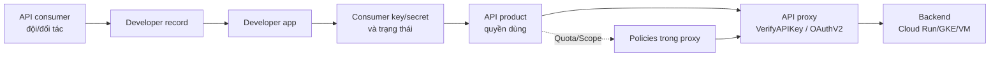
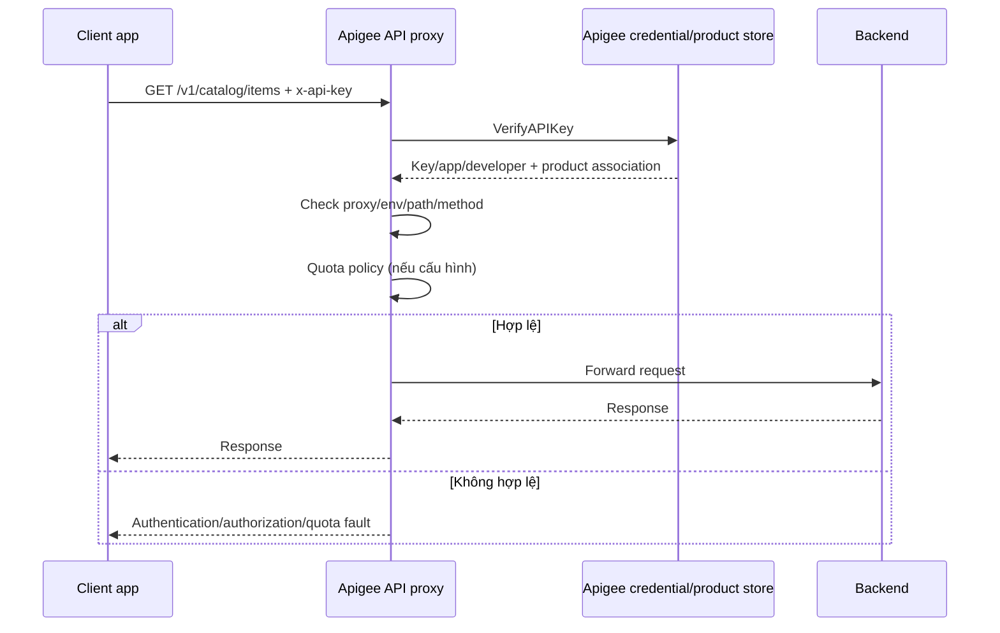
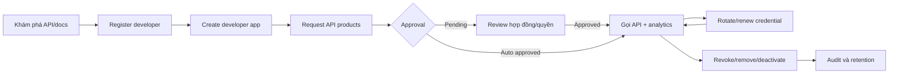

# API products, developer apps và vòng đời consumer

Một doanh nghiệp đã đưa API danh mục sản phẩm qua **Apigee**, nhưng chưa thể trả lời ba câu hỏi vận hành: *đối tác nào được gọi endpoint nào, giới hạn bao nhiêu request và làm sao thu hồi quyền khi hợp đồng kết thúc?* Việc có một API proxy và đường dẫn HTTPS **chưa đủ**. Cần thiết kế **API product**, đăng ký **developer app**, cấp và kiểm soát **credentials**, sau đó theo dõi toàn bộ **vòng đời API consumer**.

Bài thuộc chương **API Gateway và Apigee** của mô-đun `CLOUD_PROVIDERS_GCP`. Trong lộ trình từ project/IAM, VPC, Compute Engine, GKE, Cloud Run tới lưu trữ, cơ sở dữ liệu, tự động phát hành và độ tin cậy/chi phí, nội dung này tập trung vào **quản lý quyền sử dụng API ở cấp ứng dụng đối tác**. Ví dụ sử dụng **Apigee** (và những khái niệm chung với Apigee hybrid), không đồng nhất với sản phẩm **Google Cloud API Gateway**.

## 1. Kết quả học tập

Sau bài này, bạn có thể:

1. Phân biệt **API proxy**, **API product**, **developer**, **developer app**, **consumer key/secret** và **API consumer**.
2. Thiết kế API product giới hạn **proxy, environment, resource path, HTTP method, quota và OAuth scope**.
3. Hiểu sự khác nhau giữa **mức hiển thị public/private/internal** và **quyền truy cập runtime**.
4. Mô tả vòng đời **đăng ký → phê duyệt → sử dụng → giám sát → xoay khóa → thu hồi/ngừng hợp tác**.
5. Tạo product, developer và app bằng Apigee management API trong **organization lab đã tồn tại**.
6. Cấu hình `VerifyAPIKey` hoặc OAuthV2 để thực sự kiểm tra credential; dùng **Quota policy** nếu muốn thực thi hạn mức khai báo.
7. Chẩn đoán lỗi khi app/key bị pending, revoked, hết hạn hoặc không nằm trong đúng API product.
8. Thiết kế onboarding, offboarding, audit và bài kiểm thử an toàn, tránh lộ API key.

**Giới hạn thực hành:** không tạo Apigee organization, environment, paid instance hoặc proxy production mới trong bài. Lab yêu cầu **Apigee organization có sẵn**, một proxy thử nghiệm đã triển khai, quyền quản trị được ủy quyền và ngân sách được duyệt. Các thao tác `POST`/`DELETE` trong ví dụ có tác động thật; chỉ chạy trên tài nguyên lab do bạn sở hữu.

## 2. Mô hình các thực thể Apigee



| Đối tượng | Chức năng | Không phải |
| --- | --- | --- |
| **API proxy** | Địa chỉ/flow đứng trước backend, chạy policies | Bản ghi về đối tác sử dụng |
| **API product** | Gói các API operations, proxy/resources, environment, quota/scopes, approval | Một proxy triển khai mới |
| **Developer** | Bản ghi tổ chức/cá nhân chịu trách nhiệm các apps | Tài khoản Google Cloud IAM để deploy proxy |
| **Developer app** | Ứng dụng consumer được đăng ký dưới một developer; liên kết products và credentials | Cloud Run/GKE workload hoặc binary được Apigee triển khai |
| **Consumer key** | Định danh credential của developer app, có thể dùng làm API key hoặc liên kết OAuth token | Bằng chứng danh tính người dùng cuối |
| **Consumer secret** | Bí mật client dùng trong các OAuth flow phù hợp | Thứ gửi kèm mọi API-key-only request |
| **Developer portal** | Trải nghiệm khám phá API, docs, đăng ký và quản lý apps | Chính sách xác thực runtime tự động |

**Một developer có thể có nhiều apps; một app có thể đăng ký nhiều API products; một app có thể có nhiều key pairs.** Quyền thực tế phụ thuộc **trạng thái developer + app + key + product association + policy đang chạy**. Việc chỉ tạo product không bảo vệ request.

### 2.1. Phân biệt Apigee và API Gateway

**Google Cloud API Gateway** sử dụng API config (thường từ OpenAPI) để định tuyến và có cơ chế xác thực/quota thích hợp; nó **không phải** kho quản lý API products, developer records, developer apps và cặp consumer key/secret theo mô hình Apigee. Khi một bài toán cần **self-service onboarding, entitlement/tier, xét duyệt đối tác, API analytics theo consumer, portal hay monetization**, hãy đánh giá Apigee thay vì suy rằng API Gateway có cùng giao diện quản trị.

## 3. Thiết kế API product theo quyền tối thiểu

Một product có thể biểu diễn gói **Catalog Read Trial**:

| Thuộc tính | Giá trị ví dụ | Ý nghĩa |
| --- | --- | --- |
| Name | `catalog-read-lab` | ID sản phẩm, ổn định trong quản trị |
| Display name | `Catalog Read Lab` | Tên người dùng/portal nhìn thấy |
| Environment | `test` | Chỉ môi trường thử nghiệm |
| Proxy | `catalog-v1` | Chỉ proxy này |
| Proxy base path | `/v1/catalog` | Đường dẫn public của proxy |
| Resources | `/items`, `/items/*` | Suffix bên dưới base path |
| Approval type | `manual` | Key được tạo ở trạng thái pending đến khi được duyệt |
| Access | `private` | Kiểm soát khả năng nhìn thấy/chọn product trên portal |
| Product quota | 5 request/phút | Giá trị **cấu hình**, cần Quota policy để thực thi |
| OAuth scopes | `catalog.read` nếu dùng OAuth | Không phải quyền tự động áp dụng cho API key đơn thuần |

**Resource paths của API product được tính từ `proxy.pathsuffix`, không phải toàn URL**. Nếu proxy base path là `/v1/catalog` thì `/items` ứng với URL `/v1/catalog/items`; việc nhập `/v1/catalog/items` như resource suffix có thể khiến kiểm tra quyền không khớp. `/*` chỉ một mức con, `/**` bao phủ nhiều cấp; kiểm tra endpoint gốc và các method riêng.

### 3.1. Ba lỗi cấu hình nguy hiểm

1. **Không giới hạn `proxies`:** trong cấu hình API product theo mô hình tương ứng, sản phẩm có thể áp rộng tới các proxy khác trong organization. Chỉ định proxy cụ thể.
2. **Không giới hạn `environments`:** quyền của product có thể áp ở mọi environment, kể cả production. Chỉ định `test` cho lab.
3. **Đặt `access=private` rồi nghĩ API đã private:** `public/private/internal` chủ yếu ảnh hưởng **discoverability/phân phối** trên portal, không thay thế `VerifyAPIKey`, OAuth hoặc network restrictions.

**Tách read/write operations** khi mức độ rủi ro khác nhau: dùng `operationGroup` để giới hạn HTTP methods, hoặc tạo các products rõ ràng. Không dùng wildcard `/**` bừa bãi cho dịch vụ quản trị.

### 3.2. Product không phải version của proxy

Một proxy có thể triển khai revision mới mà product vẫn giữ quyền sử dụng. Ngược lại, **sửa quyền/path/quota trong product đang được nhiều apps dùng** có thể ảnh hưởng các consumer ngay lập tức. Muốn phát hành gói mới, đánh giá **product mới có ID riêng** và migrate apps theo lô, thay vì chỉnh âm thầm entitlement của tất cả đối tác.

## 4. Phê duyệt, trạng thái và phạm vi hiệu lực

| Lớp | Trạng thái/điều kiện | Tác động |
| --- | --- | --- |
| **Developer** | `active` hoặc `inactive` | Developer inactive có thể không sử dụng credentials đã cấp |
| **Developer app** | `approved` hoặc `revoked` | App revoked làm keys không còn hợp lệ để gọi API |
| **API key** | `approved`, `revoked`, hết hạn | Key revoked/expired không được chấp nhận |
| **Key × API product** | `pending`, `approved`, `revoked` | Cho phép kiểm soát từng product cho cùng một key |
| **Product scope** | Proxy, environment, resource/method | Request ngoài phạm vi bị chặn nếu proxy kiểm tra credentials đúng |
| **OAuth token** | Còn hạn, hợp scope, hợp app/key | Có thể phải kiểm tra OAuthV2; không thay thế kiểm tra quyền nghiệp vụ backend |

Với `approvalType: auto`, request cấp key cho product thường được duyệt ngay. Với `manual`, key/product association ở trạng thái **pending** cho đến khi admin duyệt. Có thể thu hồi **chỉ một API product khỏi key** mà không vô hiệu hóa toàn bộ app.

**Không có việc “app đã tạo thì tự nhiên API được bảo vệ”.** Proxy phải thực sự gắn policy kiểm tra credentials ở request flow và policy phải được deploy. Đồng thời **trạng thái approval** không đồng nghĩa consumer đã hoàn tất xác minh pháp lý, hợp đồng hay kiểm thử bảo mật.

## 5. Runtime authorization: request được quyết định thế nào?



Các điểm kiểm tra:

- Consumer key có tồn tại và còn hạn không?
- Key có được approve cho product phù hợp không?
- Developer và app có còn active/approved không?
- Proxy/environment/resource/method có thuộc phạm vi cho phép không?
- Nếu dùng OAuth, token có hợp lệ và scopes đủ không?
- Quota/SpikeArrest chính sách có chặn request không?

**Authentication bằng API key là xác thực ứng dụng**, không phải phân quyền người dùng cuối. Nếu `GET /orders/{id}` cần kiểm tra “người dùng này sở hữu đơn hàng không”, backend hoặc chính sách authorization phải xử lý riêng (ví dụ OAuth/JWT claims và kiểm tra tenant).

## 6. Product quota: định nghĩa khác với thực thi

Khai báo `quota=5`, `quotaInterval=1`, `quotaTimeUnit=minute` trong product chỉ **lưu thông số**. Để giới hạn request thực tế, proxy cần **Quota policy** và phải xác định cách đếm phù hợp.

| Cơ chế | Mục đích |
| --- | --- |
| **Quota** | Giới hạn số request trong khoảng thời gian cho consumer/product/operation |
| **SpikeArrest** | Làm mượt đột biến request rate trong thời gian ngắn |
| **Backend concurrency/rate limit** | Bảo vệ service, database và các shared dependencies |
| **Monetization rate plan** | Mô hình thương mại nếu được cấu hình/được cấp quyền sử dụng |

Quota ở **operation** có thể ưu tiên hơn product-level quota. Với nhiều proxy/operations, cần hiểu **counter scope**; đừng mặc định “1000 request/ngày” là một counter toàn organization. Trong sản phẩm đời thực, có thể tạo gói `basic` và `premium` có quyền giống nhau nhưng hạn mức khác.

**SLO:** khi bị chặn quota, ghi rõ thông điệp/response nhất quán với hợp đồng API, không biến thành HTTP 500 từ backend. Tách metrics quota violations với application errors. Một app bị từ chối do chưa duyệt credential khác với app bị vượt quota.

## 7. Vòng đời consumer end-to-end



Các bước có **owner** rõ ràng:

| Giai đoạn | Consumer/developer | API publisher/platform |
| --- | --- | --- |
| **Discover** | Xem docs, thử sandbox | Publish product, OpenAPI, SDK, terms |
| **Register** | Đăng ký danh tính/chủ sở hữu app | Xác nhận developer, phân quyền portal |
| **Request access** | Chọn product/tier và callback URL nếu OAuth cần | Xem phạm vi, hợp đồng, risk classification |
| **Approve** | Nhận credentials qua kênh bảo mật | Duyệt key/product, không cấp mặc định prod |
| **Use** | Giữ key kín, triển khai retry/backoff | Bảo đảm policy, quota, metrics, support |
| **Change plan** | Yêu cầu tăng quyền/giới hạn | Review product/operation, điều chỉnh quota và audit |
| **Rotate** | Thêm key mới, chuyển traffic, kiểm chứng | Cho phép overlap ngắn, revoke key cũ |
| **Offboard** | Ngừng gọi, thu hồi credentials khỏi hệ thống | Revoke product/key/app, giữ evidence theo retention |

**Không xóa developer/app ngay khi ngừng hợp tác nếu dữ liệu audit, disputes hoặc analytics còn cần đối chiếu.** Trước tiên revoke quyền truy cập; chỉ xóa records khi hoàn thành retention/legal policy và đã biết các phụ thuộc.

## 8. Lab: điều kiện và preflight an toàn

**Giả định:** đã tồn tại Apigee organization được ủy quyền, environment `test`, API proxy `catalog-v1` triển khai ở đó với base path `/v1/catalog` và backend lab trả JSON cho `GET /items`. Proxy đã được review để gắn `VerifyAPIKey` + `Quota` ở request flow; nếu chưa có, phần cấu hình policy trong bài chỉ là bản mẫu để đội quản trị triển khai theo quy trình.

**Không chạy lab trên Apigee production** hoặc tự tạo Apigee org chỉ để học, vì có IAM/cost và network provisioning phức tạp. Dùng **Bash**, `gcloud`, `curl` và `jq` trong thư mục lab tách riêng khỏi repository tài liệu.

### 8.1. Đặt biến

```bash
ORG="YOUR_AUTHORIZED_APIGEE_ORG"
ENV="test"
PROXY="catalog-v1"
PRODUCT="catalog-read-lab"
DEV_EMAIL="your-controlled-lab-email@example.com"
APP="catalog-consumer-lab"

API="https://apigee.googleapis.com/v1"
# URL thật của environment group hostname được phép test:
GATEWAY_BASE="https://YOUR_APIGEE_TEST_HOST"

gcloud auth list
gcloud --version
jq --version
```

**Không tiếp tục** khi biến còn placeholder. Email developer phải do bạn kiểm soát, viết thường và được phép dùng; Apigee org **không nhất thiết có ID trùng project**. Tên product/app không được trùng đối tượng do nhóm khác sở hữu.

### 8.2. Đọc tài nguyên hiện có (không sửa cấu hình)

```bash
TOKEN="$(gcloud auth print-access-token)"

curl -fsS -H "Authorization: Bearer $TOKEN" \
  "$API/organizations/$ORG/environments/$ENV"

curl -fsS -H "Authorization: Bearer $TOKEN" \
  "$API/organizations/$ORG/apis/$PROXY"

curl -fsS -H "Authorization: Bearer $TOKEN" \
  "$API/organizations/$ORG/apiproducts"

curl -fsS -H "Authorization: Bearer $TOKEN" \
  "$API/organizations/$ORG/developers"
```

Access token này dành cho **Apigee management API**, khác với **consumer key** mà app gửi đến proxy runtime. Các lệnh GET chỉ đọc nhưng dữ liệu/response có thể chứa thông tin tổ chức; không paste nguyên output nội bộ vào issue công khai.

Phải xác minh proxy nằm ở **đúng environment**, có deployment healthy và được phép dùng làm lab. Nếu `403` ở management API, xin permission tối thiểu qua admin, không cấp Organization Admin cho tất cả học viên.

## 9. Lab A — tạo một API product giới hạn phạm vi

Ví dụ sau dùng **product private + manual approval**, đủ chặt cho một consumer lab. Product chỉ áp dụng cho `catalog-v1` ở `test`, tới tài nguyên `/items` và `/items/*`; quota minh họa **5 request/phút**.

Tạo file `product.json` trong thư mục lab (không phải file mới trong repository):

```bash
cat > product.json <<'JSON'
{
  "name": "catalog-read-lab",
  "displayName": "Catalog Read Lab",
  "description": "Lab product: GET catalog items in test",
  "approvalType": "manual",
  "attributes": [
    {"name": "access", "value": "private"}
  ],
  "environments": ["test"],
  "proxies": ["catalog-v1"],
  "apiResources": ["/items", "/items/*"],
  "quota": "5",
  "quotaInterval": "1",
  "quotaTimeUnit": "minute"
}
JSON
```

**Lưu ý thiết kế:** product JSON theo schema cơ bản này không giới hạn **HTTP method**. Để thật sự tạo gói **read-only**, phải định nghĩa operations + methods (theo `operationGroup`) hoặc kiểm soát methods trong API proxy. Dòng description ghi “GET” **không** tạo chính sách read-only.

Khi đã xác nhận product chưa tồn tại, proxy/environment đúng và có quyền `apigee.apiproducts.create`:

```bash
# GHI: chỉ trên Apigee organization LAB đã được ủy quyền.
curl -fsS -X POST \
  -H "Authorization: Bearer $TOKEN" \
  -H "Content-Type: application/json" \
  --data-binary @product.json \
  "$API/organizations/$ORG/apiproducts"
```

Readback:

```bash
curl -fsS -H "Authorization: Bearer $TOKEN" \
  "$API/organizations/$ORG/apiproducts/$PRODUCT" \
  | jq '{name, approvalType, environments, proxies,
         apiResources, quota, quotaInterval, quotaTimeUnit}'
```

**Không bỏ trống `environments` hay `proxies`**: với product schema tương ứng, bỏ trống có thể mở rộng các API/environment mà app được dùng khi credential hợp lệ.

## 10. Lab B — đăng ký developer và developer app

**Developer** đại diện bên sở hữu client integration. Nó có email, tên và trạng thái; khác với tài khoản người dùng Google Cloud có quyền chỉnh Apigee organization.

### 10.1. Tạo developer lab

Dùng email thật do bạn kiểm soát và username phù hợp quy tắc của organization:

```bash
cat > developer.json <<EOF
{
  "email": "$DEV_EMAIL",
  "firstName": "Lab",
  "lastName": "Consumer",
  "userName": "cataloglabconsumer"
}
EOF

# GHI: tạo developer; chỉ thực hiện khi email chưa đăng ký.
curl -fsS -X POST \
  -H "Authorization: Bearer $TOKEN" \
  -H "Content-Type: application/json" \
  --data-binary @developer.json \
  "$API/organizations/$ORG/developers"
```

Developer mới thường ở trạng thái **active**; trạng thái có thể đổi sang **inactive** bằng management API hoặc quy trình quản trị. Không dùng email của đối tác thật để tạo bản ghi giả.

### 10.2. Tạo app gắn API product

Tạo file `app.json`, với **key expiration 1 ngày** cho lab (milliseconds):

```bash
cat > app.json <<'JSON'
{
  "name": "catalog-consumer-lab",
  "apiProducts": ["catalog-read-lab"],
  "keyExpiresIn": "86400000"
}
JSON

# CHỈ trên môi trường LAB. Output có thể chứa consumer key/secret.
umask 077
curl -fsS -X POST \
  -H "Authorization: Bearer $TOKEN" \
  -H "Content-Type: application/json" \
  --data-binary @app.json \
  "$API/organizations/$ORG/developers/$DEV_EMAIL/apps" \
  -o app-created.private.json

chmod 600 app-created.private.json
```

App creation có thể tự sinh **consumer key/secret**. Không commit file `app-created.private.json`, không in raw response vào logs/CI, không gửi key/secret qua chat hoặc issue. API keys có thể không có expiration nếu bạn bỏ `keyExpiresIn` hoặc để `-1`, vì vậy production nên thiết kế hạn dùng/rotation.

**Readback chỉ in trạng thái, không in credential bí mật:**

```bash
jq '{name, status, keyStatuses:
     [.credentials[]? | {status,
       apiProducts: [.apiProducts[]? | {apiproduct, status}]}]}' \
  app-created.private.json
```

Kiểm tra **app identity**, product association và `pending` khi product yêu cầu duyệt thủ công. Nếu dùng Apigee UI, vào **Distribution → Apps** để xem/deploy credentials theo quyền; portal tích hợp có giới hạn đối với apps nhiều credentials.

## 11. Lab C — chính sách VerifyAPIKey và Quota trên proxy

Không thể chỉ tạo product/app rồi thử bằng curl nếu proxy chưa **enforce credential**. Một policy XML mẫu dùng header `x-api-key`:

```xml
<VerifyAPIKey name="VK-Catalog">
  <APIKey ref="request.header.x-api-key"/>
</VerifyAPIKey>
```

Một Quota policy mẫu **đọc tham số từ API product** sau khi VerifyAPIKey thành công:

```xml
<Quota name="Q-Catalog">
  <Interval ref="verifyapikey.VK-Catalog.apiproduct.developer.quota.interval">1</Interval>
  <TimeUnit ref="verifyapikey.VK-Catalog.apiproduct.developer.quota.timeunit">minute</TimeUnit>
  <Allow count="5"
         countRef="verifyapikey.VK-Catalog.apiproduct.developer.quota.limit"/>
  <Identifier ref="verifyapikey.VK-Catalog.client_id"/>
</Quota>
```

Trong proxy request flow, **VerifyAPIKey phải chạy trước Quota** để flow variables của product/key sẵn sàng. Một đoạn minh họa cách gắn `Step` trong request PreFlow:

```xml
<PreFlow name="PreFlow">
  <Request>
    <Step><Name>VK-Catalog</Name></Step>
    <Step><Name>Q-Catalog</Name></Step>
  </Request>
  <Response/>
</PreFlow>
```

Các đoạn XML là **trích phần policy/flow**, không phải proxy bundle hoàn chỉnh. Quản trị viên cần thêm policy files đúng thư mục, gắn vào ProxyEndpoint thực, triển khai revision ở `test` và kiểm tra deployment. Không làm trên proxy production trong bài lab.

**Thử nghiệm bắt buộc:**

- Thiếu `x-api-key` → bị chặn.
- Key sai/revoked/expired → bị chặn.
- Key hợp lệ nhưng ngoài product resource/proxy/environment → bị chặn.
- Key hợp lệ, trong phạm vi và đã approved → backend nhận request.
- Vượt quota → Quota policy báo violation theo cấu hình.

Không dùng `SpikeArrest` như thay thế cho quota theo gói. Nếu chỉ cấu hình quota trong product mà quên `Q-Catalog`, backend vẫn có thể nhận request vượt mức.

## 12. Lab D — duyệt key và kiểm thử truy cập

Vì product tạo với `approvalType: manual`, key có thể ở `pending`. Có thể duyệt từ **Apigee UI → Distribution → Apps → app lab → Credentials → product → Approve** sau khi đối chiếu yêu cầu sử dụng.

Management API hỗ trợ approve/revoke **một product association của một key**:

```text
POST /v1/organizations/ORG/developers/EMAIL/apps/APP/
     keys/CONSUMER_KEY/apiproducts/PRODUCT?action=approve
```

Đây là **mẫu endpoint**; chỉ gọi khi quyền `apigee.appkeys.manage` đã được phê duyệt và key đúng app/product. Tránh in consumer key trong terminal history/shared logs. Sau duyệt, xác minh trạng thái qua Apigee UI hoặc GET app có kiểm soát; **đừng tự coi HTTP 2xx ở management API là bằng chứng proxy đã enforce**.

### 12.1. Gọi runtime qua hostname test

Lấy key từ file private vào biến shell, không in giá trị:

```bash
APP_KEY="$(jq -r '.credentials[0].consumerKey // empty' \
  app-created.private.json)"

# Chỉ chạy khi APP_KEY không rỗng, credential đã approved,
# proxy test có VerifyAPIKey và GATEWAY_BASE là hostname thật.
curl -i -sS \
  -H "x-api-key: $APP_KEY" \
  "$GATEWAY_BASE/v1/catalog/items"
```

Với endpoint không được product cho phép:

```bash
curl -i -sS \
  -H "x-api-key: $APP_KEY" \
  "$GATEWAY_BASE/v1/catalog/admin"
```

**Kỳ vọng:** `GET /items` được chuyển đến backend nếu app/key approved và policy đúng; `/admin` bị từ chối do product scope. Mã lỗi HTTP chính xác tùy loại policy/fault handling. Nếu cả hai đều qua, cần kiểm tra policy flow, product paths và credential validation; **không kết luận quyền đã giới hạn chỉ vì product tồn tại**.

### 12.2. Thử quota trên test traffic

Nếu proxy chỉ dành cho lab và không chia sẻ counter với consumer khác, có thể gọi nhiều lần với tốc độ nhỏ để quan sát quota 5/phút. Không stress test endpoint production. Hạn mức có thể phụ thuộc **counter scope, thời gian/reset, policy triển khai**. Dừng khi gặp quota violation; không lặp request vô hạn hoặc né quota bằng tạo thêm keys.

**Bảng bằng chứng:**

| Test case | Trước approval | Sau approval |
| --- | --- | --- |
| Key đúng, path `/items` | Chặn do pending | Cho phép khi policy, backend khỏe |
| Key thiếu hoặc sai | Chặn | Chặn |
| Key đúng, path `/admin` | Chặn | Chặn do không thuộc product |
| Request vượt quota | Không tới backend | Quota violation khi Quota policy hoạt động |
| Key sau revoke | Chặn | Chặn |

## 13. Rotation, revocation và ngừng hợp tác

### 13.1. Rotation không gián đoạn

Với consumer dùng một key K1 đang hoạt động:

1. Xác định app owner, product associations, expiry, scope và nơi cấu hình K1.
2. Tạo **key K2 mới** cho *cùng developer app* bằng UI/API; key K1 tiếp tục hoạt động trong thời gian overlap được duyệt.
3. Đảm bảo K2 được **approve** cho đúng API products, không tự thêm quyền.
4. Phân phối K2 bằng secret store/tuyến an toàn; cập nhật ứng dụng và xác minh traffic/analytics.
5. Theo dõi K1 usage giảm về 0, sau đó **revoke K1**; kiểm chứng request với K1 bị chặn.
6. Ghi thời điểm, operator, apps, products và incident/change ticket.

**Không thể sửa expiration của một key hiện có** sau khi nó được tạo theo API schema; nếu muốn thời hạn khác, cấp **key mới**. Một app có nhiều credentials được Apigee hỗ trợ ở API/UI, nhưng **integrated developer portal** có giới hạn với app nhiều credentials — kiểm tra workflow portal trước khi áp quy trình rotation đại trà.

### 13.2. Thu hồi theo phạm vi tối thiểu

| Yêu cầu | Thao tác ưu tiên |
| --- | --- |
| Ngừng chỉ quyền `catalog-read` | Revoke/remove **product association** của credential |
| Key K1 lộ | Revoke K1, cấp K2, đánh giá log và tác động |
| Tạm khóa cả app | Revoke **developer app**; keys có thể vẫn còn record nhưng không gọi được |
| Developer/đối tác rời chương trình | Đánh giá deactivate developer sau khi thu hồi apps/keys |
| Product nghỉ hoạt động | Thông báo consumer, migrate apps, cuối cùng mới xóa product |
| Sai quyền được cấp | Sửa đúng scope/product, rà keys và audit lại mọi app ảnh hưởng |

**Đừng xóa record trước khi có evidence:** phục vụ audit, phân tích abuse, tranh chấp và retention. Thu hồi API key **không phải cơ chế xóa dữ liệu backend**; dữ liệu, tokens và phiên làm việc phải được xử lý theo chính sách riêng.

### 13.3. Token OAuth sau revoke

OAuth access token có **vòng đời và quyền riêng**. Khi revoke app/key, cần xác minh hành vi của **VerifyAccessToken** đối với token đang tồn tại và, khi cần, chủ động revoke tokens theo chính sách. Không suy rằng rotate consumer secret sẽ tức thời làm mọi access token hết hạn; thiết kế TTL ngắn, refresh rotation và bước ứng phó sự cố thích hợp.

## 14. OAuth, scopes và bảo vệ người dùng cuối

**API key** xác định **client app**; nếu endpoint chứa dữ liệu cá nhân hoặc cần ủy quyền theo user/tenant, nên dùng OAuth/OIDC/JWT theo thiết kế được duyệt.

| Nhu cầu | Cơ chế điển hình |
| --- | --- |
| Thống kê request theo consumer app | VerifyAPIKey + analytics dimensions |
| Server-to-server với quyền cụ thể | OAuth 2.0 client credentials + VerifyAccessToken |
| Ứng dụng thay mặt người dùng | OAuth/OIDC authorization code + PKCE ở hệ thống hỗ trợ |
| Kiểm soát hành vi chi tiết | Scopes/claims + kiểm tra authorization tại proxy/backend |
| Chống abuse và burst | Quota, SpikeArrest, WAF/Advanced API Security tùy gói |
| Chính sách theo đối tác | Product tiers + app credentials/approval + audit |

`scopes` ở API product cho biết những quyền OAuth được phép/kiểm tra, **không tự biến API key thành token có scope**. Cấu hình OAuthV2 và policies tương ứng phải thực sự kiểm tra access token. Quyền `catalog.read` không mặc định cho phép đọc dữ liệu của *mọi tenant*; cần ủy quyền nghiệp vụ và tránh tin các header tự khai từ client.

## 15. Developer portal và trải nghiệm consumer

Một cổng developer tốt giảm công việc hỗ trợ thủ công nhưng vẫn giữ governance:

1. **Documentation:** mục đích product, base URL, paths/methods, ví dụ response, auth, lỗi và quota.
2. **Discovery:** public products được giới thiệu đúng đối tượng; private/internal không tự cấp quyền runtime.
3. **Registration:** xác minh developer và ownership, chống đăng ký spam khi công khai.
4. **App onboarding:** mô tả app name, môi trường test/prod, callback URLs nếu OAuth cần, trạng thái approval.
5. **Self-service:** xem mức dùng, tạo/yêu cầu credential theo chính sách; liên hệ support khi bị 403/429.
6. **Deprecation:** thông báo thay đổi versions/products, migration guide và sunset date.
7. **Offboarding:** revoke quyền nhưng vẫn giữ thông tin audit cần thiết.

Không coi email developer là danh tính Google Cloud IAM mặc định. Developer portal account, Apigee developer record, GCP IAM principal và backend end user là **bốn lớp danh tính khác nhau** cần ánh xạ/kiểm soát rõ.

## 16. Analytics, SLO, bảo mật và chi phí

Các dimension hữu ích trong **Apigee Analytics**: `api_product`, `developer_app`, `developer_email`, `api_proxy`, `response_status_code`, environment và thời gian. Muốn dimension consumer chính xác, proxy phải **VerifyAPIKey/OAuthV2** và key/token phải ánh xạ được về app/product; nếu không một số số liệu có thể là `(not set)`.

| Mục tiêu | Tín hiệu/biện pháp |
| --- | --- |
| **Adoption** | Số developer/app được duyệt, apps thực sự có traffic |
| **Reliability** | Success rate, p95/p99, 5xx và target latency theo product |
| **Policy correctness** | Invalid key, pending, revoked, quota violations |
| **Security** | Key anomaly/abuse, quyền IAM đổi, người duyệt, rotation quá hạn |
| **Experience** | Time-to-first-call, onboarding approval latency, support tickets |
| **FinOps** | Apigee subscription/PAYG, API calls, policies/add-ons, logs, backend egress |
| **Monetization** | Rate plans/subscriptions/billing nếu tổ chức có tính năng và đã cấu hình |

**Không ghi raw consumer key/secret hay OAuth token vào application logs, traces, dashboards hoặc analytics export.** Với key bắt buộc truyền qua proxy, ưu tiên HTTP header thay query parameter vì query có thể bị ghi vào URL/logs. Luôn dùng HTTPS.

### 16.1. Những kiểm soát tối thiểu

- Tách Apigee environment **test/prod**, dùng products và keys riêng nếu thích hợp.
- Chỉ định proxy, resources, HTTP methods và environment tường minh.
- Phân quyền quản trị products/apps/keys theo least privilege; xét duyệt 4 mắt cho production tier nhạy cảm.
- Không grant Apigee Org Admin chỉ để gọi management GET.
- Key có expiration/rotation, secret store, scope phù hợp; có quy trình khẩn cấp khi lộ.
- Backend vẫn phải có authz/tenant isolation và network controls.
- Audit changes: ai duyệt/thu hồi key nào, vào ngày nào, theo ticket nào.

## 17. Troubleshooting theo lớp

| Biểu hiện | Nguyên nhân có thể | Cách kiểm tra |
| --- | --- | --- |
| Product tạo được, API vẫn gọi không key | Proxy thiếu VerifyAPIKey/OAuthV2 hoặc chưa deploy policy | Apigee Debug, proxy revision/flow |
| App mới chưa gọi được | Product `manual` nên credential **pending** | App credentials/product approvals |
| Key hợp lệ nhưng path không gọi được | `apiResources` là **proxy.pathsuffix**, chưa khớp | Base path, suffix, resource wildcards |
| Key test gọi được prod | Product bỏ `environments` hoặc quản trị sai scope | Product environment restrictions |
| Key dùng được trên proxy khác | Product thiếu proxy restriction hoặc policy sai | Product `proxies` và VerifyAPIKey flow |
| Quota ghi 5/phút nhưng vượt vẫn OK | Quota chỉ ở product, thiếu policy hoặc counter scope không đúng | Proxy Quota policy, deployment, flow vars |
| Hai apps dùng chung quota bất ngờ | Identifier/counter scope không đúng | `client_id`, product quota counter scope |
| Key bị từ chối sau rotate | K2 pending, hết hạn, app revoked hoặc product chưa gắn | Key/app/developer status và expiry |
| OAuth token đúng nhưng thiếu quyền | Scope trong token/policy/product không khớp | OAuthV2/VerifyAccessToken, app product |
| HTTP 403 từ backend sau policy pass | Backend IAM hoặc tenant authorization | Proxy trace vs backend logs |
| Management API trả 403 | Thiếu `apigee.*` IAM permission | Principal/token và permission cụ thể |
| Consumer không thấy product trên portal | Product private/internal hoặc portal audience | Access visibility, portal config |
| Analytics không có `developer_app` | Proxy không verify key/token hoặc dữ liệu chưa được phân loại | Policy placement, analytics dimensions |
| Traffic đột biến gây phí tăng | Retry storms, abuse, quota/backoff sai | Apigee analytics, billing và backend monitoring |

Không sửa bằng cách cho mọi product `public`, approve tất cả keys hoặc tắt `VerifyAPIKey`. Những thay đổi đó nới quyền, không giải quyết nguyên nhân gốc.

## 18. Tình huống thực tế: chuyển consumer từ Trial sang Partner

Đội API có hai gói:

| Thuộc tính | Trial | Partner |
| --- | --- | --- |
| Proxy | `catalog-v1` | `catalog-v1` và endpoint giao dịch riêng |
| Resources | Chỉ đọc danh mục | Đọc danh mục + operations đã phê duyệt |
| Quota | 1000/ngày | 10000/ngày hoặc theo hợp đồng |
| Approval | Auto trên sandbox | Manual sau hợp đồng/KYC |
| Environment | Test | Prod sau security review |
| Support | Best effort | SLA và contact chính thức |

**Quy trình nâng cấp:**

1. Partner đăng ký developer app riêng cho production, không tái sử dụng key trial trên mọi môi trường.
2. Admin xác minh hợp đồng, redirect URIs/OAuth/client ownership và risk profile.
3. Cấp product Partner theo đúng operations, approval thủ công và key có expiration.
4. Thử scope, quota, tenant isolation trên staging với credential đại diện.
5. Bật production, giám sát traffic và errors theo app/product.
6. Khi hết trial, revoke quyền trial nếu không còn dùng; giữ traceable release/audit record.

Tại đây **API product là hợp đồng kỹ thuật** về những operations consumer có thể gọi. API spec/docs, authz backend, quota policy, rate plan/SLA và vận hành phải cùng phản ánh hợp đồng đó.

## 19. Bài tập tự luyện

### Bài 1 — API product có tự chặn API không?

Team tạo product `catalog-read-lab`, gắn key vào developer app nhưng proxy vẫn trả 200 khi gọi không key.

**Đáp án định hướng:** Không. Phải gắn `VerifyAPIKey` hoặc OAuthV2 `VerifyAccessToken` vào request flow và deploy revision; product không tự thực thi security.

### Bài 2 — resources theo suffix

Proxy base path `/v1/catalog`, product `apiResources=["/items"]`. Client gọi `/v1/catalog/items`.

**Đáp án:** Hợp đường dẫn nếu các điều kiện khác đạt. Nếu product ghi `/v1/catalog/items` như suffix thì có thể sai. Tách rõ proxy base path với `proxy.pathsuffix`.

### Bài 3 — quota không được thực thi

Product có `quota=1000` per day nhưng consumer gửi 2000 request được chấp nhận.

**Đáp án:** Product quota là cấu hình; cần gắn `Quota policy`, kiểm tra thứ tự sau key verification, counter scope và quota variables.

### Bài 4 — approved app, pending key

Developer app ở trạng thái approved, nhưng key-product association `pending` vì product yêu cầu manual approval.

**Đáp án:** Chưa được gọi product đó; admin phải approve đúng credential/product association. Không suy từ app approved rằng tất cả keys đã approved.

### Bài 5 — product private có chặn HTTP?

API product đặt `access=private` nhưng một request không key vẫn truy cập backend.

**Đáp án:** `private` liên quan discoverability/phân phối trên portal; không thay `VerifyAPIKey` hoặc network auth.

### Bài 6 — thu hồi có chọn lọc

Một app dùng products A và B; hợp đồng A hết hạn nhưng B còn hiệu lực.

**Đáp án:** Revoke/remove association của key với **A**; không cần xóa app hoặc revoke toàn bộ key nếu B vẫn hợp lệ và chính sách cho phép.

### Bài 7 — xoay khóa

Partner muốn đổi key K1, API đang hoạt động 24/7.

**Đáp án:** Tạo K2, phê duyệt sản phẩm tương ứng, chuyển traffic, đo K1 usage về 0, revoke K1; giới hạn overlap và giữ audit.

### Bài 8 — IAM lẫn với consumer

Developer có email trên Apigee portal nhưng gọi `gcloud` management API bị 403.

**Đáp án:** Developer record/portal account không tự cấp GCP IAM. Management API cần principal với `apigee.*` permissions; app runtime dùng consumer key/token.

### Bài 9 — scope và dữ liệu cá nhân

Key được approved cho product `orders.read`. Client đổi URL để đọc order của tenant khác.

**Đáp án:** API key chỉ nhận diện app; backend/proxy phải xác minh user/tenant ownership qua OAuth/JWT/authorization. Product scope không thay thế kiểm tra dữ liệu nghiệp vụ.

### Bài 10 — analytics thiếu app

Dashboard hiển thị nhiều traffic nhưng chiều `developer_app` là `(not set)`.

**Đáp án:** Kiểm tra proxy VerifyAPIKey/OAuth verification, key/token-to-app mapping và analytics collection; chỉ tạo app record chưa bảo đảm analytics nhận diện client.

## 20. Checklist triển khai và offboarding

- [ ] Apigee organization/environment/proxy do nhóm sở hữu; lab tách production.
- [ ] Product có owner, display name, proxy, environment, resource/method và quota rõ ràng.
- [ ] Hiểu `public/private/internal` là **visibility**, không phải runtime authorization.
- [ ] Proxy đã gắn **VerifyAPIKey/OAuthV2** phù hợp và triển khai đúng environment.
- [ ] Có **Quota policy** khi muốn enforce hạn mức sản phẩm; đo violations.
- [ ] Developer identity được xác minh, app có owner/contact/callback URL khi OAuth cần.
- [ ] Cấp credentials có thời hạn và trạng thái approval đúng; không đưa keys vào Git/logs.
- [ ] Test: no key, invalid key, pending, approved, revoked, out-of-scope, quota.
- [ ] App quyền tối thiểu, scopes đúng; backend còn kiểm tra tenant/user authorization.
- [ ] Có runbook rotation, thu hồi từng product, khóa app/developer và emergency revoke.
- [ ] Monitoring theo product/app/proxy, alerts cho lỗi tăng và abuse.
- [ ] Có quy trình đổi tier/version, thông báo deprecation và giữ audit records.
- [ ] Cost/pricing, policy types và backend egress được theo dõi theo gói sử dụng thực.
- [ ] Chỉ xóa records sau khi hết phụ thuộc và retention cần thiết.

## 21. Dọn lab an toàn

**Thứ tự xử lý không phải “xóa tất cả”.** Nếu đang dùng org test chung, các product/developer/apps cũng có thể phục vụ người khác. Trước khi dọn:

1. Ngừng client lab và xác nhận app không còn traffic.
2. Revoke key/product association hoặc app để ngăn lời gọi mới.
3. Kiểm tra còn app nào khác phụ thuộc `catalog-read-lab` không.
4. Lưu chỉ **metadata/audit không chứa secrets** theo retention policy.
5. Nếu được ủy quyền, xóa **app lab**, rồi **developer lab** không còn apps, cuối cùng **product lab** không còn consumer phụ thuộc.
6. Xóa file `app-created.private.json` chứa credentials khỏi máy lab theo quy trình bảo mật; không chụp màn hình hoặc commit chúng. Có thể cần dọn secret versions ở hệ thống secret store riêng.

Ví dụ lệnh **chỉ đọc** trước khi quyết định dọn:

```bash
curl -fsS -H "Authorization: Bearer $TOKEN" \
  "$API/organizations/$ORG/apiproducts/$PRODUCT"

curl -fsS -H "Authorization: Bearer $TOKEN" \
  "$API/organizations/$ORG/developers/$DEV_EMAIL/apps" \
  | jq .
```

Trong tài liệu không đưa lệnh xóa hàng loạt; các thao tác `DELETE` phải được review dựa trên ownership và API dependency thực tế. **Không xóa proxy/environment/org Apigee** chỉ để dọn bài lab, vì có thể gây gián đoạn dịch vụ hoặc mất dữ liệu quản trị.

## 22. Tài liệu Google Cloud chính thức

- [Introduction to API products](https://cloud.google.com/apigee/docs/api-platform/publish/what-api-product): product, key approval, quota, scopes, visibility.
- [Managing API products](https://cloud.google.com/apigee/docs/api-platform/publish/create-api-products): cấu hình product/proxy/resources/operations.
- [Registering apps and managing API keys](https://cloud.google.com/apigee/docs/api-platform/publish/creating-apps-surface-your-api): developer app, credentials, approve/revoke, rotation.
- [API keys](https://cloud.google.com/apigee/docs/api-platform/security/api-keys): consumer key và runtime enforcement.
- [VerifyAPIKey policy](https://cloud.google.com/apigee/docs/api-platform/reference/policies/verify-api-key-policy): cú pháp XML và flow variables.
- [Quota policy](https://cloud.google.com/apigee/docs/api-platform/reference/policies/quota-policy): dynamic quotas, counters, time units.
- [OAuthV2 policies](https://cloud.google.com/apigee/docs/api-platform/reference/policies/oauthv2-policy): VerifyAccessToken và grants.
- [Create API product — Management API](https://cloud.google.com/apigee/docs/reference/apis/apigee/rest/v1/organizations.apiproducts/create).
- [Create developer — Management API](https://cloud.google.com/apigee/docs/reference/apis/apigee/rest/v1/organizations.developers/create).
- [Create developer app — Management API](https://cloud.google.com/apigee/docs/reference/apis/apigee/rest/v1/organizations.developers.apps/create).
- [Approve/revoke key for a product](https://cloud.google.com/apigee/docs/reference/apis/apigee/rest/v1/organizations.developers.apps.keys.apiproducts/updateDeveloperAppKeyApiProduct).
- [Apigee Analytics dimensions](https://cloud.google.com/apigee/docs/api-platform/analytics/analytics-reference): theo dõi app/product/traffic.
- [Apigee pricing](https://cloud.google.com/apigee/pricing): subscription/PAYG, policy và chi phí liên quan.

**Kết luận:** vận hành API consumer trên Apigee không dừng ở việc phát một API key. Một quy trình đầy đủ phải **gói tài nguyên thành API product có phạm vi rõ**, đăng ký **developer/app**, xét duyệt credentials, **enforce quyền/quota ngay tại proxy**, theo dõi mức dùng và có cơ chế **rotation/revocation/offboarding**. Khi biết chính xác *ai được gọi operation nào, bằng credential nào, trong môi trường nào và đến khi nào*, bạn đã kiểm soát được vòng đời API consumer.
