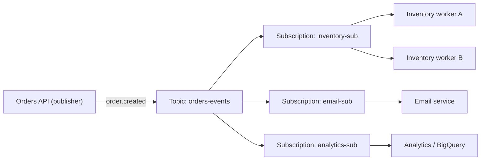
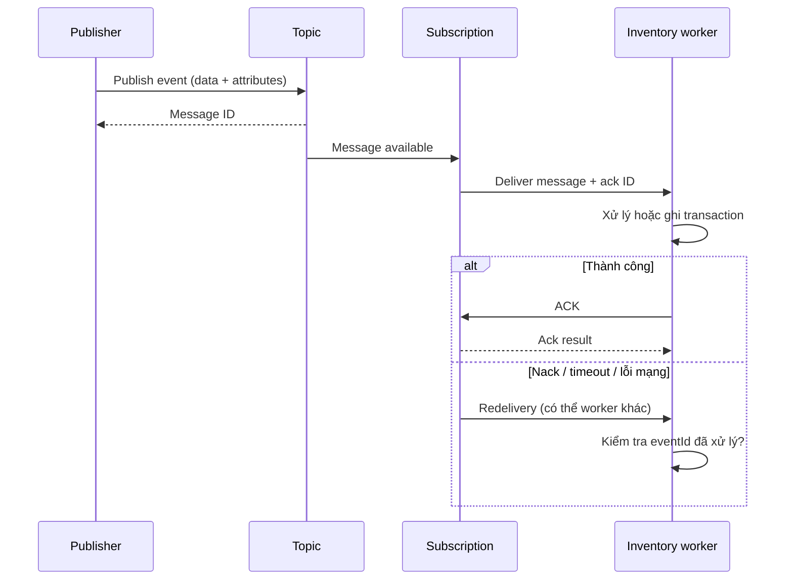
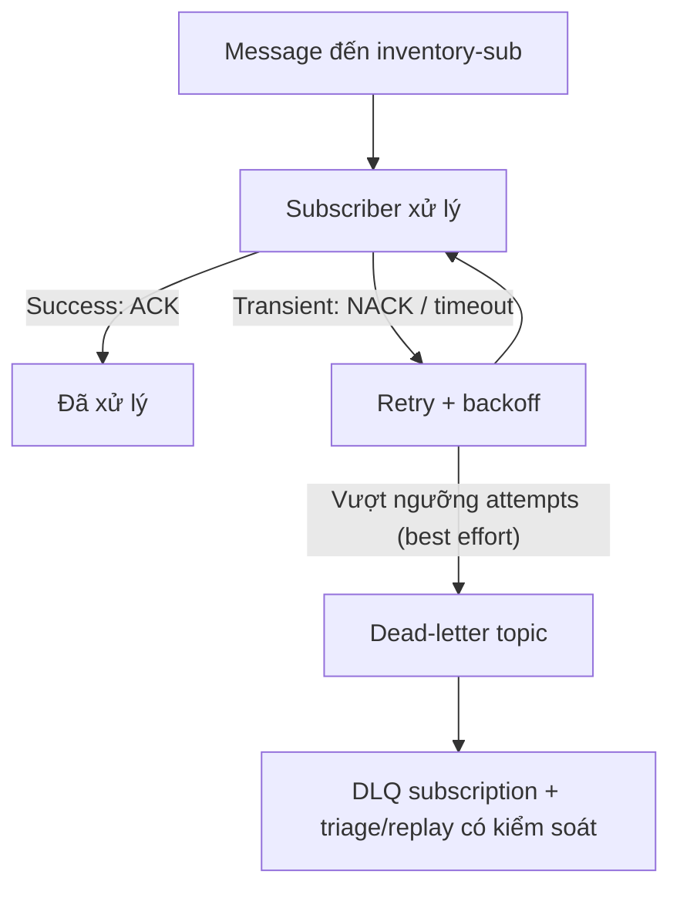

# Pub/Sub topics, subscriptions và mô hình phân phối

Khi khách đặt hàng thành công, hệ thống Orders cần gửi email xác nhận, trừ tồn kho và cập nhật báo cáo. Nếu Orders API gọi tuần tự cả ba dịch vụ, một dịch vụ gửi email bị chậm có thể làm request đặt hàng bị timeout. **Google Cloud Pub/Sub** giúp tách việc *phát sự kiện* khỏi việc *xử lý sự kiện*: Orders phát `order.created` một lần vào **topic**, còn mỗi hệ thống nhận qua **subscription** riêng.

Bài thuộc chương **Pub/Sub và thông điệp**, module `CLOUD_PROVIDERS_GCP`. Kiến thức kết nối Cloud Run/GKE/Compute Engine, IAM, mạng VPC, lưu trữ, cơ sở dữ liệu, quan sát độ tin cậy và chi phí. Trọng tâm là hiểu đúng **topic → subscription → subscriber**, chọn kiểu phân phối, xử lý thông điệp lặp và vận hành backlog.

> Ví dụ dùng project `orders-lab` và thông điệp giả lập, không chứa dữ liệu khách thật. Các lệnh tạo tài nguyên hoặc publish có thể phát sinh phí và kích hoạt subscribers; chỉ chạy trong sandbox đã được cho phép. Nội dung viết cô đọng theo luồng thực hành, không thay thế kiểm thử trên hệ thống thật.

## 1. Kết quả học tập

Sau bài này, bạn có thể:

1. Phân biệt **topic**, **message**, **publisher**, **subscription** và **subscriber**.
2. Thiết kế **fan-out** (một sự kiện cho nhiều nghiệp vụ) và **competing consumers** (nhiều workers chung subscription).
3. Chọn **pull, push hoặc export subscription** theo workload.
4. Tạo topic/subscription, publish/pull messages bằng `gcloud`; phân biệt `ack`, `nack` và `ack deadline`.
5. Giải thích mặc định **at-least-once**, tùy chọn ordering/exactly-once, retention, replay, retry và dead-letter topic.
6. Thiết kế quyền IAM tối thiểu, push authentication, idempotency và quan sát backlog/chi phí.

## 2. Các khái niệm và vòng đời message

| Khái niệm | Chức năng | Ví dụ |
| --- | --- | --- |
| **Topic** | Địa chỉ logic nhận messages từ publishers; một topic có nhiều subscriptions | `orders-events` |
| **Publisher** | Ứng dụng gửi message vào topic | Orders API |
| **Message** | Dữ liệu dạng bytes, attributes key–value; Pub/Sub thêm message ID, publish time | Sự kiện `order.created` |
| **Subscription** | Luồng messages của **một topic** dành cho một nhóm tác vụ; lưu trạng thái ack/backlog riêng | `inventory-sub`, `email-sub` |
| **Subscriber** | Client/worker hoặc endpoint nhận messages từ một subscription | Inventory worker trên GKE |
| **Ack/Nack** | Xác nhận đã xử lý / yêu cầu phân phối lại | Ack sau khi cập nhật DB |
| **Backlog** | Messages còn phải xử lý hoặc chưa ack của từng subscription | 2.000 events chờ gửi email |



Đường mũi tên từ topic tới **mỗi subscription** là một bản phân phối logic độc lập. Mỗi message được xem xét cho các subscriptions gắn với topic. Hai workers A/B cùng đọc `inventory-sub` sẽ **chia sẻ việc xử lý**, không được bảo đảm mỗi worker đều nhận một bản. Ngược lại, subscriber của `email-sub` và `inventory-sub` có trạng thái ack riêng: email hỏng không làm message đã ack của inventory tự xuất hiện lại ở inventory.

### 2.1. Message mang những gì?

Ví dụ một sự kiện ứng dụng:

```json
{
  "eventId": "evt-1001",
  "eventType": "order.created",
  "schemaVersion": 1,
  "orderId": "ord-42",
  "occurredAt": "2026-11-19T09:00:00Z"
}
```

Publisher thường mã hóa JSON thành **UTF-8 bytes** trong `message.data` và gắn attributes như `eventType=order.created`, `schemaVersion=1`. Trong Pub/Sub REST/push wrapper, bytes được thể hiện bằng **base64**; đó chỉ là encoding, **không phải mã hóa bảo mật**. Pub/Sub cấp `messageId` và `publishTime` sau khi nhận thành công.

**Đừng lấy `messageId` làm business event ID duy nhất.** Một publisher có thể publish lại cùng sự kiện sau timeout, làm Pub/Sub tạo hai messages có **message IDs khác nhau**. Dùng `eventId` do nghiệp vụ sinh để deduplicate trong downstream.

### 2.2. Subscription bắt đầu nhận từ khi nào?

Theo mặc định, **subscription mới chỉ nhận messages được publish sau khi nó được tạo**. Tạo subscription hôm nay không tự lấy toàn bộ lịch sử topic từ tuần trước. Muốn replay dữ liệu cũ, phải thiết kế **topic message retention**, hoặc lưu/giữ messages qua subscription retention, snapshots và seek theo giới hạn hỗ trợ. Topic tồn tại nhưng không có subscription không đồng nghĩa có một hàng đợi lịch sử vô hạn.

## 3. Hai mô hình phân phối quan trọng

### 3.1. Fan-out: một sự kiện, nhiều nhóm nghiệp vụ

`orders-events` có ba subscriptions:

- `inventory-sub`: cập nhật tồn kho.
- `email-sub`: gửi email xác nhận.
- `analytics-sub`: đưa dữ liệu vào kho báo cáo.

Mỗi subscription nhận luồng messages của topic theo cấu hình riêng. **Ack ở email-sub không xóa message khỏi inventory-sub**. Cách này tránh sự phụ thuộc trực tiếp giữa các dịch vụ, cho phép thêm một consumer mới mà không sửa publisher; nhưng mỗi subscription làm tăng số deliveries, backlog và khả năng phát sinh chi phí.

### 3.2. Competing consumers: tăng workers cho cùng một tác vụ

Ba replicas của Inventory worker cùng pull từ **một** `inventory-sub`. Pub/Sub phân phối công việc giữa các clients trong nhóm; một message thường được giao cho một worker tại một thời điểm, nhưng **có thể được phát lại** nếu ack thất bại/hết hạn. Không dùng ba subscriptions khác nhau để “scale” Inventory nếu ý định là mỗi event chỉ cập nhật tồn kho một lần.

| Yêu cầu | Thiết kế đúng | Sai lầm hay gặp |
| --- | --- | --- |
| Một sự kiện cần kích hoạt ba nghiệp vụ | **Ba subscriptions** trên một topic | Một subscription nhưng mong mọi service đều có bản riêng |
| Ba replicas cùng xử lý hàng đợi Inventory | **Một subscription**, ba clients | Ba subscriptions làm event bị xử lý ba lần |
| Chỉ gửi loại event nhất định cho Email | Subscription filter bằng attributes | Lọc sau khi đã gửi mọi payload và tăng xử lý không cần |
| Tách tốc độ xử lý và retention của Analytics | Subscription riêng hoặc export subscription | Để consumer chậm gây nghẽn một queue chung |

### 3.3. Fan-in và event-driven architecture

Nhiều publishers có thể cùng gửi đến một topic nếu **event contract/schema được quản lý rõ**. Ví dụ Orders API và Payments service gửi các loại events khác nhau; consumers phải kiểm tra `eventType` và `schemaVersion`. Đừng gộp mọi dữ liệu nhạy cảm vào một topic không có ranh giới quyền hoặc vòng đời rõ ràng.

## 4. Chọn Pull, Push hay Export subscription

| Loại | Cách nhận | Phù hợp | Đánh đổi |
| --- | --- | --- | --- |
| **Pull/StreamingPull** | Worker chủ động nhận messages, gửi ack RPC | GKE/Compute Engine workers, workload cần flow control và batching | Phải vận hành workers, leases và concurrency |
| **Push** | Pub/Sub gửi HTTP POST tới endpoint | Cloud Run HTTP service hoặc webhook có HTTPS | Phải bảo vệ endpoint, ack qua HTTP response, backpressure hạn chế hơn |
| **Export: BigQuery** | Pub/Sub tự ghi vào bảng BigQuery | Analytics ingest không cần viết subscriber | Schema, IAM, delivery behavior và giới hạn export |
| **Export: Cloud Storage** | Pub/Sub ghi objects theo chu kỳ/kích thước | Archive/batch file landing | Không phải request per event, format và batching cần xem xét |
| **Export: Bigtable (Preview)** | Pub/Sub ghi tới Bigtable | Ingest Bigtable phù hợp | Tính năng Preview/khả năng hỗ trợ có thể thay đổi |

**Pull không có nghĩa tự động nhanh hơn push trong mọi trường hợp.** Pull có kiểm soát số messages outstanding/bytes và kéo dài ack deadlines; push giảm việc tự quản lý worker polling nhưng endpoint cần phản hồi trong thời gian thích hợp. Các lựa chọn export có IAM/định dạng/kho đích riêng; không mặc định hỗ trợ mọi tính năng của pull như exactly-once.

### 4.1. Push message và xác nhận

Ở chế độ push mặc định, Pub/Sub POST một JSON wrapper chứa message data dạng base64, attributes và metadata. **HTTP success response được Pub/Sub công nhận tương đương ack**; phản hồi không thành công hoặc request timeout dẫn tới retry. Không trả `2xx` khi chỉ nhận request rồi bỏ qua công việc quan trọng mà chưa lưu **bền vững** vào hệ thống xử lý khác.

Push có tùy chọn **payload unwrapping** để gửi raw data thay cho JSON wrapper; khi bật tùy chọn này, consumer phải biết rõ hợp đồng payload/headers và có cách kiểm tra sự kiện. Đừng viết handler giả định luôn có `message.data` trong mọi push mode.

### 4.2. Pull message và xác nhận

Pull client nhận message cùng một **ack ID** cho lần phân phối hiện tại. Sau khi hoàn tất xử lý, gọi `ack(ackId)`; nếu lỗi, có thể gọi nack hoặc để deadline hết hạn để Pub/Sub gửi lại. Với client libraries, dùng **StreamingPull**, flow control và tự động gia hạn deadline thay vì tự viết vòng polling liên tục.

## 5. Thực hành CLI: một topic, hai subscriptions

Thực hiện theo thứ tự **tạo subscription trước, publish sau**. Các lệnh minh họa có thể **tạo tài nguyên và phát sinh phí**; dùng project sandbox được cấp quyền.

```bash
PROJECT_ID="orders-lab"
TOPIC="orders-events"
INVENTORY_SUB="inventory-sub"
EMAIL_SUB="email-sub"

# THAY ĐỔI HẠ TẦNG: bật API, tạo topic.
gcloud services enable pubsub.googleapis.com --project="$PROJECT_ID"
gcloud pubsub topics create "$TOPIC" --project="$PROJECT_ID"

# THAY ĐỔI HẠ TẦNG: hai pull subscriptions độc lập.
gcloud pubsub subscriptions create "$INVENTORY_SUB" \
  --topic="$TOPIC" \
  --ack-deadline=30 \
  --message-retention-duration=7d \
  --project="$PROJECT_ID"

gcloud pubsub subscriptions create "$EMAIL_SUB" \
  --topic="$TOPIC" \
  --project="$PROJECT_ID"

# CHỈ ĐỌC: kiểm tra topology.
gcloud pubsub topics list --project="$PROJECT_ID"
gcloud pubsub subscriptions list --project="$PROJECT_ID"
gcloud pubsub subscriptions describe "$INVENTORY_SUB" \
  --project="$PROJECT_ID"
```

Nếu tài nguyên đã tồn tại, không tạo lại để tránh thay đổi trạng thái. Người tạo topic cần quyền `pubsub.topics.create`, người tạo subscription cần `pubsub.subscriptions.create` và quyền attach subscription lên topic tương ứng. Trong project nhiều team, platform team nên chuẩn hóa tên, owner, retention và IAM bằng IaC.

### 5.1. Publish sự kiện giả lập

```bash
# CÓ TÁC ĐỘNG: message được gửi tới MỌI subscription phù hợp.
gcloud pubsub topics publish "$TOPIC" \
  --message='{"eventId":"evt-1001","eventType":"order.created","orderId":"ord-42"}' \
  --attribute=eventType=order.created,schemaVersion=1 \
  --project="$PROJECT_ID"
```

Khi thành công, CLI trả về **Pub/Sub message ID**. Chỉ gửi dữ liệu thử; topic production có subscribers thật sẽ xử lý message này ngay. Publisher nên ghi nhận publish outcome và retry có backoff khi bị quota/unavailable, nhưng retry cũng có thể sinh duplicate **business events** nếu không thiết kế idempotency.

### 5.2. Pull thử trên hai subscriptions

```bash
# CHỈ DÙNG TRONG SANDBOX: --auto-ack xác nhận ngay sau khi pull.
gcloud pubsub subscriptions pull "$INVENTORY_SUB" \
  --auto-ack --limit=5 --project="$PROJECT_ID"

gcloud pubsub subscriptions pull "$EMAIL_SUB" \
  --auto-ack --limit=5 --project="$PROJECT_ID"
```

Bạn sẽ thấy cùng một `eventId` ở **hai subscriptions**; `--auto-ack` chỉ đánh dấu message đã xử lý **tại subscription tương ứng**. **Không dùng `--auto-ack` trên queue production trước khi nghiệp vụ hoàn tất**: lệnh này có thể làm mất cơ hội xử lý message chưa thực sự được ứng dụng lưu. `--limit=5` là giới hạn trên, không bảo đảm mỗi lần gọi trả đủ năm messages.

### 5.3. Hai workers trên cùng inventory-sub

Mở hai terminal chạy pull trên **cùng `inventory-sub`**. Messages được chia giữa các workers theo availability; nếu chỉ publish một message, không kỳ vọng cả hai terminal cùng nhận. Để quan sát fan-out, tạo **subscription riêng** (như `email-sub`), không phải mở thêm client.

## 6. Ack, retry và at-least-once delivery

**Mặc định Pub/Sub bảo đảm at-least-once, không bảo đảm thứ tự.** Một message có thể được giao nhiều lần, kể cả sau sự cố mạng hoặc khi subscriber không ack kịp. Điều này là hành vi cần thiết kế xử lý, **không phải bằng chứng Pub/Sub bị hỏng**.



### 6.1. Ack deadline và lease extension

| Thuộc tính | Giá trị/ý nghĩa | Tác động |
| --- | --- | --- |
| `ackDeadline` ban đầu | Mặc định **10 giây**; cấu hình **10–600 giây** | Hết hạn chưa ack có thể bị giao lại |
| `modifyAckDeadline` | Gia hạn hoặc đặt `0` để nack | Hữu ích khi xử lý dài hoặc muốn retry sớm |
| High-level client library | Có thể tự gia hạn deadline, đặt giới hạn outstanding messages/bytes | Giảm redelivery do worker quá tải |
| `ack` | Xác nhận ở **subscription hiện tại** | Message không còn cần phân phối trên subscription đó |
| `nack` | Báo xử lý chưa thành công | Kích hoạt retry theo chính sách/nhịp backoff |

Một message không có “deadline cho cả hệ thống” bằng cách cộng deadlines ở từng subscription; mỗi subscription có trạng thái và cấu hình riêng. **Đừng kéo `ackDeadline` thật dài để che lỗi xử lý**: cần theo dõi latency, progress và giới hạn công việc trong flight.

### 6.2. Khi nào được ack?

Ví dụ Inventory worker thực hiện cập nhật tồn kho:

1. Nhận message, validate schema và business key.
2. Kiểm tra `eventId` đã được xử lý chưa.
3. Ghi kết quả nghiệp vụ và idempotency marker **trong cùng transaction** nếu database hỗ trợ.
4. Commit thành công mới gọi `ack`; nếu DB lỗi, `nack` hoặc không ack để retry.
5. Trường hợp message sai vĩnh viễn, phân loại poison message và chuyển qua DLQ theo quy trình, không retry vô tận.

**Ack trước DB commit có thể gây mất công việc:** subscriber báo xong, rồi DB ghi lỗi; Pub/Sub không còn lý do giao lại. **DB commit xong nhưng ack thất bại** thì message có thể quay lại: phải dựa vào idempotency để không trừ kho hai lần.

### 6.3. Idempotency khác với Pub/Sub message ID

Trong dữ liệu:

```json
{
  "eventId": "evt-1001",
  "orderId": "ord-42",
  "eventType": "order.created"
}
```

Các lần publish lại có thể nhận những `messageId` khác nhau nhưng cùng `eventId`. Với PostgreSQL/MySQL, một phương án là bảng có unique key trên **(consumer_name, event_id)**. Ý tưởng thuật toán:

```text
BEGIN TRANSACTION
  INSERT processed_events(consumer_name, event_id)
    ON CONFLICT DO NOTHING
  IF inserted:
    UPDATE stock ...               # cùng transaction
COMMIT
ACK message
```

Đây là **pseudocode**, không phải SQL chạy được trên mọi hệ quản trị. Với thanh toán/gửi email qua external API, cần **idempotency key** được phía dịch vụ hỗ trợ, transactional outbox hoặc cơ chế reconciliation; không thể mở một database transaction bao quanh mọi side effect bên ngoài.

## 7. Ordering và exactly-once: bảo đảm tới đâu?

| Tính năng | Mặc định | Khi bật | Giới hạn |
| --- | --- | --- | --- |
| Delivery | **At-least-once** | Có thể bật exactly-once cho pull | Không biến toàn bộ nghiệp vụ thành giao dịch exactly-once |
| Ordering | Không bảo đảm thứ tự | Theo **ordering key**, subscription enable ordering | Cùng key phải publish trong **cùng region**; các keys khác nhau không có thứ tự tổng |
| Exactly-once | Tắt | Ack có kết quả, không redelivery sau ack thành công | **Chỉ pull/StreamingPull**, theo bảo đảm trong **một region** |
| Publisher retries | Có thể xảy ra | Dùng idempotent publish/application event IDs | Exactly-once delivery không khử hai publishes độc lập cùng nghiệp vụ |

### 7.1. Giữ thứ tự sự kiện cho một đơn hàng

Giả sử một order có ba events: `created → paid → shipped`. Để đảm bảo consumer nhận theo thứ tự trên **một subscription**:

- Publisher dùng cùng `orderingKey="ord-42"` cho ba messages, và gửi cùng key từ **cùng region** theo thứ tự.
- Subscription được tạo với `--enable-message-ordering`.
- Subscriber xử lý tuần tự công việc của **cùng ordering key**, kể cả khi callback tạo thêm async tasks.
- Trạng thái ứng dụng vẫn phải chịu được retries và events đến muộn từ nguồn khác.

```bash
# THAY ĐỔI: tạo SUBSCRIPTION MỚI trước khi publish.
gcloud pubsub subscriptions create order-state-ordered-sub \
  --topic=orders-events \
  --enable-message-ordering \
  --project=orders-lab

# CÓ TÁC ĐỘNG: gửi events theo một ordering key giả lập.
gcloud pubsub topics publish orders-events \
  --message='{"eventId":"evt-1","type":"created","orderId":"ord-42"}' \
  --ordering-key=ord-42 \
  --project=orders-lab
```

Chú ý: **ordering key trong message không tự kích hoạt ordering trên subscription**. Một message lỗi có thể làm các messages kế tiếp của cùng key bị chậm hoặc redeliver; throughput và latency chịu ảnh hưởng. Tài liệu GCP quy định thuộc tính message ordering của subscription cần được đặt **khi tạo**, không mặc định đổi trực tiếp được trên subscription hiện hữu.

### 7.2. Exactly-once cho pull, không phải Push/Export

```bash
# CÓ THAY ĐỔI: subscription pull có exactly-once delivery.
gcloud pubsub subscriptions create inventory-exactly-once-sub \
  --topic=orders-events \
  --enable-exactly-once-delivery \
  --project=orders-lab
```

Exactly-once áp dụng cho **message đã được Pub/Sub nhận và phân phối qua một pull subscription**, với những điều kiện khu vực và ack hợp lệ. Nó ngăn duplicate delivery sau khi ack đã được chấp nhận, nhưng vẫn có **redelivery hợp lệ** nếu deadline hết/nack trước ack; đôi khi publisher gửi lại cùng payload tạo message mới. Nó **không tự đảm bảo database commit hay thanh toán chỉ diễn ra một lần**.

Khi cần bảo đảm này ở nhiều region, kiểm tra **locational endpoints**/region của subscriber và khuyến nghị của Pub/Sub. Exactly-once có thể tăng latency/chi phí xử lý; nếu throughput cao, dùng StreamingPull và đo trước khi bật. Khi kết hợp ordering + exactly-once, acknowledgments cần tuân theo thứ tự, có thể giảm throughput theo key.

## 8. Retention, replay, expiration và dead-letter

### 8.1. Retention không phải backup vô hạn

| Thuộc tính | Mặc định/thường gặp | Ghi nhớ |
| --- | --- | --- |
| Subscription retention | **7 ngày** với unacked messages | Có thể chỉnh từ **10 phút đến 31 ngày** |
| Acked messages | Mặc định không giữ lại sau ack | Bật `retain-acked-messages` khi cần seek/replay trong thời gian giữ |
| Topic retention | Tùy chọn riêng ở topic | Cho phép replay messages đã publish, kể cả trước khi có subscription nếu còn trong retention |
| Subscription expiration | Mặc định **31 ngày không hoạt động** | Có thể đặt hạn khác hoặc `never`; hết hạn có thể xóa backlog |
| Seek/snapshot | Dùng để phát lại/khôi phục trạng thái theo hỗ trợ | Có thể **redeliver** messages và phải thiết kế idempotency |

Khi subscription đã ack và không giữ lại acked messages, message có thể bị xóa khỏi subscription; **không thể replay từ một sự kiện vốn không còn được lưu**. Topic retention, subscription retention và snapshot có điều kiện thời gian/chi phí khác nhau, không tự thay thế backup nghiệp vụ.

Ví dụ tạo subscription mới lưu cả acked messages để diễn tập replay:

```bash
# THAY ĐỔI HẠ TẦNG / TĂNG CHI PHÍ LƯU TRỮ.
gcloud pubsub subscriptions create audit-replay-sub \
  --topic=orders-events \
  --message-retention-duration=3d \
  --retain-acked-messages \
  --expiration-period=never \
  --project=orders-lab
```

**Không chạy seek trên subscription production** nếu chưa có kế hoạch; thông điệp cũ có thể lại được phân phối và gây duplicate side effects. Test replay với dữ liệu sandbox, xác minh eventId/deduplication trước.

### 8.2. Retry và Dead-Letter Topic (DLQ)

Một `poison message` sai schema hoặc tham chiếu tới đơn hàng không tồn tại có thể gây lặp vô hạn. Pub/Sub hỗ trợ retry ngay (mặc định) hoặc exponential backoff, và **Dead-Letter Topic** để chuyển messages không thể xử lý sau số lần giao lại.



DLQ có **topic riêng** và phải có **subscription theo dõi DLQ**; chỉ tạo dead-letter topic mà không có consumer sẽ không tự sinh dashboard/alert. Với cấu hình DLQ, giới hạn `max delivery attempts` từ **5 đến 100**, nhưng **số lần giao chính xác không phải ranh giới cứng** vì forwarding theo best effort. Cần cấp quyền cho **Pub/Sub service agent** được subscribe nguồn và publish đến DLQ theo tài liệu; nếu thiếu quyền, forwarding có thể không hoạt động đúng.

Một ví dụ cấu hình **đã có DLQ topic và quyền**:

```bash
# CÓ THAY ĐỔI: tạo subscription mới với DLQ.
gcloud pubsub subscriptions create inventory-dlq-enabled-sub \
  --topic=orders-events \
  --dead-letter-topic=orders-dead-letter \
  --max-delivery-attempts=10 \
  --min-retry-delay=10s \
  --max-retry-delay=300s \
  --project=orders-lab
```

Đừng dùng DLQ để “xóa lỗi” mà không có owner. Lưu nguyên nhân lỗi, message ID/eventId và số lần retry; xử lý độc hại/PII trong payload trước khi xuất DLQ sang log hoặc hệ thống ticket.

## 9. Filtering và schema: giảm việc giao sai consumer

**Subscription filter** hoạt động với **message attributes**, không phải JSON fields nằm trong `data`. Ví dụ Email chỉ nhận `eventType="order.created"`:

```bash
# THAY ĐỔI: filter đặt ngay khi TẠO subscription.
gcloud pubsub subscriptions create email-created-only-sub \
  --topic=orders-events \
  --message-filter='attributes.eventType="order.created"' \
  --project=orders-lab
```

Messages **không match filter** được Pub/Sub **tự ack** ở subscription đó, không đưa vào backlog để Email xử lý. Filter có điều kiện immutable sau khi tạo trong những phiên bản API hiện hành; muốn thay đổi logic filter nên thiết kế subscription mới và migration có kiểm soát. Các subscription khác trên topic vẫn nhận messages theo filter của chúng.

Với JSON payload, nên có **event schema/version** và định nghĩa hợp đồng message (required fields, backward compatibility, idempotency fields). Pub/Sub schema service hỗ trợ **Avro và Protocol Buffers** cho các topic cấu hình tương ứng; nếu dùng JSON tự do, validation nằm ở ứng dụng. Thêm `schemaVersion` vào attributes giúp subscription filter hoặc router nhận biết phiên bản mà không cần decode payload.

## 10. Ví dụ Push subscription bảo vệ Cloud Run

Nếu Email service là HTTP application trên Cloud Run, Pub/Sub có thể gửi request trực tiếp tới URL HTTPS của service bằng **push subscription có xác thực**. Khác pull worker, handler push cần trả **mã HTTP thành công đúng lúc**; việc gửi email có thể kéo dài nên nên lưu công việc vào một hàng đợi/DB bền vững trước khi trả thành công, hoặc thiết kế handler để xử lý và ack trong timeout.

### 10.1. Quyền và cấu hình trước khi tạo Push

Giả định Cloud Run service `orders-email` và một user-managed service account `pubsub-push@orders-lab.iam.gserviceaccount.com` **đã được tạo**:

1. Account dùng để **tạo subscription** cần `pubsub.subscriptions.create`, quyền attach lên topic và `iam.serviceAccounts.actAs` trên push service account.
2. **Pub/Sub service agent** `service-PROJECT_NUMBER@gcp-sa-pubsub.iam.gserviceaccount.com` cần quyền `iam.serviceAccounts.getOpenIdToken` (thường `roles/iam.serviceAccountTokenCreator`) trên **push service account**.
3. Push service account được cấp `roles/run.invoker` trên **Cloud Run orders-email**, không phải Owner toàn project.
4. Cloud Run endpoint phải nhận được HTTPS requests theo ingress/network policy. Pub/Sub **không push trực tiếp tới private VPC IP**; với endpoint nội bộ cần kiến trúc khác như Eventarc hoặc pull worker.

Sau khi có quyền và URL thật của Cloud Run:

```bash
# THAY ĐỔI: chỉ chạy với Cloud Run và account đã cấu hình đầy đủ.
PROJECT_ID="orders-lab"
PUSH_SA="pubsub-push@$PROJECT_ID.iam.gserviceaccount.com"
EMAIL_SERVICE_URL="https://ACTUAL_CLOUD_RUN_SERVICE_URL"

# Pub/Sub service agent được quyền phát OIDC token với danh tính PUSH_SA.
PROJECT_NUMBER="$(gcloud projects describe "$PROJECT_ID" \
  --format='value(projectNumber)')"
PUBSUB_AGENT="service-$PROJECT_NUMBER@gcp-sa-pubsub.iam.gserviceaccount.com"

gcloud iam service-accounts add-iam-policy-binding "$PUSH_SA" \
  --project="$PROJECT_ID" \
  --member="serviceAccount:$PUBSUB_AGENT" \
  --role="roles/iam.serviceAccountTokenCreator"

# Cho phép PUSH_SA gọi Cloud Run service được chọn.
gcloud run services add-iam-policy-binding orders-email \
  --project="$PROJECT_ID" \
  --region=asia-southeast1 \
  --member="serviceAccount:$PUSH_SA" \
  --role="roles/run.invoker"

# CÓ THAY ĐỔI: tạo subscription push mới.
gcloud pubsub subscriptions create email-push-sub \
  --topic=orders-events \
  --project="$PROJECT_ID" \
  --push-endpoint="$EMAIL_SERVICE_URL/pubsub" \
  --push-auth-service-account="$PUSH_SA" \
  --push-auth-token-audience="$EMAIL_SERVICE_URL"
```

Đây là **mô hình IAM tối thiểu ở mức hướng dẫn**, không phải script production có thể chạy khi chưa có các resources/principals. Kiểm tra quyền người tạo subscription, tên service, project number và endpoint thật. Không bỏ xác thực Cloud Run hoặc đưa URL bí mật vào log để khắc phục lỗi 401/403.

### 10.2. Xử lý HTTP wrapper đúng và an toàn

Push JSON mặc định có cấu trúc tương tự:

```json
{
  "message": {
    "data": "eyJldmVudElkIjoiZXZ0LTEwMDEifQ==",
    "attributes": {"eventType": "order.created"},
    "messageId": "SAMPLE_MESSAGE_ID",
    "publishTime": "2026-11-19T09:00:00Z"
  },
  "subscription": "projects/orders-lab/subscriptions/email-push-sub"
}
```

Handler giải mã `message.data` từ base64, kiểm tra `eventType/schemaVersion` và idempotency key. Cloud Run/IAM kiểm tra token ở lớp tiếp nhận; nếu là endpoint HTTP tự quản lý, phải kiểm chứng **Google-signed OIDC JWT**, `aud` và service account email dự kiến, không tin một header tự khai.

**Ack push:** HTTP status `102`, `200`, `201`, `202` hoặc `204` là các mã thành công được Pub/Sub công nhận; HTTP lỗi hoặc deadline hết gây retry. Đừng trả 200 trước khi tác vụ đã được **lưu bền vững** hoặc hoàn tất. Khi dùng asynchronous queue nội bộ, phải bảo đảm queue đó không mất message sau HTTP 200.

## 11. IAM, bảo mật và vị trí lưu dữ liệu

| Principal | Vai trò/phạm vi nên dùng | Tránh |
| --- | --- | --- |
| Orders API publisher | `roles/pubsub.publisher` trên `orders-events` | Pub/Sub Admin toàn project |
| Inventory pull worker | `roles/pubsub.subscriber` trên `inventory-sub` | Đọc mọi subscription không liên quan |
| Platform operator | Role đủ quyền tạo topics/subscriptions và gắn IAM, ví dụ `roles/pubsub.editor` hoặc custom role | Cấp quyền tạo/xóa cho runtime không cần |
| Pub/Sub push service agent | Token Creator trên **push-auth service account** | Gán Token Creator tràn lan toàn project nếu không cần |
| Cloud Run push-auth identity | `roles/run.invoker` trên đúng service | Mở Cloud Run unauthenticated vì cấu hình push lỗi |
| DLQ service agent | Quyền subscribe source và publish DLQ theo hướng dẫn | Bỏ quyền rồi cho rằng DLQ tự hoạt động |

### 11.1. Private network không thay IAM

Pub/Sub là dịch vụ được quản lý, không phải một Pod nằm trong VPC. Workloads từ GKE/Compute Engine/Cloud Run có thể gọi Pub/Sub APIs qua đường Google APIs được hỗ trợ, với IAM/Workload Identity Federation tương ứng. Private Google Access, Private Service Connect hoặc VPC Service Controls có thể áp dụng theo yêu cầu mạng và perimeter; **mỗi cơ chế giải quyết một phần khác nhau**, không thay xác thực caller/authorization topic.

Không đưa dữ liệu nhạy cảm không cần thiết vào message; link tới dữ liệu đã mã hóa trong Cloud Storage/DB và kiểm tra quyền tại consumer khi phù hợp. Dữ liệu trong attributes cũng có thể xuất hiện trong logs/metrics/debug tools; không gắn access token, mật khẩu, email hoặc dữ liệu thẻ vào attributes.

### 11.2. Message storage policy và data residency

Pub/Sub topic là tài nguyên toàn cục, nhưng message data được lưu/xử lý tại các regions theo cách định tuyến và **message storage policy**. Nếu có yêu cầu residency, cấu hình danh sách allowed regions và cân nhắc `enforceInTransit`; publishers/subscribers ngoài vùng được phép có thể cần **regional/locational endpoints** và cấu hình mạng phù hợp.

Đừng nhầm **topic resource name** không có region với bảo đảm message data lưu ở mọi region hoặc ở một region cố định. Việc dùng nhiều regions/đường truyền xa có thể thay đổi latency, availability và egress cost; phải đo và đối chiếu policies theo đúng project.

## 12. Quan sát backlog, lỗi và chi phí

Pub/Sub cung cấp metrics cho topics/subscriptions trong Cloud Monitoring; ứng dụng cần bổ sung **end-to-end processing metrics** (mất bao lâu từ publish đến hoàn tất nghiệp vụ).

| Metric/SLI | Câu hỏi | Hướng hành động |
| --- | --- | --- |
| `subscription/num_unacked_messages_by_region` | Backlog theo region có tăng không? | Tăng worker capacity, điều tra throughput |
| `subscription/oldest_unacked_message_age_by_region` | Event cũ nhất chờ lâu bao nhiêu? | Ưu tiên khi gần retention TTL |
| `subscription/delivery_latency_health_score` | Luồng phân phối có dấu hiệu suy giảm? | Xem quota, backlog, retry và subscriber health |
| Ack deadline expirations | Worker có xử lý xong và ack kịp không? | Điều chỉnh flow control/lease, tối ưu xử lý |
| Nack/retry count | Có transient hoặc poison messages? | Triage logs, exponential backoff và DLQ |
| `subscription/dead_letter_message_count` | Có bao nhiêu messages bị forward sang DLQ? | Alert, phân loại và khắc phục nguyên nhân |
| Application success/error ratio | Tác vụ thực sự thành công bao nhiêu? | SLO nghiệp vụ, idempotency và reconciliation |

Nên dùng **regional versions** của backlog metrics khi cần dashboard vẫn hữu dụng trong sự cố mất một region; metrics có thể trễ vài phút, nên không lấy một điểm dữ liệu trống làm bằng chứng queue rỗng.

### 12.1. Khi backlog tăng

1. Kiểm tra publisher throughput có tăng hay không.
2. Kiểm tra subscribers còn kết nối và có quyền/CPU/memory/DB connections không.
3. So sánh **num_unacked** và **oldest_unacked age**: cùng tăng có thể do tiêu thụ không kịp; backlog nhỏ nhưng oldest lớn có thể do một vài poison messages.
4. Xem ack deadline, nack, retry backoff, DLQ và flow control; tăng replicas chỉ khi downstream đủ capacity.
5. Đặt alert **trước khi oldest age vượt retention**, vì messages quá hạn có thể bị xóa.

Ví dụ SLO: 99% `order.created` events hoàn tất Inventory update trong 60 giây. Chỉ số đó **không thể suy ra đầy đủ từ queue backlog**: cần timestamp/eventId và đo thời gian từ publish đến DB commit trong consumer, liên kết trace/logs theo eventId.

### 12.2. Tính chi phí đúng cho fan-out

| Nguồn | Tác động |
| --- | --- |
| Publish + deliver | Dung lượng publish và deliveries; một event có **3 subscriptions** có thể tạo 3 luồng delivery |
| Retained unacked messages | Backlog lớn hoặc retention kéo dài có thể gây chi phí storage |
| Retain acknowledged messages / topic retention | Tăng chi phí lưu trữ cho khả năng replay |
| Cross-region, exports | Egress và chi phí BigQuery/Cloud Storage riêng |
| Subscriptions không còn dùng | Vẫn có thể nhận messages, tăng backlog/chi phí |
| Retry storm | Nhiều lần delivery và tải lên downstream; DLQ/retry policies giúp kiểm soát |

Theo dõi Cloud Billing theo SKU, labels/project ownership, quota và Pub/Sub pricing hiện hành. Một subscription mới dùng để “thử” trên topic production có thể âm thầm nhận mọi events sau khi tạo, làm tăng traffic/chi phí ngay cả khi không có subscriber active.

## 13. Case study: Orders API, Inventory và Notification

Giả sử Orders chạy Cloud Run, Inventory workers chạy GKE, Email sender chạy Cloud Run, Analytics nhận dữ liệu qua BigQuery subscription. Yêu cầu:

- API đặt hàng trả nhanh, **không đợi gửi email**.
- Inventory update **không trừ hàng hai lần** khi nhận message lặp.
- Email lỗi trong 30 phút không được khiến Inventory bị chậm.
- Thứ tự `created → paid → cancelled` quan trọng **trong từng order**.
- Ops cần phát hiện backlog và xử lý DLQ có kiểm soát.

### 13.1. Thiết kế

| Thành phần | Cấu hình đề xuất | Lý do |
| --- | --- | --- |
| Topic | `orders-events`, hợp đồng JSON/Avro/Protobuf có version | Publishers không phụ thuộc số consumers |
| `inventory-sub` | Pull/StreamingPull, ordering key = order ID khi thực sự cần | Nhiều GKE workers chung subscription, flow control |
| `email-sub` | Authenticated push tới Cloud Run hoặc pull worker tùy thời gian xử lý | Email backlog/ack riêng |
| `analytics-sub` | BigQuery export subscription hoặc Dataflow consumer | Không phải viết webhook riêng nếu export đáp ứng schema |
| `orders-dead-letter` | DLQ và DLQ subscription + alert | Điều tra payload không thể xử lý |
| Database | Unique (consumer,eventId), transactional update | Chống cập nhật tồn kho lặp |
| Observability | Backlog age, DLQ count, end-to-end processing latency | Đo đúng thành công nghiệp vụ |

### 13.2. Quy trình khi Email service ngừng hoạt động

1. Orders tiếp tục publish `order.created`; Inventory vẫn ack trên **inventory-sub** sau khi trừ kho.
2. Pub/Sub giữ messages chưa được ack ở **email-sub** trong retention; retry theo chính sách.
3. Cloud Monitoring báo `oldest_unacked_message_age_by_region` của email-sub vượt SLO; on-call điều tra 5xx và quyền Cloud Run push-auth.
4. Khôi phục Email, cho subscriber tiêu thụ backlog có giới hạn; dùng `eventId` để tránh gửi email trùng.
5. Message lỗi vĩnh viễn chuyển DLQ, được phân loại và phát lại thủ công chỉ khi đã sửa nguyên nhân.

Không sửa lỗi Email bằng cách **xóa subscription**: hành động đó làm mất backlog của subscription. Cũng không để một subscriber gửi email lỗi khiến transaction Inventory phải rollback nếu hai nghiệp vụ đã được tách qua subscriptions.

### 13.3. Outbox để tránh mất sự kiện sau commit

Một race khó thấy: Orders API **commit đơn hàng vào DB rồi crash trước khi publish event**. Pub/Sub không thể cứu event chưa được gửi. Pattern **transactional outbox** ghi bản ghi đơn hàng và outbox event trong một DB transaction; một relay worker publish events và đánh dấu trạng thái. Relay có thể publish lặp sau timeout, vì vậy consumer **vẫn phải idempotent**.

Đây là vấn đề **đảm bảo phát sự kiện** ở publisher, khác với cơ chế at-least-once delivery ở subscriber; cần xử lý cả hai để giữ tính nhất quán nghiệp vụ.

## 14. Bảng lỗi thường gặp

| Triệu chứng | Nguyên nhân có thể | Kiểm tra/khắc phục |
| --- | --- | --- |
| Subscription mới không thấy event cũ | Tạo sau khi publish, topic không giữ lịch sử | Kiểm tra creation time, topic retention, replay limits |
| Publish thành công nhưng worker không nhận | Sai project/subscription, filter loại message, worker chưa chạy | Describe topic/subscription, filter attributes, IAM |
| Hai Inventory workers cùng cập nhật cùng order | Redelivery hoặc dùng hai subscriptions thay vì một | Topology, ack logs, dedup bằng business eventId |
| Message được gửi lại sau DB commit | Ack deadline hết hoặc ack RPC lỗi | Transactional idempotency, lease/flow control |
| Message “biến mất” sau dùng CLI | `--auto-ack` đã xác nhận ngay | Chỉ dùng demo; production ack sau durable work |
| Ordering không như mong đợi | Chưa enable ordering, key khác hoặc publish khác region | Subscription property, orderingKey và publisher location |
| Exactly-once vẫn có side effect lặp | Publisher gửi hai events riêng, external API không idempotent | Dùng eventId, idempotency keys, DB transaction |
| Push Cloud Run trả 401/403 | Thiếu Invoker, Token Creator, `actAs`, JWT audience sai | Kiểm tra SA identities, service agent và HTTPS endpoint |
| Push worker chậm, retry nhiều | Handler timeout/HTTP error, không có durable handoff | Trả 2xx chỉ sau durable success, quan sát request latency |
| DLQ không có messages dù retry | Thiếu service agent IAM, DLQ chưa có subscriber hoặc delivery attempts chưa đạt | Kiểm tra subscription config, IAM, DLQ subscription, metrics |
| Backlog tăng dù publish ổn | Worker/DB chậm, flow control quá nhỏ hoặc poison message | Regional backlog, age, CPU/DB, retries |
| Chi phí tăng sau khi thêm team | Mỗi team tạo subscription fan-out mới hoặc retention dài | Inventory subscriptions, labels, Billing, TTL |

## 15. Bài tập thực hành

### Bài A — Vẽ topology

Một `orders-events` topic có ba subscriptions: Inventory, Email và Analytics. Inventory có bốn replicas đọc cùng subscription. Vẽ mô hình và cho biết một event được phân phối tới bao nhiêu **subscription streams**, vì sao bốn replicas không nhận bốn bản độc lập.

### Bài B — Thử CLI trên sandbox

Tạo một topic và hai subscriptions theo mục 5, publish hai events thử và pull từ từng subscription. Chứng minh ack ở subscription thứ nhất **không ảnh hưởng** subscription thứ hai. Vì sao phải tạo subscriptions trước khi publish?

### Bài C — Ack và idempotency

Inventory worker commit trừ 2 sản phẩm khỏi kho, nhưng crash trước khi ack. Message được giao lại. Viết thuật toán dùng `eventId` và unique key/transaction để không trừ hai lần; nêu khác biệt giữa `messageId` của Pub/Sub và business event ID.

### Bài D — Ordering và exactly-once

Một order phát `created, paid, cancelled`. Hãy nêu điều kiện publisher/subscription để nhận theo thứ tự và vì sao exactly-once chỉ ở pull không tự bảo đảm thanh toán không lặp. Nếu publish từ nhiều regions với cùng key thì điều gì phải xem xét?

### Bài E — Push tới Cloud Run

Thiết kế authenticated push subscription cho `orders-email` trên Cloud Run. Liệt kê principal tạo subscription, push-auth SA, Pub/Sub service agent, `roles/run.invoker` và JWT audience. Trường hợp nào trả 2xx; trường hợp nào phải retry?

### Bài F — Retry, DLQ và retention

Một subscriber liên tục nhận message sai schema. Đặt retry/backoff, 10 delivery attempts và DLQ; mô tả pipeline xử lý DLQ, cách alert theo oldest unacked age và rủi ro của việc chạy seek trên production.

### Bài G — Quan sát và chi phí

Publish rate là 1.000 events/s; có ba subscriptions và một subscription xử lý chậm. Giải thích vì sao backlog tăng riêng, tác động số deliveries/storage, dashboard cần metrics nào và cách tăng capacity mà không làm Cloud SQL quá tải.

### Câu hỏi tự kiểm tra

1. Topic khác subscription như thế nào? Một subscription có thể nối mấy topics?
2. Vì sao fan-out cần nhiều subscriptions, còn scale một consumer thường chỉ cần thêm workers?
3. At-least-once khác exactly-once delivery và exactly-once business effect ở đâu?
4. Hết `ackDeadline` có thể xảy ra điều gì?
5. Vì sao ack phải sau khi lưu kết quả nghiệp vụ bền vững?
6. Subscription retention 7 ngày có cho phép luôn replay mọi message đã ack không?
7. Ordering key bảo đảm thứ tự giữa các orders khác nhau không?
8. Exactly-once delivery có hỗ trợ push subscription không?
9. Tại sao filter chỉ nhìn attributes chứ không đọc JSON payload?
10. Vì sao một topic có thể có các backlogs khác nhau theo subscription?

## 16. Checklist triển khai và tài liệu chính thức

- [ ] Topic, schema/version, eventId và owner được định nghĩa rõ.
- [ ] Mỗi nghiệp vụ độc lập có subscription riêng; mỗi nhóm workers cùng tác vụ chia sẻ subscription.
- [ ] Pull/push/export đúng workload và ranh giới mạng/IAM; không dùng unauthenticated push endpoint.
- [ ] Ack sau durable processing; retries, lease management, ordering/idempotency và DLQ được kiểm thử.
- [ ] Retention/expiration/topic storage policy, replay và data residency được review.
- [ ] Dashboard theo regional backlog, oldest age, retry/DLQ và end-to-end business latency.
- [ ] Billing, quotas, owner labels, cleanup và runbook khi subscriber ngừng hoạt động đã có.

Tài liệu chính thức:

- [Pub/Sub overview](https://cloud.google.com/pubsub/docs/pubsub_overview)
- [Topics and publish workflow](https://cloud.google.com/pubsub/docs/publish-message-overview)
- [Subscription overview](https://cloud.google.com/pubsub/docs/subscription-overview)
- [Choose a subscription type](https://cloud.google.com/pubsub/docs/subscriber)
- [Subscription properties](https://cloud.google.com/pubsub/docs/subscription-properties)
- [Create subscriptions](https://cloud.google.com/pubsub/docs/create-subscription)
- [Pull subscriptions](https://cloud.google.com/pubsub/docs/pull)
- [Push subscriptions and authentication](https://cloud.google.com/pubsub/docs/create-push-subscription)
- [Exactly-once delivery](https://cloud.google.com/pubsub/docs/exactly-once-delivery)
- [Message ordering](https://cloud.google.com/pubsub/docs/ordering)
- [Message retention and replay](https://cloud.google.com/pubsub/docs/subscription-message-retention)
- [Dead-letter topics](https://cloud.google.com/pubsub/docs/dead-letter-topics)
- [Filter subscription messages](https://cloud.google.com/pubsub/docs/subscription-message-filter)
- [Pub/Sub monitoring](https://cloud.google.com/pubsub/docs/monitoring)
- [Pub/Sub message storage policies](https://cloud.google.com/pubsub/docs/resource-location-restriction)
- [Pub/Sub pricing](https://cloud.google.com/pubsub/pricing)

**Ghi nhớ:** Publisher ghi vào **topic**; mỗi **subscription** là một nhóm xử lý độc lập; nhiều workers cùng subscription chia nhau công việc. Luôn thiết kế **at-least-once + idempotency**, chỉ ack sau durable processing, kiểm soát retention/retry/DLQ và theo dõi backlog **theo subscription**. Dịch vụ Pub/Sub giúp tách hệ thống, nhưng tính đúng đắn của các thay đổi nghiệp vụ vẫn do ứng dụng bảo đảm.
