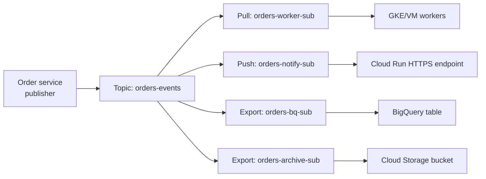
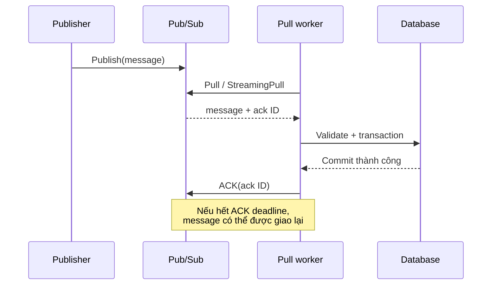

# Pull, push và export subscriptions

Trong hệ thống đặt hàng, một sự kiện `orders.created` có thể cần ba cách tiêu thụ khác nhau: worker xác thực đơn hàng, HTTP service gửi thông báo và kho phân tích lưu sự kiện vào BigQuery. **Google Cloud Pub/Sub** cho phép nhiều **subscriptions** cùng gắn với một **topic**; mỗi subscription có backlog và trạng thái ACK riêng. Chọn **pull, push hay export** quyết định ai điều khiển luồng nhận, ai xác nhận và nơi xảy ra lỗi.

Bài thuộc chương **Pub/Sub và thông điệp** của module `CLOUD_PROVIDERS_GCP`, kết nối kiến thức IAM, VPC, Cloud Run, GKE, Cloud Storage và cơ sở dữ liệu. Mục tiêu là lựa chọn đúng dịch vụ, bảo vệ tài nguyên, tự động hóa xử lý sự kiện, theo dõi độ tin cậy và chi phí. Các project/tài nguyên được đặt tên giả định; lệnh thay đổi hạ tầng chỉ dành cho lab được phép.

## 1. Mục tiêu học tập

Sau bài này, bạn có thể:

1. Phân biệt **topic, subscription, message, acknowledgment (ACK)** và backlog.
2. Chọn **pull/StreamingPull, push HTTP(S), BigQuery và Cloud Storage export** theo workload.
3. Tạo topic/subscription, publish/receive bằng `gcloud` và giải thích ACK deadline, redelivery.
4. Bảo vệ push endpoint bằng **OIDC IAM**, ACK HTTP đúng thời điểm và xử lý retry.
5. Cấu hình export theo **schema, file batch và quyền service account**, chẩn đoán lỗi đích.
6. Hiểu **at-least-once, ordering, filtering, dead-letter, exactly-once** và idempotency.
7. Giám sát backlog, latency, throughput và tổng chi phí.

## 2. Mô hình topic và subscription

Publisher tạo message gồm **data** (bytes), tùy chọn **attributes** (khóa–giá trị), ordering key và metadata như `messageId`/`publishTime`. Topic nhận messages; subscription quyết định cách giao chúng tới consumer hoặc destination.



**Hai quy tắc không được nhầm:**

- **Nhiều subscriptions trên cùng topic:** mỗi subscription nhận bản giao message riêng. ACK ở pull subscription **không ACK** cùng message ở push hay export subscription.
- **Nhiều consumers trên cùng một pull subscription:** chia nhau backlog để xử lý song song, **không** phải mỗi consumer nhận bản sao. Nếu hệ thống độc lập đều cần mọi sự kiện, hãy tạo subscription riêng.

Thông thường subscription mới nhận messages publish **từ sau thời điểm tạo subscription**, trừ trường hợp có cấu hình retention/seek/replay thích hợp. Khi so sánh ba kiểu, nên tạo subscription trước rồi mới publish.

## 3. Bảng so sánh pull, push và export

| Tiêu chí | **Pull / StreamingPull** | **Push HTTP(S)** | **Export** |
| --- | --- | --- | --- |
| Ai yêu cầu nhận? | Consumer gọi Pub/Sub API. | Pub/Sub chủ động POST tới endpoint. | Pub/Sub ghi trực tiếp vào resource. |
| Ai xử lý? | Code worker trên GKE, VM… | Code HTTP handler, chẳng hạn Cloud Run. | Không cần custom worker khi chỉ lưu dữ liệu. |
| ACK | Consumer gọi ACK/NACK; có thể gia hạn deadline. | HTTP success = ACK, HTTP error/timeout = thất bại. | Pub/Sub quản lý kết quả ghi vào đích. |
| Flow control | Consumer tự giới hạn worker, batch, outstanding bytes. | Pub/Sub điều tiết dựa vào phản hồi endpoint. | Pub/Sub tối ưu ghi dữ liệu đích. |
| Xử lý logic tùy biến | Linh hoạt, thích hợp nghiệp vụ/ETL phức tạp. | Phù hợp webhook và logic từng request. | Hạn chế, thiên về lưu raw/schema-compatible messages. |
| Điểm đến | Worker, job engine, ứng dụng. | HTTPS endpoint. | BigQuery/Cloud Storage; Bigtable export đang **Preview** theo tài liệu hiện hành. |
| Exactly-once delivery của Pub/Sub | **Hỗ trợ riêng cho pull** nếu bật và đủ điều kiện. | **Không hỗ trợ**. | **Không hỗ trợ**. |
| Rủi ro chính | Worker crash, ACK lease hết, quá tải downstream. | Endpoint auth/timeout, duplicate delivery. | Schema/IAM/target failure, file batching. |

**Quy tắc chọn nhanh:** cần xử lý nghiệp vụ và điều chỉnh tốc độ → **pull**; đã có HTTP handler muốn được gọi khi có message → **push**; chỉ lưu thông điệp vào BigQuery/Cloud Storage mà không muốn vận hành consumer → **export**.

## 4. Pull: consumer chủ động nhận và ACK



### 4.1. ACK deadline, lease và redelivery

- **ACK deadline:** giới hạn thời gian chờ sau khi giao message; nếu không ACK đúng hạn, Pub/Sub có thể giao lại.
- **Lease extension:** client libraries StreamingPull có cơ chế gia hạn ACK deadline khi xử lý lâu; phải xử lý cả lỗi mất kết nối và lease hết.
- **NACK:** từ chối xử lý lần này, message có thể được giao lại theo retry policy. NACK không tự sửa payload sai.
- **Flow control:** giới hạn số message/bytes đang xử lý để tránh đầy RAM hoặc làm ngập Cloud SQL.
- **ACK sau commit:** chỉ xác nhận sau khi side effect quan trọng đã bền vững, hoặc job đã được chuyển thành công sang queue đáng tin cậy.

**Unary Pull** phù hợp CLI/debug; **StreamingPull** phù hợp worker dài hạn nhờ stream, batch, flow control và quản lý lease. Để production, nên dùng Pub/Sub client library thay vì một cronjob cứ gọi CLI theo chu kỳ rất ngắn.

### 4.2. Mẫu worker an toàn

```text
on_message(message):
    validate(message)
    id = business_event_id(message)
    transaction:
        if not already_processed(id):
            save_business_effect(id)
            record_processed(id)
    ACK(message)    # sau commit

on_transient_failure:
    NACK or let lease expire, apply bounded retry/backoff
```

Đây là **pseudocode**, chưa phải transaction cho side effect bên ngoài DB. Nếu gọi API thanh toán/email, cần idempotency key ở đích hoặc transactional outbox. `--auto-ack` của CLI chỉ dành cho thử nghiệm vì nó ACK ngay khi đọc, không đợi xử lý nghiệp vụ.

**Pull phù hợp** khi cần xử lý song song lớn, phối hợp nhiều hệ thống, kiểm soát backpressure, kéo dài lease hoặc dùng exactly-once delivery theo điều kiện được hỗ trợ.

## 5. Push: Pub/Sub gửi HTTP request

Pub/Sub gửi **một message trên mỗi HTTP request** đến URL đã cấu hình. Endpoint trả mã HTTP thành công để ACK; mã lỗi hoặc timeout khiến message có thể được gửi lại.

### 5.1. Wrapped payload mặc định

```json
{
  "message": {
    "data": "eyJvcmRlcklkIjoiTy0xMDAxIn0=",
    "messageId": "1234567890",
    "publishTime": "2026-11-19T01:00:00Z",
    "attributes": {"kind": "orders.created"}
  },
  "subscription": "projects/orders-dev/subscriptions/orders-notify-sub",
  "deliveryAttempt": 1
}
```

`message.data` là **base64 của bytes payload**. `deliveryAttempt` không phải trường bắt buộc trong mọi tình huống. Nếu bật **payload unwrapping**, endpoint nhận body raw và cần đọc metadata/header theo cấu hình khác; không áp dụng parser của JSON wrapper cho trường hợp unwrapped.

### 5.2. HTTP ACK và bẫy 202

Các mã được Pub/Sub coi là ACK: **`102`, `200`, `201`, `202`, `204`**. Những mã khác hoặc timeout là thất bại, dẫn tới retry tùy policy.

Đặc biệt, `202 Accepted` **đã là ACK**, dù ứng dụng mới tạo thread nền trong RAM. Nếu Cloud Run instance bị thay trước khi thread lưu DB, thông điệp có thể bị mất xử lý. **Chỉ trả ACK sau commit**, hoặc sau khi tạo durable job trong Cloud Tasks/database.

### 5.3. Authenticated push tới Cloud Run

Thiết kế được khuyến nghị:

1. Tạo **user-managed service account** cho subscription push.
2. Cấp `roles/run.invoker` cho tài khoản này trên **đúng Cloud Run service**.
3. Cấu hình `--push-auth-service-account` và `--push-auth-token-audience` phù hợp URL được xác minh.
4. Bảo đảm principal tạo subscription có `iam.serviceAccounts.actAs` khi cần và Pub/Sub service agent có quyền tạo **OIDC ID token** thay account theo hướng dẫn.
5. Với endpoint không do Cloud Run IAM kiểm tra, xác minh **JWT signature, issuer, audience và email/identity**, không chỉ sự hiện diện của header Authorization.

Cloud Run service vẫn phải có ingress/networking cho phép request từ Pub/Sub theo thiết kế; **không tự mở unauthenticated** để khắc phục HTTP 403. Push rate được Pub/Sub điều chỉnh theo phản hồi và latency. Push không hỗ trợ thay đổi **ACK deadline của từng message** bằng ModifyAckDeadline như pull.

## 6. Export: ghi trực tiếp vào BigQuery hoặc Cloud Storage

**Export subscription** bỏ consumer trung gian khi chỉ cần lưu dữ liệu. Pub/Sub trực tiếp ghi tới resource đích; không phải mọi loại transformation/side effect đều được hỗ trợ. **Bigtable export** hiện được giới thiệu dạng Preview, nên cần kiểm tra khu vực, hỗ trợ và điều kiện trước khi dùng.

### 6.1. BigQuery subscriptions

BigQuery subscription ghi vào **bảng có sẵn**. Cần chọn hợp đồng dữ liệu:

| Kiểu export | Bảng BigQuery | Dùng khi |
| --- | --- | --- |
| **Không dùng schema** | Có cột `data` kiểu **BYTES, STRING hoặc JSON**. | Lưu raw payload để parse/transform sau. |
| **Use topic schema** | Topic có schema và encoding hỗ trợ; BigQuery fields tương thích. | Muốn payload ánh xạ thành cột theo schema ở Pub/Sub. |
| **Use table schema** | Pub/Sub diễn giải message theo schema BigQuery table. | Đích BigQuery là nguồn kiểm soát schema. |

`--use-topic-schema` và `--use-table-schema` **không được bật đồng thời**. Nếu dùng `--write-metadata`, bảng phải có các cột metadata với tên/kiểu phù hợp như `subscription_name`, `message_id`, `publish_time`, `attributes`. `--drop-unknown-fields` có thể bỏ trường không tồn tại trong schema đích; phải hiểu rủi ro mất thông tin trước khi bật.

Mặc định Pub/Sub dùng **Pub/Sub service agent** của project subscription, có dạng `service-PROJECT_NUMBER@gcp-sa-pubsub.iam.gserviceaccount.com`. Identity ghi BigQuery cần quyền như `roles/bigquery.dataEditor` tại phạm vi table/dataset phù hợp, hoặc dùng custom export service account. Quyền của developer tạo subscription **không tự truyền** sang service agent.

Lỗi schema/permission có thể làm **backlog tăng** dù publisher báo publish thành công. Warehouse queries nên **dedup bằng event/business ID**; export không cung cấp Pub/Sub exactly-once delivery.

### 6.2. Cloud Storage subscriptions

Cloud Storage export gom messages thành **object files** trong bucket đã tồn tại, không append liên tục vào một file như POSIX filesystem.

- **Format `text`:** các payload được ghi dạng text, phân cách bởi newline; **không chứa attributes/metadata**. Nếu payload có newline, định dạng này khó tách record an toàn.
- **Format `avro`:** binary Avro; có thể bật metadata (message ID, publish time, attributes…) nếu cấu hình phù hợp.
- **Batching:** giới hạn theo thời gian, bytes và/hoặc số messages; ví dụ `5m` nghĩa là không có file ngay cho từng publish.
- **Filename:** prefix/datetime/UUID/suffix. Không đặt logic downstream kỳ vọng một tên file cố định.
- **IAM:** export identity cần **Storage Object Creator** và quyền đọc metadata bucket theo hướng dẫn (thường `Storage Legacy Bucket Reader`). Bucket phải **tắt Requester Pays**.

Flag `--cloud-storage-bucket` nhận **bucket name thuần**, không kèm `gs://`. Đích này phù hợp archive/raw landing zone, không phải đường truy vấn realtime tới từng message.

### 6.3. Khi nào không nên export trực tiếp?

Nếu phải enrich, gọi REST API, join nhiều streams, kiểm soát transaction hoặc chuyển đổi dữ liệu phức tạp, nên xem **Dataflow, pull workers hoặc một pipeline chuyên biệt**. Export không thay thế nghiệp vụ và không tự xử lý poison messages; cần xem export state, error metrics, IAM, schema, DLQ/retention khi phát sinh lỗi.

## 7. Chính sách giao nhận dùng chung

| Chính sách | Ý nghĩa | Cạm bẫy |
| --- | --- | --- |
| **At-least-once** | Message có thể bị giao lại khi ACK lỗi/hết deadline. | Nhầm là exactly-once side effect. |
| **Exactly-once delivery** | Chỉ áp dụng **pull/StreamingPull**, trong phạm vi khu vực/tính năng. | Nghĩ push/export cũng có. |
| **Dead-letter topic** | Đưa message thất bại nhiều lần sang topic riêng theo policy/permissions. | Tưởng DLQ tự sửa dữ liệu. |
| **Ordering key** | Có thể giữ thứ tự các messages **cùng key** với cấu hình/region hỗ trợ. | Tưởng mọi message có global order. |
| **Subscription filter** | Lọc theo **attributes**, không parse JSON payload. | Viết `data.orderId = ...` trong filter. |
| **Retention, seek/snapshot** | Cho phép replay trong giới hạn retention và cấu hình. | Tin subscription mới tự chứa mọi lịch sử. |
| **Expiration** | Subscription không hoạt động có thể hết hạn theo policy. | Để backlog quan trọng không có owner/alert. |

**Exactly-once delivery không đồng nghĩa exactly-once transaction.** Dù ACK được đảm bảo theo điều kiện, worker vẫn có thể gọi DB thành công rồi crash trước ACK và phải tự bảo vệ side effect bằng idempotency.

### 7.1. Subscription filter ví dụ

Nếu publisher gắn attribute `kind=orders.created`, có thể tạo subscription chỉ nhận loại này:

```bash
gcloud pubsub subscriptions create orders-created-pull \
  --project="$PROJECT_ID" \
  --topic="$TOPIC" \
  --message-filter='attributes.kind="orders.created"'
```

Không thể coi filter là câu SQL trên message body. Việc đổi filter của subscription đang tồn tại có giới hạn; nếu đổi cách định tuyến, lên kế hoạch tạo subscription mới và xử lý backlog an toàn.

## 8. Thực hành 1 — Topic và pull subscription

**Chuẩn bị:** Cloud Shell/Bash có `gcloud` đã xác thực; project lab có billing, bật Pub/Sub API, principal có quyền tạo topic/subscription/publish/pull. Tên bên dưới là giả định, không dùng nguyên trên production.

### 8.1. Tạo topic và subscription

```bash
PROJECT_ID="orders-dev"
TOPIC="orders-events-lab"
PULL_SUB="orders-worker-lab"

# CHỈ ĐỌC: xác minh project, topic, subscription.
gcloud auth list
gcloud pubsub topics list --project="$PROJECT_ID"
gcloud pubsub subscriptions list --project="$PROJECT_ID"

# TẠO TÀI NGUYÊN THẬT: chỉ chạy nếu chưa có tên này.
gcloud pubsub topics create "$TOPIC" --project="$PROJECT_ID"
gcloud pubsub subscriptions create "$PULL_SUB" \
  --project="$PROJECT_ID" \
  --topic="$TOPIC" \
  --ack-deadline=30
```

Nếu topic/subscription đã tồn tại và do người khác sở hữu, dùng tên lab khác; không ghi đè. Với topic ở project khác, cần quyền `pubsub.topics.attachSubscription` trên topic và `pubsub.subscriptions.create` tại project chứa subscription.

### 8.2. Publish và pull

```bash
# PUBLISH THẬT vào topic lab.
gcloud pubsub topics publish "$TOPIC" \
  --project="$PROJECT_ID" \
  --message='{"orderId":"O-1001","status":"created"}' \
  --attribute=kind=orders.created

# Chỉ dùng --auto-ack cho demo, KHÔNG dùng cho consumer production.
gcloud pubsub subscriptions pull "$PULL_SUB" \
  --project="$PROJECT_ID" \
  --limit=10 \
  --auto-ack
```

`--auto-ack` ACK ngay khi CLI nhận message, không chứng minh business logic đã hoàn tất. `--limit=10` là giới hạn tối đa, Pub/Sub có thể trả ít hơn dù backlog chưa rỗng.

### 8.3. Kiểm tra metadata subscription

```bash
gcloud pubsub subscriptions describe "$PULL_SUB" \
  --project="$PROJECT_ID" \
  --format=yaml
```

Quan sát `topic`, `ackDeadlineSeconds`, retention, retry policy và dead-letter policy (nếu có). Nếu pull chưa thấy message, kiểm tra publisher đã chạy **sau khi tạo subscription**, quyền subscriber và filter.

## 9. Thực hành 2 — Push xác thực đến Cloud Run

**Điều kiện:** đã có Cloud Run service `orders-notify-dev` nhận HTTP POST ở `/events/pubsub`, có route đúng và handler xử lý/commit idempotent trước khi trả ACK. Không tạo subscription trỏ tới URL chưa có code phù hợp: nếu endpoint chỉ trả `200` mọi lúc, messages sẽ bị ACK mà chưa được xử lý.

### 9.1. Đọc URL service

```bash
REGION="asia-southeast1"
RUN_SERVICE="orders-notify-dev"
PUSH_SUB="orders-notify-lab"
PUSH_SA="pubsub-push@$PROJECT_ID.iam.gserviceaccount.com"

# CHỈ ĐỌC, giả sử RUN_SERVICE và PUSH_SA đã có.
RUN_URL="$(gcloud run services describe "$RUN_SERVICE" \
  --project="$PROJECT_ID" \
  --region="$REGION" \
  --format='value(status.url)')"
printf 'Cloud Run URL: %s\n' "$RUN_URL"
```

Người vận hành cần xác nhận service account push đã tồn tại, cấp **Cloud Run Invoker** trên đích và quyền để Pub/Sub service agent tạo OIDC token. Ví dụ gán Invoker, **chỉ trong môi trường lab được phê duyệt**:

```bash
# THAY ĐỔI IAM THẬT: role chỉ tại Cloud Run service này.
gcloud run services add-iam-policy-binding "$RUN_SERVICE" \
  --project="$PROJECT_ID" \
  --region="$REGION" \
  --member="serviceAccount:$PUSH_SA" \
  --role="roles/run.invoker"
```

### 9.2. Tạo subscription push

```bash
# TẠO SUBSCRIPTION THẬT, yêu cầu IAM và ingress hợp lệ.
gcloud pubsub subscriptions create "$PUSH_SUB" \
  --project="$PROJECT_ID" \
  --topic="$TOPIC" \
  --push-endpoint="$RUN_URL/events/pubsub" \
  --push-auth-service-account="$PUSH_SA" \
  --push-auth-token-audience="$RUN_URL" \
  --ack-deadline=30

gcloud pubsub subscriptions describe "$PUSH_SUB" \
  --project="$PROJECT_ID" --format=yaml
```

`--push-auth-token-audience` ở đây là **base Cloud Run service URL**; nếu dùng custom domain/audience khác, phải thống nhất với cấu hình verify ID token. Endpoint phải reachable theo ingress policy của service. HTTP handler cần:

1. Xác nhận caller/Cloud Run IAM (hoặc tự verify OIDC nếu endpoint không do Cloud Run IAM bảo vệ).
2. Parse push envelope, base64-decode `message.data` và validate payload/schema.
3. Ghi business effect có **idempotency key** hoặc enqueue durable job.
4. Trả `200`/`204` **sau** thành công; với lỗi tạm thời trả non-2xx để retry theo policy.

Nếu gặp `403`, đừng mở `--allow-unauthenticated` một cách tùy tiện. Kiểm tra push SA, `run.invoker`, quyền token creation, token audience, ingress và HTTP route.

## 10. Thực hành 3 — Xuất raw messages vào BigQuery

Ví dụ dùng **no-schema mode**: bảng BigQuery có một cột `data STRING` lưu JSON dưới dạng text. Đây là đường lưu raw events, **không tự tách JSON thành từng cột nghiệp vụ**.

### 10.1. Chuẩn bị bảng và IAM đích

```bash
BQ_DATASET="events_lab"
BQ_TABLE="raw_orders"
BQ_SUB="orders-bigquery-lab"

# TẠO DATASET/BẢNG THẬT: chỉ chạy khi chưa có.
# Bộ công cụ bq và quyền BigQuery tương ứng phải sẵn có.
bq --location="$REGION" mk --dataset "$PROJECT_ID:$BQ_DATASET"
bq mk --table "$PROJECT_ID:$BQ_DATASET.$BQ_TABLE" data:STRING
```

Trước khi tạo subscription, cấp Pub/Sub **service agent** hoặc export **custom service account** quyền ghi bảng/dataset phù hợp, thường `roles/bigquery.dataEditor`, tại phạm vi hẹp nhất. Kiểm tra identity project của subscription trong trường hợp cross-project.

### 10.2. Tạo BigQuery subscription

```bash
# TẠO SUBSCRIPTION THẬT.
gcloud pubsub subscriptions create "$BQ_SUB" \
  --project="$PROJECT_ID" \
  --topic="$TOPIC" \
  --bigquery-table="$PROJECT_ID.$BQ_DATASET.$BQ_TABLE"

gcloud pubsub subscriptions describe "$BQ_SUB" \
  --project="$PROJECT_ID" --format=yaml
```

Không bật `--use-topic-schema`/`--use-table-schema`, nên Pub/Sub ghi raw message vào `data`. **Không bật `--write-metadata`** khi bảng chưa có các cột metadata đúng kiểu.

### 10.3. Publish rồi xem kết quả

```bash
gcloud pubsub topics publish "$TOPIC" \
  --project="$PROJECT_ID" \
  --message='{"orderId":"O-BQ-1","status":"created"}'

# CHỈ ĐỌC: bảng có thể cần một khoảng thời gian để xuất hiện hàng mới.
bq head -n 5 "$PROJECT_ID:$BQ_DATASET.$BQ_TABLE"
```

Nếu chưa có dữ liệu, kiểm tra BigQuery subscription **export status**, schema/field names, permission của export identity và logs/metrics đích. Đừng coi một lần `bq head` chưa có hàng là bằng chứng message đã mất.

## 11. Thực hành 4 — Xuất sang Cloud Storage

Yêu cầu **bucket đã tồn tại**, thuộc sở hữu lab, **Requester Pays tắt** và Pub/Sub export identity có quyền **tạo object/đọc metadata bucket** theo tài liệu. `--cloud-storage-bucket` dùng tên bucket **không có `gs://`**.

```bash
BUCKET="orders-pubsub-archive-dev"
GCS_SUB="orders-archive-lab"

# CHỈ ĐỌC: xác nhận bucket, location và cấu hình trước.
gcloud storage buckets describe "gs://$BUCKET" \
  --project="$PROJECT_ID"

# TẠO SUBSCRIPTION THẬT: output text theo batch 5 phút.
gcloud pubsub subscriptions create "$GCS_SUB" \
  --project="$PROJECT_ID" \
  --topic="$TOPIC" \
  --cloud-storage-bucket="$BUCKET" \
  --cloud-storage-file-prefix="pubsub/orders-" \
  --cloud-storage-file-suffix=".txt" \
  --cloud-storage-output-format=text \
  --cloud-storage-max-duration=5m
```

Gửi thêm message **sau khi subscription đã tồn tại**:

```bash
gcloud pubsub topics publish "$TOPIC" \
  --project="$PROJECT_ID" \
  --message='{"orderId":"O-GCS-1"}'

# Chờ file batching/xử lý, sau đó xem object đã tạo.
gcloud storage ls "gs://$BUCKET/pubsub/"
gcloud pubsub subscriptions describe "$GCS_SUB" \
  --project="$PROJECT_ID" --format=yaml
```

Text output có thể chứa nhiều dòng và không giữ attributes. Nếu cần **message ID, publish time, attributes** hoặc payload chứa newline, dùng **Avro + write metadata** theo khả năng, rồi đọc bằng công cụ Avro tương ứng. Nếu file chưa xuất hiện ngay, kiểm tra batching, IAM, export state và quota thay vì publish liên tục.

## 12. Giám sát, IAM và chi phí

### 12.1. Các chỉ số nên quan sát

| Triệu chứng/chỉ số | Câu hỏi cần trả lời |
| --- | --- |
| **Undelivered messages / oldest unacked age tăng** | Consumer thiếu capacity, endpoint lỗi hay export đích không ghi được? |
| **ACK deadline exceeded/redelivery** | Handler lâu, lease không gia hạn, worker crash hoặc downstream chậm? |
| **Push request failures 401/403/5xx** | OIDC audience, service invoker, ingress, HTTP route hoặc code? |
| **BigQuery export errors** | Table schema, permissions, quota hay bảng không tồn tại? |
| **Cloud Storage export errors** | Bucket IAM/metadata, Requester Pays, batching hoặc quota? |
| **Dead-letter backlog tăng** | Payload lỗi vĩnh viễn, bug handler hay retry policy chưa hợp lý? |
| **Delivery latency health** | Tắc nghẽn từ Pub/Sub tới consumer/destination nằm ở đâu? |
| **Bill tăng** | Message throughput/retention, worker compute, BigQuery/GCS costs, logs/egress? |

Theo dõi các chỉ số Pub/Sub như **num undelivered messages**, **oldest unacked message age**, **push response class** và export status trong Cloud Monitoring khi có sẵn. Publisher publish thành công **không chứng minh** consumer hoặc export đã xong.

### 12.2. Quyền tối thiểu theo vai trò

- **Publisher:** `roles/pubsub.publisher` trên topic.
- **Pull consumer:** `roles/pubsub.subscriber` trên subscription.
- **Push identity:** quyền invoke HTTPS destination; Pub/Sub service agent cần quyền phát hành token theo cơ chế xác thực.
- **BigQuery export identity:** quyền ghi vào bảng/dataset đúng phạm vi.
- **Cloud Storage export identity:** Storage Object Creator + quyền đọc bucket metadata theo yêu cầu.
- **Quản trị subscription:** permission create/update/delete, attach subscription vào topic và cross-project IAM nếu có.

Giới hạn secrets, audit logs, data retention, CMEK và VPC Service Controls theo chính sách khi hỗ trợ. Tránh log payload chứa thông tin cá nhân. Đặc biệt, **một service account có quyền xuất dữ liệu sang bucket/table cũng phải được coi là một data exfiltration permission**; nên dùng custom service account nếu cần phân tách phạm vi.

### 12.3. Tổng chi phí pipeline

Chi phí có thể đến từ message publish/delivery throughput, retention/replay, DLQ, Cloud Run/GKE worker compute, network/egress, BigQuery ingestion/storage/query, Cloud Storage object bytes/operations và Logging. Export giúp giảm vận hành consumer nhưng **không làm storage hoặc BigQuery miễn phí**. Với Cloud Storage, kích thước/chu kỳ batch ảnh hưởng số objects/operations; với BigQuery, schema errors có thể giữ messages trong backlog.

## 13. Tình huống kiến trúc

| Workload | Chọn | Vì sao |
| --- | --- | --- |
| Worker kiểm tra đơn hàng rồi commit Cloud SQL | **Pull / StreamingPull** | Chủ động concurrency, ACK sau commit, lease khi xử lý lâu. |
| Cloud Run HTTP handler gửi thông báo | **Push + OIDC** | Không cần poller; endpoint phải xử lý bền và idempotent. |
| Lưu events cho analytics | **BigQuery subscription** | Không cần worker trung gian nếu schema tương thích. |
| Archive events theo file mỗi vài phút | **Cloud Storage subscription** | Pub/Sub gom object files tự động. |
| Enrich/join streams trước warehouse | **Dataflow hoặc pull worker** | Cần logic transform ngoài khả năng export trực tiếp. |
| Cần tính năng exactly-once delivery của Pub/Sub | **Pull có exactly-once enabled** | Push/export không hỗ trợ; business side effect vẫn cần dedup. |

## 14. Bài tập vận dụng (kèm đáp án)

**Bài 1 — Fan-out.** Một topic cần ba hệ thống độc lập fraud, email và analytics nhận *tất cả* sự kiện. Một pull subscription và ba consumers có đáp ứng?

*Đáp án:* Không. Ba consumers cùng subscription **chia message**, không fan-out. Cần ba subscriptions trên cùng topic.

**Bài 2 — HTTP 202.** Push endpoint trả `202` ngay rồi chạy thread nền cập nhật DB. Có rủi ro gì?

*Đáp án:* `202` được Pub/Sub ACK ngay; thread không bền, instance có thể dừng trước commit. Chỉ ACK sau commit hoặc sau khi enqueue durable job.

**Bài 3 — Redelivery.** Pull worker đã commit DB nhưng crash trước ACK; message tới lần nữa. Pub/Sub lỗi hay worker cần thay đổi?

*Đáp án:* Đây là at-least-once hợp lệ. Worker cần transaction/idempotency key để tránh side effect lặp, ACK sau khi xác minh commit.

**Bài 4 — Exactly-once.** Có thể bật exactly-once Pub/Sub cho push để khỏi gửi email trùng?

*Đáp án:* **Không.** Exactly-once delivery chỉ hỗ trợ pull trong điều kiện tính năng. Gửi email vẫn phải có idempotency tại application/đích.

**Bài 5 — BigQuery backlog.** Publisher publish tốt, nhưng BigQuery không có dòng mới.

*Đáp án:* Kiểm tra bảng/schema, IAM của export service agent, export status, quota và backlog; publish thành công không đồng nghĩa export thành công.

**Bài 6 — Storage file.** Cloud Storage subscription có batching 5 phút; một message vừa publish nhưng chưa thấy object.

*Đáp án:* Export gom batch, không tạo một object cho từng message. Kiểm tra sau khoảng phù hợp; nếu vẫn không có, xem IAM/bucket/export status.

**Bài 7 — Filter.** Vì sao filter `data.orderId="O-1001"` không phù hợp?

*Đáp án:* Subscription filter xét **message attributes**, không truy vấn trực tiếp JSON body. Đưa thuộc tính định tuyến vào attributes hoặc lọc trong consumer.

**Bài 8 — Cloud Run 403.** Push tới Cloud Run bị 403. Có nên bật unauthenticated cho service?

*Đáp án:* Không mặc định. Xác minh push service account, `roles/run.invoker` trên service, Pub/Sub service agent tạo OIDC token, audience và ingress.

**Bài 9 — Tổng chi phí.** Nhóm chỉ tính phí Pub/Sub và quên BigQuery, Cloud Run, Cloud Storage.

*Đáp án:* Phải tính compute, BigQuery data ingest/storage/query, Cloud Storage storage/operations, retention, network và Logging theo region. So **tổng pipeline cost** cùng SLO.

## 15. Checklist trước production

- [ ] Mỗi hệ thống cần mọi event có **subscription riêng**; consumers cùng subscription chia backlog.
- [ ] Pull ACK sau commit, có flow control, lease extension và graceful shutdown.
- [ ] Push có HTTPS/OIDC, audience/Invoker IAM đúng; ACK sau xử lý bền vững.
- [ ] BigQuery export có schema/columns và service agent permissions đã kiểm thử.
- [ ] Cloud Storage export có bucket đúng, Requester Pays tắt, IAM và file format/batching hợp lý.
- [ ] Không áp exactly-once cho push/export; mọi side effect quan trọng có idempotency.
- [ ] Retry, DLQ, retention, message ordering, filter và replay được thiết kế theo workload.
- [ ] Dashboard/alerts cho backlog age, push errors, export failures và costs.
- [ ] Đã thử duplicate, timeout, IAM denied, quota, poison message và restore/replay.
- [ ] Có owner, runbook, IAM least privilege, kế hoạch xóa dữ liệu và ngân sách.

### 15.1. Dọn tài nguyên lab an toàn

**Chỉ xóa các subscriptions/topic do bài lab tạo**, khi đã bảo đảm không có backlog quan trọng và người dùng khác:

```bash
# XÓA THẬT: kiểm kê trước, chỉ trong project lab.
gcloud pubsub subscriptions list --project="$PROJECT_ID"

gcloud pubsub subscriptions delete "$PULL_SUB" \
  --project="$PROJECT_ID"

# Nếu đã tạo các subscriptions tùy chọn ở bài này:
# gcloud pubsub subscriptions delete "$PUSH_SUB" --project="$PROJECT_ID"
# gcloud pubsub subscriptions delete "$BQ_SUB" --project="$PROJECT_ID"
# gcloud pubsub subscriptions delete "$GCS_SUB" --project="$PROJECT_ID"

# Chỉ xóa topic nếu thuộc riêng lab và không còn subscription khác:
# gcloud pubsub topics delete "$TOPIC" --project="$PROJECT_ID"
```

Xóa subscription **làm mất backlog chưa được ACK** của subscription đó; topic không tự bị xóa theo. Bảng BigQuery, bucket Cloud Storage, các objects đã xuất và Cloud Run service không tự xóa khi xóa subscription; quản lý chúng riêng theo owner/retention.

## 16. Tổng kết

**Pull** để consumer điều tiết workload và ACK sau commit; **push** để Pub/Sub gọi HTTP endpoint được bảo vệ bằng OIDC và xử lý retry; **export** để Pub/Sub ghi thẳng BigQuery/Cloud Storage khi không cần worker tùy biến. Dù chọn loại nào, phải phân biệt **publish thành công** với **consume/export hoàn tất**, đồng thời chuẩn bị idempotency, IAM, giám sát backlog và kế hoạch xử lý lỗi.

Nguyên tắc quan trọng nhất: **HTTP 2xx không có nghĩa business side effect đã bền vững; exactly-once delivery không tự bảo đảm exactly-once business transaction**.

### Tài liệu Google Cloud tham khảo

- [Choose a subscription type](https://cloud.google.com/pubsub/docs/subscriber)
- [Subscription overview](https://cloud.google.com/pubsub/docs/subscription-overview)
- [Receive messages using pull](https://cloud.google.com/pubsub/docs/pull-messages)
- [Push subscriptions](https://cloud.google.com/pubsub/docs/push)
- [Authenticate push subscriptions](https://cloud.google.com/pubsub/docs/authenticate-push-subscriptions)
- [Create BigQuery subscriptions](https://cloud.google.com/pubsub/docs/create-bigquery-subscription)
- [Create Cloud Storage subscriptions](https://cloud.google.com/pubsub/docs/create-cloudstorage-subscription)
- [Exactly-once delivery](https://cloud.google.com/pubsub/docs/exactly-once-delivery)
- [Dead-letter topics](https://cloud.google.com/pubsub/docs/dead-letter-topics)
- [gcloud pubsub subscriptions create](https://cloud.google.com/sdk/gcloud/reference/pubsub/subscriptions/create)
- [Pub/Sub pricing](https://cloud.google.com/pubsub/pricing)
