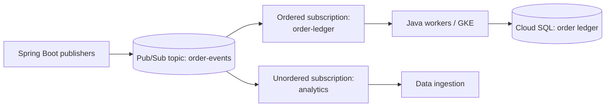
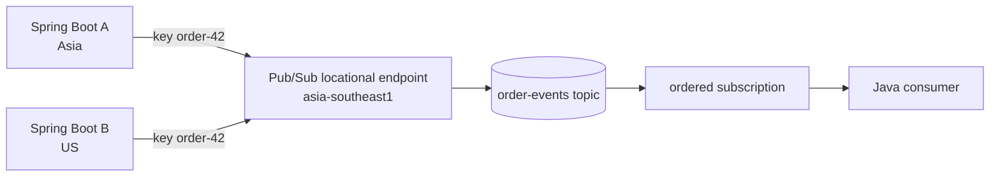
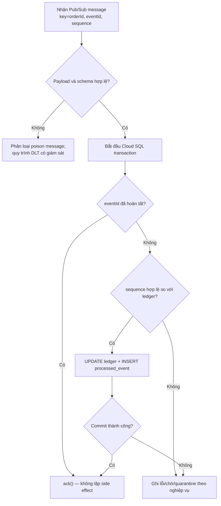
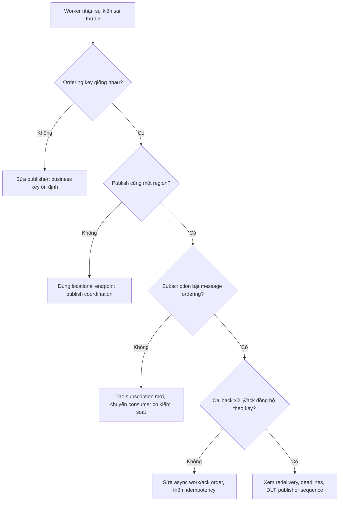

# Ordering keys và thứ tự thông điệp

## 1. Bài toán: sự kiện đến sai thứ tự làm sai trạng thái đơn hàng

Một hệ thống **Java/Spring Boot** trên Google Cloud xuất bản các sự kiện khi đơn hàng thay đổi: `CREATED → PAID → SHIPPED`. Worker trên **Cloud Run/GKE** nhận sự kiện qua **Pub/Sub** rồi cập nhật bảng tổng hợp trong **Cloud SQL**. Nếu worker xử lý `SHIPPED` trước `PAID`, hệ thống có thể hiển thị trạng thái hoặc thực hiện tác vụ nghiệp vụ sai. Nếu một sự kiện bị xử lý hai lần, hệ thống còn có thể gửi thông báo hoặc trừ tồn kho hai lần.

Pub/Sub mặc định cung cấp **at-least-once delivery, không bảo đảm thứ tự**. Tính năng **message ordering** giải quyết một phần bài toán: bảo đảm **thứ tự giao thông điệp trong từng ordering key**, với điều kiện publisher và subscription được cấu hình đúng. Ordering **không** tự cung cấp thứ tự toàn cục, transaction, exactly-once business processing hay khả năng xử lý sự kiện trùng lặp.

Trong chương **Pub/Sub và thông điệp** của mô-đun **CLOUD_PROVIDERS_GCP**, bài này tập trung vào cách thiết kế ordering keys, cấu hình topic/subscription, viết publisher/subscriber Java, xử lý ack/retry, theo dõi hot keys, IAM và chi phí. Mục tiêu là giữ hệ thống đáng tin cậy khi scale hoặc gặp sự cố, không chỉ làm cho log in ra đúng thứ tự trong một lần chạy demo.

**Kết quả học tập:**

1. Nêu chính xác điều kiện để Pub/Sub bảo đảm thứ tự và phân biệt thứ tự **trong key** với thứ tự **giữa các keys**.
2. Chọn ordering key có ý nghĩa nghiệp vụ, đủ độ phân tán và ổn định.
3. Hiểu ảnh hưởng của **region, nhiều publishers, pull/StreamingPull, push, ack deadline và redelivery**.
4. Tạo ordered subscription, publish và consume thông điệp bằng **Java Pub/Sub client library**.
5. Phân biệt message ordering, **exactly-once delivery**, **idempotency** và transaction trong Cloud SQL.
6. Chẩn đoán hot key, backlog, dead-letter, retry và dự toán chi phí.

> **Phạm vi lab:** chỉ tạo topic/subscription trong project thử nghiệm được cho phép. Bài **không** thực thi lệnh hay tạo tài nguyên GCP. Không gửi đơn hàng thật vào topic lab và không xóa subscription production để bật message ordering.

## 2. Cam kết thứ tự: trong key và trong region

**Ordering key** là chuỗi định danh nhóm thông điệp có quan hệ, ví dụ `order-42`, `account-9` hoặc `customer-127`. Mỗi message có thể chứa một `orderingKey`; khóa không được rỗng và có giới hạn kích thước **1 KB**.

Để một **subscription** nhận message theo thứ tự, cần đồng thời:

1. **Publisher gắn cùng ordering key** cho mọi message thuộc cùng chuỗi.
2. Các publish requests của **cùng key đi vào Pub/Sub tại cùng một region**. Publisher chạy ở nhiều regions hoặc ngoài GCP nên sử dụng **locational endpoint** cho cùng một region.
3. **Subscription được tạo với message ordering enabled**. Thuộc tính này được đặt khi tạo subscription; không thể bật/tắt trên subscription đã tồn tại.

```text
Publisher (region asia-southeast1)          Subscription bật ordering

key=order-42:  CREATED(1) ─ PAID(2) ─ SHIPPED(3)
                                              ↓
Subscriber:    CREATED(1) → PAID(2) → SHIPPED(3)

key=order-99:  CREATED(1) ─ CANCELLED(2)
                   ↓               ↓
Subscriber:    CREATED(1) → CANCELLED(2)

Không có ràng buộc thứ tự GIỮA order-42 và order-99.
```

**Phạm vi cam kết:** thứ tự được xác định theo **thứ tự Pub/Sub nhận các publishes trong một region**, không phải timestamp trong payload hay thứ tự đồng hồ giữa các server. Nếu hai publishers gửi sự kiện cùng key đồng thời, Pub/Sub có thứ tự nhận thực tế, nhưng publishers **không tự biết trước** thứ tự đó. Nếu nghiệp vụ cần `PAID` luôn sau `CREATED` giữa nhiều producers, phải phối hợp phát sự kiện ở phía ứng dụng (transactional outbox, single writer/leader hoặc sequence có kiểm tra). <https://cloud.google.com/pubsub/docs/ordering>

### 2.1. Topic và subscription không có cùng “cờ ordering”

| Thành phần | Cấu hình quyết định | Ý nghĩa |
| --- | --- | --- |
| **Publisher message** | `orderingKey="order-42"` | Gắn danh tính chuỗi có thứ tự |
| **Publisher client** | Enable ordering + publish vào **một region** | Đảm bảo publish-side ordering của key |
| **Topic** | Không cần “enable ordering” trên topic | Topic có thể phục vụ cả subscribers ordered và unordered |
| **Subscription A** | `enableMessageOrdering=true` | Nhận message cùng key theo thứ tự |
| **Subscription B** | `enableMessageOrdering=false` | Nhận cùng topic nhưng **không có cam kết thứ tự** |

Vì subscription là đơn vị giao message, mỗi subscription có trạng thái ack/backlog riêng. Một lỗi ở `orders-analytics-sub` **không đồng nghĩa** `orders-billing-sub` có cùng backlog.

### 2.2. Một chuỗi thời gian không phải một queue đơn



Ví dụ trong sơ đồ: worker ghi ledger cần thứ tự theo **orderId**; pipeline phân tích thống kê không yêu cầu thứ tự có thể dùng subscription riêng không bật ordering để tăng khả năng song song.

## 3. Chọn ordering key theo ranh giới nghiệp vụ

Một ordering key nên có hai đặc tính: **mọi sự kiện cần tuần tự hóa có cùng key**, nhưng các luồng độc lập nên dùng **keys khác nhau** để tăng concurrency.

| Key ứng viên | Nhận xét | Khi nào hợp lý |
| --- | --- | --- |
| `orderId` | Mỗi đơn hàng có chuỗi trạng thái riêng | Xử lý `CREATED/PAID/SHIPPED` cho cùng đơn |
| `accountId` | Tuần tự các thay đổi số dư của một tài khoản | Cần quản lý số dư và thứ tự ledger |
| `customerId` | Nhiều đơn cùng khách hàng **bị tuần tự hóa không cần thiết** | Chỉ khi nghiệp vụ thật sự cần thứ tự toàn khách hàng |
| `tenantId` | Tenant lớn có thể thành **hot key** | Chỉ khi trạng thái tenant là một chuỗi duy nhất |
| `"global"` | Mọi message qua một key, nghẽn cổ chai | Hầu như không thích hợp cho hệ thống lớn |
| Random UUID **mỗi message** | Các sự kiện cùng đơn có keys khác nhau | **Không** đạt mục tiêu bảo đảm thứ tự |

**Không dùng email, số điện thoại hoặc mã định danh nhạy cảm làm key** khi không cần; ordering key xuất hiện trong metadata/logs. Ưu tiên mã ID nội bộ không chứa PII.

### 3.1. Vì sao không dùng một key cho tất cả?

Pub/Sub có giới hạn **publisher throughput 1 MB/s trên mỗi ordering key**. Ngoài ra, tốc độ **subscriber xử lý từng key** bị giới hạn bởi thời gian hoàn thành callback của key đó. Nếu key `tenant-A` phát 2.000 events/s nhưng worker xử lý được 500/s, backlog của key tăng dù các workers khác đang rảnh.

**Hot key** không thể chữa triệt để chỉ bằng tăng số Pod hoặc `maxInstances`: một key phải giữ thứ tự. Cần giảm thời gian xử lý một message, chọn key chi tiết hơn **chỉ khi nghiệp vụ cho phép**, hoặc thay kiến trúc lưu thứ tự nghiệp vụ.

### 3.2. Ordering key không tương đương partition trong Kafka

Pub/Sub không yêu cầu người dùng định số partitions theo key; hệ thống có thể phục vụ số lượng **ordering keys rất lớn**. Đừng gán quan niệm Kafka “một topic có N partitions, do đó chỉ N chuỗi” sang Pub/Sub. Tuy nhiên **nhiều keys không tạo thứ tự giữa các keys** và không giải quyết conflict cập nhật nhiều thực thể cùng lúc.

## 4. Region: điều kiện thường bị bỏ quên

Pub/Sub **chỉ bảo đảm ordering cho một key khi các publishers gửi key đó đến cùng một region**. Nếu producer Asia và producer US cùng publish `order-42` vào hai regions, không có một chuỗi thứ tự tổng quát giữa chúng, dù đều dùng một topic và subscriber đã bật ordering.



Sơ đồ thể hiện **hai publishers cùng chọn một region cho một key**. Ví dụ endpoint Java: `asia-southeast1-pubsub.googleapis.com:443`. **Locational endpoint điều hướng publish vào region chỉ định**; nó không đồng nghĩa cơ chế **data residency mạnh** cho mọi lưu trữ/xử lý. Nếu yêu cầu lưu dữ liệu ở region nhất định, kiểm tra **regional endpoints, message storage policy và `enforce_in_transit`** theo tài liệu hiện hành.

**Điểm tinh tế:** subscriber có thể kết nối từ region khác và vẫn nhận chuỗi cùng key đã được publish trong một region theo thứ tự. Quy tắc **cùng region** là bắt buộc ở **publish side**. Riêng nếu bật **exactly-once delivery**, subscriber phải dùng endpoint trong **cùng region** để duy trì cam kết exactly-once của tính năng đó.

Khi region lỗi, chuyển publisher của cùng key sang region khác có thể ảnh hưởng thứ tự. Cần thiết kế **leader/failover coordination, sequence và checkpoint** ở cấp ứng dụng thay vì hứa hẹn cross-region total ordering.

## 5. Subscriber behavior: Pull, StreamingPull và Push

| Kiểu subscription | Ordered delivery | Lưu ý |
| --- | --- | --- |
| **StreamingPull** qua Java client | Callback của **cùng key** được chạy đến hết theo thứ tự | Khuyến nghị cho Java worker chạy lâu; keys khác có thể xử lý song song |
| **Unary Pull** | Message cùng key được sắp đúng thứ tự trong một `PullResponse`; một batch outstanding/key | Phải tự giữ thứ tự khi duyệt/xử lý batch |
| **Push** | Chỉ **một message outstanding trên mỗi key** | Dễ tăng độ trễ nếu cùng key có nhiều message; không thích hợp hot keys |
| **BigQuery export** | Messages cùng key được ghi theo thứ tự | Kiểm tra ngữ nghĩa ở bảng/consumer |
| **Cloud Storage export** | Có thứ tự trong **cùng một file**, không nên suy thứ tự từ tên file giữa các files | Không dùng file timestamp làm trình tự sự kiện |

Java high-level subscriber dùng **StreamingPull** và gọi callback cho mỗi message. Với cùng key, callback hoàn thành trước khi chạy callback kế tiếp; nhưng nếu callback **đẩy việc vào thread khác rồi trả về ngay**, bạn đã tự đánh mất thứ tự **xử lý nghiệp vụ**. Cần đồng bộ việc xử lý hoặc dùng **queue per key** có một worker tuần tự.

### 5.1. Ack phải đến sau side effect bền vững

`ack()` xác nhận đã xử lý xong để Pub/Sub không cần giao lại message theo quy tắc thông thường. `nack()` yêu cầu giao lại. Với ordered subscriptions, **ack message sau không được công nhận trước ack message trước** của cùng key. Nếu xử lý `PAID` thất bại, **không ack `SHIPPED` rồi kỳ vọng hệ thống tự giữ đúng trạng thái nghiệp vụ**.

High-level Java subscriber có thể **tự gia hạn ack deadline** trong giới hạn cấu hình khi callback còn đang xử lý; nhưng deadline vẫn có thể hết do lỗi mạng, GC pause, process chết hoặc tải quá cao. Hãy thiết kế xử lý ngắn, timeout rõ và **idempotency**, thay vì chỉ tăng ack deadline rất lớn.

## 6. Redelivery: thứ tự không loại bỏ trùng lặp

Giả sử subscriber nhận một key:

```text
order-42:
1. CREATED     → ack()
2. PAID        → xử lý chậm, ack deadline hết
3. SHIPPED     → đã từng được giao/ack

Khi (2) bị redeliver, Pub/Sub có thể redeliver cả (3),
kể cả khi (3) đã được ack trước đó.
```

Đây là hành vi được thiết kế để bảo toàn chuỗi. Vì vậy **mỗi message phải xử lý an toàn khi lặp lại**. Kết hợp ordering với **dead-letter topic (DLT)** có thể phá giả định “mọi message luôn được xử lý cùng nhau theo thứ tự”: khi Pub/Sub đưa message thất bại sang DLT (theo nỗ lực best-effort), message phía sau có thể tiếp tục đi; **không mặc định dữ liệu được tái ghép đúng chuỗi**.

### 6.1. Exactly-once delivery khác exactly-once processing

Pub/Sub hỗ trợ **exactly-once delivery** trên **Pull/StreamingPull subscriptions**, trong **phạm vi một region** và dựa trên **Pub/Sub message ID**. Push subscriptions **không** hỗ trợ tính năng này. Nếu ack thành công và đúng hạn, dịch vụ bảo đảm không giao lại cùng message ID theo phạm vi cam kết; nhưng:

- Producer có thể **publish hai lần** cùng một business event và nhận hai **message IDs khác nhau**.
- **Seek/replay** có thể khiến message được giao lại theo yêu cầu.
- Side effect tới **Cloud SQL, email hoặc REST API** không nằm trong transaction ack của Pub/Sub.
- Khi bật ordering + exactly-once, **ack phải đúng thứ tự**: ack sai thứ tự có thể gặp lỗi tạm thời; tốc độ có thể giảm.

Do đó, **exactly-once delivery không bảo đảm nghiệp vụ chỉ trừ tiền một lần**. Dùng transaction/idempotency ở backend mới bảo vệ được hậu quả nghiệp vụ.

## 7. Thiết kế một Java consumer có idempotency

Khi xử lý event `order-42/PAID`, hãy ghi một **business event ID** hoặc **(aggregate ID, sequence)** vào bảng Cloud SQL có unique constraint. Trong cùng transaction, kiểm tra trạng thái hợp lệ rồi cập nhật ledger. Nếu event đã xử lý, trả thành công và **ack**; nếu transaction rollback, **nack** hoặc để client thực hiện retry đúng loại lỗi.



Ví dụ schema ý tưởng:

```sql
CREATE TABLE processed_event (
    event_id VARCHAR(100) PRIMARY KEY,
    order_id VARCHAR(100) NOT NULL,
    sequence_no BIGINT NOT NULL,
    processed_at TIMESTAMP NOT NULL,
    UNIQUE (order_id, sequence_no)
);

-- Trong transaction thực tế: khóa đúng order row, xác nhận
-- sequence_no mong đợi, UPDATE order state rồi INSERT event.
-- Commit trước khi ack Pub/Sub message.
```

**Không dùng `PubsubMessage.getMessageId()` làm mã nghiệp vụ duy nhất** nếu producer có thể publish trùng dưới hai Pub/Sub message IDs khác nhau. Gắn `eventId` và `sequence` được sinh từ **nguồn dữ liệu có thẩm quyền**, ví dụ transactional outbox của đơn hàng. Nếu có hai writers cho một orderId, dùng **serialization/locking** để xác định thứ tự publish; thứ tự Pub/Sub nhận request không thể tự sửa lịch sử nghiệp vụ bị publish sai.

## 8. Lab: tạo ordered subscription an toàn bằng gcloud

Điều kiện: project lab có Pub/Sub API, Billing/quota và quyền phù hợp. Các lệnh sau dùng **Bash/Cloud Shell**; ví dụ Java ở mục 9 sẽ thực sự gửi messages qua **một locational endpoint**. Không dùng topic/subscription production hoặc thông tin khách hàng thật.

### Bước 1 — Tạo tài nguyên lab

```bash
gcloud config set project PROJECT_ID
gcloud services enable pubsub.googleapis.com

gcloud pubsub topics create orders-events-lab

gcloud pubsub subscriptions create orders-ordered-lab \
  --topic=orders-events-lab \
  --enable-message-ordering \
  --ack-deadline=30

gcloud pubsub subscriptions describe orders-ordered-lab \
  --format="yaml(name,topic,enableMessageOrdering,ackDeadlineSeconds)"
```

Nếu topic/subscription cùng tên đã tồn tại, **không sử dụng lại hoặc xóa** khi chưa xác định chủ sở hữu. Subscription ordering được đặt **lúc tạo**; nếu tạo nhầm unordered, dùng **subscription lab mới** và kiểm tra cách replay/backlog trước khi thay đổi hệ thống thật.

### Bước 2 — So sánh với subscription unordered

```bash
gcloud pubsub subscriptions create orders-unordered-lab \
  --topic=orders-events-lab

gcloud pubsub subscriptions describe orders-unordered-lab \
  --format="yaml(name,topic,enableMessageOrdering)"
```

Cả hai subscriptions nhận **bản sao logic riêng** của message trên topic; chỉ ordered subscription có cam kết trong từng key. Lab dùng Java cho publishers để bảo đảm **cùng region**. Lệnh `gcloud pubsub topics publish --ordering-key=...` có thể dùng để thử nhanh, nhưng nếu mỗi lệnh đi qua **global endpoint** mà publish thực tế vào các region khác nhau, không lấy đó làm bằng chứng bảo đảm ordering cross-region.

## 9. Java 21: publisher và subscriber có ordering

### 9.1. Cấu trúc Maven

Trong **thư mục lab riêng** trên máy đã có JDK 21/Maven:

```text
pubsub-ordering-lab/
├── pom.xml
└── src/main/java/dev/example/pubsub/
    ├── OrderedPublisher.java
    └── OrderedSubscriber.java
```

File `pom.xml`:

```xml
<?xml version="1.0" encoding="UTF-8"?>
<project xmlns="http://maven.apache.org/POM/4.0.0"
         xmlns:xsi="http://www.w3.org/2001/XMLSchema-instance"
         xsi:schemaLocation="http://maven.apache.org/POM/4.0.0 https://maven.apache.org/xsd/maven-4.0.0.xsd">
  <modelVersion>4.0.0</modelVersion>
  <groupId>dev.example</groupId>
  <artifactId>pubsub-ordering-lab</artifactId>
  <version>1.0.0</version>
  <properties>
    <maven.compiler.release>21</maven.compiler.release>
    <project.build.sourceEncoding>UTF-8</project.build.sourceEncoding>
  </properties>
  <dependencies>
    <dependency>
      <groupId>com.google.cloud</groupId>
      <artifactId>google-cloud-pubsub</artifactId>
      <version>1.157.0</version>
    </dependency>
  </dependencies>
  <build>
    <plugins>
      <plugin>
        <groupId>org.apache.maven.plugins</groupId>
        <artifactId>maven-compiler-plugin</artifactId>
        <version>3.13.0</version>
      </plugin>
      <plugin>
        <groupId>org.codehaus.mojo</groupId>
        <artifactId>exec-maven-plugin</artifactId>
        <version>3.5.1</version>
      </plugin>
    </plugins>
  </build>
</project>
```

Phiên bản thư viện được minh họa theo tài liệu Java Pub/Sub hiện hành; khi dùng trong production, **đối chiếu Maven Central/GCP Java BOM, mức hỗ trợ JDK và CVEs**, không mặc định pin một version mãi mãi.

### 9.2. Publisher gửi từng key theo thứ tự

File `OrderedPublisher.java`:

```java
package dev.example.pubsub;

import com.google.cloud.pubsub.v1.Publisher;
import com.google.protobuf.ByteString;
import com.google.pubsub.v1.PubsubMessage;
import com.google.pubsub.v1.TopicName;
import java.util.concurrent.TimeUnit;

public final class OrderedPublisher {
    public static void main(String[] args) throws Exception {
        if (args.length != 2) {
            throw new IllegalArgumentException("Usage: PROJECT_ID TOPIC_ID");
        }

        var topic = TopicName.of(args[0], args[1]);
        Publisher publisher = Publisher.newBuilder(topic)
            // Mọi publisher có cùng key phải chọn cùng region.
            .setEndpoint("asia-southeast1-pubsub.googleapis.com:443")
            .setEnableMessageOrdering(true)
            .build();

        // [ordering key, business event ID, sequence, payload]
        String[][] events = {
            {"order-42", "evt-42-1", "1", "CREATED"},
            {"order-99", "evt-99-1", "1", "CREATED"},
            {"order-42", "evt-42-2", "2", "PAID"},
            {"order-99", "evt-99-2", "2", "CANCELLED"},
            {"order-42", "evt-42-3", "3", "SHIPPED"}
        };

        try {
            for (String[] e : events) {
                PubsubMessage message = PubsubMessage.newBuilder()
                    .setOrderingKey(e[0])
                    .setData(ByteString.copyFromUtf8(e[3]))
                    .putAttributes("eventId", e[1])
                    .putAttributes("sequence", e[2])
                    .build();

                // Đợi publish xác nhận cho ví dụ dễ quan sát.
                // Production có thể publish async nhưng phải quản lý
                // futures, thứ tự và lỗi theo từng ordering key.
                String id = publisher.publish(message)
                    .get(30, TimeUnit.SECONDS);
                System.out.printf("key=%s seq=%s id=%s%n", e[0], e[2], id);
            }
        } finally {
            publisher.shutdown();
            publisher.awaitTermination(30, TimeUnit.SECONDS);
        }
    }
}
```

Code **chỉ dùng một publisher và một endpoint region**; những event cùng key được gửi và xác nhận tuần tự để loại bỏ nhập nhằng publish order ở lab. Không so `messageId` về thứ tự số học: nó là ID do dịch vụ cấp, **không phải sequence counter**.

**Khi một publish theo key thất bại không thể retry**, Java Publisher có thể **pause key đó**, làm các publish tiếp theo cùng key thất bại. Sau khi đã điều tra lỗi và có chiến lược bảo toàn business event (outbox/retry), gọi `publisher.resumePublish(orderingKey)` để tiếp tục. **Đừng gọi resume mù quáng rồi bỏ qua message đã publish thất bại**: như vậy sẽ tạo khoảng trống logic trong ledger.

### 9.3. Subscriber dùng StreamingPull, xử lý đồng bộ trong callback

File `OrderedSubscriber.java`:

```java
package dev.example.pubsub;

import com.google.cloud.pubsub.v1.MessageReceiver;
import com.google.cloud.pubsub.v1.Subscriber;
import com.google.pubsub.v1.SubscriptionName;

public final class OrderedSubscriber {
    public static void main(String[] args) throws Exception {
        if (args.length != 2) {
            throw new IllegalArgumentException("Usage: PROJECT_ID SUBSCRIPTION_ID");
        }

        var subscription = SubscriptionName.of(args[0], args[1]);
        MessageReceiver receiver = (message, consumer) -> {
            try {
                String key = message.getOrderingKey();
                String eventId = message.getAttributesOrDefault("eventId", "");
                String seq = message.getAttributesOrDefault("sequence", "");
                String body = message.getData().toStringUtf8();

                // Demo: in log. Hệ thống thật phải kiểm tra idempotency
                // và commit Cloud SQL trước khi gọi ack().
                System.out.printf("key=%s seq=%s event=%s state=%s%n",
                        key, seq, eventId, body);
                consumer.ack();
            } catch (RuntimeException ex) {
                System.err.println("Processing failed: " + ex);
                consumer.nack();
            }
        };

        Subscriber subscriber = Subscriber.newBuilder(subscription, receiver)
            .build();
        Runtime.getRuntime().addShutdownHook(
            new Thread(() -> subscriber.stopAsync()));
        subscriber.startAsync().awaitRunning();
        System.out.println("Listening; Ctrl+C to stop.");
        subscriber.awaitTerminated();
    }
}
```

Pub/Sub high-level client bảo toàn **callback order trong cùng key** trên ordered subscription; các keys có thể chạy song song. Code cố tình **không tạo CompletableFuture rồi ack sớm**, vì như vậy thứ tự xử lý side effect không còn được bảo đảm. Trong production, thay `System.out.printf` bằng transaction/idempotency và **flow control** hợp lý; kiểm tra ack errors khi bật exactly-once delivery.

### 9.4. Chạy lab

Trên máy lab sử dụng ADC:

```bash
gcloud auth application-default login
mvn -q clean package

# Publish 5 messages mẫu sau khi đã tạo subscriptions:
mvn -q exec:java \
  -Dexec.mainClass=dev.example.pubsub.OrderedPublisher \
  -Dexec.args="PROJECT_ID orders-events-lab"

# Chạy subscriber trong terminal khác:
mvn -q exec:java \
  -Dexec.mainClass=dev.example.pubsub.OrderedSubscriber \
  -Dexec.args="PROJECT_ID orders-ordered-lab"
```

Kỳ vọng `order-42` có sequence **1 → 2 → 3**, `order-99` có **1 → 2**; hai chuỗi có thể đan xen. Vì subscriber chạy liên tục, dừng bằng **Ctrl+C** khi hoàn thành. Mỗi message trong ordered subscription phải được xử lý/ack để không tồn đọng backlog.

### 9.5. Đối chứng với unordered subscription

Chạy cùng Java subscriber với `orders-unordered-lab`. Code nhận vẫn hoạt động nhưng **không còn bảo đảm** trình tự cho mỗi key. Với lượng message nhỏ và chạy tuần tự như lab, bạn **có thể quan sát log vẫn đúng thứ tự ngẫu nhiên**; điều đó **không chứng minh** unordered subscription hỗ trợ ordering. Muốn thử stress, tăng lượng sự kiện và nhiều workers nhưng đừng biến môi trường test thành tải bất ngờ lên quota.

## 10. Scaling và xử lý hot key

### 10.1. Nhiều instances không giúp một key chạy song song

Giả sử worker xử lý **mỗi message trong 40 ms**. Nếu một key có callback tuần tự và không thêm chờ network:

```text
Thông lượng xử lý lý thuyết/key ≈ 1 / 0,040 s = 25 messages/s.

Nếu publish 100 messages/s cho cùng key:
Backlog key tăng xấp xỉ 75 messages/s (bỏ qua retry và overhead).
```

Tăng GKE replicas từ 2 lên 10 giúp khi **có nhiều keys độc lập**, không làm cùng key `order-42` có thể xử lý 10 callbacks đồng thời mà vẫn giữ thứ tự. Cần chọn key có độ phân tán phù hợp, giảm round trips tới DB, kết hợp idempotent batch khi mô hình nghiệp vụ cho phép hoặc dùng thiết kế riêng cho nguồn phát hot key.

### 10.2. Flow control và ack deadline

Java StreamingPull subscriber có thể giới hạn **outstanding messages/bytes** để tránh tràn RAM và kết nối DB. Với ordered delivery, callback chậm làm các message phía sau cùng key phải chờ. Tối ưu **thời gian transaction**, tránh giữ khóa DB quá lâu, đặt deadline/gia hạn phù hợp và chỉ ack sau khi dữ liệu đã commit.

Các chỉ số nên giám sát gồm:

- `subscription/oldest_unacked_message_age`: tuổi message chưa ack cũ nhất, dấu hiệu backlog/hot key.
- `subscription/num_undelivered_messages`: số message còn chưa được giao/xác nhận theo trạng thái dịch vụ.
- `subscription/sent_message_count` và throughput/ack latency nếu có.
- Rate `nack`, deadline expiration, duplicate/redelivery, Java processing latency per key.
- `publisher/topic_send_request_count` và publish errors, throughput/key, publish latency.

**Không đặt ordering key vào metrics label có cardinality cực lớn** như từng `orderId`; điều này có thể làm tăng chi phí và số time series. Dùng sampling/correlation ID trong logs và tổng hợp theo nhóm thay vì một metric series cho mỗi đơn hàng.

## 11. Dead-letter, replay và tương tác với Dataflow

### 11.1. Poison message

Một message dữ liệu sai schema có thể liên tục bị nack, giữ các message sau cùng key chờ hoặc bị redeliver. **Dead-letter topic** cho phép chuyển message lỗi sau số lần giao cấu hình được (giới hạn Pub/Sub áp dụng), nhưng quá trình chuyển là **best-effort** và **thứ tự có thể không còn giữ nguyên** khi message được đưa sang topic khác.

Runbook: lưu **eventId/key/sequence/payload reference**, xác minh nguyên nhân, sửa dữ liệu ở nguồn, quyết định replay/compensation. Không chỉ “bỏ qua message lỗi rồi xử lý next” nếu nghiệp vụ đòi hỏi chuỗi đầy đủ.

### 11.2. Seek và snapshot

Pub/Sub cho phép **seek** về thời điểm hoặc snapshot theo điều kiện retention/cấu hình; thao tác này có thể **giao lại** cả message đã ack trước đó. Nếu dùng seek trong subscription thật, xử lý lại cùng key **phải idempotent** và cần change approval vì nó ảnh hưởng toàn bộ subscription, không chỉ một đơn hàng.

Exactly-once delivery cũng **không làm replay theo yêu cầu trở thành bất khả thi**. Không dùng seek làm nút “sửa thứ tự” khi source đã publish sai business sequence.

### 11.3. Dataflow không cần ordering key của Pub/Sub

Khi sử dụng **Dataflow** để xử lý streaming, Google Cloud khuyến nghị **không bật Pub/Sub ordering** chỉ để sắp xếp dữ liệu trong Dataflow; Dataflow có cơ chế **event-time/windowing** và xử lý thứ tự riêng. Hãy xác định hệ thống cần **thứ tự giao message** hay **thứ tự sự kiện theo business timestamp**, vì chúng là hai yêu cầu khác nhau.

## 12. Bảo mật, độ tin cậy và chi phí

### 12.1. IAM tách theo vai trò

| Thành phần | Quyền gợi ý | Không nên có |
| --- | --- | --- |
| Spring Boot publisher | `roles/pubsub.publisher` trên topic | Quyền xóa subscription hoặc sửa IAM toàn project |
| GKE/Cloud Run Java worker | `roles/pubsub.subscriber` trên subscription | `roles/pubsub.admin` nếu chỉ cần consume |
| Platform operator | Quyền tạo/điều chỉnh topics/subscriptions theo quy trình | Tài khoản cá nhân Owner cho CI/CD |
| Auditor | Quyền đọc metadata, logs, metrics | Quyền seek/xóa hoặc publish vào production topic |

Trên GKE dùng **Workload Identity Federation for GKE**; trên Cloud Run dùng **runtime service account**. Với code Java client, ưu tiên **Application Default Credentials (ADC)** thay vì chứa service account JSON keys. Dữ liệu nhạy cảm trong payload cần được bảo vệ qua IAM, encryption và hạn chế logs; không log nguyên payload hóa đơn/PII.

### 12.2. Chi phí và SLO

Pub/Sub có chi phí theo lượng dữ liệu publish/deliver, lưu trữ message/retention và các tính năng/đường truyền phát sinh theo bảng giá hiện hành. Ordered delivery có thể làm **latency tăng**, **publish availability giảm** so với unordered do phải phối hợp thứ tự. Exactly-once có thể có phí và quota/latency riêng; lưu lượng redelivery cũng tạo overhead.

Một mô hình tải minh họa:

```text
10.000 đơn/ngày × 4 events/đơn = 40.000 messages/ngày.
Nếu chia đều cho 10.000 orderId, mỗi key có khoảng 4 messages.
Nếu dùng key="all-orders", tất cả 40.000 messages đi chung một chuỗi.
```

Đây là **số lượng message**, không phải số tiền: cần nhân kích thước payload/metadata, số subscriptions, retention, redelivery, region và network egress. Dùng **Cloud Billing reports/budgets**; budget alert **không tự dừng publish**.

## 13. Chẩn đoán lỗi theo tầng

| Triệu chứng | Nguyên nhân có thể | Kiểm tra |
| --- | --- | --- |
| Message cùng orderId nhận sai thứ tự | Publisher không set key hoặc subscription chưa enable ordering | Message `orderingKey`, `subscriptions describe` |
| Dùng cùng key nhưng thứ tự đổi khi deploy đa region | Publishers vào nhiều regions | Endpoint, cluster region, publish audit/time |
| Không đổi được `enableMessageOrdering` | Thuộc tính bất biến sau khi tạo | Tạo subscription mới, plan replay/cutover |
| Log xử lý bị đảo dù Pub/Sub có ordering | Callback đẩy việc async rồi trả về ngay | Worker thread pool/`CompletableFuture`, ack timing |
| Message sau bị giao lại nhiều lần | Message trước cùng key timeout/nack | Ack deadline, Java GC, DB latency |
| Một khách hàng/tenant có backlog lớn | **Hot key** | Rate per key, processing latency, `oldest_unacked_message_age` |
| Publisher cùng key ngừng gửi sau lỗi | Ordering key bị pause bởi lỗi không retry được | Client logs, `resumePublish` sau khắc phục |
| Một event bị xử lý hai lần dù ordered | At-least-once hoặc producer publish trùng | Business event ID, unique constraint, redelivery logs |
| Exactly-once ack báo lỗi tạm thời | Ack out of order hoặc deadline quá ngắn | Ack sequence/response, client extension config |
| Push callback nhiều key vẫn chậm | Mỗi key chỉ một outstanding push message | Key cardinality, thời gian response, cân nhắc StreamingPull |
| DLT làm thiếu một bước trong ledger | Poison message bị chuyển sang DLT | DLT records, điều kiện retry/compensation |
| Tổng chi phí tăng | Backlog retention, duplicates, nhiều subscriptions | Billing, publish/delivery bytes, retention |

### Quy trình điều tra



**Không xóa subscription hay disable ordering để làm backlog biến mất**. Cần xác định sự kiện đang nằm trong chuỗi nào, có dữ liệu nghiệp vụ chưa xử lý không và hệ quả nếu replay/skip.

## 14. Dọn tài nguyên lab

Dừng `OrderedSubscriber` trước, sau đó chỉ xóa các tài nguyên lab đúng project sau khi đã xác nhận không có workload khác sử dụng:

```bash
gcloud pubsub subscriptions describe orders-ordered-lab
gcloud pubsub subscriptions describe orders-unordered-lab
gcloud pubsub topics describe orders-events-lab

gcloud pubsub subscriptions delete orders-ordered-lab
gcloud pubsub subscriptions delete orders-unordered-lab
gcloud pubsub topics delete orders-events-lab
```

**Xóa subscription làm mất backlog/snapshot state của subscription theo quy tắc áp dụng**, không phải “tạm dừng an toàn”. Không chạy `delete` trên topics/subscriptions thật hoặc automation của đội khác. Sau cleanup, kiểm tra Pub/Sub resources/Billing, service accounts và logs/budget nếu lab đã tạo chúng.

## 15. Bài tập và checklist

### Bài A — Xác định thứ tự

Publisher gửi `order-1: CREATED(1), PAID(2), SHIPPED(3)` và `order-2: CREATED(1), CANCELLED(2)` từ **cùng region**; subscription bật ordering. Viết các chuỗi nhận hợp lệ và giải thích tại sao không có thứ tự bắt buộc giữa `order-1` và `order-2`.

### Bài B — Thiết kế key

Hệ thống có 100.000 đơn/ngày, một khách hàng lớn tạo 50% số đơn. So sánh khóa `tenantId`, `customerId`, `orderId` theo mức độ song song, hot keys và yêu cầu nghiệp vụ. Đề xuất khóa đúng cho trạng thái **từng đơn**, rồi thay đổi lựa chọn nếu phải tuần tự hóa số dư **từng tài khoản**.

### Bài C — Thực hành Java

Tạo topic và ordered/unordered subscriptions lab; dùng Java publisher có `setEnableMessageOrdering(true)` và **locational endpoint**. Chạy Java StreamingPull subscriber và ghi nhận thứ tự từng key. Thử thay callback bằng tác vụ async **chỉ trong lab**, quan sát vì sao `ack` sớm không bảo đảm side effect đúng thứ tự.

### Bài D — Redelivery và idempotency

`order-42/PAID` đã cập nhật Cloud SQL nhưng ack timeout; `SHIPPED` sau đó được giao lại. Thiết kế bảng `processed_event`, transaction và ack logic để **không trừ kho/gửi email hai lần**. Phân biệt business event ID với Pub/Sub message ID.

### Bài E — Cross-region và exactly-once

Hai publishers ở Asia và US gửi cùng `orderingKey="account-9"`. Nêu vì sao không có cross-region ordering, cách chọn một publish region, và điều kiện riêng nếu bật exactly-once delivery ở subscription. Giải thích vì sao exactly-once delivery không ngăn producer publish cùng payment event hai lần.

### Bài F — Tính capacity

Một ordering key nhận 100 messages/s, mỗi callback mất 40 ms. Tính năng lực khoảng **25 messages/s**, backlog tăng khoảng **75 messages/s** khi duy trì tải. Đề xuất cách sửa không vi phạm yêu cầu trình tự nghiệp vụ.

### Checklist trước production

- [ ] Tôi chọn key theo ranh giới nghiệp vụ, không dùng key toàn cục hoặc UUID mới mỗi event.
- [ ] Tôi bảo đảm publishers của **một key gửi vào cùng region**, phối hợp nhiều producers nếu cần.
- [ ] Tôi tạo subscription với `--enable-message-ordering` và kiểm tra thuộc tính ngay từ đầu.
- [ ] Tôi hiểu callback của cùng key cần hoàn thành trước xử lý message kế tiếp.
- [ ] Tôi **commit side effect bền vững trước ack**, xử lý duplicate/redelivery bằng idempotency.
- [ ] Tôi biết ack deadline, DLT, seek/replay và exactly-once có các giới hạn riêng.
- [ ] Tôi theo dõi hot key, oldest unacked age, quota, throughput, Java latency và chi phí.
- [ ] Tôi phân quyền publisher/subscriber theo least privilege và bảo vệ dữ liệu payload.

**Kết luận:** Pub/Sub ordering keys bảo đảm **trình tự giao message theo từng key trong một publish region**, không tạo một thứ tự toàn cầu và không thay transactional consistency. Với Java workloads trên GCP, thiết kế đáng tin cậy cần **business key hợp lý, publisher region ổn định, subscriber ack đúng thời điểm, idempotency và khả năng quan sát hot keys**. Chỉ bật ordering cho luồng thực sự cần nó; một số pipeline phân tích nên chọn unordered subscription để đạt thông lượng cao hơn.

## 16. Tài liệu chính thức tham khảo

- [Pub/Sub: Order messages](https://cloud.google.com/pubsub/docs/ordering)
- [Pub/Sub: Publish messages và ordering keys](https://cloud.google.com/pubsub/docs/publisher)
- [Best practices for publishing ordered messages](https://cloud.google.com/pubsub/docs/publish-best-practices)
- [Best practices for subscribing / acknowledgments](https://cloud.google.com/pubsub/docs/subscribe-best-practices)
- [Subscription properties](https://cloud.google.com/pubsub/docs/subscription-properties)
- [Exactly-once delivery và ordered subscriptions](https://cloud.google.com/pubsub/docs/exactly-once-delivery)
- [Regional và locational Pub/Sub endpoints](https://cloud.google.com/pubsub/docs/reference/service_apis_overview)
- [Java: publish with ordering keys](https://cloud.google.com/pubsub/docs/samples/pubsub-publish-with-ordering-keys)
- [Java client: Publisher API / resumePublish](https://cloud.google.com/java/docs/reference/google-cloud-pubsub/latest/com.google.cloud.pubsub.v1.Publisher)
- [gcloud subscription create](https://cloud.google.com/sdk/gcloud/reference/pubsub/subscriptions/create)
- [gcloud topic publish và ordering-key](https://cloud.google.com/sdk/gcloud/reference/pubsub/topics/publish)
- [Pub/Sub quotas and limits](https://cloud.google.com/pubsub/quotas)
- [Pub/Sub pricing](https://cloud.google.com/pubsub/pricing)
