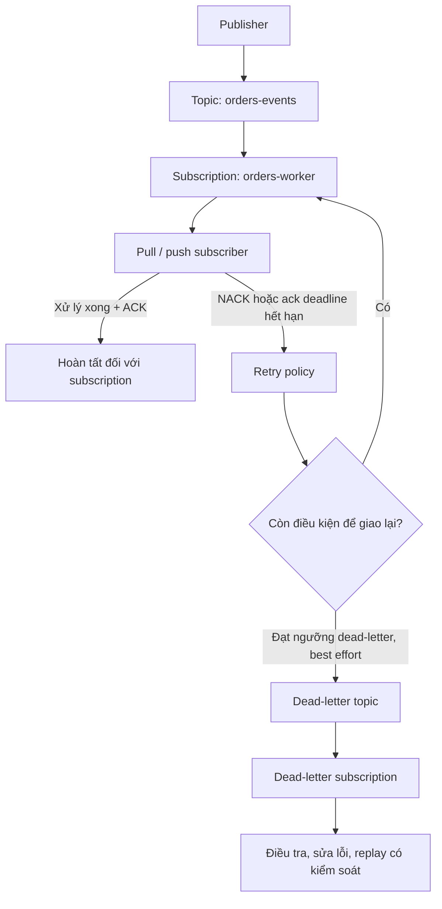
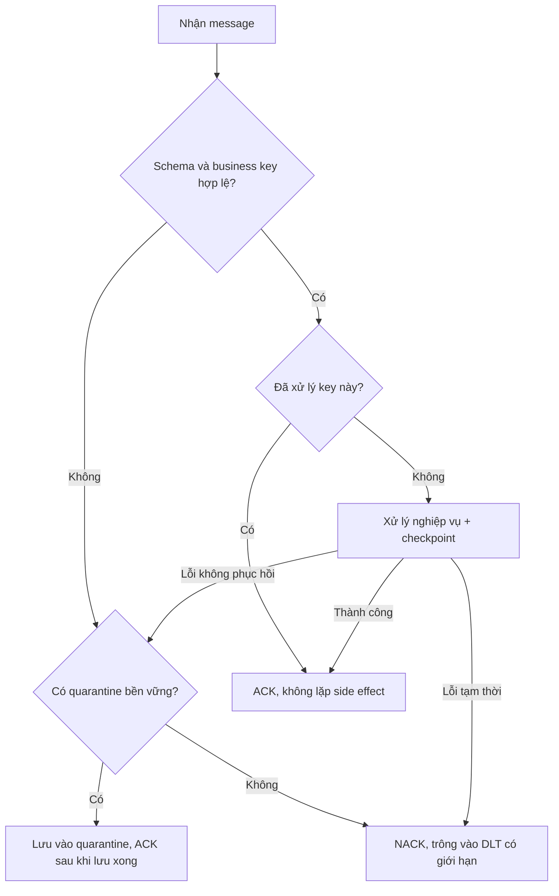

# Retry policies, dead-letter topics và poison messages

> **Chương:** Pub/Sub và thông điệp  
> **Module:** CLOUD_PROVIDERS_GCP  
> **Phạm vi module:** Khám phá Google Cloud từ tổ chức project, IAM và VPC đến Compute Engine, GKE, Cloud Run, dịch vụ lưu trữ và cơ sở dữ liệu. Qua các tình huống triển khai, người học biết lựa chọn dịch vụ, bảo vệ tài nguyên, tự động hóa phát hành và theo dõi độ tin cậy cùng chi phí.

Một subscriber xử lý đơn hàng có thể bị lỗi do database tạm mất kết nối, hoặc gặp một message có schema không hợp lệ. Hai lỗi đều có thể làm Pub/Sub giao lại message, nhưng **cách xử lý không giống nhau**: lỗi tạm thời nên được retry có kiểm soát; message không thể xử lý (**poison message**) phải được cách ly để không lặp mãi và làm nghẽn hệ thống.

Bài này giải thích **ack/nack, acknowledgment deadline, retry policy, dead-letter topic (DLT), số lần giao và quy trình xử lý poison messages** của Google Cloud Pub/Sub. Phần thực hành dựng một **pull subscription trong project sandbox**, dùng Python subscriber để mô phỏng một message hợp lệ và một poison message, sau đó quan sát dead-letter subscription. Các ví dụ không tự chạy tài nguyên thật khi biên soạn tài liệu.

## Mục tiêu học tập

Sau bài học, bạn có thể:

1. Phân biệt `ack`, `nack`, **ack deadline hết hạn**, redelivery và message retention.
2. Chọn **retry immediately** hoặc **exponential backoff** và hiểu tính **best-effort** của độ trễ.
3. Cấu hình DLT **trên subscription nguồn**, đặt `maxDeliveryAttempts` hợp lý và cấp đúng IAM cho **Pub/Sub service agent**.
4. Phân loại lỗi **transient** với **permanent/poison**, thiết kế idempotency và tránh vòng lặp retry vô hạn.
5. Tạo topic, subscription, retry/DLT policy, chạy subscriber thử nghiệm, theo dõi delivery attempts và cleanup an toàn.
6. Dùng Cloud Monitoring và logs để điều tra backlog, expired ack deadlines, dead-letter forwarding và ảnh hưởng chi phí.

## 1. Message đi qua Pub/Sub như thế nào?



**Một topic có thể có nhiều subscriptions độc lập**. Message được ACK ở subscription A **không** có nghĩa nó được ACK ở subscription B. Retry policy và dead-letter policy cũng thuộc **subscription**, không phải thuộc publisher hay topic nguồn.

### 1.1. ACK, NACK và ack deadline

| Tình huống | Kết quả đối với subscription |
|---|---|
| Subscriber xử lý và **ACK thành công** | Pub/Sub không cần giao tiếp message đó cho subscription này, trừ các ngoại lệ theo delivery semantics |
| Pull subscriber gọi **NACK** | Message đủ điều kiện **redelivery**; policy quyết định khoảng chờ |
| Subscriber không ACK trước **ack deadline** | Message có thể được giao lại |
| Subscriber bị crash giữa chừng | Message chưa ACK có thể được giao lại khi lease hết hạn |
| Message vượt giới hạn giao gần đúng với DLT hợp lệ | Pub/Sub có thể chuyển sang DLT và ACK ở subscription nguồn |
| Message hết thời gian **retention** mà vẫn chưa được xử lý | Có thể bị loại bỏ theo retention policy; **DLT không phải kho lưu giữ vô hạn** |

Với **pull**, `nack()` tương đương yêu cầu `ModifyAckDeadline=0`. Thư viện subscriber có thể tự **gia hạn ack deadline** khi handler chạy; đừng hiểu một lần xử lý dài hơn `--ack-deadline=30` là chắc chắn bị giao lại ngay sau 30 giây. Phải kiểm tra cơ chế **lease extension** và giới hạn thời gian gia hạn của client.

Với **push subscription**, subscriber không gửi `nack()` bằng SDK: HTTP endpoint trả **mã phản hồi được Pub/Sub xem là ACK** khi đã xử lý thành công; lỗi/timeout khiến Pub/Sub thử giao lại. Luồng push còn chịu **push backoff** riêng, không giống subscriber pull.

### 1.2. At-least-once không có nghĩa exactly-once processing

Trong chế độ giao mặc định, Pub/Sub có thể giao lại cùng message ID nhiều lần. Ví dụ, subscriber đã cập nhật đơn hàng nhưng crash trước khi ACK; lần giao kế tiếp có thể ghi dữ liệu trùng nếu không có cơ chế chống lặp.

**Exactly-once delivery** của Pub/Sub là tùy chọn dành cho **pull/StreamingPull** trong phạm vi region và điều kiện tương ứng; **push/export không hỗ trợ**. Tính năng này không loại bỏ mọi bản publish trùng từ producer hoặc bảo đảm một transaction ở database được thực hiện đúng một lần. Khi có side effect, vẫn thiết kế **idempotency**, transaction và kiểm tra kết quả ACK.

## 2. Retry policies: thử giao lại khi chưa ACK

Pub/Sub luôn có cơ chế thử giao lại message chưa được ACK. Bạn có thể chọn kiểu retry trên **mỗi subscription**:

| Chính sách | Cơ chế | Phù hợp |
|---|---|---|
| **Retry immediately** | Mặc định; thử giao lại sớm sau NACK/hết ack deadline | Lỗi hiếm hoặc thời gian phục hồi cực ngắn |
| **Retry after exponential backoff** | Giãn khoảng cách giữa các lần giao lại, tăng dần trong khoảng min/max | Lỗi tạm thời như 429, DB outage, downstream quá tải |

Exponential backoff là **best-effort**; khoảng chờ thực tế có thể ngắn hoặc dài hơn giá trị cấu hình. Min/max cho phép từ **0 đến 600 giây**, ví dụ `10s`–`60s`. Đây **không phải lịch chạy chính xác**, không thay cho Cloud Tasks/Scheduler khi cần trì hoãn có chủ đích.

### 2.1. Backoff áp dụng khi nào?

- Pull subscriber **NACK** message.
- Message **hết ack deadline** mà chưa ACK.
- Thời gian chờ là **theo message**, không phải một đồng hồ chung cho toàn subscription. Những message khác vẫn có thể được xử lý; ngoại lệ cần xét khi bật **message ordering**.
- Nếu phần lớn message bị NACK liên tục, Pub/Sub có thể giảm throughput chung hoặc có một số lần redelivery nhanh hơn backoff mong đợi.

### 2.2. Push backoff là một cơ chế khác

Đối với push subscription, khi endpoint liên tục không ACK, Pub/Sub có thể áp **push backoff** cho toàn subscription; thời gian chờ có thể từ khoảng **100 ms đến 60 giây**. Khi đồng thời dùng exponential retry policy, độ trễ thực tế tuân theo khoảng chờ chi phối lớn hơn trong hai cơ chế, **không cộng hai giá trị một cách cơ học**.

| Triệu chứng push | Cần xem |
|---|---|
| Cloud Run trả 5xx | Lỗi ứng dụng, timeout, downstream trước khi trả phản hồi |
| HTTP 401/403 | IAM của push identity, audience token, ingress |
| Nhiều message chậm dù chỉ một số lỗi | **Push backoff** có thể ảnh hưởng tốc độ giao toàn subscription |
| Handler trả 2xx trước khi ghi DB | Pub/Sub có thể coi message đã xong nhưng nghiệp vụ chưa bền vững |

**Không ACK sớm rồi xử lý trong background** nếu mất kết quả khi instance bị dừng. Chỉ trả success sau khi công việc cần cam kết đã hoàn tất hoặc đã ghi bền vững vào hệ thống trung gian.

## 3. Dead-letter topics: cách ly message không giao được

**Dead-letter topic (DLT)** là một **Pub/Sub topic khác** để nhận những message không được ACK sau số lần giao đủ lớn. **DLT không tự có consumer**: phải tạo **subscription trên DLT** để kiểm tra, cảnh báo hoặc xử lý lại.

```text
orders-events (topic)
    └─ orders-worker (subscription, deadLetterPolicy)
           ├─ ACK success      -> xong ở orders-worker
           └─ delivery failures (khoảng 5 lần)
                  -> orders-deadletter (topic)
                        └─ orders-deadletter-inspect (subscription)
                              -> operator/quarantine/replay
```

### 3.1. Số lần giao là giới hạn gần đúng, không phải số lần chắc chắn

- `maxDeliveryAttempts` nhận giá trị **5–100**, mặc định **5** khi đã bật dead lettering mà không đặt số khác.
- Giá trị tính gần đúng từ lần giao đầu và những lần NACK/ack deadline expired. DLT forwarding là **best-effort**: có thể chuyển **trước hoặc sau** ngưỡng, không nhất thiết đúng tuyệt đối.
- Bộ đếm delivery attempts chỉ đáng tin khi dead-letter policy **và IAM** được thiết lập đúng; có trường hợp **reset** khi pull subscriber không hoạt động.
- Một message có thể được giao nhiều lần hoặc thậm chí dead-letter nhiều lần. **Không dùng ngưỡng 5 làm cam kết “chỉ có đúng 5 lần side effect”.**

### 3.2. IAM bắt buộc của Pub/Sub service agent

Đối với subscription có dead-letter policy, Pub/Sub sử dụng **service agent của project chứa subscription nguồn**:

```text
service-PROJECT_NUMBER@gcp-sa-pubsub.iam.gserviceaccount.com
```

Service agent đó cần:

| Tài nguyên | Role cần cấp | Lý do |
|---|---|---|
| **Dead-letter topic** | `roles/pubsub.publisher` | Pub/Sub được phép publish message sang DLT |
| **Subscription nguồn** | `roles/pubsub.subscriber` | Pub/Sub được phép ACK message gốc khi forward thành công |

Những role này **khác** role của user/worker đọc message. **Không cấp `roles/editor` toàn project cho service agent**. Nếu DLT nằm ở project khác, cần cấp publisher trong **project chứa DLT**, còn subscriber vẫn ở subscription nguồn; phối hợp chủ sở hữu hai project.

### 3.3. Message được chuyển sang DLT có gì?

Pub/Sub phát một **message mới** đến DLT, có dữ liệu gốc được bao bọc và các thuộc tính nguồn như:

- `CloudPubSubDeadLetterSourceSubscription`: subscription nguồn.
- `CloudPubSubDeadLetterSourceDeliveryCount`: số lần giao được theo dõi.
- `CloudPubSubDeadLetterSourceSubscriptionProject`: project nguồn.
- `CloudPubSubDeadLetterSourceTopicPublishTime`: thời điểm publish gốc.

**Message ID của message ở DLT không nhất thiết là message ID gốc**. Khi thiết kế replay/idempotency, lưu key nghiệp vụ và metadata nguồn, không chỉ dùng ID mới của DLT. Dữ liệu DLT có thể chứa PII/secret như message gốc; **quyền đọc và retention ở DLT là vấn đề bảo mật**.

## 4. Poison message và phân loại lỗi

**Poison message** là message mà subscriber **liên tục không xử lý thành công** do nội dung/ràng buộc của chính message hoặc trạng thái nghiệp vụ không thể tự phục hồi bằng retry giống hệt.

| Lỗi | Ví dụ | Chính sách đề xuất |
|---|---|---|
| **Transient / retryable** | DB timeout, 429 rate limit, DNS tạm lỗi, API 503 | NACK hoặc để deadline hết hạn với backoff, có cảnh báo |
| **Permanent / poison** | JSON sai, schema không hỗ trợ, dữ liệu thiếu bắt buộc | Quarantine/DLT; tránh retry vô hạn |
| **Business conflict** | Đơn hàng đã hủy, giao dịch duplicate | Idempotency/no-op hoặc cách ly có ghi lý do |
| **Bug hệ thống** | Code crash với một loại payload mới | Alert, rollback/fix code, sau đó replay theo lô |
| **Security violation** | Message giả mạo schema, chứa secret hoặc quá kích thước | Không log nội dung, đưa vào quy trình xử lý an toàn |

### 4.1. Chọn ACK, NACK hay quarantine?



**Điểm thiết kế:** trong production, với dữ liệu sai vĩnh viễn, nếu có thể **ghi bền vững vào quarantine/DLT riêng** và cảnh báo, ACK ngay sau khi lưu thành công sẽ giảm xử lý vô ích. Nếu chưa có quarantine riêng, để subscription retry và forward vào DLT là phương án phù hợp. Hai hướng cần được quyết định theo SLO/risk policy, **không ACK và bỏ message một cách im lặng**.

### 4.2. Idempotency là bắt buộc dù có DLT

Một worker có thể ghi xong DB nhưng ACK bị mất; lần sau nhận lại cùng message. Cần key theo nghiệp vụ như `orderId + actionType` hoặc `eventId`, unique constraint/transaction, trạng thái `processing/done` và xử lý crash an toàn. Nếu replay từ DLT về topic nguồn, Pub/Sub sẽ sinh **publish mới**; dedupe theo business key giúp tránh side effect trùng qua nhiều lần replay.

## 5. Lab — Tạo subscription có retry và dead-letter policy

> **Phạm vi:** chỉ chạy trong project sandbox, có quota/budget và quyền IAM. Topic, subscriptions, Pub/Sub API, message retention, xử lý lặp và Cloud Logging có thể phát sinh phí. **Không dùng topic/consumer production** để thử poison messages.

### 5.1. Khai báo biến, kiểm kê chỉ đọc

Trong Cloud Shell/Bash:

```bash
PROJECT_ID="my-pubsub-retry-lab"
TOPIC="orders-events-lab"
SUB="orders-worker-lab"
DLT_TOPIC="orders-deadletter-lab"
DLT_SUB="orders-deadletter-inspect-lab"

gcloud auth list --filter="status:ACTIVE"
gcloud projects describe "$PROJECT_ID" \
  --format="table(projectId,name,lifecycleState)"

gcloud pubsub topics list --project="$PROJECT_ID"
gcloud pubsub subscriptions list --project="$PROJECT_ID"
```

**Dừng** nếu tên trùng resource của người khác, thiếu quyền, project không được phép hoặc không có phương án xóa tài nguyên lab. Các lệnh sau **thay đổi Cloud resources**.

### 5.2. Bật API và tạo topic nguồn, dead-letter topic

```bash
# Chỉ khi project sandbox đã được phê duyệt.
gcloud services enable pubsub.googleapis.com --project="$PROJECT_ID"

gcloud pubsub topics create "$TOPIC" --project="$PROJECT_ID"
gcloud pubsub topics create "$DLT_TOPIC" --project="$PROJECT_ID"

# Tạo DLT subscription TRƯỚC khi gửi test messages,
# nếu không message đã forward khi chưa có subscription có thể không được lưu.
gcloud pubsub subscriptions create "$DLT_SUB" \
  --topic="$DLT_TOPIC" \
  --project="$PROJECT_ID" \
  --ack-deadline=30
```

**Dead-letter policy nằm trên subscription nguồn**, không phải cấu hình của `orders-events-lab`. DLT phải khác topic nguồn và nên có owner, retention, metrics và chính sách truy cập riêng.

### 5.3. Tạo subscription nguồn có backoff và DLT

```bash
gcloud pubsub subscriptions create "$SUB" \
  --topic="$TOPIC" \
  --project="$PROJECT_ID" \
  --ack-deadline=30 \
  --min-retry-delay=10s \
  --max-retry-delay=60s \
  --dead-letter-topic="projects/$PROJECT_ID/topics/$DLT_TOPIC" \
  --max-delivery-attempts=5

gcloud pubsub subscriptions describe "$SUB" \
  --project="$PROJECT_ID" \
  --format="yaml(name,topic,ackDeadlineSeconds,retryPolicy,deadLetterPolicy)"
```

Ở ví dụ này:

- `ack-deadline=30` là khoảng chờ ACK trên subscription; client streaming có thể tự gia hạn lease.
- `10s–60s` là retry backoff **best-effort** của message chưa ACK.
- `max-delivery-attempts=5` là **ngưỡng dead-letter xấp xỉ**, không phải số lần chắc chắn.

Nếu muốn cấu hình cho subscription **đã có**, dùng `gcloud pubsub subscriptions update` sau khi đọc cấu hình và có change approval. Khi update retry policy, **nên truyền cả min và max** vì giá trị bị bỏ có thể trở lại mặc định; không sửa subscription chung trong lab.

### 5.4. Cấp IAM đúng service agent để DLT hoạt động

```bash
# Pub/Sub service agent thuộc PROJECT CHỨA SOURCE SUBSCRIPTION.
# Lấy số project bằng gcloud, không tự điền ngẫu nhiên.
PROJECT_NUMBER="$(gcloud projects describe "$PROJECT_ID" \
  --format='value(projectNumber)')"
PUBSUB_AGENT="service-$PROJECT_NUMBER@gcp-sa-pubsub.iam.gserviceaccount.com"
printf 'Pub/Sub service agent: %s\n' "$PUBSUB_AGENT"

# Cho Pub/Sub forward sang DLT topic.
gcloud pubsub topics add-iam-policy-binding "$DLT_TOPIC" \
  --project="$PROJECT_ID" \
  --member="serviceAccount:$PUBSUB_AGENT" \
  --role="roles/pubsub.publisher"

# Cho Pub/Sub ACK message trên subscription nguồn sau khi forward.
gcloud pubsub subscriptions add-iam-policy-binding "$SUB" \
  --project="$PROJECT_ID" \
  --member="serviceAccount:$PUBSUB_AGENT" \
  --role="roles/pubsub.subscriber"

# Đọc lại policies để xác minh hai bindings:
gcloud pubsub topics get-iam-policy "$DLT_TOPIC" --project="$PROJECT_ID"
gcloud pubsub subscriptions get-iam-policy "$SUB" --project="$PROJECT_ID"
```

Nếu service agent chưa được provisioning ngay sau khi bật API, kiểm tra trạng thái/đợi IAM propagation theo quy trình của project; không đổi sang service account của user để “chữa”. Khi đặt DLT ở **project khác**, service agent này vẫn thuộc **project nguồn**.

## 6. Python subscriber: xử lý tốt và NACK poison message

Lab tạo **một pull subscriber** để minh họa API ACK/NACK. Mã dưới đây cố ý không ghi DB; trong production chỉ ACK **sau** khi side effect đã được cam kết bền vững.

### 6.1. Cài thư viện trên môi trường phát triển

Trong thư mục thử nghiệm trên máy người học, tạo virtual environment và cài:

```bash
python -m venv .venv
# Bash:
source .venv/bin/activate
python -m pip install "google-cloud-pubsub>=2.25,<3"

# Nếu dùng máy local, cấu hình Application Default Credentials
# theo chính sách tổ chức; trên Cloud Shell thường đã có môi trường auth.
# gcloud auth application-default login
```

Không nhúng service account **JSON key** trong source hoặc commit credentials. Tài khoản/identity chạy subscriber cần quyền đọc **subscription nguồn** (ví dụ `roles/pubsub.subscriber` trên resource đó). Người publish cần quyền **`roles/pubsub.publisher` trên topic nguồn**.

### 6.2. Tạo file `subscriber.py`

```python
import json
import logging
import os

from google.cloud import pubsub_v1

logging.basicConfig(level=logging.INFO, format="%(levelname)s %(message)s")

project_id = os.environ["PROJECT_ID"]
subscription_id = os.environ["SUB"]

subscriber = pubsub_v1.SubscriberClient()
subscription_path = subscriber.subscription_path(project_id, subscription_id)


def callback(message):
    attempt = getattr(message, "delivery_attempt", None)
    try:
        event = json.loads(message.data.decode("utf-8"))
        if not isinstance(event, dict) or not event.get("order_id"):
            raise ValueError("Invalid order message schema")

        if event.get("simulate_poison") is True:
            raise ValueError("Simulated permanent failure for lab")

        # LAB: chỉ log; production: transaction/commit trước ACK.
        logging.info(
            "ACK message_id=%s order_id=%s attempt=%s",
            message.message_id, event["order_id"], attempt
        )
        message.ack()

    except (UnicodeDecodeError, json.JSONDecodeError, ValueError) as error:
        # LAB: NACK để thấy retry và dead-letter forwarding.
        # Production: cân nhắc quarantine + ACK nếu permanent failure.
        logging.warning(
            "NACK message_id=%s attempt=%s reason=%s",
            message.message_id, attempt, type(error).__name__
        )
        message.nack()


future = subscriber.subscribe(subscription_path, callback=callback)
logging.info("Listening on %s; press Ctrl+C to stop", subscription_path)

try:
    future.result()
except KeyboardInterrupt:
    future.cancel()
    logging.info("Subscriber stopped")
finally:
    subscriber.close()
```

**Giải thích:** `message.delivery_attempt` thường có trên pull subscription khi dead-lettering được cấu hình hợp lệ, nhưng có thể trống hoặc không phải bộ đếm chính xác trong mọi tình huống. Code không log message body/PII. Việc `message.nack()` không tự publish trực tiếp sang DLT; Pub/Sub quản lý forwarding sau các lần giao theo policy.

### 6.3. Publish hai message thử

Trên terminal A, chạy subscriber:

```bash
# Vì Python đọc biến môi trường, phải export trước khi chạy.
export PROJECT_ID SUB
python subscriber.py
```

Terminal B sử dụng cùng `PROJECT_ID` và `TOPIC` đã khai báo:

```bash
# Message hợp lệ: được ACK ở lần xử lý thành công.
gcloud pubsub topics publish "$TOPIC" --project="$PROJECT_ID" \
  --message='{"order_id":"lab-order-101","simulate_poison":false}'

# Poison message có chủ đích: luôn NACK trong mã LAB.
gcloud pubsub topics publish "$TOPIC" --project="$PROJECT_ID" \
  --message='{"order_id":"lab-order-102","simulate_poison":true}'
```

**Kỳ vọng:** callback ghi log ACK cho `lab-order-101`, còn `lab-order-102` được giao lại với attempt tăng **nếu có đủ điều kiện**; sau ngưỡng xấp xỉ, Pub/Sub chuyển message sang DLT. **Không thể hứa “đúng 5 lần và xong trong 60 giây”** vì backoff, delivery attempts, IAM và trạng thái subscription là best-effort. Đừng publish hàng trăm poison messages để tăng tốc phép thử.

### 6.4. Quan sát dead-letter subscription

Sau khi đã thấy các lần NACK, dùng **terminal khác**:

```bash
gcloud pubsub subscriptions describe "$SUB" --project="$PROJECT_ID" \
  --format="yaml(retryPolicy,deadLetterPolicy)"

# Đọc DLT theo cách KHÔNG auto-ack để còn điều tra;
# message sẽ lại xuất hiện sau ack deadline nếu chưa ACK.
gcloud pubsub subscriptions pull "$DLT_SUB" \
  --project="$PROJECT_ID" --limit=10 --format=json
```

Quan sát attributes như `CloudPubSubDeadLetterSourceSubscription` và `CloudPubSubDeadLetterSourceDeliveryCount`; không giả định ID ở DLT giống message ID gốc. **`--auto-ack` trên DLT sẽ xóa message khỏi subscription** khi pull thành công; chỉ dùng sau khi đã lưu bằng chứng/hoàn tất xử lý và có quyền.

### 6.5. Dùng Console để xác minh tương đương

Mở **Pub/Sub → Subscriptions → orders-worker-lab**:

1. Xem **Retry policy**: exponential backoff `10s–60s`.
2. Xem **Dead lettering**: đúng DLT và max attempts `5`.
3. Kiểm tra action items/IAM của **Publisher trên DLT** và **Subscriber trên source subscription**.
4. Sang **orders-deadletter-inspect-lab**, xem messages nhận được.
5. Mở **Monitoring** để xem backlog/expired deadlines/dead-letter count.

Nếu DLT chưa có message ngay, đọc IAM và metrics trước khi thử publish lại. **Đừng coi số dòng log NACK bằng ngưỡng cấu hình là điều kiện đủ** để khẳng định forwarding đã hoàn tất.

## 7. Theo dõi độ tin cậy và chi phí

### 7.1. Metrics quan trọng

| Metric Cloud Monitoring | Câu hỏi cần trả lời |
|---|---|
| `subscription/num_unacked_messages_by_region` | Có bao nhiêu message chưa ACK đang chờ/được xử lý? |
| `subscription/oldest_unacked_message_age_by_region` | Message lâu nhất chưa ACK đã cũ đến mức nào? |
| `subscription/expired_ack_deadlines_count` | Pull subscriber có thường xuyên hết ack deadline không? |
| `subscription/dead_letter_message_count` | Pub/Sub đã forward bao nhiêu message từ source subscription sang DLT? |
| `subscription/push_request_count` (lọc response lỗi) | Push endpoint có đang NACK/timeout hàng loạt? |

Theo dõi thêm **tỷ lệ NACK**, message processing latency, duplicate-suppressed count, retry/DLT volume, idempotency failures và các log nghiệp vụ. Metric DLT là **số message thực sự được forward**, không phải số message đang có trong subscription DLT; giám sát cả **backlog/oldest age ở DLT subscriber** để biết có ai xử lý hàng chờ điều tra hay không.

### 7.2. Đọc dashboard

- **Backlog và oldest age cùng tăng:** workers không theo kịp, crash hoặc gặp lỗi hệ thống.
- **Backlog gần ổn định nhưng oldest age tăng:** có thể một vài poison messages đang bị kẹt.
- **Expired ACK deadlines tăng:** xử lý chậm, lease extension không đủ hoặc client chết trước ACK.
- **DLT count tăng:** cần phân loại nguyên nhân; không xem “đã vào DLT” là xử lý nghiệp vụ thành công.

Đặt alert trước khi **oldest unacked age gần giới hạn message retention**. Sự cố kéo dài quá thời gian giữ message có nguy cơ mất dữ liệu; DLT cũng phải có retention/consumer rõ ràng.

### 7.3. Chi phí

Repeated deliveries có thể tăng lượng xử lý, logs, network egress và chi phí subscriber. DLT forwarding tạo hoạt động publish/delivery riêng; lưu trữ backlog/retention dài có thể thêm phí. Đặt budget, alert và chính sách retry hợp lý, nhưng **Budget alert không tự dừng chi tiêu**. Không nâng max attempts lên 100 chỉ để “tránh mất message” khi poison chắc chắn không tự phục hồi.

## 8. Quy trình xử lý DLT trong production

**Không tự động republish toàn bộ DLT vào source topic.** Làm vậy có thể tái tạo cùng poison messages, tăng phí và gây gián đoạn hệ thống vừa phục hồi.

Quy trình đề xuất:

1. **Triage:** xác định source subscription, delivery count, thời điểm, schema version, business key và nhóm lỗi; hạn chế đọc payload nhạy cảm.
2. **Cô lập:** giữ DLT subscriber có retention phù hợp và quyền tối thiểu; tạo incident khi vượt ngưỡng.
3. **Phân loại:** lỗi code, schema, sự cố downstream, fraud/validation hay dữ liệu nghiệp vụ không thể phục hồi.
4. **Khắc phục:** sửa producer/consumer, migration dữ liệu, feature flag, rollback code hoặc khôi phục dependency.
5. **Replay chọn lọc:** chỉ message đã qua kiểm tra, giữ metadata nguồn và idempotency key, áp rate limit/batch nhỏ.
6. **Xác minh:** đo side effects, backlog, retry count, DLQ volume và SLO sau replay.
7. **ACK DLT message** chỉ khi đã xử lý, lưu trữ phục vụ điều tra hoặc chuyển quyền sở hữu thành công theo chính sách.

### 8.1. Chống vòng lặp dead-letter

Nếu DLT subscriber cũng có retry policy + DLT trỏ ngược topic nguồn, message lỗi có thể **đi vòng** không dứt. Hãy dùng **quarantine/DLT chuyên biệt**, vận hành manual/controlled replay hoặc đưa vào **topic replay** có quy định riêng. Dùng idempotency key và `replay_count`/audit metadata phù hợp để chặn lặp nghiệp vụ.

### 8.2. Ordered delivery và exactly-once

Với **message ordering**, NACK/retry một message có thể ảnh hưởng các message cùng ordering key; DLT forwarding có thể làm thay đổi kỳ vọng về thứ tự. Không tự tăng song song hoặc bỏ ràng buộc thứ tự khi ứng dụng xử lý trạng thái. Với exactly-once pull, tuân thủ ACK deadline và xử lý response từ ACK; vẫn cần bảo vệ DB side effects và publisher duplicates.

## 9. Troubleshooting

| Triệu chứng | Nguyên nhân cần kiểm tra | Hướng xử lý |
|---|---|---|
| Message bị giao đi giao lại ngay | Retry immediate, NACK liên tục | Dùng backoff phù hợp, sửa lỗi gốc |
| Đã cấu hình exponential nhưng vẫn thấy retry nhanh | Best-effort, nhiều NACK hoặc push backoff | Xem retry settings và event timing thực tế |
| DLT rỗng dù source NACK nhiều | Thiếu Pub/Sub service agent IAM, nhầm DLT, chưa đạt ngưỡng | Xem DLT/source IAM, policy và metrics |
| Delivery attempt trống/reset | Dead-letter policy/IAM sai hoặc subscriber inactive | Kiểm tra policy và trạng thái pull subscriber |
| DLT topic có message nhưng subscriber không thấy | DLT subscription được tạo sau khi publish, ACK nhầm, retention | Tạo DLT subscription trước, xem backlog/pull |
| Push subscriber trả 403 | IAM audience/token hoặc ingress Cloud Run sai | Kiểm tra push service account, Run Invoker và route |
| Push throughput tụt mạnh | Push backoff do nhiều HTTP failures | Điều tra 4xx/5xx, timeout và chính sách backoff |
| Message tồn tại rất lâu | Backlog/lease/poison, workers thiếu capacity | Xem oldest age, expire risk và worker logs |
| Message đã xử lý bị ghi trùng | ACK thất bại, redelivery, replay | Idempotency key, DB transaction, kiểm tra ACK |
| Cấp `roles/pubsub.publisher` vào source topic nhưng vẫn không forward | Quyền Publisher cần cấp trên **DLT topic** | Gán đúng resource và source service agent |
| DLT tăng liên tục sau khi deploy mới | Regression/schema change hoặc external dependency | Rollback/sửa code, quarantine và replay chọn lọc |
| DLQ replay lại gây poison | Không sửa dữ liệu/code, replay vô hạn | Dừng replay, phân loại lỗi và giới hạn batch |

### Checklist điều tra nhanh

```text
Message chưa ACK?
  ├─ Xử lý thành công? -> ACK/commit và kiểm tra idempotency
  └─ Thất bại
       ├─ Temporary? -> backoff + retry có giới hạn
       └─ Permanent? -> quarantine hoặc DLT
            ├─ DLT không nhận? -> source subscription policy + service agent IAM
            └─ DLT nhận? -> điều tra + sửa gốc + replay chọn lọc
```

## 10. Dọn tài nguyên lab an toàn

**Chỉ xóa topic/subscriptions do bài tạo**, không dừng consumer hoặc xóa DLT được nhiều hệ thống dùng chung. Trước khi xóa, xem còn message cần giữ hay không; xóa subscription có thể khiến backlog của subscription đó **không thể khôi phục** nếu chưa có snapshot/quy trình backup phù hợp.

### 10.1. Dừng Python subscriber và kiểm kê

Nhấn **Ctrl+C** ở terminal chạy `subscriber.py`. Sau đó:

```bash
printf 'Project=%s Topic=%s Sub=%s DLT=%s DLTSub=%s\n' \
  "$PROJECT_ID" "$TOPIC" "$SUB" "$DLT_TOPIC" "$DLT_SUB"

gcloud pubsub subscriptions describe "$SUB" --project="$PROJECT_ID"
gcloud pubsub subscriptions describe "$DLT_SUB" --project="$PROJECT_ID"
gcloud pubsub topics describe "$TOPIC" --project="$PROJECT_ID"
gcloud pubsub topics describe "$DLT_TOPIC" --project="$PROJECT_ID"
```

### 10.2. Xóa subscription trước, topic sau

```bash
# Chỉ trên project sandbox và đúng resources do lab tạo.
gcloud pubsub subscriptions delete "$SUB" \
  --project="$PROJECT_ID"
gcloud pubsub subscriptions delete "$DLT_SUB" \
  --project="$PROJECT_ID"

gcloud pubsub topics delete "$TOPIC" \
  --project="$PROJECT_ID"
gcloud pubsub topics delete "$DLT_TOPIC" \
  --project="$PROJECT_ID"
```

Nếu topics/DLT còn subscriptions khác, **không xóa**. Nếu IAM bindings trên DLT/source resource là riêng cho lab, chúng biến mất khi resource bị xóa; không cần xóa Google-managed Pub/Sub service agent. Đừng disable Pub/Sub API hoặc xóa project chỉ vì đã hoàn thành bài này. Kiểm tra Billing Reports sau dọn; báo cáo có thể cập nhật trễ.

## 11. Bài tập có đáp án

### Bài 1 — Chọn retry policy

Consumer lỗi vì database trả 503 trong một phút. Dùng retry immediately hay exponential backoff?

**Đáp án:** exponential backoff, ví dụ min `10s` max `60s`, giảm tải cho DB đang lỗi. Cần theo dõi tổng thời gian chờ và backlog, không coi thời gian giao lại là cố định.

### Bài 2 — Cấu hình DLT

Một subscription có `maxDeliveryAttempts=3`, topic DLT tồn tại nhưng không có subscription đọc DLT. Có hai lỗi gì?

**Đáp án:** maxDeliveryAttempts **không hợp lệ** (phải 5–100), và DLT topic **không có subscription** nên forwarded messages có thể không được giữ để điều tra.

### Bài 3 — Quyền bị thiếu

Pub/Sub service agent được cấp `roles/pubsub.publisher` trên DLT topic, nhưng chưa có `roles/pubsub.subscriber` trên subscription nguồn. Điều gì có thể xảy ra?

**Đáp án:** dead lettering không hoạt động đúng; hệ thống cần quyền ACK message ở source subscription sau khi forward, và attempt tracking có thể không đáng tin. Cấp Subscriber trên đúng subscription.

### Bài 4 — Tính số attempts

Đặt max attempts = `5`. Message được nhận 6 lần trước khi thấy ở DLT. Có chắc cấu hình sai không?

**Đáp án:** không. DLT forwarding **best-effort**, attempt count có thể reset hoặc vượt ngưỡng gần đúng. Điều tra nếu kéo dài bất thường, nhưng không xem 5 là giới hạn tuyệt đối.

### Bài 5 — Idempotency

Subscriber cập nhật trạng thái đơn hàng thành công nhưng crash trước ACK. Message được giao lại; cần làm gì?

**Đáp án:** dùng unique business key/transaction hoặc trạng thái `done` để bỏ qua side effect trùng, sau đó ACK thành công. DLT không thay thế idempotency.

### Bài 6 — Push + retry

Cloud Run push endpoint trả 500 liên tục, nhưng cấu hình retry policy cho min `10s` max `60s`. Vì sao những message khác cũng bị chậm?

**Đáp án:** **push backoff** riêng có thể ảnh hưởng toàn push subscription; lỗi hàng loạt/HTTP 500 khiến delivery chậm dù retry policy chỉ theo từng message.

## 12. Checklist production

| Hạng mục | Tiêu chí đạt |
|---|---|
| **ACK semantics** | Chỉ ACK sau commit hoặc enqueue bền vững, NACK khi retryable |
| **Retry** | Min/max hợp lý; hiểu best-effort và push backoff |
| **DLT** | DLT topic **và** DLT subscription tồn tại, owner/retention rõ ràng |
| **IAM** | Pub/Sub service agent Publisher trên DLT và Subscriber trên source subscription |
| **Attempts** | Chọn 5–100, không nhầm là giới hạn tuyệt đối |
| **Poison** | Schema validation, phân loại transient/permanent và quarantine |
| **Idempotency** | Key theo nghiệp vụ, checkpoint/transaction, chống replay lặp |
| **Monitoring** | Backlog, oldest age, expired deadlines, dead_letter_message_count, alerts |
| **Bảo mật** | IAM tối thiểu, không log dữ liệu nhạy cảm, DLT được bảo vệ |
| **Chi phí** | Retry volume, delivery/storage/logging và budget được theo dõi |
| **Runbook** | Có triage, remediation, replay chọn lọc, người phê duyệt và cleanup |

## Ghi nhớ

**ACK đúng thời điểm**, **retry có backoff** cho lỗi tạm thời và **DLT/quarantine** cho poison messages là ba phần khác nhau của hệ thống tin cậy. DLT là **topic riêng cấu hình trên subscription nguồn**, cần **subscription đọc DLT** và **hai IAM roles** của Pub/Sub service agent. Ngưỡng attempts, thời gian backoff và delivery đều có yếu tố **best-effort**; vì vậy không thể thay **idempotency**, giám sát, runbook và phục hồi bằng một vài flags.

## Tài liệu tham khảo chính thức

- [Google Cloud — Subscription retry policy](https://cloud.google.com/pubsub/docs/subscription-retry-policy)
- [Google Cloud — Dead-letter topics](https://cloud.google.com/pubsub/docs/dead-letter-topics)
- [Google Cloud — Subscription properties](https://cloud.google.com/pubsub/docs/subscription-properties)
- [Google Cloud — Exactly-once delivery](https://cloud.google.com/pubsub/docs/exactly-once-delivery)
- [Google Cloud — Push subscriptions và push backoff](https://cloud.google.com/pubsub/docs/push)
- [Google Cloud — Best practices for subscribing](https://cloud.google.com/pubsub/docs/subscribe-best-practices)
- [Google Cloud — Monitor Pub/Sub in Cloud Monitoring](https://cloud.google.com/pubsub/docs/monitoring)
- [Google Cloud — Subscription create CLI reference](https://cloud.google.com/sdk/gcloud/reference/pubsub/subscriptions/create)
- [Google Cloud — Subscription update CLI reference](https://cloud.google.com/sdk/gcloud/reference/pubsub/subscriptions/update)
- [Google Cloud — Pub/Sub IAM roles](https://cloud.google.com/pubsub/docs/access-control)
