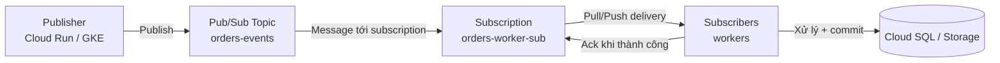
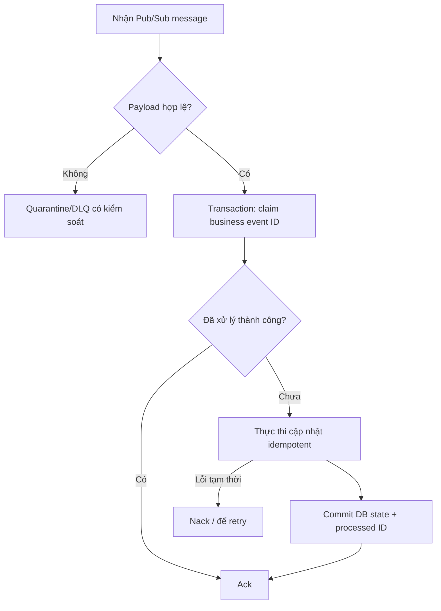

# Snapshots, seek và phát lại thông điệp

## 1. Khi nào cần phát lại thông điệp?

Một dịch vụ nhận sự kiện đơn hàng từ **Google Cloud Pub/Sub**, xử lý trên **Cloud Run** hoặc **GKE** rồi cập nhật **Cloud SQL**. Sau khi triển khai phiên bản mới, đội vận hành phát hiện subscriber đã **acknowledge (ack)** một số message nhưng ghi dữ liệu sai. Lúc này, việc deploy bản sửa không tự đưa những message đã ack trở lại hàng đợi.

Pub/Sub có hai cơ chế giúp khôi phục:

- **Snapshot** ghi lại **trạng thái đã/chưa ack của subscription** tại một thời điểm để có thể quay lại.
- **Seek** thay đổi hàng loạt trạng thái ack của một subscription theo **snapshot** hoặc **mốc thời gian**, từ đó **phát lại (replay)** message còn được giữ.

Bài học thuộc chương **Pub/Sub và thông điệp** trong module **CLOUD_PROVIDERS_GCP**, kết nối các chủ đề Project/IAM, mạng VPC, Compute Engine, GKE, Cloud Run và các dịch vụ dữ liệu. Mục tiêu là biết thiết kế khả năng phục hồi, giới hạn quyền thay đổi, bảo đảm đúng dữ liệu và kiểm soát độ tin cậy cùng chi phí.

### Kết quả học tập

Sau bài học, bạn có thể:

1. Phân biệt **topic, subscription, message, ack, retention, snapshot và seek**.
2. Chọn **seek to snapshot** hay **seek to timestamp** theo loại sự cố.
3. Giải thích **thời hạn snapshot tối đa 7 ngày** và giới hạn retention tới **31 ngày** của topic/subscription.
4. Dùng `gcloud pubsub snapshots ...` và `gcloud pubsub subscriptions seek ...` trong một lab an toàn.
5. Nhận biết tác động của replay lên **pull, push, filtered subscriptions, dead-letter topics và exactly-once delivery**.
6. Thiết kế xử lý **idempotent**, quan sát backlog và có runbook trước khi seek production.

> **Cảnh báo:** Seek thay đổi **trạng thái ack của cả subscription**, không chỉ một subscriber instance. Seek tới thời điểm tương lai có thể **đánh dấu ack hàng loạt message chưa xử lý** và gây mất cơ hội xử lý chúng. Chỉ chạy các lệnh có tác động trong **project/subscription lab** hoặc theo quy trình thay đổi đã được phê duyệt.

## 2. Ôn lại luồng Pub/Sub và ack



| Khái niệm | Ý nghĩa | Điểm liên quan tới replay |
| --- | --- | --- |
| **Topic** | Nơi publisher gửi message | Có thể bật **topic message retention** để lưu lịch sử độc lập với subscription |
| **Subscription** | Luồng nhận và **trạng thái ack** của consumer | Seek thay đổi trạng thái ack của **subscription được chọn** |
| **Message ID** | Định danh của một message được Pub/Sub publish | Cần phân biệt với **business event ID** |
| **Ack** | Subscriber thông báo đã xử lý message | Mặc định message đã ack không còn trong backlog subscription |
| **Ack deadline** | Khoảng thời gian để subscriber ack một lần delivery | Hết hạn có thể redeliver; **khác retention** |
| **Retention** | Khoảng thời gian message còn được giữ để có thể replay | Hết retention thì seek không khôi phục được nội dung đã bị loại bỏ |
| **Snapshot** | Điểm lưu trạng thái ack của một subscription | Dùng để khôi phục sau triển khai lỗi |
| **Seek** | Thao tác đổi hàng loạt trạng thái ack tới snapshot/timestamp | Có thể replay **hoặc purge** backlog |

**Message đã ack khác message đã xử lý đúng.** Pub/Sub chỉ biết ack đến từ subscriber; nó không thể kiểm tra transaction trong Cloud SQL hay tính đúng đắn của báo cáo. Một ứng dụng ghi dữ liệu sai nhưng vẫn ack có thể cần replay **kết hợp bù trừ dữ liệu**, không chỉ chạy lại cùng hàm.

### Mặc định quan trọng

- Subscription thường giữ **message chưa ack trong 7 ngày** sau thời điểm publish; mặc định **không** giữ message đã ack.
- Có thể đặt **subscription message retention** từ **10 phút đến 31 ngày**; tùy chọn `retainAckedMessages` cho phép giữ cả message đã ack.
- **Topic message retention** là cấu hình **riêng**, mặc định **không bật**; có thể giữ lịch sử từ **10 phút đến 31 ngày**.
- Các con số này là giới hạn **message retention**, **không phải tuổi thọ snapshot**.

## 3. Snapshot thực sự lưu cái gì?

**Snapshot của Pub/Sub** là một **điểm ghi trạng thái ack** nhất quán của một subscription. Nó bảo toàn khả năng phát lại:

1. Những message **chưa ack** trong source subscription khi snapshot được tạo.
2. Những message **được publish lên cùng topic sau thời điểm snapshot**.

Snapshot **không** phải tệp CSV/JSON chứa danh sách message để tải về và **không** làm cho một message đã bị xóa khỏi retention lịch sử trước đó tự xuất hiện lại.

### Một ví dụ theo thời gian

Giả sử subscription `orders-sub` đang nhận ba message:

| Thời điểm | Message A | Message B | Message C |
| --- | --- | --- | --- |
| 09:00 | Đã ack | Chưa ack | Chưa publish |
| **09:05: tạo snapshot S1** | Đã ack | **Chưa ack — được snapshot giữ** | Chưa publish |
| 09:06 | Không đổi | Đã ack | **Được publish** |
| 09:07 | Không đổi | Đã ack | Đã ack |
| **09:08: seek đến S1** | Không được phát lại chỉ vì seek S1 | **Được phát lại** | **Được phát lại** |

**Vì sao A không được phát lại?** A đã ack **trước khi snapshot được tạo**; trạng thái ack trong snapshot không yêu cầu xử lý lại A. Muốn replay A, cần **topic/subscription retention phù hợp** và seek theo timestamp (nếu message còn được lưu), hoặc một snapshot được tạo **trước lần ack A**.

**Vì sao C được phát lại?** Snapshot bảo vệ khả năng replay message được publish **sau điểm snapshot**, kể cả khi message đó đã được ack ở thời điểm seek.

### Giới hạn phạm vi

- Snapshot gắn với **một topic** và ghi trạng thái từ **một source subscription**.
- Có thể **seek một subscription khác trên cùng topic** tới snapshot ấy, kể cả subscription được tạo sau snapshot.
- Không thể dùng snapshot của topic A để seek subscription thuộc topic B.
- Snapshot không phải bản sao của các **API key, schema, bộ lọc, DLQ configuration hoặc side effects** của subscriber.

## 4. Tuổi thọ snapshot: không phải luôn 7 ngày

Tuổi thọ tối đa của snapshot là **7 ngày**, nhưng giảm theo độ tuổi của **message chưa ack lâu nhất** trên source subscription tại thời điểm tạo:

\[
\text{snapshot lifetime} =
7\text{ ngày} - \text{tuổi của oldest unacked message}
\]

| Oldest unacked khi tạo | Tuổi thọ snapshot (xấp xỉ) |
| --- | --- |
| Không có backlog cũ đáng kể | Tối đa 7 ngày |
| 12 giờ | Khoảng 6 ngày 12 giờ |
| 2 ngày | Khoảng 5 ngày |
| 6 ngày 22 giờ | Khoảng 2 giờ |
| Từ 6 ngày 23 giờ trở lên | Có thể **không tạo được** vì còn dưới 1 giờ |

Pub/Sub **từ chối tạo snapshot** nếu nó sẽ hết hạn trong **ít hơn một giờ**. Không nên tạo snapshot như kế hoạch khôi phục dài hạn khi backlog đã gần hết thời gian giữ. Kiểm tra trường `expireTime` thực tế thay vì ghi cứng “snapshot dùng được đúng 7 ngày”.

### Hai giới hạn dễ nhầm

- **Snapshot:** nhiều nhất **7 ngày** và phụ thuộc backlog tại lúc tạo.
- **Topic/subscription message retention:** có thể cấu hình tối đa **31 ngày**; tuy nhiên **chỉ các message còn thực sự được lưu** mới replay được.

Muốn khôi phục sự cố từ **hai tuần trước**, một snapshot thông thường **không đủ**. Cần thiết kế retention từ trước hoặc lưu **event archive** bền vững trong Cloud Storage/BigQuery nếu có yêu cầu lâu hơn 31 ngày.

## 5. Seek: thao tác thay đổi ack state hàng loạt

Có hai kiểu chính:

| Kiểu seek | Đầu vào | Tác dụng | Điều kiện |
| --- | --- | --- | --- |
| **Seek to snapshot** | `SNAPSHOT_ID` | Khôi phục ack state tương ứng snapshot và các message sau snapshot | Snapshot **còn hạn**, cùng topic |
| **Seek to timestamp** | Timestamp (UTC/RFC 3339) | Message còn được lưu **trước mốc** được đánh dấu ack; **sau mốc** được đánh dấu chưa ack | Có topic retention hoặc subscription giữ acked messages cho dữ liệu cần replay |

### Seek không phải truy vấn theo timestamp của ứng dụng

Pub/Sub dùng **publishTime do server Pub/Sub gán**, không phải `createdAt` hoặc `orderTime` nằm trong payload. Có thể có độ lệch clock và thời điểm source system phát nghiệp vụ khác thời điểm publish. Vì vậy seek theo 09:00 UTC không bảo đảm chính xác mọi đơn hàng có `eventTime >= 09:00` đều được xử lý.

Để replay theo một dải **business ID** hoặc khoảng thời gian event nghiệp vụ chính xác, cần lưu **event archive/index** hoặc tạo một subscription/consumer lọc theo logic ứng dụng. Seek theo timestamp **không có filter từng message** của payload.

### Seek có tính nhất quán cuối cùng

Sau khi seek được chấp nhận, thay đổi delivery có thể cần khoảng **một phút** để phản ánh đầy đủ:

- Một số message trước mốc hoặc đã ack trong snapshot vẫn có thể được giao trong thời gian chuyển tiếp.
- Message cần trở thành unacked **sẽ được giao lại cuối cùng** theo bảo đảm dịch vụ, nhưng không nhất thiết hiện ngay ở lần pull tiếp theo.
- Không được dựa vào seek để đạt thứ tự xử lý hoặc exactly-once side effect.

## 6. Chọn snapshot hay timestamp: bảng quyết định

| Sự cố/vận hành | Nên chọn | Lý do |
| --- | --- | --- |
| Chuẩn bị deploy subscriber revision mới, muốn có nút khôi phục | **Tạo snapshot trước deploy** | Lưu ack state trước bản lỗi |
| Bản mới đã ack sai sau thời điểm snapshot | **Seek snapshot** | Replay backlog bảo vệ từ thời điểm tạo snapshot |
| Sự cố xuất hiện bất ngờ, chưa tạo snapshot | **Seek timestamp** nếu có retention | Quay về mốc tương ứng các messages còn giữ |
| Cần thử lại cùng dữ liệu trên subscriber khác cùng topic | **Seek snapshot** tới subscription thử nghiệm | Copy điểm ack để chạy lại |
| Cần bỏ backlog cũ không còn giá trị | Seek timestamp **tới mốc hiện tại/tương lai** — rất nguy hiểm | Bulk ack/purge có chủ đích |
| Muốn khôi phục dữ liệu từ 40 ngày trước | **Không dùng seek thông thường** | Ngoài retention tối đa 31 ngày |
| Muốn replay chỉ vài order IDs | **Business reprocessing có chọn lọc** | Seek tác động toàn subscription, không phải API query từng ID |

### Runbook trước mọi seek ngoài lab

1. Ghi **project, topic, subscription**, người chịu trách nhiệm và mục tiêu replay.
2. Kiểm tra **retention hiện tại**, mốc seek, snapshot `expireTime`, subscription filter và dead-letter/exactly-once settings.
3. **Ngừng hoặc điều tiết consumer** nếu cần tránh xung đột; thông báo cho đội đang dùng chung subscription.
4. Đánh giá **số message bị replay, side effects có thể lặp**, sức chịu database/API và chi phí.
5. Đặt **business idempotency key**, backup/checkpoint, metric và rollback plan.
6. Chỉ sau phê duyệt mới gọi seek; quan sát ít nhất vài phút, kiểm chứng output thật.

> **Không có “undo seek” tổng quát.** Có thể tìm lại trạng thái từ snapshot **khác** hoặc seek trở lại mốc thời gian **nếu retention còn đủ**. Nếu đã purge và message hết retention, không có cách lấy lại từ Pub/Sub bằng một lệnh.

## 7. Lab A — tạo snapshot rồi phát lại một message

Ví dụ dùng **Cloud Shell Bash** và project `acme-pubsub-lab` do tổ chức phê duyệt. Trước khi chạy, cần bật **Pub/Sub API**, Billing và có quyền tạo topic/subscription/snapshot, publish, pull, ack và seek; thao tác trên tài nguyên sẽ phát sinh phí.

### 7.1. Tạo topic và subscription lab

```bash
# THAY ĐỔI: chỉ chạy trong project LAB được phép
PROJECT="acme-pubsub-lab"
TOPIC="replay-lab-topic"
SUB="replay-lab-sub"
SNAP="replay-lab-snap"

gcloud pubsub topics create "$TOPIC" --project="$PROJECT"
gcloud pubsub subscriptions create "$SUB" \
  --project="$PROJECT" \
  --topic="$TOPIC" \
  --ack-deadline=10

# CHỈ ĐỌC cấu hình
gcloud pubsub subscriptions describe "$SUB" --project="$PROJECT"
```

`--ack-deadline=10` là **10 giây cho một lần delivery**, không phải giới hạn thời gian có thể seek; production subscriber libraries thường tự gia hạn deadline khi đang xử lý. Nếu tài nguyên có tên trùng đã tồn tại, **không xóa dữ liệu của người khác**; dùng tên lab riêng.

### 7.2. Chụp trạng thái ack trước khi publish

```bash
# TẠO SNAPSHOT từ subscription lab
gcloud pubsub snapshots create "$SNAP" \
  --project="$PROJECT" \
  --subscription="$SUB"

# CHỈ ĐỌC: xác minh topic và expireTime
gcloud pubsub snapshots describe "$SNAP" \
  --project="$PROJECT"
```

Vì vừa tạo subscription, đôi khi cần đợi quá trình tạo subscription lan truyền trước khi tạo snapshot. Snapshot lúc này ghi nhận điểm xuất phát: chưa có message trong backlog, nhưng có thể giữ **những message publish sau snapshot**.

### 7.3. Publish và ack

```bash
# TẠO message vào topic lab
gcloud pubsub topics publish "$TOPIC" \
  --project="$PROJECT" \
  --message='{"eventId":"demo-001","action":"create-report"}'

# THAY ĐỔI ack state: chỉ dùng --auto-ack cho message LAB
gcloud pubsub subscriptions pull "$SUB" \
  --project="$PROJECT" \
  --limit=10 \
  --auto-ack

# Thử pull lần nữa: có thể không có message sau ack
gcloud pubsub subscriptions pull "$SUB" \
  --project="$PROJECT" \
  --limit=10
```

**Lưu ý:** `--auto-ack` xác nhận ngay **không cần consumer xử lý nghiệp vụ**. Tuyệt đối không dùng tùy tiện với subscription production: có thể làm mất cơ hội xử lý nếu retention không bảo vệ message đã ack.

### 7.4. Seek về snapshot và pull lại

```bash
# THAY ĐỔI ACK STATE cho toàn bộ subscription LAB
gcloud pubsub subscriptions seek "$SUB" \
  --project="$PROJECT" \
  --snapshot="$SNAP"

# Lệnh pull có thể cần thử lại sau khi seek lan truyền
gcloud pubsub subscriptions pull "$SUB" \
  --project="$PROJECT" \
  --limit=10 \
  --auto-ack
```

**Kỳ vọng:** message `demo-001` được phát lại, vì nó được publish **sau khi snapshot đã tạo**. Nếu ngay lập tức không thấy, kiểm tra trạng thái seek/snapshot, đợi propagation và thử pull lại trong lab; không chạy seek liên tục nhiều lần.

## 8. Lab B — seek theo timestamp sau khi giữ acked messages

Ở bài này tạo **subscription riêng** `replay-time-sub` trên **cùng topic** để tách trạng thái khỏi Lab A. Không nên dựa vào việc bật `retain-acked-messages` **sau khi ack** để khôi phục message đã bị loại bỏ trước đó.

### 8.1. Tạo subscription có retention từ đầu

```bash
# THAY ĐỔI: subscription LAB mới, giữ acked messages 2 ngày
TIME_SUB="replay-time-sub"

gcloud pubsub subscriptions create "$TIME_SUB" \
  --project="$PROJECT" \
  --topic="$TOPIC" \
  --message-retention-duration=2d \
  --retain-acked-messages

gcloud pubsub subscriptions describe "$TIME_SUB" \
  --project="$PROJECT"
```

Từ thời điểm tạo subscription, các message phù hợp được publish lên topic sẽ được quản lý theo retention của subscription đó. **Không suy rằng subscription mới sẽ tự nhận toàn bộ lịch sử topic**, trừ khi **topic retention** hỗ trợ và có thao tác seek phù hợp.

### 8.2. Ghi mốc trước khi publish

```bash
# Cloud Shell (GNU date); dùng UTC, ghi vào nhật ký lab
T0="$(date -u '+%Y-%m-%dT%H:%M:%SZ')"
echo "$T0"

# Tách khỏi ranh giới giây của timestamp để dễ quan sát
sleep 2

gcloud pubsub topics publish "$TOPIC" \
  --project="$PROJECT" \
  --message='{"eventId":"demo-time-001"}'

gcloud pubsub subscriptions pull "$TIME_SUB" \
  --project="$PROJECT" \
  --limit=10 \
  --auto-ack
```

### 8.3. Seek ngược thời gian

```bash
# THAY ĐỔI ACK STATE của cả TIME_SUB, không ảnh hưởng trực tiếp SUB của Lab A
gcloud pubsub subscriptions seek "$TIME_SUB" \
  --project="$PROJECT" \
  --time="$T0"

gcloud pubsub subscriptions pull "$TIME_SUB" \
  --project="$PROJECT" \
  --limit=10 \
  --auto-ack
```

**Kỳ vọng:** `demo-time-001` có thể được giao lại vì publish sau `T0` và vẫn nằm trong retention. Nếu chưa thấy, đợi tối đa khoảng một phút để seek nhất quán rồi thử pull. Nếu `T0` rơi ngoài thời hạn lưu giữ, seek **không phục hồi** các message đã bị expunge.

**Không dùng mốc thời gian trong payload** thay cho timestamp pub/sub. Timezone trên CLI phải rõ ràng, ưu tiên định dạng UTC như `2026-11-19T02:30:00Z`. Giới hạn phân biệt theo publish timestamp có thể không hoàn toàn chính xác ở ranh giới do clock skew/độ trễ.

## 9. Giữ lịch sử tại topic hay subscription?

Muốn seek timestamp sau khi message đã ack, phải **bật retention trước khi dữ liệu bị xóa**. Có hai cách:

| Cấu hình | Phạm vi và tác dụng | Đặc điểm phí |
| --- | --- | --- |
| **Subscription retention + `retain-acked-messages`** | Một subscription giữ những message đã ack trong thời hạn cấu hình; seek của subscription này có thể khôi phục chúng | Phí lưu message đã ack được tính cho **project của subscription** |
| **Topic message retention** | Topic giữ message từ lúc publish; có thể hỗ trợ seek trên attached subscription và replay message publish trước khi subscription được tạo, trong thời hạn lưu | Phí lưu được tính cho **project của topic** |
| **Snapshot** | Lưu ack state và khả năng replay từ mốc snapshot; không cần bật retain-acked để seek snapshot | Phí snapshot storage theo chính sách Pub/Sub |

### 9.1. Cập nhật subscription retention

```bash
# THAY ĐỔI: chỉ ví dụ trên subscription LAB
gcloud pubsub subscriptions update replay-time-sub \
  --project=acme-pubsub-lab \
  --message-retention-duration=3d \
  --retain-acked-messages

# CHỈ ĐỌC để kiểm tra cấu hình thực
gcloud pubsub subscriptions describe replay-time-sub \
  --project=acme-pubsub-lab
```

Trong response xem `retainAckedMessages` và `messageRetentionDuration`. **Bật retention bây giờ không tự phục hồi message đã expunge hôm qua**. Nếu vừa kéo dài retention, kiểm tra **subscription expiration policy** phải không ngắn hơn retention duration; một subscription không hoạt động có thể tự hết hạn nếu không cấu hình phù hợp.

### 9.2. Bật topic retention (một lựa chọn khác)

```bash
# THAY ĐỔI TOPIC của tất cả publishers/subscriptions cùng dùng
gcloud pubsub topics update replay-lab-topic \
  --project=acme-pubsub-lab \
  --message-retention-duration=7d

# CHỈ ĐỌC
gcloud pubsub topics describe replay-lab-topic \
  --project=acme-pubsub-lab
```

Topic retention có thể tăng phí cho **tất cả message được publish vào topic**, kể cả những message mọi subscription đã ack. Trước khi bật trên production, cần forecast bytes/day, giới hạn 31 ngày, CMEK/region policy và owner chịu phí.

**Không nhầm:** Một subscription có `messageRetentionDuration=7d` nhưng `retainAckedMessages=false` **không** tự cho phép replay những message đã ack nếu topic không lưu chúng.

## 10. Dùng snapshot với subscription khác trên cùng topic

Một snapshot có thể chuyển trạng thái xử lý sang **subscription khác** cùng topic. Đây là cách thử bản subscriber mới trên dữ liệu được bảo vệ mà không reset production subscription.

```mermaid
flowchart TB
    TOP["Topic orders-events"]
    PROD["Subscription orders-prod<br/>snapshot tại T0"]
    SNAP["Snapshot orders-before-v2"]
    TEST["Subscription orders-replay-lab<br/>cùng topic"]
    OLD["Consumer production"]
    NEW["Consumer lab v2"]
    TOP --> PROD
    TOP --> TEST
    PROD -->|"create snapshot"| SNAP
    SNAP -. "seek"| TEST
    PROD --> OLD
    TEST --> NEW
```

### Ví dụ gcloud

```bash
# Chỉ thực hiện trong LAB đã tạo ở trên
TEST_SUB="replay-copy-sub"

# TẠO một subscription trên cùng topic
gcloud pubsub subscriptions create "$TEST_SUB" \
  --project="$PROJECT" \
  --topic="$TOPIC"

# SEEK: thay đổi ack state của TEST_SUB, không trực tiếp đổi SUB
gcloud pubsub subscriptions seek "$TEST_SUB" \
  --project="$PROJECT" \
  --snapshot="$SNAP"

# CHỈ ĐỌC/ACK LAB: quan sát message được giao
gcloud pubsub subscriptions pull "$TEST_SUB" \
  --project="$PROJECT" --limit=10 --auto-ack
```

Điều kiện bắt buộc là **snapshot và target subscription cùng topic**, và snapshot còn hiệu lực. **Không** thể dùng snapshot từ `orders-events` cho subscription của `payments-events`.

### Tại sao không chạy thử trực tiếp trên production subscription?

Hai nhóm subscribers của **cùng một subscription** thường là *competing consumers*: các messages được phân phối giữa chúng, chứ không phải mỗi worker đều nhận toàn bộ. Khi một subscriber lab nhận và ack, worker production có thể không bao giờ xử lý message đó. **Subscription riêng** tạo ranh giới nhận/ack độc lập, an toàn hơn cho việc thử nghiệm.

Tuy nhiên, việc subscription thử nghiệm nhận message giống production **không làm side effects tự cách ly**. Consumer lab phải dùng **Cloud SQL/bucket/sandbox riêng**, hoặc dry-run mode, tránh gửi email/thu tiền/cập nhật production hai lần.

## 11. Tương tác với filters, DLQ, retry và exactly-once

### 11.1. Subscription có filter

Pub/Sub subscription filters dựa trên **message attributes**, không lọc dữ liệu trong payload. Khi seek timestamp trên một subscription có filter, Pub/Sub chỉ **redeliver những message còn lưu khớp filter của subscription đích**.

Với seek snapshot:

- Snapshot từ filtered subscription có thể liên quan message chưa ack trước điểm snapshot và message publish sau đó, bao gồm một số message không khớp filter ban đầu.
- **Subscription thực hiện seek** chỉ nhận message **khớp filter của chính nó**.
- Filter của một subscription **không chỉnh được tại chỗ**; thay filter cần thiết kế subscription mới và migration có kiểm soát.

Không dùng seek như cách “bỏ qua filter”. Nếu một event không được subscription nhận vì filter, cần kiểm tra thiết kế nguồn/retention và cách replay qua subscription phù hợp.

### 11.2. Dead-letter topic (DLQ)

Subscription có **dead-letter policy** thường chuyển những message vượt số delivery attempts cho phép tới dead-letter topic nếu cấu hình service-agent IAM đúng. Khi seek:

- **Delivery attempt count được reset về 0** cho các message trong subscription liên quan.
- Điều đó **không tự kéo message từ dead-letter topic về topic gốc**.
- Muốn replay messages đã vào DLQ, cần xử lý **DLQ subscription và republish có kiểm soát**, sau khi đã sửa nguyên nhân.

Không nhầm **seek** với **DLQ redrive**. Chúng đều giúp khôi phục nhưng vận hành trên nguồn/trạng thái khác.

### 11.3. Retry policy và ack deadline

Seek còn reset khoảng delay của subscription retry policy; message có thể được redeliver nhanh trở lại tùy cơ chế backoff. Đừng dùng seek để chữa retry loop khi business code chưa được sửa: bạn có thể **tăng tải backend và phí** mà không tạo giá trị.

Ack deadline chỉ điều khiển thời gian mỗi delivery được xem là outstanding. Nếu deadline hết trước khi xử lý, message có thể được phát lại dù **không có seek**. Cần phân biệt các lần redelivery thông thường với replay chủ động.

### 11.4. Exactly-once delivery không loại bỏ replay

Pub/Sub **exactly-once delivery** (cho các pull subscriptions được hỗ trợ và trong phạm vi bảo đảm tương ứng) hạn chế duplicate **sau khi ack thành công** trong quá trình bình thường. Nhưng một thao tác **seek chủ động** có thể phát lại message đã ack hợp lệ. Những **ack IDs từ delivery trước seek có thể không còn hợp lệ**.

Hơn nữa, publisher có thể gửi **hai bản business event khác nhau** có message IDs khác nhau. Vì thế:

**Exactly-once delivery của Pub/Sub ≠ exactly-once database transaction hoặc exactly-once business side effect.**

Thiết kế **idempotency key** và transaction/checkpoint vẫn bắt buộc nếu replay có thể ghi dữ liệu lần hai.

## 12. Seek để purge backlog: thao tác phá hủy cần kiểm soát

Seek tới **mốc thời gian hiện tại/tương lai** có thể đánh dấu các message đã có **thành acknowledged** theo mốc, hiệu quả như **bulk purge**. Đây là thao tác hữu ích khi backlog đã **hết giá trị nghiệp vụ**, nhưng cực kỳ nguy hiểm với payment, audit hoặc đơn hàng chưa xử lý.

Ví dụ **chỉ minh họa, KHÔNG thực thi trên production**:

```bash
# CẢNH BÁO: đánh dấu ack hàng loạt messages trước thời điểm này
# Chỉ chạy trong SUBSCRIPTION LAB nếu thực sự cần học purge
gcloud pubsub subscriptions seek replay-copy-sub \
  --project=acme-pubsub-lab \
  --time="2099-01-01T00:00:00Z"
```

**Không chạy ví dụ này như một bước bắt buộc của lab.** Nếu cần loại bỏ backlog thật, hãy dùng runbook riêng: review phạm vi, backup/retention, xác nhận dữ liệu không còn giá trị, phê duyệt hai người và ghi audit trail. Ngay cả seek purge cũng chịu **eventual consistency**; không dùng nó làm cách chặn một request đang in-flight tức thì.

Với hệ thống tài chính/kiểm toán, thông thường nên **khôi phục/điều tra messages**, không tự động purge chỉ vì backlog lớn.

## 13. Thiết kế subscriber idempotent trước khi replay

Giả sử message chứa:

```json
{
  "eventId": "order-2026-11019-001",
  "orderId": "ORD-1001",
  "status": "PAID",
  "schemaVersion": 1
}
```

**Không chỉ dùng Pub/Sub `messageId`** để chống xử lý trùng: cùng business event có thể được publish hai lần với hai message IDs. Với đơn hàng, khóa phù hợp thường là **business event ID** hoặc **order ID + event version**, được thiết kế xuyên suốt các services.

### Quy trình an toàn



Ví dụ ý tưởng PostgreSQL:

```sql
CREATE TABLE processed_events (
    event_id TEXT PRIMARY KEY,
    processed_at TIMESTAMPTZ NOT NULL DEFAULT NOW()
);

-- Trong một transaction với cập nhật order:
INSERT INTO processed_events(event_id)
VALUES ('order-2026-11019-001')
ON CONFLICT (event_id) DO NOTHING;

-- Chỉ thực hiện nghiệp vụ khi INSERT đã tạo hàng mới.
-- COMMIT transaction rồi mới ACK message.
```

**Không lấy SQL trên làm quy trình đầy đủ.** Ứng dụng phải kiểm tra số row thực được insert, thực hiện cập nhật nghiệp vụ **trong cùng transaction**, và xử lý rollback/concurrency. Nếu còn **side effects ngoài database** (gửi email, gọi payment gateway), cần **transactional outbox**, API idempotency key hoặc workflow bù trừ. Ack **trước commit** sẽ làm tăng nguy cơ mất dữ liệu khi ứng dụng crash.

### Trường hợp reprocess dữ liệu lỗi đã ghi

Replay một event `order-paid` không có nghĩa cứ chạy lại `UPDATE orders SET ...` là đủ. Nếu bug cũ đã ghi giá trị sai, cần:

1. Xác định phạm vi và trạng thái bị lỗi.
2. Sửa code và có **data migration/compensation plan**.
3. Tạo business reprocessing run ID có audit.
4. Chạy lại idempotent; kiểm tra bản ghi trước/sau.
5. Đối chiếu row count, checksum, event IDs và SLO rồi mới đóng sự cố.

## 14. IAM, bảo mật dữ liệu và quyền seek

Đừng cấp `roles/pubsub.admin` cho tất cả subscribers. Một runtime service account chỉ cần **consume/ack** trên đúng subscription, còn operator được phép **create snapshot/seek** theo quy trình riêng.

| Hành động | Quyền IAM liên quan | Phân quyền gợi ý |
| --- | --- | --- |
| Publish vào topic | `pubsub.topics.publish` | `roles/pubsub.publisher` trên topic |
| Pull/ack/seek timestamp | `pubsub.subscriptions.consume` | `roles/pubsub.subscriber` trên subscription, nhưng cần giám sát lạm dụng seek |
| Seek tới snapshot | `pubsub.subscriptions.consume` **và** `pubsub.snapshots.seek` | Phân quyền cả subscription đích và snapshot |
| Tạo snapshot | `pubsub.snapshots.create` và các quyền nguồn cần thiết theo API | Chỉ nhóm quản trị hoặc role tùy chỉnh |
| Xem topic/subscription/snapshot | Các quyền `get/list` tương ứng | `roles/pubsub.viewer` theo phạm vi phù hợp |
| Sửa retention | `pubsub.subscriptions.update` hoặc `pubsub.topics.update` | Qua IaC/CI có review |

**Điểm bảo mật quan trọng:** `roles/pubsub.subscriber` bao gồm quyền consume và có thể hỗ trợ seek; không coi nó là quyền “chỉ đọc message không sửa trạng thái”. Nếu cần tách người **chỉ xem metadata** với người có quyền replay, dùng **Viewer** và custom roles phù hợp.

Pub/Sub messages có thể chứa PII, access tokens hoặc dữ liệu giao dịch. Trong replay, tránh log toàn bộ message body, không đưa credential vào code, giữ encryption/CMEK và message storage policies phù hợp; với dữ liệu cần retention lâu, kiểm tra chính sách lưu trữ và xóa theo pháp lý.

## 15. Quan sát replay bằng Cloud Monitoring và logs

Thành công của `gcloud pubsub subscriptions seek` mới là thành công của **thao tác quản lý**, **không** chứng minh consumer đã xử lý lại đúng business state.

| Tín hiệu | Metric/nguồn | Mục đích |
| --- | --- | --- |
| Số message chưa ack | `subscription/num_unacked_messages_by_region` | Nhìn backlog tăng sau seek và giảm dần |
| Tuổi message chưa ack lâu nhất | `subscription/oldest_unacked_message_age_by_region` | Nguy cơ hết retention/SLO |
| Chất lượng delivery latency | `subscription/delivery_latency_health_score` | Quan sát hiệu suất subscriber |
| Ack/redelivery rate | Pub/Sub metrics/Cloud Monitoring | Phân biệt replay với retry loop |
| Số message chuyển DLQ | `subscription/dead_letter_message_count` | Theo dõi poison messages |
| Retained acked messages | `subscription/num_retained_acked_messages_by_region` | Đo chi phí retention và tính sẵn sàng replay |
| Snapshot expiry | `gcloud pubsub snapshots describe` | Biết hạn cuối seek snapshot |
| Business completion | Cloud SQL/Firestore/checkpoint/GCS manifest | Chứng minh các events thực sự đã được xử lý |

Với regional dashboards, Google Cloud khuyến nghị dùng metrics hậu tố `_by_region` vì các metric backlog tổng hợp toàn vùng có thể có gap khi một region không sẵn sàng.

### Quy trình quan sát

1. Trước seek, lưu **baseline**: backlog/oldest age, throughput, lỗi và business checkpoint.
2. Ngay sau seek, ghi **timestamp thao tác**, snapshot ID hoặc timestamp target, user IAM.
3. Chờ propagation và theo dõi backlog; không kết luận từ **một lần pull trả về rỗng**.
4. Quan sát CPU/RAM/số instances của Cloud Run/GKE worker, error rate của Cloud SQL và DLQ.
5. Đối chiếu business event IDs và transaction outcomes; cảnh báo khi sai lệch hoặc duplicate side effects.

**Số message được pull khác số bản ghi hợp lệ.** Một message bị redeliver nhiều lần nhưng idempotent handler chỉ cập nhật database một lần là hành vi tốt, không phải mất message.

## 16. Chi phí và capacity khi phát lại

Pub/Sub tính phí theo **publishing/delivery throughput, data transfer và storage**; thêm chi phí của consumer (Cloud Run/GKE/Compute Engine), database/Cloud Storage/Logging nếu có.

| Thay đổi | Chi phí/rủi ro |
| --- | --- |
| Bật topic retention 7–31 ngày | Tăng dữ liệu lưu tại topic, bao gồm các message đã được mọi subscriber ack |
| Giữ acked messages ở subscription | Tăng storage tính theo project subscription |
| Nhiều snapshots | Tăng snapshot storage; có quota/giới hạn tạo |
| Seek replay 1 triệu messages | Tăng delivery throughput, CPU/runtime, log volume và DB requests |
| Seek trên subscription có nhiều consumer | Có thể gây backlog spike, saturate CPU/SQL hoặc 429 downstream |
| Xử lý lặp không idempotent | Có thể tạo **thiệt hại nghiệp vụ** lớn hơn phí Pub/Sub |

Ví dụ sơ bộ:

```text
Một lượt replay: 200.000 messages × trung bình 2 KiB
                   ≈ 390,6 MiB dữ liệu message payload
Nếu mỗi message tạo 1 dòng log và 1 database write:
                   thêm khoảng 200.000 logs + 200.000 writes
```

Đây **không phải hóa đơn Pub/Sub chính xác**: phí còn xét kích thước attributes, API request batching, lượng bytes thực theo quy tắc tính phí, retention, region và SKU. Xem [Pub/Sub pricing](https://cloud.google.com/pubsub/pricing) cùng **Cloud Billing export** cho dự toán phù hợp.

### Bảo vệ downstream

- Giới hạn **subscriber concurrency / flow control** thay vì replay mọi thứ với tốc độ tối đa.
- Kiểm tra Cloud SQL connection pools, API rate limits và Cloud Run max instances.
- Có checkpoint/reconciliation và dashboard **business progress**, không chỉ Pub/Sub throughput.
- Nếu backlog vượt khả năng xử lý trong retention, cân nhắc thêm capacity, partition workloads hoặc dùng archive/backfill flow riêng.

## 17. Troubleshooting nhanh

| Triệu chứng | Nguyên nhân có thể | Cách xác minh |
| --- | --- | --- |
| Không tạo được snapshot | Oldest unacked quá cũ, còn dưới 1 giờ hiệu lực; IAM | Xem oldest age, retention, `pubsub.snapshots.create` |
| Snapshot không thấy | Sai project/name, đã hết hạn hoặc bị xóa | `gcloud pubsub snapshots list/describe` |
| Seek snapshot báo topic mismatch | Snapshot/topic của subscription đích khác nhau | `snapshot.topic`, `subscription.topic` |
| Seek timestamp không replay message đã ack | Chưa bật retain acked/topic retention từ trước; message hết hạn | `retainAckedMessages`, topic retention, publishTime |
| Seek trả thành công nhưng pull chưa thấy | Eventual consistency khoảng 1 phút; subscriber khác đã nhận | Chờ, xem backlog metrics, kiểm tra consumer instances |
| Replay nhiều message hơn dự tính | Mốc publishTime quá sớm, snapshot trước nhiều events, boundary clock skew | Đọc mốc UTC, sự kiện thực và phạm vi subscription |
| Message được giao lại dù đã từng ack | Seek chủ động, deadline expiration hoặc retry | Phân biệt logs theo seek time và message ID |
| Message không đi vào consumer do filter | Filter subscription đích không khớp | Xem attributes/filter; không chỉnh filter cũ tại chỗ |
| DLQ message không quay lại source | Seek không tự redrive DLQ | Xử lý DLQ subscription và republish đã kiểm soát |
| Exactly-once ack ID cũ thất bại | Seek khiến delivery/ack state cũ không còn hợp lệ | Dùng ack ID từ delivery mới, kiểm tra library và logs |
| Backlog tăng, Cloud SQL quá tải | Replay quá nhanh, consumer concurrency cao | Flow control, DB metrics, rate limit |
| Chi phí storage tăng sau bật retention | Giữ message đã ack hoặc topic retention | Billing SKU, retained bytes, cấu hình mới |

### Runbook khi subscriber release gây mất dữ liệu

1. **Phát hiện:** Dựa trên business reconciliation, không chỉ message ack count.
2. **Khoanh vùng:** Xác định deployment revision, thời điểm bug bắt đầu, source topic/subscription, dữ liệu đã bị tác động.
3. **Kiểm tra quyền và retention:** Snapshot tạo trước deploy còn hạn không? Nếu không, có retained acked/topic retention không?
4. **Chuẩn bị khắc phục:** Sửa bug, test canary, snapshot/data backup, idempotency/bù trừ và downstream capacity.
5. **Chọn đích:** Ưu tiên replay sang **subscription phục hồi riêng** cùng topic khi cần thử an toàn; không seek production ngay.
6. **Thực thi:** Seek snapshot/timestamp theo kế hoạch được duyệt, ghi log thao tác và quan sát trạng thái.
7. **Xác minh:** Row counts, transaction IDs, latency/errors, DLQ, log và chi phí; ghi postmortem/owner.

## 18. Ba tình huống vận hành

### Tình huống A — Deploy mới ack sai

Trước deploy `orders-worker-v2`, đội SRE tạo snapshot `orders-before-v2`. Sau 20 phút, bản v2 đã ack nhiều event `order.paid` nhưng cập nhật bảng tổng hợp sai.

**Cách làm:** rollback code về bản được kiểm thử hoặc deploy bản sửa, xác định snapshot còn hạn, dùng subscription **recovery** để canary, sau đó seek theo snapshot trong phạm vi cần thiết. Xác minh business transactions trước khi cho hệ thống tính tiền/phát email lần nữa.

**Không làm:** chạy replay với code lỗi vẫn đang hoạt động, hoặc quên bảo vệ database khỏi double writes.

### Tình huống B — Lỗi được phát hiện nhưng không có snapshot

Sự cố được phát hiện sau 3 giờ. Subscription đã được cấu hình **`retainAckedMessages=true`, retention 2 ngày** từ trước.

**Cách làm:** đối chiếu publishTime khoảng xảy ra lỗi, chọn timestamp sớm hơn mốc lỗi một khoảng nhỏ để tránh bỏ sót, chấp nhận replay thừa **có idempotency** và kiểm tra kết quả. Chỉ những message còn nằm trong retention được khôi phục.

**Không làm:** bật retention lúc này rồi kỳ vọng mọi message đã ack và bị xóa sẽ hồi sinh.

### Tình huống C — Backlog cũ nhưng data retention bắt buộc

Subscription xử lý analytics bị dừng 5 ngày; oldest unacked gần hết hạn, hệ thống không thể kịp xử lý.

**Cách làm:** đo backlog bytes/age, xem retention có thể tăng trong giới hạn 31 ngày, điều chỉnh capacity, khôi phục subscriber và đưa archive lâu dài vào chiến lược nếu cần. Snapshot tạo quá muộn có tuổi thọ ngắn, **không phải giải pháp lưu trữ lâu dài**.

**Không làm:** seek tới tương lai để purge cho biểu đồ trở về 0, vì thông điệp chưa xử lý có thể là dữ liệu nghiệp vụ bắt buộc phải bảo toàn.

## 19. Dọn tài nguyên lab có kiểm soát

Chỉ khi bạn chắc chắn tất cả tên resources trong `acme-pubsub-lab` được tạo **riêng cho bài học**, đã giữ bằng chứng cần thiết và không consumer nào khác dùng chúng:

```bash
# CHỈ ĐỌC trước khi xóa
gcloud pubsub snapshots list --project=acme-pubsub-lab
gcloud pubsub subscriptions list --project=acme-pubsub-lab
gcloud pubsub topics list --project=acme-pubsub-lab

# THAY ĐỔI: chỉ xóa resources do lab tạo
gcloud pubsub subscriptions delete replay-copy-sub --project=acme-pubsub-lab
gcloud pubsub subscriptions delete replay-time-sub --project=acme-pubsub-lab
gcloud pubsub subscriptions delete replay-lab-sub --project=acme-pubsub-lab
gcloud pubsub snapshots delete replay-lab-snap --project=acme-pubsub-lab
gcloud pubsub topics delete replay-lab-topic --project=acme-pubsub-lab
```

**Không chạy khối xóa nguyên văn** nếu project/tên đã được thay bằng resources dùng chung. Xóa subscription hoặc snapshot có thể làm mất trạng thái phục hồi; xóa topic có thể ảnh hưởng các publisher/subscriber khác.

## 20. Bài tập và câu hỏi kiểm chứng

1. **Nhớ trạng thái ack:** Tại lúc tạo snapshot S, message A đã ack, B chưa ack. Sau đó publish C, ack cả B và C. Seek S sẽ phát lại những message nào? **Đáp án:** B và C, không phải A.
2. **Tính tuổi snapshot:** Oldest unacked có tuổi 3 ngày 6 giờ khi tạo. Snapshot còn sống tối đa bao lâu? **Đáp án:** 3 ngày 18 giờ, nếu không có giới hạn khác.
3. **Snapshot lỗi:** Oldest unacked 6 ngày 23 giờ 30 phút. Có tạo snapshot được không? **Đáp án:** Không; lifetime còn ~30 phút, dưới tối thiểu một giờ.
4. **Acked retention:** Subscription có retention 7 ngày nhưng không bật `retain-acked-messages` và topic retention tắt. Sau khi ack, có thể seek timestamp hôm qua để khôi phục mọi message không? **Không**; chúng có thể đã bị expunge.
5. **Timestamp boundary:** Message có `eventTime=08:00` trong JSON nhưng publishTime là `09:10Z`. Seek `09:00Z` dựa trên thời điểm nào? **Đáp án:** publishTime `09:10Z`.
6. **Hai subscriptions:** Sub A và B cùng một topic. Seek B tới snapshot của A có làm thay đổi ack state của A không? **Đáp án:** Không; chỉ B bị seek; snapshot phải cùng topic.
7. **Filtered subscription:** A lọc `attributes.type="order"`, B lọc `"invoice"`. Seek B tới snapshot từ A có tự bỏ filter của B không? **Không**; message redelivery tuân filter của subscription thực hiện seek.
8. **DLQ/exactly-once:** Sau seek, delivery attempt counter thay đổi thế nào với DLQ policy? Vì sao exactly-once không ngăn replay? **Gợi ý:** counter reset 0; seek có chủ đích khởi tạo lại eligibility, ack IDs cũ có thể invalid.
9. **Idempotency:** Một order event được publisher gửi hai lần, có hai Pub/Sub message IDs. Hãy đề xuất business key và transaction strategy để không charge hai lần.
10. **Sự cố release:** Có snapshot trước deploy và đã ack sai 10.000 events. Viết kế hoạch phục hồi gồm change freeze, canary recovery subscription, rollback code, seek, reconciliation và monitoring.
11. **Chi phí:** Replay 100.000 messages làm Cloud SQL bị 429. Nên đổi retention hay subscriber concurrency trước? Giải thích rủi ro nếu tăng parallelism.
12. **Bài thực hành chỉ đọc:** Liệt kê subscriptions và snapshots của một project được phép xem; ghi retention, `retainAckedMessages`, `expireTime`, topic mapping và đo backlog trước khi đề xuất một runbook replay. **Không thực hiện seek production** trong bài này.

## 21. Checklist trước khi seek production

- [ ] Đã xác nhận **topic, subscription, project, consumer owners** và business impact.
- [ ] Hiểu **seek thay ack state toàn subscription**, không chỉ một Pod/worker.
- [ ] Chọn snapshot hay timestamp theo tình huống, tránh seek tới mốc tương lai ngoài kế hoạch purge.
- [ ] Snapshot cùng topic, còn `expireTime` hợp lệ; không nhầm tuổi thọ snapshot với retention 31 ngày.
- [ ] Retention đã được bật từ trước với dữ liệu cần replay; không kỳ vọng phục hồi message đã expunge.
- [ ] Xác nhận UTC `publishTime`, không dùng nhầm timestamp bên trong payload.
- [ ] Đã kiểm tra subscription filters, DLQ policy, retry, exactly-once và consumer concurrency.
- [ ] Có bản sửa subscriber đã kiểm thử và **business idempotency key**.
- [ ] Có sandbox/recovery subscription hoặc cơ chế thử an toàn khi cần.
- [ ] IAM phân tách người consume, tạo snapshot và thực hiện seek; có approval/audit.
- [ ] Số messages, backlog bytes và capacity của Cloud Run/GKE/Cloud SQL được dự toán.
- [ ] Có dashboard regional backlog, oldest age, delivery errors, DLQ và **business reconciliation**.
- [ ] Hiểu seek **eventually consistent**, không kết luận ngay từ pull đầu tiên.
- [ ] Đã kiểm thử rollback/compensation, có owner/on-call và ngưỡng dừng replay.
- [ ] Đã đánh giá phí Pub/Sub delivery/storage, compute, database, network và logs.
- [ ] Có postmortem, dữ liệu phục hồi, thời hạn retention và kế hoạch archive dài hạn.

## 22. Tài liệu Google Cloud chính thức

1. [Replay and purge messages with seek](https://cloud.google.com/pubsub/docs/replay-overview).
2. [Quickstart: Replay a message by seeking](https://cloud.google.com/pubsub/docs/replay-message).
3. [Configure subscription message retention](https://cloud.google.com/pubsub/docs/subscription-message-retention).
4. [Enable topic message retention](https://cloud.google.com/pubsub/docs/create-topic#message_retention).
5. [Subscription properties](https://cloud.google.com/pubsub/docs/subscription-properties).
6. [Snapshot REST resource](https://cloud.google.com/pubsub/docs/reference/rest/v1/projects.snapshots).
7. [Seek REST method](https://cloud.google.com/pubsub/docs/reference/rest/v1/projects.subscriptions/seek).
8. [gcloud pubsub snapshots](https://cloud.google.com/sdk/gcloud/reference/pubsub/snapshots).
9. [gcloud pubsub subscriptions seek](https://cloud.google.com/sdk/gcloud/reference/pubsub/subscriptions/seek).
10. [Exactly-once delivery](https://cloud.google.com/pubsub/docs/exactly-once-delivery).
11. [Filter messages from a subscription](https://cloud.google.com/pubsub/docs/subscription-message-filter).
12. [Pub/Sub IAM access control](https://cloud.google.com/pubsub/docs/access-control).
13. [Monitor Pub/Sub in Cloud Monitoring](https://cloud.google.com/pubsub/docs/monitoring).
14. [Pub/Sub quotas and limits](https://cloud.google.com/pubsub/quotas).
15. [Pub/Sub pricing](https://cloud.google.com/pubsub/pricing).

**Ghi nhớ:** Snapshot lưu **điểm ack state** để phục hồi sau thay đổi; Seek là lệnh **đổi trạng thái ack hàng loạt** theo snapshot hoặc publish timestamp. Replay chỉ lấy lại message **còn được retention hoặc snapshot bảo vệ**, có thể giao trùng và không bảo đảm đã sửa dữ liệu nghiệp vụ. Hãy kết hợp **idempotency, IAM tối thiểu, canary, monitoring và reconciliation** để khôi phục an toàn mà không nhân đôi side effects hoặc chi phí.
