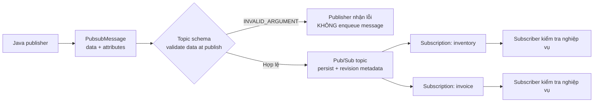
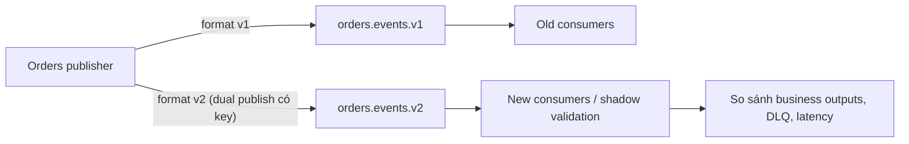

# Schemas, message validation và thay đổi định dạng

Trong hệ thống bán hàng dùng **Google Cloud Pub/Sub**, dịch vụ Java `orders-api` phát sự kiện `OrderCreated` để ứng dụng kho, hóa đơn và phân tích dữ liệu cùng xử lý. Một hôm publisher đổi `totalMinor` từ số sang chuỗi tùy ý; consumer Java cũ không giải mã được, message bị giao lại liên tục. Sự cố này có thể phòng ngừa bằng **schema** (hợp đồng định dạng), **message validation** lúc publish và quy trình **schema evolution** có kiểm soát.

Bài thuộc chương **Pub/Sub và thông điệp** của module **CLOUD_PROVIDERS_GCP**, kết nối kiến thức project/IAM, Cloud Run, GKE, dịch vụ lưu trữ/cơ sở dữ liệu và vận hành độ tin cậy. Trọng tâm là cách bảo đảm publisher và subscriber hiểu cùng một thông điệp, thay đổi định dạng mà không làm gián đoạn hệ thống, đồng thời nhận diện giới hạn của kiểm tra schema.

> Project, topic, schema, service account và messages đều là ví dụ. Các lệnh tạo tài nguyên, publish và thay đổi revision có thể phát sinh phí hoặc ảnh hưởng subscriber thật. Chỉ dùng project lab và thông điệp giả. Không đưa thông tin khách hàng, access token hay khóa bí mật vào schema, message mẫu hoặc logs.

## Mục tiêu học tập

Sau bài này, bạn có thể:

1. Giải thích schema được gắn vào **topic**, Pub/Sub kiểm tra **`message.data` lúc publish** và trả lỗi khi không khớp.
2. So sánh **Apache Avro** với **Protocol Buffers**, phân biệt **`JSON` và `BINARY` encoding**.
3. Tạo schema, gắn với topic, thử valid/invalid messages bằng `gcloud`, đọc thông tin schema revision trên subscriber.
4. Phân biệt **syntax/type validation** với **business validation**, tránh coi schema như cơ chế IAM hoặc phân quyền tenant.
5. Thay đổi schema bằng **revision tương thích**, chọn `firstRevisionId`/`lastRevisionId` và thực hiện rollout publisher/subscriber.
6. Xác định thay đổi phá vỡ tương thích và thiết kế **topic/schema mới, chuyển đổi dữ liệu, dual run, rollback**.
7. Viết publisher Java phù hợp schema, xử lý publish failure, observability, dead-letter và chi phí.

## 1. Schema trong Pub/Sub hoạt động ở đâu?

Schema là tài nguyên Pub/Sub xác định **cấu trúc và kiểu** của payload. Một schema có thể được gắn với nhiều topics. Khi một topic gắn schema, publisher phải gửi `data` đúng **schema type**, **encoding** và ít nhất một **revision được phép**.



**Phân biệt trách nhiệm:**

| Lớp | Kiểm tra gì? | Không làm gì? |
| --- | --- | --- |
| **Publisher** | Tạo payload, đúng encoding, đủ trường nghiệp vụ | Không nên chỉ dựa vào server trả lỗi để bảo vệ người dùng |
| **Pub/Sub schema** | Cú pháp và kiểu của **`data`** theo revision topic cho phép | Không xác nhận `tenantId` có quyền, số tiền dương, đơn hàng tồn tại |
| **Subscriber** | Giải mã, kiểm tra ngữ nghĩa, idempotency, xử lý lỗi | Không giả định message chỉ được giao đúng một lần |
| **IAM Pub/Sub** | Ai có quyền publish, subscribe, sửa topic/schema | Không xác thực quyền của từng order bên trong payload |

**Phạm vi validation:** Pub/Sub schema kiểm tra trường **`data`**, không áp hợp đồng đó lên `attributes`, `orderingKey` hoặc nghiệp vụ liên kết DB. Một message thất bại `INVALID_ARGUMENT` ở publish **chưa nằm trong topic**; dead-letter topic của subscription **không thể bắt** một message vốn chưa được publish thành công.

Nếu **topic không gắn schema**, Pub/Sub không tự validate JSON chỉ vì publisher đặt attribute `contentType=application/json`.

## 2. Chọn Avro hay Protocol Buffers?

Pub/Sub schema hỗ trợ **Apache Avro 1.11** và **Protocol Buffers (proto2/proto3)**. Một schema Pub/Sub chỉ có **một top-level type** và không hỗ trợ `import` tham chiếu type từ file khác trong định nghĩa schema.

| Tiêu chí | Apache Avro | Protocol Buffers |
| --- | --- | --- |
| Định nghĩa | Avro schema dạng JSON | `.proto` với field numbers |
| Phù hợp | Data pipeline, hệ sinh thái Avro/BigQuery | Microservices Java, Go, gRPC và generated types |
| Serialization | Avro JSON hoặc Avro binary theo schema | Proto JSON mapping hoặc wire-format binary |
| Evolution | Phụ thuộc Avro reader/writer resolution, defaults và unions | Giữ **field number/type**, thêm/bỏ trường `optional` theo hạn chế Pub/Sub |
| Đọc dữ liệu cũ | Cần quan tâm **writer schema revision** | Generated protobuf code thường bỏ qua unknown fields; vẫn phải giữ semantics |
| Rủi ro | Union JSON encoding dễ nhầm, sai defaults | Tái sử dụng field numbers, đổi type/enum, nhầm JSON field names |

### JSON và BINARY là encoding của **topic**

Khi gắn schema, bạn chọn **`JSON` hoặc `BINARY`**. Đây **không phải** hai kiểu schema khác nhau và Pub/Sub **không tự chuyển đổi** nội dung giữa chúng.

| Encoding | Payload trong `message.data` | Phù hợp |
| --- | --- | --- |
| **`JSON`** | UTF-8 JSON đúng quy tắc Avro JSON hoặc Protobuf JSON mapping | Dễ đọc trong lab/log, kiểm thử CLI |
| **`BINARY`** | Byte array đã được serializer Avro/Protobuf tạo | Thường gọn hơn, dùng client generated classes |

**Ví dụ dễ sai:** Proto3 `int64 total_minor` thường xuất thành JSON key `totalMinor` với giá trị **chuỗi số thập phân**, chẳng hạn `"145000"`. Avro JSON có quy tắc biểu diễn **union** riêng; không thể gửi JSON tùy ý rồi cho rằng cả hai schema types đều chấp nhận.

## 3. Hợp đồng OrderCreated phiên bản đầu tiên

Ta dùng Protocol Buffers và JSON encoding để có thể kiểm thử bằng CLI. Tạo file `order-created-v1.proto` trong thư mục lab:

```proto
syntax = "proto3";
package retail.events;

option java_package = "example.events";
option java_outer_classname = "OrderCreatedProto";

message OrderCreated {
  string event_id = 1;
  string order_id = 2;
  int64 total_minor = 3;
  string currency = 4;
}
```

Ý nghĩa dữ liệu:

| Trường | Kiểu | Quy tắc nghiệp vụ bổ sung |
| --- | --- | --- |
| `event_id` | `string` | ID duy nhất phục vụ chống xử lý trùng |
| `order_id` | `string` | Phải là mã đơn thực sự tồn tại của tenant hợp lệ |
| `total_minor` | `int64` | Tổng tiền theo đơn vị nhỏ nhất, **không âm** |
| `currency` | `string` | Một trong những mã ISO 4217 được ứng dụng chấp nhận |

**Giới hạn Proto3 cần nhớ:** Một số trường scalar **có thể bị bỏ qua và nhận default** khi parse. Ví dụ thiếu `order_id` có thể vẫn hợp lệ về mặt Protobuf schema nhưng tạo ra chuỗi rỗng trong Java. Muốn trường bắt buộc theo nghiệp vụ, phải **validate trong publisher và subscriber**, không chỉ trông vào cú pháp schema.

Một message hợp lệ theo Proto JSON mapping:

```json
{
  "eventId": "evt-001",
  "orderId": "ord-1001",
  "totalMinor": "145000",
  "currency": "VND"
}
```

Message sau **sai kiểu**:

```json
{
  "eventId": "evt-002",
  "orderId": "ord-1002",
  "totalMinor": "not-a-number",
  "currency": "VND"
}
```

Message sai kiểu bị từ chối ở publish, trong khi `totalMinor: "-100"` có thể **hợp lệ theo schema** nhưng **sai nghiệp vụ**.

## 4. Lab: tạo schema, topic và kiểm tra message

**Điều kiện:** đã bật `pubsub.googleapis.com`, có project Google Cloud được phép dùng Pub/Sub và Google Cloud CLI. Tài khoản quản trị cần các permission tạo/đọc schema, attach schema và tạo topic; publisher chỉ cần `pubsub.topics.publish` trên topic. Không cần cấp `roles/owner` cho publisher.

### 4.1 Kiểm tra ngữ cảnh (chỉ đọc)

```bash
PROJECT_ID="retail-dev-01"
SCHEMA_ID="order-created-schema"
TOPIC_ID="order-events-schema-lab"
SUB_ID="order-events-lab-sub"

gcloud auth list
gcloud config get-value project
gcloud services list --enabled --project="$PROJECT_ID" \
  --filter="config.name:pubsub.googleapis.com"
```

Các ID phải được đổi thành tài nguyên **chưa tồn tại** hoặc thuộc quyền kiểm soát của bạn. Việc đặt ID đơn giản không tạo tài nguyên.

### 4.2 Kiểm tra định nghĩa và tạo schema

```bash
# Validate định nghĩa .proto ở local file; chưa tạo topic.
gcloud pubsub schemas validate-schema \
  --type=protocol-buffer \
  --definition-file=order-created-v1.proto \
  --project="$PROJECT_ID"

# THAY ĐỔI HẠ TẦNG: tạo schema mới.
gcloud pubsub schemas create "$SCHEMA_ID" \
  --type=protocol-buffer \
  --definition-file=order-created-v1.proto \
  --project="$PROJECT_ID"

gcloud pubsub schemas describe "$SCHEMA_ID" --project="$PROJECT_ID"
gcloud pubsub schemas list-revisions "$SCHEMA_ID" --project="$PROJECT_ID"
```

`validate-schema` chỉ kiểm tra **định nghĩa hợp lệ**; nó không xác minh payload mẫu hay tương thích với publisher/consumer hiện có. Muốn kiểm tra một message, dùng lệnh tiếp theo.

### 4.3 Tạo topic gắn schema và subscription

```bash
# THAY ĐỔI HẠ TẦNG / CÓ THỂ PHÁT SINH PHÍ.
gcloud pubsub topics create "$TOPIC_ID" \
  --schema="$SCHEMA_ID" \
  --message-encoding=json \
  --project="$PROJECT_ID"

gcloud pubsub subscriptions create "$SUB_ID" \
  --topic="$TOPIC_ID" \
  --project="$PROJECT_ID"

# Xác nhận schemaSettings/encoding từ topic thực tế.
gcloud pubsub topics describe "$TOPIC_ID" --project="$PROJECT_ID"
```

`--message-encoding=json` chọn **Protobuf JSON mapping**, không phải Protobuf binary. Một producer gửi `toByteArray()` vào topic JSON sẽ bị từ chối.

### 4.4 Test message trước khi publish

```bash
VALID='{"eventId":"evt-001","orderId":"ord-1001","totalMinor":"145000","currency":"VND"}'
INVALID='{"eventId":"evt-002","orderId":"ord-1002","totalMinor":"not-a-number","currency":"VND"}'

# Chỉ validate; không đưa message lên topic.
gcloud pubsub schemas validate-message \
  --schema-name="$SCHEMA_ID" \
  --message-encoding=json \
  --message="$VALID" \
  --project="$PROJECT_ID"

# Kỳ vọng validation lỗi vì totalMinor không phải int64.
gcloud pubsub schemas validate-message \
  --schema-name="$SCHEMA_ID" \
  --message-encoding=json \
  --message="$INVALID" \
  --project="$PROJECT_ID"
```

### 4.5 Publish rồi pull

```bash
# THAY ĐỔI DỮ LIỆU: publish message hợp lệ.
gcloud pubsub topics publish "$TOPIC_ID" \
  --message="$VALID" \
  --attribute=eventType=OrderCreated \
  --project="$PROJECT_ID"

# Kỳ vọng INVALID_ARGUMENT; message không được nhận vào topic.
gcloud pubsub topics publish "$TOPIC_ID" \
  --message="$INVALID" \
  --project="$PROJECT_ID"

# Chỉ dành cho subscription lab vì --auto-ack sẽ xác nhận message đã pull.
gcloud pubsub subscriptions pull "$SUB_ID" \
  --limit=5 --auto-ack \
  --project="$PROJECT_ID"
```

**Kết quả mong đợi:** publish hợp lệ trả message ID; publish sai kiểu nhận `INVALID_ARGUMENT`; subscription chỉ có message đã được topic chấp nhận. Nếu lệnh pull không thấy ngay, kiểm tra thời điểm publish, subscription, quyền subscriber và thử lại sau; không lập tức kết luận schema sai.

## 5. Publisher Java: serialize theo đúng encoding

Trong hệ sinh thái Java, nên sinh class từ `.proto` bằng `protoc`/Maven plugin và dùng serializer chính thức. Ví dụ sau **giả định** đã tạo Java class `example.events.OrderCreatedProto` từ schema mục 3 và dự án có dependency `com.google.cloud:google-cloud-pubsub` cùng `com.google.protobuf:protobuf-java-util`, các versions được quản lý bằng BOM.

```java
import com.google.api.core.ApiFuture;
import com.google.cloud.pubsub.v1.Publisher;
import com.google.protobuf.ByteString;
import com.google.protobuf.util.JsonFormat;
import com.google.pubsub.v1.PubsubMessage;
import com.google.pubsub.v1.TopicName;
import example.events.OrderCreatedProto.OrderCreated;
import java.util.concurrent.TimeUnit;

public final class PublishOrderCreated {
  public static void main(String[] args) throws Exception {
    if (args.length != 2) {
      throw new IllegalArgumentException("Usage: PROJECT_ID TOPIC_ID");
    }
    TopicName topic = TopicName.of(args[0], args[1]);
    OrderCreated event = OrderCreated.newBuilder()
        .setEventId("evt-java-001")
        .setOrderId("ord-1003")
        .setTotalMinor(145000L)
        .setCurrency("VND")
        .build();

    // Phải là JSON vì topic lab được tạo với --message-encoding=json.
    String json = JsonFormat.printer()
        .omittingInsignificantWhitespace().print(event);
    PubsubMessage message = PubsubMessage.newBuilder()
        .setData(ByteString.copyFromUtf8(json))
        .putAttributes("eventType", "OrderCreated")
        .build();

    Publisher publisher = Publisher.newBuilder(topic).build(); // Dùng ADC.
    try {
      ApiFuture<String> id = publisher.publish(message);
      System.out.println("Published message ID: " + id.get());
    } finally {
      publisher.shutdown();
      publisher.awaitTermination(1, TimeUnit.MINUTES);
    }
  }
}
```

**Nếu topic dùng BINARY:** với generated Protobuf message, dùng `event.toByteString()` thay cho `JsonFormat.printer()`. Không sửa encoding ở phía publisher đơn lẻ khi topic vẫn yêu cầu JSON. Java client dùng **Application Default Credentials**; trên Cloud Run/GKE nên dùng workload identity/service account, không lưu JSON private key dài hạn.

Ở production, không hardcode ID vào mỗi event: `eventId` cần được sinh và lưu theo transaction/outbox nghiệp vụ để retry publish không phát sinh nhiều event logic khác nhau. Kiểm tra `future.get()` hoặc callback publish failure; không báo “đã phát thành công” khi Pub/Sub thực tế trả lỗi.

## 6. Subscriber biết message thuộc revision nào?

Khi một message được publish thành công tới topic có schema, Pub/Sub thêm ba **attributes do hệ thống cung cấp**:

| Attribute | Nội dung |
| --- | --- |
| `googclient_schemaname` | Tên schema đã được dùng để validate |
| `googclient_schemaencoding` | `JSON` hoặc `BINARY` |
| `googclient_schemarevisionid` | Revision ID dùng để parse và validate message |

Ví dụ xử lý **logic** trong Java:

```java
String encoding = message.getAttributesOrDefault(
    "googclient_schemaencoding", "");
String revision = message.getAttributesOrDefault(
    "googclient_schemarevisionid", "");

if ("JSON".equals(encoding)) {
  // Dùng JsonFormat.parser() và generated OrderCreated.Builder.
  // Kiểm tra tiếp eventId/orderId/amount/currency theo nghiệp vụ.
} else if ("BINARY".equals(encoding)) {
  // Dùng OrderCreated.parseFrom(message.getData()) cho protobuf binary.
} else {
  // Unsupported encoding: lưu/quarantine có kiểm soát, không ACK mù.
}
```

Đây là **mảnh code** trong subscriber, chưa khai báo `message`, ack/nack và exception handling. Với **Avro**, subscriber cần **writer schema revision** đã dùng khi encode, có thể fetch/cached theo `googclient_schemarevisionid` rồi thực hiện Avro schema resolution với reader schema phù hợp.

**Không nên xóa schema hoặc revision lịch sử ngay sau deploy.** Khi xóa, Pub/Sub có thể thay metadata bằng `_deleted-schema_` hoặc `_deleted-schema-revision_`; đặc biệt BigQuery subscriptions với `Use topic schema` có thể không ghi được các message đã publish bằng revision bị xóa. Tài liệu khuyến nghị **rollback bằng revision mới** hơn là xóa lịch sử.

### Khi consumer gặp schema hợp lệ nhưng nội dung không dùng được

Ví dụ `orderId=""` được Protobuf parse thành công nhưng sai nghiệp vụ. Consumer cần:

1. Ghi log lỗi phân loại, không ghi toàn payload chứa PII.
2. Gửi sang **quarantine/DLQ** theo thiết kế subscription hoặc ghi trạng thái `REJECTED` có audit.
3. **ACK chỉ sau khi** bản ghi bị từ chối đã được xử lý bền vững; nếu lỗi hạ tầng tạm thời thì NACK/retry có giới hạn.
4. Không tạo vòng lặp retry vô hạn cho poison message; theo dõi dead-letter count/backlog và có runbook replay.

## 7. Schema revisions và nguyên tắc tương thích

Một schema Pub/Sub có nhiều **revisions**; revision ID do Pub/Sub sinh, không phải số phiên bản tự đặt như `v1/v2`. Khi **commit một revision mới**, Pub/Sub kiểm tra các giới hạn tương thích với revisions đã có. Việc **validate riêng một definition** không thay thế bước kiểm tra tương thích này.

Các điểm kỹ thuật:

- **Protocol Buffers:** trong schema revisions được Pub/Sub quản lý, có thể **thêm/bỏ trường `optional`**, không thêm/bỏ các trường khác hoặc sửa trường hiện hữu. Không tùy tiện thay **field number**, field type hay ý nghĩa nghiệp vụ.
- **Avro:** revision mới phải tuân thủ khả năng schema resolution theo hướng **cả reader và writer** với các revisions liên quan. Khi thêm trường, quy tắc `default` và Avro union phải được xem xét kỹ.
- Một schema tối đa **20 revisions** tại một thời điểm. Giới hạn schema definition khoảng **300 KiB**; cần theo dõi quota áp dụng.
- **Tương thích kiểu dữ liệu chưa bảo đảm tương thích nghiệp vụ**: thêm mã enum, đổi đơn vị tiền hoặc đổi cách hiểu timestamp vẫn có thể khiến subscriber cũ xử lý sai.

### Ví dụ revision mới: thêm trường tùy chọn

Tạo `order-created-v2.proto` giữ nguyên toàn bộ các trường cũ, chỉ thêm:

```proto
syntax = "proto3";
package retail.events;

option java_package = "example.events";
option java_outer_classname = "OrderCreatedProto";

message OrderCreated {
  string event_id = 1;
  string order_id = 2;
  int64 total_minor = 3;
  string currency = 4;
  optional string sales_channel = 5;
}
```

Khi `sales_channel` không có, consumer v2 phải có default nghiệp vụ phù hợp, ví dụ `"unknown"`; không tự coi `""` là một kênh bán hàng hợp lệ. Producer cũ vẫn có thể gửi v1, producer mới phát v2.

### Commit và xem revision IDs

```bash
# Kiểm tra định nghĩa mới, chưa commit.
gcloud pubsub schemas validate-schema \
  --type=protocol-buffer \
  --definition-file=order-created-v2.proto \
  --project="$PROJECT_ID"

# THAY ĐỔI SCHEMA: tạo revision mới; chỉ làm sau contract tests.
gcloud pubsub schemas commit "$SCHEMA_ID" \
  --type=protocol-buffer \
  --definition-file=order-created-v2.proto \
  --project="$PROJECT_ID"

# Lấy revision IDs THẬT, không tự đặt tên v1/v2 để dùng trong --last-revision-id.
gcloud pubsub schemas list-revisions "$SCHEMA_ID" \
  --project="$PROJECT_ID" --view=full
```

Nếu commit không tương thích, **không xóa revision cũ để ép thành công** trên production; tạo schema/topic mới theo chiến lược breaking change ở mục 9.

## 8. Cho phép nhiều revisions rồi chuyển dần

Một topic có schema revisions được cấu hình bằng **dải revision cho phép**:

- `firstRevisionId`: revision cũ nhất **được phép** (inclusive).
- `lastRevisionId`: revision mới nhất **được phép** (inclusive).
- Nếu không chỉ định dải, Pub/Sub mặc định cho phép **toàn bộ dải** hiện có theo các mốc được cấu hình.
- Khi publish, Pub/Sub thử **từ revision mới nhất được phép về revision cũ nhất** cho tới khi hợp lệ hoặc thất bại.
- Khi thay đổi revision range/encoding của topic, cấu hình có thể mất **vài phút** để lan truyền.

Ví dụ sơ đồ dải:

```text
Schema revisions theo thời gian:  A (cũ) -- B -- C -- D (mới)

Topic cho phép A..D  -> validate theo D, C, B, A
Topic cho phép B..C  -> A-only và D-only bị từ chối
Topic cho phép D..D  -> chỉ message khớp D mới được nhận
```

### Cấu hình dải có chủ đích

```bash
# Thay bằng IDs lấy từ list-revisions và xác nhận thứ tự.
FIRST_REVISION_ID="REAL_OLD_REVISION_ID"
LAST_REVISION_ID="REAL_NEW_REVISION_ID"

# THAY ĐỔI TOPIC: cập nhật schema settings sau khi test tất cả publishers.
gcloud pubsub topics update "$TOPIC_ID" \
  --schema="$SCHEMA_ID" \
  --message-encoding=json \
  --first-revision-id="$FIRST_REVISION_ID" \
  --last-revision-id="$LAST_REVISION_ID" \
  --project="$PROJECT_ID"

gcloud pubsub topics describe "$TOPIC_ID" --project="$PROJECT_ID"
```

**Cảnh báo CLI:** khi update schema settings, các flags schema settings **không được truyền có thể trở về giá trị mặc định**. Luôn truyền schema, encoding và dải revision mong muốn **đầy đủ**, review `describe` trước/sau, không đổi ngẫu nhiên trên production.

### Phát message v2

```bash
V2='{"eventId":"evt-003","orderId":"ord-1004","totalMinor":"200000","currency":"VND","salesChannel":"mobile"}'

gcloud pubsub schemas validate-message \
  --schema-name="$SCHEMA_ID" \
  --message-encoding=json --message="$V2" \
  --project="$PROJECT_ID"

gcloud pubsub topics publish "$TOPIC_ID" \
  --message="$V2" \
  --project="$PROJECT_ID"
```

**Đọc metadata revision** tại subscriber: hai messages cùng topic có thể được validate theo **hai revisions khác nhau** trong giai đoạn chuyển tiếp. Pub/Sub **không revalidate** messages đã publish khi bạn commit revision mới hoặc đổi allowed range; message cũ tiếp tục giữ schema metadata tại thời điểm publish.

## 9. Thay đổi định dạng không làm gãy hệ thống

### Rollout tương thích: expand → migrate → contract

1. **Lập contract:** chốt ý nghĩa trường, data types, encoding, idempotency key và yêu cầu của mọi subscribers.
2. **Nâng subscribers trước:** chấp nhận cả dữ liệu cũ và trường `salesChannel` mới; test unknown/default values, replay, messages theo revision A/B.
3. **Commit revision tương thích:** dùng `validate-schema`, `validate-message` và contract tests trên staging; không chỉ kiểm tra syntax.
4. **Mở dải revisions topic:** để cả publisher cũ lẫn mới phát được; kiểm tra propagation và publish failures.
5. **Rollout publisher mới bằng canary:** quan sát `INVALID_ARGUMENT`, parse errors, DLQ, backlog và business metrics.
6. **Contract sau khi chắc chắn:** giới hạn dải revision cũ chỉ khi mọi publishers/subscribers/backfill đã sẵn sàng; giữ khả năng rollback và không xóa revision quá sớm.

### Khi nào cần schema/topic mới?

Các thay đổi sau thường là **breaking** hoặc cần quyết định phiên bản nghiệp vụ riêng:

| Thay đổi | Rủi ro | Cách xử lý |
| --- | --- | --- |
| Đổi `total_minor` từ `int64` sang `string` mô tả tiền | Không tương thích kiểu/ý nghĩa | Schema/event type mới; chuyển đổi rõ ràng |
| Tái sử dụng field number `3` cho trường khác | Consumer cũ đọc sai dữ liệu | **Không làm**; giữ/reserve field numbers |
| Đổi từ Proto JSON sang Avro binary | Subscriber không decode được; encoding khác | Topic mới hoặc cutover phối hợp toàn bộ |
| Bỏ trường mà consumer cũ còn cần | Lỗi nghiệp vụ dù schema chấp nhận | Deploy consumer mới trước hoặc duy trì bridge |
| Đổi tổng tiền từ VND sang xu/đồng khác mà giữ kiểu `int64` | Schema vẫn valid, kết quả sai | Tạo event version mới, ghi rõ đơn vị |
| Thêm giá trị enum mà consumer cũ không hiểu | Logic switch/default sai | Contract tests và fallback an toàn |

**Mẫu migration có breaking change:**



Sau khi so sánh, tắt producer/consumer v1 theo kế hoạch và làm sạch IAM/subscriptions **sau thời gian retention**. Dual publish tạo **hai messages khác nhau** nên consumer downstream phải có **business idempotency key** để không tạo hai hóa đơn. Nếu không thể dual publish an toàn, cân nhắc bridge/transform service hoặc cutover có maintenance window.

### Rollback schema revision

```bash
# THAY ĐỔI SCHEMA: rollback tạo REVISION MỚI với nội dung từ revision cũ.
gcloud pubsub schemas rollback "$SCHEMA_ID" \
  --revision-id="KNOWN_GOOD_REVISION_ID" \
  --project="$PROJECT_ID"

gcloud pubsub schemas list-revisions "$SCHEMA_ID" --project="$PROJECT_ID"
```

Rollback **không xóa message đã publish**, không đổi encoding của topic và không tự cập nhật giới hạn revision của topic đang pin một dải. Phải kiểm tra lại `schemaSettings` trên topic và producer/consumer sau rollback. Đừng dùng `delete-revision` như công cụ rollback: xóa là vĩnh viễn và có thể ảnh hưởng BigQuery subscription dùng topic schema.

## 10. Message validation không phải business validation

Một schema có thể nhận message:

```json
{"eventId":"","orderId":"","totalMinor":"-100","currency":"XYZ"}
```

Đây có thể là payload **hợp lệ về kiểu Protobuf**, nhưng sai nghiệp vụ. Định nghĩa **ba lớp kiểm tra**:

| Lớp | Ví dụ | Ứng phó khi lỗi |
| --- | --- | --- |
| **Schema/type** | `totalMinor` phải parse được thành `int64` | Reject tại publisher / `INVALID_ARGUMENT` |
| **Business rules** | `eventId` không rỗng, `totalMinor >= 0`, currency được phép, tenant đúng | Reject/quarantine ở app với audit |
| **Delivery/idempotency** | Cùng `eventId` được giao hai lần | Transaction/upsert có điều kiện, ACK sau commit |

**Pub/Sub at-least-once delivery** vẫn có thể giao cùng message nhiều lần; schema không giải quyết duplicate, ordering, late events hoặc xử lý side effects. Với consumer thấy event ID khác nhưng cùng order/business operation, cần **business idempotency** chứ không chỉ dựa message ID.

### Publish thành công nhưng consumer thất bại

Đó là **lỗi sau publish**, khác lỗi schema validation tại topic. Nếu subscriber không parse được do bug/phiên bản mới, nó có thể NACK/retry và cuối cùng chuyển tới DLQ **nếu subscription có cấu hình**. Kiểm tra payload theo revision metadata và đừng ACK message chưa được xử lý/quarantine bền vững.

## 11. IAM, observability và giới hạn vận hành

### Quyền tối thiểu

| Chủ thể | Quyền cần trong thiết kế | Tránh |
| --- | --- | --- |
| Schema administrator | `pubsub.schemas.create/commit/validate/attach`, sửa topic theo phạm vi được giao | Cho mọi publisher quyền sửa schema |
| Java publisher | `roles/pubsub.publisher` trên **đúng topic** | `roles/editor` ở toàn project |
| Subscriber | `roles/pubsub.subscriber` trên **đúng subscription** | Quyền xóa topic/schema không cần thiết |
| CI deploy schema | Quyền schema/topic có approval, WIF/SA impersonation | Service account key lưu trong repo |

Schema chỉ là **data contract**, không chặn publisher có IAM hợp lệ gửi dữ liệu của tenant khác nếu vẫn đúng kiểu. Thiết kế server-side authorization, input sanitization và encryption/retention cho dữ liệu nhạy cảm theo đúng trách nhiệm.

### Metrics cần theo dõi

- **Publish failures** theo lỗi `INVALID_ARGUMENT`, `PERMISSION_DENIED`, quota: phân biệt schema, IAM và rate limit.
- **Message ingestion/throughput** trên topic; nếu lỗi validation tăng, lượng message publish thành công có thể giảm.
- **Subscription backlog, oldest unacked age, delivery attempts, DLQ**: phát hiện subscriber cũ không parse revision mới.
- **Schema revision distribution** từ attributes ở subscriber: xem tỉ lệ message đang dùng v1/v2 trong giai đoạn migrate.
- **Business validation rejects** và số order/invoice thực sự được xử lý; schema-compatible không bằng business-correct.
- **Billable operations/bytes**, log ingestion và DLQ/storage: dual publish và replay làm tăng chi phí.

Log nên ghi **message ID, schema name/revision, encoding, event ID đã hash, error class và trace ID**, không ghi toàn payload chứa PII hoặc credentials. Đặt alert khi publish lỗi sau commit mới, backlog tăng hoặc DLQ bắt đầu có message.

### Các giới hạn cần nhớ

- Schema definition tối đa khoảng **300 KiB**; một schema tối đa **20 revisions**.
- Chỉ hỗ trợ **Avro/Protocol Buffers** theo phiên bản giới hạn được sản phẩm công bố; một schema chỉ có **một top-level type**.
- **Tất cả publisher tới topic schema-enabled phải tuân cùng encoding** đã cấu hình.
- Dải revision và cấu hình thay đổi có thể mất vài phút để có hiệu lực.
- Không xóa revision lịch sử khi còn message đang retention/replay, nhất là khi BigQuery subscription dùng topic schema.

## 12. Bảng chẩn đoán nhanh

| Triệu chứng | Nguyên nhân khả dĩ | Kiểm tra |
| --- | --- | --- |
| Publish `INVALID_ARGUMENT` | JSON/BINARY sai encoding, sai type hoặc ngoài allowed revision range | `topics describe`, `validate-message`, contract tests |
| Java publisher dùng `toByteString()` nhưng topic JSON | Đã gửi protobuf binary vào JSON topic | Dùng `JsonFormat.printer()`, không sửa topic tùy tiện |
| Subscriber Java parse lỗi khi rollout v2 | Consumer chưa hiểu revision mới | `googclient_schemarevisionid` và generated code version |
| Message có kiểu đúng nhưng thiếu `orderId` | Proto3 scalar mặc định, không có business validation | Kiểm tra application validator |
| Commit revision mới bị từ chối | Không tương thích với revisions hiện có | Giữ type/field numbers, thử optional field hoặc schema mới |
| Message cũ không có trong topic sau khi đổi schema | Không phải hành vi revalidation | Kiểm tra publish-time logs, retention và subscription |
| `gcloud` validate được nhưng Java publish bị 403 | CLI principal khác workload identity/IAM thiếu | ADC/runtime SA, topic IAM và Policy Troubleshooter |
| DLQ tăng sau deploy schema mới | Consumer đang fail sau publish | Kiểm tra decoding/semantics, rollback canary, replay có kiểm soát |
| BigQuery subscription lỗi sau xóa revision | Mất schema writer revision cần giải mã | Tránh xóa; khôi phục schema theo hướng dẫn hỗ trợ |
| Cùng order tạo hai hóa đơn | Duplicate delivery hoặc dual publish | Business idempotency, outbox và dedup |

## 13. Case study: đổi định dạng sự kiện thanh toán

Đội thanh toán muốn bổ sung `salesChannel` cho `OrderCreated` và tương lai thay đơn vị `totalMinor`.

**Phương án A — Thêm trường tùy chọn:** cam kết revision v2, nâng consumers xử lý khi trường thiếu, mở range A..B, rollout Java publisher mới, đo revision metadata, rồi thu hẹp range khi hết producer cũ. Đây là **schema evolution tương thích** nếu consumer nghiệp vụ cũng sẵn sàng.

**Phương án B — Đổi đơn vị tiền/kiểu dữ liệu:** không thay `totalMinor` bằng string hoặc đổi cách hiểu âm thầm. Tạo event `OrderCreatedV2` với schema/topic mới (ví dụ `orders.events.v2`), dual run/transform và mapping rõ `money.currency` + `money.amountMinor`. So sánh kết quả kế toán, áp idempotency, chỉ ngừng v1 khi downstream và lưu trữ/replay sẵn sàng.

**Nếu rollout gây lỗi:** tạm dừng canary publisher, giữ lại revision cũ trong allowed range, sửa/revert consumer, kiểm tra backlog và DLQ; không xóa schema cũ trước khi xác nhận có thể replay.

## 14. Bài tập tự kiểm tra

### Bài 1 — Schema kiểm tra gì?

Message có `orderId=""` và `totalMinor="-100"` vẫn có thể hợp lệ theo Proto3 schema. Tại sao?

<details>
<summary>Đáp án</summary>

Schema kiểm tra kiểu/format của `data`; trường scalar có thể vắng mặt hoặc chứa giá trị sai nghiệp vụ. Publisher/subscriber cần kiểm tra `orderId` không rỗng và số tiền không âm.
</details>

### Bài 2 — Lỗi publish và DLQ

Publisher gửi `totalMinor="abc"` vào topic gắn Proto3 JSON schema. Subscriber DLQ có nhận message này không?

<details>
<summary>Đáp án</summary>

Không. Pub/Sub từ chối ngay ở **publish** với `INVALID_ARGUMENT`; message chưa vào topic nên không thể vào DLQ của subscription. Publisher phải xử lý/sửa payload hoặc ghi quarantine riêng.
</details>

### Bài 3 — Encoding sai

Topic yêu cầu `--message-encoding=json` nhưng Java publisher gửi `OrderCreated.toByteString()`. Vì sao thất bại?

<details>
<summary>Đáp án</summary>

`toByteString()` là Protobuf **binary**, không phải Proto JSON. Dùng `JsonFormat.printer()` để tạo UTF-8 JSON, hoặc thực hiện migration topic encoding đã được phối hợp với tất cả publishers/subscribers.
</details>

### Bài 4 — Revision range

Schema có A, B, C; topic chỉ cho phép B..C. Message chỉ khớp A có được publish không?

<details>
<summary>Đáp án</summary>

Không. Pub/Sub thử từ revision C về B; nếu không khớp, publish thất bại. Revision A ở ngoài dải.
</details>

### Bài 5 — Phân biệt hai loại compatibility

Vì sao đổi đơn vị tiền từ “đồng” sang “nghìn đồng” nhưng giữ `int64` vẫn nguy hiểm?

<details>
<summary>Đáp án</summary>

Kiểu dữ liệu không đổi nên schema validation có thể vẫn thành công, nhưng consumer cũ tính sai tiền. Đây là **breaking semantic change**; cần event version/schema/topic mới và migration có kiểm thử nghiệp vụ.
</details>

### Bài 6 — Dữ liệu cũ sau update

Sau khi commit revision B, các message đã publish bằng A có được Pub/Sub kiểm tra lại và đổi metadata thành B không?

<details>
<summary>Đáp án</summary>

Không. Validation xảy ra tại publish; metadata schema/revision của message cũ giữ theo thời điểm đó. Subscriber phải hiểu dữ liệu lịch sử theo đúng writer revision.
</details>

### Bài 7 — Rollback

Bạn muốn khôi phục định nghĩa từ revision A. Có nên xóa revision B vừa tạo không?

<details>
<summary>Đáp án</summary>

Không nên xóa lịch sử, nhất là khi còn message hoặc BigQuery subscription dùng schema. Dùng `schemas rollback --revision-id=A` để tạo revision mới có nội dung A, điều chỉnh topic range và kiểm thử consumers/publishers.
</details>

### Bài 8 — Dual publish

Để đổi từ Proto JSON sang Avro binary, hệ thống publish song song hai topics. Tại sao cần idempotency key?

<details>
<summary>Đáp án</summary>

Hai topics tạo hai message IDs riêng cho **cùng một thao tác nghiệp vụ**; nếu cùng downstream đọc cả hai, có thể xử lý đơn hàng hai lần. Dùng event/business key ổn định, xử lý nguyên tử và quan sát kết quả shadow trước cutover.
</details>

## 15. Checklist triển khai production

- [ ] Schema xác định rõ type, encoding, event name, field numbers/types và quy tắc nghiệp vụ ngoài schema.
- [ ] Đã test `validate-schema`, `validate-message` với payload hợp lệ, sai kiểu và thiếu trường quan trọng.
- [ ] Publishers dùng serializer tương ứng topic `JSON/BINARY`, xử lý publish `INVALID_ARGUMENT`.
- [ ] Java subscribers đọc schema metadata, hỗ trợ revision cũ/mới và reject business-invalid có kiểm soát.
- [ ] Không dựa vào Pub/Sub schema để xác thực tenant, phân quyền hoặc chống duplicate.
- [ ] Có compatibility/contract tests cho tất cả consumers và bảng ma trận phiên bản publisher/subscriber.
- [ ] Rollout theo thứ tự **consumer trước, producer sau**, dải revisions cho phép có chủ đích.
- [ ] Breaking change dùng schema/topic mới và migration/dual run an toàn, có idempotency key.
- [ ] Không xóa revision cũ khi còn dữ liệu retention, replay hoặc BigQuery subscription cần nó.
- [ ] IAM tách schema admin, topic publisher và subscriber; workload dùng ADC/identity ngắn hạn.
- [ ] Có alerts publish failures, backlog, DLQ, version distribution, ingestion bytes và chi phí.
- [ ] Có runbook rollback topic revision range, pause canary, replay và dọn tài nguyên lab.

## Tài liệu tham khảo chính thức

- [Pub/Sub schema overview](https://cloud.google.com/pubsub/docs/schemas): giới hạn, Avro/Proto, phạm vi validate.
- [Create a schema](https://cloud.google.com/pubsub/docs/create-schemas): `schemas create`.
- [Associate a schema with a topic](https://cloud.google.com/pubsub/docs/associate-schema-topic): encoding và revision range.
- [Validate a schema definition](https://cloud.google.com/pubsub/docs/validate-schema-definition): validation syntax.
- [Validate messages](https://cloud.google.com/pubsub/docs/validate-schema-message): `schemas validate-message`.
- [Publish messages with a schema](https://cloud.google.com/pubsub/docs/publish-topics-schema): publish, `INVALID_ARGUMENT` và revision metadata.
- [Parse schema messages](https://cloud.google.com/pubsub/docs/schemas-valid): `googclient_schemaname`, `googclient_schemaencoding`, `googclient_schemarevisionid`.
- [Commit a schema revision](https://cloud.google.com/pubsub/docs/commit-schema-revision): tương thích Avro/Proto và quota revisions.
- [Roll back a schema](https://cloud.google.com/pubsub/docs/roll-back-schemas): tạo revision mới từ revision lịch sử.
- [SchemaSettings API](https://cloud.google.com/pubsub/docs/reference/rpc/google.pubsub.v1#schemasettings): `first_revision_id` và `last_revision_id`.
- [Pub/Sub Java client](https://cloud.google.com/java/docs/reference/google-cloud-pubsub/latest/overview): publisher/subscriber và ADC.
- [Pub/Sub pricing](https://cloud.google.com/pubsub/pricing) và [Monitoring Pub/Sub](https://cloud.google.com/pubsub/docs/monitoring): chi phí và vận hành.

