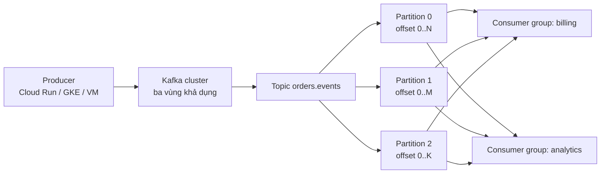
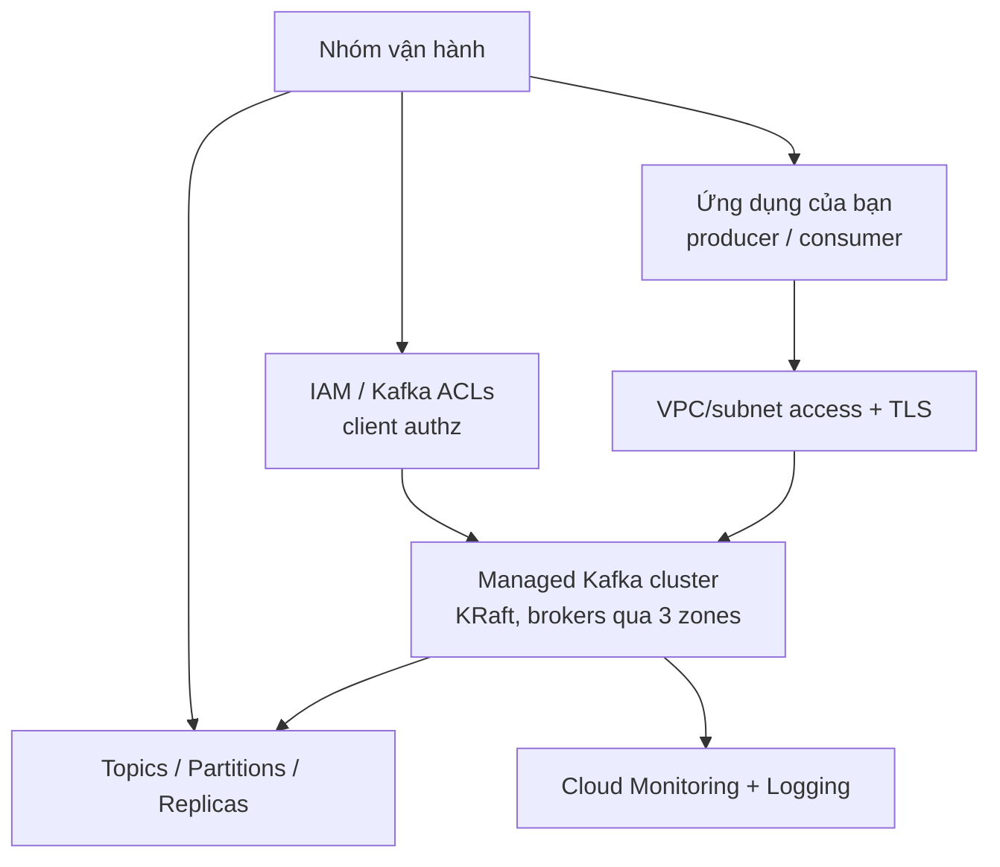
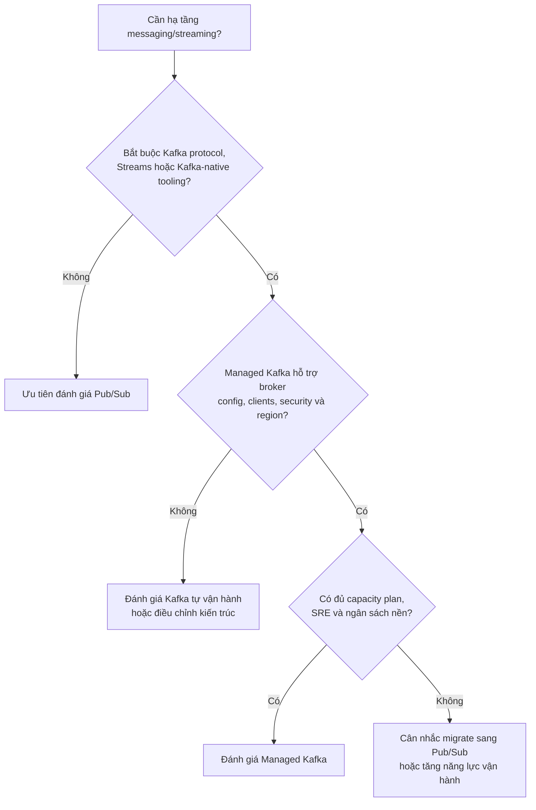
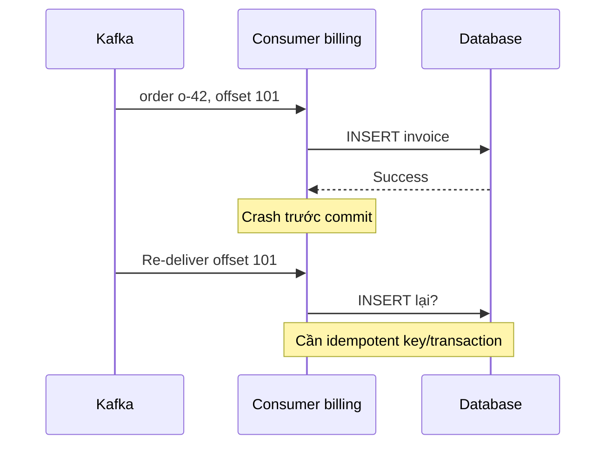

# Managed Service for Apache Kafka và tiêu chí lựa chọn

Một đội thương mại điện tử có hai nhu cầu khác nhau: phát sự kiện `OrderCreated` cho nhiều dịch vụ nhận thông báo, và đưa luồng thay đổi dữ liệu liên tục vào hệ thống phân tích vốn đã dùng **Apache Kafka clients, consumer groups, Kafka Streams và Kafka Connect**. Cả **Google Cloud Pub/Sub** lẫn **Managed Service for Apache Kafka** đều xử lý thông điệp bất đồng bộ, nhưng mô hình mở rộng, thứ tự, lưu giữ, chi phí và trách nhiệm vận hành khác nhau.

Bài thuộc chương **Pub/Sub và thông điệp** của mô-đun `CLOUD_PROVIDERS_GCP`, nối tiếp kiến thức về project, IAM, VPC, GKE, Cloud Run, lưu trữ, dữ liệu và vận hành trên Google Cloud. Mục tiêu là **chọn dịch vụ đúng theo nhu cầu**, hiểu Managed Kafka quản lý phần nào và làm một bài thực hành Kafka an toàn với cluster **đã tồn tại**. Không giả định “managed” có nghĩa không cần thiết kế kiến trúc hoặc quan sát hệ thống.

## 1. Mục tiêu học tập

Sau bài học, bạn có thể:

1. Mô tả **cluster, broker, topic, partition, replica, producer, consumer group, offset** và **retention**.
2. Giải thích phần Google Cloud quản lý trong **Managed Service for Apache Kafka**, những giới hạn của dịch vụ và phần vẫn thuộc trách nhiệm ứng dụng.
3. So sánh **Managed Kafka, Pub/Sub và Kafka tự vận hành** theo compatibility, latency, ordering, throughput, scaling, security và TCO.
4. Thiết kế key/partition, consumer groups, retry và xử lý trùng an toàn.
5. Kết nối Kafka clients với **SASL/OAUTHBEARER**, **Application Default Credentials (ADC)** và quyền IAM/Kafka ACL phù hợp.
6. Thực hiện preflight chỉ đọc, tạo một **topic lab** trên cluster đã được ủy quyền, rồi produce/consume bằng Kafka CLI.
7. Theo dõi consumer lag, throughput, failures, disk/retention, quota và chi phí.
8. Lập phương án migration/DR, đánh giá Kafka Connect, Schema Registry và điều kiện không nên chọn Kafka.

**Phạm vi:** bài chủ yếu dành cho **Managed Service for Apache Kafka chạy trên Google Cloud**; không phải hướng dẫn dựng ZooKeeper/Kafka trên VM hoặc GKE. Lệnh ghi chỉ dành cho **project/cluster test** được phép dùng. Không tạo cluster mới hoặc thay IAM sản xuất trong bài; việc tạo cluster có chi phí nền ngay cả khi chưa có message.

## 2. Mô hình dữ liệu Kafka



| Thành phần | Vai trò | Điều cần nhớ |
| --- | --- | --- |
| **Cluster** | Tập Kafka brokers cùng cấu hình quản trị | Managed Kafka cung cấp hạ tầng nhiều zone |
| **Broker** | Máy chủ xử lý Kafka protocol, lưu partition replicas | Số brokers được dịch vụ bố trí, không điều khiển từng broker trực tiếp |
| **Topic** | Luồng records có cùng mục đích | Ví dụ `orders.events` |
| **Partition** | Log append-only có thứ tự, mỗi record có offset | **Ordering chỉ đảm bảo trong cùng partition** |
| **Replication factor** | Số bản sao của partition trên brokers | RF=3 thường hợp với yêu cầu HA, tăng network/chi phí |
| **Key** | Dùng partitioner quyết định record đi partition nào | Dùng `orderId` nếu cần thứ tự theo order |
| **Consumer group** | Nhiều consumer chia công việc của một nhóm | Trong group, một partition được một member xử lý tại thời điểm bình thường |
| **Offset** | Vị trí đọc/commit của consumer trong partition | Có thể replay nếu record còn retention |
| **Retention** | Thời gian/dung lượng lưu record dù đã consume | **Không xóa record chỉ vì consumer đã commit** |

**Ví dụ:** cùng topic `orders.events` có consumer group `billing` tính hóa đơn và `analytics` cập nhật warehouse. Mỗi group có offset riêng, vì vậy cả hai đọc được mỗi record. Trong nhóm `billing`, thêm consumer có thể tăng throughput **tới giới hạn số partitions**, không tạo thêm thứ tự toàn cục.

## 3. Google Cloud quản lý những gì?

**Managed Service for Apache Kafka** chạy Apache Kafka tương thích với Kafka open-source client protocol, kết hợp Console, `gcloud`, API và Cloud Monitoring/Logging. Google Cloud vận hành phần lớn hạ tầng broker: provision, bố trí brokers qua **ba zone**, quản lý máy chủ/ổ đĩa, thay thế phần cứng, bảo trì và vá bảo mật quan trọng.



**Những giới hạn và trách nhiệm quan trọng:**

- Cluster phân bố đều tài nguyên qua **ba zone** của một region; không tự chọn từng zone và không có cluster một/hai zone.
- Dịch vụ dùng **KRaft**, **không hỗ trợ ZooKeeper mode**. Không nên giả định script quản lý ZooKeeper vẫn áp dụng.
- Bạn xác định **cluster capacity bằng vCPU/RAM**, thiết kế số partitions, replication factor, retention, topic configs và các Kafka clients. Đừng mặc định scaling tự động vô hạn như Pub/Sub.
- Không thể chỉnh tùy ý mọi broker configuration. Một số cấu hình read-only chỉ có hiệu lực sau broker restart/bảo trì; những cấu hình service-managed không được sửa.
- Dịch vụ tự vá lỗ hổng quan trọng và bảo trì hạ tầng nhưng **không cam kết tự nâng tất cả Kafka minor versions** như một cluster do người vận hành kiểm soát.
- **Kafka Connect managed** là tài nguyên riêng nếu dùng; connector availability và custom-plugin support không giống Kafka Connect tự host.
- Hệ thống vẫn cần **DR liên vùng** nếu business RTO/RPO đòi chống mất cả region; replication trong ba zone chỉ xử lý một lớp HA.

Không thể coi Managed Kafka là “Pub/Sub có Kafka endpoint”. Hai sản phẩm có mô hình delivery, storage và control plane khác nhau.

## 4. So sánh Pub/Sub, Managed Kafka và Kafka tự vận hành

| Tiêu chí | **Pub/Sub** | **Managed Kafka** | **Kafka tự vận hành** |
| --- | --- | --- | --- |
| API/client | Google Cloud Pub/Sub API/client libraries | **Apache Kafka protocol** hiện có | Apache Kafka protocol |
| Vận hành | Ít nhất: không quản lý brokers/partitions | Google Cloud quản lý brokers; bạn thiết kế cluster capacity, topics, consumer groups | Tự quản lý brokers, storage, OS, upgrades, DR |
| Chi phí nền | Chủ yếu trả theo sử dụng, có phí lưu trữ/capacity tính năng liên quan | **Trả theo capacity** compute + storage/network; cluster nhàn rỗi vẫn có phí | VM/disk/network + chi phí nhân lực/on-call |
| Mở rộng | Tự động theo tải lớn, không tự chia partitions | Phải lập capacity/partition plan và điều chỉnh khi tăng tải | Toàn quyền nhưng công việc nhiều |
| Ordering | Theo **ordering key** nếu bật, với giới hạn thông lượng | Theo **partition** | Theo partition |
| Delivery | Thường at-least-once; có **exactly-once delivery** cho pull được hỗ trợ | At-least-once thường gặp; idempotent producer/transactions theo Kafka | Như Kafka |
| Replay/retention | Retention tối đa **31 ngày**, theo policy | Retention topic có thể dài/không giới hạn theo cấu hình và nguồn lực | Theo disk/retention tự quản |
| Tính tương thích hệ sinh thái | Không chạy trực tiếp Kafka-native protocol | Tương thích ứng dụng Kafka open-source | Toàn quyền plugin/broker settings |
| Độ trễ | Thường khoảng 100 ms end-to-end (không phải SLA cố định) | Có thể quanh 10 ms với clients hoạt động tốt (không phải SLA cố định) | Phụ thuộc hạ tầng/tuning |
| Ecosystem | Pub/Sub subscriptions, BigQuery/Storage integrations | Kafka Streams/Connect/Kafka clients; một số tính năng managed có giới hạn | Plugin/Connectors linh hoạt nhất |
| Kiểm soát cấu hình broker | Không có brokers để cấu hình | Một phần, theo service policy | Gần như toàn phần |

Bảng là **tiêu chí kỹ thuật, không phải bảng xếp hạng**. Pub/Sub có hỗ trợ ordering, exactly-once **delivery** nhưng không đảm bảo mọi side effect database chính xác một lần; Kafka transactions có exactly-once semantics **trong chuỗi Kafka đọc–xử lý–ghi Kafka** khi dùng đúng API/consumer settings, không tự mở rộng tới mọi hệ thống ngoài.

### 4.1. Khi nghiêng về Pub/Sub

- Event-driven services mới trên Google Cloud, dùng Cloud Run/GKE và không cần Kafka-native APIs.
- Lưu lượng biến thiên mạnh, muốn **autoscale** mà không quản trị partitions hoặc cluster capacity.
- Cần subscription push/pull, dead-letter topics, filter và IAM đơn giản.
- Chi phí phù hợp mô hình trả theo lượng message, không muốn cluster luôn chạy.

### 4.2. Khi nghiêng về Managed Kafka

- Hệ thống **đã dùng Kafka protocol**, muốn chuyển workloads sang Google Cloud với ít thay đổi business code.
- Cần Kafka Streams, ecosystem Kafka-native và consumer group/partition semantics.
- Cần đọc lại event log theo offsets trong thời gian retention tùy chỉnh.
- Có throughput ổn định, đội ngũ hiểu partitions, rebalances, quota và client backpressure.

### 4.3. Khi vẫn cân nhắc Kafka tự vận hành

- Cần broker configs/plugins chưa được managed service hỗ trợ, môi trường hạ tầng/phiên bản tùy biến đặc biệt.
- Đã có đội Kafka SRE và tối ưu TCO vượt chi phí vận hành.
- Quy định dữ liệu/triển khai không phù hợp ràng buộc managed service.
- Cần kiểm soát lịch upgrade, brokers, storage hoặc plugin ở cấp rất sâu.

**Nguyên tắc:** chọn cách **ít rủi ro và ít vận hành nhất** đáp ứng đúng yêu cầu hiện tại, không chọn Kafka chỉ vì “tải lớn” khi Pub/Sub cũng đáp ứng.

## 5. Cây quyết định lựa chọn



**Năm câu hỏi phải trả lời bằng số liệu:**

1. Tỷ lệ producer/consumer **MiB/s**, peak và thời gian giữ dữ liệu?
2. Có cần ordering theo entity key/partition, replay nhiều lần hoặc transactional stream processing?
3. Có bao nhiêu **consumer groups**, mỗi group chịu lag tối đa bao lâu?
4. Đội ngũ có cần Kafka-native client/protocol, connector đặc thù hoặc broker config ngoài danh sách managed?
5. Ngân sách tháng, nhu cầu HA liên vùng và số giờ on-call/SRE chấp nhận được là bao nhiêu?

Nếu chưa có dữ liệu, làm **proof of concept** với vài chủ đề và test workload đại diện, không quyết định chỉ từ bảng marketing.

## 6. Producer, partitions và thứ tự sự kiện

Kafka định tuyến records vào partitions theo key/partitioner. Nếu mỗi lần đặt hàng phát `OrderCreated`, `OrderPaid`, `OrderShipped`, dùng **cùng `orderId` làm key** giúp các event của một đơn hàng đi cùng partition, giữ thứ tự **trong partition** theo log append.

```json
{"eventId":"evt-1001","orderId":"o-42","type":"OrderCreated","version":1}
{"eventId":"evt-1002","orderId":"o-42","type":"OrderPaid","version":2}
{"eventId":"evt-1003","orderId":"o-99","type":"OrderCreated","version":1}
```

Không có thứ tự tổng quát giữa `o-42` và `o-99` nếu chúng ở partitions khác nhau. Cần lưu ý:

- **Key không phân bố đều** → hot partition có thể giới hạn throughput cả luồng.
- **Tăng số partitions** giúp tăng concurrency nhưng có thể thay ánh xạ key→partition của các records mới, ảnh hưởng giả định order nếu ứng dụng không thiết kế cẩn thận.
- Mỗi partition trong một consumer group thường chỉ có **một active consumer**; 12 consumers với 3 partitions không tạo 12 luồng xử lý song song.
- **Replication factor=3** tạo replicas cho HA; replicas **không** làm tăng số partition-level consumer concurrency.
- Producer nên dùng `acks=all` và idempotent producer khi cần hạn chế duplicates từ retry; chọn `min.insync.replicas` phù hợp với RF/durability.

Không đặt `acks=0` hoặc giảm replication factor chỉ để tăng throughput khi nghiệp vụ yêu cầu không mất đơn hàng.

## 7. Delivery, offsets và “exactly once” thực tế

Consumer đọc Kafka records, xử lý và commit offset cho group. Nếu crash **sau khi ghi DB nhưng trước commit**, record có thể được đọc lại → tác vụ trùng.



Phân biệt:

| Cam kết | Điều kiện/giới hạn |
| --- | --- |
| **At-most-once** | Commit trước khi xử lý có thể mất record khi crash |
| **At-least-once** | Xử lý rồi commit, chấp nhận retry/redelivery |
| **Kafka exactly-once processing** | Idempotent producer + transactions và offset coordination trong phạm vi Kafka→Kafka được hỗ trợ |
| **Pub/Sub exactly-once delivery** | Tập trung vào cơ chế giao nhận/ack ở pull subscription hỗ trợ, không bao trùm side effects |
| **Business exactly-once effect** | Cần transaction, unique key, dedupe hoặc idempotency ở database/payment API |

Ví dụ bảo vệ hóa đơn:

```sql
CREATE TABLE processed_events (
  event_id VARCHAR(120) PRIMARY KEY,
  processed_at TIMESTAMP NOT NULL
);
```

Ghi `processed_events` và business update trong **cùng DB transaction**; nếu `event_id` đã tồn tại, bỏ qua side effect nhưng vẫn commit Kafka offset theo quy trình. Đây là phương án cho trường hợp at-least-once và dễ kiểm chứng hơn hứa “không bao giờ có duplicate”.

## 8. Retention và replay

Kafka không xóa record khi một consumer ack/commit. Records tồn tại đến khi chính sách `retention.ms`/`retention.bytes` và các điều kiện quản lý log áp dụng; consumer có thể reset offset để đọc lại dữ liệu còn retention.

| Câu hỏi | Tác động thiết kế |
| --- | --- |
| Muốn replay sau sự cố mấy ngày? | Retention tối thiểu phải lớn hơn **lag dự kiến + thời gian điều tra/phục hồi** |
| Tải ingest bao nhiêu? | Ảnh hưởng local/long-term storage và network replication |
| Cần truy vấn current state thay event log? | Có thể cần compacted topic hoặc database riêng; hiểu semantics compaction |
| Cần lưu trữ nhiều năm? | Đánh giá chi phí/retention phù hợp; có thể archive sang Cloud Storage |
| Có dữ liệu cá nhân cần xóa theo chính sách? | Event log bất biến/replica/replay khó đáp ứng “xóa ngay từng record”; thiết kế dữ liệu và retention từ đầu |

**Lưu ý:** tài liệu Managed Kafka khuyến cáo không đặt retention quá ngắn (ví dụ dưới 48 giờ) vì consumer downtime có thể vượt thời hạn. Retention 7 ngày không đồng nghĩa **consumer có thể bị dừng 8 ngày rồi đọc đủ toàn bộ dữ liệu**.

## 9. Sizing cluster và tính chi phí sơ bộ

Managed Kafka yêu cầu ít nhất **3 vCPU/cluster**, bộ nhớ trong khoảng **1–8 GiB mỗi vCPU**, dịch vụ phân bổ tài nguyên qua ba zone. Broker count, local storage và storage tiering do service điều phối theo cấu hình capacity; không coi 3 vCPU là lời khuyên đủ cho production.

### 9.1. Ví dụ tính lượng dữ liệu

Producer ổn định **1 MiB/s**:

```text
1 MiB/s × 86.400 s/ngày = 86.400 MiB/ngày
                         = 84,375 GiB/ngày

3 ngày retention ≈ 253,125 GiB dữ liệu logical
RF=3              ≈ 759,375 GiB bản sao logical trước
                    khi tính tiering, compression và overhead
```

Đây là **ước lượng dữ liệu**, không phải công thức hóa đơn: Managed Kafka tính **compute (vCPU/RAM)**, local storage được cấp theo capacity, long-term storage, **inter-zone replication/network**, Connect clusters/PSC khi dùng. Service có cơ chế lưu local/long-term và pricing không đồng nhất với phép nhân RF của retained bytes.

### 9.2. Các biến cần đo

- Ingress, egress trung bình và peak theo MiB/s.
- Tỷ lệ nén của payload; batch size, message size, producer acks.
- Partitions, replica count, broker saturation, per-zone traffic.
- Retention và số consumer groups, tốc độ các consumer đọc lại.
- Inter-zone egress, PSC, cross-region access và Kafka Connect usage.
- Mức sử dụng vCPU/RAM: quá dư capacity tăng chi phí idle, quá sát peak gây lag/timeouts.

Vì Managed Kafka có **compute trả theo capacity**, một cluster ít traffic vẫn có chi phí nền. Pub/Sub thường thích hợp hơn khi tải rất thưa/thất thường; ngược lại Kafka có thể hợp TCO với workloads Kafka-native ổn định, nhưng cần **Pricing Calculator** theo region và loại traffic thực tế.

## 10. Bảo mật: network, authentication và authorization

**Managed Kafka không dùng plaintext Kafka connections**. Client kết nối bằng TLS với một trong các cơ chế:

| Phương án | Danh tính | Ưu/nhược |
| --- | --- | --- |
| **SASL/OAUTHBEARER** | Google Cloud IAM principal qua ADC/token ngắn hạn | **Khuyến nghị** cho GCE/GKE/Cloud Run và external WIF; không lưu private key lâu dài |
| **SASL/PLAIN** | IAM principal qua access token hoặc service account key | Tiện thử nghiệm; **không** dùng static JSON key làm mặc định production |
| **mTLS** | Client certificate từ CA Service | Phù hợp môi trường dùng PKI; quản lý vòng đời cert, authorization bằng Kafka ACLs |

mTLS chỉ áp dụng cho clusters đủ điều kiện theo **ngày tạo**; phải kiểm tra tính năng với cluster thực. Không coi mọi cluster đời cũ đều hỗ trợ. Tùy mô hình mạng, clients từ GKE/Cloud Run/VM cần kết nối tới subnet/VPC được gắn cluster; public access nếu được bật phải dùng allowlist nguồn tin cậy và Org Policy thích hợp.

### 10.1. IAM và ACLs

- **Management API**: roles như `roles/managedkafka.clusterEditor` hoặc `roles/managedkafka.topicEditor` cho thao tác quản trị tương ứng.
- **Kafka client SASL**: principal cần `roles/managedkafka.client` (quyền `managedkafka.clusters.connect`) trên scope phù hợp.
- **Kafka ACLs**: giới hạn các thao tác read/write/describe theo topic và consumer group; với mTLS, **ACL là cơ chế authorize bắt buộc** thay cho IAM.
- **Mức mặc định cần phòng ngừa:** nếu cluster **không có ACL**, Kafka default có thể cấp quyền rộng cho authenticated principals. **Cần lập ACLs rõ ràng** trước khi đưa dữ liệu nhiều team lên cùng cluster.
- App trên GKE dùng Workload Identity Federation có yêu cầu version/annotation riêng khi auth Kafka, khác với cấu hình chỉ dùng service account impersonation. Kiểm tra tài liệu trước rollout.

**Không truyền OAuth access token, service account key hoặc mật khẩu qua Kafka records/logs**. Tránh hardcode token vào `client.properties` hoặc Docker image. Managed service không thay thế encryption/key management của những secret ở hệ thống upstream/downstream.

## 11. Kafka Connect, connectors và Schema Registry

Một số workload cần di chuyển dữ liệu giữa Kafka và hệ thống khác:

| Nhu cầu | Cân nhắc |
| --- | --- |
| Đưa records Kafka tới BigQuery | Managed Kafka Connect với connector được hỗ trợ; kiểm tra region/IAM/cost |
| Đọc dữ liệu từ source vào Kafka | Source connector phù hợp, hoặc tự xây producer |
| Đồng bộ cluster phục vụ DR/migration | MirrorMaker 2.0 theo thiết kế replication và offset/failover |
| Schema Avro/Protobuf có versioning | Managed Kafka Schema Registry (kiểm tra **Preview/GA status** và giới hạn tính năng) |
| Plugin Connect tự viết | Managed Kafka Connect **không cho upload custom connector plugin**; có thể cần tự host Kafka Connect |

**Kafka Connect là tài nguyên riêng với Kafka cluster**, có CPU/memory, connectors, network và phí riêng. Không mặc định “Managed Kafka đã có sẵn mọi Connector Confluent” hoặc “đã bật MirrorMaker là DR tự động hoàn chỉnh”.

Với Schema Registry, hãy kiểm tra compatibility rules trước khi cho producer thay đổi payload. Registry được Google Cloud cung cấp trong giai đoạn **Preview** theo tài liệu hiện hành và hỗ trợ Avro/Protobuf, **không đồng nghĩa hỗ trợ mọi API/plugin/JSON Schema** của Confluent.

## 12. Lab A — kiểm tra cluster và policy hiện có

**Giả định:** người học đã được cấp quyền với **Managed Kafka cluster test đã tồn tại** ở một region được hỗ trợ; cluster đã có subnet kết nối được từ một Compute Engine VM hoặc GKE workload lab. Bài **không yêu cầu tạo cluster** do chi phí nền và thời gian cấp phát.

### 12.1. Preflight chỉ đọc

Trong Cloud Shell hoặc Bash có `gcloud`:

```bash
PROJECT_ID="YOUR_AUTHORIZED_LAB_PROJECT"
REGION="YOUR_CLUSTER_REGION"
CLUSTER="YOUR_EXISTING_TEST_CLUSTER"
TOPIC="events-selection-lab"
GROUP="selection-lab-reader"

gcloud --version
gcloud auth list
gcloud projects describe "$PROJECT_ID" \
  --format="yaml(projectId,lifecycleState)"

gcloud managed-kafka clusters list \
  --project="$PROJECT_ID" \
  --location="$REGION"

gcloud managed-kafka clusters describe "$CLUSTER" \
  --project="$PROJECT_ID" \
  --location="$REGION"
```

Xác minh cluster `ACTIVE`, đúng project/region/subnets, số vCPU/RAM, có **bootstrapAddress** và chính sách IAM/ACL đã được owner rà soát. Lệnh trên **không gửi Kafka record**, chỉ đọc control plane metadata.

### 12.2. Đọc topic và bootstrap address

```bash
gcloud managed-kafka topics list "$CLUSTER" \
  --project="$PROJECT_ID" \
  --location="$REGION"

BOOTSTRAP="$(gcloud managed-kafka clusters describe "$CLUSTER" \
  --project="$PROJECT_ID" \
  --location="$REGION" \
  --format='value(bootstrapAddress)')"

printf 'Bootstrap address configured: %s\n' "$BOOTSTRAP"
```

Nếu lệnh đọc lỗi do IAM, không thử tạo cluster mới hoặc nâng quyền Owner để “sửa” lab. Nếu địa chỉ bootstrap có nhưng client timeout, **đó có thể là lỗi VPC/DNS/firewall**, không phải lỗi API quản trị.

**Quy tắc bảo vệ:** không tạo topic `orders` hoặc tên trùng topic thật, không thay retention/ACLs trên cluster chung mà chưa được duyệt.

## 13. Lab B — tạo một topic riêng với retention rõ ràng

Trên cluster lab đã được ủy quyền, tạo **topic mới chỉ cho bài học**, ba partitions, RF=3, retention **3 ngày**. Số brokers khả dụng phải đủ cho RF và tổ chức phải chấp nhận chi phí lưu giữ.

```bash
# GHI: chỉ chạy khi TOPIC là tên mới và cluster LAB được duyệt.
gcloud managed-kafka topics create "$TOPIC" \
  --project="$PROJECT_ID" \
  --cluster="$CLUSTER" \
  --location="$REGION" \
  --partitions=3 \
  --replication-factor=3 \
  --configs="retention.ms=259200000"

# READBACK.
gcloud managed-kafka topics describe "$TOPIC" \
  --project="$PROJECT_ID" \
  --cluster="$CLUSTER" \
  --location="$REGION"
```

Kỳ vọng: `partitionCount=3`, `replicationFactor=3`, `retention.ms=259200000`. Ở production, retention phải bao gồm khả năng tạm dừng consumer, backfill, điều tra sự cố và dự toán storage. RF=3 với `min.insync.replicas=2` là một baseline quen thuộc, nhưng vẫn phải kiểm tra cluster/topic actual configs và cấu hình producer.

Nếu không có quyền create, chỉ thực hiện phần so sánh và **read-only preflight**, không tự yêu cầu người quản trị tắt ACL/quota.

## 14. Lab C — producer và consumer qua Kafka CLI

Kafka **data plane** cần client có network access tới brokers và auth đúng; **Cloud Shell mặc định không đương nhiên truy cập private VPC Kafka**. Thực hành trên **VM/GKE đã có quyền mạng**, dùng danh tính workload đã được cấp `roles/managedkafka.client` và Kafka ACL read/write cần thiết.

### 14.1. Chuẩn bị Kafka CLI

Dùng bộ công cụ Kafka tương thích với cluster và **Google Managed Kafka authentication library** được phát hành chính thức; chọn version từ quickstart tương ứng thay vì dùng một link file không kiểm tra.

Với Kafka CLI Java, file `client.properties`:

```properties
security.protocol=SASL_SSL
sasl.mechanism=OAUTHBEARER
sasl.login.callback.handler.class=com.google.cloud.hosted.kafka.auth.GcpLoginCallbackHandler
sasl.jaas.config=org.apache.kafka.common.security.oauthbearer.OAuthBearerLoginModule required;
```

**Điều kiện chạy:** phải cài auth library vào Kafka CLI classpath theo hướng dẫn Google Cloud. File chỉ có bốn dòng trên mà **thiếu library**, client không tải được `GcpLoginCallbackHandler`. ADC trên VM/GKE phải trỏ tới identity có quyền connect. Không dùng JSON key cố định, không paste access token vào command history.

### 14.2. Test connection từ máy có quyền VPC

```bash
# BOOTSTRAP lấy lại từ gcloud describe ở cluster test.
kafka-topics.sh --list \
  --bootstrap-server "$BOOTSTRAP" \
  --command-config client.properties
```

Nếu broker timeout: kiểm tra VPC/subnet routing, firewall, DNS/private connection và port; nếu `SaslAuthenticationException`/authorization lỗi: kiểm tra ADC, `roles/managedkafka.client` và Kafka ACLs. Không đổi cluster sang public chỉ để chạy bài tập.

### 14.3. Produce hai messages nhỏ

```bash
# Chỉ gửi dữ liệu mô phỏng, không chứa PII.
printf '%s\n' \
  '{"eventId":"lab-1","orderId":"o-42","type":"OrderCreated"}' \
  '{"eventId":"lab-2","orderId":"o-43","type":"OrderCreated"}' \
  | kafka-console-producer.sh \
      --bootstrap-server "$BOOTSTRAP" \
      --topic "$TOPIC" \
      --producer.config client.properties
```

**Kết quả kiểm tra:** producer không báo lỗi và topic metrics có ingress. Đây là bản demo, **chưa chỉ định Kafka message key**; vì vậy không thể dùng nó để chứng minh ordering theo `orderId`. Muốn bảo đảm order theo entity trong ứng dụng thật, producer phải đặt **record key** ở Kafka protocol, không chỉ đặt field `orderId` trong JSON.

### 14.4. Consume và xác minh

```bash
kafka-console-consumer.sh \
  --bootstrap-server "$BOOTSTRAP" \
  --topic "$TOPIC" \
  --consumer.config client.properties \
  --group "$GROUP" \
  --from-beginning \
  --max-messages 2
```

Kỳ vọng nhận đủ hai JSON records. Vì dữ liệu nằm trên **nhiều partitions**, **không dựa vào thứ tự in giữa partitions**; chỉ kỳ vọng bản ghi đúng nội dung. Consumer group `selection-lab-reader` có offsets riêng; một group thứ hai có thể đọc lại từ beginning nếu retention còn.

Nếu không thấy records, kiểm tra topic tên đúng, đã publish thành công, consumer group offset tồn tại, ACL read và `--from-beginning` (chỉ áp khi group chưa có committed offsets phù hợp).

## 15. Giám sát thực tế: đừng chỉ nhìn “cluster ACTIVE”

| Tín hiệu | Ý nghĩa | Khi cần cảnh báo |
| --- | --- | --- |
| **Consumer group offset lag** | Records chưa được group xử lý theo offsets | Lag tăng liên tục, nguy cơ vượt retention |
| **Produce/fetch throughput** | Khả năng ghi/đọc theo broker/topic | Gần capacity hoặc chênh lệch lớn giữa partitions |
| **Offline partitions** | Partition không có leader/không phục vụ | **Bất kỳ giá trị >0** trên cluster quan trọng |
| **Under-replicated partitions/replica lag** | Replication chưa theo kịp | Độ bền/availability giảm |
| **Produce/fetch errors, p95 latency** | Client hoặc broker bất ổn | Spike theo deploy/config change |
| **Hot partition** | Một key/partition quá tải | Partition lag lệch nhiều so với phần còn lại |
| **Storage/retention** | Dung lượng local/long-term và tuổi record | Gần limits hoặc chi phí tăng |
| **Authentication/authorization failures** | IAM/ACLs, token expiry và kết nối | Lỗi đồng loạt, bất thường bảo mật |

Managed Kafka xuất metrics vào **Cloud Monitoring** theo cluster, topic, partition và consumer group; logs vào **Cloud Logging**. Trên Console vào **Managed Kafka → Cluster → Monitoring** hoặc dùng Metrics Explorer với monitored resource phù hợp. Với production, đo thêm **client-side retries, timeouts, consumer processing latency và business outcome** để không nhầm broker healthy với đơn hàng chưa được xử lý.

### 15.1. Thử tình huống consumer lag

Cho producer ghi thử một số bản ghi nhỏ rồi **tạm dừng consumer lab**. Quan sát `offset_lag` của group riêng. Khi chạy lại consumer, lag phải giảm nếu tốc độ xử lý lớn hơn tốc độ publish. Không dùng load test 1 triệu messages trên cluster dùng chung nếu chưa có giới hạn chi phí, quota và owner approval.

**Runbook:** lag tăng → kiểm tra producer rate, consumer errors/rebalances, downstream DB, partition skew, CPU/throttle → tăng processing capacity hoặc số partitions sau đánh giá ordering → bảo đảm retention đủ để không mất dữ liệu trước khi catch up.

## 16. Availability, Disaster Recovery và migration

### 16.1. HA trong một region

Managed Kafka tự phân bố brokers qua ba zones nhưng HA thực tế còn phụ thuộc:

- **RF** và `min.insync.replicas` của từng topic.
- Producer `acks=all` và retry/idempotence.
- Client bootstrap/DNS/network đa zone, không hardcode một broker.
- Consumer group rebalances, backpressure và hợp đồng retry.
- Quota/capacity để broker replicas và consumers phục hồi sau lỗi zone.

Một cluster healthy không loại trừ lỗi ứng dụng: nếu Kafka record đã được nhận nhưng business consumer không commit thành công, vẫn có lag hoặc replay.

### 16.2. DR khi cả region gặp sự cố

Ba zone cùng region **không bảo vệ mất cả region**. Nếu RTO/RPO yêu cầu, thiết kế cluster dự phòng vùng khác, đồng bộ dữ liệu bằng MirrorMaker 2.0/replication và kiểm thử:

1. Topic names/partitions/ACLs, schema và offset translation.
2. Producer rerouting, DNS/endpoint và circuit breaker.
3. Consumer group offsets/failover behavior, tránh duplicate side effects.
4. Tốc độ replicate và RPO thực tế khi đường mạng có vấn đề.
5. Quy trình failback và thời gian phục hồi dự kiến.

Không chỉ cấu hình MirrorMaker rồi gọi là “DR hoàn tất” nếu chưa diễn tập chuyển producer/consumer sang region mới.

### 16.3. Migration từ Kafka self-managed

- Inventory clients (Kafka protocol versions), topics/partitions, retention, ACLs và Connect plugins.
- Kiểm tra broker config nào bị managed service giới hạn, ZooKeeper→KRaft, auth mTLS/SASL.
- Tạo cluster test, so sánh throughput, ordering, lag và end-to-end semantics.
- Đồng bộ dữ liệu có giám sát; chạy shadow consumers hoặc dual-write có cơ chế dedupe.
- Chuyển từng consumer group, rồi producer theo release plan; có đường quay lại và kiểm tra lag.
- Xóa cluster cũ sau khi giữ đủ retention/rollback period, đối chiếu billing.

**Migrate được client protocol không đồng nghĩa mọi plugin/broker tuning/ZooKeeper script đều tương thích.**

## 17. Troubleshooting theo lớp

| Triệu chứng | Nguyên nhân thường gặp | Chẩn đoán ưu tiên |
| --- | --- | --- |
| `gcloud clusters describe` trả 403 | Thiếu management IAM | Principal và role, scope project/location |
| Bootstrap có địa chỉ nhưng client timeout | VPC/DNS/PSC/subnet/network path | Client location, firewall, network routing |
| `SaslAuthenticationException` | ADC/token sai hoặc thiếu auth library | `GcpLoginCallbackHandler`, identity, auth logs |
| `TopicAuthorizationException` | Kafka ACL hoặc IAM client thiếu quyền | Kafka ACLs, `managedkafka.client` |
| Producer timeout khi `acks=all` | ISR thấp, broker lỗi hoặc capacity quá tải | Partition/replica health, latency |
| Consumer lag tăng | Quá ít consumers, slow sink, hot partition hoặc rebalances | Group lag theo partition, logs, DB |
| Thêm consumers không tăng throughput | Số partitions ít hơn consumers | Partition count và key distribution |
| Records ngoài thứ tự mong đợi | Các keys nằm khác partition, rebalances/retries | Record key, partitioner, producer settings |
| Duplicate business event | At-least-once retry/offset commit timing | Idempotency key và DB transaction |
| Retention làm mất backlog | Consumers dừng lâu hơn thời gian giữ | Topic retention, offset age và cảnh báo |
| Metrics healthy nhưng API chậm | Kafka backend OK, downstream/API bottleneck | Client tracing, database, app logs |
| Chi phí cao khi idle | Cluster provisioned vCPU/RAM/storage vẫn tính phí | Billing by SKU, capacity plan |
| Schema Registry lỗi API | Preview/unsupported API hoặc schema format | Supported formats/methods, version/feature stage |
| Connect plugin không tải được | Managed Connect không hỗ trợ custom plugins | Connector support matrix, tự host Connect nếu cần |

## 18. Ba tình huống chọn nền tảng

### 18.1. Webhooks cho microservices Cloud Run mới

Một công ty phát `PaymentSucceeded` đến ba dịch vụ Cloud Run, tải trung bình vài request/giây và tăng theo flash sale, không có Kafka clients.

**Nghiêng về Pub/Sub:** dịch vụ tự mở rộng, ít thiết lập cluster/partition, mô hình subscription thuận tiện và chi phí theo sử dụng. Thiết kế idempotency và dead-letter topic nếu consumer lỗi; không cần mở managed Kafka cluster chỉ vì event-driven.

### 18.2. Luồng clickstream đã dùng Kafka Streams

Doanh nghiệp cần giữ Kafka-native topology, đọc lại offsets theo partition, sử dụng ecosystem Kafka và có traffic ổn định hàng chục MiB/s.

**Nghiêng về Managed Kafka:** giảm chi phí vận hành brokers, giữ Kafka protocol và consumer semantics. Vẫn phải benchmark Kafka Streams, chọn partitions, retention, capacity và kiểm tra chi phí replication/egress.

### 18.3. Mở rộng Kafka với custom broker plugins

Một hệ thống cũ cần broker config/plugin riêng không được managed service hỗ trợ và phụ thuộc thao tác ZooKeeper.

**Cần đánh giá lại thiết kế hoặc Kafka tự vận hành**. Chuyển broker lên dịch vụ managed mà không bỏ phụ thuộc ZooKeeper/unsupported plugin có thể không khả thi; nên thử compatibility trước khi cam kết migration.

## 19. Bài tập tự luyện

### Bài 1 — chọn dịch vụ

Một hệ thống Cloud Run mới phát 500 thông điệp/ngày; không cần Kafka clients hay replay dài hạn.

**Đáp án:** ưu tiên **Pub/Sub** vì ít hạ tầng nền và trả theo sử dụng; thiết kế retry/ack/dedupe.

### Bài 2 — ordering

Một topic có 6 partitions. Team nói mọi records đến từ topic luôn giữ thứ tự toàn cục.

**Đáp án:** sai. Kafka bảo đảm ordering **trong mỗi partition**; dùng key nhất quán theo entity khi cần thứ tự theo thực thể.

### Bài 3 — parallelism

Topic có 3 partitions, consumer group có 10 instances nhưng throughput không tăng sau instance thứ ba.

**Đáp án:** group có tối đa khoảng **3 active partition assignments** đồng thời; cần đánh giá tăng partitions, skew và ordering risk.

### Bài 4 — at-least-once

Consumer ghi DB thành công nhưng crash trước offset commit; record được xử lý lại.

**Đáp án:** đúng với at-least-once. Dùng event ID/transactional dedupe ở DB; không nhầm Kafka transaction với exactly-once ở bên ngoài Kafka.

### Bài 5 — retention

Topic giữ 24 giờ, consumer tạm dừng 36 giờ. Có thể đảm bảo đọc đủ messages khi khởi động lại?

**Đáp án:** không. Một phần log có thể đã hết retention; đặt thời gian giữ phù hợp RTO/backlog và monitoring lag, tránh retention quá ngắn.

### Bài 6 — phân quyền

App trên GKE dùng OAUTHBEARER và `roles/managedkafka.client` nhưng vẫn bị Kafka authorization error khi produce.

**Đáp án:** kiểm tra Kafka ACL write trên topic (và group liên quan), không mặc định connect permission đồng nghĩa topic write. Với WIF GKE cần xác minh principal/annotation và library.

### Bài 7 — chi phí

Hai workload có cùng tổng lượng dữ liệu/tháng nhưng một tải liên tục, một tải chỉ xuất hiện 1 giờ/ngày.

**Đáp án:** Kafka provisioned capacity có phí nền theo thời gian cluster tồn tại, nên workload thưa thường bất lợi hơn Pub/Sub trả theo sử dụng; tính bằng Billing Calculator với storage/network thực tế.

### Bài 8 — Kafka Connect

Nhóm cần upload connector plugin tự viết lên managed Kafka Connect.

**Đáp án:** dịch vụ managed không cho upload custom plugins theo giới hạn hiện hành; cân nhắc Kafka Connect tự host trên GKE/VM hoặc chọn connector đã hỗ trợ.

### Bài 9 — mất region

Cluster brokers phân bố ba zones. Business RPO=5 phút cả khi vùng mất hoàn toàn. Ba-zone replication đã đủ chưa?

**Đáp án:** chưa. Cần DR **liên region** với replication, client failover, offset/ACL/schema plan và kiểm thử RPO/RTO.

### Bài 10 — chọn replication factor

Developer muốn RF=1 cho topic đơn hàng để tiết kiệm inter-zone traffic, mặc dù yêu cầu chịu lỗi một zone.

**Đáp án:** không phù hợp durability/HA; RF thường là **3**, `acks=all` và kiểm tra `min.insync.replicas`/brokers đủ, sau đó đo chi phí.

## 20. Checklist quyết định và triển khai

- [ ] Đã xác nhận cần **Kafka protocol/ecosystem** hay chỉ cần asynchronous messaging.
- [ ] Đã so sánh Pub/Sub, Managed Kafka và self-managed bằng SLO, TCO và vận hành.
- [ ] Có số liệu ingress/egress peak, partitions, consumer groups, key distribution.
- [ ] Có retention/RPO/RTO, replay policy, idempotency và data contract.
- [ ] Managed Kafka region, 3-zone topology và broker feature limits phù hợp.
- [ ] Không phụ thuộc ZooKeeper, JMX hoặc custom broker configs/plugin không được hỗ trợ.
- [ ] Chọn vCPU/RAM theo throughput, budget/alerts và khả năng scale thực tế.
- [ ] Client kết nối qua VPC/TLS, dùng SASL/OAUTHBEARER+ADC hoặc mTLS được duyệt.
- [ ] Có IAM client connect và Kafka ACLs tối thiểu, không để quyền rộng mặc định.
- [ ] Có monitoring offset lag, errors, offline partitions, replication và storage/cost.
- [ ] Kafka Connect/Schema Registry đã đối chiếu giới hạn/tình trạng release.
- [ ] Có runbook region failover, migration và rollback.
- [ ] Đã thực hành bằng cluster/topic lab tách sản xuất, xác minh producer/consumer readback.
- [ ] Chỉ xóa topic/cluster nếu ownership và phụ thuộc đã được rà soát.

## 21. Dọn lab và chi phí tồn đọng

Trước khi xóa, xác nhận topic `events-selection-lab` **chỉ do bài lab tạo**, không có consumer nào khác sử dụng và đã lưu evidence cần thiết.

```bash
# Chỉ đọc:
gcloud managed-kafka topics describe "$TOPIC" \
  --project="$PROJECT_ID" \
  --cluster="$CLUSTER" \
  --location="$REGION"

gcloud managed-kafka clusters describe "$CLUSTER" \
  --project="$PROJECT_ID" \
  --location="$REGION"
```

Nếu owner chấp thuận dọn **topic lab**, có thể dùng:

```bash
# CÓ TÁC ĐỘNG XÓA DỮ LIỆU, CHỈ TOPIC LAB.
gcloud managed-kafka topics delete "$TOPIC" \
  --project="$PROJECT_ID" \
  --cluster="$CLUSTER" \
  --location="$REGION"
```

**Không xóa cluster có sẵn dùng chung**, subnet, service account, ACLs/consumer group của nhóm khác hoặc môi trường chứa dữ liệu ngoài lab. Nếu đã tạo VM phục vụ Kafka CLI ngoài phạm vi bài này, phối hợp người sở hữu dọn VM/disk theo policy. Việc xóa topic không làm biến mất phí cluster vCPU/RAM nếu cluster còn chạy.

Nếu cần tạo cluster tạm cho mục đích riêng ngoài bài, phải tính chi phí **cluster capacity, local storage, long-term storage, inter-zone transfer, PSC và Kafka Connect**. Chọn TTL/nhãn/owner và ngày xóa trước khi tạo; không bỏ cluster chạy qua đêm chỉ vì không có message.

## 22. Tài liệu Google Cloud chính thức

- [Managed Service for Apache Kafka overview](https://cloud.google.com/managed-service-for-apache-kafka/docs/overview): kiến trúc, brokers, KRaft và giới hạn.
- [Choose Pub/Sub or Managed Kafka](https://cloud.google.com/pubsub/docs/choose-pubsub-kafka): bảng so sánh protocol, latency, autoscaling, retention, delivery.
- [Create and view a Kafka cluster](https://cloud.google.com/managed-service-for-apache-kafka/docs/quickstart-cluster): yêu cầu project/IAM, cluster, bootstrap.
- [Create a Kafka topic](https://cloud.google.com/managed-service-for-apache-kafka/docs/create-topic): partitions, replication factor, retention configs.
- [Kafka CLI quickstart](https://cloud.google.com/managed-service-for-apache-kafka/docs/quickstart): cài client auth library, produce/consume với SASL_SSL.
- [Configure networking](https://cloud.google.com/managed-service-for-apache-kafka/docs/networking-kafka): VPC/subnet, private và public cluster policy.
- [Kafka authentication types](https://cloud.google.com/managed-service-for-apache-kafka/docs/authn-types-kafka): SASL/OAUTHBEARER, mTLS và IAM/Kafka ACL.
- [Kafka access control](https://cloud.google.com/managed-service-for-apache-kafka/docs/access-control): roles và broker ACLs.
- [Kafka cluster monitoring](https://cloud.google.com/managed-service-for-apache-kafka/docs/monitor-cluster): metrics cluster/topic/partition/group.
- [Kafka client monitoring](https://cloud.google.com/managed-service-for-apache-kafka/docs/monitor-clients): throughput, errors, consumer lag.
- [Managed Kafka Connect](https://cloud.google.com/managed-service-for-apache-kafka/docs/kafka-connect-overview): supported connectors, MirrorMaker và custom plugin limitations.
- [Schema Registry overview](https://cloud.google.com/managed-service-for-apache-kafka/docs/schema-registry/schema-registry-overview): Preview status, Avro/Protobuf, limitations.
- [Kafka disaster recovery](https://cloud.google.com/managed-service-for-apache-kafka/docs/disaster-recovery): regional DR và failover.
- [Managed Kafka pricing](https://cloud.google.com/managed-service-for-apache-kafka/pricing) và [Pub/Sub pricing](https://cloud.google.com/pubsub/pricing): các yếu tố phí tính toán/lưu trữ/network.

**Kết luận:** **Pub/Sub** phù hợp khi mục tiêu là messaging dễ vận hành, tự động mở rộng và không cần Kafka-native APIs. **Managed Service for Apache Kafka** phù hợp khi cần giữ **Kafka protocol, partitions/consumer groups, replay và hệ sinh thái streaming**, đồng thời muốn Google Cloud quản lý brokers. Quyết định đúng phải dựa trên **mẫu tải, retention, thứ tự, delivery/idempotency, tính tương thích, IAM/VPC và tổng chi phí vận hành** — không chỉ vào tên công nghệ.
