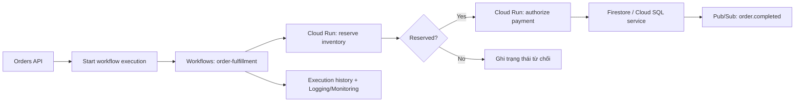
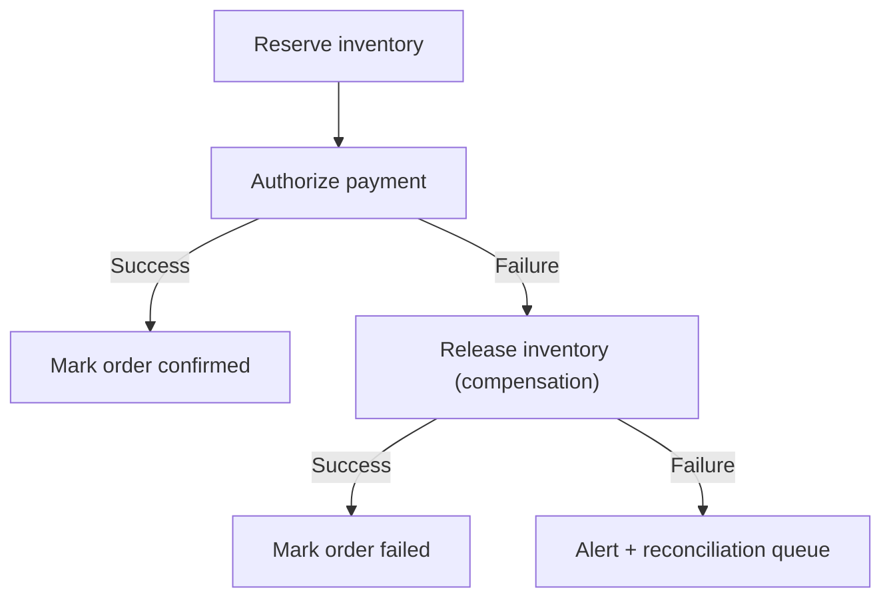
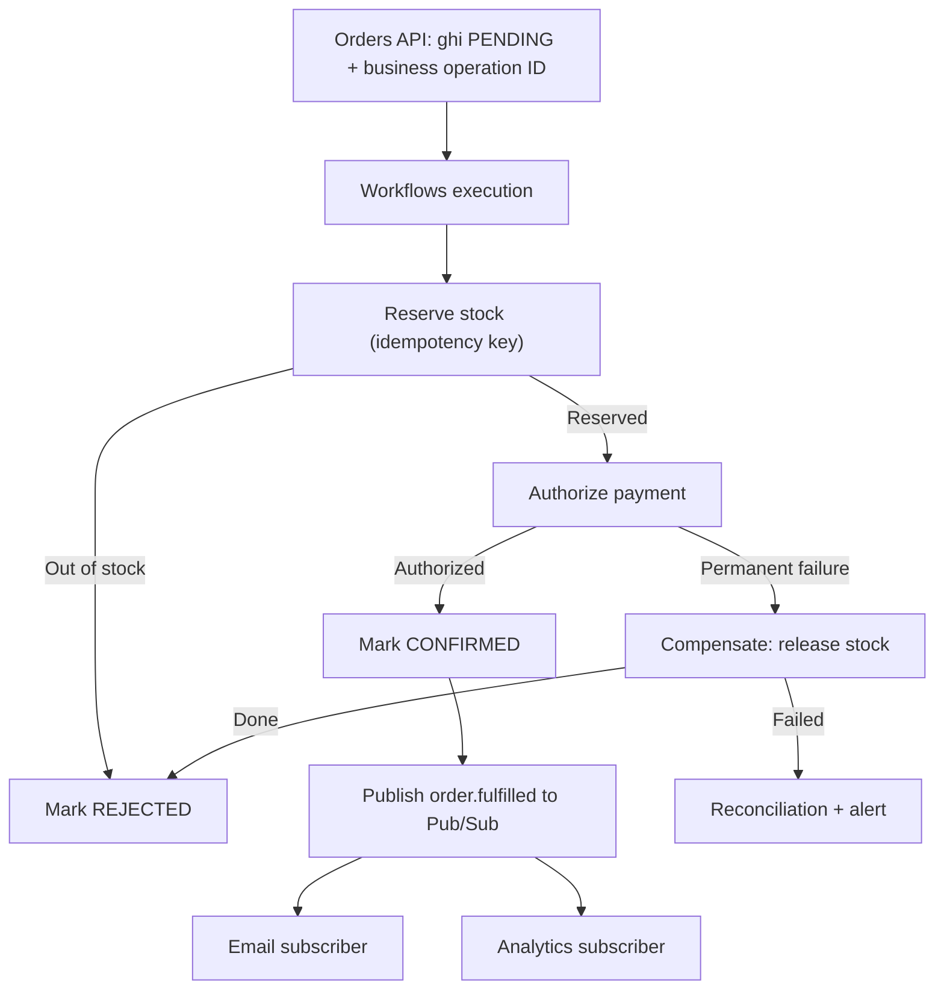

# Workflows và điều phối dịch vụ Google Cloud

Một đơn hàng mới cần kiểm tra tồn kho, xác nhận thanh toán, lưu trạng thái và gửi thông báo. Nếu Orders API tự gọi tuần tự mọi hệ thống, một lỗi tạm thời từ đối tác thanh toán có thể khiến request người dùng kéo dài, còn xử lý lại sau lỗi dễ tạo giao dịch trùng. **Google Cloud Workflows** giúp biểu diễn quy trình nhiều bước dưới dạng YAML/JSON, gọi các dịch vụ Google Cloud và HTTP APIs, lưu trạng thái từng **execution**, rẽ nhánh, thử lại có kiểm soát và theo dõi kết quả.

Bài thuộc chương **Điều phối và tích hợp ứng dụng**, module `CLOUD_PROVIDERS_GCP`. Nội dung kết nối IAM, Cloud Run, GKE, Compute Engine, Pub/Sub, Cloud Storage, cơ sở dữ liệu, giám sát độ tin cậy và chi phí. Mục tiêu là quyết định **khi nào nên điều phối bằng Workflows**, viết workflow có xác thực và xử lý lỗi đúng, thay vì dùng một chuỗi lời gọi API thiếu khả năng truy vết.

> Project `orders-lab`, Cloud Run URLs, topic và đơn hàng trong bài chỉ là ví dụ. Các lệnh bật API, triển khai workflow, cấp IAM, tạo Scheduler/Eventarc trigger hoặc chạy execution có thể thay đổi tài nguyên, kích hoạt tác vụ thật và phát sinh phí. Chỉ thao tác trên sandbox được phép. Không đưa bí mật/thông tin cá nhân vào runtime arguments hoặc logs.

## 1. Kết quả học tập

Sau bài học, bạn có thể:

1. Phân biệt **workflow definition**, **execution**, **step**, **subworkflow** và **connector**.
2. Chọn Workflows thay vì Pub/Sub, Cloud Tasks, Cloud Scheduler hoặc Cloud Composer theo nhu cầu.
3. Viết YAML gồm `params`, `assign`, `call`, `switch`, `for`, `parallel`, `try/retry/except` và `return`.
4. Gọi Cloud Run private service bằng **OIDC** và Google Cloud APIs bằng **connector/OAuth** với IAM tối thiểu.
5. Triển khai/chạy workflow qua `gcloud`, hoặc kích hoạt bằng Cloud Scheduler/Eventarc khi phù hợp.
6. Thiết kế idempotency, retries, compensating actions, logging, alerting và kiểm soát chi phí.

## 2. Workflows giải quyết vấn đề gì?

Workflows là dịch vụ **serverless orchestration**: bạn khai báo các bước rồi Google Cloud quản lý việc thực thi và lưu trạng thái tiến trình. Một lần chạy là một **execution** độc lập; các execution có thể diễn ra đồng thời theo quota. Workflows **không phải container runtime** để thực hiện xử lý CPU nặng liên tục: công việc như tính toán ảnh, truy vấn nghiệp vụ hoặc gửi email nên đặt ở Cloud Run, GKE, Cloud Run Jobs hay dịch vụ chuyên dụng.



**Control plane** lưu workflow definition (mã YAML, region, service account, env vars). **Runtime** tạo execution, thực hiện bước theo thứ tự/nhánh và ghi trạng thái, kết quả hoặc lỗi. Cần phân biệt **HTTP request khởi chạy execution** với **execution hoàn tất**: một event hoặc lời gọi API được chấp nhận không bảo đảm quy trình đã thành công.

| Thuật ngữ | Ý nghĩa | Ví dụ |
| --- | --- | --- |
| `Workflow` | Tài nguyên được deploy theo region, tham chiếu source và IAM identity | `order-fulfillment` |
| `Step` | Đơn vị điều khiển, gọi API, gán biến hoặc quyết định nhánh | `reserveInventory` |
| `Execution` | Một lần chạy theo input JSON, có trạng thái và lịch sử | Xử lý `ord-42` |
| `Subworkflow` | Khối logic có tham số/tái sử dụng trong cùng source | `notifyFailure` |
| `Connector` | Hàm gọi Google Cloud API với authentication/tích hợp retry phù hợp | `googleapis.pubsub.v1.projects.topics.publish` |
| `Runtime arguments` | JSON đầu vào của một execution | `{"orderId":"ord-42"}` |

### 2.1. Workflows khác các dịch vụ gần tên

| Nhu cầu | Công cụ thường phù hợp | Vì sao |
| --- | --- | --- |
| Điều phối **nhiều bước**, phụ thuộc kết quả, rẽ nhánh và theo dõi tiến trình | **Workflows** | Một execution thể hiện trạng thái quy trình end-to-end |
| Phát sự kiện tới nhiều consumers, không cần chờ nhau | **Pub/Sub** | Topic/subscriptions fan-out, at-least-once delivery |
| Gửi một HTTP task có retry/rate limiting/thời điểm thực thi | **Cloud Tasks** | Queue điều tiết công việc độc lập, task handlers tự bảo đảm idempotency |
| Chạy quy trình theo lịch cron | **Cloud Scheduler** → Workflows/HTTP/Pub/Sub | Scheduler kích hoạt đúng thời điểm, không tự mô hình hóa quy trình phức tạp |
| DAG dữ liệu lớn, Airflow operators, data pipeline có nhiều dependencies | **Cloud Composer (Apache Airflow)** | Phù hợp hệ sinh thái DAG và data operations chuyên sâu |
| Xử lý bất đồng bộ cần CPU lớn hoặc thời gian dài | **Cloud Run Jobs/GKE/Compute Engine** | Thực thi công việc; Workflows có thể chỉ gọi/đợi kết quả |

Một kiến trúc có thể **dùng đồng thời**: Cloud Scheduler kích hoạt Workflows → Workflows gọi Cloud Run → Cloud Run publish Pub/Sub. Không dùng Workflows thay message queue lưu hàng triệu events hoặc để thực hiện từng phép toán rất nhỏ khi một ứng dụng xử lý được hiệu quả hơn.

## 3. Cú pháp Workflows YAML và các loại step

Workflows dùng YAML hoặc JSON với indentation có nghĩa. Một source có **một workflow `main`** và có thể thêm subworkflows. Phần lớn bước được chạy **theo thứ tự** từ trên xuống nếu không có `switch`/`next`, `parallel` hoặc `return`.

| Cú pháp | Mục đích | Lưu ý |
| --- | --- | --- |
| `main.params` | Nhận một runtime argument JSON | Input có thể là map/list/scalar; kiểm tra schema trước khi gọi |
| `assign` | Khởi tạo/gán biến | Dùng biểu thức `${...}`, lưu ý scope |
| `call`, `args`, `result` | Gọi hàm HTTP, connector hoặc stdlib; lưu kết quả | Không gọi API không xác thực nếu endpoint cần IAM |
| `switch`, `condition`, `next` | Chuyển nhánh có điều kiện | Điều kiện được xét theo thứ tự |
| `for` | Lặp qua danh sách/phạm vi | Giới hạn số steps thực thi và khả năng xử lý lặp |
| `parallel` | Nhiều branches/iterations đồng thời | Thứ tự hoàn tất không xác định, tránh shared state race |
| `try` / `retry` / `except` | Thử lại và xử lý lỗi | Retry **side effect** chỉ khi có idempotency |
| `return`, `raise` | Trả kết quả hoặc báo lỗi | Kết thúc execution đúng trạng thái |

### 3.1. Bài hello workflow tối thiểu

```yaml
main:
  params: [input]
  steps:
    - init:
        assign:
          - orderId: ${map.get(input, "orderId")}
    - validate:
        switch:
          - condition: ${orderId == null}
            next: reject
    - success:
        return:
          accepted: true
          orderId: ${orderId}
    - reject:
        raise: "Missing orderId"
```

Ví dụ trên **không gọi dịch vụ thật**: nó chỉ minh họa tham số, biến, nhánh và kết quả. Với input `{"orderId":"ord-42"}`, execution trả map `{"accepted":true,"orderId":"ord-42"}`; nếu thiếu `orderId`, execution thất bại với lỗi có chủ đích. Kiểm tra map bằng `map.get` an toàn hơn đọc thẳng `input.orderId` khi khóa có thể không tồn tại.

Trong YAML, cú pháp `${...}` là **Workflows expression**, không phải shell variable substitution. Khi expression chứa dấu hai chấm, dấu ngoặc hoặc biểu thức phức tạp, đặt toàn expression trong dấu nháy đơn YAML theo tài liệu. Tránh nhúng business secrets vào source hoặc runtime arguments.

## 4. Gọi Cloud Run HTTP service có xác thực

Workflows dùng **service account của workflow** làm danh tính khi gọi downstream. HTTP request **không tự gửi token**; phải khai báo:

- **Cloud Run/Cloud Run functions:** `auth.type: OIDC`, token ID có audience đúng.
- **Google Cloud REST APIs ở `*.googleapis.com`:** `auth.type: OAuth2` nếu gọi HTTP trực tiếp.
- **Google Cloud connectors:** connector tự xử lý OAuth identity cho API, không cần tự viết HTTP headers.

Giả sử Cloud Run service `orders-inventory` có endpoint HTTPS `POST /reserve`, chấp nhận JSON `orderId`, `idempotencyKey` và trả `{"status":"RESERVED"}`. Đây là **hợp đồng ứng dụng minh họa**: bạn cần triển khai endpoint thật trước khi thử workflow.

### 4.1. YAML gọi private Cloud Run

```yaml
main:
  params: [input]
  steps:
    - init:
        assign:
          - orderId: ${map.get(input, "orderId")}
          - baseUrl: ${sys.get_env("INVENTORY_URL")}
    - validate:
        switch:
          - condition: ${orderId == null}
            next: invalidInput
    - reserveInventory:
        try:
          call: http.post
          args:
            url: ${baseUrl + "/reserve"}
            auth:
              type: OIDC
              audience: ${baseUrl}
            headers:
              Content-Type: application/json
            body:
              orderId: ${orderId}
              idempotencyKey: ${orderId}
            timeout: 30
          result: reservation
        retry: ${http.default_retry}
    - confirm:
        switch:
          - condition: ${reservation.body.status != "RESERVED"}
            next: rejected
    - done:
        return:
          orderId: ${orderId}
          status: "RESERVED"
    - rejected:
        raise: "Inventory did not reserve items"
    - invalidInput:
        raise: "Missing orderId"
```

**Điều kiện để retry ở ví dụ này an toàn:** Cloud Run phải thực sự **idempotent theo `idempotencyKey`**, chẳng hạn lưu unique key và kết quả trong database transaction. `http.default_retry` có thể thử lại sau timeout hoặc lỗi 429/502/503/504; nếu endpoint trừ hàng mỗi lần gọi, retry có thể trừ hai lần. Khi chưa xây idempotency, cân nhắc `http.default_retry_non_idempotent` hoặc không tự động retry và thực hiện reconciliation.

`audience` ở đây là **Cloud Run service URL gốc**, không bao gồm `/reserve`. Với URL có path, cấu hình audience rõ sẽ tránh dùng sai giá trị mặc định (mặc định có thể lấy chính URL được gọi). Nếu gọi tagged URL của Cloud Run, vẫn kiểm tra audience theo service URL và cấu hình Cloud Run/IAM thực tế. HTTP `2xx` không luôn đồng nghĩa nghiệp vụ thành công — workflow phải đọc payload như `status` để quyết định.

### 4.2. Phân quyền cho lời gọi

Workflow identity, ví dụ `workflows-orders@orders-lab.iam.gserviceaccount.com`, cần `roles/run.invoker` trên đúng Cloud Run service. Người deploy workflow cần quyền Workflows tạo/sửa và **`iam.serviceAccounts.actAs`** trên identity này. Người **chạy execution** cần quyền gọi Workflows, không cần được trao quyền trực tiếp vào inventory nếu họ không được phép gọi service đó.

Giới hạn ai được gọi workflow: **workflow có thể thực hiện hành động với toàn bộ quyền của service account đính kèm**. Một input JSON do người dùng gửi không được tùy ý đổi URL/Cloud project/resource ID thành mục tiêu đặc quyền. Validate danh sách hành động, ownership và tenant ở lớp khởi chạy và tại downstream API.

## 5. Gọi Google Cloud APIs bằng connectors

Workflows có các hàm `googleapis.*` cho nhiều Google Cloud APIs, ví dụ Pub/Sub, Firestore, Cloud Storage, BigQuery và Secret Manager. **Connector** tự gắn thông tin xác thực theo service account của workflow, định dạng API request và có cơ chế xử lý retry hoặc **long-running operations (LRO)** khi phù hợp. Điều này khác với `http.post` gọi API nghiệp vụ của Cloud Run.

### 5.1. Ví dụ publish thông điệp Pub/Sub

Giả sử topic `orders-events` đã tồn tại và workflow service account có `roles/pubsub.publisher` tại topic:

```yaml
main:
  params: [input]
  steps:
    - prepare:
        assign:
          - projectId: ${sys.get_env("GOOGLE_CLOUD_PROJECT_ID")}
          - event:
              eventId: ${input.eventId}
              orderId: ${input.orderId}
              type: "order.fulfilled"
          - encoded: ${base64.encode(json.encode(event))}
    - publish:
        call: googleapis.pubsub.v1.projects.topics.publish
        args:
          topic: ${"projects/" + projectId + "/topics/orders-events"}
          body:
            messages:
              - data: ${encoded}
        result: published
    - done:
        return: ${published.messageIds}
```

`json.encode(event)` chuyển map thành **JSON bytes**, `base64.encode(...)` mã hóa thành dạng `data` mà Pub/Sub API yêu cầu. Message payload **không được mã hóa bảo mật** chỉ vì dùng Base64. Connector trả về Pub/Sub message IDs sau khi publish API thành công, **không có nghĩa các subscribers đã xử lý nghiệp vụ**.

**Đừng tự retry publish thiếu kiểm soát:** nếu server đã nhận message nhưng client thấy timeout, retry có thể publish thêm một message với ID mới. Đưa `eventId` vào payload và thiết kế consumers idempotent. Những thao tác cần thay đổi trạng thái nhiều hệ thống phải được kiểm chứng kết quả qua business status, không chỉ qua HTTP 200 hoặc Pub/Sub message ID.

### 5.2. Khi nào dùng connector hay HTTP?

| Đích | Cách gọi thường dùng | Quyền cần có |
| --- | --- | --- |
| Cloud Run HTTPS service | `http.get/post` + `auth.type: OIDC` | `roles/run.invoker` trên service |
| Pub/Sub publish | `googleapis.pubsub.v1.projects.topics.publish` | `roles/pubsub.publisher` trên topic |
| Cloud Storage API | Connector `googleapis.storage.*` hoặc HTTP OAuth | Quyền object/bucket đúng hành động |
| Secret Manager | Connector `googleapis.secretmanager.*` hoặc HTTP OAuth | `roles/secretmanager.secretAccessor` trên secret |
| Google Cloud API chưa có connector | `http.request` + `auth.type: OAuth2` | IAM role cho API/resource đích |
| Third-party HTTPS API | `http.request` + auth do nhà cung cấp hỗ trợ | Credential bảo vệ qua Secret Manager, TLS, allowlist |

Không ghi secret/token trả về từ connector vào `sys.log`, execution results hoặc error messages. Nếu cần dùng Secret Manager, để workflow identity chỉ đọc các secret thực sự cần thiết, không cấp Secret Manager Admin toàn project.

## 6. Điều khiển luồng: switch, for, parallel và subworkflow

### 6.1. Switch cho quyết định nghiệp vụ

Từ status do Inventory service trả, workflow có thể chuyển nhánh:

```yaml
- decide:
    switch:
      - condition: ${reservation.body.status == "OUT_OF_STOCK"}
        next: rejectOrder
      - condition: ${reservation.body.status == "RESERVED"}
        next: authorizePayment
- unexpectedStatus:
    raise: "Unknown inventory status"
```

Đây là **trích đoạn**, các steps `rejectOrder` và `authorizePayment` phải tồn tại trong workflow hoàn chỉnh. Không nên coi bất kỳ status lạ nào là thành công; dùng default fail-closed khi schema backend thay đổi.

### 6.2. For lặp qua danh sách

```yaml
- inspectItems:
    for:
      value: item
      in: ${input.items}
      steps:
        - logSku:
            call: sys.log
            args:
              severity: INFO
              text: ${"Validating SKU " + item.sku}
```

Đây chỉ là **ví dụ vòng lặp**, không thực hiện kiểm tra tồn kho. Với danh sách lớn, đừng biến Workflows thành batch processor xử lý hàng triệu phần tử: giới hạn step count, dữ liệu variables, thời gian/quotas và chi phí có thể khiến thiết kế kém hiệu quả. Đẩy bulk processing sang Cloud Run Jobs/Dataflow/GKE và để Workflows điều phối ở mức nhóm tác vụ.

### 6.3. Parallel cho những bước độc lập

Giả sử Inventory và Fraud services đều có endpoint **đọc trạng thái** theo `orderId`, không thay đổi dữ liệu. Có thể gọi đồng thời rồi ghép kết quả:

```yaml
main:
  params: [input]
  steps:
    - init:
        assign:
          - inventoryUrl: ${sys.get_env("INVENTORY_URL")}
          - fraudUrl: ${sys.get_env("FRAUD_URL")}
          - inventoryStatus: null
          - fraudStatus: null
    - checkInParallel:
        parallel:
          shared: [inventoryStatus, fraudStatus]
          branches:
            - inventory:
                steps:
                  - readInventory:
                      call: http.get
                      args:
                        url: ${inventoryUrl + "/status"}
                        query:
                          orderId: ${input.orderId}
                        auth:
                          type: OIDC
                          audience: ${inventoryUrl}
                      result: inv
                  - saveInventory:
                      assign:
                        - inventoryStatus: ${inv.body.status}
            - fraud:
                steps:
                  - readFraud:
                      call: http.get
                      args:
                        url: ${fraudUrl + "/assessment"}
                        query:
                          orderId: ${input.orderId}
                        auth:
                          type: OIDC
                          audience: ${fraudUrl}
                      result: assessment
                  - saveFraud:
                      assign:
                        - fraudStatus: ${assessment.body.status}
    - done:
        return:
          inventory: ${inventoryStatus}
          fraud: ${fraudStatus}
```

Hai branches có thể hoàn tất **theo thứ tự bất kỳ**. Các biến cha mà branch cần **ghi** phải được khai báo trong `shared`; biến cục bộ như `inv` và `assessment` nằm trong từng branch. Không viết logic yêu cầu Fraud phải thấy kết quả Inventory nếu hai bước thực sự chạy đồng thời: hãy tách thành chuỗi tuần tự.

Parallel chỉ cải thiện latency khi nhánh **độc lập**; không tự giải quyết concurrency limit của Cloud Run, quota API, DB pool hoặc race condition. Workflows có giới hạn song song/bộ nhớ/step count theo region và phiên bản, cần xem bảng quotas trước khi thiết kế fan-out quy mô lớn.

### 6.4. Subworkflow để tái sử dụng

```yaml
main:
  steps:
    - format:
        call: makeResult
        args:
          id: "ord-42"
          state: "DONE"
        result: output
    - done:
        return: ${output}

makeResult:
  params: [id, state]
  steps:
    - response:
        return:
          orderId: ${id}
          status: ${state}
```

Subworkflow thích hợp với việc **chuẩn hóa response hoặc tái dùng đoạn logic ngắn**, không thay thế package/module của ứng dụng. Một lệnh gọi subworkflow cũng sử dụng các steps và có thể tính phí; tránh recursion sâu hoặc truyền maps chứa payload nhạy cảm không cần thiết.

## 7. Retry, timeout, exceptions và idempotency

Mạng, quota và downstream endpoints có thể trả 429, 5xx hoặc timeout. Workflows cho phép `try/retry/except`, dùng **retry policy phụ thuộc tính lặp an toàn của thao tác**:

| Policy | Nên dùng | Retry conditions mặc định |
| --- | --- | --- |
| `http.default_retry` | GET hoặc POST có **idempotency đã được thực thi thật** | 429, 502, 503, 504, connection errors, timeouts |
| `http.default_retry_non_idempotent` | Thao tác có side effect và chưa chứng minh idempotent | Hạn chế hơn: 429, 503 hoặc connection failure |
| Custom retry | Cần riêng số lần thử, backoff hoặc mã lỗi | Phải tự định nghĩa predicate và bounds |

**Ngay cả retry policy non-idempotent cũng không bảo đảm side effect không bị lặp.** HTTP 503 có thể xuất hiện *sau khi* downstream đã ghi dữ liệu. Muốn thanh toán/trừ kho đúng một lần về mặt nghiệp vụ, API phải hỗ trợ idempotency key, unique constraints và reconciliation.

### 7.1. Try/retry/except cho một HTTP GET

```yaml
- queryStatus:
    try:
      call: http.get
      args:
        url: ${baseUrl + "/status"}
        query:
          orderId: ${orderId}
        auth:
          type: OIDC
          audience: ${baseUrl}
        timeout: 15
      result: response
    retry: ${http.default_retry}
    except:
      as: e
      steps:
        - logFailure:
            call: sys.log
            args:
              severity: ERROR
              text: "Downstream status check failed"
        - rethrow:
            raise: ${e}
```

Đoạn này nằm trong workflow có `baseUrl` và `orderId` đã được gán. Khi retries hết hoặc lỗi không đủ điều kiện retry, `except` log **thông báo đã được kiểm soát** rồi ném lại để execution thất bại. Không log toàn bộ `e` nếu response có thể chứa Authorization headers, token hoặc PII.

### 7.2. Hành động bù trừ (Saga) không phải rollback transaction

Một giao dịch qua Cloud Run + Pub/Sub + Cloud SQL **không có một ACID transaction bao toàn bộ bước**. Nếu đã giữ hàng thành công nhưng thanh toán thất bại, cần bước **releaseInventory** có thể retry/idempotent:



Compensation cũng có thể lỗi; workflow phải **ghi trạng thái cần đối soát** và có người/worker tiếp tục xử lý. “Đã gọi bước release” chưa chứng minh tồn kho thực sự được trả lại. Khi thanh toán đã tạo charge bên ngoài, refund/cancel cần hợp đồng riêng và audit trail; không gửi lại nguyên request thanh toán thiếu idempotency key.

### 7.3. Timeout, chờ và polling

Workflows có `sys.sleep(seconds)`, `sys.sleep_until` và connector handling cho một số long-running operations. Tránh busy-poll mỗi 100 ms; dùng backoff/đợi đủ lâu và kiểm tra giới hạn execution duration, HTTP timeout, memory, steps, quota cùng tác vụ downstream. Nếu một job có thể kéo dài nhiều giờ, cần mô hình lưu job ID, kiểm tra trạng thái hoặc callback thích hợp thay vì giữ một HTTP request dài vô hạn.

## 8. Thực hành triển khai và chạy workflow

Ví dụ ở mục 4 dùng một Cloud Run Inventory endpoint đã có trong sandbox. Người dùng cần `gcloud` đã đăng nhập, project có Billing, quyền bật APIs (nếu cần), tạo Workflows, và permission `iam.serviceAccounts.actAs` trên **workflow service account**. Khi chạy thực tế, kiểm tra `gcloud config get-value project` và region trước khi tạo resources.

### 8.1. Chuẩn bị APIs và danh tính

```bash
PROJECT_ID="orders-lab"
REGION="asia-southeast1"
WORKFLOW="order-fulfillment"
WORKFLOW_SA="workflows-orders@$PROJECT_ID.iam.gserviceaccount.com"

# THAY ĐỔI / CÓ THỂ PHÁT SINH PHÍ: chỉ chạy ở sandbox được duyệt.
gcloud services enable \
  workflows.googleapis.com \
  workflowexecutions.googleapis.com \
  run.googleapis.com \
  --project="$PROJECT_ID"

# Tạo một service account riêng nếu chưa tồn tại.
gcloud iam service-accounts create workflows-orders \
  --project="$PROJECT_ID" \
  --display-name="Orders workflow identity"

# Cho workflow identity quyền gọi đúng Cloud Run Inventory service.
gcloud run services add-iam-policy-binding orders-inventory \
  --project="$PROJECT_ID" \
  --region="$REGION" \
  --member="serviceAccount:$WORKFLOW_SA" \
  --role="roles/run.invoker"
```

Không chạy lại thao tác tạo account nếu đã tồn tại. Với workflow còn publish Pub/Sub hoặc truy cập Firestore/Secret Manager, thêm **quyền chính xác trên từng resource**; không cấp Editor hoặc Owner cho workflow chỉ vì có nhiều dịch vụ.

### 8.2. Deploy source YAML có gắn service account

Lưu **mẫu ở mục 4** vào một file lab tên `order-fulfillment.yaml` trong workspace sandbox riêng của bạn (không phải file bài học). Tạo trước Cloud Run service thật có `/reserve` và biến env trỏ tới **service URL gốc**:

```bash
# LỆNH TRIỂN KHAI: thay URL bằng URL Cloud Run thực tế.
INVENTORY_URL="https://ACTUAL_ORDERS_INVENTORY_RUN_URL"

gcloud workflows deploy "$WORKFLOW" \
  --source=order-fulfillment.yaml \
  --location="$REGION" \
  --project="$PROJECT_ID" \
  --service-account="$WORKFLOW_SA" \
  --set-env-vars="INVENTORY_URL=$INVENTORY_URL"

# CHỈ ĐỌC: trạng thái workflow và IAM identity gắn với nó.
gcloud workflows describe "$WORKFLOW" \
  --location="$REGION" \
  --project="$PROJECT_ID"
```

`--set-env-vars` là cấu hình **workflow resource**, không phải environment của Cloud Run. Nếu update một workflow đang có nhiều env vars, phải kiểm tra sự khác nhau giữa `--set-env-vars` và `--update-env-vars` để không vô tình xóa các giá trị đã được cấu hình. **URL không phải secret**; credentials phải được bảo vệ qua IAM/Secret Manager.

### 8.3. Chạy execution và đọc kết quả

```bash
# CÓ TÁC ĐỘNG: gọi Inventory service và có thể giữ hàng giả lập.
gcloud workflows run "$WORKFLOW" \
  --location="$REGION" \
  --project="$PROJECT_ID" \
  --data='{"orderId":"ord-42"}'

# CHỈ ĐỌC: danh sách executions và ID của lần chạy.
gcloud workflows executions list "$WORKFLOW" \
  --location="$REGION" \
  --project="$PROJECT_ID" \
  --limit=10

# CHỈ ĐỌC: dùng EXECUTION_ID thực tế.
gcloud workflows executions describe EXECUTION_ID \
  --workflow="$WORKFLOW" \
  --location="$REGION" \
  --project="$PROJECT_ID"
```

`gcloud workflows run` **đợi execution hoàn tất** rồi in kết quả; trong khi đó REST API `executions.create` tạo execution và thường trả metadata khi đã được chấp nhận, **không chờ hết toàn bộ workflow**. Lưu execution ID cùng business `orderId` để điều tra. Với một bài lab chỉ kiểm tra cú pháp mà không muốn giữ hàng, hãy dùng **hello workflow ở mục 3** hoặc mock Cloud Run endpoint.

### 8.4. Kiểm thử trước khi dùng production

| Test | Input/giả định | Kết quả cần quan sát |
| --- | --- | --- |
| Input hợp lệ | `{"orderId":"ord-42"}` | Execution `SUCCEEDED`, response có status hợp lệ |
| Thiếu orderId | `{}` | Execution `FAILED` với lỗi validation, không gọi Inventory |
| Inventory trả OUT_OF_STOCK | Service trả business status | Workflow không trả success giả; bước `raise` được ghi nhận |
| Inventory 503 tạm thời | Dùng mock để mô phỏng | Retries giới hạn, backoff, không trừ hàng lặp |
| Cloud Run trả 403 | Workflow SA thiếu `run.invoker` | Execution failed, sửa IAM đúng principal |
| Workflow chạy lại cùng orderId | Trùng business operation | Downstream idempotent, không xử lý hai lần |

Không thực hiện fault injection vào production nếu chưa được duyệt; dùng mock/staging với cùng schema và IAM điều khiển phù hợp.

## 9. Kích hoạt Workflows: trực tiếp, theo lịch và theo sự kiện

| Nguồn kích hoạt | Cơ chế | Phù hợp |
| --- | --- | --- |
| Người vận hành/CI | Console hoặc `gcloud workflows run` | Chạy thủ công, smoke tests |
| Ứng dụng backend | Workflows Executions REST/Client API | Bắt đầu quy trình nghiệp vụ với JSON input |
| **Cloud Scheduler** | Cron → HTTP POST tới Executions API | Batch đối soát/báo cáo định kỳ |
| **Eventarc** | CloudEvents từ Pub/Sub, Cloud Storage hoặc audit events | Xử lý theo sự kiện và chuyển event thành runtime argument |

### 9.1. Cloud Scheduler gọi Executions API

Giả định đã có workflow riêng `daily-reconcile` xử lý input `{}`, cùng service account `workflow-scheduler@orders-lab.iam.gserviceaccount.com` được cấp `roles/workflows.invoker`. Ví dụ tạo cron hằng ngày:

```bash
# THAY ĐỔI / CÓ PHÍ: chỉ tạo sau khi account/workflow đã tồn tại.
PROJECT_ID="orders-lab"
REGION="asia-southeast1"
SCHEDULER_SA="workflow-scheduler@$PROJECT_ID.iam.gserviceaccount.com"
EXEC_URL="https://workflowexecutions.googleapis.com/v1/projects/$PROJECT_ID/locations/$REGION/workflows/daily-reconcile/executions"

gcloud scheduler jobs create http daily-reconcile-job \
  --project="$PROJECT_ID" \
  --location="$REGION" \
  --schedule="0 2 * * *" \
  --time-zone="Asia/Ho_Chi_Minh" \
  --http-method=POST \
  --uri="$EXEC_URL" \
  --headers="Content-Type=application/json" \
  --message-body='{"argument":"{}"}' \
  --oauth-service-account-email="$SCHEDULER_SA"
```

**Dùng OAuth2 khi Scheduler gọi Google APIs** như `workflowexecutions.googleapis.com`, không dùng OIDC vốn thường dành cho Cloud Run HTTP endpoints. Scheduler có thể **retry** khi response lỗi: nếu lần trước thực ra đã tạo execution nhưng caller timeout, có thể phát sinh **hai executions**. Batch cần business key (ví dụ batch date) và lock/dedup trong DB; không kỳ vọng cron đảm bảo hiệu ứng đúng một lần.

### 9.2. Eventarc bắt Pub/Sub và khởi chạy workflow

Eventarc có thể nhận CloudEvents và khởi chạy Workflows, với event JSON làm **runtime argument**. Với một Pub/Sub topic `orders-events` đã có và trigger service account `eventarc-workflows@orders-lab.iam.gserviceaccount.com` đã được cấp `roles/workflows.invoker`:

```bash
# THAY ĐỔI: tạo Eventarc trigger; có thể tạo subscription vận chuyển.
gcloud eventarc triggers create orders-pubsub-trigger \
  --project=orders-lab \
  --location=asia-southeast1 \
  --destination-workflow=order-fulfillment \
  --destination-workflow-location=asia-southeast1 \
  --event-filters="type=google.cloud.pubsub.topic.v1.messagePublished" \
  --transport-topic=orders-events \
  --service-account="eventarc-workflows@orders-lab.iam.gserviceaccount.com"
```

**Lưu ý về schema:** Workflows nhận **CloudEvent JSON wrapper**, không trực tiếp map `{"orderId":"..."}` như mẫu ở mục 4. Khi dùng Eventarc, cần viết bước **decode Pub/Sub base64 data, parse JSON và xác minh event type/schema** trước khi lấy `orderId`, hoặc dùng subworkflow adapter phù hợp. Không áp trigger này lên workflow mẫu mà chưa sửa input contract.

Các Events **được coi là đã giao khi workflow execution bắt đầu**; nếu execution sau đó thất bại, Eventarc **không tự thử lại toàn bộ execution**. Workflows có cơ chế dedup sự kiện trong cửa sổ được tài liệu quy định (24 giờ), nhưng điều đó **không thay thế idempotency của business effects**. Để khôi phục lỗi quy trình sau khi đã khởi chạy, cần retry/compensation, DLQ hoặc một tiến trình reconciliation theo thiết kế.

Eventarc trigger/workflow phải cùng project theo phạm vi hỗ trợ, còn location trigger/workflow có thể khác nếu được hỗ trợ. Cần kiểm tra quota, IAM `roles/workflows.invoker`, Eventarc service account, Pub/Sub transport và nguồn event. Nếu không cần Workflows rẽ nhánh, nhiều khi Eventarc/Pub/Sub gọi Cloud Run trực tiếp sẽ đơn giản và rẻ hơn.

## 10. IAM và bảo vệ dữ liệu trong workflow

| Danh tính | Quyền tối thiểu gợi ý | Ranh giới |
| --- | --- | --- |
| Workflow deployer | Workflows Developer và `roles/iam.serviceAccountUser` trên workflow SA | Được sửa source/cấu hình nhưng không nên có quyền runtime quá rộng |
| Workflow runtime SA | `roles/run.invoker` cho đúng service, Pub/Sub Publisher/Storage Object Viewer khi cần | Không cấp Owner/Editor toàn project |
| Ứng dụng khởi chạy workflow | `roles/workflows.invoker` hoặc custom `workflows.executions.create` | Không tự có quyền deploy/edit |
| Cloud Scheduler/Eventarc trigger SA | `roles/workflows.invoker` tại phạm vi được cho phép | Chỉ kích hoạt workflow mục tiêu |
| Operations viewer | Quyền xem executions/logs/Monitoring | Không mặc định xem được secrets hoặc nội dung nhạy cảm |

**Dữ liệu input, kết quả và execution history có thể chứa payload.** Không truyền password, payment card numbers, ID tokens hoặc dữ liệu cá nhân không cần thiết qua Workflows arguments; thay bằng resource IDs/tokens tham chiếu có quyền truy cập hẹp. Với Secret Manager, không log secret value và không trả nó trong `return`.

Một workflow ở region xác định **được thực thi trong region đó**, nhưng HTTP calls và connectors có thể truy cập tài nguyên ở region khác. Nếu có yêu cầu residency/VPC Service Controls, phải xét **toàn đường dữ liệu**, bao gồm các service đích và logs. Dùng HTTPS, OIDC/OAuth đúng endpoint, policy secrets và kiểm tra TLS cho third-party APIs. Workflows có khả năng gọi Cloud Run ingress-restricted theo tài liệu khi IAM và đường truy cập phù hợp; không mặc định mọi private RFC1918 endpoint đều gọi được trực tiếp.

## 11. Observability, SLO, quota và chi phí

Workflows tạo execution logs khi bắt đầu/kết thúc; tùy cấu hình có thể bật call logging hoặc tự ghi log bằng `sys.log`. Trang **Workflows → workflow → Executions** cho phép xem trạng thái, kết quả và lịch sử bước nếu đã bật mức lưu history phù hợp. Bật ghi chi tiết toàn bộ request/response khi production có thể làm lộ payload, nên ưu tiên **structured logs chứa execution ID, business correlation ID, step name và status**, không chứa secrets.

Ví dụ log nội bộ ở một step:

```yaml
- logProgress:
    call: sys.log
    args:
      severity: INFO
      data:
        event: "inventory_reserved"
        orderId: ${orderId}
```

Nếu `orderId` là dữ liệu nhạy cảm theo chính sách tổ chức, hãy dùng correlation ID thay thế. Custom logs/call logging cần workflow identity có `logging.logEntries.create` (ví dụ `roles/logging.logWriter`).

### 11.1. Một dashboard đủ để on-call dùng

| Chỉ số | Ý nghĩa | Cảnh báo gợi ý |
| --- | --- | --- |
| Executions `SUCCEEDED/FAILED/CANCELLED` | Tỷ lệ workflow hoàn tất | Failure ratio tăng liên tiếp |
| Execution latency p95/p99 | Thời gian end-to-end | Vượt SLO hoặc tăng sau deploy |
| Errors theo step/downstream | Nút thắt do Cloud Run, Pub/Sub, IAM, quota | Retry 429/503 tăng, 403 liên tục |
| Active/queued executions và quota | Workflow bị nghẽn do concurrency hoặc giới hạn | Số execution pending/queued bất thường |
| Business state | Đơn hàng đã thật sự hoàn tất chưa? | Inventory reserved nhưng payment chưa xác nhận quá lâu |
| Compensation backlog | Hành động bù trừ thất bại | Chuyển tới người/worker đối soát |

**SLO minh họa:** 99,5% đơn hàng có execution hoàn tất thành công trong 60 giây, đo bằng timestamp đầu–cuối và business outcome. Trạng thái Workflows `SUCCEEDED` chỉ đáng tin ở cấp nghiệp vụ nếu các bước cuối đã xác minh công việc thật. Một step trả HTTP 200 với body `{"status":"FAILED"}` không được xem là thành công của đơn hàng.

### 11.2. Chi phí tính theo steps đã thực thi

Workflows tính phí dựa trên **internal/external steps** trong tháng; steps thành công, thất bại và **retry attempts đều được tính**. Một subworkflow có phí cho step gọi lẫn steps bên trong. Phí downstream (Cloud Run CPU/request, BigQuery query, Pub/Sub, Scheduler, Eventarc, logging/egress) **không nằm trong phí Workflows**.

Ba cách tiết kiệm mà không giảm độ tin cậy:

- Gộp các phép tính đơn giản vào `assign` hợp lý, tránh hàng trăm steps không mang giá trị quan sát.
- Dùng **backoff** và giới hạn retries, không polling liên tục với tần suất quá cao.
- Không chạy một execution mới cho từng event nhỏ nếu pub/sub consumer hoặc batch job đã xử lý phù hợp; cân đối latency với chi phí.

Giá, free tier, internal/external classification và quotas có thể thay đổi; kiểm tra [Workflows pricing](https://cloud.google.com/workflows/pricing) và [Workflows quotas](https://cloud.google.com/workflows/quotas) theo dự án. Workflows có giới hạn về kích thước input/result, bộ nhớ variables, số steps, parallel branches và executions đồng thời; thiết kế theo các giới hạn **hiện hành**, không theo số liệu nhớ từ bài cũ.

## 12. Case study: điều phối đơn hàng và đối soát

Giả sử hệ thống Orders có:

- **Cloud Run Orders API** xác thực người dùng và ghi đơn hàng trạng thái `PENDING`;
- **Workflows** điều phối: kiểm tra tồn kho → giữ hàng → ủy quyền thanh toán → xác nhận;
- **Cloud Run Inventory/Payment** thực thi logic và ghi idempotency keys;
- **Pub/Sub** phát `order.fulfilled` để Notification/Analytics xử lý độc lập;
- **Cloud SQL** chứa trạng thái đơn hàng, outbox/compensation records; Cloud Monitoring theo dõi end-to-end status.



### 12.1. Thiết kế release an toàn

| Quyết định | Phương án | Vì sao |
| --- | --- | --- |
| Business request ID | Gắn `operationId` duy nhất từ Orders API | Retry hoặc trigger lặp không tạo giao dịch mới |
| Input của workflow | Chỉ ID, event type/version cần thiết | Giảm PII và kích thước execution history |
| Hold stock/payment | Cloud Run endpoint **idempotent** | Retry timeout không lặp side effect |
| Status update | Transaction/state machine có kiểm tra trạng thái | Không chuyển `CANCELLED` ngược về `CONFIRMED` bởi execution muộn |
| Confirmation event | Transactional outbox hoặc bước publish + reconciliation | Tránh trạng thái DB đã commit nhưng message không được publish |
| Email/analytics | Pub/Sub subscriptions riêng | Email chậm không làm workflow thanh toán kéo dài |
| Alert | Error/latency + reconciliation backlog | Workflows `FAILED` không tự khôi phục mọi side effect |

### 12.2. Sự cố giả định

Payment trả HTTP 503 **sau khi đã tạo authorization**. Workflow coi bước thất bại, retry rồi thấy authorization mới nếu Payment service không hỗ trợ idempotency. Đây là lỗi **business contract**, không sửa được bằng tăng `max_retries`.

Để khắc phục: (1) Payment API lưu idempotency key theo `operationId`; (2) retry trả lại kết quả trước thay vì tạo giao dịch mới; (3) workflow xử lý trường hợp “không rõ đã thành công hay chưa” bằng **query status/reconciliation**, không tự động hoàn tiền khi chưa xác minh; (4) nếu không thể bù trừ tự động thì tạo ticket/queue có owner. Sau thay đổi, thử fault injection trên sandbox và kiểm tra cả logs, database lẫn hệ thống thanh toán giả lập.

## 13. Chẩn đoán các lỗi phổ biến

| Hiện tượng | Nguyên nhân có thể | Cách kiểm tra |
| --- | --- | --- |
| Deploy YAML bị lỗi cú pháp | Sai indentation, expression chưa quote, trùng step name | Workflows syntax reference, Console editor, deploy error location |
| `run --data` lỗi trước HTTP call | JSON input thiếu khóa, kiểu sai | Dùng `map.get`, validate input, kiểm tra runtime argument |
| Cloud Run trả 401/403 | Thiếu `auth: OIDC`, audience sai, workflow SA thiếu Invoker | Execution step error, URL gốc, Cloud Run IAM |
| Google Cloud API trả 403 | Connector/HTTP OAuth dùng SA thiếu resource role | Đối chiếu connector, principal, exact project/resource |
| Execution `SUCCEEDED` nhưng đơn hàng lỗi | HTTP 200 chứa business status thất bại | Kiểm tra response.body, state machine, business SLI |
| Inventory bị trừ hai lần | Retry sau timeout không có idempotency | Business operation ID, DB unique constraints, logs |
| Parallel branch không deploy được | Ghi parent variable chưa khai báo `shared` | Parallel shared/local scope |
| Workflow chậm bất thường | Poll liên tục, downstream latency, retry hoặc quá quota | Step timings, Logs/Monitoring và retry count |
| Pub/Sub event tạo execution nhưng cuối cùng FAILED | Eventarc chỉ xác nhận khi execution đã bắt đầu | Workflows errors, compensation/reconciliation riêng |
| Scheduler tạo hai executions cùng một lịch | HTTP timeout/retry hoặc task trùng | Correlation key theo scheduled time, idempotency lock |
| Không thấy Workflows custom logs | SA thiếu Log Writer hoặc query sai project | `sys.log` output, IAM và Logs Explorer |
| Chi phí tăng đột biến | Retry storm, vòng lặp/step nhiều, triggers quá dày | Step count, Billing SKUs và downstream requests |
| Workflow mới gọi sai môi trường | Env var URL cấu hình sai, nguồn input không kiểm soát | Describe workflow/config, allowlist target, CI promotion |

**Trình tự điều tra:** xác nhận input/identity → xem execution status và step lỗi → kiểm tra HTTP/connector response → xác minh business state downstream → nhận diện retry/duplicate → đánh giá bù trừ và ảnh hưởng dữ liệu. Không “sửa nhanh” bằng cấp Project Owner hoặc log toàn bộ response có thể chứa thông tin bí mật.

## 14. Bài tập thực hành

### Bài A — Chọn công cụ

Trong hệ thống có ba nhu cầu: (1) gửi event đến ba consumers độc lập, (2) chạy một quy trình ba bước theo lịch mỗi đêm, (3) gửi một HTTP task có rate limit/retry. Chọn Pub/Sub, Workflows, Cloud Scheduler và Cloud Tasks thích hợp; giải thích khi nào nên kết hợp thay vì thay thế.

### Bài B — Viết workflow có điều kiện

Từ mẫu mục 3, bổ sung validation `orderId` không rỗng, gọi Inventory (mô phỏng) và dùng `switch` xử lý `RESERVED`/`OUT_OF_STOCK`. Trả một JSON result nhất quán; trường hợp unknown status phải fail-closed.

### Bài C — Deploy và kiểm tra Cloud Run auth

Trên sandbox có private Cloud Run Inventory, tạo workflow service account, cấp `roles/run.invoker` đúng service, deploy mẫu mục 4 và chạy `gcloud workflows run --data=...`. Thử bỏ `auth.type: OIDC` để thấy 401/403, sau đó khôi phục. Vì sao không mở `--allow-unauthenticated` để vượt lỗi?

### Bài D — Connector Pub/Sub

Viết workflow publish `order.fulfilled` với `eventId` vào Pub/Sub dùng `googleapis.pubsub.v1.projects.topics.publish`. Giải thích tại sao `base64.encode(json.encode(event))` cần cho field `data` và vì sao Pub/Sub message ID không chứng minh Email đã gửi thành công.

### Bài E — Parallel và quản lý biến

Cho Inventory và Fraud cung cấp các endpoint GET độc lập. Dùng `parallel.branches` để giảm latency và ghép kết quả vào hai parent variables. Nếu bỏ `shared`, điều gì có thể xảy ra khi deploy? Khi nào chuyển sang xử lý tuần tự?

### Bài F — Retry và saga

Giả sử Inventory đã giữ hàng, Payment API timeout nhưng có thể đã tạo authorization. Thiết kế idempotency key, retry/backoff, query status và compensation. Phân biệt `http.default_retry` với `http.default_retry_non_idempotent`; nêu một trường hợp không nên retry tự động.

### Bài G — Eventarc, Scheduler và theo dõi

Thiết kế một workflow chạy hằng ngày để đối soát đơn hàng và một workflow được kích hoạt bởi Pub/Sub CloudEvent. Nêu IAM Invoker, input contract, cách deduplicate, SLO, error alert và cách xử lý khi execution đã bắt đầu rồi thất bại. Ước lượng những loại phí có thể phát sinh khi workload tăng gấp 10.

### Câu hỏi tự kiểm tra

1. Một workflow definition khác một execution như thế nào?
2. Vì sao Workflows không phải công cụ xử lý hàng triệu messages như Pub/Sub?
3. `http.post` gọi Cloud Run dùng OIDC hay OAuth2?
4. Connector tự xử lý authentication có đồng nghĩa workflow SA được quyền truy cập mọi API không?
5. Vì sao Workflows HTTP 200 vẫn có thể là thất bại nghiệp vụ?
6. Vì sao retry thanh toán cần idempotency key và reconciliation?
7. Parallel branches có chạy theo thứ tự khai báo không? Khi nào cần `shared`?
8. Eventarc có tự retry một execution thất bại sau khi execution đã bắt đầu không?
9. Cloud Scheduler gọi Executions REST API nên sử dụng loại token nào?
10. Những bước nào làm phát sinh chi phí Workflows và vì sao phải đo cả downstream services?

## 15. Checklist và tài liệu chính thức

- [ ] Chọn đúng loại tích hợp: orchestration, queue, cron hay dữ liệu DAG.
- [ ] Workflow YAML có input contract, validation, bounded steps và rõ business success criteria.
- [ ] Dùng service account riêng, OIDC cho Cloud Run, OAuth/connector cho Google APIs.
- [ ] Mọi side effect dễ retry có idempotency key, status query hoặc compensation.
- [ ] Parallel chỉ áp cho bước độc lập; lưu trạng thái shared/ownership đúng.
- [ ] Trigger có IAM Invoker, input decoder, dedup và reconciliation khi execution lỗi.
- [ ] Execution history/logs/alerts bảo vệ PII; có SLO, timeout/retry và rollback.
- [ ] Quota, step counts, downstream billing và data location được xem xét trước production.

Tài liệu Google Cloud để đối chiếu khi sử dụng:

- [Workflows overview](https://cloud.google.com/workflows/docs/overview)
- [Workflows syntax reference](https://cloud.google.com/workflows/docs/reference/syntax)
- [Make an HTTP request](https://cloud.google.com/workflows/docs/http-requests)
- [Authenticate from a workflow](https://cloud.google.com/workflows/docs/authenticate-from-workflow)
- [Manage IAM for workflows](https://cloud.google.com/workflows/docs/authentication)
- [Workflows connectors](https://cloud.google.com/workflows/docs/connectors)
- [Parallel steps](https://cloud.google.com/workflows/docs/reference/syntax/parallel-steps)
- [Retry steps](https://cloud.google.com/workflows/docs/reference/syntax/retrying)
- [Catch errors](https://cloud.google.com/workflows/docs/reference/syntax/catching-errors)
- [Run a workflow](https://cloud.google.com/workflows/docs/execute-workflow)
- [Cloud Scheduler trigger](https://cloud.google.com/workflows/docs/schedule-workflow)
- [Eventarc triggers for Workflows](https://cloud.google.com/workflows/docs/trigger-workflow-eventarc)
- [Workflows execution logging](https://cloud.google.com/workflows/docs/log-workflow)
- [Workflows quotas and limits](https://cloud.google.com/workflows/quotas)
- [Workflows pricing](https://cloud.google.com/workflows/pricing)

**Ghi nhớ:** Workflows diễn đạt **trình tự và trạng thái** của quy trình đa dịch vụ; Cloud Run/GKE thực thi nghiệp vụ, Pub/Sub phân phối sự kiện, Scheduler/Eventarc kích hoạt. Chọn đúng IAM, kiểm tra business outcome, retry có idempotency, xử lý compensation và quan sát execution là điều kiện để workflow hoạt động đáng tin cậy.
