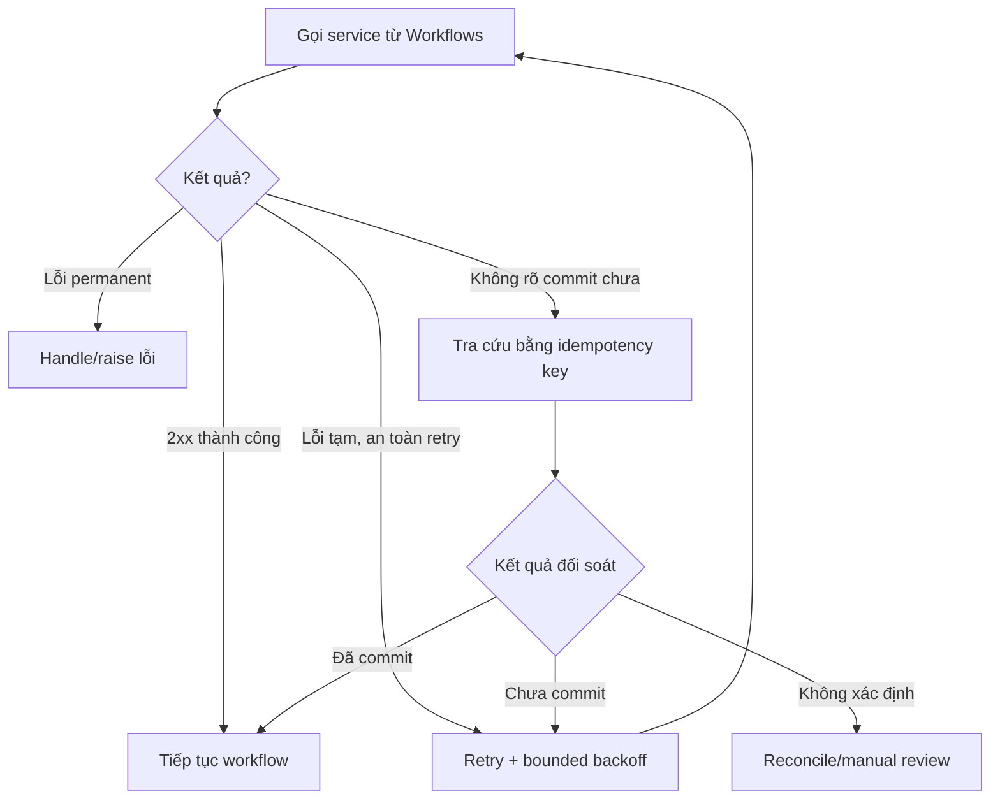
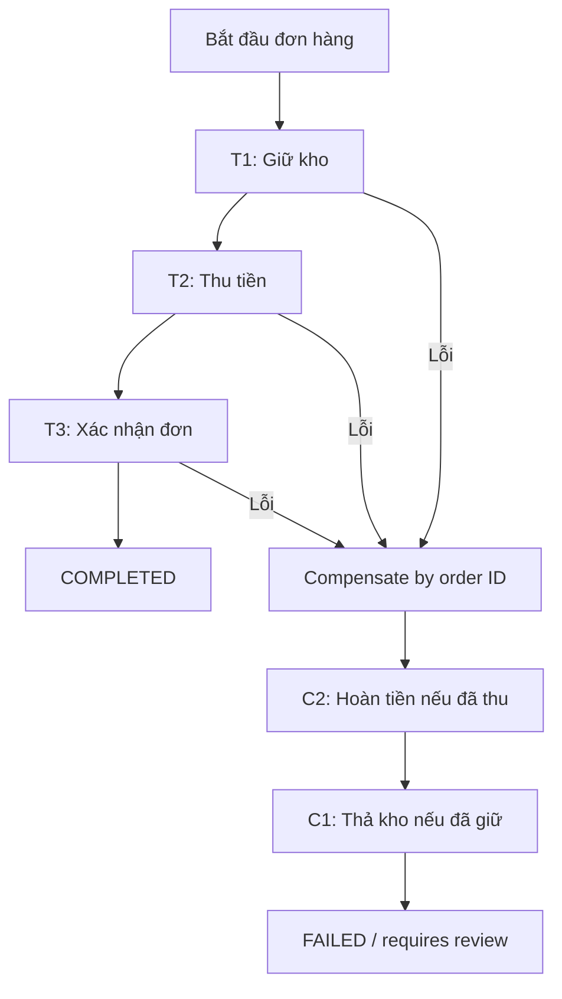

# Retries, error handling và compensation trong Workflows

Giả sử một đơn hàng phải đi qua ba dịch vụ: **giữ hàng tồn kho → thu tiền → xác nhận đơn**. Nếu hệ thống thanh toán trả HTTP 503, ta có nên thử lại? Nếu tiền đã thu nhưng bước xác nhận đơn thất bại, làm thế nào hoàn tiền? Nếu HTTP timeout nhưng bên nhận đã thực hiện giao dịch, một lần retry có gây thu tiền hai lần không?

**Google Cloud Workflows** điều phối các bước liên dịch vụ theo thứ tự khai báo. Workflows hỗ trợ **`try/retry/except`**, retry predicate, exponential backoff, custom errors và subworkflows, giúp xây dựng luồng xử lý có khả năng chịu lỗi. Nhưng Workflows **không tạo transaction phân tán tự động**; ứng dụng cần **idempotency, đối soát trạng thái và compensation (hành động bù)** để giữ dữ liệu nhất quán khi có lỗi.

Bài thuộc chương **Điều phối và tích hợp ứng dụng** của module `CLOUD_PROVIDERS_GCP`. Các ví dụ kết nối Cloud Run, IAM, Pub/Sub/Cloud Tasks, cơ sở dữ liệu và Cloud Logging, tập trung vào phát hành an toàn, độ tin cậy và chi phí. Nội dung cố gắng tự chứa, các URL/resource được ghi rõ là giả định; **không gọi API thanh toán thật bằng dữ liệu lab**.

## 1. Mục tiêu học tập

Sau bài này, bạn có thể:

1. Phân biệt lỗi **transient**, **permanent** và **không rõ kết quả** của một HTTP call.
2. Dùng `try/except`, `raise` và error map trong Workflows.
3. Chọn `http.default_retry` hoặc `http.default_retry_non_idempotent`, cấu hình predicate, `max_retries` và backoff.
4. Giải thích vì sao **retry không đồng nghĩa exactly-once**, đặc biệt với POST thanh toán.
5. Thiết kế **Saga orchestration** có compensation theo thứ tự ngược và theo dõi thất bại khi bù.
6. Viết ví dụ Workflows YAML và thử các nhánh thành công/lỗi qua CLI trong môi trường lab.
7. Theo dõi execution history, logging, SLO, IAM và chi phí.

## 2. Ba loại thất bại phải xử lý khác nhau

| Loại | Ví dụ | Hành động hợp lý |
| --- | --- | --- |
| **Transient** | `429` rate limit, `503` tạm quá tải, lỗi kết nối ngắn hạn. | Retry có giới hạn + backoff, tôn trọng quota/timeout. |
| **Permanent / business error** | `400` payload sai, `401/403` thiếu quyền, `404` đối tượng không tồn tại, `409` xung đột nghiệp vụ. | Sửa cấu hình/input, hoặc trả lỗi nghiệp vụ; **không retry mù quáng**. |
| **Unknown outcome** | POST tới payment bị timeout sau khi server đã nhận request. | Tra cứu trạng thái bằng **idempotency key**, có thể retry an toàn hoặc bù nếu cần. |

HTTP `5xx` cũng không phải lúc nào retry đều đúng: nếu POST đã gây side effect rồi trả 500, thực thi lại có thể tạo hai giao dịch. **Khả năng retry an toàn là thuộc tính của nghiệp vụ và API contract**, không phải chỉ của HTTP method.



## 3. Workflows error map, try/except và raise

### 3.1. Những thông tin trong một exception

Một bước gọi HTTP không thành công có thể ném error map. Với `HttpError`, các trường thường gặp gồm `tags`, `message`, `code` (HTTP status), `headers` và `body`. Các lỗi khác như timeout/kết nối có **tags và fields khác**; **đừng truy cập `e.code` khi chưa chắc trường này tồn tại**.

| Trường | Ví dụ | Cách dùng |
| --- | --- | --- |
| `e.tags` | `["HttpError"]` hoặc tag lỗi khác. | Phân loại lỗi; kiểm tra `"HttpError" in e.tags` trước khi đọc HTTP code. |
| `e.message` | Thông điệp chẩn đoán. | Log có kiểm soát, tránh lộ secrets/payload. |
| `e.code` | `404`, `503` nếu là HTTP error. | Nhận diện một lỗi HTTP cụ thể. |
| `e.body`, `e.headers` | Nội dung và header response. | Có thể chứa dữ liệu nhạy cảm; chỉ lưu phần cần thiết. |

### 3.2. Ví dụ try/except có nhánh xử lý lỗi

```yaml
main:
  params: [args]
  steps:
    - read_order:
        try:
          call: http.get
          args:
            url: ${args.url}
            auth:
              type: OIDC
          result: response
        except:
          as: e
          steps:
            - handle_not_found:
                switch:
                  - condition: ${"HttpError" in e.tags and e.code == 404}
                    steps:
                      - missing:
                          return:
                            found: false
            - propagate_unexpected:
                raise: ${e}
    - success:
        return:
          found: true
          data: ${response.body}
```

Ví dụ này phù hợp khi `args.url` là một HTTPS endpoint nội bộ có Cloud Run IAM và workflow service account được quyền gọi. Trong production, **không nhận URL tùy ý từ input không tin cậy**: cấu hình endpoint cố định/allowlist; nếu gọi endpoint khác, chọn auth tương ứng.

**Điểm cốt lõi:**

- `try` bao quanh phần có thể thất bại; `except.as` nhận error map để phân loại.
- Bắt `404` trong ngữ cảnh “không có order” và trả một kết quả nghiệp vụ có chủ đích.
- Các lỗi khác dùng `raise: ${e}` để **không nuốt lỗi**. Việc luôn trả “OK” từ `except` khiến người gọi tưởng quy trình đã thành công.
- Biến khai báo trong `except` có **scope cục bộ**; muốn dùng trạng thái xử lý lỗi sau khối này, khai báo biến ở bước ngoài trước rồi cập nhật.

### 3.3. Tự phát sinh lỗi nghiệp vụ bằng raise

```yaml
- check_amount:
    switch:
      - condition: ${args.amount <= 0}
        steps:
          - reject:
              raise:
                code: "INVALID_AMOUNT"
                message: "Order amount must be positive"
```

`raise` có thể nhận **string hoặc map**. Một custom map không tự trở thành HTTP error: custom fields/tags phải được xử lý theo cấu trúc bạn định nghĩa. Đừng đặt `e.code` bằng chuỗi `INVALID_AMOUNT` rồi coi đó là HTTP 400 nếu không có hợp đồng rõ ràng.

## 4. Retry policy và exponential backoff

### 4.1. Retry có cấu trúc gì?

```yaml
- read_inventory:
    try:
      call: http.get
      args:
        url: https://EXAMPLE_SERVICE_URL/stock
        auth:
          type: OIDC
      result: inventory_response
    retry:
      predicate: ${http.default_retry_predicate}
      max_retries: 3
      backoff:
        initial_delay: 1
        max_delay: 15
        multiplier: 2
    except:
      as: e
      steps:
        - record_failure:
            call: sys.log
            args:
              json:
                event: "inventory_read_failed"
                message: ${e.message}
              severity: "ERROR"
        - propagate_failure:
            raise: ${e}
```

**Đây là snippet**, không phải workflow độc lập: phải nằm trong một `steps` list và thay URL giả định bằng endpoint Cloud Run được phép. `retry` và `except` nằm **cùng cấp với `try`** của một bước.

| Tham số | Ý nghĩa | Ví dụ |
| --- | --- | --- |
| `predicate` | Hàm quyết định exception có đáng retry không. | `http.default_retry_predicate`. |
| `max_retries` | Số **lần thử lại**, không tính lần gọi ban đầu. | `3` → tối đa 4 attempts. |
| `initial_delay` | Thời gian chờ trước retry đầu, tính bằng giây. | `1`. |
| `multiplier` | Hệ số tăng delay theo exponential backoff. | `2`. |
| `max_delay` | Trần delay giữa các retries. | `15` giây. |

Với ví dụ này, backoff lý thuyết là khoảng `1s → 2s → 4s` giữa các retries (chưa tính thời gian HTTP call và các giới hạn thực thi). **Thời gian tối đa của workflow** phụ thuộc cả timeout của từng bước, thời gian chờ, retry lẫn tổng execution deadline. Mỗi retry là thêm một lần thực thi bước và có thể tăng phí.

### 4.2. Default policy nào phù hợp?

| Predicate / policy | Nhóm lỗi được retry | Khi dùng |
| --- | --- | --- |
| `http.default_retry_predicate` | HTTP **429, 502, 503, 504** và một số lỗi kết nối/timeout. | API **idempotent** hoặc có idempotency bảo đảm. |
| `http.default_retry_predicate_non_idempotent` | HTTP **429, 503** và `ConnectionFailedError`. | API có side effect chưa được chứng minh an toàn retry. |
| `http.default_retry` | Object policy mặc định cho idempotent operation. | Muốn policy Workflows dựng sẵn. |
| `http.default_retry_non_idempotent` | Object policy mặc định cho non-idempotent operation. | Muốn policy thận trọng hơn khi POST/side effect. |
| Custom predicate | Lỗi do ứng dụng định nghĩa. | API có hợp đồng lỗi rõ, yêu cầu đặc thù. |

Chẳng hạn:

```yaml
- reserve_inventory:
    try:
      call: http.post
      args:
        url: https://EXAMPLE_SERVICE_URL/reserve
        body:
          orderId: "O-1001"
    retry: ${http.default_retry_non_idempotent}
```

**Cảnh báo:** policy non-idempotent **không tự ngăn duplicate side effect**. Một POST có thể commit trước khi bên gọi nhận được response, kể cả lúc mạng đứt. Với nghiệp vụ như đặt hàng/thanh toán, yêu cầu API hỗ trợ **idempotency key** và tra cứu trạng thái khi outcome không rõ.

### 4.3. Custom retry predicate

Nếu API nội bộ định nghĩa một điều kiện có thể retry riêng, dùng subworkflow trả về boolean:

```yaml
retry_if_503:
  params: [e]
  steps:
    - decide:
        return: ${"code" in e and e.code == 503}
```

Gắn vào một bước có `try`:

```yaml
retry:
  predicate: ${retry_if_503}
  max_retries: 2
  backoff:
    initial_delay: 1
    max_delay: 5
    multiplier: 2
```

Predicate **nhận map exception làm một tham số**, trả true/false. Không retry `400/401/403` chỉ vì số attempt chưa dùng hết. Nếu API trả HTTP 2xx kèm trạng thái `PENDING` trong body, đó **không tự phải lỗi** để retry: phải tự phân tích và `raise` có chủ đích, hoặc dùng polling có deadline phù hợp.

## 5. Idempotency, retry budget và timeout

### 5.1. Idempotency key

Một API thực hiện side effect nên chấp nhận **khóa ổn định theo nghiệp vụ**. Ví dụ mọi attempt charge cho đơn `O-1001` gửi cùng header:

```yaml
headers:
  Idempotency-Key: ${"charge:" + order_id}
body:
  orderId: ${order_id}
```

Backend cần lưu kết quả/key trong database có **ràng buộc duy nhất hoặc atomic conditional write**: request lặp trả cùng kết quả hợp lệ, không thu tiền lần nữa. Chỉ gửi cùng một key mà backend không thực thi dedup **không có giá trị bảo đảm**.

### 5.2. Retry budget

Với một chuỗi Workflows → Cloud Run → Cloud SQL/third-party API, mỗi tầng đều retry có thể khuếch đại tải. Ví dụ Workflows thử 4 lần, API phía dưới lại thử 3 lần mỗi request: downstream có thể nhận **tới 12 attempts** cho một thao tác.

- Đặt **max retries** và timeout có ngân sách theo SLO.
- Dùng exponential backoff, tránh tất cả clients đồng loạt retry; nơi phù hợp thêm jitter ở tầng hỗ trợ.
- Xem `429`/`Retry-After` của upstream khi tích hợp, nhưng Workflows default policy **không tự bảo đảm tôn trọng mọi rate-limit hint**.
- Với API thất bại liên tục, chuyển sang **quarantine/manual review** thay vì retry vô hạn.
- Thông tin idempotency và correlation ID phải được giữ xuyên suốt attempts.

### 5.3. Auth và network khi gọi Cloud Run

Trong Workflows:

```yaml
auth:
  type: OIDC
  audience: ${service_base_url}
```

Dùng **OIDC** khi gọi Cloud Run/Cloud Run functions bảo vệ bằng IAM; workflow service account cần `roles/run.invoker` trên service đích. Nếu URL có path như `/reserve`, đặt `audience` bằng **base service URL** được Cloud Run chấp nhận. Với các Google Cloud APIs qua `googleapis.com`, dùng **OAuth2** hoặc Workflows connector tương ứng; đừng trộn token audience.

**Cấu hình IAM/network lỗi thường là permanent error**, không nên retry hàng chục lần để “vượt qua 403”. Hạn chế service endpoints vào allowlist tin cậy, kiểm soát ingress và không đưa service account key vào workflow source.

## 6. Compensation và mô hình Saga

Nếu đơn hàng đã giữ kho nhưng thanh toán thất bại, một câu lệnh `raise` chỉ làm workflow **FAILED**; nó **không tự thả hàng**. Compensation là một hoặc nhiều thao tác nghiệp vụ bù lại những phần đã hoàn tất trước đó.



Đây là một **Saga theo kiểu orchestration**: Workflows điều phối giao dịch và chạy compensation khi một bước thất bại. Các thao tác bù **không phải rollback ACID** của toàn hệ thống:

| Giao dịch | Compensation | Điều kiện nghiệp vụ |
| --- | --- | --- |
| `reserve(orderId)` | `release(orderId)` | Giải phóng đúng reservation; không thả hàng của đơn khác. |
| `charge(orderId)` | `refund(orderId)` | Hoàn đúng payment; nếu chưa charge thì no-op/an toàn. |
| `finalize(orderId)` | `cancel(orderId)` (nếu cần) | Hợp đồng rõ về việc đơn đã giao hàng hay đã phát hành hóa đơn. |

**Thiết kế quan trọng nhất khi outcome không rõ:** nếu `charge` timeout, Workflows không biết giao dịch đã commit chưa. Vì vậy compensation `refund(orderId)` phải tra cứu trạng thái theo cùng **business/idempotency key** và làm no-op nếu chưa thu tiền. Tương tự, `release(orderId)` không được làm lỗi nghiệp vụ mới khi reservation chưa tồn tại.

**Đừng trộn “compensation đã được yêu cầu” với “đã bù thành công”**. Refund có thể lỗi; khi đó phải có trạng thái `COMPENSATION_PENDING`, alert, retry độc lập hoặc quy trình đối soát, thay vì chỉ ghi log rồi thông báo đơn hàng hoàn tác xong.

## 7. Ví dụ Workflows YAML: Saga đặt hàng có bù

Ví dụ sau là **workflow hoàn chỉnh về mặt cấu trúc**. Nó giả định ba Cloud Run services tồn tại với các API:

| Dịch vụ | Lệnh nghiệp vụ | Lệnh compensation |
| --- | --- | --- |
| Inventory | `POST /reserve` | `POST /release` |
| Payment (giả lập lab) | `POST /charge` | `POST /refund` |
| Orders | `POST /confirm` | `POST /cancel` |

Tất cả endpoints chấp nhận JSON `{"orderId":"..."}`, nhận header `Idempotency-Key` và phải **dedup theo orderId + action**. Các endpoint compensation là **idempotent**, trả thành công cả khi action gốc chưa xảy ra (safe no-op). Chúng kiểm tra trạng thái lưu bền trước khi bù. Workflow service account có `roles/run.invoker` trên đúng ba services.

> **Đây là minh họa về kiến trúc, không phải tích hợp thanh toán thật.** Không chạy với một payment provider không có hợp đồng idempotency/refund và công cụ đối soát. Các base URLs đưa vào `args` phải đến từ cấu hình tin cậy hoặc allowlist; không cho user bất kỳ điều khiển URL để Workflows gọi hộ.

```yaml
main:
  params: [args]
  steps:
    - init:
        assign:
          - order_id: ${args.order_id}
          - inventory_url: ${args.inventory_url}
          - payment_url: ${args.payment_url}
          - orders_url: ${args.orders_url}

    - orchestrate:
        try:
          steps:
            - reserve_stock:
                try:
                  call: http.post
                  args:
                    url: ${inventory_url + "/reserve"}
                    auth:
                      type: OIDC
                      audience: ${inventory_url}
                    headers:
                      Idempotency-Key: ${"reserve:" + order_id}
                    body:
                      orderId: ${order_id}
                    timeout: 20
                retry: ${http.default_retry_non_idempotent}

            - charge_payment:
                try:
                  call: http.post
                  args:
                    url: ${payment_url + "/charge"}
                    auth:
                      type: OIDC
                      audience: ${payment_url}
                    headers:
                      Idempotency-Key: ${"charge:" + order_id}
                    body:
                      orderId: ${order_id}
                    timeout: 20
                retry: ${http.default_retry_non_idempotent}

            - confirm_order:
                try:
                  call: http.post
                  args:
                    url: ${orders_url + "/confirm"}
                    auth:
                      type: OIDC
                      audience: ${orders_url}
                    headers:
                      Idempotency-Key: ${"confirm:" + order_id}
                    body:
                      orderId: ${order_id}
                    timeout: 20
                retry: ${http.default_retry_non_idempotent}

        except:
          as: original_error
          steps:
            - log_saga_failure:
                call: sys.log
                args:
                  json:
                    event: "order_saga_failed"
                    order_id: ${order_id}
                    message: ${original_error.message}
                  severity: "ERROR"

            # Compensation in reverse order.
            # All endpoints must be idempotent and safe as no-ops.
            - cancel_order:
                try:
                  call: http.post
                  args:
                    url: ${orders_url + "/cancel"}
                    auth:
                      type: OIDC
                      audience: ${orders_url}
                    headers:
                      Idempotency-Key: ${"cancel:" + order_id}
                    body:
                      orderId: ${order_id}
                retry: ${http.default_retry_non_idempotent}
                except:
                  as cancel_error
                  steps:
                    - log_cancel_failure:
                        call: sys.log
                        args:
                          json:
                            event: "compensation_failed"
                            action: "cancel"
                            order_id: ${order_id}
                            message: ${cancel_error.message}
                          severity: "ERROR"

            - refund_payment:
                try:
                  call: http.post
                  args:
                    url: ${payment_url + "/refund"}
                    auth:
                      type: OIDC
                      audience: ${payment_url}
                    headers:
                      Idempotency-Key: ${"refund:" + order_id}
                    body:
                      orderId: ${order_id}
                retry: ${http.default_retry_non_idempotent}
                except:
                  as refund_error
                  steps:
                    - log_refund_failure:
                        call: sys.log
                        args:
                          json:
                            event: "compensation_failed"
                            action: "refund"
                            order_id: ${order_id}
                            message: ${refund_error.message}
                          severity: "ERROR"

            - release_stock:
                try:
                  call: http.post
                  args:
                    url: ${inventory_url + "/release"}
                    auth:
                      type: OIDC
                      audience: ${inventory_url}
                    headers:
                      Idempotency-Key: ${"release:" + order_id}
                    body:
                      orderId: ${order_id}
                retry: ${http.default_retry_non_idempotent}
                except:
                  as release_error
                  steps:
                    - log_release_failure:
                        call: sys.log
                        args:
                          json:
                            event: "compensation_failed"
                            action: "release"
                            order_id: ${order_id}
                            message: ${release_error.message}
                          severity: "ERROR"

            - propagate_original_failure:
                raise: ${original_error}

    - completed:
        return:
          order_id: ${order_id}
          status: "COMPLETED"
```

### 7.1. Đọc luồng trên

1. **Thành công:** reserve → charge → confirm → trả `COMPLETED`.
2. **Một bước thất bại:** từng bước tự retry theo policy có giới hạn; khi vẫn lỗi, khối `except` của `orchestrate` được gọi.
3. **Compensation:** lần lượt thử `cancel` → `refund` → `release`; dùng idempotency key theo action và order.
4. **Compensation lỗi:** `except` riêng của mỗi thao tác ghi log rồi tiếp tục thử các bước bù còn lại. **Log lỗi chưa phải recovery hoàn tất**.
5. **Kết thúc:** `raise original_error` làm workflow phản ánh thất bại thực; không trả `COMPLETED` nếu đã phải bù.

Tại sao thử cả `cancel` và `refund` khi chưa chắc `confirm`/`charge` đã thành công? Vì một timeout có thể xảy ra **sau khi backend commit**. Các API bù bắt buộc kiểm tra trạng thái đã ghi bền; khi không có đối tượng cần bù thì **trả thành công/no-op**. Nếu quy trình nghiệp vụ đã bước sang trạng thái không thể hủy (ví dụ đã giao hàng hoặc payment đã quyết toán), thay đổi này cần **quy trình bù nghiệp vụ chuyên biệt**, không dùng refund/cancel mù quáng.

### 7.2. Điều còn thiếu để trở thành production Saga

Ví dụ trên chưa có **durable Saga state store**. Trong production nên có bản ghi `order_id` gồm `RESERVED`, `CHARGED`, `CONFIRMED`, `COMPENSATING`, `COMPENSATED` và `COMPENSATION_PENDING` để:

- Đối soát khi HTTP request timeout hoặc execution bị hủy/mất trước khi vào `except`.
- Cho phép một **reconciler** hoặc operator tiếp tục compensation thất bại, dựa trên trạng thái thực.
- Ngăn khởi chạy hai executions của cùng order tạo side effects cạnh tranh.
- Kiểm tra tương quan giữa đơn hàng, reservation, payment transaction và event IDs.
- Phát cảnh báo P0/P1 khi khoản thu tiền chưa có đơn hoặc chưa được hoàn lại đúng SLA.

Không đặt toàn bộ business state chỉ trong biến Workflows hoặc execution history. **Workflows orchestrates; database và business APIs là nguồn sự thật**.

## 8. Lab độc lập: thử retry và except không cần backend

Để thử **syntax và số lần retry** mà không gọi Cloud Run/payment, tạo file `retry-demo.yaml` trên máy lab:

```yaml
main:
  steps:
    - simulated_failure:
        try:
          raise:
            code: 503
            message: "simulated transient error"
        retry:
          predicate: ${retry_if_503}
          max_retries: 2
          backoff:
            initial_delay: 1
            max_delay: 4
            multiplier: 2
        except:
          as: e
          steps:
            - handled:
                return:
                  status: "HANDLED_AFTER_RETRIES"
                  error_code: ${e.code}

retry_if_503:
  params: [e]
  steps:
    - decide:
        return: ${"code" in e and e.code == 503}
```

`raise` luôn ném lỗi 503, nên lần đầu + hai retries đều thất bại; sau đó `except` trả `HANDLED_AFTER_RETRIES`. Đây là ví dụ **kiểm chứng retry mechanics**, không phải mẫu cho phép nghiệp vụ “bỏ qua mọi lỗi 503”: trong ứng dụng thật thường nên raise lại hoặc báo kết quả không thành công.

### 8.1. Deploy và chạy trong project lab

Chỉ thực hiện khi project đã bật **Workflows API**, người chạy có quyền deploy/execute, có billing/quota và workflow service account phù hợp:

```bash
PROJECT_ID="orders-dev"
REGION="asia-southeast1"
WORKFLOW="retry-demo-lab"

# CHỈ ĐỌC: xem workflow có sẵn trước khi tạo.
gcloud workflows list \
  --project="$PROJECT_ID" \
  --location="$REGION"

# THAY ĐỔI TÀI NGUYÊN: tạo hoặc cập nhật workflow tên được chỉ định.
gcloud workflows deploy "$WORKFLOW" \
  --project="$PROJECT_ID" \
  --location="$REGION" \
  --source=retry-demo.yaml

# THỰC THI THẬT, có phí steps/executions theo giá hiện hành.
gcloud workflows run "$WORKFLOW" \
  --project="$PROJECT_ID" \
  --location="$REGION" \
  --data='{}'
```

Đây là workflow **không gọi API bên ngoài**, nên có thể dùng để quan sát attempts/backoff và kết quả `HANDLED_AFTER_RETRIES`. Để xác minh lần chạy cụ thể:

```bash
gcloud workflows executions list "$WORKFLOW" \
  --project="$PROJECT_ID" \
  --location="$REGION"

# Thay EXECUTION_ID thực lấy từ lệnh list.
gcloud workflows executions describe EXECUTION_ID \
  --workflow="$WORKFLOW" \
  --project="$PROJECT_ID" \
  --location="$REGION"
```

Môi trường tổ chức có thể hạn chế quyền xem execution details hoặc log dữ liệu. Nếu báo `PERMISSION_DENIED`, kiểm tra IAM workflow/executions thay vì cấp Owner toàn project.

### 8.2. Chạy thử Saga với mock services

Chỉ triển khai ví dụ mục 7 khi **ba backend mocks** thực sự đã có và hỗ trợ:

- Validates `orderId`/`Idempotency-Key`, lưu state vào datastore của lab.
- `reserve`/`charge`/`confirm` có thể tạo lỗi 429, 503, 400 hoặc timeout theo kịch bản.
- `cancel`/`refund`/`release` idempotent/no-op khi action gốc chưa commit.
- Ghi lại event/action theo `order_id` để kiểm tra không có duplicate charge và không còn reservation/payment bị treo.
- Các Cloud Run services yêu cầu OIDC và workflow runtime service account có Invoker đúng phạm vi.

Một input chỉ mang tính minh họa:

```json
{
  "order_id": "O-LAB-1001",
  "inventory_url": "https://inventory-mock-EXAMPLE.a.run.app",
  "payment_url": "https://payment-mock-EXAMPLE.a.run.app",
  "orders_url": "https://orders-mock-EXAMPLE.a.run.app"
}
```

**Không copy các URLs placeholder vào một workflow thật**; phải thay bằng service URLs riêng của lab và kiểm chứng quyền. Vì ví dụ liên quan payment, backend được phép chỉ nên là **mock/sandbox**, không kết nối dịch vụ thu tiền production.

### 8.3. Ma trận kiểm thử bắt buộc

| Scenario mock | Kỳ vọng workflow | Kỳ vọng business state |
| --- | --- | --- |
| Cả 3 calls trả 2xx | `COMPLETED` | Một reservation, một charge, một order confirmed. |
| Reserve trả 503 rồi 2xx | Retry thành công | Không có reservation trùng. |
| Charge trả 400 cố định | Fail + compensation | Inventory released, không tạo charge. |
| Charge commit rồi connection timeout | Có thể retry/bù | Không double-charge; refund/no-op dựa trên status thật. |
| Confirm commit rồi response timeout | Workflow có thể fail + bù | Cancel/refund/release theo policy, không để confirmed order mồ côi. |
| Refund endpoint liên tục 503 | Workflow FAILED, alert | Saga state `COMPENSATION_PENDING` cần đối soát. |
| Hai executions cùng `order_id` | Idempotency/collision policy rõ | Không tạo 2 đơn/2 charges. |
| Execution bị cancel giữa chừng | Reconciler phục hồi | Không phụ thuộc `except` chắc chắn chạy. |

**Tiêu chí pass không chỉ là execution state**, mà là **trạng thái hệ thống cuối cùng** (inventory, payment, orders) và việc tái chạy cùng idempotency key không gây side effect mới.

## 9. Logging, quan sát và xử lý sự cố

### 9.1. Nên log những gì?

| Tầng | Dữ liệu cần quan sát |
| --- | --- |
| **Workflows execution** | Workflow/revision, execution ID, trạng thái, step lỗi, tổng duration. |
| **Retry** | Operation name, attempt count, error class/code, delay, retries exhausted. |
| **Compensation** | Action, idempotency key, SUCCESS/FAILED/PENDING, kết quả đối soát. |
| **Downstream Cloud Run** | HTTP latency, 429/5xx, instance count, service logs và trace ID. |
| **Database/queue** | Commit state, duplicate key conflicts, pending refunds/reservations, retry backlog. |
| **Cost** | Executed steps, số retries, execution duration, Cloud Run/DB/Logging costs. |

`sys.log` ghi vào Cloud Logging theo service account và cấu hình; ví dụ:

```yaml
- log_compensation:
    call: sys.log
    args:
      json:
        event: "compensation_attempt"
        order_id: ${order_id}
        action: "refund"
      severity: "WARNING"
```

**Tránh ghi raw payment tokens, Authorization headers, PII hoặc toàn bộ error body**. Ghi `order_id`/correlation ID đã được phân loại dữ liệu đúng. Log tự nó không phải durable source of truth cho trạng thái bù; cần bảng trạng thái/outbox và alert.

### 9.2. Chẩn đoán nhanh

| Triệu chứng | Nguyên nhân thường gặp | Cách điều tra |
| --- | --- | --- |
| Deploy workflow lỗi syntax | Sai indentation YAML, `retry` sai cấp với `try` hoặc biểu thức không hợp lệ. | Kiểm tra định dạng và thông báo compiler Workflows. |
| `403` khi gọi Cloud Run | Runtime SA thiếu `run.invoker` hoặc audience không khớp. | OIDC, service URL, IAM và ingress; không retry vô hạn. |
| Retry không xảy ra | Predicate trả false, mã lỗi nằm ngoài danh sách hoặc không được raise. | Xem tags/code, custom predicate, error body vs status code. |
| Retries quá nhiều | Retry nhiều tầng, max_retries/backoff quá rộng. | Tính tổng attempts và step fees, xem downstream quota. |
| Compensation không được gọi | Exception chưa được catch, execution bị cancel hoặc workflow dừng bất ngờ. | Execution history, error propagation, reconciliation store. |
| Refund hai lần | Backend không idempotent hoặc key thay đổi giữa attempts. | Xác minh key, conditional writes, payment reconciliation. |
| Workflows báo FAILED dù có refund | Lỗi nghiệp vụ đã được raise sau compensation. | Đọc state `COMPENSATED` vs `COMPENSATION_PENDING`; FAILED có thể đúng. |
| Dashboard không thấy sys.log | Thiếu IAM/logging config hoặc filter sai. | Cloud Logging resource/log name, quyền Logging Writer và filters. |

### 9.3. Chi phí và SLO

Mỗi step, retry, connector call, HTTP request và Cloud Run/DB operation có thể góp phần tăng tổng phí. **Exponential backoff** giảm dồn tải nhưng kéo dài execution latency; **compensation** cũng tiêu tốn requests/compute và đôi khi phí nghiệp vụ hoàn tiền. Đặt SLO gồm:

- Tỷ lệ Saga **COMPLETED** đúng hạn.
- Tỷ lệ **FAILED cần compensation**, tỉ lệ compensation hoàn tất.
- Số `COMPENSATION_PENDING` và **tuổi lớn nhất** trước khi đối soát.
- p95 execution duration, retry exhaustion count.
- Chi phí / đơn hàng thành công và lượng retry/compensation không bình thường.

Không nên tối ưu giảm vài bước Workflows bằng cách bỏ qua bù tiền/tồn kho. Workflows step billing chỉ là một phần nhỏ của rủi ro và tổng chi phí hệ thống.

## 10. Bài tập vận dụng (có đáp án)

**Bài 1 — Số attempts.** Một HTTP step đặt `max_retries: 4`. Nếu mọi attempt đều thất bại, tổng số lần gọi tối đa?

*Đáp án:* **5 lần** = 1 lần ban đầu + 4 retries. Backoff chỉ đặt khoảng cách giữa retries.

**Bài 2 — 403 có nên retry?** Workflow gọi Cloud Run trả HTTP 403, tiếp tục retry 10 lần mà vẫn thất bại.

*Đáp án:* 403 thường là lỗi IAM/ingress/OIDC audience hoặc quyền nghiệp vụ, không phải lỗi tạm. Kiểm tra workflow runtime SA và `roles/run.invoker` trên service, không tăng retries.

**Bài 3 — Chọn predicate.** `http.default_retry_predicate` và `http.default_retry_predicate_non_idempotent` khác nhau thế nào?

*Đáp án:* Predicate idempotent bao gồm 429/502/503/504 và lỗi kết nối/timeout; non-idempotent thận trọng hơn, chủ yếu 429/503 và ConnectionFailedError. **Không có predicate nào tự bảo đảm an toàn side effects.**

**Bài 4 — Timeout sau charge.** Payment xử lý thành công nhưng HTTP response bị mất. Workflow retry POST và khách bị thu hai lần.

*Đáp án:* API thiếu idempotency/tra cứu theo order ID. Gửi cùng idempotency key, backend giữ record/transaction duy nhất; khi unknown outcome thì reconcile trước khi hành động tiếp.

**Bài 5 — Compensation.** Inventory reserve thành công, charge thất bại vĩnh viễn. Bước nào phải chạy?

*Đáp án:* **Release reservation** để trả hàng; nếu charge outcome không rõ, **refund/no-op** theo trạng thái payment thật rồi release. Không đơn giản return 500 và để stock bị giữ mãi.

**Bài 6 — Bù thất bại.** Payment đã charge, refund API cũng 503 sau retries. Nên trả trạng thái `REFUNDED`?

*Đáp án:* **Không.** Ghi `COMPENSATION_PENDING` trong durable store, alert/reconcile và retry có kiểm soát. Log đơn thuần chưa đủ.

**Bài 7 — Exception scope.** Một biến `compensation_failed` chỉ tạo bên trong `except`, bước ngoài `except` truy cập bị lỗi. Cách sửa?

*Đáp án:* Khai báo biến trước `try` ở scope ngoài rồi cập nhật trong `except`, hoặc đóng gói xử lý/return bên trong `except`.

**Bài 8 — Retry bùng nổ.** Workflow retry 4 attempts, Cloud Run bên dưới retry 3 attempts. Upstream có thể nhận bao nhiêu calls?

*Đáp án:* **Tới 12**. Cần retry budget và backoff phối hợp giữa các tầng; cân nhắc một điểm chịu trách nhiệm retry.

**Bài 9 — Hủy workflow.** Một execution bị cancel giữa lúc đã reserve nhưng trước khi chạy `except`. Có chắc stock sẽ release?

*Đáp án:* Không. Cần **durable Saga state + reconciler** xử lý các giao dịch treo/đã hủy, không chỉ dựa vào catch block.

## 11. Checklist production

- [ ] Mỗi bước được phân loại transient/permanent/unknown outcome rõ ràng.
- [ ] `try/retry/except` đúng cú pháp, error map không bị đọc trường vắng mặt.
- [ ] Retry có predicate, max attempts, backoff, timeout và tổng ngân sách rõ.
- [ ] POST có idempotency key **được backend thực thi**, không chỉ header hình thức.
- [ ] Có cơ chế query/reconcile kết quả khi timeout hoặc connection drop sau commit.
- [ ] Compensation theo thứ tự ngược, đủ endpoint bù và no-op an toàn.
- [ ] Trạng thái Saga/compensation lưu bền, có operator/reconciler cho `PENDING`.
- [ ] Workflow IAM dùng runtime SA least privilege, Cloud Run OIDC audience đúng.
- [ ] Không nhận arbitrary endpoint URL, không log secrets/payment/PII.
- [ ] Thử 429/503, 400/403, timeout, duplicate, compensation failure và cancellation.
- [ ] Monitoring execution, retry, compensation backlog, p95 latency, chi phí được đặt alert.
- [ ] Có rollback/redeploy workflow, versioned business APIs và quy trình xử lý incident.

## 12. Tổng kết

**Retry** giúp vượt qua lỗi tạm thời; **`try/except`** giúp phân loại và chuyển lỗi thành hành động cụ thể; **compensation** giúp khôi phục tính nhất quán nghiệp vụ khi nhiều dịch vụ đã commit một phần. Ba cơ chế này bổ sung nhau nhưng không thay thế **idempotency, database transactions và reconciliation**.

Một thiết kế Workflows đáng tin cậy cần trả lời được bốn câu hỏi:

1. **Có nên thử lại không?** Chỉ khi lỗi hợp lệ và tác vụ an toàn với repeat.
2. **Thử lại bao lâu?** Giới hạn attempts/backoff/timeout theo SLO và chi phí.
3. **Nếu thất bại giữa chừng thì bù thế nào?** Hành động bù idempotent, có state và thứ tự rõ.
4. **Nếu bù thất bại hoặc execution biến mất thì ai xử lý?** Durable Saga state, alert và reconciler.

### Tài liệu Google Cloud tham khảo

- [Workflows — Retry steps](https://cloud.google.com/workflows/docs/reference/syntax/retrying)
- [Workflows — Catch errors](https://cloud.google.com/workflows/docs/reference/syntax/catching-errors)
- [Workflows — Workflow errors](https://cloud.google.com/workflows/docs/reference/syntax/error-types)
- [Workflows — Raise errors](https://cloud.google.com/workflows/docs/reference/syntax/raising-errors)
- [Workflows — Default retry predicate](https://cloud.google.com/workflows/docs/reference/stdlib/http/default_retry_predicate)
- [Workflows — Default non-idempotent retry predicate](https://cloud.google.com/workflows/docs/reference/stdlib/http/default_retry_predicate_non_idempotent)
- [Workflows — Authentication](https://cloud.google.com/workflows/docs/authenticate-from-workflow)
- [Workflows — Best practices: retries and Saga](https://cloud.google.com/workflows/docs/best-practice)
- [Workflows — Pricing](https://cloud.google.com/workflows/pricing)
