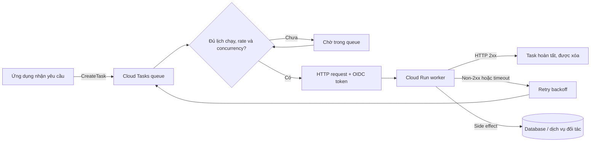

# Rate limits, lịch chạy và retries cho Cloud Tasks

> **Chương:** Điều phối và tích hợp ứng dụng  
> **Module:** CLOUD_PROVIDERS_GCP  
> **Phạm vi module:** Khám phá Google Cloud từ tổ chức project, IAM và VPC đến Compute Engine, GKE, Cloud Run, dịch vụ lưu trữ và cơ sở dữ liệu. Qua các tình huống triển khai, người học biết lựa chọn dịch vụ, bảo vệ tài nguyên, tự động hóa phát hành và theo dõi độ tin cậy cùng chi phí.

Một API bán hàng cần gửi email xác nhận và gọi đối tác thanh toán sau khi nhận đơn. Thực hiện tất cả ngay trong HTTP request có thể làm người mua chờ lâu, còn gọi ồ ạt khiến API đối tác trả `429 Too Many Requests`. **Cloud Tasks** giúp đưa từng công việc vào **queue bền vững**, lên lịch **thời điểm thử thực thi sớm nhất**, giới hạn tốc độ giao đến worker và retry khi worker chưa xử lý thành công.

Bài học tập trung vào ba cơ chế khác nhau: **rate limits** điều tiết tổng số lần dispatch, **schedule time** trì hoãn lần thử đầu và **retry configuration** quyết định các lần thử sau khi thất bại. Ta xây dựng một Cloud Run HTTP worker có xác thực, queue Cloud Tasks giới hạn thấp, ba task thử nghiệm (thành công, lỗi và hẹn giờ), sau đó quan sát logs, xử lý lỗi và cleanup. Các thao tác ghi Cloud chỉ dành cho **project sandbox**.

## Mục tiêu học tập

Sau bài này, bạn có thể:

1. Giải thích vai trò **queue, task, dispatch attempt, worker** và xác định khi nào chọn Cloud Tasks thay vì Cloud Scheduler, Pub/Sub hoặc Workflows.
2. Cấu hình `maxDispatchesPerSecond`, `maxConcurrentDispatches`; hiểu **token bucket**, burst và ramp-up.
3. Dùng `scheduleTime` theo RFC 3339, phân biệt **một lần chạy trong tương lai** với lịch **cron định kỳ**.
4. Thiết lập `maxAttempts`, `maxRetryDuration`, `minBackoff`, `maxBackoff`, `maxDoublings` và đọc chính xác điều kiện dừng retry.
5. Gọi Cloud Run riêng tư bằng **OIDC token** của task service account với IAM tối thiểu.
6. Thiết kế handler **idempotent**, phân loại lỗi, theo dõi queue depth/latency và xử lý task thất bại không mất dữ liệu nghiệp vụ.

## 1. Cloud Tasks nằm ở đâu trong kiến trúc?



**Cloud Tasks lưu yêu cầu xử lý và chủ động gửi đến worker**. Application tạo task không cần đợi công việc hoàn tất; tạo task thành công chỉ chứng minh đã **enqueue**, không chứng minh worker đã xử lý thành công.

| Khái niệm | Vai trò |
|---|---|
| **Queue** | Nơi lưu tasks, quy định tốc độ dispatch và retry policy mặc định |
| **Task** | HTTP method, URL, payload, danh tính gọi, thời điểm schedule và cấu hình có thể tùy chỉnh |
| **Attempt** | Một lần Cloud Tasks gửi request tới worker; có thể thất bại và được thử lại |
| **Worker/handler** | HTTP service xử lý công việc, trả status thể hiện thành công/thất bại |
| **Task name** | Định danh trong queue, có thể dùng hỗ trợ chống tạo task trùng |

### 1.1. Chọn Cloud Tasks hay dịch vụ khác?

| Nhu cầu | Công cụ thường phù hợp | Lý do |
|---|---|---|
| Chạy một công việc HTTP cụ thể sau 10 phút, giới hạn 2 req/s | **Cloud Tasks** | Lịch một lần, dispatch rate, retries |
| Chạy công việc mỗi ngày lúc 01:00 | **Cloud Scheduler** | Cron định kỳ; có thể gọi service hoặc tạo tasks |
| Fan-out nhiều consumers theo sự kiện | **Pub/Sub** | Publish/subscribe, mỗi subscription nhận message |
| Chuỗi bước có nhánh, đợi kết quả và quản lý trạng thái | **Workflows** | Điều phối nhiều lời gọi và nhánh quyết định |
| Chạy batch nhiều giờ và kết thúc theo tasks | **Cloud Run jobs** | Execution/task lifecycle, không cần HTTP handler nhận từng request |

**Cloud Tasks không phải công cụ cron.** Một task có `scheduleTime` chỉ được lập lịch **một lần**; muốn chạy định kỳ, dùng Cloud Scheduler kích hoạt producer/enqueuer. Cloud Tasks cũng **không bảo đảm thứ tự FIFO** hoặc chính xác thời điểm thực thi.

## 2. Vòng đời HTTP task và quy tắc thành công

```text
CreateTask → SCHEDULED → đủ thời điểm + capacity → DISPATCH
                                         ├─ Worker trả HTTP 2xx → SUCCESS → task bị xóa
                                         └─ HTTP non-2xx / timeout
                                               → BACKOFF → DISPATCH tiếp
                                               → kết thúc retry / retention → task bị xóa
```

- Với **HTTP target**, Cloud Tasks coi **HTTP 2xx** là kết quả thành công, bao gồm `200`, `201`, `204`.
- Các response khác (ví dụ `400`, `401`, `429`, `500`, `503`), timeout và lỗi mạng có thể khiến task được thử lại theo chính sách. **Đừng coi `400` tự động là lỗi vĩnh viễn không retry.**
- Request có payload phải dùng HTTP `POST` hoặc `PUT`; khi gọi API có side effect, không đặt logic thay đổi dữ liệu vào GET.
- Cloud Tasks áp dụng **at-least-once delivery**; trong một số tình huống có thể gửi lại cả khi ứng dụng đã xử lý xong. Handler phải **idempotent**.
- Khi task hoàn tất hoặc hết điều kiện retry, Cloud Tasks **xóa task**. **Không có dead-letter topic tự động** tương đương Pub/Sub dead-letter policy trong mô hình HTTP Cloud Tasks thông thường.

### 2.1. ACK của Pub/Sub không tương đương status của Cloud Tasks

Đối với Cloud Tasks HTTP target, worker **không gọi `ack()`**. Nó trả mã HTTP để thông báo kết quả; `2xx` tương đương hoàn tất task theo góc nhìn Cloud Tasks. Nếu đã ghi dữ liệu nhưng response bị mất, attempt sau có thể lặp lại. Bảo đảm giao tối thiểu một lần **không** đồng nghĩa bảo đảm nghiệp vụ chỉ xảy ra đúng một lần.

### 2.2. Giới hạn quan trọng cần ghi nhớ

Theo giới hạn Cloud Tasks hiện hành, khi dùng HTTP target:

| Giới hạn | Giá trị | Ý nghĩa |
|---|---|---|
| Lịch xa nhất | **30 ngày** từ hiện tại | Không dùng task schedule cho lịch một lần nhiều tháng |
| Task retention tối đa | **31 ngày** | Tasks bị xóa khi chạm giới hạn, kể cả chưa thành công |
| HTTP dispatch deadline | **15 giây đến 30 phút**; mặc định 10 phút | Cloud Tasks ngừng chờ attempt khi hết deadline |
| Tốc độ dispatch mỗi queue | **Tối đa 500 tasks/s** | Tăng hơn cần chiến lược nhiều queue và capacity |
| Task size | **1 MiB** | Không nhúng file lớn trong HTTP task; truyền tham chiếu Cloud Storage |
| Ghi nhớ task ID sau khi xóa | **Tới 24 giờ** | Tạo lại tên cũ có thể trả `ALREADY_EXISTS` |
| Xóa rồi tạo lại queue cùng tên | **Phải chờ 3 ngày** | Không xóa/recreate queue tùy tiện trong vận hành |

Lịch xa nhất và retention là **hai giới hạn khác nhau**: một task có thể schedule cho tương lai trong 30 ngày; mọi task vẫn chịu giới hạn tồn tại tối đa 31 ngày.

## 3. Rate limits: giới hạn tốc độ và số attempt đồng thời

Cloud Tasks điều tiết **các lần dispatch**, gồm **lần đầu và retries**, không chỉ các task mới:

| Thuộc tính | Ý nghĩa | Ví dụ |
|---|---|---|
| `maxDispatchesPerSecond` | Tốc độ dispatch mục tiêu lớn nhất theo cơ chế token bucket | `2` tasks/s |
| `maxConcurrentDispatches` | Số attempt đang chờ response đồng thời tối đa | `2` requests cùng lúc |
| `maxBurstSize` | Số token tối đa tích lũy để thực hiện **burst** | Do API tính tự động trong nhiều cấu hình |
| Queue `state` | `RUNNING` hay `PAUSED` | Pause ngừng dispatch nhưng vẫn có thể enqueue |

### 3.1. Token bucket và burst

Queue bổ sung token theo `maxDispatchesPerSecond`; mỗi dispatch tiêu một token. Khi queue nhàn rỗi, token có thể tích lũy và tạo **burst**, nên tốc độ trong một khoảng rất ngắn **có thể vượt mức trung bình được cấu hình**. Cloud Tasks có thể tự tính `maxBurstSize`; với Cloud Tasks API/`gcloud`, không giả định có flag chỉnh trực tiếp burst size cho mọi queue.

Ngược lại, queue **mới tạo, vừa resume hoặc nhàn rỗi một thời gian** có thể ramp-up dần, chứ không ngay lập tức đạt mức dispatch tối đa. Vì vậy **`maxDispatchesPerSecond=100` không phải lời hứa sẽ chạy ngay 100 tasks/s**.

### 3.2. Concurrency cộng với tốc độ quyết định throughput

Giả sử queue có `maxDispatchesPerSecond=2`, `maxConcurrentDispatches=2`:

- Nếu mỗi request xử lý khoảng **0,1 giây**, giới hạn tốc độ trung bình 2 tasks/s thường chi phối.
- Nếu mỗi request xử lý **4 giây**, hai request đang chạy chiếm hết concurrency; throughput lý thuyết theo concurrency chỉ khoảng **2 / 4 = 0,5 tasks/s**.
- Nếu worker trả nhiều `429`/`503`, Cloud Tasks còn có **congestion backoff**, giảm tốc độ thực để bảo vệ đích.

Với giả định tải ổn định, có thể ước tính:

\[
\text{Throughput} \lesssim \min\left(\text{maxDispatchesPerSecond},\ \frac{\text{maxConcurrentDispatches}}{\text{độ trễ attempt (s)}}\right)
\]

Đây là **cận gần đúng**, không dự báo chính xác từng giây vì burst, ramp-up, lỗi và retry. Ví dụ queue giới hạn 2 concurrent không thay thế cấu hình **Cloud Run max instances/concurrency**: cả queue và worker phải phù hợp năng lực downstream.

### 3.3. Không chỉnh queue để chữa mọi lỗi 429

Nếu API đối tác cho phép 5 req/s, cần tính **tất cả nguồn gọi**, không chỉ queue đang xét. Giảm queue `maxDispatchesPerSecond` có thể hữu ích, nhưng một token bucket vẫn có burst. Khi cần kiểm soát rất chặt, xem thêm concurrency, quota của downstream và rate limiter ở tầng ứng dụng. Không tăng tốc độ lên 500/s chỉ vì backlog tăng; trước tiên đo khả năng chịu tải.

## 4. Lịch chạy: `scheduleTime` chỉ điều khiển lần thử đầu

Khi tạo task, `scheduleTime` nhận thời điểm theo **RFC 3339**, ví dụ `2026-11-19T10:30:00Z`. Nếu bỏ qua hoặc đặt trong quá khứ, Cloud Tasks coi như task sẵn sàng giao từ hiện tại.

**`scheduleTime` không phải thời điểm thực thi chính xác**. Một task dù đến giờ vẫn có thể chờ vì queue pause, rate limit, concurrency, backoff, lỗi hạ tầng hoặc ramp-up. Đồng hồ của ứng dụng, logic đặt lịch theo timezone và yêu cầu SLO phải được thiết kế riêng.

### 4.1. Một lần, định kỳ và retry

| Tình huống | Công cụ/cơ chế |
|---|---|
| Gửi lời nhắc cho đơn hàng sau 15 phút | Cloud Tasks `scheduleTime` cho **một task** |
| Gửi báo cáo **mỗi** sáng | Cloud Scheduler cron → tạo task hoặc gọi Cloud Run |
| Request 503 sau lần gửi đầu | **RetryConfig** quyết định thời điểm **attempt tiếp theo** |
| Cần đợi một bước workflow xong rồi mới chạy bước khác | Workflows / ứng dụng quản lý trạng thái |

Chỉ cần ghi `scheduleTime` cho task **chưa bắt đầu**, không dùng nó như công cụ trì hoãn mọi retry. Khi task đã được giao và thất bại, `minBackoff`/`maxBackoff` mới chi phối các lần thử sau.

### 4.2. Sắp lịch theo timezone

Giao diện Cloud Tasks dùng timestamp tuyệt đối. Khi người dùng nhập “09:00 ngày mai”, ứng dụng phải **chuyển từ timezone nghiệp vụ sang UTC**, xử lý DST nếu có, trước khi enqueue. Trong lab, dùng GNU `date` của Cloud Shell để tạo mốc **UTC cách hiện tại vài phút**, không hardcode ngày cũ:

```bash
SCHEDULE_AT="$(date -u -d '+3 minutes' '+%Y-%m-%dT%H:%M:%SZ')"
printf 'Task scheduled for %s\n' "$SCHEDULE_AT"
```

Nếu triển khai trên Windows PowerShell, cú pháp `date -d` không tương thích; dùng `[DateTimeOffset]::UtcNow.AddMinutes(3)` rồi format ISO 8601 hoặc tính timestamp trong ngôn ngữ lập trình.

## 5. RetryConfig: số attempts, thời gian và backoff

Cloud Tasks retry sau response lỗi/timeout theo các trường:

| Trường | Diễn giải |
|---|---|
| `maxAttempts` | Tổng số attempts **bao gồm lần đầu**; `-1` nghĩa là không giới hạn bởi số lần |
| `maxRetryDuration` | Khoảng thời gian retry tính từ **lần thực thi đầu**; `0s` nghĩa là không giới hạn bởi thời gian riêng này |
| `minBackoff` | Thời gian chờ retry tối thiểu |
| `maxBackoff` | Thời gian chờ retry tối đa |
| `maxDoublings` | Số lần khoảng chờ tăng theo cấp số nhân, trước khi chuyển sang tăng tuyến tính |

### 5.1. Chi tiết dễ nhầm: điều kiện dừng retry

Theo **RetryConfig API hiện hành**, nếu đồng thời đặt `maxAttempts` hữu hạn và `maxRetryDuration` dương, Cloud Tasks kết thúc retry khi **cả hai điều kiện đã thỏa** (hoặc task thành công/chạm retention), **không phải khi điều kiện đầu tiên vừa đạt**. Ví dụ `maxAttempts=3` và `maxRetryDuration=3600s` **không bảo đảm task dừng ở lần thứ ba** nếu mốc thời gian chưa đạt.

Khi muốn giới hạn bằng **số attempts** trong lab, đặt `maxRetryDuration=0s` để tắt điều kiện thời gian; khi muốn giới hạn bằng thời gian, cân nhắc `maxAttempts=-1`. Dù vậy **retention tối đa vẫn áp dụng**, và không dùng Cloud Tasks như công cụ cam kết số side effects tối đa — handler vẫn phải idempotent.

### 5.2. Ví dụ lịch backoff

Nếu `minBackoff=10s`, `maxBackoff=300s`, `maxDoublings=3`, các khoảng chờ sau lỗi có thể đi theo:

```text
10s → 20s → 40s → 80s → 160s → 240s → 300s → 300s ...
```

Đây là **lịch lý tưởng** của RetryConfig; Cloud Tasks có thể tự giảm tốc nếu worker trả `429`/`503` hoặc queue gặp congestion. Chờ thực tế cũng chịu rate/concurrency limits.

### 5.3. Retry tại task và tại queue

Retry policy mặc định gắn với **queue**, nhưng Cloud Tasks hiện hỗ trợ **task-level retryConfig override** cho từng task theo API/`gcloud`. Queue routing/auth override (nếu bật) cũng có thể ghi đè cài đặt của task. Không dựa vào từng lệnh tạo task nếu queue đã có những policy override do platform team quản lý.

### 5.4. Task lỗi vĩnh viễn đi đâu?

Khác Pub/Sub dead-letter policy, khi Cloud Tasks task dùng hết điều kiện retry/retention, nó **có thể bị xóa khỏi queue**, không tự lưu vào một dead-letter topic. Nếu cần kiểm tra hoặc replay:

1. Producer lưu **business job ID và trạng thái** trong database/outbox trước khi enqueue.
2. Worker ghi **lỗi có cấu trúc** và trạng thái thất bại bền vững.
3. Với lỗi dữ liệu vĩnh viễn, worker ghi một **quarantine record/queue** bền vững rồi trả `2xx` nếu đã xử lý tình huống đó theo policy.
4. Operator sửa nguyên nhân và tạo **task mới với ID có kiểm soát** để replay.

Không trả `2xx` cho công việc chưa được xử lý hoặc lưu an toàn; cũng không retry vô hạn một payload chắc chắn sai. Thông tin về thất bại cần tồn tại độc lập với task sau khi Cloud Tasks xóa nó.

## 6. Xác thực Cloud Run bằng OIDC và IAM tối thiểu

Đối với Cloud Run service yêu cầu IAM, Cloud Tasks có thể đính kèm **Google-signed OIDC ID token** của một service account mà bạn chỉ định trên task:

```text
Producer SA / người enqueue ── cloudtasks.tasks.create ──> Queue
            └── iam.serviceAccounts.actAs ──> Task caller SA
Cloud Tasks service agent ── phát hành OIDC token cho Task caller SA
Cloud Tasks request ── Bearer ID token ──> Cloud Run IAM Invoker
Cloud Run runtime SA ── quyền nghiệp vụ ──> Database / Storage
```

| Identity | Quyền cần có |
|---|---|
| **Queue administrator** | Quản lý Cloud Tasks queue trong sandbox |
| **Task enqueuer/producer** | `roles/cloudtasks.enqueuer` trên queue/project phù hợp và `iam.serviceAccounts.actAs` trên task caller SA |
| **Task caller SA** | `roles/run.invoker` **trên Cloud Run service đích** |
| **Cloud Tasks service agent** | `roles/cloudtasks.serviceAgent` để tạo token và vận hành dịch vụ (thường được cấp tự động) |
| **Cloud Run runtime SA** | Quyền API/DB theo nghiệp vụ, không phải danh tính gọi service |

Không gán `roles/editor` hoặc tải service account **JSON key** xuống máy. Task caller SA phải ở **cùng project với queue** theo API. Khi gửi OIDC đến Cloud Run, `audience` nên là **URL gốc của service** lấy từ `gcloud run services describe`, không gồm path `/tasks/process`.

### 6.1. Ingress khác IAM

Trong lab, Cloud Run có `--ingress=all --no-allow-unauthenticated`. Cloud Tasks gọi URL `run.app` qua đường mạng, nhưng không có token hợp lệ sẽ bị chặn. Không chuyển tùy tiện sang `--ingress=internal` nếu chưa xác nhận đường request Cloud Tasks thuộc nguồn internal được hỗ trợ. **Service yêu cầu IAM không đồng nghĩa cô lập mạng tuyệt đối**; các principal khác có Invoker vẫn có thể gọi trực tiếp.

### 6.2. Không tin chỉ mỗi header Cloud Tasks

Headers `X-CloudTasks-TaskName`, `X-CloudTasks-TaskRetryCount` và `X-CloudTasks-QueueName` có ích để quan sát, **không phải chữ ký xác thực**: HTTP client được phép gọi endpoint có thể tự đặt chúng. Dùng Cloud Run IAM/OIDC, kiểm tra payload và áp authorization nghiệp vụ; chỉ dùng headers làm metadata truy vết.

## 7. Lab A — Kiểm kê và tạo Cloud Run HTTP worker

> **Quy tắc:** chỉ thực hiện lệnh ghi trên project sandbox, có quyền IAM, Billing/budget và được chủ tài nguyên cho phép. Không tạo tasks cho endpoint thanh toán, email hoặc hạ tầng production để thực hành. Các lệnh trong tài liệu chưa được chạy khi biên soạn.

### 7.1. Biến và kiểm kê chỉ đọc

Trong Cloud Shell/Bash:

```bash
PROJECT_ID="my-cloud-tasks-lab"
REGION="asia-southeast1"
QUEUE="orders-async-lab"
SERVICE="tasks-worker-lab"
RUN_SA_NAME="tasks-runtime-lab"
CALLER_SA_NAME="tasks-caller-lab"
RUN_SA="$RUN_SA_NAME@$PROJECT_ID.iam.gserviceaccount.com"
CALLER_SA="$CALLER_SA_NAME@$PROJECT_ID.iam.gserviceaccount.com"

gcloud auth list --filter="status:ACTIVE"
gcloud projects describe "$PROJECT_ID" \
  --format="table(projectId,name,lifecycleState)"
gcloud tasks queues list --project="$PROJECT_ID" --location="$REGION"
gcloud run services list --project="$PROJECT_ID" --region="$REGION"
gcloud iam service-accounts list --project="$PROJECT_ID"
```

**Dừng** nếu đã có queue/service/SA cùng tên do người khác sở hữu; không overwrite hoặc xóa chung. Queue HTTP có thể ở các region được Cloud Tasks hỗ trợ mà không cần tạo App Engine app. Lab đặt queue và worker cùng region để dễ theo dõi độ trễ, **không phải yêu cầu chung cho mọi HTTP task**.

### 7.2. Bật API và tạo SA của lab

```bash
# Chỉ khi project sandbox cho phép bật dịch vụ và thay IAM.
gcloud services enable \
  cloudtasks.googleapis.com \
  run.googleapis.com \
  cloudbuild.googleapis.com \
  artifactregistry.googleapis.com \
  iam.googleapis.com \
  --project="$PROJECT_ID"

gcloud iam service-accounts create "$RUN_SA_NAME" \
  --project="$PROJECT_ID" --display-name="Cloud Tasks lab runtime"

gcloud iam service-accounts create "$CALLER_SA_NAME" \
  --project="$PROJECT_ID" --display-name="Cloud Tasks lab OIDC caller"
```

Deployer cần quyền quản lý Cloud Run và `iam.serviceAccounts.actAs` trên runtime SA; build identity cần quyền build/push Artifact Registry theo project policy. Người tạo HTTP tasks phải có `cloudtasks.tasks.create` (ví dụ Enqueuer) và `actAs` trên caller SA. **Cloud Tasks service agent** thường có role nền tảng tự động sau khi bật API; chỉ điều chỉnh nếu có lỗi IAM được xác minh.

### 7.3. Code worker nhận request và mô phỏng lỗi

Tạo thư mục `worker/` **trên máy người học**, gồm hai file; không ghi thêm file vào repository khóa học.

**`worker/app.py`**

```python
import json
import logging
import os
from http.server import BaseHTTPRequestHandler, ThreadingHTTPServer

logging.basicConfig(level=logging.INFO, format="%(levelname)s %(message)s")


class Handler(BaseHTTPRequestHandler):
    def reply(self, code, content):
        body = content.encode("utf-8")
        self.send_response(code)
        self.send_header("Content-Type", "text/plain; charset=utf-8")
        self.send_header("Content-Length", str(len(body)))
        self.end_headers()
        self.wfile.write(body)

    def do_POST(self):
        if self.path != "/tasks/process":
            self.reply(404, "Unknown route")
            return

        try:
            size = int(self.headers.get("Content-Length", "0"))
            if not 0 < size <= 4096:
                self.reply(400, "Invalid body size")
                return
            payload = json.loads(self.rfile.read(size).decode("utf-8"))
            job_id = payload["job_id"]
            mode = payload.get("mode", "ok")
            if not isinstance(job_id, str) or not job_id:
                self.reply(400, "Missing job_id")
                return
        except (ValueError, KeyError, UnicodeDecodeError, TypeError):
            self.reply(400, "Invalid JSON task payload")
            return

        # Metadata phục vụ debug, KHÔNG dùng headers làm auth proof.
        task_name = self.headers.get("X-CloudTasks-TaskName", "unknown")
        retry_count = self.headers.get("X-CloudTasks-TaskRetryCount", "unknown")
        logging.info("task=%s job_id=%s retry=%s mode=%s",
                     task_name, job_id, retry_count, mode)

        if mode == "always_fail":
            # Lỗi mô phỏng: Cloud Tasks sẽ retry theo RetryConfig.
            self.reply(503, "Simulated temporary failure")
            return

        # LAB: không ghi DB hoặc gọi đối tác.
        # Production: transaction/idempotent commit trước khi trả 2xx.
        self.reply(200, "processed")


if __name__ == "__main__":
    port = int(os.environ.get("PORT", "8080"))
    ThreadingHTTPServer(("0.0.0.0", port), Handler).serve_forever()
```

**`worker/Dockerfile`**

```dockerfile
FROM python:3.12-slim
WORKDIR /app
COPY app.py .
ENV PYTHONDONTWRITEBYTECODE=1 PYTHONUNBUFFERED=1
USER 65532:65532
CMD ["python", "app.py"]
```

Đây là worker chỉ ghi log và trả `200` hoặc `503`; **không tự thực hiện nghiệp vụ thật**. Lỗi `400` cũng có thể bị Cloud Tasks retry, vì vậy production nên phân loại dữ liệu sai, đưa vào quarantine bền vững rồi mới trả success có chủ đích. Không log payload/PII hoặc token; `job_id` trong log phải là mã không nhạy cảm.

### 7.4. Deploy service riêng tư và cấp Invoker

```bash
# Chạy từ worker/ của người học, có app.py và Dockerfile.
gcloud run deploy "$SERVICE" \
  --source . \
  --project="$PROJECT_ID" --region="$REGION" \
  --service-account="$RUN_SA" \
  --ingress=all --no-allow-unauthenticated \
  --concurrency=2 --max-instances=2 \
  --timeout=30s --memory=512Mi --cpu=1

RUN_URL="$(gcloud run services describe "$SERVICE" \
  --project="$PROJECT_ID" --region="$REGION" \
  --format='value(status.url)')"
printf 'Worker service URL: %s\n' "$RUN_URL"

# Cấp Invoker đúng caller SA, không cấp cho allUsers.
gcloud run services add-iam-policy-binding "$SERVICE" \
  --project="$PROJECT_ID" --region="$REGION" \
  --member="serviceAccount:$CALLER_SA" \
  --role="roles/run.invoker"

gcloud run services get-iam-policy "$SERVICE" \
  --project="$PROJECT_ID" --region="$REGION"
```

**Kiểm tra âm tính (không token):**

```bash
curl -i -X POST "$RUN_URL/tasks/process" \
  -H 'Content-Type: application/json' \
  -d '{"job_id":"direct-no-auth","mode":"ok"}'
```

Kỳ vọng Cloud Run **từ chối anonymous** (thường `401/403`), không trả `processed`. Nếu thấy `200`, kiểm tra IAM/Invoker và cài đặt auth trước khi tiếp tục.

## 8. Lab B — Tạo queue với rate limits và retries

### 8.1. Queue 2 attempts đồng thời, 2 dispatches/s

```bash
gcloud tasks queues create "$QUEUE" \
  --project="$PROJECT_ID" --location="$REGION" \
  --max-dispatches-per-second=2 \
  --max-concurrent-dispatches=2 \
  --max-attempts=3 \
  --max-retry-duration=0s \
  --min-backoff=10s \
  --max-backoff=60s \
  --max-doublings=2 \
  --log-sampling-ratio=1.0

gcloud tasks queues describe "$QUEUE" \
  --project="$PROJECT_ID" --location="$REGION" \
  --format="yaml(name,state,rateLimits,retryConfig,stackdriverLoggingConfig)"
```

Ý nghĩa:

- Mỗi queue chỉ dispatch trung bình tối đa khoảng **2 attempts/s** (có thể có burst/ramp-up).
- Không quá **2 attempts đang xử lý đồng thời** trên queue này.
- `maxAttempts=3` **gồm lần đầu**; `maxRetryDuration=0s` không áp ràng buộc thời gian riêng, giúp lab giới hạn số lần; maximum retention vẫn luôn áp dụng.
- Backoff bắt đầu `10s`, có thể tăng lên `20s` và tối đa `60s` theo số lần thử/lỗi thực tế.
- `--log-sampling-ratio=1.0` ghi logs đầy đủ để quan sát lab; production thường giảm sampling theo khối lượng và chi phí.

Queue vừa tạo có thể cần thời gian initialization. Không liên tục tạo queue khác nếu lệnh `describe` chưa phản ánh ngay trạng thái RUNNING.

### 8.2. Cách cập nhật queue đang có (chỉ khi được duyệt)

```bash
# Ví dụ riêng trong sandbox: thay đổi cùng lúc rate và concurrency.
gcloud tasks queues update "$QUEUE" \
  --project="$PROJECT_ID" --location="$REGION" \
  --max-dispatches-per-second=1 \
  --max-concurrent-dispatches=2

# Phục hồi cấu hình lab ban đầu:
gcloud tasks queues update "$QUEUE" \
  --project="$PROJECT_ID" --location="$REGION" \
  --max-dispatches-per-second=2 \
  --max-concurrent-dispatches=2
```

Đối với queue production, lưu snapshot cấu hình trước khi update, có rollback plan và theo dõi backlog/p95. Nếu chỉnh **queue-level routing/auth override**, thay đổi có thể áp dụng cho cả tasks đang chờ, nên cần quy trình pause, update, propagation và resume riêng theo tài liệu.

## 9. Lab C — Enqueue task ngay, task lỗi và task hẹn giờ

Các ví dụ sử dụng **URL thật** lấy từ Cloud Run; `oidc-token-audience` là **URL gốc**, không gồm `/tasks/process`. Cloud Tasks service account và queue phải trong cùng project theo API.

### 9.1. Task hợp lệ: xử lý một lần

```bash
TASK_OK="ok-$(date +%s)"
gcloud tasks create-http-task "$TASK_OK" \
  --project="$PROJECT_ID" --location="$REGION" --queue="$QUEUE" \
  --url="$RUN_URL/tasks/process" --method=POST \
  --header="Content-Type:application/json" \
  --body-content='{"job_id":"order-101","mode":"ok"}' \
  --oidc-service-account-email="$CALLER_SA" \
  --oidc-token-audience="$RUN_URL"
```

**Kỳ vọng:** Cloud Tasks tạo task, gửi request mang OIDC token; worker nhận `job_id=order-101` và trả `200`, task bị xóa. `gcloud tasks list` có thể **không còn thấy** task sau khi nó chạy thành công — kiểm tra logs thay vì kết luận task chưa tạo.

### 9.2. Task mô phỏng lỗi để thấy retry

```bash
TASK_FAIL="fail-$(date +%s)"
gcloud tasks create-http-task "$TASK_FAIL" \
  --project="$PROJECT_ID" --location="$REGION" --queue="$QUEUE" \
  --url="$RUN_URL/tasks/process" --method=POST \
  --header="Content-Type:application/json" \
  --body-content='{"job_id":"order-102","mode":"always_fail"}' \
  --oidc-service-account-email="$CALLER_SA" \
  --oidc-token-audience="$RUN_URL"
```

**Kỳ vọng:** worker trả `503`, Cloud Tasks thử lại theo backoff và số attempts của queue. Vì `maxRetryDuration=0s`, ví dụ này nhằm minh họa **ngưỡng 3 attempts**, nhưng thời gian dispatch thực tế còn phụ thuộc giới hạn queue và congestion backoff. Sau khi task bị xóa do hết retry, **không có DLT tự động**.

### 9.3. Task hẹn sau ba phút

```bash
# Dành cho Cloud Shell GNU date.
SCHEDULE_AT="$(date -u -d '+3 minutes' '+%Y-%m-%dT%H:%M:%SZ')"
TASK_LATER="later-$(date +%s)"

gcloud tasks create-http-task "$TASK_LATER" \
  --project="$PROJECT_ID" --location="$REGION" --queue="$QUEUE" \
  --url="$RUN_URL/tasks/process" --method=POST \
  --header="Content-Type:application/json" \
  --body-content='{"job_id":"order-103","mode":"ok"}' \
  --oidc-service-account-email="$CALLER_SA" \
  --oidc-token-audience="$RUN_URL" \
  --schedule-time="$SCHEDULE_AT"

# Đọc tasks chưa hoàn tất / đang chờ:
gcloud tasks list \
  --project="$PROJECT_ID" --location="$REGION" --queue="$QUEUE"
```

**Kỳ vọng:** task chưa dispatch trước schedule time; sau mốc đó sẽ **đủ điều kiện** được dispatch chứ không được hứa thực thi đúng từng giây. Không đặt lịch quá 30 ngày; muốn cron hằng ngày dùng Cloud Scheduler.

### 9.4. Task IDs và chống enqueue trùng

Nếu producer gửi lại cùng một `TASK_ID` và task đã tồn tại hoặc ID đang trong khoảng ghi nhớ **tối đa 24 giờ sau khi xóa**, Cloud Tasks có thể trả `ALREADY_EXISTS`. Dùng ID ổn định/hash từ **business operation ID** để giảm tạo trùng khi producer retry, tránh ID tuần tự dễ gây hotspot ở hệ thống tải lớn.

**Đừng coi task-name dedup là idempotency end-to-end:** ngoài cửa sổ nhớ ID, sau replay hoặc khi producer đổi task name, yêu cầu có thể chạy lại. Worker vẫn phải xác minh trạng thái nghiệp vụ qua database/unique constraint.

## 10. Lab D — Giám sát và pause/resume có kiểm soát

### 10.1. Quan sát queue và worker

```bash
gcloud tasks queues describe "$QUEUE" \
  --project="$PROJECT_ID" --location="$REGION" \
  --format="yaml(name,state,rateLimits,retryConfig)"

gcloud tasks list \
  --project="$PROJECT_ID" --location="$REGION" --queue="$QUEUE"

gcloud run services logs read "$SERVICE" \
  --project="$PROJECT_ID" --region="$REGION" --limit=50
```

Trong logs của worker, xem `X-CloudTasks-TaskName` và `X-CloudTasks-TaskRetryCount` ở dạng metadata do code đã ghi. Lần đầu thường `retry=0`; những lần sau có thể tăng. Đừng dựa duy nhất vào header làm bằng chứng task được tạo bởi Cloud Tasks.

### 10.2. Pause/resume chỉ để học điều tiết

```bash
# CHỈ trên queue sandbox riêng. Pause ngừng dispatch tasks mới.
gcloud tasks queues pause "$QUEUE" \
  --project="$PROJECT_ID" --location="$REGION"

gcloud tasks queues describe "$QUEUE" \
  --project="$PROJECT_ID" --location="$REGION" \
  --format="yaml(name,state)"

# Sau khi đã xác minh không còn yêu cầu phải giữ pause:
gcloud tasks queues resume "$QUEUE" \
  --project="$PROJECT_ID" --location="$REGION"
```

**Pause không hủy các HTTP requests đã dispatch** và không xóa backlog. Task đang chờ vẫn chịu schedule/retry và retention; khi resume có thể có một đợt xử lý tăng dần theo ramp-up. Không dùng `run task`/force-run để kiểm tra SLO vì thao tác debug đó có thể **bỏ qua rate limits**, làm tải vượt dự kiến.

### 10.3. Cloud Logging và Cloud Monitoring

Với queue logging sampling bật, có các sự kiện như `CreateTask`, `AttemptDispatch`, `AttemptResponse`. Cloud Run có request logs riêng; đối chiếu task ID, response code, thời gian và revision để phân biệt lỗi queue/worker. Trong **Logs Explorer** có thể tìm:

```text
resource.type="cloud_tasks_queue"
```

Để điều tra attempts lỗi (schema của logs có thể thay đổi theo hoạt động):

```text
resource.type="cloud_tasks_queue"
jsonPayload.attemptResponseLog.status!="OK"
```

Một số metric Cloud Monitoring hữu ích (prefix `cloudtasks.googleapis.com/`):

| Metric | Ý nghĩa vận hành |
|---|---|
| `queue/depth` | Số tasks đang tồn đọng; tăng dài hạn là dấu hiệu không theo kịp |
| `queue/task_attempt_count` | Attempts theo `response_code`, giúp tìm lỗi `RESOURCE_EXHAUSTED`, `UNAVAILABLE` |
| `queue/task_attempt_delays` | Độ lệch giữa thời điểm đủ điều kiện và lúc dispatch thực |
| `api/request_count` với method `CreateTask` | Tốc độ producer tạo tasks và lỗi API |

Cloud Tasks ghi **canonical status** trên một số metrics/logs: ví dụ HTTP `429` có thể thành `RESOURCE_EXHAUSTED`, `503` thành `UNAVAILABLE`, timeout thành `DEADLINE_EXCEEDED`. Metrics thường có độ trễ hiển thị, không dùng một biểu đồ chưa cập nhật để kết luận worker đã ngừng.

## 11. Thiết kế production: idempotency, SLO và backpressure

### 11.1. Đặt bài toán từ SLO và năng lực downstream

Giả sử đối tác cho phép trung bình **5 requests/s**, mỗi request mất p95 **0,8 giây**, và cần xử lý 1.000 đơn trong 10 phút.

- Nhu cầu trung bình: `1000 / 600 ≈ 1,67 tasks/s`, chưa tính retries.
- Chọn queue rate khoảng `2 tasks/s` có thể phù hợp **nếu đối tác còn đủ quota** và burst được kiểm soát.
- Concurrency theo p95 0,8s tại 2/s cần tối thiểu khoảng `1,6` slot; chọn `2` là điểm khởi đầu, không phải cam kết đảm bảo.
- Nếu p95 tăng lên 4 giây, throughput có thể bị concurrency chặn xuống khoảng `0,5 tasks/s`, backlog tăng.

**Rate limits là tối đa cho queue, không là SLA cho từng task**. Khi có nhiều queues cùng gọi một vendor, tổng lưu lượng mới quyết định quota; cần budget chung và ứng dụng xử lý overload.

### 11.2. Idempotent worker

Phác thảo:

```text
POST /tasks/process {job_id, operation, payload_ref}
  Validate schema + principal/authorization
  BEGIN TRANSACTION
    INSERT job_execution(job_id, operation, status='processing')
      ON CONFLICT: kiểm tra trạng thái hiện tại
    Nếu done -> return 200 (không lặp side effect)
  COMMIT / lập reservation bền vững
  Gọi downstream với idempotency key hoặc outbox
  Ghi status=done bền vững
  return 200

Nếu downstream tạm lỗi -> return 503 để retry theo policy.
Nếu input sai vĩnh viễn -> quarantine + audit bền vững,
  sau đó return 2xx khi chính sách cho phép hoàn tất task.
```

Nếu crash sau khi ghi `processing` nhưng trước `done`, cần **lease/timeout và cơ chế phục hồi**; một bản ghi `processing` vĩnh viễn không phải giải pháp idempotency. Với payment/email, nên sử dụng idempotency key ở API đích hoặc outbox/transaction khi có thể.

### 11.3. Timeouts và duplicate processing

Ba timeout cần phân biệt:

1. **Client→Producer HTTP timeout:** request của người dùng có thể mất kết nối **sau khi task đã enqueue thành công**; producer retry cần xử lý task ID trùng.
2. **Cloud Tasks HTTP dispatch deadline:** mặc định 10 phút, tối đa 30 phút; quá hạn attempt có thể bị retry.
3. **Cloud Run request timeout:** là cấu hình của worker; phải tương thích thời gian công việc và dispatch deadline.

Không đặt worker chạy 60 phút rồi mặc định Cloud Tasks đợi đủ 60 phút: **HTTP task deadline tối đa 30 phút**. Với xử lý lâu, worker có thể ghi **job/queue bền vững** và trả 2xx sau khi bàn giao, hoặc dùng Cloud Run jobs/Workflows.

### 11.4. Chống retry storm và lỗi hệ thống

- Với downstream outage, cân nhắc **pause queue** theo runbook, hạ rate và sửa lỗi gốc; resume theo từng bước.
- Không đặt `maxAttempts=-1` và `maxRetryDuration=0s` cho công việc không có idempotency/checkpoint: task có thể retry đến retention 31 ngày.
- Không trả 2xx khi chưa có cam kết bền vững, nhưng cũng không lặp mãi lỗi schema.
- Giám sát **queue depth**, **oldest business job age**, **task attempt failures**, p95 worker, cost và tỷ lệ nghiệp vụ thành công.
- Cloud Tasks queue không thay thế **durable business job ledger**: một task bị xóa sau hết retry không có nghĩa nghiệp vụ được hoàn tất.

### 11.5. Bảo mật, dữ liệu và chi phí

- Task payload nên mang **resource ID/reference** thay vì secret, PII hoặc file lớn; 1 MiB là giới hạn task.
- Cloud Run IAM/OIDC, quyền task enqueuer và `actAs` cần được giới hạn; không dùng service account key tĩnh.
- Task headers, logs và URL có thể lộ dữ liệu: không gửi token trong query string hoặc log raw body.
- Chi phí đến từ Cloud Tasks operations/dispatch, Cloud Run CPU/memory/requests, build/image, Logging/Monitoring và network egress. Retry lỗi hàng loạt tăng tất cả các khoản này.
- Budget alert **không tự dừng tính phí**. Cấu hình queue giới hạn thấp, max instances và alert thực tế; chỉ tăng sau load test và quota plan.

## 12. Troubleshooting theo nguyên nhân

| Triệu chứng | Nguyên nhân thường gặp | Kiểm tra đầu tiên |
|---|---|---|
| Tạo task bị `PERMISSION_DENIED` | Producer thiếu `cloudtasks.tasks.create` hoặc `actAs` caller SA | IAM Enqueuer, SA và project |
| Worker nhận `401/403` | Caller SA thiếu Invoker, OIDC audience sai, ingress chặn | Cloud Run IAM, task OIDC, URL gốc |
| Task enqueue nhưng không dispatch | Queue `PAUSED`, `scheduleTime` tương lai, ramp-up hoặc rate limit | Queue state, scheduleTime, metrics |
| Dispatch thấp hơn max rate | Concurrency, latency worker, cold queue, congestion backoff | Depth, attempts/delays, 429/503 |
| Task bị retry dù handler “xong” | Response không phải 2xx, timeout hoặc mất response | Response status, deadline, idempotency |
| Task bad payload bị retry mãi | `400` vẫn là non-2xx, retryConfig rộng | Validation, quarantine/terminal-failure policy |
| Đặt maxAttempts=3 nhưng thấy >3 attempts | Đồng thời đặt `maxRetryDuration` dương; điều kiện dừng xét cả hai | `retryConfig` thực và retention |
| Hết attempts nhưng không có DLT | Cloud Tasks HTTP không tự có DLT như Pub/Sub | Ledger, logs, quarantine |
| Task theo lịch đến muộn | Không bảo đảm thời điểm, queue đang bận/pause | Schedule vs actual dispatch delay |
| Đặt cùng task ID bị `ALREADY_EXISTS` | Task còn tồn tại hoặc tên được nhớ tới 24 giờ | Task ID và dedupe window |
| Task xử lý trùng trong database | At-least-once, retry/producer duplicate, response mất | Unique business key/transaction |
| Cloud Run `429`/`503` hàng loạt | Max instances/concurrency/downstream quá tải | Cloud Run logs, Cloud Tasks congestion backoff |
| Không thấy queue logs | Sampling mặc định 0 hoặc filter sai | Logging config, resource type |
| Chi phí tăng bất thường | Retry storm, backlog, min instances, log sampling=1.0 | Billing Reports, attempts, depth |

### Runbook ngắn

```text
Task chưa được xử lý?
  ├─ Có trong queue?
  │    ├─ Chưa đủ scheduleTime / PAUSED? → chờ hoặc xử lý có phép
  │    └─ Đủ giờ nhưng chậm? → rate, concurrency, ramp-up, target errors
  └─ Không còn trong queue?
       ├─ Đã thành công? → xác nhận ledger/side effect
       └─ Hết retry / retention? → logs, quarantine, replay chọn lọc

Worker báo lỗi?
  ├─ 401/403 → OIDC, Invoker, ingress
  ├─ 429/503 → worker/downstream capacity, retry storm
  └─ 400 / bad schema → quarantine bền vững, không retry vô hạn
```

## 13. Cleanup và khôi phục sau lab

**Chỉ xóa resource tạo riêng cho bài học.** Xóa queue sẽ xóa toàn bộ tasks đang chờ, gồm cả tasks hẹn giờ và đang retry; thao tác không thể phục hồi bằng cách tạo queue lại. Nếu task chứa nghiệp vụ thật hoặc queue có owner khác, **không xóa**.

### 13.1. Kiểm kê và quyết định giữ/hủy tasks

```bash
printf 'Project=%s Region=%s Queue=%s Service=%s SA=%s\n' \
  "$PROJECT_ID" "$REGION" "$QUEUE" "$SERVICE" "$CALLER_SA"

gcloud tasks queues describe "$QUEUE" \
  --project="$PROJECT_ID" --location="$REGION"
gcloud tasks list \
  --project="$PROJECT_ID" --location="$REGION" --queue="$QUEUE"
gcloud run services describe "$SERVICE" \
  --project="$PROJECT_ID" --region="$REGION"
```

Đợi task hợp lệ hoàn tất hoặc ghi lại công việc chưa hoàn thành. Nếu có task `later-*` mà chưa đến giờ, cần **chủ động quyết định hủy** thay vì mặc định xóa. Dừng producer không để tasks mới được enqueue khi cleanup.

### 13.2. Xóa queue riêng sau khi xác nhận không còn công việc cần giữ

```bash
# CHỈ khi tất cả tasks của lab được phép hủy/đã hoàn tất.
gcloud tasks queues delete "$QUEUE" \
  --project="$PROJECT_ID" --location="$REGION"
```

**Xóa queue là thao tác phá hủy**, không nên dùng `purge` trên queue dùng chung. Tên queue đã xóa **không được tạo lại ngay trong 3 ngày**, vì thế dùng tên mới khi cần sandbox khác thay vì liên tục delete/recreate.

### 13.3. Thu hồi IAM và dọn Cloud Run/SA của lab

```bash
gcloud run services remove-iam-policy-binding "$SERVICE" \
  --project="$PROJECT_ID" --region="$REGION" \
  --member="serviceAccount:$CALLER_SA" \
  --role="roles/run.invoker"

# Chỉ xóa service thuộc riêng bài lab.
gcloud run services delete "$SERVICE" \
  --project="$PROJECT_ID" --region="$REGION"

# Chỉ xóa hai service accounts nếu không còn phụ thuộc.
gcloud iam service-accounts delete "$CALLER_SA" \
  --project="$PROJECT_ID"
gcloud iam service-accounts delete "$RUN_SA" \
  --project="$PROJECT_ID"
```

Không xóa **Cloud Tasks service agent**, default SA, project hay Artifact Registry repository `cloud-run-source-deploy` vì có thể được ứng dụng khác dùng chung. Nếu ban đầu queue/service đã tồn tại, **khôi phục settings/IAM cũ**, không xóa. Kiểm tra Cloud Billing Reports sau cleanup vì dữ liệu chi phí có thể cập nhật trễ.

## 14. Bài tập và đáp án gợi ý

### Bài 1 — Rate và concurrency

Queue có `maxDispatchesPerSecond=10`, `maxConcurrentDispatches=4`, worker xử lý khoảng `2 giây/request`. Throughput tối đa gần đúng do concurrency là bao nhiêu?

**Đáp án:** `4 / 2 = 2 tasks/s`, thấp hơn rate limit 10/s. Cần cải thiện latency/scale/giới hạn concurrency phù hợp, không chỉ tăng `maxDispatchesPerSecond`.

### Bài 2 — Một lần hay định kỳ?

Yêu cầu gửi SMS nhắc thanh toán sau 30 phút kể từ lúc đơn hàng được tạo; yêu cầu khác gửi báo cáo mỗi sáng lúc 08:00.

**Đáp án:** SMS sau 30 phút → một Cloud Task có `scheduleTime`. Báo cáo hàng ngày → **Cloud Scheduler** (cron), có thể gọi ứng dụng tạo Cloud Tasks. `scheduleTime` không tự tạo recurrence.

### Bài 3 — Hai điều kiện retry

Đặt `maxAttempts=3` và `maxRetryDuration=3600s`. Một task luôn trả 503; có được khẳng định nó **không bao giờ** chạy lần thứ tư không?

**Đáp án:** **Không.** Cloud Tasks chỉ ngừng retry khi cả hai điều kiện hữu hạn đã đạt, hoặc task thành công/chạm retention. Muốn chỉ dùng trần attempts, đặt `maxRetryDuration=0s` để tắt ràng buộc thời gian riêng.

### Bài 4 — Gọi Cloud Run lỗi 403

Task đã gắn OIDC SA `tasks-caller-lab`, nhưng Cloud Run trả 403. Producer có `roles/cloudtasks.enqueuer`. Thiếu gì?

**Đáp án:** kiểm tra **caller SA** có `roles/run.invoker` trên Cloud Run service; kiểm tra audience bằng URL gốc, ingress và quyền Cloud Tasks service agent. Enqueuer chỉ cho quyền **tạo task**, không cấp quyền **invoke**.

### Bài 5 — Poison task không có DLT

Worker trả 400 vì JSON sai, task retry đến khi bị xóa. Làm sao giữ bằng chứng và xử lý lại đúng?

**Gợi ý:** validate schema; ghi lỗi/quarantine **bền vững** và audit; chỉ trả 2xx khi đã chuyển quyền xử lý an toàn. Sau khi sửa producer/handler, replay có chọn lọc với business idempotency key. Cloud Tasks không có dead-letter topic tự động.

### Bài 6 — Ảnh hưởng burst

Queue đặt 5 dispatches/s nhưng thỉnh thoảng thấy hơn 5 requests trong một giây. Đây chắc chắn là lỗi?

**Đáp án:** không; token bucket có thể tích lũy tokens và dispatch thành burst. Xem `maxBurstSize`, `maxConcurrentDispatches`, sampling interval và giới hạn thực của downstream.

### Bài 7 — Duplicate side effect

Worker đã gửi email thành công nhưng response bị timeout, task được giao lại. Chỉ dùng task ID để tránh gửi trùng có đủ không?

**Đáp án:** không. Task ID chống enqueue trùng trong một cửa sổ giới hạn; worker vẫn cần idempotency theo **business operation ID** và trạng thái lưu bền vững, hoặc API đích có idempotency key.

## 15. Checklist production

| Hạng mục | Tiêu chí đạt |
|---|---|
| **Chọn dịch vụ** | Task một lần, cron, fan-out và orchestration đã phân biệt |
| **Rate limits** | Dispatch/s + concurrent + burst phù hợp API/downstream tổng thể |
| **Scheduling** | RFC3339 UTC, giới hạn 30 ngày, không giả định chạy đúng giây |
| **Retries** | Hiểu min/max/doublings và điều kiện dừng xét attempts/duration |
| **Timeouts** | Cloud Tasks HTTP deadline phù hợp Cloud Run và worker |
| **IAM** | Producer Enqueuer/actAs, task caller SA Invoker, Cloud Tasks service agent hợp lệ |
| **Idempotency** | Business key/transaction, retry/replay không tạo duplicate side effects |
| **Poison tasks** | Quarantine/audit bền vững; không trông đợi DLT tự động |
| **Observability** | Queue depth, task attempts/delays, Cloud Run 4xx/5xx, SLO |
| **Bảo mật** | Không log token/payload nhạy cảm, không dùng allUsers hoặc Owner để chữa 403 |
| **Chi phí** | Budget, log sampling, retry volume và target capacity được theo dõi |
| **Runbook** | Pause/resume, rollback cấu hình, replay chọn lọc, cleanup có owner |

## Ghi nhớ

**Rate limit kiểm soát tổng lượng dispatch; schedule time chỉ quyết định thời điểm sớm nhất của attempt đầu; retry policy điều khiển các lần thử sau thất bại.** Cloud Tasks giao **at least once**, không đảm bảo thứ tự hay thời gian chính xác; worker phải idempotent. Với Cloud Run riêng tư, dùng **OIDC caller service account + Run Invoker**. Một task bị xóa sau thành công/hết retry **không tự chứng minh nghiệp vụ đã xong**, nên cần logging, state bền vững và quy trình kiểm tra/replay.

## Tài liệu tham khảo chính thức

- [Google Cloud — Understand Cloud Tasks](https://cloud.google.com/tasks/docs/dual-overview)
- [Google Cloud — Configure queue routing, limits and retries](https://cloud.google.com/tasks/docs/configuring-queues)
- [Google Cloud — Create HTTP tasks](https://cloud.google.com/tasks/docs/create-tasks)
- [Google Cloud — Set retry parameters for an individual task](https://cloud.google.com/tasks/docs/configure-retry-task)
- [Google Cloud — RetryConfig API reference](https://cloud.google.com/tasks/docs/reference/rest/v2/RetryConfig)
- [Google Cloud — Create HTTP tasks with authentication](https://cloud.google.com/tasks/docs/creating-http-target-tasks)
- [Cloud Run — Execute asynchronous tasks using Cloud Tasks](https://cloud.google.com/run/docs/triggering/using-tasks)
- [Google Cloud — Cloud Tasks quotas and limits](https://cloud.google.com/tasks/docs/quotas)
- [Google Cloud — Cloud Tasks observability](https://cloud.google.com/tasks/docs/monitor)
- [Google Cloud — Manage scaling risks](https://cloud.google.com/tasks/docs/manage-cloud-task-scaling)
- [Google Cloud — Cloud Tasks issues and limitations](https://cloud.google.com/tasks/docs/common-pitfalls)
- [gcloud CLI — Create queue](https://cloud.google.com/sdk/gcloud/reference/tasks/queues/create)
- [gcloud CLI — Create HTTP task](https://cloud.google.com/sdk/gcloud/reference/tasks/create-http-task)
