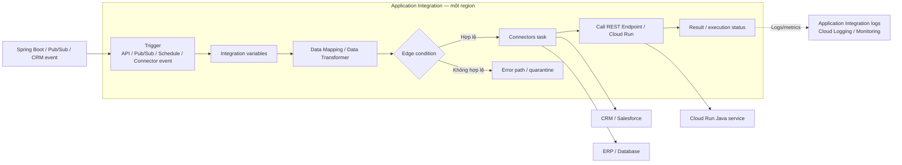
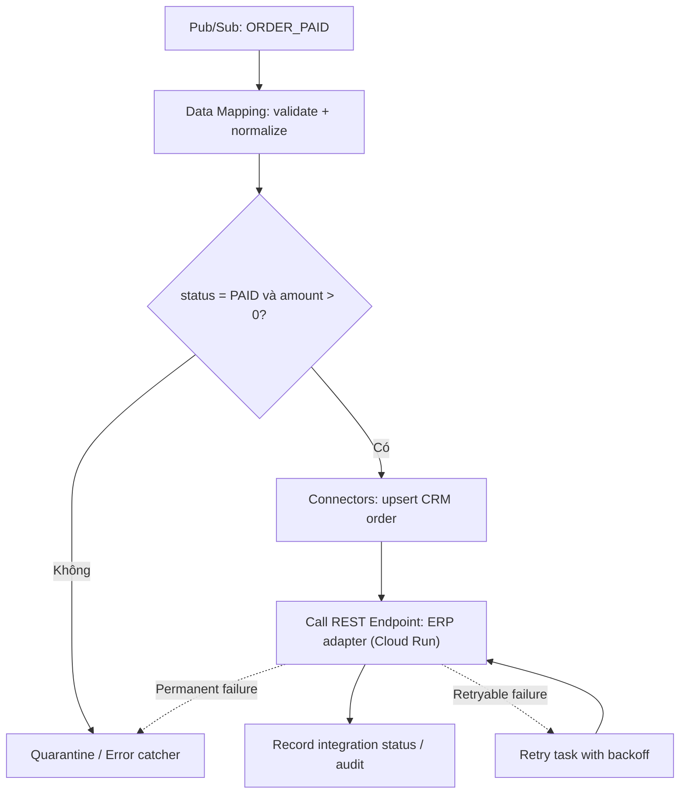
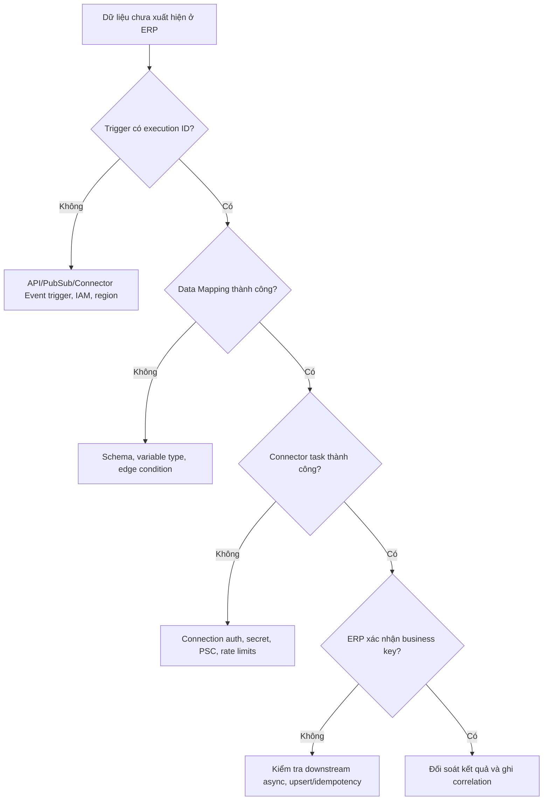

# Application Integration và kết nối hệ thống doanh nghiệp

## 1. Bài toán: kết nối Java API, CRM, ERP và hệ thống dữ liệu

Một doanh nghiệp có **Spring Boot** nhận đơn hàng qua **Cloud Run**, **Cloud SQL** lưu giao dịch, CRM quản lý khách hàng và ERP xử lý hóa đơn/kho. Mỗi nền tảng có định dạng, cách xác thực, tốc độ và quy tắc lỗi khác nhau. Nếu Java API trực tiếp gọi CRM rồi ERP trong mỗi HTTP request, sự cố hoặc giới hạn API của một hệ thống có thể làm cả luồng đặt hàng thất bại; khi hệ thống trả lỗi sau khi đã ghi dữ liệu, việc retry còn dễ tạo bản ghi trùng.

**Google Cloud Application Integration** là dịch vụ **Integration Platform as a Service (iPaaS)** serverless, được quản lý, giúp thiết kế **luồng tích hợp** nhiều ứng dụng qua giao diện trực quan: nhận trigger, chuyển đổi dữ liệu, gọi tác vụ/connector, rẽ nhánh, xử lý lỗi và quan sát từng lần thực thi. **Integration Connectors** bổ sung lớp kết nối có sẵn cho SaaS, database và hệ thống doanh nghiệp. Không phải viết một microservice Java riêng cho mỗi phép biến đổi hoặc kết nối đơn giản. Với logic nghiệp vụ phức tạp, Java vẫn có thể xử lý trong **Cloud Run** và được gọi từ integration.

Trong chương **Điều phối và tích hợp ứng dụng** của mô-đun **CLOUD_PROVIDERS_GCP**, bài học tập trung vào tích hợp ứng dụng doanh nghiệp một cách an toàn, kết nối IAM/VPC, sự kiện Pub/Sub, tự động hóa phát hành và theo dõi **độ tin cậy, chi phí**.

**Sau bài học, bạn có thể:**

1. Phân biệt **integration, trigger, task, edge/condition, variable, version** và **connector/connection**.
2. Chọn Application Integration thay vì **Workflows, Pub/Sub, Eventarc, Cloud Run** theo mục tiêu nghiệp vụ.
3. Thiết kế một flow **đơn hàng → chuẩn hóa dữ liệu → CRM/ERP** với lỗi, retry và chống xử lý trùng.
4. Tạo và kiểm thử **API trigger** không kết nối hệ thống thật; gọi API từ CLI/Java qua IAM.
5. Hiểu cách thiết lập **Integration Connectors**, credentials/Secret Manager và kết nối mạng.
6. Lập runbook publish, rollback, vận hành, observability và dự toán chi phí.

> **Giới hạn lab:** chỉ dùng project **thử nghiệm có quyền/Billing** và dữ liệu giả. Việc provision region, bật Application Integration/Connectors, tạo connection nodes hoặc chạy flow có thể **tính phí**, kể cả khi task không tạo đơn hàng thật. Không nhập mật khẩu CRM/ERP production vào lab và không publish flow có tác dụng ghi vào hệ thống thật.

## 2. Kiến trúc Application Integration



Một **integration** là định nghĩa một quy trình. **Trigger** là điểm khởi động; **tasks** thực hiện bước công việc; **edges** nối và điều khiển nhánh; **variables** truyền dữ liệu giữa các bước. Flow được chạy trong **region đã provision** của Application Integration; các đầu đích (CRM, ERP, Cloud Run) có thể ở region/hệ thống khác theo khả năng network, quy định lưu trú dữ liệu và connector.

| Thành phần | Ý nghĩa | Ví dụ |
| --- | --- | --- |
| **Trigger** | Khởi chạy một execution | API trigger, Cloud Pub/Sub, Schedule, Connector Event |
| **Task** | Một hành động có đầu vào/đầu ra | Data Mapping, Connectors, Call REST Endpoint |
| **Edge/condition** | Truyền điều khiển giữa tasks | Chỉ gửi ERP nếu `amount > 0` và `status=PAID` |
| **Integration variable** | Dữ liệu kiểu String, JSON, số, Boolean… trong flow | `orderId`, `correlationId`, `customer` |
| **Version** | Snapshot của flow để phát hành/rollback | `v1` thử nghiệm, `v2` thêm CRM mapping |
| **Execution** | Một lần chạy cụ thể | Execution ID, task statuses, thời gian, output |

Flow có thể chứa nhiều triggers, nhưng mỗi sự kiện chỉ kích hoạt **trigger tương ứng**, không phải tự chạy mọi trigger. Các task/đầu ra khác nhau có thể được nối bằng nhánh điều kiện, **fork/join**, vòng lặp hoặc gọi sub-integration. Không coi tất cả tasks là một transaction nguyên tử xuyên các hệ thống.

## 3. Phân biệt Application Integration với Workflows và messaging

| Dịch vụ | Chọn khi | Không nên kỳ vọng |
| --- | --- | --- |
| **Application Integration** | Business process, đồng bộ CRM/ERP/SaaS, mapping dữ liệu, connector dựng sẵn, low-code | Một message queue hoặc engine quản lý transaction nhiều SaaS |
| **Workflows** | Điều phối REST/Google APIs, hạ tầng hoặc pipeline, có logic code-like/YAML rõ ràng | Tự có mọi SaaS connector/schema discovery như iPaaS |
| **Pub/Sub** | Fan-out sự kiện bất đồng bộ, decouple producers/consumers, backlog/replay | Mapping nghiệp vụ hoặc workflow có trạng thái phức tạp |
| **Eventarc** | Định tuyến sự kiện từ nguồn được hỗ trợ tới Cloud Run/Workflows | Thay thế lớp CRM/ERP connector và data mapping |
| **Cloud Run Java** | Logic custom, Spring Boot APIs, validation hoặc xử lý hiệu năng đặc thù | Tự động có lifecycle/retry/monitor của integration |
| **API Gateway/Apigee** | Công bố, bảo vệ và quản lý API | Tự điều phối dữ liệu và state machine doanh nghiệp |

**Ví dụ kiến trúc kết hợp:** Spring Boot commit đơn hàng vào Cloud SQL rồi phát sự kiện **qua transactional outbox → Pub/Sub**. Application Integration nghe Pub/Sub để cập nhật CRM/ERP bằng connector. Một Cloud Run service thực hiện quy tắc giá phức tạp được gọi qua **Call REST Endpoint**. Workflows có thể bao ngoài một pipeline quản trị dài, nhưng không cần ép mọi việc vào một công cụ.

**Quy tắc chọn:** nếu trọng tâm là **kết nối/biến đổi dữ liệu giữa nhiều hệ thống doanh nghiệp**, ưu tiên Application Integration; nếu trọng tâm là **orchestrate dịch vụ và API do team kỹ thuật sở hữu**, đánh giá Workflows trước. Google Cloud có thể kết hợp hai dịch vụ trong cùng giải pháp.

## 4. Integration Connectors: connector, connection, entity và action

**Integration Connectors** biến giao thức và định dạng của ứng dụng đích thành giao diện thống nhất để sử dụng từ Application Integration (và Apigee Integrations). Nó cung cấp **authentication, endpoint configuration, protocol/data format mediation, schema discovery** và một số **event subscriptions**.

| Khái niệm | Diễn giải | Ví dụ |
| --- | --- | --- |
| **Connector type** | Adapter cho hệ thống/công nghệ | Salesforce, ServiceNow, MySQL, HTTP, SAP theo catalog |
| **Connection** | Một instance đã cấu hình đến tenant/host/database cụ thể | `crm-sandbox-us` nối CRM sandbox |
| **Authentication** | Phương thức/credentials của connection | OAuth 2.0, username + Secret Manager password |
| **Entity** | Đối tượng dữ liệu được connector khám phá | `Account`, `Contact`, `Orders`, `Customers` |
| **Operation** | Thao tác phổ biến trên entity | List, Get, Create, Update, Delete nếu connector hỗ trợ |
| **Action** | Tác vụ nghiệp vụ chuyên biệt do connector cung cấp | Gọi stored procedure hoặc một lệnh SaaS riêng |
| **Connector Event** | Sự kiện phát từ hệ thống đích | Thay đổi bản ghi/ticket, tùy connector/phiên bản |

**Không phải connector nào cũng có cùng entities, actions hoặc CRUD operations.** Những gì hiển thị phụ thuộc phiên bản connector, account privileges và schema thực của hệ thống. Trước khi thiết kế, dùng giao diện **Connectors → Connections → Entities/Actions** để khám phá, không tự đoán rằng tên entity `Invoice` tồn tại ở mọi ERP.

### 4.1. Vì sao nên tái sử dụng connection?

Một **connection** cấu hình host/tenant, service account, credentials, connection nodes và network. Nhiều integrations có thể dùng nó; nếu endpoint/cert thay đổi, việc quản lý kết nối tập trung giảm các cấu hình trùng. Nhưng connection dùng chung cũng tạo **failure domain**: rotate sai secret hoặc vượt rate limit SaaS sẽ làm nhiều flows lỗi cùng lúc. Phân biệt **sandbox/prod connections**, quản lý owner và quota riêng.

### 4.2. Network tới hệ thống riêng tư

SaaS public APIs thường cần HTTPS và OAuth; database hoặc ERP on-prem/private IP cần phương án kết nối **được Integration Connectors hỗ trợ**, chẳng hạn **Private Service Connect (PSC), endpoint attachment, proxy/host networking** tùy connector. **Không** giả định “cùng project/VPC” thì connector có đường tới Cloud SQL hoặc ERP; cũng không mở public IP vào Internet để né lỗi network.

Chọn location, VPC/Shared VPC, DNS, firewall, certificate/TLS và data residency theo chính sách tổ chức. Lưu ý có connector có **giới hạn TLS/mã hóa cụ thể** theo loại backend; luôn đọc trang cấu hình của **đúng connector** trước khi dùng dữ liệu thật.

## 5. Thiết kế hợp đồng dữ liệu giữa hệ thống

Một sự kiện đơn hàng từ Java nên mang **event ID ổn định**, **business key**, version schema và timestamp. Ví dụ:

```json
{
  "eventId": "evt-9001",
  "schemaVersion": 1,
  "type": "ORDER_PAID",
  "occurredAt": "2026-11-19T08:00:00Z",
  "order": {
    "id": "ord-1001",
    "customerId": "cust-20",
    "totalMinor": 259900,
    "currency": "VND",
    "status": "PAID"
  },
  "correlationId": "trace-order-1001"
}
```

**Dùng đơn vị tiền nhỏ nhất** (`totalMinor`) và mã tiền tệ, không dựa vào string `"259.900 đ"` hoặc float có lỗi làm tròn. Không đưa số thẻ, email hoặc payload nhạy cảm vào log/trace nếu không cần.

### 5.1. Ví dụ mapping từ Java sang CRM/ERP

| Nguồn | Integration variable | Đích minh họa | Phép chuyển |
| --- | --- | --- | --- |
| `eventId` | `eventId:String` | CRM external ID/ERP dedup key | Giữ nguyên, unique |
| `order.id` | `orderId:String` | `ExternalOrderId` | Giữ nguyên |
| `order.customerId` | `customerId:String` | `CustomerReference` | Lookup/mapping ID theo hệ thống đích |
| `order.totalMinor` | `amountMinor:Integer` | `Amount` | Chuyển đơn vị theo currency; kiểm soát precision |
| `order.status` | `status:String` | ERP status code | Bảng mapping `PAID → PAYMENT_CONFIRMED` |
| `occurredAt` | `eventTime:String` | Timestamp đích | ISO 8601/UTC, validate timezone |

**Data Mapping task** thực hiện gán biến, đọc/ghi JSON properties và kết hợp mapping functions trong canvas. **Data Transformer task** sử dụng **Jsonnet** để chuyển đổi phức tạp. Khi mapping có vòng lặp/phụ thuộc nghiệp vụ nặng hoặc cần test bằng code, có thể gọi **Cloud Run Java** thay vì biến một expression khó bảo trì thành “business rule không ai sở hữu”.

Ví dụ đích ERP giả định:

```json
{
  "externalOrderId": "ord-1001",
  "customerReference": "cust-20",
  "amountMinor": 259900,
  "currencyCode": "VND",
  "erpStatus": "PAYMENT_CONFIRMED",
  "sourceEventId": "evt-9001"
}
```

Đây là **schema minh họa**, không phải field names được tất cả Salesforce/SAP/MySQL connectors hỗ trợ. Trước khi triển khai, khám phá schema của **tenant sandbox thực**, xác định null/default values, required fields và mapping khi thiếu khách hàng.

## 6. Triggers: đồng bộ và bất đồng bộ

| Trigger | Điều kiện khởi chạy | Cách dùng |
| --- | --- | --- |
| **API trigger** | Caller gọi Integration API đã xác thực | Java API/Workflows chủ động yêu cầu xử lý |
| **Cloud Pub/Sub trigger** | Message được publish vào topic | Đồng bộ CRM/ERP bất đồng bộ, tách khỏi latency HTTP |
| **Schedule trigger** | Đến lịch cấu hình (cron/thời gian) | Đồng bộ danh mục, đối soát mỗi đêm |
| **Connector Event trigger** | Connector nhận sự kiện từ SaaS | Ticket/khách hàng thay đổi ở CRM |

**API trigger** có thể khai báo input/output variables và được gọi **đồng bộ** qua `projects.locations.integrations.execute`; API schedule cung cấp đường chạy bất đồng bộ trong điều kiện phù hợp. **Pub/Sub/Schedule/Connector Event** thường thuộc mô hình asynchronous. Vì vậy không trói Spring Boot HTTP request vào một quy trình SaaS kéo dài nhiều phút nếu không có yêu cầu bắt buộc; hãy **chấp nhận sự kiện rồi theo dõi trạng thái** theo correlation ID.

**Lưu ý delivery:** trigger Pub/Sub không bảo đảm mỗi business event chỉ chạy đúng một lần. Quy trình chạy lại, retry, source phát lại và replay có thể tạo duplicate. **Data consistency phải dựa vào business event ID và idempotent operations**; chỉ bật tính năng retry không giải quyết vấn đề.

## 7. Tasks, branches và failure policy

Một flow cập nhật hệ thống doanh nghiệp có thể hình dung:



Application Integration hỗ trợ **task-level error handling** và **Error catcher** để xử lý cuối cùng sau lỗi. Một số chiến lược:

| Chiến lược | Hành vi | Rủi ro cần nhớ |
| --- | --- | --- |
| **Retry task with exponential backoff** | Chạy lại task lỗi, khoảng đợi tăng | Side effect đã thành công nhưng response mất có thể bị làm lại |
| **Retry task fixed/linear interval** | Chạy lại task theo thời gian cấu hình | Nhiều executions có thể làm nghẽn SaaS |
| **Restart integration with backoff** | Chạy lại **cả flow từ đầu** | Các task trước đó có thể tạo đơn trùng nếu không idempotent |
| **Fatal** | Kết thúc execution ở Failed | Cần cảnh báo/quy trình bù |
| **Ignore** | Tiếp tục như task thành công | Có thể che giấu mất dữ liệu; không dùng cho tác vụ bắt buộc |
| **Error catcher** | Nhánh riêng thu thập lỗi và xử lý | Phải tránh lặp vô tận và che giấu lỗi gốc |

Phân loại **lỗi tạm thời** (`429`, `503`, network timeout), **lỗi vĩnh viễn** (schema sai, unauthorized, business conflict) bằng **mã lỗi và nội dung cụ thể**, không retry mù quáng mọi `4xx`. Theo tài liệu, Application Integration có quy tắc phân loại mặc định riêng, nên **cấu hình retry conditions theo từng task/connector** và kiểm tra hành vi thực tế.

### 7.1. Không có distributed transaction tự động

Giả sử CRM đã tạo bản ghi nhưng ERP timeout: nếu restart cả integration, CRM có thể nhận lệnh tạo lần hai. Một giải pháp an toàn là:

1. Ghi **external business key** `evt-9001` và trạng thái `CRM_DONE` bền vững.
2. Dùng **upsert/unique external ID** nếu SaaS hỗ trợ; nếu không thì tra cứu trước theo key và kiểm soát race condition.
3. Khi ERP lỗi, retry **task tương ứng**, hoặc chạy **compensation/saga** theo nghiệp vụ.
4. Chỉ báo hoàn thành khi các hệ thống bắt buộc đã đồng bộ; có dashboard **partial failure** và reconciliation job.

Idempotency key API trigger (`requestId`) hỗ trợ chống gửi trùng ở **đầu vào API** trong phạm vi tính năng, **không thay thế unique constraint của CRM/ERP** hay bảo đảm chính xác một side effect qua nhiều API.

## 8. Lab an toàn: API trigger + Data Mapping, không cần CRM thật

Lab đầu tiên chỉ mapping và trả kết quả, **không kết nối SaaS, không sửa database**. Cần project lab có Billing/quyền Application Integration và region được hỗ trợ (ví dụ `us-central1`).

### Bước 1 — Provision region

Trong **Google Cloud Console → Application Integration**, chọn project test và **Quick setup** cho `us-central1`; hoặc **Advanced setup** nếu tổ chức cần chọn cơ chế mã hóa. Quick setup có thể bật `integrations.googleapis.com`, `connectors.googleapis.com` và `secretmanager.googleapis.com`, tạo service agent và cấu hình region.

**Không thử bật CMEK trong project sản xuất:** lựa chọn mã hóa bằng **CMEK cho region có ràng buộc không thể đảo ngược** theo tài liệu. Provision region có thể làm xuất hiện tài nguyên và phí theo usage. Nếu region chưa được provision, menu tạo integration sẽ không hiển thị nó.

### Bước 2 — Tạo integration chưa publish

Chọn **Integrations → Create integration**, đặt tên `order-sync-lab` và region `us-central1`. Trong integration editor:

1. Thêm **API trigger**, đổi label thành `order_ingress`; ghi lại **Trigger ID** hiển thị, thường dạng `api_trigger/order_ingress`.
2. Khai báo các **integration variables** (String) `orderId`, `status`, `responseOrderId` và `responseStatus`.
3. Trong API trigger, thêm `orderId` và `status` vào **Input variables**; thêm `responseOrderId`, `responseStatus` vào **Output variables**.
4. Thêm **Data Mapping task**, nối từ API trigger. Map `orderId → responseOrderId` và `status → responseStatus`. Không gọi REST/Connectors task trong bài lab cơ bản.
5. Kiểm tra task/edge configuration và lưu draft. Nếu muốn validate status chỉ chấp nhận `PAID`, thêm edge condition/nhánh lỗi nhưng **phải xác nhận công thức với kiểu biến thực tế**.

**Điều kiện hoàn thành:** canvas có trigger, mapping task, edges hợp lệ; output được khai báo rõ. Không giả định một variable tự trở thành response nếu chưa đánh dấu output.

### Bước 3 — Test trước khi Publish

Trong editor chọn **Test**, nhập `orderId="ord-lab-001"` và `status="PAID"` cho API trigger, chạy test. Xem kết quả và **Execution Logs**; hai output phải giữ đúng giá trị input. Khi còn lỗi mapping, sửa draft và test lại.

Test từ Console thực thi theo **synchronous mode**. Những flows chứa **Approval/Suspend/Timer tasks** không được test theo cơ chế này trước publish; lab hiện tại không có các tasks đó.

### Bước 4 — Publish version

Khi test PASS, chọn **Publish** để kích hoạt phiên bản. Cần quyền như **`roles/integrations.integrationDeployer`**; người test thường cần **`roles/integrations.integrationInvoker`**. Nếu integration có **run-as service account**, người test/publish còn phải có **`roles/iam.serviceAccountUser`** trên account đó.

**Versioning:** khi publish phiên bản mới, phiên bản trước được **unpublish tự động**; một integration không có nhiều bản published song song theo cơ chế thông thường. Giữ version đã kiểm thử và change record để có thể **publish lại** khi cần rollback. Bỏ publish phiên bản đang chạy sẽ khiến caller phụ thuộc nó ngừng hoạt động.

### Bước 5 — Gọi API trigger đã publish

Từ Cloud Shell với danh tính có `integrations.integrations.invoke`, dùng lệnh Bash dưới đây. Sử dụng **tên integration cụ thể** thay vì `-` để tránh chạy nhiều integrations vô tình có cùng trigger ID:

```bash
gcloud config set project PROJECT_ID

curl --fail-with-body -X POST \
  -H "Authorization: Bearer $(gcloud auth print-access-token)" \
  -H "Content-Type: application/json" \
  -H "X-Server-Timeout: 120" \
  --data '{
    "triggerId": "api_trigger/order_ingress",
    "requestId": "lab-event-001",
    "inputParameters": {
      "orderId": {"stringValue": "ord-lab-001"},
      "status": {"stringValue": "PAID"}
    }
  }' \
  "https://us-central1-integrations.googleapis.com/v1/projects/PROJECT_ID/locations/us-central1/integrations/order-sync-lab:execute"
```

**Trước khi chạy:** xác nhận API trigger ID thực tế (nếu editor tự sinh tên khác, thay trong JSON), integration đã publish, đúng region và các input variable names/types. Response sẽ chứa thông tin execution/output hoặc lỗi tương ứng, **không phải REST endpoint trả nguyên document JSON do bạn tùy ý đặt**. Theo API v1, `inputParameters` dùng kiểu `ValueType`: String là `{"stringValue":"..."}`, Integer là `{"intValue":"123"}`, JSON là `{"jsonValue":"{...}"}` (chuỗi JSON). `requestId` là khóa chống request trùng ở mức API, nên **giữ cùng ID khi retry cùng business event**.

**Không nhầm `gcloud auth print-access-token` với ID token:** Application Integration API là Google API sử dụng OAuth access token và IAM `integrations.integrations.invoke`; nó **khác** cách gọi Cloud Run private bằng OIDC ID token.

### Bước 6 — Quan sát và dọn lab

Trong Console → Application Integration → **Logs/Execution Logs**, lọc integration và execution ID, kiểm tra trạng thái từng task. Để dọn, **unpublish integration lab**, xác minh không có API caller/trigger thật, rồi xóa integration nếu thật sự không dùng. **Xóa integration không có tính năng khôi phục tự động**; chỉ thao tác trên object lab đã đối chiếu name/project/region. Không xóa region, default service agent, connection dùng chung hoặc Cloud SQL/SaaS credentials của tổ chức.

## 9. Từ lab sang kết nối CRM/ERP bằng Connectors task

Phần mở rộng này **chỉ là thiết kế lab sandbox**, không phải hướng dẫn chạy trên tenant production. Giả sử doanh nghiệp đã có CRM sandbox và database MySQL test được truy cập bằng kết nối được hỗ trợ.

### Thiết lập connection

1. Vào **Integration Connectors → Connections → Create connection**, chọn **connector type** và **region** tương thích.
2. Đặt tên `crm-sandbox-conn` hoặc `erp-test-conn`; chọn service account của connection nếu được yêu cầu, cấu hình endpoint/tenant/database.
3. Chọn kiểu auth **đúng connector**. Với username/password, lưu password trong **Secret Manager**, cấp `secretmanager.versions.access` theo nguyên tắc tối thiểu; với SaaS OAuth, dùng client/app credentials thuộc **sandbox tenant**.
4. Chọn **connection node settings** và private connectivity khi cần; kiểm tra DNS, route, PSC endpoint attachment và khả năng truy cập thật.
5. Sau khi connection **ACTIVE**, khám phá entities/actions và thử **read-only List/Get** trước khi bật Create/Update.
6. Trên integration editor, thêm **Connectors task**, chọn connection, entity/operation phù hợp, map input/output qua Data Mapping.

**Lưu ý chi phí:** ngay cả khi chỉ dùng vài requests, **connection nodes có thể tính phí theo phút**. Dùng Cloud Pub/Sub trigger trực tiếp không yêu cầu một connector cho Pub/Sub; chỉ thêm Connectors task khi thực sự cần khả năng đó.

### Ví dụ mapping trong Connectors task

```text
Input từ Java order event:
  orderId="ord-lab-001", customerId="cust-20",
  amountMinor=259900, currency="VND"

Data Mapping:
  orderId -> CRM external order ID
  customerId -> CRM/ERP reference (qua lookup nếu cần)
  amountMinor + currency -> amount theo schema đích

Connectors task:
  Connection: crm-sandbox-conn
  Entity: "Order" (chỉ nếu connector thực tế hiển thị)
  Operation: Create/Update/Upsert (chỉ nếu hỗ trợ)

Output:
  remoteRecordId, status, errorCode, correlationId
```

Nếu connector không hỗ trợ upsert theo external ID, cần **tra cứu và thiết kế dedup/transaction** riêng. Không cho rằng thực hiện `Get` trước `Create` luôn đủ chống race condition khi có nhiều executions đồng thời.

## 10. Tích hợp code Java với Application Integration API

Cloud Run Java/Spring Boot có thể gọi API trigger **đồng bộ** bằng Google Cloud OAuth access token. Trong production, chạy bằng **runtime service account** được cấp `roles/integrations.integrationInvoker` (theo phạm vi phù hợp), sử dụng **Application Default Credentials (ADC)**; không đưa service account JSON key hoặc token vào Git.

Đoạn code Java 21 minh họa một **client/service class** có thể được gọi từ Spring Boot. Cần thêm dependencies **`com.google.auth:google-auth-library-oauth2-http`** và **`com.fasterxml.jackson.core:jackson-databind`** (thường có qua `spring-boot-starter-web`) với **phiên bản đã được quản lý/kiểm tra tương thích**:

```java
package dev.example.integration;

import com.fasterxml.jackson.databind.ObjectMapper;
import com.google.auth.oauth2.GoogleCredentials;
import java.net.URI;
import java.net.http.HttpClient;
import java.net.http.HttpRequest;
import java.net.http.HttpResponse;
import java.nio.charset.StandardCharsets;
import java.time.Duration;
import java.util.List;
import java.util.Map;

public final class OrderIntegrationClient {
    private static final ObjectMapper JSON = new ObjectMapper();
    private final HttpClient http = HttpClient.newHttpClient();
    private final String projectId;
    private final String location;

    public OrderIntegrationClient(String projectId, String location) {
        this.projectId = projectId;
        this.location = location;
    }

    public String execute(String eventId, String orderId, String status)
            throws Exception {
        // eventId ổn định qua các lần retry của CÙNG business event.
        var body = Map.of(
            "triggerId", "api_trigger/order_ingress",
            "requestId", eventId,
            "inputParameters", Map.of(
                "orderId", Map.of("stringValue", orderId),
                "status", Map.of("stringValue", status)));

        GoogleCredentials credentials = GoogleCredentials
            .getApplicationDefault()
            .createScoped(List.of(
                "https://www.googleapis.com/auth/cloud-platform"));
        credentials.refreshIfExpired();

        String endpoint = String.format(
            "https://%s-integrations.googleapis.com/v1/" +
            "projects/%s/locations/%s/integrations/order-sync-lab:execute",
            location, projectId, location);

        var request = HttpRequest.newBuilder(URI.create(endpoint))
            .timeout(Duration.ofSeconds(100))
            .header("Authorization",
                "Bearer " + credentials.getAccessToken().getTokenValue())
            .header("Content-Type", "application/json")
            .POST(HttpRequest.BodyPublishers.ofString(
                JSON.writeValueAsString(body), StandardCharsets.UTF_8))
            .build();

        var response = http.send(
            request, HttpResponse.BodyHandlers.ofString());
        if (response.statusCode() / 100 != 2) {
            throw new IllegalStateException(
                "Integration API returned HTTP " + response.statusCode());
        }
        return response.body();
    }
}
```

**Đây là client demo**, không phải full Spring Boot application: hãy thêm timeout/exception mapping, OpenTelemetry correlation, retry có backoff cho lỗi phù hợp và bảo vệ khỏi log payload nhạy cảm. **Không log access token**. Nếu dùng synchronous call, timeout Java phải nhất quán với `X-Server-Timeout`/API task duration; yêu cầu dài nên chuyển sang async trigger.

**Tách hai lớp idempotency:** `requestId=eventId` giúp giảm số API executions trùng theo hỗ trợ dịch vụ; CRM/ERP/Cloud SQL vẫn phải có **unique business key** để an toàn khi Java retry hoặc flow chạy lại. Không gửi một `UUID` mới trong mỗi lần retry nếu mục tiêu là dedup.

## 11. IAM, danh tính thực thi, secret và ranh giới bảo mật

Application Integration có **nhiều danh tính độc lập**; nhầm quyền giữa các lớp là nguyên nhân phổ biến của `PERMISSION_DENIED`.

| Vai trò/Identity | Quyền tiêu biểu | Phạm vi khuyến nghị |
| --- | --- | --- |
| **Integration designer/editor** | `roles/integrations.integrationEditor` hoặc custom role | Chỉnh draft; không cấp Admin toàn project khi không cần |
| **Publisher/deployer** | `roles/integrations.integrationDeployer` | Publish version trong project môi trường tương ứng |
| **Invoker (Cloud Run Java caller)** | `roles/integrations.integrationInvoker` | Chỉ gọi integration được phép |
| **Run-as service account** | Quyền đọc/gọi đích mà task thực sự cần | Cloud Run Invoker, Pub/Sub, Secret Manager theo tài nguyên |
| **Operator connections** | `roles/connectors.admin` hoặc vai trò hẹp phù hợp | Tạo connection và quản trị credentials theo nhiệm vụ |
| **Integration service agent** | Service-agent roles do Google Cloud cung cấp | Không dùng làm identity ứng dụng nghiệp vụ |

**Lưu ý thay đổi tháng 10/2026:** Google Cloud yêu cầu **run-as service account** cho integrations mới tạo từ **15/10/2026 (UTC)** và một số chế độ execution; khi region bật **integration governance**, việc publish/test cũng yêu cầu run-as identity. Người test/publish cần quyền **`iam.serviceAccounts.actAs`** (thường qua `roles/iam.serviceAccountUser`) trên account được chọn. Từ những thay đổi ủy quyền trong năm 2026, các task có thể chạy dưới principal gọi API nếu không có run-as identity thích hợp. **Nên cấu hình run-as SA tường minh** để hành vi ổn định, nhất là asynchronous flows và connector tasks.

**Secrets:** với OAuth client secret, password MySQL, token CRM hoặc certificates, dùng **Secret Manager** hoặc auth profile được sản phẩm hỗ trợ; không ghi credential trong Data Mapping, integration variables, HTTP URL, source repo hay log. Rotate secret trong **sandbox trước**, kiểm tra connection health, rồi mới thay production.

**Quyền dữ liệu:** SaaS/ERP cần role ở **phía hệ thống đích** ngoài Google Cloud IAM. Được quyền execute integration không có nghĩa caller được đọc mọi hồ sơ khách hàng. Rà soát row-level permission, scopes, audit trail, retention và residency; tránh chuyển PII qua region hoặc SaaS ngoài chính sách.

**CMEK:** nếu chọn encryption bằng **Cloud KMS customer-managed key** cho Application Integration region, có các ràng buộc **không thể đảo ngược** đối với lựa chọn này. Không bật trong môi trường thật nếu chưa duyệt thiết kế KMS, key rotation, quyền service agent và disaster recovery.

## 12. Phát hành version, rollback và quản trị thay đổi

Vòng đời bình thường là **Draft → Test → Publish → Execute**. Bản được publish trở thành active; khi publish version mới, version đang publish trước đó thường **tự unpublish**. Chỉnh một version đã publish sẽ tạo version mới để chỉnh sửa theo mô hình editor.

Một quy trình release đáng tin cậy:

1. Lưu **đặc tả mapping, trigger IDs, connection/schema versions và test fixtures** trong hệ thống quản lý nguồn.
2. Kiểm thử trong **sandbox**, dùng mock endpoint hoặc CRM/ERP test tenant; xác minh happy path, missing fields, 429/503, duplicate và out-of-order events.
3. Review **IAM delta**, destination URLs, secret references, connection nodes/network, data residency và dự toán trước publish.
4. Publish version; chạy smoke test có **eventId/correlationId** giả, kiểm tra execution và task outputs.
5. Giám sát lỗi và chi phí trong change window. Nếu mapping lỗi, **publish lại version đã biết hoạt động**, sau khi kiểm tra schema/backend vẫn tương thích.
6. Nếu đã gửi đơn hàng trùng tới CRM/ERP, rollback version **không tự hoàn tác side effects**; phải dùng reconciliation hoặc compensation.

Không thay đổi cùng lúc **connector credentials, ERP schema và integration version** nếu có thể chia deployment thành từng bước; nếu tất cả thay đổi cùng lúc, rất khó xác định nơi gây lỗi.

**Phân tách môi trường:** nên có connections/tenants riêng cho dev/staging/prod. Với IaC hoặc API tự động, cần đối chiếu cấu trúc/versioning trên môi trường đích; đừng copy IDs của connection hoặc Secret Manager giữa projects rồi giả định tồn tại và có cùng quyền.

## 13. Observability, logs và xử lý sự cố

### 13.1. Những gì cần theo dõi

| Nguồn | Quan sát | Tại sao |
| --- | --- | --- |
| **Application Integration Execution Logs** | Execution ID, version, trigger, task state, duration, error code | Tìm chính xác task thất bại |
| **Integration Connectors** | Connection state, auth errors, action/entity errors, rate limits | Phân biệt connector với Java/ERP issue |
| **Cloud Logging** (khi bật) | Task errors, correlation, audit logs, alerts | Tích hợp monitoring tập trung |
| **Cloud Run/Java** | HTTP 4xx/5xx, p95 latency, GC, timeout, Cloud SQL pool | Chẩn đoán downstream ứng dụng |
| **Pub/Sub** | Backlog, oldest unacked age, redelivery, dead-letter | Detect message bị kẹt hoặc tăng tải |
| **Cloud Monitoring / Billing** | Execution rate, failed executions, connection-node minutes, data processed | SLO và chi phí |

Application Integration **Execution Logs** được lưu trong dịch vụ tối đa khoảng **32 ngày** theo tài liệu hiện hành; có thể bật **Cloud Logging** để quản trị lưu trữ/alerts theo chính sách. Cloud Logging cho integration **không bật mặc định**, cần cấu hình trên version chưa publish. Chọn **local logging** phù hợp: asynchronous logging ít ảnh hưởng latency nhưng có khả năng thiếu vài execution logs trong các sự cố hiếm; synchronous logging đáng tin cậy hơn nhưng tăng độ trễ.

**Dữ liệu nhạy cảm:** execution logs có thể chứa **integration variables/input/output**. Bật **variable masking** ở mức region/integration/variable theo cơ chế hỗ trợ; chỉ để log `eventId`, `correlationId`, status và mã lỗi khi đủ điều kiện. Cloud Logging có chi phí lưu trữ sau free allotment và giới hạn kích thước log entry; không đẩy nguyên JSON khách hàng hoặc tokens vào log.

### 13.2. Bảng lỗi theo tầng

| Triệu chứng | Nguyên nhân thường gặp | Kiểm tra |
| --- | --- | --- |
| Không tạo được integration | Region chưa provision hoặc thiếu quyền/API | Console Regions, `integrations.googleapis.com`, IAM |
| Test/Publish báo không có run-as identity | Governance hoặc quy định mới | Run-as SA và `iam.serviceAccounts.actAs` |
| API trigger trả 403 | Caller thiếu Invoke permission hoặc token sai | `roles/integrations.integrationInvoker`, OAuth token, project/region |
| API trigger trả lỗi input | Sai Trigger ID, biến/kiểu hoặc flow chưa Publish | `api_trigger/NAME`, `ValueType`, input variables |
| Connector `UNAUTHENTICATED` | Credential hết hạn, OAuth scope sai | Secret Manager version, connection auth, SaaS role |
| Connector timeout | PSC/VPC/network, CRM rate limit hoặc DNS | Connection endpoint, logs, firewall, target health |
| Mapping output null | Input schema thay, thiếu field hoặc JSON path sai | Variable type, raw sample (đã che PII), Data Mapping |
| CRM tạo hai bản ghi | Retry/replay hoặc race condition; thiếu external ID | Event ID, Upsert/unique key và task retry policy |
| Task xử lý chậm | SaaS throttling, sequential loop, low quota | Task duration, concurrency, rate limit, connection nodes |
| Execution hoàn thành nhưng ERP không nhận | `Ignore` lỗi, branch condition sai, async downstream | Execution/task results, ERP acknowledgement, reconciliation |
| Publish version mới làm toàn bộ flow khác kết quả | Schema/connection mapping thay; version cũ bị unpublish | Version history, downstream schema, rollback procedure |

### 13.3. Runbook theo thứ tự



**Không xóa integration, tắt tất cả retries hoặc chuyển connector sang public Internet** để che lỗi. Nếu đã có side effects ở SaaS, việc replay/retry phải qua **dedup và business owner**; những execution đã chạy một phần không nhất thiết được hoàn tác khi đánh dấu Failed.

## 14. Chi phí, quota và trade-off

Chi phí Application Integration thường có các thành phần:

- **Integration executions**: tính theo số lượt chạy, kể cả lượt có lỗi theo chính sách giá.
- **Data processed**: lượng dữ liệu đi qua integration/connection.
- **Connection nodes**: năng lực/connection infrastructure theo thời gian, có thể phát sinh phí khi ít hoặc không có request, tùy loại connector và gói giá.
- **Dịch vụ liên quan**: Pub/Sub, Cloud Run, Cloud SQL, Secret Manager, Cloud Logging, network egress và SaaS API plan.

**Ví dụ ước tính tải, không phải giá Google Cloud:**

```text
20.000 đơn/ngày × 30 ngày = 600.000 business events/tháng.
Mỗi event kích hoạt 1 integration execution: ~600.000 executions.
Nếu mỗi event lỗi một lần và phải chạy lại toàn flow:
  có thể lên tới ~1.200.000 executions (giả định).

Nếu connection nodes chạy liên tục:
  24 giờ/ngày × 30 ngày = 720 node-hours cho MỖI node
  (chưa tính loại node, pricing tier và scale).
```

Đây chỉ là mô hình công suất: số lượt thực tế phụ thuộc **retry strategy, sub-integrations, số task, connector nodes, data volume**, cấu hình tính giá và free tier. Không nhân số executions với một đơn giá cố định mà bỏ qua connection-node time và data egress.

**Quotas/limits** thay đổi theo region/gói: số integration versions, concurrent executions, task count, trigger/input payload size, connector connections và throughput. Ví dụ API trigger v1 có giới hạn **tổng input variables khoảng 8 MB**; dữ liệu tệp lớn nên dùng **Cloud Storage URI** thay vì nhúng toàn bộ object vào integration variables.

**Tối ưu:** tránh polling SaaS quá thường, giảm payload/PII không cần thiết, dùng Pub/Sub fan-out khi nhiều consumer độc lập, giữ connection nodes chỉ nơi có nhu cầu, đặt retry budget và theo dõi **chi phí cho mỗi đơn hàng đồng bộ thành công**. **Cloud Billing budget alerts không tự chặn executions**.

## 15. Bài tập và checklist

### Bài A — Chọn dịch vụ

Doanh nghiệp cần (1) đồng bộ khách hàng Salesforce ↔ ERP, (2) fan-out đơn hàng tới ba consumers, (3) gọi tuần tự ba Google Cloud APIs để deploy hạ tầng, (4) API Java có 30 endpoints. Chọn giữa **Application Integration, Pub/Sub, Workflows, Cloud Run**, giải thích vì sao không dùng một dịch vụ cho toàn bộ bài toán.

### Bài B — API trigger không ghi dữ liệu

Trong project test đã provision region, tạo `order-sync-lab` với API trigger, `orderId` và `status` input, Data Mapping task tạo output. **Test → Publish → curl `:execute`** dùng `requestId` ổn định. Ghi lại execution ID và task states. Mô tả phản hồi khi **Trigger ID sai**, thiếu Invoke IAM hoặc status null.

### Bài C — Mapping và schema evolution

CRM có field `ExternalOrderId` và ERP dùng `OrderReference`, trong khi Java event có `order.id`. Vẽ mapping, chọn canonical schema, xử lý currency/minor units, missing customer reference và version v2 thêm `taxMinor` mà không phá v1.

### Bài D — Thiết kế connector bảo mật

Một MySQL ERP chỉ có private IP và dùng password. Nêu các bước kết nối: connector type, region, network/PSC/proxy được hỗ trợ, Secret Manager, service account, **read-only test**, cuối cùng mới dùng Create/Update. Giải thích tại sao bật public IP cho DB không phải cách sửa tối ưu.

### Bài E — Retry và idempotency

CRM trả success nhưng integration timeout trước khi nhận response. Task được retry, ERP chưa ghi. Thiết kế **external business key**, transaction/unique constraint, error catcher, compensation và runbook replay. Phân biệt `requestId` ở API trigger với idempotency trong CRM.

### Bài F — FinOps và SLO

Với 20.000 events/ngày trong 30 ngày, mỗi event trung bình một execution và một node connector luôn hoạt động, tính **600.000 executions** và **720 node-hours**. Sau đó giải thích vì sao chi phí còn phụ thuộc dữ liệu xử lý, retry, loại node, region, egress, Logging và SaaS quotas. Đặt SLO **99,9% đồng bộ trong 5 phút** và đề xuất metrics/cảnh báo.

### Checklist trước production

- [ ] Tôi đã xác định khi nào dùng Application Integration và khi nào dùng Workflows/Pub/Sub.
- [ ] Tôi hiểu trigger, task, edge, variable, version và execution.
- [ ] Tôi đã chọn region, residency và trust boundary của các hệ thống doanh nghiệp.
- [ ] Tôi có canonical event schema, correlation ID và mapping rõ ràng, không đưa PII dư thừa vào logs.
- [ ] Tôi kiểm thử API trigger/outputs và publish từng version có change record.
- [ ] Tôi tách IAM Invoker/Deployer, **run-as service account** và connector credentials.
- [ ] Tôi dùng Secret Manager, quyền SaaS tối thiểu và private networking được hỗ trợ.
- [ ] Tôi đã kiểm thử timeout, rate limit, retries, duplicate/replay và failure compensation.
- [ ] Tôi theo dõi execution/task logs, connector health, backlog và SLO end-to-end.
- [ ] Tôi đã dự toán executions, connection-node time, data processed và chi phí SaaS/network.
- [ ] Tôi có runbook rollback integration **và** đối soát side effects đã ghi ra ngoài.

**Kết luận:** **Application Integration** giúp kết nối các ứng dụng doanh nghiệp và chuẩn hóa dữ liệu mà không phải tự viết mọi adapter; **Integration Connectors** đơn giản hóa giao tiếp với SaaS và database. Nhưng thành công production phụ thuộc vào **hợp đồng dữ liệu, danh tính chạy, network, idempotency, retry có kiểm soát, khả năng quan sát và ngân sách**. Dùng Java/Cloud Run cho logic nghiệp vụ cần code, Pub/Sub cho fan-out bất đồng bộ và Workflows cho orchestration kỹ thuật nơi thích hợp, thay vì ép một công cụ giải quyết tất cả.

## 16. Tài liệu Google Cloud tham khảo

- [Application Integration overview](https://cloud.google.com/application-integration/docs/overview)
- [Application Integration concepts: triggers, tasks, variables, versions](https://cloud.google.com/application-integration/docs/concepts)
- [Choose Application Integration or Workflows](https://cloud.google.com/application-integration/docs/choose-application-integration-or-workflows)
- [Set up Application Integration / provision regions](https://cloud.google.com/application-integration/docs/setup-application-integration)
- [API trigger và cách gọi execute](https://cloud.google.com/application-integration/docs/configure-api-trigger)
- [Application Integration REST execute v1](https://cloud.google.com/application-integration/docs/reference/rest/v1/projects.locations.integrations/execute)
- [InputParameters / ValueType REST schema](https://cloud.google.com/application-integration/docs/reference/rest/v1/ValueType)
- [Triggers and tasks](https://cloud.google.com/application-integration/docs/triggers)
- [Data mapping overview](https://cloud.google.com/application-integration/docs/data-mapping-overview)
- [Integration Connectors overview](https://cloud.google.com/integration-connectors/docs/overview)
- [Configure a Connectors task](https://cloud.google.com/application-integration/docs/configure-connectors-task)
- [Test and publish integration versions](https://cloud.google.com/application-integration/docs/test-publish-integrations)
- [Error handling and retry strategies](https://cloud.google.com/application-integration/docs/error-handling-strategy)
- [Authorization changes and run-as service accounts](https://cloud.google.com/application-integration/docs/authorization-changes-troubleshoot)
- [Execution logs and retention](https://cloud.google.com/application-integration/docs/integration-execution-logs)
- [Cloud Logging for integrations](https://cloud.google.com/application-integration/docs/introduction-logs)
- [Application Integration pricing](https://cloud.google.com/application-integration/pricing)
- [Application Integration quotas and limits](https://cloud.google.com/application-integration/docs/quotas-limits)
